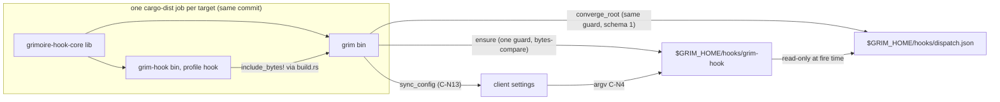

# ADR: A native `grim-hook` dispatcher, embedded in grim and written under `$GRIM_HOME/hooks/`

## Metadata

**Status:** Accepted (owner, 2026-10-25, at the `/hex-plan` gate; D1–D3 resolved as recommended; amended 2026-10-25: hooks are experimental, no backwards compat, O6 withdrawn)
**Date:** 2026-10-25 (round-1 review fixes applied the same day)
**Classification:** one-way door (**high**) · **external contract** (registered argv lives in third-party
settings files across many repositories; `dispatch.json` is read by a launcher shared by every workspace on
the machine) · tier **xhigh**
**Irreversible once shipped:** the argv grammar (C-N4); the launcher path, file name and the reserved names
`grim-hook`/`grim-hook.exe` (C-N5); the exit-code table (C-N7); the semantics of the table's `schema` field
(C-N10); and the registration shape, exec form versus shell form (C-N13).
**Deciders:** Michael Herwig (maintainer; owner decisions 2026-10-25 are inputs), Architect (`/hex-architect`)
**Beads Issue:** N/A — latency: [#87](https://github.com/grimoire-rs/grimoire/issues/87); related
[#97](https://github.com/grimoire-rs/grimoire/issues/97), [#168](https://github.com/grimoire-rs/grimoire/issues/168),
[#171](https://github.com/grimoire-rs/grimoire/issues/171)
**Related PRD:** N/A
**Tech Strategy Alignment:**
- [x] Golden Path: Rust 2024, stable 1.95.0, no new third-party dependency (the launcher uses a strict subset of
      grim's existing `serde` / `serde_json`).
- [x] Deviation justified: the launcher is **not on Tokio** (owner decision 7; the runtime is sequential, see
      [C-N8](#c-n8)). The repo becomes a Cargo **workspace** (owner decision 2), which AGENTS.md and
      `product-context.md` currently describe as absent. Both get recorded in `product-tech-strategy.md` in WP-5.
**Domain Tags:** security | packaging | integration | api
**Supersedes (on acceptance, in part):** [`adr_hooks_support.md`](./adr_hooks_support.md):
- Decisions **D** and **G**, amendment **A5**, and research decision **D9**.
- Contracts **C-007** (its runtime home only) and **C-008**.
- The **Availability** NFR row and Open Question 2 (Windows).
- The **I3** consequences of Decision G.

`converge_root`'s "an empty set removes the root" behaviour is **unchanged**. See that file's amendment banner.
**Superseded By:** N/A

## Context

Today a hook fire is a chain:

1. The client runs a 5-line `sh` registration string (`src/install/vendor.rs:632-656`).
2. That string calls the generated shim `$GRIM_HOME/hooks/bin/grim-hook`
   (`src/install/hook_launcher.rs:417-428`, `exec "$G" hook "$@"`).
3. The shim execs the full 26.8 MB `grim` binary, which runs `grim hook run`
   (`src/command/hook/run.rs:146`).

Three problems follow.

1. **Cold latency is binary size.** `.agents/hook_dispatch_latency.md` § "The F-1 cold trade": cold no-match
   is 13–15 ms on WSL2 ext4 against ~2 ms warm, and "the honest fix for a 5 ms cold row is the binary's size,
   not the scheduler". The client pays it on the first tool call after every idle period.
2. **Windows cannot arm at all.** `HOOKS_SUPPORTED = cfg!(unix)` (`src/install/hook_registrar.rs:399`).
   Every registered command and the shim are POSIX `sh`, and Copilot's PowerShell fails them and then denies
   every tool call (`.claude/rules/subsystem-file-structure.md` § Hooks).
3. **The failure policy masks the harness.** Decision G resolves every grim failure to exit 0. The string's
   trailing `case "$s" in … *) exit 0` makes even a crash look like "no opinion". That defeats the fail-closed
   rule Copilot deliberately ships (`hooks_vendor_reports/copilot.md` exit table, hardened at 1.0.55).

The owner settled the *whether* on 2026-10-25. This record decides the *how*.

## Decision Drivers

- **Experimental: no backwards-compatibility machinery** (owner decision 2026-10-25; O6 withdrawn). Hooks first
  shipped in v0.15.0 behind `[options.experimental] hooks`, and `stability.md:169-179` exempts the dispatch table
  shape, every `grim hook` verb and its JSON, `grim schema --kind hook`, `hook.toml` and the hook flags. What still
  freezes at first ship is the launcher interface (C-N4, C-N7): registered argv lives in third-party settings files.
- **Security parity or better** against `arch-threat-model.md` T1–T5. The launcher is new native code that
  grim writes to disk and clients execute.
- **Size and cold start**, the reason the work exists.
- **Release and contributor cost.** cargo-dist builds 8 targets (`dist-workspace.toml`). A second binary
  must not become a second release pipeline.

## Owner-settled decisions (inputs, recorded as decided)

| # | Decision (2026-10-25) |
|---|---|
| O1 | A separate small crate builds `grim-hook`. grim embeds per-target bytes and writes `$GRIM_HOME/hooks/grim-hook[.exe]`. No `bin/` dir; convergence deletes the old `hooks/bin/grim-hook` shim once |
| O2 | `grim-hook` **is** the dispatcher, replacing `grim hook run`, which is deleted (H4). C-007's "`dispatch.json` is the only fire-time input" is preserved. The repo becomes a Cargo workspace |
| O3 | Registration is a **bare command** on every client, Copilot and Qoder included: `<abs GRIM_HOME>/hooks/grim-hook <client> <event> <32-hex root token>`. Positional, no `--table`, table found relative to `current_exe()` and never from env, path quoted only when needed |
| O4 | Grim never masks a harness's fail-closed rule. Missing launcher → the client's own policy. Launcher internal failure → a non-verdict error exit, never a forged 0 and never Claude's 2. This amends Decision G, A5 and I3 |
| O5 | Windows: the native `.exe` lifts the `platform-unsupported` refusal, **per client, once verified** |
| O6 | **Withdrawn 2026-10-25** (hooks are experimental; no backwards compat). What remains: `launcher::ensure` writes the embedded bytes atomically (stage + rename; Windows rename-aside of a running exe) iff the on-disk bytes differ. Two grims (for example a VS Code-bundled one and the CLI) may overwrite each other's launcher: accepted, harmless |

**Reconciliations with these inputs** (where a review finding touched an owner decision):

- **O1, "reap the shim":** the old `hooks/bin/grim-hook` shim is deleted once by convergence (`remove_file`,
  NotFound ignored; [C-N12](#c-n12)). An old registration that still points at it hits its own
  `[ -f ] && [ -x ] || exit 0` guard and exits 0 until `grim install` rewrites that workspace's registration.
  Leaving the shim in place while `grim hook run` is gone would make clap exit 2, which Claude treats as a block.
- **O3, "bare command":** "bare" is read as *no shell guard and no wrapper*. Where a client offers an
  **exec form** (`command` + `args`), grim registers that ([C-N13](#c-n13)). It carries the same three
  operands with no shell in between, which is barer than a command string.
- **O4 versus "unknown root exits 0":** a root token missing from the table means no hook is configured for
  that workspace now. Nothing is configured, so nothing is masked, and exiting 0 is consistent with O4.
- **Atomic replace on Windows:** a running image may force a two-rename sequence that is not atomic
  ([C-N5](#c-n5)). WP-0 first tries a single POSIX-semantics rename. If the window survives WP-0, it is a
  recorded **deviation from the atomic-replace intent of O6**, brought to the owner with WP-0's evidence.

## Industry Context & Research

**Research artifact:** [`research_hook_dispatcher_ocx_shim_precedent.md`](../research/research_hook_dispatcher_ocx_shim_precedent.md).
Primary sources: `ocx:crates/ocx_store/src/shim.rs`, `ocx:crates/ocx_shim/`,
`ocx:.claude/artifacts/adr_windows_exe_shim.md`, `ocx:.claude/artifacts/adr_shim_hermetic_zigbuild.md`.

- **ocx ships committed prebuilt blobs.** That means `include_bytes!`, a separate zigbuild workflow, a SHA
  canary, a provenance attestation and a recency gate. ocx does it for **2** Windows-only blobs, and needed
  three toolchain pivots in two days. Byte-reproducibility was abandoned. The recency gate exists because a
  blob older than its source "made every Windows trampoline exit 78 with a fully green tree" (research §1).
- **ocx never replaces a running exe.** It uses digest-named files plus hardlinks per entrypoint. Grimoire
  has one name at a **registered** path, so that trick does not transfer (research §7 "Differs").
- **Size floor.** A `std` + `serde_json` + `Command` probe with ocx's profile is **366 KiB** (glibc) /
  **453 KiB** (musl) before any dispatcher logic (research §2). ocx's own 239–333 KiB blobs carry no serde.
- **Prior art.** `substrate-wasm-builder` builds a sibling binary from `build.rs`: a nested `cargo build`
  with its own target dir. The **R1 review notes it hung when that dir was a literal `target/`**, which is
  why C-N2 derives the dir. The `self-replace` crate (used by cargo-dist's `axoupdater`) renames a running
  Windows exe aside. **Neither was re-read this session, and neither mechanism is verified here.** WP-0 is
  the gate for both.

**Key insight:** grim's dispatcher needs 8 targets, and cargo-dist already builds each one natively. The
cheapest correct embed is to build the launcher **in the same job, from the same commit**, not to commit 8
opaque blobs.

## Considered Options

The *whether* is fixed (O1–O7). Four HOWs were open; H3 is withdrawn and H4 reduced to deletion. Scores 1–5, higher is better. **All H1 scores
are conditional on WP-0.**

### H1 — How the per-target launcher bytes get into `grim` (weighted)

| Criterion | W | **B1 `build.rs` nested `cargo build`** | B2 committed blobs (ocx) | B3 cargo artifact deps (`-Z bindeps`) | B4 cargo-dist pre-build step + env path |
|---|---|---|---|---|---|
| Supply chain / provenance | 5 | **4** — no opaque bytes, inside grim's archive attestation; but **not** in grim's `.dep-v0`/SBOM unless added explicitly (C-N2) | 2 — 8 unreviewable binaries in git | 4 | 4 |
| Reproducibility — embedded logic always equals the commit | 4 | **5** | 3 — needs a recency gate | 5 | 4 |
| Release complexity | 4 | **4** — dist config unchanged; precise-builds double-build to rule out in WP-0 | 3 — second workflow plus refresh PRs | 2 — nightly toolchain at release | 2 — custom per-target dist steps |
| Dev-loop cost | 3 | 3 — `hook-dev` profile in debug (C-N3); `check` and rust-analyzer still run the nested build once | **5** | 4 | 4 |
| Cross-compile (xwin, zigbuild, native runners) | 3 | 3 — designed to inherit the outer target env; **unverified, WP-0** | 2 — macOS from Linux via zig unproven | 3 | 3 |
| Contributor UX | 3 | **4** — transparent when it works; nested-cargo errors read worse | 2 — editing core needs a blob refresh or CI goes red | 2 — nightly | 2 — dev and release paths differ |
| **Weighted (max 110)** | | **86** | 61 | 77 | 71 |

**Chosen: B1.**
- **B2** solves a problem grimoire does not have. ocx's blobs are cross-linked by a toolchain the main
  build does not use, while grimoire's 8 targets are each built natively by dist anyway.
- **B3** breaks the pinned stable toolchain.
- **B4** makes dev builds and release builds take different paths.
- **B5, unscored:** a second `[[bin]]` shipped in the dist archive and found via `current_exe().parent()`.
  It is **excluded** because it violates O1 (embed). It also cannot meet O7: per-package profile overrides
  cannot set `lto` or `panic`, so the budget is unreachable. Installers and `publish-ocx.yml:150-169` (one
  `grim` per archive) would carry two files, and the two binaries could drift in version at runtime.

### H2 — Replacing the launcher at a fixed registered path

| Option | Pros | Cons |
|---|---|---|
| **U1 — stage + rename-over (POSIX); rename-aside then rename-in (Windows)** — chosen | One file, one name, one Defender scan per version. POSIX rename is atomic, and running processes keep the old inode | Windows may need a two-rename window ([C-N5](#c-n5), the O6 reconciliation) |
| U2 — digest-named blobs + fixed-path hardlink (ocx) | Old blobs never touched | The fixed name **is** the running image on Windows, so the swap hits the same lock. Adds litter, with nothing gained for one consumer |
| U3 — register the digest path, rewrite registrations on upgrade | No running-exe replace | Violates O3. Every upgrade changes the string, so Codex re-prompts every upgrade, and unrevisited repos point at a deleted file |

### H3 — How grim learns the installed launcher's version

**Withdrawn 2026-10-25.** There is no version stamp: `launcher::ensure` compares the on-disk bytes with the embedded bytes ([C-N5](#c-n5)).

### H4 — `grim hook run` after the cutover

**Delete the verb outright** (owner, 2026-10-25). It is experimental (`stability.md:169-179`); keeping it would carry a second argv grammar, a second exit mapping and a shim for registrations nobody depends on. It survives only as the test vehicle for WP-1a/WP-1b (the existing suite runs against it unchanged) and is removed in WP-3, once those tests drive the launcher. The docs pipeline deletes its `commands.md` and `subsystem-cli-commands.md` entries.

## Decision Outcome

**Chosen:** B1 + U1 (bytes-compare, no stamp) + delete `grim hook run` and the old shim, under the contracts below. Contracts are numbered
**C-N1…C-N14** so `/hex-plan` can join on them.

### Component contracts

<a id="c-n1"></a>**C-N1 — Workspace layout.**

```
Cargo.toml              [workspace] members = [".", "crates/grimoire-hook-core", "crates/grim-hook"], resolver = "3"
                        [workspace.package] version/edition/license (single version bump site)
                        [workspace.lints] (moved from [lints]); [profile.hook], [profile.hook-dev] (C-N3)
build.rs                NEW — nested build (C-N2)
src/                    package `grimoire`, binary `grim` — location unchanged
crates/grimoire-hook-core/   lib; deps: serde (derive), serde_json; feature `schema` → schemars derives
crates/grim-hook/       bin `grim-hook`; deps: grimoire-hook-core, serde_json
every member            [lints] workspace = true; publish = false (crates.io and docs.rs are N/A)
crates/grim-hook        [package.metadata.dist] dist = false
```

- **Core owns every type both sides must agree on**, so a writer/reader skew is a compile error rather than
  the ocx recency incident. What moves:
  - From `src/oci/hook.rs`: `CanonicalEvent`, `HookTier`, `HookPayloadMode`, `HookHandler`,
    `DEFAULT_TIMEOUT_SECS`, `MAX_TIMEOUT_SECS`, `MATCHER_MAX_BYTES`, `HOOK_SCHEMA_VERSION`, the matcher
    charset, `ProjectionRow`, `VerdictTokens`, `RESPONSE_PROJECTION` and `projection_for`.
  - From `src/install/hook_dispatch.rs`: `DispatchTable`/`Root`/`Entry` (Serialize **and** Deserialize),
    `DISPATCH_SCHEMA`, `MAX_TABLE_BYTES` and `RootToken` parsing.
  - From `src/hook/audit.rs`: the audit writer and `sanitize`.
  - The runtime from `src/command/hook/{argv,envelope,pipeline,projector}.rs`, including
    `canonical_event` (the native → canonical event mapping), and the dispatch logic of `run.rs` (`core::dispatch`).

  `src/oci/hook.rs` re-exports via `pub use`, so grim call sites do not churn.
- **Stays in grim:** `HookManifest` (TOML authoring), `RootToken` *minting* (HMAC, `sha2`), `converge_root`
  and the advisory lock, the registrar, vendor shapes, consent, trust, policy, `grim hook list|allow|revoke`,
  and `launcher::ensure` (C-N5). `hook_launcher::{shim_body, generate}` and their tests are deleted (C-N12).
- **schemars stays out of the launcher.** Derives are `#[cfg_attr(feature = "schema", derive(JsonSchema))]`,
  and only `grimoire` enables `schema`. The nested build is `-p grim-hook` alone, so feature unification never
  pulls schemars in, and the release size job catches it if it ever does.
- **Logging:** core has no logging dependency. It returns warnings as values, `grim` renders them through
  `tracing`, and `grim-hook` through `eprintln!` (C-N9).
- `unsafe_code = "forbid"` holds in both new crates. That is why ocx's Win32 process hygiene (job objects,
  handle lists, `SetDefaultDllDirectories`) is **not** ported ([Threat deltas](#threat-model-deltas)).
- **Gates:** `taskfiles` Rust tasks (clippy, nextest, build) gain `--workspace`.

<a id="c-n2"></a>**C-N2 — Build and embed (`build.rs`).**

1. **Command:** `$CARGO build -p grim-hook --profile <hook | hook-dev> --target $TARGET --locked
   --target-dir <T>`.
   - `<T>` is derived from the **real** outer target dir: `CARGO_TARGET_DIR` if set, otherwise walked up from
     `OUT_DIR`. Then `/grim-hook-embed/`. It is **never** a literal `target/` (the substrate-wasm-builder hang).
   - `hook` is used when `PROFILE=release`, `hook-dev` otherwise.
   - Offline: cargo does not expose an outer `--offline` flag to build scripts, so `build.rs` passes `--offline`
     iff `CARGO_NET_OFFLINE` is truthy in its environment. Either way the nested build fetches nothing:
     `grim-hook`'s dependency set is a subset of `grim`'s (the dependency-allowlist test, Validation), so the outer build already
     downloaded every crate it needs. WP-0 runs it with networking disabled.
2. **Environment: a denylist, not an allowlist** (an allowlist must chase every platform's toolchain variables,
   e.g. `SystemRoot`, `TEMP`, `ComSpec`, `PATHEXT`, `SDKROOT`, `DEVELOPER_DIR`, `MACOSX_DEPLOYMENT_TARGET`).
   The nested command inherits the environment minus the variables cargo sets **for grim's build script**:
   `CARGO_PKG_*`, `CARGO_MANIFEST_*`, `CARGO_CFG_*`, `CARGO_FEATURE_*`, `CARGO_PRIMARY_PACKAGE`, `OUT_DIR`,
   `TARGET`, `HOST`, `PROFILE`, `OPT_LEVEL`, `DEBUG`, `NUM_JOBS`, `RUSTC`, `RUSTDOC`, `RUSTC_LINKER`,
   `CARGO_ENCODED_RUSTFLAGS`. It also loses the instrumentation that must not reach the launcher:
   `RUSTC_WRAPPER`/`RUSTC_WORKSPACE_WRAPPER` (clippy-driver, sccache), `LLVM_PROFILE_FILE`, `CARGO_LLVM_COV*`.
   `CARGO_MAKEFLAGS` (the jobserver), `CC_*`/`AR_*`/`CARGO_TARGET_<T>_LINKER` stay. Rustflags are re-supplied
   explicitly: the outer `CARGO_ENCODED_RUSTFLAGS` minus `-Cinstrument-coverage`/`-Cprofile-generate*`, plus
   `--remap-path-prefix` for `$CARGO_HOME` and the workspace root (the ocx rust-src path leak, research §1).
   The `cargo-auditable` wrapper is forwarded only if WP-0 shows that is how dist injects it.
3. **Outputs:** copy the artifact to `$OUT_DIR/grim-hook[.exe]` and emit
   `cargo:rustc-env=GRIM_HOOK_BIN=<path>`.
   - `rerun-if-changed`: `crates/`, root `Cargo.toml`, `Cargo.lock`, `.cargo/config.toml`, `rust-toolchain.toml`.
   - `rerun-if-env-changed`: every forwarded variable.
4. **In grim:** `pub static LAUNCHER_BYTES: &[u8] = include_bytes!(env!("GRIM_HOOK_BIN"));`. Under
   `#[cfg(not(debug_assertions))]` it also gets
   `const _: () = assert!(LAUNCHER_BYTES.len() <= LAUNCHER_SIZE_BUDGET);` (the budget const lives in core).
   So every **release** build enforces the budget, dist's 8 jobs included. Debug builds embed `hook-dev` bytes
   and skip the assert. The PR size job (NFR Size) enforces the budget before release.
5. **Supply chain, stated honestly:** `grim-hook` is not a cargo dependency of `grim`. Its dependency set is
   therefore **absent** from grim's `cargo-auditable` `.dep-v0` and from its CycloneDX SBOM. The bytes are
   inside the attested archive, but nothing describes their dependencies. Mitigations:
   - CI runs `cargo audit bin` on the built `grim-hook` artifact.
   - `grim hook list` reports the launcher's sha256.
   - Whether member SBOMs ship with the release is decided in WP-0, with the cargo-cyclonedx output in hand.
6. **WP-0 must show on all 8 targets** (unverified until then) that each of these works:
   - the nested build under `dist build`, xwin, zigbuild, `cargo clippy --workspace` and `cargo llvm-cov`;
   - dist's precise-builds without building `grim-hook` twice.

<a id="c-n3"></a>**C-N3 — Profiles.**
- `[profile.hook]`: `inherits = "release"`, `opt-level = "z"`, `lto = "fat"`, `codegen-units = 1`,
  `panic = "abort"`, `strip = "symbols"`, `debug = false`, `incremental = false`.
- `[profile.hook-dev]`: `inherits = "dev"`, `panic = "abort"`, no LTO.
- `[profile.dist]` is unchanged.
- **Nothing mutates the launcher after link** (no post-link strip, no codesign, no patching). The macOS
  signature depends on it (C-N5).

<a id="c-n4"></a>**C-N4 — argv grammar (frozen, one-way door).**

```
grim-hook <client> <event> <root>
  <client>  [a-z][a-z0-9-]{0,31}            a grim vendor name
  <event>   [A-Za-z][A-Za-z0-9._-]{0,63}    the event string grim registered (canonical PascalCase or native)
  <root>    [0-9a-f]{32}                     opaque root token (HMAC-derived, minted by grim)
```

- **Shape:** exactly three operands, no flags, no `--`. A wrong count or a grammar mismatch, an empty client
  included, exits **64**.
- **An event name this launcher cannot map to a canonical event is not an error.** It selects no row → exit 0,
  as today (`test_hook_run_runtime.py:474`, `PermissionRequest`).
- **Evolution:** future capability arrives through `dispatch.json` fields, never through argv. The grammar
  may only **widen** a charset and never add an operand (the ocx sidecar rule, research §3).
- **Single definition:** `core::argv::{render, parse}`. grim's registration builder calls `render`, and the
  launcher calls `parse`. A round-trip property test pins them together, plus a test that a numeric-looking
  token (`00000000000000000000000000000000`, `1e10…`) reaches the launcher verbatim through each client form.

**The launcher interface is a future-frozen contract** (one exe serves every project on the machine):
1. The argv grammar above (3 operands, no flags) and the exit table (C-N7) are frozen at graduation and treated as
   frozen now. They never change; only new `<client>`/`<event>` literals are added.
2. All future capability arrives through additive, optional `dispatch.json` fields, never argv.
3. The launcher skips rows and roots it cannot read (C-N10, the existing forward-compat rule). That, not a version
   stamp, keeps an older launcher safe against a newer table.
4. When hooks graduate from experimental, these three move into `stability.md`'s frozen list.

<a id="c-n5"></a>**C-N5 — On-disk layout and update algorithm.**

| Path | Meaning | Reserved binding name? |
|---|---|---|
| `$GRIM_HOME/hooks/grim-hook` (Unix) / `grim-hook.exe` (Windows) | The launcher, mode `0o755`, owned by the user, inside the existing `0o700` `hooks/` | **yes — add `grim-hook` and `grim-hook.exe` to `RESERVED_ARTIFACT_NAMES`; a hook bound under either name is refused ([reserved names](#reserved-name-migration))** |
| `$GRIM_HOME/hooks/.grim-hook.<pid>-<rand>.tmp` | Staging file | no — a leading `.` is outside `SkillName` |
| `$GRIM_HOME/hooks/.grim-hook.old.<rand>.exe` | Windows rename-aside of a running image | no |
| `$GRIM_HOME/hooks/bin/grim-hook` | Old `sh` shim: deleted once by convergence ([C-N12](#c-n12)) | yes (`bin`, unchanged) |

There is no version stamp and no monotonicity. `ensure` writes the embedded bytes **iff the on-disk bytes differ**.
Two grims may overwrite each other's launcher: accepted, harmless, because the launcher interface is frozen (C-N4)
and the table read rule is additive-only (C-N10).

**`launcher::ensure(home, &guard)`.** The registrar takes **one** `dispatch.json.lock` guard. It passes that
guard to `ensure` and then to `converge_root(&guard, …)`, so `converge_root` no longer takes the lock itself
(it does today, `hook_dispatch.rs:999`). If the lock is held, the registrar reports `dispatch-lock-held`,
not-armed, and writes no launcher. Before `ensure` runs, every precondition must pass:
`validate_grim_home` (`hook_registrar.rs:1441`, plus Windows `grim-home-shared`, C-N14) and
`path_is_representable` (`hook_launcher.rs:293`).

```
recover: launcher absent ∧ .grim-hook.old.*.exe present → rename the newest .old back (crash between renames)
open path (Unix: O_NOFOLLOW; then fstat); compare at most own.len + 1 bytes:
  directory                              → refuse `launcher-path-occupied`, write nothing
  regular ∧ bytes = own:
      mode 0o755 ∧ uid = euid            → Current, write nothing
      otherwise                          → repair (chmod), else install
  anything else (NotFound, symlink, other non-regular, differing or longer bytes) → install
install:
  stage = create_new(.grim-hook.<pid>-<rand>.tmp); write_all; sync_all; chmod 0o755 (Unix)
  Unix:    rename(stage, path); fsync(hooks/)     — a NEW inode; never write in place (macOS kills an exec'd
           signed binary whose pages change, so the inode swap is load-bearing, regression-tested)
  Windows: std::fs::rename(stage, path) first (POSIX-semantics rename where available; WP-0 records whether it
           replaces a running image). ERROR_SHARING_VIOLATION(32) (Defender) → retry 0/100/400/800 ms ±25 %.
           ERROR_ACCESS_DENIED(5) (running image) → no retry: rename(path, .grim-hook.old.<rand>.exe);
           rename(stage, path); on failure rename .old back and refuse `launcher-unwritable`.
reap: best-effort remove .grim-hook.old.*.exe and .grim-hook.*.tmp (a still-running image fails delete; leave it)
```

- A planted or foreign file (a symlink, garbage, a forged copy) is overwritten by the next `ensure`. `rename`
  replaces a link, never its target. `grim hook list` reports it as `stale` ([C-N14](#c-n14)).
- **A shared `$GRIM_HOME` across hosts of different arch** (bytes differ → reinstall each time) is a
  documented non-goal: table roots are machine-local already.

<a id="c-n6"></a>**C-N6 — Fire-time resolution (C-007 preserved).**
- `table = canonicalize_dir(current_exe().parent()) / "dispatch.json"`. The **directory** is canonicalized,
  never the leaf, and a Linux ` (deleted)` suffix on the exe name is irrelevant. That keeps an instance
  running across a launcher replacement resolving the right table, which a test covers by replacing the
  launcher before resolution. A **symlinked leaf** is out of contract: Linux's `current_exe` (`/proc/self/exe`)
  resolves it, macOS returns the invoked path; grim never registers one (C-N5 replaces links).
- No environment variable takes part in any path. The only env read is `GRIM_LOG` (C-N9).
- Fire-time reads are exactly `dispatch.json` and the client's stdin.
- Fire-time writes are unchanged: `hook_audit.jsonl{,.1}` and `payload_<pid>_<slot>.json` beside the table.
- Handlers spawn with `current_dir(entry.payload_dir)`.
- The existing order holds: read the table, select rows, and read stdin (8 MiB cap) **only if** rows match.

<a id="c-n7"></a>**C-N7 — Exit codes (frozen) and what each client does with them.**

| Condition | Exit | stdout | stderr |
|---|---|---|---|
| No row selected: root token not in the table (benign, see the O4 reconciliation), root has no rows (flag off, revoked), or event/matcher matches nothing | **0** | empty | `GRIM_LOG` warn for an unknown root only |
| Rows ran; verdict projected (C-004, unchanged) | **0** | projected JSON or empty | — |
| argv count or grammar mismatch (C-N4) | **64** | — | `grim-hook: usage: grim-hook <client> <event> <root>` |
| `dispatch.json` absent while a registration fires | **79** | — | one line |
| Table unparsable, `schema` > the launcher's known schema, over `MAX_TABLE_BYTES`, `roots` not an object; a **selected** row unparsable (C-N10); client stdin over the cap | **65** | — | one line |
| `current_exe` unresolvable; table or stdin I/O error other than NotFound | **74** | — | one line |
| Any other internal error | **1** | — | one line |
| Panic | abort (SIGABRT / `0xC0000409`) | — | — |

**Never 2, never a forged 0.** Values reuse grim's `cli::exit_code::ExitCode` numbers, and a test asserts the
equality. Per-hook outcomes (payload crash, timeout, unwritable audit per C-012) are unchanged pending
[D2](#open-questions).

| Exit | Claude (`claude.md` §7) | Codex (`codex.md` §7) | Copilot (`copilot.md` exit table) | Qoder (`research_hooks_qoder_copilot_schemas.md` §1, unobserved per A8) |
|---|---|---|---|---|
| 0, no stdout | proceeds; normal permission flow | proceeds | proceeds | proceeds |
| 0, JSON | the JSON decides | the JSON decides | the JSON decides | the JSON decides |
| 1/64/65/74/79/abort | exec form, or shell form via sh / Git Bash: non-blocking error, action proceeds. **Shell form via PowerShell (Windows, no Git Bash): blocks**, per the R1 review's docs reading; WP-4 confirms | `HookRunStatus: failed`, proceeds | **`preToolUse`: deny**; other events fail-open | fail-open |
| launcher missing (127 / spawn failure) | as above | failed | **`preToolUse`: deny**; spawn-failure evidence is [github/copilot-cli#4001](https://github.com/github/copilot-cli/issues/4001), cited by the R1 review and not re-read here | fail-open |

The Copilot rows are O4 as decided: grim no longer stands between Copilot and its own fail-closed rule.
**Considered and not adopted:** setting Claude's `onFailure: "block"` (≥ v2.1.295, per R1) on gatekeeper
`PreToolUse` rows to match Copilot. O4 says to respect each client's own policy, not to strengthen it.

<a id="c-n8"></a>**C-N8 — Runtime port, Tokio → `std` (behaviour-equivalent).** The pipeline is sequential
today (no `join!`, `JoinSet` or `select!`; discover map), so no concurrency is lost.

- Stdin: `read_to_end` through `take(cap + 1)`.
- Spawn: `std::process::Command`, unchanged. `HookHandler::Command` → `/bin/sh -c` or `cmd /C`; `Argv` →
  direct exec.
- **Per child:** a stdin-writer thread (the envelope may exceed the pipe buffer), a stdout-reader thread
  (`take(64 KiB)`), and a main-thread deadline loop.
  - The loop waits on the reader's EOF channel with `recv_timeout`, then calls `try_wait` with backoff from
    0.2 ms to a 5 ms cap.
  - On the deadline it runs `kill()` then `wait()`, and **never joins** the reader or writer threads, because
    a grandchild can hold the pipes open (test: `sleep 300 & echo x`). The handles are dropped and dispatch
    continues.
  - The kill reaches the direct child only, as today's `kill_on_drop`/`start_kill` does (a pre-existing
    limit).
- File ops, including `create_new` 0o600 for the `payload = "file"` envelope and the remove after: `std::fs`.
- Timestamps: `core::time::rfc3339_utc(SystemTime)` (civil-from-days). A grim test asserts equality with
  chrono over a sweep.
- **Matcher** (replaces globset): split on `|`.
  - An alternative with no `*`/`?` is an exact compare.
  - Otherwise a hand-rolled iterative glob runs: `*` = any run, `?` = one char, case-sensitive, no escapes,
    no separator semantics.
  - An empty alternative matches nothing.
  - The charset is already restricted at build to `A-Za-z0-9_*?./-|` (`oci/hook.rs:74`). A table test ports
    every existing `matches_tool` case.

<a id="c-n9"></a>**C-N9 — Diagnostics without tracing-subscriber.**
- Warnings (for example "bad matcher matches nothing") go to stderr as one `grim-hook: warning: …` line
  each. That is today's default visibility; Claude shows exit-0 stderr only in verbose mode.
- `GRIM_LOG` adds debug lines when its value contains `debug` or `trace`.
- Nothing logs the payload, the envelope or environment values (I6).
- `GRIM_LOG` is not an arming input. A repository that sets it gains nothing but verbosity.

<a id="c-n10"></a>**C-N10 — `dispatch.json` read rule for a shared launcher.** The table keeps the forward-compatible
read rule it has today. It gains no field.

1. **The launcher accepts any `schema` ≤ the newest it knows** (today 1), and errors on a higher one (65).
   Principle 9 prohibits non-additive evolution, so in practice the number does not move.
2. **Additive only:** new optional fields with defaults, and new enum literals (tier, event, handler, payload
   mode). Readers ignore unknown keys at every level. A test pins that no reader type is
   `deny_unknown_fields`.
3. **"Selected", defined.**
   - The top level is parsed with `roots` as `RawValue`s, and only the invocation's root is opened.
   - Each raw row is **probed** for string fields `client` and `event`. A row whose probe fails, or does not
     string-equal the invocation's `(client, canonical event)`, is not addressed to this invocation and is
     **skipped**.
   - A selected row must then parse **fully**, or the launcher exits **65**, because skipping it could silently
     drop a gatekeeper. Examples: an unknown tier literal, a matcher over `MATCHER_MAX_BYTES`, a non-absolute
     `payload_dir`.
   - The matcher is evaluated last.

   `core::table::select` is the fire-time reader. `read_table` stays for the writer, `status` and `install`.
4. **Writer side.** Order: `ensure` → `converge_root` → registrations, under one guard (C-N11).
5. Writers keep splicing into the stored JSON. Other roots and unknown keys survive verbatim
   (`hook_dispatch.rs:1008`, insert/remove at `:1052`/`:1056`), an unreadable table is never overwritten, and
   pretty JSON output plus the sort order keep a no-change rewrite byte-identical.

<a id="c-n11"></a>**C-N11 — Arm and disarm.**
- **Arm:** preconditions (C-N5) → one guard → `ensure` → `converge_root` → registrations.
- **Disarm:** unchanged. An empty desired set removes the root key (`hook_dispatch.rs:1056`), and
  registrations are removed.
- **No tombstones.** A running Copilot session holds a cached registration, because Copilot loads hook
  config only at start (`adr_hooks_support.md` NFR Operability). When that session fires a removed token, it
  gets exit 0 (C-N7), so it cannot deny tool calls until restart.

<a id="c-n12"></a>**C-N12 — Registration rewrite, and the old shim deleted.**

- **Rewrite on converge.** Every convergence of a root by a grim ≥ this ADR rewrites **all** of that root's
  registrations to the C-N13 form. Registrations are derived per root (decision L), so this is the existing
  `sync_config` pass with a new shape, not a new migration engine. No marker is recorded.
- **The old shim is deleted, not kept.** Convergence removes `$GRIM_HOME/hooks/bin/grim-hook` (`remove_file`,
  NotFound ignored) under the same guard. `shim_body`, `generate` and their tests are deleted, and `bin` stays
  reserved. An old registration that still points at the shim hits its own `[ -f ] && [ -x ] || exit 0` guard and
  exits 0 until `grim install` rewrites that workspace's registration. Leaving the shim in place while
  `grim hook run` is gone would make clap exit 2, which Claude treats as a block.
- **Release note:** "experimental hooks: re-run `grim install` in each workspace; until then its hooks do not fire."
- **Codex re-trust.** The changed string changes Codex's `hook_hash` (`research_hooks_codex_surface.md` §2),
  so every approved grim registration is untrusted **once**, and Codex skips it silently until `/hooks`
  approval.
  - At **default verbosity**, `grim install` prints a warning naming each now-untrusted gatekeeper row.
  - `grim status` reports `untrusted` / `client-trust-pending`, and the release notes carry it.
  - After that one time, the shape is byte-stable for the life of the argv contract.

<a id="reserved-name-migration"></a>**Reserved names (A9: the directory-reap migration is withdrawn, 2026-10-25).**
Today `grim-hook` is not reserved, and a global hook payload lives at `$GRIM_HOME/hooks/<name>/`. After this ADR:
- a hook bound as `grim-hook` or `grim-hook.exe` is refused by the existing `binding_name_refusal` seam
  (`subsystem-file-structure.md` § Hooks), so that one hook does not arm. It reports `not-armed` with the new
  additive cause **`binding-name-reserved`**;
- `ensure`, finding a **directory** at the launcher path, refuses with `launcher-path-occupied` and writes
  nothing. There is no reap, no record rewrite and no upgrade fixture: the user removes the old hook (or the
  directory) and re-binds it under another name.

<a id="c-n13"></a>**C-N13 — Registration shape.** One builder, `vendor::hook_registration(launcher, client,
event, root, host_os)`, over `core::argv::render`. **Exec form where the client has one, shell form only where
it does not.** This is decided now, because it fixes the shipped shape: moving to exec form later would be a
second migration and a second Codex-style re-trust, not an additive change. The old reason for shell-only
(`oci/hook.rs:1150-1166`: "exec form … cannot carry a fail-open guard") no longer counts against exec form,
because O4 removes the guard.

| Client | Form | Evidence | Gate |
|---|---|---|---|
| Claude, Qoder | **exec**: `{"command": "<abs launcher>", "args": ["<client>", "<event>", "<root>"]}` | `claude.md` §5 (docs: `args` present ⇒ no shell); Qoder's schema accepts `args` (`research_hooks_qoder_copilot_schemas.md` §5). **Contested:** WP-B observed Claude running `command` through `/bin/sh` with no argv array (`oci/hook.rs:1159`) | **WP-0 executes it on current Claude and records the version floor.** If falsified, Claude and Qoder ship the shell form below, decided **before** first ship so there is still one migration |
| Copilot | **exec**: `{"exec": "<abs launcher>", "args": [...]}`, no `bash`/`powershell`/`command` (docs: do not mix) | `research_hooks_qoder_copilot_schemas.md` § "Command hook shape" | WP-0 live probe on Unix, WP-4 on Windows |
| Codex | **shell** `command` (Codex has no exec form) | `codex.md` §5 | — |

**Shell form rules** (Codex everywhere, and the Claude/Qoder fallback). The three operands are never quoted,
because their grammar excludes every metacharacter. A control character or non-UTF-8 byte in the path is
refused before rendering, as today (`not-registered`).

| Shell | Bare when the path is within | Otherwise |
|---|---|---|
| POSIX `sh` (Unix) | `[A-Za-z0-9_./+-]` | single-quote with `'\''` (existing `posix_single_quote`) |
| `cmd /C` (Codex, Windows) | `[A-Za-z0-9_.:\\+-]` | **refuse to arm Codex**, `launcher-path-unquotable`, until [openai/codex#38168](https://github.com/openai/codex/issues/38168) (embedded quotes never execute, reported Completed) is verified fixed |
| PowerShell (Claude fallback, Windows) | `[A-Za-z0-9_.:/+-]`: the path is rendered with `/`, which PowerShell and Git Bash both accept | `"shell": "powershell"` + `& '<path>' …`, doubling every `'` and every U+2018–U+201B. A hostile-path golden runs through real PowerShell in WP-4 |

Registration paths are never `\\?\` verbatim (dunce-style strip). Keys, markers, matcher placement and timeout
spelling stay as today (`vendor_claude.rs:253-275`, `vendor_codex.rs:172-198`, `vendor_copilot.rs:143-192`).

Claude `settings.local.json` / Qoder `settings.json` (exec form):

```json
{ "hooks": { "PreToolUse": [ { "matcher": "Bash", "hooks": [ {
  "type": "command",
  "command": "/home/u/.grimoire/hooks/grim-hook",
  "args": ["claude", "PreToolUse", "0123456789abcdef0123456789abcdef"],
  "timeout": 60,
  "com.grimoire.managed": "hook-dispatcher" } ] } ] } }
```

Codex `$CODEX_HOME/hooks.json` (shell form):

```json
{ "hooks": { "PreToolUse": [ { "matcher": "Bash", "hooks": [ {
  "type": "command",
  "command": "/home/u/.grimoire/hooks/grim-hook codex PreToolUse 0123456789abcdef0123456789abcdef",
  "timeout": 60 } ] } ] } }
```

Copilot `~/.copilot/hooks/grim.json` (exec form, Windows host):

```json
{ "version": 1, "hooks": { "PreToolUse": [ {
  "type": "command",
  "exec": "C:\\Users\\John Doe\\.grimoire\\hooks\\grim-hook.exe",
  "args": ["copilot", "PreToolUse", "0123456789abcdef0123456789abcdef"],
  "matcher": "Bash", "timeoutSec": 60 } ] } }
```

**Cross-client firing.** Copilot CLI also ingests `.claude/settings.json` hooks, so a Claude-registered row
may fire under Copilot with `client = claude`, which gives a Claude-dialect projection. Grim writes project
rows to `settings.local.json`, and whether Copilot reads that file is unknown. **The risk is deny-all:** a Copilot
that runs a Claude exec-form row's `command` without its `args` gets exit 64 on every `preToolUse`. Decided now:
the WP-0 probe and Windows acceptance run a Claude exec-form row under Copilot from **global `~/.claude/settings.json`**
and from project `settings.json`/`settings.local.json`. If Copilot drops `args` from any of them, Claude ships the
shell form (with the C-N13 fallback rules) before first ship.

<a id="c-n14"></a>**C-N14 — Windows arming gate and reporting.**
- **Gate:** `HOOKS_SUPPORTED = cfg!(unix)` becomes `const HOOKS_WINDOWS_VERIFIED: &[Vendor]`, initially
  empty. A client joins it only when its Windows acceptance passes ([Validation](#validation)); until then it
  keeps `platform-unsupported`.
- **`$GRIM_HOME` on Windows:** grim refuses to arm unless the canonical home is local (no `\\server`, no
  `\\?\UNC\`) and under `%USERPROFILE%` or `%LOCALAPPDATA%`. The cause is `grim-home-shared`. Optionally,
  `icacls /inheritance:r` on `hooks\`, decided in WP-4.
- **Link and directory hygiene:** `grim-hook.exe` links with `/DEPENDENTLOADFLAG:0x800` (no `unsafe`). The
  `hooks\` root holds no `.exe` other than grim's own, enforced by a test, because Rust `Command` searches the
  parent exe's directory first for a bare program name.
- **New causes**, all additive `not-armed` literals under `json-interface.md`'s policy: `launcher-unwritable`,
  `launcher-path-occupied`, `launcher-path-unquotable`, `grim-home-shared`, `binding-name-reserved`.
- **Reporting:** `grim hook list --format json` gains an additive top-level `launcher: {path, sha256, state}`.
  `state` is one of `current|stale|occupied|missing` (`stale`: any other file at the path, whose bytes differ from
  the embedded launcher). `grim hook list` never writes.

### Consequences

**Positive:** the launcher no longer depends on the `grim` binary (uninstall, move and, on POSIX only, mid-upgrade are not failures); one exec of a sub-MiB binary replaces sh → sh → 26.8 MB grim, and exec form drops the client shell; writer/reader agreement is compile-time; Windows becomes reachable per client.

**Negative:**
- **O4's price:** a broken `$GRIM_HOME` (launcher or table deleted while registered, a corrupted row) or a client stdin over the 8 MiB cap (exit 65) makes Copilot deny every tool call and Claude/Codex show an error on every call until the next `grim install`. Today that state is silent.
- Unrevisited workspaces stop firing hooks until `grim install` runs there: the old shim and `grim hook run` are gone (experimental, `stability.md:169-179`).
- Codex users re-approve grim's hooks once. The first `cargo check`/rust-analyzer load runs the nested build once. AGENTS.md, `product-context.md` and subsystem rules ("no workspace") change in the same release.

**Risks:** size (D1); the nested build in exotic cross setups (WP-0); Claude exec form contested (WP-0, decided fallback in C-N13); the Windows rename window (C-N5: one fire per upgrade-while-running gets client policy, only if WP-0's single rename fails); Defender/Smart App Control on an unsigned local exe (D3).

## Technical Details

### Architecture (C4)

**Context.**

```
developer ──grim install──► grim ──writes──► $GRIM_HOME/hooks/{grim-hook[.exe], dispatch.json}
                              └───splices──► client hook config (machine-local, I1)
AI client ──fires event──► grim-hook <c> <e> <root>   (exec form; Codex via its shell)
                              ├─ reads  dispatch.json (beside current_exe's directory)
                              ├─ spawns payload(s) per tier (C-011/O)
                              └─ stdout: projected verdict (C-004) ──► AI client
```

**Container.**



**Component (inside `grimoire-hook-core`).**

```
argv ──► table::select(bytes, inv) ──► matcher ──► pipeline::compose ──► projection::project ──► stdout
              │ probe {client,event}       hand glob     │ order (O), spawn+deadline (std)
              │ strict parse of selected                 ├─ envelope::{build, environment}
              └ C-N10 errors → exit::DispatchExit        └─ audit::{writable, append}  (C-012)
time::rfc3339_utc · exit (shared numbers)     ← grim-only: ensure, converge_root, registrar
```

### Data model deltas

- `dispatch.json`: no new field; `schema` stays 1 (C-N10).
- `RESERVED_ARTIFACT_NAMES`: `+ "grim-hook"`, `+ "grim-hook.exe"` (refusal only, no migration).
- Status `cause` literals: `+ launcher-unwritable`, `+ launcher-path-occupied`, `+ launcher-path-unquotable`, `+ binding-name-reserved`,
  `+ grim-home-shared`.
- `grim hook list` JSON: `+ launcher`.
- Registrations: the new shape (C-N13).
- No lock, config, state or `hook.toml` change.

### NFR coverage

| NFR | Effect and bound |
|---|---|
| **Latency** ([#87](https://github.com/grimoire-rs/grimoire/issues/87)) | Copilot registers exec form, which removes every `sh` from its chain. Claude, Qoder and Codex register the shell form (PD-9 decided it for Claude and Qoder), so they keep one `sh`. For all four, a 26.8 MB image becomes one under 1 MiB. The cold row is the target, per `hook_dispatch_latency.md` § F-1. **Gate, not a promise:** on WSL2 ext4, `task bench:hooks` (retargeted) must show cold `no-match/matcher×1` p50 at most **½** of today's 14.93 ms, and warm no worse than today's 2.65 ms chain row. Both cold rows gate. Of the warm rows only `chain` (exec) gates: `shell-form` keeps the one `sh` the old chain had and measures at the old warm number (1.50–2.71 ms over four runs, 2026-10-26), so its warm row is reported, not gated. Failing that falsifies the size premise and reopens this ADR. Linux-native, macOS and Windows rows are measured, never inferred (#87). The C-N8 deadline loop must add ≤ 1 ms p50 on `match/1` against the Tokio implementation (the WP-1b gate) |
| **Size** | A release-only const-assert (C-N2). A PR CI job builds `-p grim-hook --profile hook` for linux-gnu, linux-musl (the worst case) and windows-msvc via xwin, and fails over budget. macOS is checked in `verify-deep` and at release. Budget: **D1** |
| **Availability** | Better for grim-side causes: the launcher survives grim's absence. Worse by owner decision O4 for a broken `$GRIM_HOME`. No **benign** state ever errors: flag off, revoked, unknown root and no match all exit 0 |
| **Security** | [Threat deltas](#threat-model-deltas) |
| **Windows / Defender** | A written exe gets one real-time scan per new content. Sharing violations are retried (C-N5). No Mark-of-the-Web is set on a file grim writes. **Block-at-first-sight** (a 10–60 s hold) and Smart App Control on an unsigned exe are unmeasured: a clean-Windows-11 first-run test is part of the `HOOKS_WINDOWS_VERIFIED` gate, and signing is **D3** |
| **macOS** | Bytes are written verbatim and nothing mutates them after link (C-N3), so the linker-applied ad-hoc signature that arm64 requires is preserved. The new-inode rename is load-bearing (C-N5). No quarantine xattr is set on a file a CLI writes. **Unverified:** the WP-0 probe runs codesign-verify plus exec-after-replace on arm64 |
| **Operability** | `grim hook list` launcher row (with sha256 and state); `GRIM_LOG` debug (C-N9) |
| **Compatibility** | Launcher interface frozen (argv C-N4, exit table C-N7); table read rule additive-only (C-N10); no legacy chain (O6 withdrawn). Self-heal: a second `grim install` leaves the registrations, the table and the launcher byte-identical, and `status` not-modified |

### Threat model deltas

Scoped to `arch-threat-model.md`. The relevant attackers are T1, T3 and T5; N2 and N5 bound the rest.

| Change | Attacker | Verdict |
|---|---|---|
| grim now writes **native code** that clients execute | T1/T2 | The bytes come from grim's own binary, not a registry, and sit inside its attested archive. The dependency metadata gap (C-N2.5) is mitigated by `cargo audit bin` plus the sha256 in `grim hook list`. Better than committed blobs, which nobody can review |
| Table found via the canonical `current_exe()` directory instead of an argv `--table` | T3 | Narrower: no argv-supplied path at all. A copy of `grim-hook` beside a planted table runs only if a registration names that copy, and a repo able to commit a registration can already run any command. No new capability |
| Symlink, hardlink or garbage planted at `hooks/grim-hook` | N2 | Needs write access to `$GRIM_HOME`. Detection opens with `O_NOFOLLOW` + `fstat`, and rename-over replaces a link, never its target. The next `ensure` overwrites a planted file with the embedded bytes |
| Windows DLL search beside `grim-hook.exe` | N2 | With `$GRIM_HOME` required local and under the user profile (C-N14), planting needs user privilege, which a hook payload already has. `/DEPENDENTLOADFLAG:0x800` narrows dependent-DLL search to System32 (WP-4 verifies the effect). Residual on Windows builds that ignore the flag: **accepted, recorded** |
| Bare-name `Command` resolution on Windows searches the exe dir | T1 via payload | Only grim's own `.exe` lives in the `hooks\` root, enforced by a test (C-N14). Payloads live in subdirectories |
| `GRIM_LOG` read from the client env | T3/T5 | Verbosity only. Never an arming input, never logs payload or env values (I6) |
| An error exit can now deny Copilot tool calls | T3 | A hostile repo can register `exit 1` directly with no grim involvement, so this is not grim-attributable. Breaking `$GRIM_HOME` itself is N2 or N5 |
| Permissions | T5 | `hooks/` 0o700 (unchanged). The launcher is 0o755, user-owned, and checked by `ensure`. On Windows the profile ACL is inherited, with an optional `icacls` in WP-4 |

**Invariant changes (apply to `arch-threat-model.md` on acceptance):**

- **I1:** unchanged. The launcher is machine-local, and its registered path is absolute and never
  env-derived (CWE-426).
- **I3 is rewritten** (O4). New text: *"Grim never converts its own failure into a verdict: no forged allow
  (0), no forged block (2). A grim-internal failure is a non-verdict error exit, and the client's documented
  policy decides the direction. Grim's obligations are that no benign state ever errors (flag off, revoked,
  unknown root, no match) and that the runtime does not depend on the grim binary."* The scope note's
  "every refusal on the dispatch path exits 0" is deleted.
- **I2, I4, I5, I6:** unchanged.

## Migration / Rollout Plan

The experimental flag stays the only gate (I4); this adds no new flag. The cutover is the release that ships it.

| WP | Content | Gate |
|---|---|---|
| **WP-0 spike** | Workspace skeleton; `grim-hook` with real deps and a stub dispatcher; `build.rs` embed. Then: dist build on all 8 targets, xwin, zigbuild, clippy `--workspace`, llvm-cov, precise-builds. The Windows rename-over-a-running-exe probe (via `/mnt/c/Users/ecom/grim-wintest/run.sh`). The macOS arm64 codesign + exec-after-replace probe. A Claude exec-form probe (version floor) and a Copilot exec probe | Records the **std floor** per target (it does not close D1), the rename result (O6 reconciliation) and the exec-form verdict (C-N13). If the nested build fails on any target, stop and reopen H1 |
| **WP-1a core move** (Hat 1) | Move the C-N1 types and runtime into crates unchanged; `grim hook run` stays as the test vehicle, calling core | Every existing hook test passes unchanged; `task verify` |
| **WP-1b port** (Hat 2) | Tokio → std (C-N8), globset → hand glob, chrono → `core::time` | The full suite plus the bench perf gate (≤ 1 ms p50 on `match/1`) |
| **WP-2 launcher binary** | argv (C-N4), current_exe table (C-N6), exit table (C-N7), probe/strict reader (C-N10), diagnostics (C-N9) | New suites, the dep allowlist, **real bytes on all targets (closes D1)** |
| **WP-3 install side** | One guard + `ensure` (C-N5, bytes-compare), recovery, reserved-name refusal, old-shim removal (C-N12), registration builder (C-N13), new causes, the `hook list` launcher row, the Codex re-trust warning; migrate the direct `grim hook run` tests to the launcher and delete the verb | Shim-removal, `ensure`-branch and crash fixtures; self-heal |
| **WP-4 Windows + macOS** | `HOOKS_WINDOWS_VERIFIED` (C-N14), the home check, `/DEPENDENTLOADFLAG`, Windows acceptance via `run.sh` then CI, the clean-Win11 first-run test, macOS release checks | Each client is added only on its own green run |
| **WP-5 docs, rules, catalog, bench** | The surfaces listed below; `task bench:hooks` on the new chain; `catalog:verify` drift review | The NFR latency gate |

**Docs, rules and config surfaces** (planned work, not edited now):
- **Docs:** `hooks.md` (:99, :126, :222, :308), `commands.md:1130` (the `grim hook run` section is deleted), `hooks-troubleshooting.md` (:96-117; new causes, Claude-on-PowerShell blocking, "re-run `grim install` after upgrading"), `json-interface.md` (causes, `platform-unsupported` :599, `hook list` launcher), `configuration.md`, `telemetry.md:37` (drop `grim hook run`), `stability.md` (argv, table, registration-shape contracts).
- **Catalog:** `catalog/hooks/README.md`; `grim-authoring` (`hook-spec.md:267`, `release-checklist.md`, `updating.md:55`); `grim-usage` (`SKILL.md:122`, `consume.md:560/:628`, `troubleshooting.md:355`, `telemetry.md:30`, `updating.md:42`).
- **Agent config (A11):** AGENTS.md (workspace; drop "`grim hook run` never exports" from the `GRIM_TELEMETRY` row) and `product-context.md` (workspace); `product-tech-strategy.md` (launcher Tokio deviation); `subsystem-file-structure.md` § Hooks, `subsystem-cli-commands.md` (the `grim hook run` row is deleted); `arch-threat-model.md` I3; `crates/**` added to the `paths:` of `arch-threat-model.md` and the four `src/**` subsystem rules, plus the `.claude/rules.md` overlap table; `workflow-release.md` (single `[workspace.package]` bump).

## Validation

**Existing tests that change** (discover map; line numbers to re-verify):

- `vendor.rs:1997`, `:2030`, `~:2060` (shell-string goldens) → C-N13 goldens per client × OS × exec/shell × bare/quoted, plus the `argv` round-trip and verbatim-token tests. `hook_registrar.rs:3298-3315` and the `vendor_codex`/`vendor_copilot` `hook_file_document` tests → new shapes.
- `hook_launcher.rs:563-790` shim tests are deleted with the shim (C-N12).
- `src/command/hook.rs` scans: C-007/C-009 become a `cargo metadata` **dependency allowlist** (`grim-hook` normal deps ⊆ {core, serde, serde_derive, serde_json, itoa, ryu, memchr, proc-macro2, quote, syn, unicode-ident}) plus a source scan (no `std::env::var` except `GRIM_LOG`). F1 (current-thread runtime) and B1 deleted with the verb.
- Direct `grim hook run --client …` calls (`test_hook_run_runtime.py:79-95`, `test_hooks_copilot.py:74`, `test_hook_decline_dispatch.py:197-209`, `test_hooks_port_contracts.py:411`, `test_hooks_fixes_table_forward_compat.py:132`, `test_hooks_qoder.py:178`) → `grim-hook <c> <e> <tok>`; the verb is then deleted, with its `:340-356` relative-`--table` refusal test and `test_telemetry_contract.py:154` (the launcher has no telemetry code; the dependency allowlist pins it). `:466-478`: unknown event still exits 0; only the empty client exits 64.
- `test_hooks_boundary.py:336-370` (forged root): unchanged, exit 0. `:455-484` (unlinked launcher) **reverses**: no guard in the registration, `launcher.state = missing`.
- `test_hook_arming.py:190`, `:274-310` (exec bit, exec-form args); `test_hooks_flag_off.py` (new path); `test_hook_decline_dispatch.py:433-471` (+ `grim-hook` reserved); `test_hooks_fixes_windows.py` (per-client gate); `test_hooks_fixes_table_forward_compat.py` (C-N10 rules 1–4).

**New:**

- [ ] Shim removal: an estate with `hooks/bin/grim-hook` and old 5-line strings → `grim install` deletes the shim
      once (a second run ignores NotFound), rewrites that workspace's registrations, and the old string in an
      unrevisited workspace exits 0 through its own guard.
- [ ] Frozen interface: one test pins the argv grammar (C-N4) and every exit number (C-N7) against grim's `ExitCode`.
- [ ] `ensure` writes only on a byte difference: an equal launcher keeps its inode and mtime; a differing one is replaced.
- [ ] Two concurrent `grim install`s → one guard, one intact launcher, no staging litter after reap.
- [ ] Each C-N5 `ensure` branch. Includes mode/owner repair, O_NOFOLLOW on a symlink, a file longer than the embedded bytes, a
      directory (`launcher-path-occupied`) and `dispatch-lock-held` (no launcher write).
- [ ] Crash between the two Windows renames → the next `ensure` restores the launcher before the byte comparison.
- [ ] C-N6: launcher replaced while an instance resolves its table → the correct table.
- [ ] C-N7: every row's exit code, never 2, nothing on stdout on error. Unknown root → 0.
- [ ] C-N8: `sleep 300 & echo x` handler → the deadline fires, dispatch continues, no join hang.
- [ ] C-N10: a non-selected unreadable row is skipped; a selected unreadable row → 65; `schema: 2` → 65; the
      writer preserves unknown keys.
- [ ] Reserved names: a hook bound `grim-hook` is refused (`binding-name-reserved`); a directory at the launcher path → `launcher-path-occupied`, nothing written.
- [ ] Self-heal: a second `grim install` is byte-identical for registrations, table and launcher;
      `status` reports not-modified.
- [ ] The release size const-assert, plus the PR CI size job (gnu, musl, msvc). `cargo audit bin` on the
      launcher.
- [ ] **Windows acceptance** (`/mnt/c/Users/ecom/grim-wintest/run.sh`, then CI), per client (Claude, Codex, Copilot; Qoder stays gated until observed): fire through the real launch path (Claude exec plus the Git Bash and PowerShell fallbacks, Codex `cmd /C`, Copilot exec); a `GRIM_HOME` with a space and with quote characters; rename-aside while an instance runs a slow hook, plus the sharing-violation retry; a Claude row under Copilot (`settings.json` and `settings.local.json`); the clean-Win11 first-run (Defender, Smart App Control); the `grim-home-shared` refusal.
- [ ] macOS arm64: `codesign -v` on the written launcher, exec, replace, and exec again (WP-0 probe, then
      `verify-deep`).
- [ ] `task bench:hooks` on the new chain meets the NFR latency gate.
- [ ] `/security-auditor` handoff before merge (a new executable written to disk; the I3 rewrite).

## Explicitly out of scope

- [#171](https://github.com/grimoire-rs/grimoire/issues/171) (re-check flag and consent at fire time).
  C-007's single-input rule is kept, and a fire-time consent read would be an additive later decision.
- [#168](https://github.com/grimoire-rs/grimoire/issues/168) (a grim-free runtime for exported plugins).
  `grim-hook` is a natural candidate, but shipping it inside plugins is a separate ADR.
- Process-tree kill, job objects and `SetDefaultDllDirectories` on Windows (they need `unsafe` plus Win32
  bindings): recorded follow-ons.
- Claude `onFailure: "block"`: considered and not adopted (C-N7).

## Open Questions

None open. The owner resolved all three at the `/hex-plan` gate (2026-10-25), each as recommended:

- **D1: the size budget.** 512 KiB on non-musl targets and 640 KiB on musl, replacing O7's 500 KB. WP-0 records only the std floor. The budget closes at the end of WP-2, set from real dispatcher bytes on all targets. If a target is over, cut in this order: (1) manual field extraction via `serde_json::Value`/`RawValue` instead of serde derive on table, entry and projection; (2) measure `opt-level = "s"` against `"z"`. No build-std, and no `panic = immediate-abort` (both nightly).
- **D2: the non-verdict error channel.** Two classes of failure go through it:
  - launcher failures (O4);
  - grim-owned infrastructure failures that withhold a selected gatekeeper: an unwritable audit (C-012), a failed `payload = "file"` temp write, a failed envelope build.

  The client's policy applies to both. Payload-owned outcomes (hook crash, timeout, garbage output) keep today's fail-open behaviour; a follow-up ADR covers them (issue to file).
- **D3: Windows GA signing.** Windows ships behind `HOOKS_WINDOWS_VERIFIED`, gated by the clean-Win11 first-run test against Defender block-at-first-sight and Smart App Control. Authenticode (SignPath Foundation, as ocx researched) is a follow-on, not a precondition, unless that test shows blocking.

## Links

- [`research_hook_dispatcher_ocx_shim_precedent.md`](../research/research_hook_dispatcher_ocx_shim_precedent.md) — ocx precedent, size probe
- [`adr_hooks_support.md`](./adr_hooks_support.md) — Decisions D, G, A5, P, N, L; C-004, C-006, C-007, C-008, C-011, C-012 (partly superseded, see its banner)
- [`adr_hook_workspace_consent.md`](./adr_hook_workspace_consent.md) — consent is compiled into the table at convergence; unchanged here
- [`hook_dispatch_latency.md`](../hook_dispatch_latency.md) — baseline rows and the F-1 cold trade
- [`arch-threat-model.md`](../../.claude/rules/arch-threat-model.md) — T1–T5, N1–N5, I1–I6 (I3 rewritten on acceptance)
- `research_hooks_codex_surface.md` §2 (Codex hook hash), `hooks_vendor_reports/{claude,codex,copilot}.md` §5/§7, `research_hooks_qoder_copilot_schemas.md`
- ocx: `crates/ocx_store/src/shim.rs`, `crates/ocx_shim/`, `.claude/artifacts/adr_windows_exe_shim.md`, `.claude/artifacts/adr_shim_hermetic_zigbuild.md`

---

## Changelog

| Date | Author | Change |
|------|--------|--------|
| 2026-10-26 | `/hex-execute` (review fix loop) | **Execution-time decisions, no option reopened.** Registration forms per the WP-0 probes: Claude and Qoder shell form, Copilot exec form, Codex shell form. Windows admits Claude only until Copilot and Codex are observed live (plan Progress Log). Wire behaviour pinned by the review: the table and response readers refuse duplicate keys and positional-array rows and ignore unknown handler keys; an unselected unreadable row is skipped and a selected one exits 65; a non-object payload with a gatekeeper selected exits 65; a reader or writer thread-spawn failure withholds the gatekeeper (exit 1). Binding names ending in `.exe`, `.com`, `.bat` or `.cmd` are refused as `binding-name-reserved`, since a directory of that name in `hooks\` shadows `cmd`. The latency gate covers the shell-form row as well as the exec-form row. |
| 2026-10-25 | Owner | **Amendment: experimental, no backwards compat; O6 withdrawn.** Hooks first shipped in v0.15.0 behind the experimental flag and `stability.md:169-179` exempts their surfaces. Removed: shim keep-and-regenerate (C-N12 now deletes it once), `grim hook run` (H4 → delete), the A9 directory-reap migration, the `GRIM-HOOK-STAMP/1` stamp, `READER_REVISION`, row `requires`, `launcher_sha256`, `newer-unverified` and monotonic replacement (H3 withdrawn; `ensure` writes iff bytes differ). Kept: argv C-N4, exit table C-N7 (now stated as a future-frozen launcher interface), the table's additive read rule, size gates, exec-form registrations |
| 2026-10-25 | Owner (`/hex-plan` gate) | **Accepted.** D1 → 512/640 KiB, closed after WP-2; D2 → grim-owned infrastructure failures use the non-verdict channel, payload outcomes stay fail-open pending a follow-up ADR; D3 → unsigned Windows behind the clean-Win11 first-run gate |
| 2026-10-25 | Architect (`/hex-architect`, xhigh) | **Round-1 review fixes (A1–A12).** Deleted `registration_form`, the shim reaper, tombstones and `disarmed_at`, `dispatch.v2.json` and `stamp.target`. Shim kept and regenerated (A1); unknown root → 0 (A2); directory-canonical table lookup (A3); nested-build hygiene, `hook-dev` profile, honest supply-chain statement, B5 recorded (A4); false "verified" claims removed and citations fixed (A5); exec-form registrations, Windows home check, DLL hardening, crash recovery, POSIX-rename-first (A6); one guard, `requires`/`reads`, `launcher_sha256`, mode and owner check (A7); schema ≤ known plus a defined "selected" (A8); reserved-name migration (A9); no thread join after kill, WP-1 split (A10); rule-glob and tech-strategy work items (A11); reversibility list, Codex warning, superseded-list alignment (A12). Open questions replaced with D1–D3 |
| 2026-10-25 | Architect (`/hex-architect`, xhigh) | Initial proposal over owner decisions O1–O7: build.rs nested embed (H1), fixed-path monotonic replace (H2), byte-scanned stamp (H3), `grim hook run` kept as legacy entry (H4); contracts C-N1…C-N14; three open questions |
