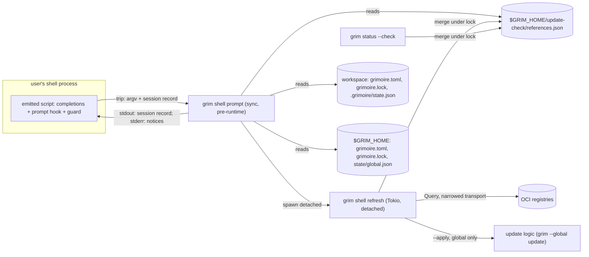

# ADR: Shell activation — one profile line for completions, a lock-drift notice and update notices

## Metadata

**Status:** Proposed
**Date:** 2026-11-11
**Deciders:** Michael Herwig (owner; the decisions ratified 2026-11-11 are inputs, listed under [Owner-settled inputs](#owner-settled-inputs)), Architect (`/hex-architect`)
**Beads Issue:** N/A · **Related PRD:** N/A (discussion: `.agents/discussions/shell-activation.md`, ratified 2026-11-11)
**Blast radius:** cross-area. A new CLI family (`grim shell`), two keys in the `grimoire.toml` schema, a new file set under `$GRIM_HOME`, a write side effect on `grim status --check`, the write behaviour of a no-op `grim install`, the docs site, the `grim-usage` catalog skill, and CI (three shells and two PowerShell editions that no workflow installs today).
**Reversibility:** one-way door, medium. The orchestrator's classification holds, sharpened: the one-way parts are the spellings that leave grim's control. `grim shell init <shell>` is pasted into users' shell profiles, and `options.update_mode` / `options.update_check_hours` land in committed `grimoire.toml` files. Renaming either later breaks shell start-up or makes a repository unreadable (exit 78). Everything else (the emitted script, the hidden entry points, the cache file, the notice wording, the background policy) is internal or labelled Unstable and stays two-way.
**Tech Strategy Alignment:**
- [x] Golden Path: Rust 2024, Tokio for the network round, no new dependency. Detaching uses `std::os::unix::process::CommandExt::process_group` and `std::os::windows::process::CommandExt::creation_flags`, both safe under `unsafe_code = "forbid"` (`Cargo.toml:176`).
- [x] Deviation recorded: the prompt-time entry point runs synchronously **before** the Tokio runtime is built (`src/main.rs:189`). This is a code path inside the main binary, not a crate deviation like `crates/grim-hook`, so `product-tech-strategy.md` needs no new row.

**Domain Tags:** cli | security | integration | devops
**Supersedes:** N/A
**Amends:** `.agents/plans/plan_catalog_freshness_revalidation.md` C-041 ("a background refresh has no owner in a process about to exit"), with one scoped exception: see [Compatibility and stability](#compatibility-and-stability).
**Superseded By:** N/A

## Context

The owner asked for "a good grim shell activation" that gives tab completion, notices when a project's `grimoire.lock` no longer matches what is installed, and notices (and, at global scope, optionally asking or automatic applying) for available artifact updates. The discussion ratified the shape on 2026-11-11; this record decides the mechanism.

What exists today, from the evidence files:

- **Completions are static and stdout-only.** `grim completions <shell>` generates a `clap_complete` script from the live clap tree into a buffer and writes it to stdout (`src/command/completions.rs:42-50`). There is no eval-time hook and no shell detection (`docs/src/content/docs/commands.md:4217`). Dynamic completion (`CompleteEnv`) is still behind `clap_complete`'s `unstable-dynamic` feature (`research_shell_activation_prior_art.md` §7).
- **The cheapest local check hashes every output.** `grim status` reads config, lock and install state and hashes each recorded output; it takes no lock and makes no request (`src/command/status.rs:5-10`). One machine measured it at 9.1 ms (`research_shell_activation_recon.md` Q2). Its exit code is 0 for any per-artifact state; it fails only on unreadable inputs (`research_shell_activation_architecture_map.md` claim 4).
- **A no-op `grim install` is slow and writes.** One machine measured about 230 ms (recon Q6). The code explains why it is not a read: it takes the non-blocking config lock (`src/command/install.rs:79-82`), builds an HTTP client and runs `ensure_layout` (`src/command/install.rs:104`, `src/context.rs:381-388`), hashes every output in the integrity gate, then **unconditionally** rewrites `state.json` through tempfile, `sync_data`, rename and directory `fsync` (`src/install/installer.rs:826-843`, `src/install/install_state.rs:1325-1349`), runs `sync_config` for every client and converges hooks (`src/install/installer.rs:851-873`). Nothing is profiled (architecture map B6).
- **No update-check cache exists.** `grim status --check` resolves each declared reference live with `Operation::Query`, which writes no tag pointer (`src/catalog/update_availability.rs:57-62`, `src/oci/access/cached_access.rs:83-90`). The existing tag cache at `$GRIM_HOME/tags/` has no timestamp, rejects unknown fields and feeds offline resolution (`src/oci/tag_cache.rs:35-43`), so the owner excluded it. The index cannot answer either: its records carry no digest per tag (`src/catalog/index_package.rs:123-126`).
- **`status --check` already writes something.** Before the digest sweep it loads the catalog (`src/command/status.rs:701-712`), which can rewrite `$GRIM_HOME/catalog/<h16>.json` past its TTL and, for a plain-OCI source, prune `$GRIM_HOME/tags/` through `put_tags` (architecture map claims 14 and 18).
- **No detached process and no shell test exist.** grim spawns only awaited children (architecture map B8). No workflow installs or asserts zsh, fish or pwsh, and no test sources a script in a real shell or uses a pty (architecture map B11).
- **The plain-HTTP allowlist includes project declarations.** `declared_insecure_hosts` unions the `insecure = true` hosts of project and global `[[registries]]` into the transport list of every access seam, `status --check` included (`src/command.rs:704-757`).
- **An existing credential-transport defect.** In shipped grim, the user's stored registry credential can travel in cleartext to a registry host that only a project file declares `insecure` (CWE-319 class). The defect exists independently of this design and is tracked as a separate bugfix, which this record does not decide.
- **`$GRIM_HOME` is taken verbatim.** `grim_home()` returns `$GRIM_HOME` with no absoluteness check and falls back to a relative `.grimoire` when `HOME` is unset (`src/env.rs:36-44`). Only the hook and settings paths fence it (`validate_grim_home`, `src/install/hook_registrar.rs:2139`).

The design has to stay inside grim's frozen contracts (Principle 9), the threat model (`.claude/rules/arch-threat-model.md`), and the owner's decision that the project-scope background check runs in any workspace that has a lock.

## Decision Drivers

- **An idle prompt costs nothing.** No process, no file write, no network.
- **The prompt never waits on the network.** Network work happens in a detached process whose lifetime is its own.
- **A notice is advisory.** The cache never feeds `grim install`, `grim update`, `grim lock` or `grim status --check` resolution, so a stale or forged entry cannot move or hold a pin (`adr_lock_pin_stability.md` D2).
- **A cloned repository is untrusted (T3).** The owner chose the any-workspace check knowingly. The unattended round must therefore be the narrowest one that still answers "is this pin behind".
- **A project file can only make grim do less.** This is the lesson of mise CVE-2026-35533, where project config could set trust keys (`research_shell_activation_prior_art.md` §6).
- **Principle 9.** Every change to an existing surface is additive.
- **Proof per shell and per platform.** Nothing ships for a shell that CI does not drive.

## Owner-settled inputs

These were ratified on 2026-11-11 and are constraints, not options:

1. `grim shell init <shell>` prints an activation script for bash, zsh, fish and PowerShell (7 and Windows PowerShell 5.1). The user evaluates it from their profile; grim edits no rc file. Elvish keeps `grim completions elvish` and gets no hook.
2. Completions stay static `clap_complete` output.
3. An idle prompt spawns no process (a shell-builtin guard, the ocx shape). The prompt path never touches the network and never waits on it.
4. Project lock drift is a notice only, and the hook writes no file. Rematerializing after a checkout is a documented git-hook recipe calling `grim install`; no grim command installs git hooks. A no-op `grim install` must become fast enough for that.
5. Update notices compare lock pins with a new machine-wide per-reference cache under `$GRIM_HOME`. `grim status --check` is the explicit check command and writes it. The tag cache is not repurposed.
6. References the cache has never seen, or holds longer than a configurable TTL, trigger a detached background round. Global scope is checked at shell start-up, a project the first time the prompt hook runs inside it. Skipped offline and in CI.
7. The project-scope round runs in any workspace with a lock, a fresh clone included.
8. One `options.*` key selects `none | notify | prompt | auto`, default `notify` at both scopes. `prompt` and `auto` act on global scope only, and only when set in global config. A project file may set `none` or `notify`; a wider value there is ignored with one warning. Nothing ever applies an update to a project's `grimoire.lock`.
9. The hook speaks when a finding appears or changes, and once at shell start while it is outstanding; silent otherwise and in non-interactive terminals.
10. The cache informs notices only.
11. No path in this feature grants hook or settings consent.
12. Answering update checks from the index is deferred.

## Industry Context & Research

**Research artifacts:** `research_shell_activation_prior_art.md` (direnv, mise, uv, pixi, fnm, oh-my-zsh, Homebrew, gh, update-notifier, `clap_complete`), `research_shell_activation_recon.md` (grim and ocx), `research_shell_activation_update_cache.md` (existing caches), `research_shell_activation_powershell_hook.md` (PowerShell 5.1 and 7), `research_shell_activation_architecture_map.md` (claim diff; it overrides the older three where it says CHANGED).

**Trending approaches.**

- `eval "$(tool init <shell>)"` is the common activation line (direnv, mise, fnm, starship, zoxide). Its cost is one process per shell start (prior art §1).
- Every surveyed tool except ocx spawns its binary on every prompt; mise added an early exit to bring an idle `hook-env` from 40-60 ms to 8-10 ms by its own estimate (prior art §2). ocx is the one tool whose guard is pure shell builtins: it compares `$PWD` and `[ file -nt stamp ]` and spawns nothing when idle (recon Part 2 B).
- No surveyed tool installs from its activation hook. uv and pixi sync on a real command; ocx forbids the prompt path from writing inside a repository (recon Part 2 C; prior art §3).
- Update checks run in a detached child that writes a cache the next run reads (update-notifier), or on a real command throttled by a file's mtime (gh, ocx). TTLs run from 1 day (gh, update-notifier, ocx) to 7 days (mise) and 2 weeks (oh-my-zsh). update-notifier skips CI; oh-my-zsh offers `auto`, `reminder` and `disabled` (prior art §4, §5).
- ocx refuses its `[update]` policy in the project file (exit 78), "so neither a fleet publisher nor a cloned repository can switch on binary replacement" (recon Part 2 F). mise fixed CVE-2026-35533 by ignoring trust-control keys outside global config (prior art §6).
- On PowerShell, zoxide and mise wrap the global `prompt` function and chain the previous one; starship and oh-my-posh replace it. `LocationChangedAction` is 7-only. `powershell.exe -WindowStyle Hidden` flashes a console; `DETACHED_PROCESS` from the tool itself does not. Execution policy can block the profile, and Constrained Language Mode blocks `[System.IO.File]` (PowerShell research §1, §2, §5).

**Key insight.** The pieces exist separately: ocx's spawn-free guard, update-notifier's detached child, gh's TTL'd notice and mise's global-only policy. No surveyed tool combines a zero-cost idle prompt with a background check, so the combination is grim's to prove, and the proof is the per-shell test suite.

## Considered Options

### Whole design

| Option | Description |
|---|---|
| **A. Ratified prompt hook** | `grim shell init` registers completions and a prompt hook with a builtin guard. A trip runs grim locally for drift and update notices; a detached grim process refreshes the per-reference cache; global `prompt`/`auto` apply through the same detached process. Plus the git-hook recipe and a write-free no-op `grim install`. |
| **B. No shell hook** | Completions via the existing `grim completions`. The git-hook recipe rematerializes after checkouts. Update notices print on stderr after an interactive grim command, from the same cache, refreshed by a detached child that the command starts (update-notifier style). |
| **C. Do nothing** | Today's surface: `grim completions`, `grim status --check` by hand, no recipe. |

Scores are 1 to 5, 5 best. The weights state what the owner's ask emphasises; the cells are scored on the evidence, not toward A.

| Criterion | Weight | A | B | C | Basis |
|---|---|---|---|---|---|
| Delivers the three asked outcomes (completion, drift notice, update notice and global apply) | 5 | 5 | 2 | 1 | B's notices appear only when the user runs grim, which a set-and-forget tool rarely sees; B has no drift notice, only the recipe's fix |
| Prompt and command latency | 4 | 4 | 5 | 5 | A adds one spawn per shell start and per trip (directory change, file change, expiry); B and C add nothing to a prompt |
| Exposure to an untrusted clone (T3) | 4 | 2 | 4 | 5 | A contacts the hosts a clone names when the prompt first renders there; B only after the user runs a grim command there, which already contacts them |
| Build and maintenance cost | 3 | 1 | 3 | 5 | A: four shells, two PowerShell editions, three platforms, pty tests, a detached process; B: the detached process and cache only |
| Reach into agent shells and new worktrees | 3 | 3 | 3 | 1 | Prompt hooks do not fire in agents' non-interactive shells (prior art §1); A and B share the git-hook recipe |
| Risk to frozen surfaces | 3 | 3 | 3 | 5 | A: new family, two keys, install write change; B: two keys, stderr lines on every interactive command |
| Reversibility | 2 | 2 | 4 | 5 | A's init line lives in users' profiles |
| **Weighted total (max 120)** | | **74** | **81** | **88** | |

**Read honestly, the matrix ranks A last.** C wins on every axis except the one the owner asked about, and B is cheaper and safer than A. A is chosen because the first row is a requirement, not a preference: the owner asked for notices in the shell, and only A delivers them. Used as a gate, that row leaves A alone; B passes it only in part. The table records the price of the feature, and it is why the sub-decisions below aim at the cheapest form that keeps A's outcomes; where one pays more, its section says for what.

### Sub-decisions

#### S1. What the tripped hook runs

| Option | For | Against |
|---|---|---|
| **1a. The main `grim` binary on a pre-runtime path (chosen).** A hidden `grim shell prompt` is matched in `main()` from argv **before** the clap parse (`src/main.rs:162`), so it skips building the clap tree, `init_tracing` (`:179`), the runtime (`:189`), `Context::new` and telemetry (`src/app.rs:45-46`). | One binary and one parser for lock, state and config, so the hook cannot disagree with `grim status` about what a pin is. `grim --version`, which also exits before the runtime, measured 2.2-2.7 ms on one machine (recon Q7; update-cache Q4). No build machinery. | The image is 26.8 MB, so a cold page-in costs more than a small binary (13-15 ms cold against 2 ms warm for a comparable case, `adr_hook_native_dispatcher.md` Context). A trip runs at every directory change, at a watched-file change and at expiry, so `cd`-heavy use pays one spawn per `cd`; Windows pays most (about 22 ms for an idle CreateProcess alone, PowerShell research §3). |
| 1b. A std-only helper like `crates/grim-hook` | Smallest cold start. | It would need TOML parsing (`grimoire.lock`, `grimoire.toml`), which the launcher's dependency allowlist forbids (`crates/grim-hook/tests/guards.rs:14-32`). It is a second reader of three frozen formats, with embedding, a size budget and an install step. The gain is cold-start milliseconds on a path that is already off the idle prompt. |
| 1c. The comparison in shell | No process at all. | Parsing TOML and JSON in bash 3.2, zsh, fish and PowerShell 5.1 is four fragile parsers of frozen formats. It is not credible. |

**Recommendation: 1a.** The pre-runtime path reads synchronously with `std::fs`. A command that runs on the Tokio runtime must not block (ASYNC-02), and this path never builds a runtime.

#### S2. The per-reference cache, and no install stamp

| Option | For | Against |
|---|---|---|
| **2a. One JSON file, `$GRIM_HOME/update-check/references.json`, read-modify-write under an advisory lock, atomic replace (chosen)** | A trip reads one file. Rounds finishing anywhere change one mtime, which every shell's guard can watch. Writers are rare (a round, a `status --check`), so the lock is almost never contended. | A writer that loses the lock after a short retry drops its answers (they are advisory). |
| 2b. One file per reference, hashed names | No lock. | A trip reads N files. "A round finished" needs a separate marker file. |
| 2c. A field in the tag cache | | Excluded by the owner: no timestamp, `deny_unknown_fields`, and it feeds offline resolution (`src/oci/tag_cache.rs:35-43`). |

**Keying.** The key is the reference a lock row records, `registry/repository:tag`, in `Identifier`'s canonical display form. For an artifact row it comes from the tag in `pinned`, which `adr_lock_pin_stability.md` D1 now records. For a `[[bundle]]` row it comes from the row's `tag`. A row with no tag (a digest-only request, or a pin a pre-D1 grim wrote) has no key and is never checked. The hook needs only the lock to find its keys: no config resolution and no store read.

**Locking.** Readers take no lock; the atomic rename makes every read whole. A writer takes `AdvisoryFileLock::try_acquire` on the file (`src/lock/advisory_lock.rs:93`, sidecar `references.json.lock`) and retries every 50 ms for up to 1 s. If it still fails, it logs at debug and drops the write.

**Eviction.** Every write drops entries checked more than 30 days ago, then keeps the 8,192 most recently checked. The longest TTL is 720 hours (30 days), so eviction never removes an entry that is still fresh.

**Downgrade.** No grim released so far reads `update-check/`, so the file is invisible to an older binary. A newer reader treats a file whose `v` it does not know as empty and never overwrites it (the `dispatch.json` rule in `subsystem-install-layout-hooks.md`). Unknown fields are tolerated on read and need not survive a rewrite; a field added later must be optional with a safe absent meaning.

**No install stamp (2d, chosen) against a stamp under `$GRIM_HOME` (2e).** The drift notice compares the pins of the lock's `skill`, `rule`, `agent` and `mcp` rows with the install records `state.json` already carries (`src/install/install_state.rs:565-598`). That is a subset of `grim status`'s `missing` and `outdated` derivation (`src/command/status.rs:2866-2891`): no output hashing, no `stale`, and no hook, settings or `[[bundle]]` rows, for which `state.json` cannot answer ([C-3](#c-3-grim-shell-prompt-hidden-the-trip) Findings). A stamp (2e) would be a second record of the same fact. It could not live in `state.json` (`deny_unknown_fields` at `src/install/install_state.rs:585`, and repository-resident) and would have to live under `$GRIM_HOME` keyed by workspace. Its only other use is an early exit for `grim install`, which S2 rejects in [C-8](#c-8-no-op-grim-install): that exit would skip the self-heal a no-op install performs today.

#### S3. How "already said" is kept per shell session

| Option | For | Against |
|---|---|---|
| **3a. Shell variables carrying a session record that grim returns and receives (chosen)** | Per session by construction; nothing on disk; dies with the shell. | The record must be safe to hold in a variable, so grim builds it from a closed character set ([C-3](#c-3-grim-shell-prompt-hidden-the-trip) stdout). |
| 3b. A per-session file | Survives `exec` of a new shell. | Needs creation and cleanup; leaks on `kill -9`. |
| 3c. A machine-wide "said" file | | Silences every other shell, which breaks "once at shell start" for the next terminal. |

**Recommendation: 3a.** The record holds up to 16 eight-character fingerprints of findings already spoken, the session's start time and the time of its last spawn. The script passes it back on the next trip and **never evaluates grim's output as code**: it splits lines into variables. Unlike the eval-based hooks of ocx, mise and direnv, a path or string that reaches the record can never execute.

**The bash and zsh stamp is a deliberate exception to 3b's rejection.** Their guard keeps one empty file per session, the stamp ([C-2](#c-2-what-the-emitted-script-does) P13), because bash has no builtin that reads a file's mtime, only `-nt` between two files. The stamp holds no state, only an mtime, so 3a's reason for keeping state in variables stands; the stamp pays 3b's creation and cleanup cost for the mtime alone ([Divergence 4](#divergences-for-the-owner)). fish and PowerShell keep mtimes in variables and need no file.

#### S4. Spawning and bounding the background round

| Option | For | Against |
|---|---|---|
| **4a. grim spawns itself detached (chosen)**: `current_exe()` with null stdio; on Unix `process_group(0)`, on Windows `DETACHED_PROCESS \| CREATE_NEW_PROCESS_GROUP` | One code path for four shells. No console flash on Windows. No PowerShell 5.1/7 split. The update-notifier precedent (PowerShell research §5). | A new mechanism in grim (architecture map B8). A terminal or job object that kills its process group or job can still end the round. |
| 4b. A shell background job (`&`, `Start-Job`) | No grim code. | Four syntaxes. `Start-Job` costs a PowerShell process and dies with the session. `powershell -WindowStyle Hidden` flashes (PowerShell research §5). |
| 4c. A thread in the trip process | | It dies when the trip exits, which is immediately. |

**Bounds.** The round reuses `grim status --check`'s limits unchanged: 8 concurrent resolutions (`src/command/status.rs:95`), 30 s per call, 300 s per run (`:106`), and at most 2,048 references (`MAX_TRANSITIVE_NODES`). The round is detached, so its duration costs no prompt latency.

**Single flight.** The worker takes `AdvisoryFileLock::try_acquire` on `$GRIM_HOME/update-check/refresh.lock`. If another round holds it, the worker exits 0 at once. When the running round writes the cache, every shell's guard trips; any reference still due then starts the next round. A session also spawns at most once per 60 s, so ten shells opened together start ten short-lived processes, and only one of them runs a round.

**Failures are cached too.** A failed or timed-out resolution is recorded with its time and counts as fresh for `min(TTL, 1 h)`. Without this, an unreachable host would start a round from every trip.

**The install lock.** A round takes no config lock: it writes neither config, lock nor state, so it never meets the non-blocking install lock or exit 75 (`src/error.rs:508-513`). Only the global apply step ([C-4](#c-4-grim-shell-refresh-hidden-the-background-round)) takes the global config lock, non-blocking. On 75 it records nothing and leaves the finding outstanding, so the next shell start retries.

#### S5. TTL representation and expiry in a long-lived shell

The config layer has no duration type; the value types are `String`, `Bool`, `U32`, `Enum`, `StringList` and `StringSet` (`src/api/config_report.rs:401-441`). **The TTL is a `U32` in hours, `options.update_check_hours`, range 1 to 720, default 24.** Hours matches the prior-art range of 1 day to 2 weeks without a unit suffix grim would have to parse.

A shell that stays open past the earliest expiry notices it without spawning. The trip returns the seconds until the earliest expiry among the references in view. bash (3.2 included) and zsh add it to `$SECONDS`, a builtin counter; PowerShell keeps a `[DateTime]::UtcNow` deadline. A builtin comparison at each prompt trips the hook once it passes. fish has no builtin clock, so a fish session notices expiry only at its next trip (a directory change, a watched file change, or another shell's round landing) or in a new shell. Seconds-since-shell-start avoids `printf '%(%s)T'`, which bash 3.2 lacks.

#### S6. What `prompt` asks, where, and what "yes" runs

| Option | For | Against |
|---|---|---|
| **6a. Ask at the first prompt of a new shell only; "yes" starts the detached apply (chosen)** | No question mid-session, where buffered type-ahead would be eaten. The prompt never waits on the network. One apply code path shared with `auto`. | Output of the update is not shown live. The next prompt reports the outcome in one line, and `grim --global status` gives detail. |
| 6b. "Yes" runs `grim --global update` in the foreground | The user sees the change list and Ctrl-C works. | The prompt waits on the network, against owner input 3. |
| 6c. Ask whenever a finding appears | Faster reaction. | Type-ahead typed while a command ran becomes the answer. |

**Recommendation: 6a.** The question appears on stderr and is read from stdin, both of which must be terminals (`interactivity()`, `src/hook/trust.rs:289`). Only `y` or `yes` (any case) followed by Enter means yes. Anything else, including an empty line or end of input, means no. A "no" is not asked again in that session. A new shell asks again while the finding is outstanding, which is oh-my-zsh's behaviour (prior art §5). A global finding that appears mid-session is announced with the `notify` wording, and the question waits for the next shell start. "Yes" spawns the same worker `auto` uses, with `--apply`, and that worker runs exactly what `grim --global update` runs.

#### S7. Does the update mode get an environment variable?

**No.** AGENTS.md records why hook and settings consent have no environment form: a repository carries its own environment through `.envrc`, `.mise.toml` or a devcontainer's `containerEnv`, so an env-settable gate lets a repository decide for the person who cloned it. A `GRIM_UPDATE_MODE` able to say `auto` would let a repository switch a cloner's global scope to unattended updating. A narrowing-only variable would be safe, but two already exist: `GRIM_OFFLINE` and CI detection (`src/env.rs:52-55`, `:77-90`) both stop every background round. A third would add surface nobody asked for.

## Decision Outcome

**Chosen:** option A, with S1 1a, S2 2a and 2d, S3 3a, S4 4a, S5 hours in a `U32` with builtin-clock expiry, S6 6a, and S7 no variable.

**Rationale.** A is the only option that delivers the asked outcomes in the shell. The sub-decisions keep its cost to one grim spawn per shell start and per trip, one detached process per due round, and a design whose security exposure is bounded by the narrowed round in [Security](#security-what-an-untrusted-repository-can-cause).

### Component contracts

Each contract is written so a tester can write a failing test from it without reading code.

#### C-1. `grim shell init <SHELL>`

- **Synopsis.** `grim shell init <SHELL>`, where `SHELL` is one of `bash`, `zsh`, `fish`, `powershell`. `powershell` covers PowerShell 7 and Windows PowerShell 5.1.
- **stdout.** The activation script, ending with a newline. For a given grim build, shell and executable path it is byte-stable. Text grim writes itself is ASCII. It embeds two inputs grim does not author: the absolute path of the running executable as the OS reports it (`std::env::current_exe`), quoted for the target shell, and `clap_complete`'s script, which carries grim's argument help text, some of it non-ASCII (for example U+2014 in `src/cli/options.rs:97`).
  - For `bash`, `zsh` and `fish` both are emitted as UTF-8.
  - For `powershell` the whole output is ASCII, because Windows PowerShell decodes a native command's output with the console code page. A non-ASCII character in the executable path is written as `[char]` code-unit expressions joined into the string. One in help text is replaced by an ASCII fallback: `-` for U+2014, `...` for U+2026, `?` for any other.
- **stderr.** Empty on success.
- **Exit codes.** 0 on success. 64 for a missing or unknown shell, `elvish` included; clap's message lists the four values. A closed stdout exits 0 silently (the `tag_stdout_pipe` contract, as for `grim completions`, `test/tests/test_broken_pipe.py:71-78`).
- **Global flags.** `--format`, `--offline`, `--global`, `--config` and `--registry` are accepted and ignored. No JSON document exists, as for `completions`.
- **Side effects.** None. It reads no config, lock, state or cache; it makes no request, writes nothing, spawns nothing and emits no telemetry event (mechanism in [C-11](#c-11-telemetry-and-logging)).
- **Report tier.** Fully exempt from `Printable`, wired directly in `src/app.rs` like `completions` (`.claude/rules/subsystem-cli-api.md` "Payload-Plain Reports").
- **Documented activation lines.** These are the contract the docs page and tests use:

  | Shell | Profile | Line |
  |---|---|---|
  | bash | `~/.bashrc` | `eval "$(grim shell init bash)"` |
  | zsh | `~/.zshrc` | `eval "$(grim shell init zsh)"` |
  | fish | `~/.config/fish/config.fish` | `grim shell init fish \| source` |
  | PowerShell | `$PROFILE` (each edition has its own file) | `if ($grimInit = & grim shell init powershell \| Out-String) { Invoke-Expression $grimInit }` |

  The PowerShell line is guarded because `Invoke-Expression` refuses an empty string for its mandatory `-Command` parameter: unguarded, an older grim that prints only a usage error would raise a parameter-binding error at profile load. The guarded line evaluates nothing then. With no `grim` on `PATH`, PowerShell prints its own command-not-found error and the line evaluates nothing.

- **`grim shell` with no verb** exits 64, as any missing subcommand does (`src/main.rs` maps every non-help parse error to 64).

#### C-2. What the emitted script does

Every property holds in every supported shell unless a row says otherwise. Tests observe it through a real shell, never by reading script text.

| # | Property |
|---|---|
| P1 | **Completions.** After evaluation, completion of `grim` covers the same subcommands and flags that `grim completions <shell>` covers. In zsh this holds whether the line sits before or after `compinit`. In PowerShell the completer works for `grim`; whether a second registration for `grim.exe` is needed on Windows is decided by the Windows test, not assumed. The PowerShell output starts with `clap_complete`'s two `using namespace` lines, because they must be the first statements of the evaluated text (PowerShell research §6). The scripts also list the hidden `shell refresh` verb and its flags: `clap_complete` 4.6.11 applies no hidden filter to subcommands or flags (`clap_complete-4.6.11/src/aot/generator/utils.rs:40-60`, `:95-130`). `shell prompt` is not in the clap tree ([C-3](#c-3-grim-shell-prompt-hidden-the-trip)), so no script lists it. |
| P2 | **Idempotent.** Evaluating the script twice leaves one prompt hook and one completion registration. |
| P3 | **Chains.** Existing prompt hooks keep running, in their order: bash keeps `PROMPT_COMMAND` in its string or array form and appends; zsh appends to `precmd_functions`; fish uses a `fish_prompt` event handler; PowerShell wraps the current `prompt` function, saves it, and calls it last. Tools that replace `prompt` without chaining (starship, oh-my-posh) must be initialised before grim, and the docs say so. |
| P4 | **Status preserved.** The exit status the user's own prompt sees (`$?`; in PowerShell `$?` and `$LASTEXITCODE`) is the last command's, not the hook's. |
| P5 | **Idle costs nothing.** When `$PWD` is unchanged, no watched file changed or appeared or disappeared since the last trip (P13), and no deadline has passed, the hook runs shell builtins only: zero processes, zero file writes. The watched set is what the last trip returned: the project's `grimoire.lock`, `.grimoire/state.json` and `grimoire.toml`, the global lock, `state/global.json` and `grimoire.toml`, and `update-check/references.json`. |
| P6 | **A trip runs grim once.** Otherwise the hook runs the embedded executable once as `grim shell prompt`, stores the record it prints, and never evaluates that output as code. |
| P7 | **Interactive only.** The prompt hook is registered only in an interactive shell. Completions are registered either way. Nothing is spawned while the script is evaluated, beyond the `grim shell init` that produced it (spawning during PowerShell init can hold the `Out-String` pipe open; PowerShell research §5). |
| P8 | **Failure contained.** If the embedded executable is missing, or a trip exits non-zero, the hook disables itself for the rest of the session. The prompt still renders, and at most the one failing run's stderr reaches the terminal. |
| P9 | **Strict modes.** It works under bash `set -u`, zsh `setopt nounset` and PowerShell `Set-StrictMode -Version Latest`. PowerShell code uses 5.1 grammar only: no `??`, ternary, `&&` or `$IsWindows`. |
| P10 | **PowerShell degradation.** Under Constrained Language Mode, evaluating the script raises no error: every call to a type outside CLM's permitted set sits inside `try`/`catch`, in initialization as in the prompt hook. The file-time checks (`[System.IO.File]`) then fail, and the hook trips only on a directory change and at the first prompt. Whether `clap_complete`'s completer runs under CLM is decided by the Windows test, not assumed; if it does not, completion is absent under CLM and the docs say so. Under an execution policy that blocks the profile, nothing runs, and the docs say so. |
| P11 | **Expiry.** bash and zsh trip once `$SECONDS` passes the returned deadline; PowerShell trips once its `[DateTime]::UtcNow` deadline passes; fish has no deadline (S5). |
| P12 | **Inherited values are never evaluated.** Every variable the script uses carries the `__grim_` prefix and is assigned while the script is evaluated, never taken from the environment. Every value used in arithmetic or a numeric comparison is first checked to be digits only (a `case` pattern such as `''\|*[!0-9]*`) and is reset to empty otherwise. The reason: bash and zsh evaluate a variable's value as an arithmetic expression in `(( ))`, `$(( ))` and `[[ -gt ]]`, recursively, so an exported variable of the same name, from `direnv`, a `mise` `[env]` table or a parent process, could otherwise run a command. |
| P13 | **File-change guard.** The script owns the guard and its stamp; grim never names, reads or writes a stamp. <br>• **bash and zsh** compare each watched file with a per-session stamp file. The stamp lives in `$XDG_RUNTIME_DIR` when that is a directory, else in `${TMPDIR:-/tmp}`, named `grim-shell.<uid>.<pid>.<random>` from `$UID`, `$$` and `$RANDOM`. Immediately before each trip starts, the script empties it with a `: >` redirection, a builtin, which updates its mtime (`O_TRUNC`), so a file changed while a trip runs trips the next prompt. The redirection writes only through a regular file the user owns that is not a link (`[ -f ]`, `[ ! -L ]`, `[ -O ]`). An absent stamp is created exclusively, through a noclobber redirection that the implementation proves opens with `O_EXCL` in both shells. Any other file at that name turns file-change detection off for the session. A watched file trips when it is not older than the stamp (`! [ "$stamp" -nt "$file" ]`). A change in the same second as the trip's start, which bash 3.2's whole-second `-nt` cannot order, therefore costs one extra trip, not a missed one. On exit the script removes the stamp where the shell has an exit hook that does not displace the user's own (zsh `zshexit_functions`; bash only when no `EXIT` trap is set). Otherwise the system temp cleaner removes it, and the next trip recreates a stamp it finds gone. <br>• **fish** keeps each watched file's last `path mtime`, and **PowerShell** its last `GetLastWriteTimeUtc`, in variables read just before the trip starts. Both trip on any difference, an older mtime included. <br>• **Every shell** also trips when a watched path's existence differs from the `+`/`-` mark the last trip printed (C-3 stdout), which catches a deletion and an appearance. <br>• **Limit:** bash and zsh miss a watched file replaced by one with an older mtime (`cp -p`, `tar x`) until a trip from another cause. |

Minimum versions are bash 3.2 (macOS `/bin/bash`), zsh 5.0, fish 3.5 and PowerShell 5.1 and 7.2. fish 3.5 is the release that added the `path` builtin, which the fish guard uses for mtimes (P13). All four are recommendations that CI must confirm (see [Verification](#verification)).

#### C-3. `grim shell prompt` (hidden): the trip

Unstable: it is called only by a script the same build emitted. It is not a clap subcommand: `main()` matches the exact argv `shell prompt <SHELL> [--state <RECORD>]` before `parse_cli` (`src/main.rs:162`), so it appears in neither `--help` nor a completion script.

- **Invocation.** `grim shell prompt <SHELL> [--state <RECORD>]`, run from the shell's current directory with the shell's environment and terminal. It is dispatched before `init_tracing` and before the Tokio runtime exists. It builds no `Context`, starts no telemetry, creates no directory and opens no network connection. It installs a log subscriber only when `GRIM_LOG` is set, so the `tracing` warnings of the loaders it reuses print nothing by default, and no stderr line but C-9's appears.
- **Root rule.** Before it reads anything under `$GRIM_HOME` (`src/env.rs:36-44`), the trip accepts that root only when all three hold:
  1. it is absolute (`validate_grim_home` cause 1, `src/install/hook_registrar.rs:2139`);
  2. it does not lie inside the workspace the trip found (cause 2 of the same function, called with that workspace at project scope);
  3. it does not lie inside the work tree around the current directory, judged as the settings global-root fence judges a global settings root. That tree is the outermost `.git` ancestor that does not hold `$HOME`. Literal and link-resolved spellings both count, a `..` component is refused, and an unreadable current directory refuses (`RootFence::around`, `src/install/settings_phase.rs:1127`).

  A refused root counts as an unreadable global config. The trip then reads no global config, lock, state or cache under it, so it reads no update policy. Both scopes are silent, because the global config is the ceiling for both ([C-5](#c-5-config-keys)). It spawns nothing, says nothing about the refusal, and prints a record with no watched path, so the next directory change judges the root again. [C-4](#c-4-grim-shell-refresh-hidden-the-background-round) and [C-7](#c-7-the-grim-status---check-side-effect) apply the same rule before they write.
- **Inputs.** First, because the root rule's cause 2 needs it, the trip walks up from the current directory to the nearest `grimoire.toml`, with the ceiling scope resolution uses (`$HOME` inclusive, `src/config/project_config.rs:161-193`); the walk only tests for the file. Under an accepted root it then reads the global `grimoire.toml`, `grimoire.lock`, `state/global.json` and `update-check/references.json`, and the found workspace's `grimoire.toml`, `grimoire.lock` and `.grimoire/state.json`. It parses with the loaders' own parser (`ProjectConfig::from_toml_str`, `src/config/project_config.rs:122`) and never reads the legacy `$GRIM_HOME/state/projects/` file.
- **Workspace owner (Unix).** A workspace whose `grimoire.toml` or `grimoire.lock` is not owned by the owner of `$HOME` counts as absent. A file another local user planted in a shared parent (`/tmp`, a group-writable directory) therefore never reaches the prompt (T5). `geteuid` needs `unsafe`, which the crate forbids, so the owner of `$HOME` stands in for the user, as a grim-created directory does in `src/install/launcher.rs:210-217`. With `$HOME` unreadable, every workspace counts as absent. A repository that sets `HOME` defeats the check, the same edge the threat model records for the settings fence. Windows has no such check. Explicit commands keep today's walk-up.
- **Bounded reads.** Every file the trip reads goes through one procedure, the launcher's (`src/install/launcher.rs:111-140`) without `O_NOFOLLOW`, because a dotfiles layout links `grimoire.toml` legitimately:
  1. `metadata`, following links, must name a regular file within the cap;
  2. the open adds `O_NONBLOCK` on Unix, so a file swapped for a FIFO since step 1 cannot block the open;
  3. `fstat` on the open handle re-checks regular file and cap;
  4. the read stops at cap + 1 bytes.

  A FIFO, device, socket or directory, a link to one, or a file over its cap is unreadable. Caps: 1 MiB for each `grimoire.toml`, `grimoire.lock` and state file; 8 MiB for `references.json` ([C-6](#c-6-on-disk-update-check)). The loaders' `read_capped` (`src/config.rs:72-104`) opens before it checks the type, so the trip does not reuse it.
- **Unreadable input.** An unreadable or unparseable input silences the scope it belongs to; an unreadable global config silences both scopes, because it is the ceiling for both ([C-5](#c-5-config-keys)). No unreadable input produces an error or a non-zero exit.
- **Findings, per scope** (global always, project when found):
  - *Drift*: the number of rows in the lock's `skill`, `rule`, `agent` and `mcp` sections whose kind and name have no install record in the scope's state file, or whose record's source differs from the row's pin (`derive_state`'s `missing` and `outdated` without the output hashing, `src/command/status.rs:2866-2891`). Three row sets are left out, because the state file cannot answer for them:
    - `[[bundle]]` rows, which never get an install record (`src/command/status.rs:366-378`);
    - `hook` rows, whose state `grim status` derives from the experimental flag, the consent record and the dispatch table, and whose record a policy refusal can leave at an older pin (`src/install/installer.rs:914-925`);
    - `settings` rows, whose project records live in `$GRIM_HOME/settings/<workspace-key>.json`, never in `state.json` (`src/install/install_state.rs:1100-1145`, `:1260-1276`).

    Records only, so a deleted output does not count, and a lock older than its config (`stale`) is not reported. A project whose state still sits at the legacy path reads as not installed until the next `grim install` migrates it.
  - *Updates*: the number of lock rows whose cache entry holds a `found` digest different from the row's pinned digest. This runs only when the scope's effective mode is not `none`.
  - *Project wider value*: a project `options.update_mode` of `prompt` or `auto`.
  - *Apply outcome*: a global `last_apply` recorded after this session started.
- **Speaking.** Notices are written to **stderr** only when stderr is a terminal. A finding is spoken when its fingerprint is not in the record's said-set; on the first trip that set is empty, so every outstanding finding is spoken once. Wording is fixed ([C-9](#c-9-notice-wording)).
  - **Fingerprint.** 8 lowercase hex characters: the first 4 hex characters of SHA-256 over the scope key (`global`, or the workspace path as UTF-8 with invalid sequences replaced), then the first 4 of SHA-256 over `<finding kind> <count>`. A changed count therefore speaks again.
  - **Said-set upkeep.** After each trip the said-set keeps the fingerprints of findings still outstanding in the scopes this trip evaluated, plus every fingerprint whose scope part names a scope it did not evaluate. It is ordered oldest first and capped at 16; past 16 the oldest is dropped. A finding that clears and comes back with the same count is spoken again, and one dropped by the cap is spoken again when its scope is next evaluated.
  - **Order.** One trip writes its lines in a fixed order: project before global, drift before updates, the project wider-value warning after the project's findings, and the question, when there is one, last.
- **Asking.** At the first trip of a session, only when stdin and stderr are terminals, the global effective mode is `prompt`, neither `[options.experimental]` flag is on in global config, and a global update finding is outstanding, it asks one question ([S6](#s6-what-prompt-asks-where-and-what-yes-runs)). On "yes" it spawns the apply worker.
- **Spawning.** It spawns `grim <scope flag> shell refresh` detached ([C-4](#c-4-grim-shell-refresh-hidden-the-background-round)) when all of these hold: stderr is a terminal; neither `GRIM_OFFLINE` nor CI is set (`src/env.rs:52`, `:77`); the scope's effective mode is not `none`; at least one of the scope's checkable references is unseen, expired, or a failure older than `min(TTL, 1 h)`; and this session has not spawned in the last 60 s. The scope flag is `--global`, or `--config <workspace>/grimoire.toml` for a project. For global scope it adds `--apply` when the effective mode is `auto` and neither experimental flag is on. At the first trip it also spawns an `--apply` worker for an outstanding global finding when the mode is `auto`, both flags are off, and `last_apply` does not record a failure for this same finding within the TTL. A reference is checkable when its row is tagged, the tag is inside the OCI grammar, and its host is not [project-only insecure](#security-what-an-untrusted-repository-can-cause).
- **stdout.** Line 1 is the session record: five fields separated by one space each, `v1 <started> <last-spawn> <seconds-until-due> <said-set>`.
  - `<started>` is Unix seconds.
  - `<last-spawn>` and `<seconds-until-due>` are Unix seconds and seconds, or `-`.
  - `<said-set>` is comma-separated fingerprints, or `-` when empty.

  The record therefore holds only `v`, digits, lowercase hex, space, `,` and `-`, and is at most 200 bytes. Each following line is one watched path, at most 7, prefixed `+ ` when the file exists and `- ` when it does not (P13). A path holding a control character is left out of the list. For `powershell`, so is a path holding a non-ASCII character, because Windows PowerShell decodes native output with the console code page ([Divergence 6](#divergences-for-the-owner)). A file left out trips the hook only through a directory change, a deadline or another watched file.
- **`--state`.** A value that does not match this grammar exactly, an unknown version included, counts as no record: a fresh session, in which each outstanding finding is spoken once.
- **Exit.** 0 in every benign state, a malformed `--state` included. 64 only when `<SHELL>` is not one of the four, which P8 turns into a disabled hook.
- **Writes.** None, except the detached spawn. The bash and zsh stamp belongs to the script (P13); the trip never names, reads or writes it. Nothing is ever written inside a workspace.

#### C-4. `grim shell refresh` (hidden): the background round

Hidden from `--help`. Unstable. It is normally started only by C-3, and it can be run by hand in the foreground to diagnose, with `GRIM_LOG=debug`.

- **Invocation.** `grim --global shell refresh [--apply]` or `grim --config <path> shell refresh`. `--apply` is ignored at project scope.
- **Process.** It runs on the normal Tokio path. When spawned by C-3, its stdin, stdout and stderr are null, its working directory is the workspace (or `$GRIM_HOME` for global), and its environment is inherited unchanged. The spawn adds no `GRIM_*` variable and passes the scope as argv only, never a secret (I6).
- **Gates.** First causes 1 and 2 of C-3's root rule, cause 2 against the `--config` workspace (the spawning trip judged cause 3 in the same environment): under a refused root, exit 0 with no work and never `--apply`. Offline or CI: exit 0 with no work. If `refresh.lock` is held: exit 0 at once.
- **Selection.** The same checkable-and-due set C-3 computes, from the lock alone, capped at 2,048 references.
- **Resolution.** `Operation::Query` through an access seam whose plain-HTTP list is the loopback forms, `GRIM_INSECURE_REGISTRIES` and the **global** `[[registries]]` entries marked `insecure`, never a project's (`plain_http_hosts_with`, `src/oci/access/registry_client.rs`). It does **not** load the catalog, does not run `status --check`'s held-back probes, and reads nothing from the content store. Limits are as S4.
- **Writes.** It merges its answers into `references.json` ([C-6](#c-6-on-disk-update-check)). It writes nothing else: not the tag cache, not the catalog cache, not any config, lock or state.
- **Apply** (`--apply`, global scope only). After the round, it applies when the global effective mode is `prompt` or `auto`, neither `[options.experimental] hooks` nor `settings` is on in global config, and the cache shows at least one global update. It then runs exactly what `grim --global update` runs: no names, so `Refresh::All`; no `--force`; no trust flag; non-interactive. It takes the global config lock non-blocking. On exit 75 it records nothing. Otherwise it records `last_apply` with the outcome (`applied` or `failed`), the exit code, the finding fingerprint and the moved pins from the update report. No consent record is written: global scope needs none (`src/hook/trust.rs` rung 5), and `grim update` never writes one.
- **Exit.** The usual codes; nobody reads them when detached.

#### C-5. Config keys

Two keys are **appended** to `ConfigKey::ALL` (`src/command/config_keys.rs:69-84`, append-only), at positions 13 and 14, in section `General`. Their serde fields go on `ConfigOptions` (`src/config/declaration.rs:295`, `deny_unknown_fields`).

| Key | Type | Default | Title | Description (house style, `subsystem-config-keys.md`) |
|---|---|---|---|---|
| `options.update_mode` | `Enum { values: ["none", "notify", "prompt", "auto"], default: "notify" }` | `notify` | Update mode | Sets what the `grim shell init` hook does about artifact updates: `none`, `notify`, `prompt` or `auto`. Unset, it notifies. `prompt` and `auto` take effect only in the global config and update only the global scope; a project file can lower the mode, never raise it. |
| `options.update_check_hours` | `U32 { default: 24 }` | `24` | Update check interval | Sets how many hours an update check result stays fresh before the `grim shell init` hook checks that reference again, from `1` to `720`. Defaults to `24`. A project file can lengthen the interval, never shorten it. |

**Validation** follows `options.search_min_relevance`'s precedent: a value outside the enum, or an interval outside 1 to 720, exits 65 on `grim config set` and 78 when a `grimoire.toml` is loaded.

**Effective values: a project file only narrows.** Modes are ordered `none < notify < prompt < auto`. "Global config" means `$GRIM_HOME/grimoire.toml` under a root that passes C-3's root rule. Under a refused root no policy is read, and every effective mode is `none`.

- Global scope: the global value, else `notify`.
- Project scope: `min(global effective, project value clamped to notify)`; with no project value, `min(global effective, notify)`. A project `prompt` or `auto` clamps to `notify` and produces the one warning: once per shell session from the hook, and on stderr from a `grim config set` that writes it (exit 0, the value is still written).
- Interval: global scope uses the global value, else 24. Project scope uses `max(project value, global value or 24)`.

**Mechanism and precedent.** This is new mechanism; no key today is read with a cross-scope ceiling (architecture map B3). It needs a new seam. `global_config_tiers` (`src/command.rs:304-313`) takes a `Context` and returns only `[[registries]]` and `default_registry`, never `options`. The trip reads `$GRIM_HOME/grimoire.toml` with C-3's bounded procedure and parses it with `ProjectConfig::from_toml_str` (`src/config/project_config.rs:122`), the parser `GlobalConfig::load` uses (`src/config/global_config.rs:93-120`), synchronously and before any `Context` exists. Commands on the normal path read the same `options` through `GlobalConfig::load`. The direction, "a project file can only make grim stricter", is the one grim already applies to the plain-HTTP gate for hooks, where "a cloned repository declaring `insecure = true` can only stop its own hook from arming" (`src/hook/trust.rs` module doc, finding W2). The policy follows mise's CVE-2026-35533 fix and ocx's refusal of `[update]` in the project file (prior art §6; recon Part 2 F). A global `none` therefore silences update notices and rounds machine-wide ([Open question 1](#open-questions)).

Only the hook reads these keys. They change nothing about `grim install`, `grim update`, `grim lock` or `grim status --check`.

#### C-6. On-disk: `$GRIM_HOME/update-check/`

| Path | Contents | Contract |
|---|---|---|
| `update-check/references.json` | The per-reference cache and `last_apply` | Created mode `0600` on Unix (T5). Written only with `atomic_write` (`src/store/atomic_write.rs:32`) under its lock. Deleting it is always safe and costs one round per reference |
| `update-check/references.json.lock` | `AdvisoryFileLock` sidecar | Transient |
| `update-check/refresh.lock` | Single-flight for rounds | Transient |

```json
{
  "v": 1,
  "references": {
    "ghcr.io/acme/code-review:1": { "outcome": "found",  "digest": "sha256:9f…", "checked_at": "2026-11-11T10:00:00Z" },
    "ghcr.io/acme/old-rule:2":    { "outcome": "absent", "digest": null,        "checked_at": "2026-11-11T10:00:00Z" },
    "registry.example:5000/x:1":  { "outcome": "failed", "digest": null,        "checked_at": "2026-11-11T10:00:00Z" }
  },
  "last_apply": {
    "at": "2026-11-11T10:01:12Z", "outcome": "applied", "exit": 0, "finding": "a1b2c3d4",
    "moved": [ { "reference": "ghcr.io/acme/code-review:1", "from": "sha256:…", "to": "sha256:…" } ]
  }
}
```

- `v` is an integer. A reader treats a `v` it does not know as an empty cache, and a writer never overwrites it.
- **Size.** A file over 8 MiB, or one that is not a regular file, reads as empty (C-3 bounded reads). A writer replaces a file it cannot read within the cap or cannot parse; a file whose `v` it does not know it leaves alone. A key longer than 512 bytes is never written and, when read, is dropped. That bound keeps a full file, 8,192 entries plus a `last_apply` of 2,048 moved pins, under the cap.
- Unknown fields are tolerated on read (no `deny_unknown_fields`), as in the catalog sidecar precedent (`.claude/rules/subsystem-file-structure.md` § Catalog Cache).
- **Entry validity.** An entry is dropped, and the rest kept, when any of these holds:
  - its key does not parse as a tagged `Identifier`;
  - its `outcome` is outside `found | absent | failed`;
  - its `outcome` is `found` without a digest that parses, or `absent` or `failed` with a non-null `digest`;
  - its `checked_at` is missing or does not parse as an RFC 3339 UTC time.
- **Clock.** A `checked_at` more than 1 hour later than the reader's clock drops the entry; one within that hour reads as now. A clock moved back by more than an hour therefore costs one fresh check per reference, and a far-future time can never hold an entry past eviction.
- `absent` means the tag does not exist, and is never an update (`outdated_from_resolve`, `src/catalog/update_availability.rs`).
- `last_apply` is optional.
- Freshness: `found` and `absent` are fresh for the effective interval; `failed` for `min(interval, 1 h)`. Eviction is as S2.
- Not a `ClientOutput`, so it is invisible to anchors and reaping. Not a frozen layout surface: Unstable, with no migration, reaper or upgrade fixture, the `telemetry/installation-id` precedent (`.claude/rules/subsystem-file-structure.md:44-55`).

#### C-7. The `grim status --check` side effect

- After the sweep, the answers collected in `fresh_digests` (`src/command/status.rs:1187-1233`, `swept.answers`) whose reference is tagged are merged into `references.json`. A digest is recorded as `found`, a `None` as `absent`, an error or per-call timeout as `failed`.
- An answer the run's deadline cut off (`swept.late`, `src/command/status.rs:1179-1183`, `:1228-1231`) is not recorded, so a slow run never replaces an earlier `found` entry with `failed`.
- It writes only when `$GRIM_HOME` passes C-3's root rule, judged with the resolved scope's workspace and the current directory. Under a refused root it writes nothing and logs at debug.
- An answer is **not** recorded when its host is project-only insecure (it was reached over a plain HTTP that only a repository file allowed), so the cache never holds a cleartext answer a repository arranged.
- stdout, `--format json`, stderr notes and the exit code are unchanged. The write is best-effort: a failure logs at debug and changes nothing visible.
- `$GRIM_HOME/tags/` stays as today: `Query` writes no pointer. The catalog load and its possible `put_tags` are untouched.
- The MCP `grim_status` tool with `check` runs the same `status::run` (`src/mcp/server.rs:93-102`), so it writes too. The TUI's `UpdateChecker` does not (out of scope).

#### C-8. No-op `grim install`

**Decision: no early exit; a no-op install rewrites no persistent file and builds no network client.** One transient write stays, as today: the config lock creates the sidecar `grimoire.toml.lock` and removes it on drop (`src/command/install.rs:79-82`, `src/lock/advisory_lock.rs:4-8`), which a workspace file watcher sees. The full read path still runs: scope, the config lock, lock freshness, consent resolution, client detection, state load, the integrity gate's per-output hash, and each client's vendor-config read. Only the effects whose result would be identical are skipped:

1. The access seam (`ensure_layout` and the HTTP client, `src/command/install.rs:104`) is built on the first blob the store lacks, not up front.
2. `state.persist` writes each of its files, `state.json` and at project scope the settings store `$GRIM_HOME/settings/<workspace-key>.json` (`src/install/install_state.rs:1260-1276`), only when the bytes it would write differ from the bytes on disk at that path. A state loaded from the legacy path therefore still writes once.
3. `sync_config`, the hook converge and `launcher::ensure` write a file only when its bytes would change (`launcher::ensure` already does).

**Guarantee.** Identical to today's full path: outputs are re-verified by content hash, and a hand-deleted MCP entry, client registration or dispatch row is still restored. The fast path gives up nothing. An early exit on a stamp (option 2e) would prove only that the lock and the outputs' stat data are unchanged, and it would skip the self-heal that `subsystem-cli-commands.md` documents for `install` ("every command is idempotent and self-healing").

**Budget, provisional.** On the CI Linux runner, over the no-op fixture, a no-op `grim install` takes at most 50 ms median. It leaves `state.json`, the settings store, every vendor config file, `dispatch.json` and `$GRIM_HOME/hooks/grim-hook` with unchanged inode and mtime.
- **Fixture.** Project scope, three clients (`claude`, `codex`, `copilot`). Two artifacts of each of skill, rule, agent and mcp, plus one hook and one settings package, with both experimental flags on and the workspace consented, so the launcher, the dispatch table and the settings store exist.
- **Timing boundary.** The `grim install` process from spawn to exit, warm page cache, median of 21 runs after 3 discarded.
- **Derivation.** On one machine `grim status` did comparable reading in 9.1 ms (recon Q2); install adds vendor-config reads and consent resolution, and 50 ms leaves 5x headroom for a slower runner. The number is not derived from a profile of install.
- **Profile first.** No profile exists of where today's 230 ms goes (architecture map B6). The plan profiles before it fixes the number. If the profile shows the reads alone exceed the budget, option 2e is reopened in an amendment rather than shipped quietly.

#### C-9. Notice wording

Every line starts with `grim: `, is ASCII, is at most 120 characters, and interpolates only counts and closed-enum literals. No artifact name, path, registry host, tag or digest from a repository ever appears, so no escape sequence a repository authored can reach the terminal. Singular and plural follow the count. No colour.

| Finding | Line |
|---|---|
| Project drift | `grim: grimoire.lock pins 3 artifacts that are not installed at their locked version; run: grim install` |
| Project drift, no `.grimoire/state.json` in the workspace (a fresh clone) | `grim: grimoire.lock pins 3 artifacts that are not installed here; review grimoire.toml, then run: grim install` |
| Global drift | `grim: the global lock pins 3 artifacts that are not installed at their locked version; run: grim --global install` |
| Project updates | `grim: 2 updates available for this project; run: grim update` |
| Global updates (`notify`, and `prompt` mid-session) | `grim: 2 global updates available; run: grim --global update` |
| Question (`prompt`, first prompt) | `grim: 2 global updates available. Apply them in the background now? [y/N] ` |
| After "yes" | `grim: applying global updates in the background` |
| Applied | `grim: applied 2 global updates in the background; details: grim --global status` |
| Apply failed | `grim: a background global update failed; run: grim --global update` |
| `prompt` or `auto` paused | `grim: automatic global updates are paused while experimental hooks or settings are on; run: grim --global update` |
| Project wider value | `grim: update_mode 'auto' in this project's grimoire.toml is ignored; a project can set 'none' or 'notify'` |

#### C-10. The git-hook recipe (documentation contract)

The docs page publishes one POSIX `sh` script for `post-checkout`, `post-merge` and `post-rewrite`. grim installs none of them.

- `post-checkout` acts only when its third argument is `1` (a branch checkout). `git worktree add` runs it, since a clone's worktrees share its hooks. `git clone` does not, because no per-clone hook exists before the clone; run `grim install` once after cloning. `post-checkout` can also fire inside a rebase, so a rebase may run `grim install` twice, which a fast no-op install makes harmless. `post-merge` always acts. `post-rewrite` acts only when its first argument is `rebase`, which covers `git pull --rebase` (prior art §2).
- It runs from the worktree top level, where git runs hooks. It does nothing when `grim` is not on `PATH` or `grimoire.lock` is absent.
- It runs `grim install </dev/null`. With stdin not a terminal, install never asks for hook or settings consent, so a checkout never leaves a question waiting inside git (`interactivity()`).
- It always exits 0; post-hooks cannot change the git operation's outcome anyway. On a non-zero `grim install` it prints one stderr line naming the exit code and `grim install`. Exit 75 means a concurrent install already holds the lock; 81 means offline.
- **Install it per clone** (`.git/hooks/`, shared by that repository's worktrees) or through the repository's own hook manager. **Never through a global `core.hooksPath`**: that runs `grim install` in every clone, including ones nobody reviewed, and install fetches from the hosts a clone names and writes its declared files (T3).
- On Windows, Git for Windows runs the same script with its bundled `sh`.

#### C-11. Telemetry and logging

The `shell` family sends no telemetry event. `grim shell init` runs at every shell start, and an armed export waits up to 500 ms (`src/telemetry.rs:298`). `prompt` and `refresh` are unattended.
- **Mechanism.** `init` and `refresh` run through `app::run`, which starts telemetry for every command (`src/app.rs:45-46`) and exports in `finish` (`:212`). The `shell` family therefore joins an exclusion checked where `Telemetry::start` records the command (`src/telemetry.rs:135-141`, beside `LONG_LIVED` at `:46`), so `finish` sends nothing for it. `prompt` never reaches `app::run`.
- **Proof.** A test arms telemetry against a stub endpoint and asserts that `shell init` and `shell refresh` send no request.

`src/telemetry/command_name.rs` still gains an exhaustive arm (a compile requirement), and `docs/src/content/docs/telemetry.md` gains one sentence. `GRIM_LOG` works as everywhere, except that the trip installs a log subscriber only when it is set (C-3). The detached `refresh` has null stderr, so its logs appear only when it is run by hand.

### Security: what an untrusted repository can cause

**Attacker.** T3, a repository the user clones and whose directory their interactive prompt renders in. Owner input 7 means the project-scope round runs there without any gesture beyond `cd`.

**What today's code would allow, had the round been a plain `grim status --check`:**

1. **Hosts.** Every `registry[:port]` that the clone's `grimoire.lock` pins, or that its `grimoire.toml` declares (lock pins and `[[registries]]` locators), up to 2,048 resolutions per run. With `index` entries, it would also reach arbitrary `http(s)` URLs, because `status --check` loads the catalog for every configured source (`src/command/status.rs:701-712`). For a plain-OCI source the catalog walk would run a `_catalog` crawl of that registry.
2. **Protocol.** HTTPS, except plain HTTP for the loopback forms (`localhost`, `127.0.0.1`, bare and on port 5000), `GRIM_INSECURE_REGISTRIES`, and **any host the clone's `[[registries]]` marks `insecure = true`** (`src/command.rs:739-757`).
3. **Credentials.** For a host that only the clone's `[[registries]]` marks `insecure`, today's code can carry the user's stored credential in cleartext. That is the existing credential-transport defect named in [Context](#context): it exists in shipped grim independently of this design and is tracked as a separate bugfix, which this record does not decide. A round that ran today's `status --check` would expose it at `cd`.
4. **Writes.** Under `Query`, the digest sweep writes no tag pointer. The catalog load would write `$GRIM_HOME/catalog/` and, for a plain-OCI source, prune `$GRIM_HOME/tags/` (architecture map claims 14, 18). The new cache would hold whatever digests the named hosts return, keyed by the clone's references.

**The narrowed unattended round** (C-3, C-4, C-7). What it refuses that an explicit `grim status --check` allows:

| Refusal | Closes |
|---|---|
| Plain HTTP only for loopback, `GRIM_INSECURE_REGISTRIES` and **global** `insecure` entries. A reference whose host only a project file marks insecure is not checked at all, and `status --check` does not record such an answer | Item 3: no credential travels in cleartext because of a repository file; no cleartext answer enters the shared cache |
| No catalog load, no index fetch, no `_catalog` walk, no held-back probe | Item 1's arbitrary URLs and crawls; item 4's catalog and tag-cache writes |
| Only tagged lock rows whose tag fits the OCI grammar; one `Query` resolution each; 2,048 cap; 30 s per call, 300 s per run; failures cached for up to 1 h | Unbounded fan-out and a respawn storm against a dead host |
| Writes only `references.json`, keyed by the reference actually resolved, digests validated | A clone's answers can only describe references on hosts it names, so it cannot forge an entry for a reference its hosts do not serve |
| Notices interpolate counts only; the script never evaluates trip output | Terminal-escape and code injection from repository strings |
| Global `prompt` and `auto` read global config only; project values clamp | A clone cannot turn on unattended applying (mise CVE-2026-35533 shape) |

**Mapping onto the threat model.**

| Item | Attacker or invariant | Verdict |
|---|---|---|
| Background round contacts hosts a clone names | T3 | Residual, stated below. Bounded by the refusals above |
| Clone marks a host insecure | T3, network attacker | Closed for the unattended round. For explicit commands it is the existing credential-transport defect ([Context](#context)), independent of this design and tracked as a separate bugfix this record does not decide |
| `$GRIM_HOME` relative, or inside the repository or the work tree around the current directory | T3, through repository-carried environment or an unset `HOME` | Closed by C-3's root rule: the trip reads nothing under such a root, the round and the `status --check` write refuse it, so a repository file never stands in for the user's global config, policy or cache |
| A repository file that is a FIFO, a device, a link to one, or very large | T3 | Closed by C-3's bounded reads: only regular files are opened, without blocking, within fixed caps; anything else silences its scope |
| A `grimoire.toml` another local user planted in a shared parent directory | T5 | Closed for the hook on Unix by C-3's owner check. Explicit commands keep today's walk-up |
| An exported variable named like one of the script's | T3, through repository-carried environment | Closed by P12: the script assigns its own variables and checks every arithmetic operand as digits |
| `auto` applies a new global version unattended | T1 | Its answer stays the pin. While either experimental flag is on, `prompt` and `auto` pause ([Divergence 1](#divergences-for-the-owner)), so no unattended or background apply arms a hook or settings package. With the flags off, an auto-applied skill, rule, agent or MCP descriptor is what a manual `grim --global update` would install. Evidence is `last_apply.moved` and `grim --global status` (I5) |
| Tag swap upstream | T2 | Unchanged. The cache never moves a pin; a swapped tag shows as an update, which only `grim update` acts on (I2) |
| Agent driven by prompt injection | T4 | No new surface: agent shells are non-interactive, so the hook never fires (prior art §1) |
| Cache readable by another local user | T5 | `0600`. It holds only reference strings and digests, no secret |
| I1, nothing armable in a repository | I1 | Holds. The hook reads repository files only to count; it arms, registers and executes nothing from them. The cache and locks live under `$GRIM_HOME` |
| I3, grim's failure is never a verdict | I3 | Holds. Every unreadable input is silence, the trip exits 0, and a failing hook disables itself without breaking the prompt |
| I6, no secrets in argv or env | I6 | Holds. The spawn passes scope only |
| Consent | Owner input 11 | No path writes a consent record. `refresh --apply` runs update logic, which never writes one, and only at global scope, which needs none |

**Residual risk, in plain words.** When the user's prompt first renders inside a cloned repository, grim makes HTTPS requests in the background to the registry hosts that repository names, and plain-HTTP requests to `localhost` or `127.0.0.1` on port 80 or 5000 if it names them. The repository's author learns that someone opened the clone, from where and when, and can point those registry-shaped requests at internal hosts the user can reach. The user's stored credential goes only to a host the repository names over TLS, or to a realm that host chooses; grim also runs the user's own credential helper once per named host. With the narrowing, I judge this acceptable inside the owner's decision. It is the exposure `git clone` and an explicit `grim install` in that clone already carry, moved earlier to the moment of `cd`, without a credential leak and without a write outside `$GRIM_HOME/update-check/`. The "known workspaces only" gate is not required for safety; it would remove the presence signal and is the owner's to weigh.

### Technical details

#### Architecture (C4)

**Context.**

```
developer ──types──► interactive shell (bash | zsh | fish | PowerShell)
     │                    │  profile: eval "$(grim shell init <shell>)"
     │                    ├─ idle prompt: builtins only (stat compare, $PWD, clock)
     │                    └─ trip ──► grim shell prompt ──reads──► project + $GRIM_HOME files
     │                                        └─ spawn (detached) ──► grim shell refresh ──HTTPS──► OCI registries
     ├──git checkout / merge / rebase──► per-clone git hook ──► grim install </dev/null
     └──grim status --check (also VS Code, MCP) ──writes──► $GRIM_HOME/update-check/references.json
```

**Container.**



**Component** (inside the `grim` crate; module names indicative, the plan fixes them).

```
command/shell.rs ─ init ──────► shell script emitters (bash, zsh, fish, powershell) + clap_complete
                 ├ prompt ────► scope probe (walk-up) ─► findings ─► notices / question ─► spawn
                 └ refresh ───► single-flight ─► checkable-and-due set ─► Query sweep ─► cache merge ─► apply
update_check (new domain module)
  ├ references: pin_references(lock) and the checkable predicate, shared by prompt, refresh and status
  ├ cache: read (tolerant), merge, evict, atomic write under lock
  ├ mode: effective mode and interval (global ceiling, project clamp)
  └ findings: drift and update counts, fingerprints
command/status.rs ── fresh_digests answers ─► update_check::cache::merge (best-effort)
command/install.rs + install/* ── lazy access seam, write-only-if-changed persist and sync
```

#### Data model deltas

- `ConfigOptions`: `+ update_mode: Option<UpdateMode>`, `+ update_check_hours: Option<u32>`. Both optional; the published config schema gains two properties.
- `ConfigKey::ALL`: two keys appended (12 to 14).
- `$GRIM_HOME/update-check/`: new, three files (C-6).
- No change to `grimoire.lock`, `state.json`, `tags.json`, the catalog cache, `dispatch.json` or any report shape.

### NFR coverage

| NFR | Effect and bound |
|---|---|
| **Latency: idle prompt** | Zero processes, enforced structurally by trace (Verification). Added wall time at most 1 ms median over 200 prompts in bash, zsh and fish on the Linux runner. Derivation: at most seven builtin stat comparisons, seven existence tests, one string compare and one integer compare (P13); ocx's comparable guard spawns nothing (recon Part 2 B). PowerShell: zero processes enforced; time measured and reported, gated only once a Windows baseline exists |
| **Latency: trip** | Median at most the same runner's `grim --offline status` median on the same fixture, p95 at most 30 ms (Linux). Derivation: the trip reads a subset of what `status` reads, skips output hashing, and adds one cache file. One-machine figures are `--version` 2.2-2.7 ms and `status` 9.1-9.5 ms (recon Q6, Q7; update-cache Q4); ocx's comparable trip was 6.0 ms. These are single-machine measurements; the gate is relative so a slower runner does not fail it. The trip is also measured with a full cache (8,192 entries) and reported. Windows: measured, not gated. mise reports about 22 ms for one idle CreateProcess (PowerShell research §3). A trip runs at every directory change |
| **Latency: shell start** | One `grim shell init` spawn (comparable to `grim completions zsh`, 6.4 ms on one machine, recon Q1) plus completion-script evaluation plus the first trip. Reported, not gated; the PowerShell figure includes evaluating `clap_complete`'s script |
| **Latency: no-op `grim install`** | At most 50 ms median, provisional until profiled; no persistent file rewritten (C-8) |
| **Latency: background round** | Off the prompt. At most 300 s; typically one manifest resolution per distinct reference plus token handshakes, 8 at a time |
| **Security** | [Security](#security-what-an-untrusted-repository-can-cause) |
| **Availability and degradation** | Offline (`GRIM_OFFLINE`): no rounds; notices from the existing cache still show. CI: no rounds. Execution policy blocking the profile: nothing runs (documented). Constrained Language Mode: the script evaluates without error and trips on directory change and first prompt only (P10). `$GRIM_HOME` relative or inside the repository: silent (C-3 root rule). A repository file that is a FIFO, a device or over its cap: that scope silent, prompt not delayed (C-3 bounded reads). Missing, corrupt or over-8-MiB cache: read as empty, rebuilt by the next round. Unknown cache `v`: read as empty, never overwritten. Ten concurrent shells: one round (S4). Registry down: failures cached, retried after at most 1 h. Binary moved or deleted: hook disables itself for the session, and the next shell picks up the new path. Terminal or job object killing the round: no partial write (atomic), retried next trip |
| **Operability** | `GRIM_LOG=debug grim --global shell refresh` runs a round in the foreground. `grim --global status --check` is the explicit refresh. The cache is plain JSON. `rm -rf $GRIM_HOME/update-check` is always safe. `last_apply` keeps the evidence of the last unattended apply |
| **Cost** | Per distinct reference, at most one resolution per interval, deduplicated machine-wide by the shared cache across every workspace and the global scope. Default 24 h |
| **Scalability** | Up to 2,048 references per round. The cache is capped at 8,192 entries, about 1 MB with typical keys and at most 8 MiB by the key bound (C-6), parsed once per trip. Workspace count affects only which file a trip reads |
| **Compatibility** | [Next section](#compatibility-and-stability) |

## Compatibility and stability

**Additive.**

- The `grim shell` family: `init` public; `prompt` and `refresh` hidden. `AGENTS.md`'s subcommand count goes from 26 to 27.
- Two keys appended to `ConfigKey::ALL` and the config schema, both optional.
- `$GRIM_HOME/update-check/`, new and private.
- A best-effort write by `grim status --check`. Its output and exit code are unchanged. The MCP `grim_status` tool with `check`, a read tool, therefore writes `$GRIM_HOME/update-check/` too; its catalog load already writes `$GRIM_HOME/catalog/`, so this is not the first write from that tool.
- A no-op `grim install` no longer rewrites persistent files; the config lock's transient sidecar is still created and removed. Mtimes stop moving, which no contract promises.
- `stability.md`'s Frozen intro counts its exceptions ("Three exceptions sit inside these rows", `docs/src/content/docs/stability.md:24-28`). The shell activation behaviour becomes a fourth, listed by name under Unstable, with a label test modelled on the telemetry one.

**The correct claim about completions and help.** "`grim completions` output byte-identical" cannot hold, because the scripts and `grim --help` are generated from the clap tree, which gains `shell` (`src/command/completions.rs:46`; architecture map B1). The claim that holds, and that a test pins: for every command that existed before this change, the completion entries and the help text are unchanged. The completion scripts differ by the added `shell` subcommand, its `init` verb, and the hidden `refresh` verb with its flags, because `clap_complete` 4.6.11 lists hidden subcommands and flags (C-2 P1). `--help` differs by `shell` and `init` only. `prompt` is outside the clap tree and appears in neither. The test asserts `refresh` present in the scripts and `prompt` absent from both. `grim status` output and exit codes are unchanged in every mode.

**Stability labels.**

- **Frozen at 1.0 with the rest of the CLI and config, no carve-out:**
  - the spelling `grim shell init <shell>`, its four shell values and its exit codes, because profiles embed them;
  - the key names `options.update_mode` and `options.update_check_hours`, the mode literals and the interval's type and range, because committed `grimoire.toml` files embed them.

  This departs from the discussion's suggestion that everything be Unstable until 1.0 ([Open question 2](#open-questions)).
- **Unstable through 1.0** (listed by name in `stability.md` § Unstable, as telemetry is): the emitted script's text and prompt-time behaviour, the hidden `shell prompt` and `shell refresh` entry points and their I/O, the session record, the notice wording, `$GRIM_HOME/update-check/` and its schema, and the background policy (default interval, what the round skips, failure backoff). These may change in any minor release.

**What an older grim does with the new files.** It never reads `update-check/`. It reads `grimoire.lock`, `state.json` and the tag cache unchanged, because none of them changed. A `grimoire.toml` that sets either new key is **rejected with exit 78** by an older grim (`deny_unknown_fields`, `src/config/declaration.rs:294`). This is the same trade the browse-filter keys made (`stability.md`, "the first case where that matters in practice"), and the docs state it: a team that commits `options.update_mode` needs every member on a grim that knows it. An rc line evaluated by an older grim runs `grim shell`, which that grim does not know: it prints a usage error at shell start and exits 64. bash, zsh and fish then evaluate the empty output as nothing, and the guarded PowerShell line (C-1) skips evaluation. The upgrading page says so for a downgrade.

**Self-heal.** A second `grim install` still restores what the first wrote (C-8 keeps the full read path), so Principle 9's renderer clause is untouched.

**Departure from C-041.** C-041 says a background refresh has no owner in a process about to exit, so the CLI has none (`.agents/plans/plan_catalog_freshness_revalidation.md:226-230`; `adr_catalog_freshness_revalidation.md` D2). This record makes one scoped exception and keeps C-041's reasoning: the round's owner is `grim shell refresh`, a process that exists only for the round, and nothing it produces is ever served to a resolution. `grim search`, `grim status` and every other one-shot command keep C-041 exactly. On acceptance, C-041 gains one line pointing here, and the `arch-principles.md` ADR index gains this record.

## Verification

Today no test drives bash, zsh, fish or PowerShell through a profile, and none uses a pty (architecture map B11). The work is proven as follows.

**Unit (Rust).**

- Cache tolerant read: unknown `v` reads as empty and is never overwritten; unknown fields; a bad key, digest or outcome drops one entry.
- Merge, eviction (30 days, 8,192) and the 0600 mode.
- The checkable predicate, especially the project-only insecure host.
- Effective mode and interval across every global and project combination.
- Drift and update counts against `status`'s derivation on the same fixtures.
- Fingerprint stability, and said-set upkeep: pruning per evaluated scope, the 16-entry cap, oldest dropped first.
- Notice lines: a property test feeds names, paths, hosts and tags carrying control characters and asserts that no notice line contains a byte outside printable ASCII and that none contains any of the fed strings.
- Session-record parsing rejects anything outside its grammar, and a rejected `--state` reads as a fresh session.
- Bounded reads: a FIFO, a link to a FIFO, a link to `/dev/zero`, a directory, and a file one byte over each cap are unreadable, and none blocks.
- Root rule: a relative root, one inside the found workspace, one inside the work tree around the current directory by literal and by link-resolved spelling, one with `..`, and a tree that holds `$HOME` (accepted).
- Cache validity: each dropped-entry case of C-6, a `checked_at` 2 hours ahead (dropped) and 30 minutes ahead (read as now), and a 513-byte key.
- Drift: `[[bundle]]`, `hook` and `settings` rows never count.
- PowerShell emitter: non-ASCII help text and executable paths produce ASCII-only output.

**Acceptance (pytest, `test/tests/`).** A new pty-capable harness drives real shells, using Python's stdlib `pty` on Linux and macOS. Each case starts a shell with an isolated `HOME` and `GRIM_HOME` and the activation line in a scratch profile. Cases:

1. **Idle spawns nothing.** Shell tracing (bash and zsh `xtrace`, fish `fish_trace`, PowerShell `Set-PSDebug -Trace 1`) shows exactly one `grim shell prompt` invocation across 200 idle prompts after the first.
2. **Never waits on the network.** With the registry stopped, a prompt inside a project returns within the trip budget.
3. **Drift.** A changed `grimoire.lock` prints the drift notice at the next prompt and writes no file in the workspace (tree hash before and after). A fresh clone prints the fresh-clone line. After `grim install`, a project with a settings package, with a hook while the hooks flag is off, and with a declared bundle prints no drift notice. Drift, then `grim install`, then the same drift again prints the notice twice.
4. **`status --check` writes the cache.** Then, with the registry stopped, the next prompt prints the update notice, and a second prompt prints nothing.
5. **Older pins.** Checking out a lock with older pins prints the update notice with the registry stopped.
6. **Mode matrix.** `none`, `notify`, `prompt` (answers `y`, `n` and EOF) and `auto` at global scope. A project `prompt` or `auto` is ignored with exactly one warning per session. A global `none` silences project rounds.
7. **Narrowed round.** The registry stub records every request and its scheme:
   - a project-only insecure host receives no request;
   - no `Authorization` header ever arrives over plain HTTP;
   - no index or `_catalog` request is made;
   - `$GRIM_HOME/tags/` and `$GRIM_HOME/catalog/` are byte-identical before and after a round;
   - `$GRIM_HOME/tags/` is byte-identical before and after `grim status --check`, and an offline resolve gives the same digests.
8. **Single flight.** Ten shells started together produce one round (stub request count).
9. **Unarmed.** With `[options.experimental] hooks` on, `auto` pauses with its line, and a hook artifact stays unarmed.
10. **Config.** `grim config list --all` lists both keys with title and description at positions 13 and 14.
11. **No-op install.** Over C-8's fixture it meets C-8's budget and leaves every file C-8 lists with unchanged inode and mtime. It succeeds with the registry stopped.
12. **Completions.** Present in each shell. Every pre-existing command's completion entries and help text are unchanged (the corrected compatibility claim). `shell refresh` is present in the scripts; `shell prompt` is absent from the scripts and from `--help`.
13. **Script safety.** P2 idempotence, P3 chaining with a pre-existing `PROMPT_COMMAND` (string and array forms), P4 status preservation, and P9 strict modes.
14. **Git-hook recipe.** Run against `git checkout`, `git merge`, `git pull --rebase` (a fast-forward one too) and `git worktree add`; `grim install` gets non-terminal stdin.
15. **Root rule.** A relative `GRIM_HOME`, and one inside the clone whose `grimoire.toml` there sets `update_mode = "auto"`: no notice, no request, and no file written under that root, by the hook or by `grim status --check`.
16. **Hostile files.** A `grimoire.lock` that links to a FIFO, one that links to `/dev/zero`, and a 2 MiB `grimoire.toml`: the prompt returns within the trip budget and says nothing for that scope.
17. **Foreign owner.** A `grimoire.toml` and `grimoire.lock` owned by another uid in a parent directory produce no notice. Runs where the runner can create a file owned by another uid.
18. **Hostile environment.** Every script variable name is exported with a value such as `x[$(touch marker)]` before the activation line; after 20 prompts, no marker exists.
19. **File-change guard.** Deleting a watched file trips the next prompt. A link planted at the stamp's name is never followed (its target is unchanged), and file-change detection then stays off for the session.
20. **Quiet stderr.** A malformed `include` pattern in the project's `[[registries]]` prints nothing on stderr beyond C-9's lines.
21. **Activation line quoting.** For an executable path containing `'`, `$`, a backtick, a space, a newline and a non-ASCII character, each shell's activation line evaluates without error and runs that executable; the PowerShell output is ASCII.

Timing boundaries: the idle-prompt figure is the pty time from sending Enter to the prompt string appearing, with and without the activation line; the trip figure is the wall time of the `grim shell prompt` process; the no-op install figure is as C-8.

**CI must gain.**

- On the Linux leg: install `zsh` and `fish`, and assert all three shell versions and `pwsh` at job start. Today the repository neither installs nor asserts any of them.
- On the macOS leg in `verify-deep`: `/bin/bash` 3.2 and zsh.
- A benchmark task for the latency gates, in the style of `task bench:hooks`, including the trip with a full 8,192-entry cache.
- On the Windows leg of `verify-deep`: Pester files run under `shell: powershell` (5.1) and `shell: pwsh` (7), each case in a child process started with `-NoProfile`. Cases: idle prompt with zero spawns; strict mode; `$?` and `$LASTEXITCODE` preserved; a non-chaining prompt defined before grim; Constrained Language Mode, covering evaluation of the init output, a completion request and a nested `-NoProfile` shell, not only the file-time fallback; the guarded activation line with an older grim and with no grim on `PATH`; a non-ASCII executable path and home directory; the detached round surviving its shell's exit with no console window; and whether a native process's stderr reaches the console from inside `prompt` under 5.1 (unverified, see [Divergences](#divergences-for-the-owner)). These cases call the `prompt` function in a child process after evaluating the init output; they do not drive PSReadLine or an interactive console host, which stays a known gap.
- **Not driven by any leg:** Git Bash on Windows, fish and pwsh on macOS, pwsh on Linux, and the zsh frameworks (oh-my-zsh, powerlevel10k instant prompt). The docs list them as untested for the prompt hook ([Divergence 7](#divergences-for-the-owner)). Windows runs only in `verify-deep`, so a Windows regression can land between deep runs.

**Windows proof comes from a CI deep run.** The herdr host has no Windows. The CLAUDE.md local Windows route applies only on a host that has `/mnt/c`.

**Gates.** `task verify`, `task docs:check` for the new and changed pages, and `task catalog:verify` with a drift review of `catalog/skills/grim-usage` for the new command.

## Consequences

**Positive.**

- One profile line gives completions, a drift notice and update notices, with no cost on an idle prompt and no network wait at any prompt.
- `grim status --check`, the VS Code extension's rounds (which call it; unverified here, the extension lives outside this repository) and the hook share one cache, so a check anywhere informs every shell.
- A no-op `grim install` rewrites no persistent file, which also helps the VS Code extension and every CI job that runs it.
- The script never evaluates tool output, which is stronger than the eval-based hooks it learns from.

**Negative.**

- Option A is the most expensive option in the matrix: four shells, two PowerShell editions, three platforms, a pty test harness and the first detached process in grim.
- The update notice answers "did the tag this pin records move", not every case of "would `grim update` move this pin". `grim status --check` additionally covers dependency rows answered by an edge reference, split references, and nested bundles (`subsystem-cli-commands.md`, `status` row). A hand-edited or diamond-shaped lock can therefore get a notice that `grim update` does not act on, or miss one. The notice is advisory, and `grim status --check` stays the authoritative check.
- A lock row with no tag (a digest request, or a pin written before `adr_lock_pin_stability.md` D1) never gets a notice until relocked.
- A reference reachable only over a plain HTTP that only a project allows never gets a notice from the hook.
- A fresh agent worktree stays stale until its clone has the git hooks wired. Accepted in the discussion.
- `grim init` in the current directory, or a `grimoire.toml` appearing in a parent directory, is noticed at the next directory change or in a new shell, as with ocx (recon Part 2 G).
- fish notices interval expiry only at its next trip.
- A team that commits either new key locks out older grims with exit 78.
- A `hook`, `settings` or `[[bundle]]` row never produces a drift notice; `grim status` reports those rows.
- bash and zsh miss a watched file replaced by one with an older mtime until a trip from another cause (P13).
- Under PowerShell a watched path with a non-ASCII character is not watched. On Windows that covers every global file under a non-ASCII profile directory, which is then noticed at the next directory change or in a new shell.
- On Unix a workspace whose `grimoire.toml` or `grimoire.lock` the user does not own gets no notice, and with `$GRIM_HOME` relative or inside the repository the hook is silent.

**Explicitly out of scope.**

- Editing rc files.
- A grim command that installs git hooks.
- Installing or writing any workspace file from the prompt hook.
- Automatic updates of a project's lock.
- Dynamic completion.
- elvish, nushell, `cmd.exe` and Clink.
- Self-update of the grim binary.
- Answering checks from the index: deferred, and a follow-up issue in the indexer repository should ask for a digest per tag.
- The TUI's `UpdateChecker` writing the cache.
- The VS Code extension adopting the new keys: grim ships first, and the extension follows in its own change.
- Notifying about a stale lock (`grimoire.toml` edited after locking).
- A per-key environment variable.

**What the implementation touches** (for the planner, not a task list):

- Code: `src/main.rs`, `src/app.rs`, `src/command.rs`, a new `src/command/shell.rs` with its emitters, a new `update_check` domain module, `src/telemetry/command_name.rs`, `src/command/config_keys.rs`, `src/config/declaration.rs` and `src/config/defaults.rs`, `src/command/status.rs` (the merge), and `src/command/install.rs` plus the persist and sync seams in `src/install/`.
- Docs: `docs/src/content/docs/commands.md` (a `shell` section; the completions paragraph points to it), a new how-to page for activation and the git-hook recipe, `configuration.md` (keys and data layout), `stability.md`, `telemetry.md` and `upgrading.md`.
- Rules and catalog: `.claude/rules/subsystem-cli-commands.md`, `subsystem-file-structure.md` (an `update-check` section) and `catalog/skills/grim-usage`.
- Tests and CI: the test harness, CI workflows and the Pester suite.

## Open questions

1. [NEEDS CLARIFICATION: Does a global `options.update_mode = "none"` also silence update notices and background rounds in every project (a machine-wide ceiling), or only at global scope?]
   Recommended: a machine-wide ceiling, as designed in C-5. It is the only reading under which no repository file can produce background traffic on a machine whose owner said `none`, and it matches the "a project file only narrows" rule.
2. [NEEDS CLARIFICATION: Do the init spelling and the two key names freeze at 1.0 with the CLI and config schema, or carry an Unstable carve-out like the hook kind?]
   Recommended: freeze the spellings and keep the behaviour Unstable, as decided under [Compatibility and stability](#compatibility-and-stability). Profiles and committed config files outlive any label, so a rename would break users whatever the page says.
3. [NEEDS CLARIFICATION: While `[options.experimental] hooks` or `settings` is on in global config, should `prompt` and `auto` pause (as designed), or apply and arm global hooks and settings the way a manual `grim --global update` does?]
   Recommended: pause. Global scope arms without consent (`src/hook/trust.rs` rung 5), so applying would arm new hook or settings versions with no human in the loop, which is what the discussion's consent requirement rules out. See Divergence 1.
4. [NEEDS CLARIFICATION: Does the first version keep the hook-started background round (C-4 and the spawning in C-3) and mode `auto`, or ship without them?]
   Open owner decision; this record does not pre-decide it. Five review Blocks depend on the answer and stay unresolved until it is given:
   - On Windows the detached worker inherits the trip's handles, so a captured trip can hold the prompt for the round's duration.
   - The automatic apply after a round has no time bound or recovery while it holds the single-flight lock.
   - Inside the unattended round, a token realm can downgrade the credential transport to plain HTTP.
   - Inside the unattended round, insecure hosts set through the environment (`GRIM_INSECURE_REGISTRIES`), which a repository can carry, widen the plain-HTTP set.
   - "Seconds until due" is undefined when no refresh can land (offline, an unknown cache `v`, an unwritable `$GRIM_HOME`, the throttle, a round in flight), so a past deadline would trip every prompt.

## Unresolved review findings

One spec re-validation ran on 2026-11-11 against the round-1 revision. No further revision was made after it, so the findings below stand against the text above. The drift-row fix (C-3 Findings › Drift) was found closed. Line numbers refer to the revision of 2026-11-11.

Block:

1. **The bash and zsh stamp (C-2 P13) is unsafe in a shared temp directory.** When neither `XDG_RUNTIME_DIR` nor `TMPDIR` is set the stamp falls back to `/tmp`, its name is predictable, and the `: >` touch truncates whatever regular file the user owns at that name, including a hard link to one of the user's own files (shown in bash 5.2.21 and zsh 5.9). The stamp directory also comes from inherited environment values, against P12 and Divergence 4. Direction: never a shared directory (`XDG_RUNTIME_DIR`, else a private absolute directory of mode 0700 the user owns); zsh needs no stamp at all, since `zsh/stat` reads an mtime without a process.

Warn:

2. **Root rule, third cause (C-3, l.247; mapping row l.448).** It inherits the settings fence's recorded gaps: a work tree is found only through `.git`, and a tree that holds `$HOME` is skipped. A checkout with no `.git` (an archive download, a non-colocated jj, hg or Sapling checkout) can still supply the root through a repository-carried environment. The mapping row says "Closed"; it must name the gap, or the rule must gain further tree markers.
3. **Bounded reads follow a link to any target (C-3, l.252-258; mapping row l.449).** A repository link into an automount path, a UNC path on Windows, or a cloud placeholder file makes the prompt touch the network and wait on it, before the non-blocking open is reached. Windows has no counterpart to the handle re-check, and Verification has no Windows case. Direction: confine a followed link's target to the workspace or `$HOME` without opening it, refuse UNC and device prefixes, treat recall-on-access files as unreadable.
4. **P13 does not define a failed stamp create.** A missing stamp makes every existing watched file trip, so a session that outlives its runtime directory spawns grim at every prompt. Direction: any failed create turns detection off.
5. **P13's mtime comparison has two unnamed limits.** A watched file on a coarse-timestamp filesystem changed just after the touch is missed (bash 5.2 and zsh 5.9 compare nanoseconds, so the "one extra trip" sentence is wrong), and a watched file with a future mtime trips every prompt.
6. **Verification 15 (l.611) contradicts C-7 (l.361).** `grim status --check` creates the `$GRIM_HOME` layout and writes the catalog cache before the gated cache write, so "writes no file under a refused root" cannot pass as written.
7. **Three sentences still call the round's credential handling closed or acceptable** (residual-risk paragraph l.461, security table row 1 l.435, Divergence 2), while Open question 4 records two unresolved Blocks in the same round. All three are pending Open question 4.

Suggest:

8. `src/install/settings_phase.rs:1127` supports only part of its sentence; the spelling and `..` rules live in `root_refusal` (`:1176`), and `..` is refused only while a tree is fenced.
9. Two legitimate setups the root rule silences are unnamed: a dotfiles repository holding a linked `GRIM_HOME`, and on Windows a root outside `%USERPROFILE%`/`%LOCALAPPDATA%` (`src/install/hook_registrar.rs:2193-2205`).
10. An absent global `grimoire.toml` must mean defaults, not an unreadable config (l.259); a dangling link needs a stated meaning.
11. The stamp's exit cleanup runs `rm` resolved through `PATH`; use `command -p rm` or a builtin.
12. "No write outside `$GRIM_HOME/update-check/`" (l.461) ignores the stamp.
13. "Counts as absent" (l.251) does not say whether the walk-up stops or continues upward.
14. `src/command/install.rs:104` is cited for the access seam; the seam is at `:106`.

Not tested by any reviewer: the fish and PowerShell guards (neither shell is installed on the review host), macOS shell behaviour, and Windows link following.

## Divergences for the owner

1. **The discussion's consent sentence does not hold at global scope, so `prompt` and `auto` pause while experimental hooks or settings are on.**
   - The discussion says: "An unattended apply leaves a hook or settings artifact unarmed, as a non-interactive run does today."
   - At global scope a non-interactive run **does** arm. The arming ladder grants global scope at rung 5, after the feature flag and the trust-flag rungs and with no consent record ("`$GRIM_HOME/grimoire.toml` is the user's own file", `src/hook/trust.rs` module doc). `grim --global update` run by `auto` would therefore arm a new hook version, or a hook a bundle newly gained, with no person seeing the change list.
   - Owner input 11 ("no path grants consent") stays literally true either way, since global scope needs no grant.
   - To keep the discussion's stated outcome, this design pauses `prompt` and `auto` (they act as `notify`, with one fixed line) whenever either experimental flag is on in global config. That narrows `auto` and `prompt` for users of the experimental kinds. The alternative is to let them apply and arm as a manual update does, which is simpler, and to record the T1 residual instead. Open question 3 asks for the choice.
2. **None on the any-workspace check.** The security analysis found one real hazard, cleartext credentials through a project-declared insecure host. The narrowed round closes it inside the owner's decision. The remaining residual is a presence signal plus blind registry-shaped requests, which I judge acceptable without the "known workspaces only" gate. The gate stays available if the owner weighs the presence signal differently.
3. **Unverified, not a divergence.** Whether a native process's stderr reaches the console when it is called from inside a PowerShell 5.1 `prompt` function while its stdout is captured is unverified. If the Windows deep run shows it does not, the PowerShell script relays notice lines that grim prints on stdout, with no evaluation. That changes the hidden protocol only, which is Unstable.
4. **The bash and zsh guard keeps one empty stamp file per session outside every workspace (P13), against the literal wording of owner input 4 ("the hook writes no file"), because bash has no builtin that reads an mtime.**
5. **Drift notices have no switch of their own: `options.update_mode` governs update findings only, so the way to silence drift is removing the activation line.**
6. **Under PowerShell, watched paths with a non-ASCII character are left out rather than escaped (C-3 stdout), trading file-change detection under a non-ASCII Windows profile directory for an ASCII-only protocol that needs no console-encoding switch around each trip.**
7. **Git Bash on Windows, fish and pwsh on macOS, pwsh on Linux and the zsh frameworks are documented as untested for the prompt hook, neither refused nor driven by CI.**
8. **Under a `$GRIM_HOME` the root rule refuses, the hook is silent rather than warning, so a user whose `HOME` is unset sees no notice and no reason; `grim status` names the cause only on hook and settings rows.**

## Links

- `.agents/discussions/shell-activation.md`, the ratified discussion.
- `.agents/research/research_shell_activation_{architecture_map,recon,update_cache,prior_art,powershell_hook}.md`.
- [`adr_artifact_trust_model.md`](./adr_artifact_trust_model.md), [`adr_hook_workspace_consent.md`](./adr_hook_workspace_consent.md), [`adr_lock_pin_stability.md`](./adr_lock_pin_stability.md), [`adr_catalog_freshness_revalidation.md`](./adr_catalog_freshness_revalidation.md), [`adr_hook_native_dispatcher.md`](./adr_hook_native_dispatcher.md), [`adr_grim_config_command.md`](./adr_grim_config_command.md).
- `.claude/rules/arch-threat-model.md`, `docs/src/content/docs/stability.md`.
- [grimoire-rs/grimoire#53](https://github.com/grimoire-rs/grimoire/issues/53), rematerializing managed context blocks on config change (adjacent).

## Changelog

| Date | Author | Change |
|---|---|---|
| 2026-11-11 | Claude (`/hex-architect`, architect) | Initial draft, Proposed |
| 2026-11-11 | Claude (`/hex-architect`, architect) | Review round 1, findings that hold whether or not the background round stays. C-3 gains a `$GRIM_HOME` root rule (also applied by C-4, C-5 and C-7), a bounded read procedure with caps for every input, and a Unix workspace-owner check. Drift leaves out `hook`, `settings` and `[[bundle]]` rows. The bash and zsh stamp moves to the script (C-2 P13) with existence checks; P12 forbids evaluating inherited values. `prompt` leaves the clap tree, and the trip's record, said-set and line order are specified. C-1 gets per-shell encoding rules and a guarded PowerShell line. C-6 gets size, key, validity and clock rules. C-8's wording, fixture and provisional budget are fixed, and C-11 names its telemetry mechanism. The shipped credential-transport defect is restated as a separate bugfix. Open question 4 and Divergences 4-8 are added. Status stays Proposed |
| 2026-11-11 | Claude (`/hex-architect`, orchestrator) | Recorded the spec re-validation's findings under "Unresolved review findings"; no contract changed |
