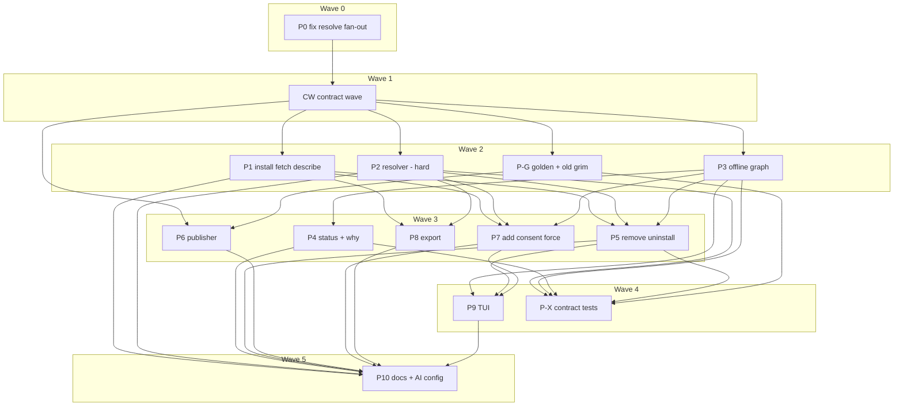

# Plan: Declared dependencies between artifacts, resolved through the bundle machinery

## Status

- **Plan:** plan_artifact_dependencies
- **Active phase:** Review round 4 (R7 delta, tier low) — Approve after one fix pass; R7 merged, every row merged
- **Step:** awaiting /finalize
- **Last update:** 2026-11-03 (after 22558444: test(add): prove --force still covers a stamped nested member)
- State:   review
- Tier:    xhigh
- Tier-grammar: 5
- Updated: 2026-11-03
- Next:    /hex-finalize
- Reviewed: 2255844467ae42d3da9f67b425bd37f47056138a

---

## Header

- **Goal contract (binding):** `.agents/goals/adr-artifact-dependencies.md`. Definition of done D1–D8, plus PR merge-ready, CI green and deep verify in the DONE block only. Autonomy: never prompt; every doubt runs § Issue resolution and is recorded here.
- **ADR (Accepted 2026-11-02 by this run):** [`adr_artifact_dependencies.md`](../adr/adr_artifact_dependencies.md), Decisions 1–8, § Component contracts, § Migration and rollout. Its two open questions were closed on their recommendations (PD-1, PD-2). This plan reopens no ADR decision; it decomposes them.
- **Design:** [`design_artifact_dependencies.md`](../specs/design_artifact_dependencies.md) §3–§7. Its test table (§7) is the source of most test names below. Where this plan renames a test file, PD-5 says so.
- **Research:** `.agents/research/research_artifact_dependencies_*.md` (9 files). Not repeated (`research=skip`).
- **Discussion:** `.agents/discussions/artifact-dependencies.md` (drained, State not active).
- **Branch:** `hex/adr-artifact-dependencies`. It holds the goal file, the ADR, this plan and every implementation commit. The root orchestrator runs in the main checkout; pipeline workers get worktrees under `.agents/worktrees/<pipeline>`.
- **Classification:** large scope · one-way door (high: OCI wire layout, lock field shapes, report shapes, a new annotation key, a new reason slug, a new subcommand) · tier xhigh (auto; the topic carries every xhigh signal) · `architect=inline` (the accepted ADR covers every design decision) · `research=skip` (9 persisted artifacts) · `adversary=on` (requested by the goal loop's run directive).
- **Tracking:** no open GitHub issue or PR covers this work (checked 2026-11-02: `gh issue list --search "dependencies OR requires OR why"`).
- **Gate command:** `env -u OTEL_EXPORTER_OTLP_ENDPOINT -u OTEL_EXPORTER_OTLP_HEADERS task verify`, or the subsystem gate (`task rust:verify`, `task claude:tests`, `task shell:verify`) mid-step. The developer shell exports a live OTLP endpoint (hex.md › Memory pitfall). Docs steps also run `task docs:check` (Node 24). Heavy gates run one at a time. No cargo target dir under `/tmp` (RAM-backed tmpfs).
- **Discover inputs:** four Discover reports (resolve/lock/mutations, OCI/install/fetch, publish/export, reports/TUI/test infra). They are not committed; every fact this plan relies on is cited inline as `file:line` at HEAD `4f316b40`.

## Objective

Any artifact kind can declare what it requires. grim resolves those
requirements transitively at `add`, `lock`, `update` and `install`, through one
recursive members machinery that also gives nested bundles. grim can say why
every artifact is installed: `required_by` and `direct` on every `status`
item, and a new `grim why <kind> <name>` with every chain, root first.
Everything ships in one release (0.16.0), additive only.

## Scope

**In** (ADR Decisions 1–8 and the in-repo parts of § Migration and rollout):

- the two-layer carrier and Rule F4 / F1 forward-compat gates (D1, D2);
- recursive resolution with caps, the diamond policy, cycles, offline locking, partial resolve (D3);
- the lock fields, install set-compare, closure-aware remove/uninstall, hook consent, `add --force` scope (D4);
- `status` fields, `grim why`, `add.pulled_in`, `describe.requires`, the TUI rows (D5, in this repo);
- source-side declaration for every kind, nested bundle sources, build/release/publish (D6);
- export flattening (D7);
- `registry_text` sharing, `generated_by` validation, publisher-naming messages (D8);
- the separate `fix(resolve):` fan-out commit (release gate 4);
- the upgrade fixture `test/data/golden/pre_dependencies_cdeedcaa/` and its test;
- the local opt-in `test/tests/test_old_grim_dependencies.py` (`GRIM_OLD_BIN`), plus one recorded local run (release gate 3, in-repo half);
- docs, schemas, AI config and the catalog drift review the ADR lists.

**Out (deferred follow-ups; outside this loop's grants):**

| # | Follow-up | Why deferred | Owner of the act |
|---|---|---|---|
| F-1 | Release gate 1: push and pull the two-layer fixture on GHCR, Docker Hub, ECR, Harbor and GitLab; record the result in the ADR changelog | Needs pushes to five external registries (no grant) | owner, before tagging 0.16.0 |
| F-2 | Release gate 2 and goal DoD "D5 grimoire-vscode shows Required by": a `grimoire-vscode` release that reads `direct`/`required_by`, runs `grim why --format json`, and knows `kept-by-dependency` and the `dependency: …` source literal | Another repository (`../grimoire-vscode`); no grant. This plan ships the JSON contract it consumes (§ JSON interface) and edits nothing there | owner, same day as or before 0.16.0 |
| F-3 | Release gate 3, release-notes half: copy the recorded `GRIM_OLD_BIN` run (P-G step 4, § Verification record) into the 0.16.0 release notes | Release notes are written at release time | release run |
| F-4 | Tag and release 0.16.0 | Release acts are never delegated | owner |

## Decisions taken while decomposing

Each row is a question met while planning, the research that answered it, and
the decision. None reopens an ADR choice (goal § Issue resolution, step 2).

| # | Question | Research | Decision |
|---|---|---|---|
| PD-1 | ADR open question 1: are the caps 2048 nodes / 32 MiB / depth 32 right? | ADR § Open questions recommendation; demand research (`research_artifact_dependencies_demand.md`: skill → sibling, skill → MCP, depth ≤ 2); Principle 9 (raising a cap is additive, lowering is a break) | **Adopt as written.** ADR flipped to Accepted with a changelog line naming the goal loop |
| PD-2 | ADR open question 2: does `describe` fetch the requires layer, or report `has_requires: bool`? | ADR recommendation; `DescribeReport` is shared with MCP `grim_describe` (`src/mcp/describe.rs:23`); grimoire-vscode needs names before `add` | **Fetch it.** `requires` is `[{kind,name,id}]` / `[]` / `null`; no `has_requires` field |
| PD-3 | The ADR says a path-declared **mcp or hook** contributes edges from its source. Do path sources exist for those kinds? | `src/skill/local_pack.rs:57` (hook path source is an error) and `:95` (`unreachable!("mcp path sources are rejected at config parse")`); `resolve_path_entries` iterates skills, rules and agents only (`src/resolve/resolver.rs:83-85`) | **Path-source edges apply to skill, rule and agent path entries and to local bundles only.** Adding a path source for mcp or hook is a new feature, out of scope. The ADR's "MCP path freshness is load-bearing" sentence is therefore moot; no MCP path compare is built |
| PD-4 | How is a path source's edge freshness checked? | `grim.requires.*` keys are packed verbatim into the content (ADR D6), so they are inside the path entry's content hash; the stale path-hash check already refuses with 65 `stale-lock` | **No new compare for path skills, rules and agents.** P2 adds an acceptance test proving that changing one `grim.requires.*` key of a path skill after `grim lock` makes `grim install` refuse with 65 `stale-lock`. Local bundles keep their existing snapshot check |
| PD-5 | The design names one `test_dependencies.py` for resolve, add and mutation cases. Three parallel pipelines would share it | `decompose.md`: a shared file forces one pipeline | **Split by owner:** `test_dependencies.py` (P2, resolution), `test_dependencies_install.py` (P1), `test_dependencies_mutations.py` (P5), `test_dependencies_add.py` (P7). Test function names stay as in design §7 |
| PD-6 | Where does `fetch_members_blob` live? The ADR contract puts it in `src/oci/bundle.rs` returning `ResolveErrorKind` | `fetch_bundle_layer`/`fetch_bundle_members` already live in `src/resolve/resolver.rs:711,752`; `src/oci` does not depend on `src/resolve` today | **New `src/resolve/members.rs`.** It keeps the ADR signature. `src/oci` stays free of resolve types. The ADR states "the plan owns placement" |
| PD-7 | Where does the one pure merge-policy function live, so the online expander and the offline closure cannot drift? | ADR § Risks ("one pure policy function with shared unit tests"); `src/resolve` already depends on `src/lock`, not the reverse | **`src/lock/merge_policy.rs`, real in the contract wave**, consumed by P2 (online) and P3 (offline) |
| PD-8 | The lock wire shape is read or written by almost every pipeline's acceptance test | Discover: ~20 struct-literal sites of `LockedArtifact`; byte-exact lock tests at `grimoire_lock.rs:803,1023,1083`, `lock_io.rs:622` | **The lock fields land fully (serde both ways, byte-exact tests, schema golden) in the contract wave.** No pipeline waits on a separate lock pipeline |
| PD-9 | `grim add --force` must cover only the target's destinations, but `--force` reaches the installer as a `bool` (`installer.rs:396`, `add.rs:548`) | `install_and_persist` is shared by `install`, `add`, `update` and the TUI | **The contract wave replaces the `bool` with `ForceScope { None, All, Only(BTreeSet<NodeKey>) }`**, threaded through the installer's internal `force` parameters (about eight functions in `installer.rs`) down to the one guard predicate. Callers map `true → All`, `false → None` (behavior identical): `command/install.rs:118,363`, `command/add.rs:538`, `tui/app.rs:2966,3098,3202`. P7 passes `Only` |
| PD-10 | `add.rs`'s `single_entry_lock` / `bundle_members_lock` are imported by the TUI (`src/tui/app.rs:29`). P7 replaces them with reachability; P9 owns `app.rs` | One file, two pipelines | **The contract wave adds `reachable_lock(lock, target)` in `add.rs` with a shim body equal to today's projection, and switches both `add.rs` and `app.rs` to it.** P7 replaces the body; P9 adds the TUI test |
| PD-11 | Assertion 5 of the golden test ("`grim remove` of the bundle drops exactly what 0.15.1 dropped") needs a recorded expectation | ADR fixture tree lists no post-remove file | **Add `golden/project.after-remove.grimoire.lock` and `golden/state.project.after-remove.json`** to the fixture, produced by the v0.15.1 binary in the same generator run |
| PD-12 | Does the new closure-aware remove replace the destructive pre-cache fallback (`legacy_drop_from_lock`, `remove.rs:282`, `evict_bundle_members` `:398`) for every lock? | ADR D4: "replaces, **for dependency-bearing locks**, the pre-cache fallback"; golden assertion 5 pins pre-R behavior | **Only for dependency-bearing locks** (any `requires` or `transitive = true`). A dependency-free lock keeps today's fallback byte for byte |
| PD-13 | `CachedAccess::fetch_manifest` becomes store-first (ADR D3). A tag reference cannot be content-addressed | `cached_access.rs:93-125`; `fetch_blob` is already store-first (`:127-167`) | **Store-first only for digest references.** A tag reference keeps today's path. Side effect: an offline `describe`/`fetch` of a digest-pinned artifact whose manifest is cached now succeeds instead of exiting 81, a widening (additive) recorded in `stability.md` by P10 |
| PD-14 | `status` already emits a third `source` literal, `path: 
` (`src/command/status.rs:224`), that the ADR's literal list omits | Discover | **`path: 
` is kept unchanged.** The new literals are `dependency: <kind>/<name>, …` and `dependency` only. P10 lists all five literals in `json-interface.md` |
| PD-15 | Run-directive conflicts at this run's gate | `hex.md › Preferences` maps `reviewer:spec` to `deep-reasoning`; the goal loop's run directive and the owner's global routing put reviewers on `sonnet` | **Reviewers run on sonnet for this plan's review.** `/hex-execute` re-reads hex.md at its own gate |
| PD-16 | grimoire-vscode ("D5 grimoire-vscode shows Required by") is in another repository | Goal § Context: "needs a grant covering it"; run directive: no other repos | **Deferred as F-2.** No pipeline edits `../grimoire-vscode` |
| PD-17 | The old-grim matrix rows need a v0.15.1 binary, also used to generate the golden fixture | `test/data/golden/pre_hooks_03e59b0/tools/generate.py` takes `GOLDEN_GRIM`; v0.15.1 is commit `cdeedcaa` | **P-G builds v0.15.1 once** from `cdeedcaa` in `.agents/worktrees/v0151` with `CARGO_TARGET_DIR=.agents/worktrees/v0151/target` (never `/tmp`). The same binary feeds `GOLDEN_GRIM` and `GRIM_OLD_BIN`. The worktree is removed when P-G merges |
| PD-18 | How does the resolver read a path skill's edges? `pack_local_artifact` returns only name and bytes (`src/skill/local_pack.rs:34-40`) | `validate_skill_dir`, `validate_rule_file`, `validate_agent_file` (`src/skill/skill_package.rs:48,99,128`) return the parsed frontmatter including `metadata` | **P2 calls those validators on the path source and feeds `metadata` to C-006.** No signature in `src/skill/**` changes, so no pipeline owns those files |
| PD-19 | P1 (install, describe) and P2 (resolver) both call `fetch_members_blob` and both run in wave 2; P2 also makes digest manifests store-first (PD-13) | Spec review | **The `fetch_members_blob` signature is frozen at CW** (a change is a contract amendment). P1's tests assert online behavior only and never pin the offline digest-ref `describe` exit; the PD-13 widening is asserted only by P2 |

## Design guarantees

### Backwards compatibility (Principle 9 gate)

Additive only. Every surface below is either byte-identical for an existing
user or widened by an optional field, an appended enum literal, or a new
command. One narrowing is permitted because its surface is experimental (hook
consent, `upgrading.md` records it). No Constitution Deviations; the ADR's
§ Convention deviations 1–13 are the complete list and each is carried here.

| Surface | Change | Proof (test, owner) |
|---|---|---|
| OCI wire, dependency-free artifact and bundle | Byte-identical manifest and layers | `test_release_requires.py::test_dependency_free_release_byte_identical` (P6): releasing the fixture source from a directory outside any git tree (pytest `tmp_path`, so no `created`/`revision` provenance annotations) yields manifest bytes equal to `registry/release_baseline.json`, which P-G records with the v0.15.1 binary from the same source |
| OCI wire, dependent artifact | New two-layer layout (convention); shipped grim refuses at materialization | `test_old_grim_dependencies.py` (P-G, opt-in); F4 unit tests (CW) |
| `com.grimoire.requires-features` annotation | New key; never written by this grim for dependencies | F1 unit tests (CW); `test_forward_compat.py` (P1) |
| `grimoire.lock`, dependency-free | Byte-identical modulo `[metadata] generated_by`, online **and** offline | `test_golden_pre_dependencies.py` assertions 1, 3, 4a, 4b (P-G, characterization: green on the CW tree; every later pipeline that merges after it keeps it green, and the integration gate re-runs it); `lock_io.rs:622` fixtures (CW) |
| `grimoire.lock`, new fields | `[[<kind>.requires]]`, `transitive = true`; omitted when empty/false; `lock_version` stays 1 | byte-exact unit snapshot in `grimoire_lock.rs` (CW); `lock.schema.json` golden regenerated additively (CW) |
| `grim status` item | Adds `direct: bool`, `required_by: [{kind,name}] \| null`; `source` keeps `direct`, `path: 
`, `bundle: …`; adds `dependency: …`, `dependency` | `test_status_dependencies.py` (P4); golden `provenance/status.*.json` `source` equality (P-G); `test_golden_status_fields` (P-X) |
| `grim add` report | Adds `pulled_in` (always present, `[]` when none) | `test_dependencies_add.py::test_pulled_in` (P7) |
| `grim describe` / MCP `grim_describe` | Adds `requires` (always present) | `test_describe.py` additions (P1) |
| `grim uninstall` item `status` | Appends literal `kept-by-dependency` | `test_dependencies_mutations.py::test_uninstall_dependency_only_kept` (P5) |
| Error document `reason` | Appends `unsupported-artifact-feature` | `c031_4_no_new_error_reason_slug` and `c021_exit_codes_and_reasons_equal_main` extended by appending (CW) |
| CLI | New `grim why`; widened `release --pin`, `publish.toml pin`; `add --force` scoped (fresh surface, ADR D4) | `test_why.py` (P4); `test_release_requires.py`, `test_publish_requires.py` (P6); `test_dependencies_add.py::test_add_force_transitive_clobber_refused` (P7) |
| Nested bundles | Previously refused at lock (65), now expanded (widening) | `test_dependencies.py::test_nested_bundle_expands` (P2) |
| `remove` / `uninstall` of a dependency-free lock | Unchanged, including the pre-cache fallback (PD-12) | golden assertion 5 (P-G); existing `test_add_remove.py`, `test_uninstall.py`, `test_bundles.py` stay green |
| Hook consent on `grim add <bundle>` | **Narrowed**: no longer consents a hook member already present and unconsented. Experimental surface, no promise | `test_hook_consent.py::test_add_bundle_does_not_consent_preexisting_member` (P7); `upgrading.md` (P10) |
| Offline `describe`/`fetch` of a digest ref with a cached manifest | Was 81, now succeeds (PD-13) | `cached_access.rs` unit (P2); `stability.md` line (P10) |
| JSON schemas (`grimoire-lock`, `grim-mcp`, `grim-publish`, hook) | Additive, not byte-identical | golden schema files (CW lock; P6 hook) |

Old-grim behavior for every ADR matrix row is the ADR's § Migration and
rollout table; P-G turns each row that a v0.15.1 binary can exercise locally
into one opt-in test.

### TDD approach

Every pipeline step runs **Specify → Implement → Self-check**:

1. **Specify:** write the unit and acceptance tests named in the step's
   contracts, from this plan and the ADR, not from code. Run them and record
   the red run (fails for the stated reason, not a compile error elsewhere).
2. **Implement:** until the step's tests and the existing suite pass.
3. **Self-check:** the subsystem gate (`task rust:verify` for Rust steps,
   `task docs:check` for docs steps), targeted `pytest -k`, and **one
   empirical mutation per contract**: change one token of real source, show a
   named test fails, revert. Report it.

Rules every step follows:

- Characterization first where behavior must not move: P-G's golden test and
  CW's shim callers are green **before** the change they guard.
- Acceptance tests rebuild `test/bin/grim` (`cp -f target/release/grim
  test/bin/grim` or through `task`). A stale binary passes negative tests
  vacuously, so every "nothing happened" assertion carries a positive control
  in the same test.
- Plan IDs (C-0xx, PD-n) stay out of source, test names and comments
  (code-docs LNK-01). Tests are named descriptively as listed.
- The contract wave's stubs are `todo!()`-free: shims keep today's behavior so
  the tree stays green and every wave-2 pipeline starts from a passing suite.
- Two-layer fixtures are pushed with the CW helper (`push_manifest`,
  `make_dependent`), never through the grim under test, so a broken writer
  cannot mask a broken reader.

### JSON interface

Every field is always present; `null` only where stated. These are the shapes
grimoire-vscode (F-2) consumes; `json-interface.md` (P10) documents them.

| Report | Field | Type | Null / empty semantics | Pipeline |
|---|---|---|---|---|
| `status` item | `direct` | bool | never null | P4 |
| `status` item | `required_by` | `[{kind, name}]` \| null | `[]` = no parent; `null` = graph incomputable offline | P4 |
| `status` item | `source` | string | unchanged `direct`, `path: 
`, `bundle: <repo>, …`; new `dependency: <kind>/<name>, …`, `dependency` | P4 |
| `why` | `kind`, `name` | string | never null | P4 |
| `why` | `pinned` | string \| null | null for a path source or local bundle | P4 |
| `why` | `direct` | bool | never null | P4 |
| `why` | `paths` | `[[{kind, name, pinned}]]` | never empty on exit 0; root first, target last | P4 |
| `why` | `path_count` | integer | exact, saturating at 9007199254740991 | P4 |
| `why` | `truncated` | bool | `path_count > len(paths)` or step budget exhausted | P4 |
| `why` | `overrides` | `[{kind, name, id}]` | `[]` = nothing shadowed | P4 |
| `add` | `pulled_in` | `[{kind, name, pinned}]` | `[]` = nothing pulled in | P7 |
| `describe`, MCP `grim_describe` | `requires` | `[{kind, name, id}]` \| null | `[]` = declares none; `null` = foreign manifest | P1 |
| `uninstall` item | `status` | string | new literal `kept-by-dependency` | P5 |
| error document | `reason` | string \| null | new literal `unsupported-artifact-feature` | CW |

`install` and `update` do not gain `pulled_in`. MCP `grim_status` inherits the
status fields through `status::run` (`src/mcp/server.rs:105`).

### Exit codes

No new numeric code. Every row has a named test.

| Condition | Exit | Reason | Test (pipeline) |
|---|---|---|---|
| Unknown or malformed required feature (F1), unsupported layout (F4), at resolve/install/fetch/export/MCP fetch+render | 65 | `unsupported-artifact-feature` | `test_forward_compat.py` (P1), `test_dependencies.py::test_resolve_refuses_unknown_feature` (P2), `test_export_dependencies.py::test_export_refuses_unknown_feature` (P8) |
| Dependency cycle at resolve | 65 | null | `test_dependencies.py::test_cycle_refused` (P2) |
| Node/bytes/depth budget, requires list > 512, layer > 512 KiB, zero-member requires layer, invalid member name or id, relative edge from a path source | 65 | null | `graph.rs` boundary units, `zero_member_requires_layer_refused`, `invalid_member_name_refused`, `relative_edge_from_path_source_refused`, `members_blob_*` units (CW) + `test_dependencies.py::test_caps_refuse` (P2) |
| Self-reference or invalid `grim.requires.*` key at `grim build` | 65 | null | `test_build_requires.py` (P6) |
| Publish batch cycle | 65 | null | `test_publish_requires.py::test_batch_cycle_refused` (P6) |
| Diamond conflict (different digests) | 78 | null | `test_dependencies.py::test_diamond_conflict_lists_all` (P2) |
| Edge target tag or repository not found | 79 | null | `test_dependencies.py::test_missing_edge_target` (P2) |
| Registry unreachable / auth / offline miss | 69 / 80 / 81 | null | existing classifiers; `test_dependencies.py::test_cross_registry_edge` (P2) |
| Install: lock `requires` ≠ pinned requires layer | 65 | `stale-lock` | `test_dependencies_install.py::test_install_refuses_mismatched_requires` (P1) |
| Path source: edges changed since lock | 65 | `stale-lock` | `test_dependencies.py::test_path_source_requires_change_is_stale` (P2) |
| `add --force` with a clobber on a transitive destination | 65 | `untracked-destination` | `test_dependencies_add.py::test_add_force_transitive_clobber_refused` (P7) |
| `grim why`: target not in effective set / no lock / no project / incomputable or cyclic lock / unknown kind | 79 / 79 `no-lock` / 79 `no-config` / 65 `stale-lock` / 64 | as listed | `test_why.py::test_exit_codes` (P4); `test_exit_codes.py` row (P4) |
| `describe` with a bad requires layer / unreachable blob | 65 / 69, 81 | null | `test_describe.py::test_requires_layer_invalid_fails` (P1) |
| Lock parse failure, `generated_by` names a newer grim | 78 (unchanged) | `config` path unchanged; message gains `; this lock was written by grim X; update grim` | `grimoire_lock.rs` / `lock_io.rs` units (P3) |
| grim ≤ 0.15.1 reading a lock with `requires` or `transitive` | 78 | shipped | `test_old_grim_dependencies.py` (P-G, opt-in) |

## Component contracts

Signature-level contracts are the ADR's § Component contracts; the rows below
add placement, behavior and edge cases. Each is testable without reading code.

### Contract wave (CW)

- **C-001 `OciManifest::layout(kind) -> Result<LayerLayout, ArtifactFeatureError>`** (`src/oci/manifest.rs`). Accepts exactly: one layer (any kind; for `Bundle` it is `BundleMembers`); `[content, requires]` for a non-bundle kind where `layers[1].media_type == BUNDLE_LAYER_MEDIA_TYPE` and `layers[0].media_type != BUNDLE_LAYER_MEDIA_TYPE`. Everything else is `UnsupportedLayout` (three layers, a two-layer bundle, a requires layer at index 0, two requires layers, zero layers). Display is the ADR D2 one-line message with `{n} layers: {media types}` passed through `registry_text`, ending `update grim (this is grim {version})`. `single_layer()` stays for `src/oci/description.rs`.
- **C-002 `check_required_features(reference, manifest)`** (`src/oci/features.rs`, new). `KNOWN_FEATURES = ["dependencies"]`. Comma-separated; trims; drops empty segments; each segment matches `[a-z0-9]+(-[a-z0-9]+)*`; value ≤ 1024 bytes and ≤ 32 names. Absent key or no non-empty segment = Ok. Unknown name → `UnknownFeatures` (names escaped, listed sorted); bad grammar or cap breach → `MalformedFeatures`. Boundary units: 1024 bytes ok / 1025 refused; 32 names ok / 33 refused; `"dependencies"` ok; `" , dependencies ,"` ok.
- **C-003 `registry_text` moves to `src/oci/text.rs`** with `escape_controls` (from `src/api/export_report.rs:221`), behavior byte-identical; `layer.rs` and `api/export_report.rs` import it. Existing tests move with it unchanged. Hat 1 only.
- **C-004 Error taxonomy.** `ErrorReason::UnsupportedArtifactFeature` appended after `NoLock` (`src/error.rs:143`), slug `unsupported-artifact-feature`, not retryable, not forceable. `FROZEN_REASON_SLUGS` becomes 9 by appending; `c031_4_no_new_error_reason_slug` and `c021_exit_codes_and_reasons_equal_main` (`src/command/export.rs:660`) extended by appending. `Error::ArtifactFeature(ArtifactFeatureError)` classifies 65 with that reason.
- **C-005 `ResolveErrorKind` variants** (`src/resolve/resolve_error.rs`): `DependencyCycle { cycle, publisher }` (65, null), `GraphTooLarge { limit: GraphLimit, via }` (65, null), `UnsupportedFeature(ArtifactFeatureError)` (65, `unsupported-artifact-feature`); `GraphLimit { Nodes, RequiresBytes, Depth }`. `classify_resolve` (`src/error.rs:455`) arms added. Display texts follow ADR D3: the cycle message `dependency cycle: skill/a -> skill/b -> skill/a; the edge skill/b -> skill/a is published by {repo}; contact that publisher`; the cap message names the limit, its value and `via`. All registry strings escaped.
- **C-006 Requires declaration grammar** (`src/oci/requires_decl.rs`, new, real). `from_metadata(&BTreeMap<String,String>) -> Result<Vec<BundleMember>, RequiresDeclError>` reads keys `grim.requires.<table>.<name>`; `from_toml_tables(&toml::Table) -> Result<Vec<BundleMember>, RequiresDeclError>` reads `[requires.<table>]` (mcp, hook) and `[bundles]` (bundle source, kind `Bundle`). Tables: `skills`, `rules`, `agents`, `mcp`, `hooks`, `bundles`. Name passes `SkillName::parse`; value passes `MemberRef::parse`. Output sorted by `(kind, name)`. A `grim.requires.` key with an unknown table, an extra segment, a bad name or a bad ref is an error (65 at build). Other metadata keys are ignored.
- **C-007 Lock wire** (`src/lock/{locked_artifact,locked_bundle,grimoire_lock}.rs`). `LockedArtifact.requires: Vec<BundleMember>` serialized as `[[<kind>.requires]]` after the entry's own keys and after `[[<kind>.bundles]]`, element keys in order `kind`, `name`, `id`, sorted by `(kind, name)`; omitted when empty, whatever the provenance. `LockedBundle.transitive: bool` serialized as `transitive = true` after `pinned`, omitted when false. Both accepted on read (`deny_unknown_fields` stays on everything else). Byte-exact snapshot test of the ADR D4 example. `src/lock/testdata/grimoire_lock/*.lock` round-trip unchanged. `src/lock/testdata/lock.schema.json` regenerated (two optional properties). Every struct-literal site gets `requires: Vec::new()` / `transitive: false`.
- **C-008 Merge policy** (`src/lock/merge_policy.rs`, new, real). One pure function settles one `(kind, name)` from its claims: an optional direct claim, plus edge claims `{ parent: NodeKey, requested_id: Identifier (already resolved against the parent's current repository), digest: Option<Digest> }`. Rules: direct present → `Direct { shadowed }` where `shadowed` = edge claims whose digest differs from the direct digest (unknown digest is not shadowed), plus `publisher_mismatch` = edge claims whose registry/repository differs from the direct's; no direct and all edge digests equal → `Agreed { winner_id = smallest requested_id, parents }`; otherwise `Conflict { contributors }` sorted. Deterministic for any claim order (property test over permutations). Offline callers pass the lock-entry digest when the repository matches, and `None` otherwise.
- **C-009 `fetch_members_blob(access, repo, layer)`** (`src/resolve/members.rs`, new, real). Refuses a descriptor `size` over `BUNDLE_LAYER_SIZE_LIMIT` before the GET, re-checks after transfer, parses `BundleManifest`, refuses more than `MAX_BUNDLE_MEMBERS`. No tag resolve. `fetch_bundle_layer` becomes resolve-tag → manifest → `layout(Bundle)` → `fetch_members_blob`; `fetch_bundle_members` keeps its signature (TUI caller `bundle_member_fetch.rs:218`). Units over a fake `OciAccess`: `members_blob_refuses_oversize_descriptor_before_get` (no GET recorded), `members_blob_rechecks_size_after_transfer`, `members_blob_refuses_513_members`, `members_blob_never_resolves_a_tag`. Existing bundle tests green.
- **C-010 `ForceScope`** (`src/install/installer.rs`). `install_and_persist(.., force: ForceScope, ..)`; `None` never overrides, `All` overrides every destination (old `true`), `Only(set)` overrides destinations of the listed `(kind, name)` only. Callers per PD-9 map their bool; behavior identical, existing clobber tests green. Unit `force_scope_only_overrides_listed_nodes`: with `Only({skill/a})`, an untracked clobber on `skill/a` is overwritten and one on `skill/b` refuses.
- **C-011 Effective-set surface** (`src/lock/effective_set.rs`). Adds `NodeKey`, `EffectiveGraph`, `effective_graph`, `declared_parent_provides`, `why_paths`, `WhyPaths`, `MAX_WHY_PATHS = 256`, `WHY_STEP_BUDGET = 100_000`. `effective_set(set, &GrimoireLock)` replaces `(set, &[LockedBundle])`; `Origin::Bundles` renamed `Origin::Implied { id, contributors, required_by }`. Shim bodies: `effective_set` and `declared_parent_provides` delegate to today's logic over `lock.bundles`; `effective_graph` builds the graph from that result with bundle → member edges; `why_paths` returns the empty result. Callers updated: `remove.rs:153-157,176,250`, `uninstall.rs:97`, `tui/app.rs:1843-1847,3385-3388,3487`. All existing tests green.
- **C-012 `reachable_lock(lock, target) -> Option<GrimoireLock>`** (`src/command/add.rs`). Shim body = today's `single_entry_lock` / `bundle_members_lock` projection; `add.rs:484-560` and `tui/app.rs:29` call it. Behavior identical.
- **C-013 Test infrastructure** (`test/src/registry.py`, `test/src/helpers.py`). `push_manifest(repo, tag, layers: list[(media_type, bytes)], annotations) -> digest` pushes arbitrary layers and returns the manifest digest. `make_dependent(repo, tag, kind, content, requires: list[(kind, name, id)], *, annotations=None)` builds the canonical requires layer (sorted, pretty JSON, trailing newline) after the kind's normal content layer. Self-test `test/tests/test_dependency_fixtures.py` pushes and reads back a two-layer and a three-layer manifest.

### P0: fan-out bound (`fix(resolve):`, its own commit)

- **C-014** `RESOLVE_CONCURRENCY = 32` (`src/resolve/resolver.rs`). `resolve_work` (`:832-865`) acquires a semaphore permit per item; at most 32 resolves in flight. Result order unchanged (sorted). Unit with a counting fake `OciAccess`: 100 items, max in-flight ≤ 32 and > 1. Commit subject `fix(resolve): bound the direct resolve fan-out`, landing before CW.

### P1: layout-aware install, fetch, describe

- **C-015** Every materializing path uses `layout(kind)`: `installer.rs:2367` (`fetch_verified_layer`) and `:2529` (`install_mcp`), `fetch.rs:349` (`fetch_artifact`; the description-companion branch at `:337` keeps `single_layer()`), `expected_outputs.rs:108`, `layer.rs:120` (`compression_of` reads the content layer only). Installing or fetching a dependent artifact materializes exactly the content layer. A three-layer manifest refuses 65 `unsupported-artifact-feature`.
- **C-016** The F1 gate fires in `fetch_verified_layer` (covers install and `grim export plugin`/`marketplace`, which stage through it: `export/stage.rs:1258,1267`) and in `fetch_artifact` (covers `grim fetch`, MCP `grim_fetch`, `grim_render`). It does not fire on `describe`, `search`, TUI catalog or index browse (`test_forward_compat.py::test_describe_ignores_unknown_feature`).
- **C-017 Install set-compare.** For every node `install` materializes, compare the lock entry's `requires` as a set of `(kind, name, id)` with the requires layer read by descriptor from the digest-verified pinned manifest (absent layer = empty set). Any difference refuses 65 `stale-lock` with `{kind} '{name}': the lock's dependencies do not match the pinned artifact; run grim lock`, before any destination is written (no file, state or consent write). Covers a 0.15.1-style lock (no `requires`, layer present), a hand-edited lock, and an offline carry-forward.
- **C-018 `describe.requires`** (`fetch.rs:843` `DescribeReport`, `api/describe_report.rs`). Populated from the requires layer (ids as published, sorted); `[]` with no requires layer; `null` for a foreign manifest. A malformed, oversize or invalid-member layer fails `describe` 65; an unreachable blob fails 69 (81 offline). Never partial. Plain table gains a `Requires` row (`-` when empty). MCP `grim_describe` returns the same field.

### P2: recursive resolver (mark `hard`)

- **C-019 Store-first manifest** (`src/oci/access/cached_access.rs:93-125`). For a digest reference, read `BlobStore` first in both modes; a hit is returned only after its digest verifies (a corrupted entry is ignored online and refetched, refused offline as a miss). Tag references unchanged (PD-13).
- **C-020 `expand_graph`** (`src/resolve/graph.rs`, new). BFS by level from roots (direct entries + declared bundles). Per new node: one tag resolve, manifest by pinned digest, F1/F4, requires or members layer by descriptor through `fetch_members_blob`. Relative ids resolve through `MemberRef::resolve` against the parent's current pinned repository. Edges may target `bundle` (nested bundles expand; the rejection at `resolver.rs:500-505` is removed). Zero-member requires layer → 65 naming the parent. Each level runs in one `JoinSet` behind `RESOLVE_CONCURRENCY` permits and is fully collected, then sorted. A counting fake proves exactly one `resolve_digest` per node and no second tag resolve for the requires layer.
- **C-021 Caps, before admission.** `MAX_TRANSITIVE_NODES = 2048` counts nodes reached through a requires edge or through a bundle that was itself reached through an edge; depth-1 members of declared bundles are exempt. `MAX_REQUIRES_BYTES = 32 MiB` sums requires and nested-bundle layer bytes (declared-bundle layers exempt). `MAX_DEPTH = 32` BFS levels below the roots. Before inserting a level, compute its new keys; exceeding the remaining budget refuses `GraphTooLarge { limit, via }` naming the parent and its publisher. Boundary units per design §7 (2048 ok / 2049 refused; depth 32 ok / 33 refused; 32 MiB ok / +1 refused; 513 members refused; three declared 512-member bundles ok).
- **C-022 Diamond, cycles, determinism.** Settlement through C-008: direct wins and its edges expand; a publisher mismatch prints one warning naming both repositories; equal digests merge with every parent recorded; different digests are collected and fail once with 78 `BundleConflict`, contributors named `{id} from bundle {repo}:{tag}` or `{id} required by {kind}/{name}`, ending `declare <kind> <name> directly in grimoire.toml to choose one`. Error precedence: smallest failing `(kind, name)` per level; caps at their level; conflicts after expansion; cycle check (iterative DFS from roots in key order, children in key order, first back edge, rotated to smallest key, self-edges and edges into direct nodes included) only on a conflict-free graph → 65 `DependencyCycle` naming the publisher of the closing edge.
- **C-023 Lock population.** `build_lock` writes each entry's `requires` exactly as published (relative ids stay relative), flags bundle snapshots reached through an edge `transitive = true`, keeps bundle provenance for members reached through a nested bundle (naming the nested bundle). A dependency-free project produces a byte-identical lock modulo `generated_by` (golden assertion 3 stays green).
- **C-024 Offline locking.** Offline: tag cache gives the digest; store gives the manifest and requires blob. On a store miss with a previous lock entry at the same digest, that entry's `requires` is carried forward unverified; with no previous entry, edges are empty unverified. Online, lock `requires` never influences resolve (`lock_requires_never_trusted_cache` unit: an edited lock `requires` changes nothing online). Golden 4a/4b stay green.
- **C-025 Partial resolve** (`resolve_lock_partial`, `grim update <names>`, `grim add`). Selected nodes and nodes absent from the previous lock resolve fresh; an unselected child keeps its previous pin only when its winning requested identifier is unchanged; unreachable nodes are dropped; declared bundles are re-fetched. Unit: change parent edge `b:1` → `b:2`, `update parent` re-resolves `b`.
- **C-026 Path sources** (PD-3, PD-4). A path skill/rule/agent contributes edges from its frontmatter via C-006; a relative edge refuses 65 naming the path entry. A local bundle's `[bundles]` table contributes nested bundle members (all absolute, `validate_local_members`). A registry artifact can never require a path.
- **C-027 Cross-registry edges** use per-host credentials (never forwarded); plain HTTP only through the existing insecure set. No new control.

### P3: offline graph, why paths, lock hint

- **C-028 `effective_graph(set, lock) -> Option<EffectiveGraph>`.** From the roots, follows bundle snapshots and entry `requires`, with a visited set and C-008. Direct precedence first: an edge to a directly declared key resolves to the direct entry with no repository check. A non-direct target is followed only when its lock entry's registry/repository equals the edge id resolved against the parent's current repository. Any failed lookup, a `transitive = true` on a declared binding, or a declared binding with no snapshot → `None`. `effective_set` = `graph.nodes`. Unit: a direct entry at another repository plus an edge yields `Some`.
- **C-029 `declared_parent_provides(set, lock, key)`**: true when a remaining declared root still reaches `key` through the graph (generalizes `declared_bundle_provides`).
- **C-030 `why_paths(graph, target, limit, step_budget)`**: root-first simple paths, sorted lexicographically by `(kind, name)` sequence, deduplicated, at most `limit`; iterative DFS with `step_budget` edge visits; exhaustion sets `truncated` and keeps the paths found. `path_count` is an exact DP count over the acyclic graph, saturating at 2^53 − 1. An offline cycle check runs first (the caller maps a cycle to 65 `stale-lock`). Boundary units: 256/257 paths, 20×2 layered diamond (`path_count == 2^20`, truncated), 60×2 (saturates).
- **C-031 `generated_by` hint.** On lock parse failure, re-read `[metadata] generated_by` leniently; accept only `grim <semver>`; compare with the running version by semver precedence; if newer, append `; this lock was written by grim {x.y.z}; update grim` (escaped). Exit stays 78. No resolve or install decision reads it. Units: `grim 0.16.10` > `grim 0.16.9`; garbage adds nothing.

### P4: status and `grim why`

- **C-032 `status` items** (`status.rs`, `api/status_report.rs`). `direct` and `required_by` on every item (C-028 graph; `null` when `None`). Rows for every lock entry not directly declared (filter widens from `is_from_bundle()`, `status.rs:404-421`). `source` literals per § JSON interface; incomputable non-bundle non-direct row reads `dependency`. Direct-and-required at the same digest prints one stderr note `note: skill/x is declared directly and also required by skill/y at the same digest; the declaration can be removed` (plain only).
- **C-033 `grim why <KIND> <NAME>`** (`src/command/why.rs`, `src/api/why_report.rs`, `src/main.rs`, `src/app.rs`, `src/command.rs`, `src/api.rs`, `src/telemetry/command_name.rs`). Offline (reads lock and config only); honors `--global`, `--config`, `--format`; `--registry` accepted and inert. `--help` text verbatim from ADR D5. Report and plain output per ADR D5 (10 paths, then `… and {n} more; grim why --format json lists up to 256`; `overrides:` line; the redundant-direct note). Exits per § Exit codes.

### P5: closure-aware remove and uninstall

- **C-034** `remove A` drops from config and lock `A` and every node only A's subtree reached (`E_before \ E_after`). `uninstall A` deletes files and install records of `E_before \ E_after`. A node a remaining parent reaches is protected: directly declared → uninstall degrades to remove, files kept; dependency-only → unchanged, item status `kept-by-dependency`; held by a bundle → `kept-by-bundle`. The id-mismatch rule of `adr_effective_set_mutations.md` is unchanged.
- **C-035** Incomputable closure on a dependency-bearing lock (PD-12): act on the target only (config entry, lock entry, own files); never delete or restamp another node's files; write every other lock entry untouched; plain output `kept N artifacts whose dependency graph could not be computed offline; run grim lock`. Dependency-free locks keep `legacy_drop_from_lock`.

### P6: publisher side

- **C-036 `grim build`** validates declarations offline per kind: skill/rule/agent frontmatter keys via C-006 (keys stay in the packed content verbatim); mcp `[requires.*]` split off the parsed TOML table before `McpDescriptor` deserialization (descriptor JSON bytes unchanged); `HookManifest.requires` optional field (accepted and ignored by the consumer parser); bundle source `[bundles]` table. A self-reference (an edge naming the artifact being built, same kind and name with a relative or same-repository id) refuses 65 offline. `grim-mcp` schema declares `requires`; `src/command/testdata/hook.schema.json` golden regenerated.
- **C-037 `grim release`** writes `[content, requires]` for an artifact with requires (canonical bytes, no descriptor annotations, never compressed), checks each ref parses and syntactically resolves against the release target, freezes ids under `--pin` (relative → absolute digest-pinned, via `pin_members`, `release.rs:563`). Identical re-release of a dependent tar-kind artifact is adopted (`same_content` unchanged); MCP and bundle keep `TagExists` on different bytes. Dependency-free release byte-identical.
- **C-038 `grim publish`**: `pin = true` accepted on any entry (no-op without requires; `publish.rs:~1883` widened); entries ordered topologically over same-manifest edges, fixed kind order as tie-break; a batch cycle refuses 65 before any push; `grim-publish` schema updated.

### P7: add, consent, force

- **C-039 `add` reachability and `pulled_in`.** `reachable_lock` (C-012) projects everything reachable from the target through the new lock, including already-locked dependencies whose files are missing. `pulled_in` = `E_after \ E_before` minus the target, sorted, `{kind, name, pinned}`; when `E_before` is `None`, only nodes absent from both the pre-add config and the previous lock. Plain adds `pulled in N dependencies: skill/gws-shared, mcp/gdrive` on stderr.
- **C-040 Consent.** `add` consents exactly the hook nodes reachable from the target through its own edges, whose settled lock id equals the reaching edge id, and not in `E_before`; when `E_before` is `None`, excluding every hook declared in the pre-add config or present in the previous lock (entry or `[[bundle.member]]`). `grim add <bundle>` no longer consents an already-present unconsented member. `install`, `update`, `lock` never write consent. Hooks reached through `requires` are disclosed like bundle hooks (`disclose_bundle_hooks`, `hook_consent.rs:341`).
- **C-041 `--force` scope.** `add --force` passes `ForceScope::Only({target})`; a clobber on a transitive destination refuses 65 `untracked-destination` listing every transitive refused destination.
- **C-042 Transitive hook transport parity** (no code change expected; `hook/policy.rs:253-259` computes transport from the hook's own pin): a transitive hook on a routable `GRIM_INSECURE_REGISTRIES` host is `insecure-transport` like a direct one; `--trust-hooks` arms it; a hook on an HTTPS host reached through a plain-HTTP parent is not withheld for transport.

### P8: export

- **C-043** `grim export plugin` / `marketplace` write every node reachable from the exported artifact into its plugin as if it were a member; no `dependencies` key emitted; a node shared by two exported plugins is written into both. The F1 gate fires through `fetch_verified_layer` (C-016).

### P9: TUI

- **C-044** Detail pane gains `Required by:` (one hop, `-` none, `?` incomputable) and `Why:` (first path, `+N more`). Any row whose artifact has requires expands like a bundle: lazy, one level per expand, member cache keyed by any node; nested bundle members are no longer dropped (`bundle_members.rs:114`); an ancestor repeated on the current branch renders as a non-expandable `(repeated)` leaf. TUI add schedules the reachability projection (target plus locked-but-missing dependencies). TUI bundle uninstall (`bundle_uninstall_targets`, `app.rs:3361`) uses `E_before \ E_after` and `declared_parent_provides`.

### P-G: upgrade fixture and old-grim checks

- **C-045** `test/data/golden/pre_dependencies_cdeedcaa/` in the `pre_hooks_03e59b0` layout plus PD-11's two files, produced only by the v0.15.1 binary (`GOLDEN_GRIM`), namespace `grim-golden/pre-dependencies-cdeedcaa`, README carrying the never-regenerate warning; `tools/{generate,replay,verify}.py` adapted. `test_golden_pre_dependencies.py` asserts ADR assertions 1, 2 (`source` equality only), 3, 4a, 4b, 5; skipped unless `localhost:5000`; `GRIM_REQUIRE_GOLDEN=1` turns skips into failures. Green on the CW tree.
- **C-046** `test_old_grim_dependencies.py`, skipped unless `GRIM_OLD_BIN` is set: v0.15.1 `add` of a dependent artifact exits 65 `expected a single-layer artifact`; `add --no-install` and `lock` exit 0 with a lock missing the edges; reading a lock with `[[skill.requires]]` or `transitive = true` exits 78; a nested-bundle lock exits 65; a three-layer manifest exits 65; an unknown `requires-features` name is ignored.
- **C-047** `.github/workflows/verify-deep.yml` runs `test_golden_pre_dependencies.py` under `GRIM_REQUIRE_GOLDEN=1` next to the pre-hooks golden, with the same junit "both ran" check.

### P-X: cross-pipeline contract tests

- **C-048** `online_offline_agree` unit (P2 expander and P3 closure fed the same graph yield equal node sets and origins); `test_golden_status_fields` (golden fixture: every status item has `direct`, `required_by` non-null, sources unchanged); `test_transitive_chain_lock_why_remove` (A→B→C: `grim lock`, `grim why skill c` lists `skill/a -> skill/b -> skill/c`, `remove skill a` drops b and c).

### P10: docs, schemas, AI config, catalog

- **C-049** The ADR's § Docs to update list, each page edited against merged code: `stability.md` (additive fields, `#frozen` OCI row, annotations, forward compat incl. the silent-lock residual, PD-13 widening), `concepts.md` (`## Dependencies {#dependencies}`; `#bundle-conflicts`, `#bundle-pinning`, `#bundles` updated; anchors kept), `publishing.md`, `artifacts.md`, `json-interface.md` (five `source` literals, PD-14), `commands.md` (`grim why {#why}` section and index row; status/remove/uninstall/`add --force`/export), `configuration.md` (lock reference), `upgrading.md` (matrix; narrowed bundle consent). Schemas regenerated with `task schema`. AI config: `subsystem-cli-commands.md` why row and status fields, `arch-principles.md` ADR index row (added by /hex-plan because `TestAdrIndex` was red on the committed ADR; P10 re-checks its wording against merged code), `AGENTS.md` subcommand count 20 → 21, `product-context.md` count. Catalog drift review of `grim-usage` and `grim-authoring` (`catalog/README.md`), `task catalog:verify` green.

## User-experience scenarios

| ID | Action | Expected outcome | Error cases |
|---|---|---|---|
| S-001 | Publisher adds `grim.requires.skills.gws-shared: "./gws-shared:1"` to `gws-drive/SKILL.md`, runs `grim build` then `grim release` | Build passes; release pushes `[tar+gzip, requires]`; `grim describe` shows `requires` | bad key or ref → 65 at build; self-reference → 65; ref not syntactically resolvable against the target → 65 at release |
| S-002 | Consumer runs `grim add ghcr.io/acme/skills/gws-drive:1` | Lock gains `gws-drive` with `[[skill.requires]]`, plus `gws-shared` and `gdrive`; all installed; stderr `pulled in 2 dependencies: mcp/gdrive, skill/gws-shared`; JSON `pulled_in` lists them | edge target missing → 79 naming the parent; transitive clobber → 65 `untracked-destination` even with `--force` |
| S-003 | `grim status`, then `grim why skill gws-shared` | Dependency rows carry `direct: false`, `required_by: [{skill, gws-drive}]`, `source: "dependency: skill/gws-drive"`; `why` prints `skill/gws-drive -> skill/gws-shared` | no lock → 79 `no-lock`; unknown kind → 64; not in set → 79 |
| S-004 | Two parents require `skill/b` at tags resolving to different digests | `grim lock` exits 78 listing both contributors, ending `declare skill b directly in grimoire.toml to choose one`; after declaring `b` directly, lock passes and `grim why skill b` shows `overrides` | same digest under different tags merges silently |
| S-005 | A requires B requires A (published by two repos) | `grim lock` exits 65 `dependency cycle: skill/a -> skill/b -> skill/a; the edge skill/b -> skill/a is published by <repo of b>; contact that publisher` | — |
| S-006 | `grim remove skill gws-drive`; then `grim uninstall skill x` where `x` is also required by a remaining parent | Remove drops `gws-shared` and `gdrive` when nothing else reaches them; uninstall of `x` reports `kept-by-dependency` and keeps files | directly declared and reached → uninstall degrades to remove |
| S-007 | Offline `grim remove` on a dependency-bearing lock whose closure is incomputable | Target only removed; stderr `kept N artifacts whose dependency graph could not be computed offline; run grim lock` | — |
| S-008 | `grim install` of a lock 0.15.1 wrote for a dependent artifact | 65 `stale-lock`, `… run grim lock`; nothing written | — |
| S-009 | `grim install` / `fetch` of an artifact listing `requires-features: future-thing`, or a three-layer manifest | 65 `unsupported-artifact-feature`, message names features or layer media types and `update grim (this is grim 0.16.0)` | `describe` still works and shows metadata |
| S-010 | A hostile graph (2049 transitive nodes, depth 33, or 32 MiB + 1 of requires bytes) | 65, message names the cap, its value, and `via` with its publisher | — |
| S-011 | `grim add skill s` where `s` requires hook `h`; and a repo-planted unconsented `h` already locked | New `h` is consented and armed; pre-existing `h` stays `not-armed` (consent cause) | closure incomputable → no pre-existing hook consented |
| S-012 | `grim export plugin` of a skill with requires | The plugin contains the skill and every reachable node; no `dependencies` key | unknown feature in the closure → 65 |
| S-013 | TUI: select a skill with requires | Detail pane shows `Required by:` and `Why:`; the row expands one level; a repeated ancestor shows `(repeated)` | offline incomputable → `Required by: ?` |
| S-014 | `grim publish` with skill `a` requiring skill `b` in the same `publish.toml` | `b` is released before `a`; `pin = true` on `a` freezes its edge to `b`'s digest | batch cycle → 65 before any push |
| S-015 | Existing dependency-free project upgrades to 0.16.0 and runs `grim lock`, `grim lock --offline`, `grim status`, `grim remove` | Lock byte-identical modulo `generated_by`; status `source` unchanged with new fields; remove identical to 0.15.1 | — |
| S-016 | `grim describe ghcr.io/acme/skills/gws-drive:1` before adding | Report lists `requires` with ids as published | bad requires layer → 65; unreachable → 69 / 81 |

## Trade-off analysis

Owned by the ADR (§ Considered Options: carrier A–E weighted, F1–F4, L1–L3,
W1–W3). This plan's own choices are decomposition trade-offs, each in the PD
table: lock wire and merge policy in the contract wave (PD-7, PD-8) buy four
parallel wave-2 pipelines at the cost of a heavier contract wave; the test-file
split (PD-5) buys parallelism at the cost of one more file per area.

## Parallelization

P0 lands first as its own commit, then the contract wave (one commit), then
pipelines launch on dependency-ready.
P6 waits for P-G only for its byte-identity baseline (`registry/release_baseline.json`).

| Pipeline | Scope | Expected files | Wave | Depends on | Marks | Status |
|---|---|---|---|---|---|---|
| P0 | C-014 | `src/resolve/resolver.rs` (`resolve_work` + unit) | 0 | — | — | merged |
| CW | C-001…C-013 | `src/oci.rs`, `src/oci/{manifest,features,text,requires_decl,layer}.rs`, `src/api/export_report.rs`, `src/error.rs`, `src/command/export.rs` (`escape_controls` import at `:17` + c021 test), `src/resolve.rs`, `src/resolve/{resolve_error,members,resolver}.rs`, `src/lock.rs`, `src/lock/{locked_artifact,locked_bundle,grimoire_lock,lock_io,merge_policy,effective_set}.rs`, `src/lock/testdata/lock.schema.json`, `src/install/{installer,prune}.rs`, `src/command/{install,add,remove,uninstall,status,lock,update}.rs` (call and struct-literal sites only), `src/export/{rename,stage,marketplace_export}.rs` (struct-literal sites only), `src/tui/app.rs` (call and literal sites only), `test/src/{registry,helpers}.py`, `test/tests/test_dependency_fixtures.py` | 1 | P0 | — | merged |
| P1 | C-015…C-018; S-008, S-009, S-016 | `src/install/{installer,expected_outputs}.rs`, `src/fetch.rs`, `src/oci/layer.rs`, `src/api/describe_report.rs`, `test/tests/{test_forward_compat,test_dependencies_install}.py`, `test/tests/test_describe.py`, `test/tests/test_mcp_fetch.py` (additions) | 2 | CW | review | merged |
| P2 | C-019…C-027; S-004, S-005, S-010 | `src/oci/access/cached_access.rs`, `src/resolve/{graph,resolver,resolve_error,members}.rs`, `src/resolve.rs`, `test/tests/test_dependencies.py` | 2 | CW | hard | merged |
| P3 | C-028…C-031 | `src/lock/effective_set.rs`, `src/lock/{grimoire_lock,lock_io}.rs` (parse-error path only) | 2 | CW | — | merged |
| P6 | C-036…C-038; S-001, S-014 | `src/command/{build,release,publish,schema}.rs`, `src/oci/{mcp,hook}.rs`, `src/command/testdata/hook.schema.json`, `test/tests/{test_build_requires,test_release_requires,test_publish_requires}.py` | 3 | CW, P-G | — | merged |
| P-G | C-045…C-047; S-015 | `test/data/golden/pre_dependencies_cdeedcaa/**`, `test/tests/{test_golden_pre_dependencies,test_old_grim_dependencies}.py`, `.github/workflows/verify-deep.yml` | 2 | CW | — | merged |
| P4 | C-032, C-033; S-003 | `src/command/{status,why}.rs`, `src/api/{status_report,why_report}.rs`, `src/api.rs`, `src/command.rs`, `src/main.rs`, `src/app.rs`, `src/telemetry/command_name.rs`, `test/tests/{test_status_dependencies,test_why}.py`, `test/tests/test_exit_codes.py` | 3 | P3 | — | merged |
| P5 | C-034, C-035; S-006, S-007 | `src/command/{remove,uninstall}.rs`, `src/api/uninstall_report.rs`, `test/tests/test_dependencies_mutations.py` | 3 | P1, P2, P3 | — | merged |
| P7 | C-039…C-042; S-002, S-011 | `src/command/{add,hook_consent}.rs`, `src/api/add_report.rs`, `test/tests/test_dependencies_add.py`, `test/tests/test_hook_consent.py` | 3 | P1, P2, P3 | review | merged |
| P8 | C-043; S-012 | `src/export/{resolve,stage}.rs`, `test/tests/test_export_dependencies.py` | 3 | P1, P2 | — | merged |
| P9 | C-044; S-013 | `src/tui/{app,bundle_members,bundle_member_fetch,state,event,tree,detail,render}.rs` | 4 | P3, P5, P7 | — | merged |
| P-X | C-048 | `src/resolve/agreement_tests.rs` (new `#[cfg(test)]` module, registered in `src/resolve.rs`), `test/tests/test_dependencies_contract.py` | 4 | P2, P3, P4, P5, P-G | — | merged |
| P10 | C-049 | `docs/src/content/docs/{stability,concepts,publishing,artifacts,json-interface,commands,configuration,upgrading}.md`, `.claude/rules/{subsystem-cli-commands,arch-principles,product-context}.md`, `AGENTS.md`, `catalog/skills/{grim-usage,grim-authoring}/**` | 5 | P1, P2, P4, P5, P6, P7, P8, P9 | — | merged |
| R1 | C-022 partial (review 2026-11-03): a path-declared direct is not a `DirectClaim` in `claims_of`, edges onto a direct key are still tag-resolved, and the online read id is fixed at first scheduling while offline takes the minimum over all claims | `src/resolve/graph.rs`, `src/lock/effective_set.rs`, `src/resolve/agreement_tests.rs` | 6 | P2, P3, P-X | review | merged |
| R2 | C-041, C-044 partial (review 2026-11-03): TUI install passes `ForceScope::All` over `reachable_lock` (covers dependency destinations); TUI single-row delete leaves dependency orphans that `uninstall` deletes | `src/tui/app.rs`, `src/command/uninstall.rs` | 6 | P5, P7, P9 | review | merged |
| R3 | Windows acceptance run red on the branch (§ Issue resolution 5): 8 failed, 2 errored | `test/tests/{test_build_requires,test_release_requires,test_dependencies}.py` | 6 | — | — | merged |
| R4 | C-022 partial (review round 2, 2026-11-03): a path direct is special-cased in `Graph::settled()` (src/resolve/graph.rs:657) and reports every edge as a publisher mismatch (EX-16: "did you mean to switch publishers?" for a path, contradicts `concepts.md:174-177`, no test); `settle_winners()` (graph.rs:909) swaps a node's id to a winner in another repository while its relative edges stay resolved against the first-read repository | `src/lock/merge_policy.rs`, `src/resolve/graph.rs`, `src/resolve/agreement_tests.rs`, `docs/src/content/docs/concepts.md` | 7 | R1 | review | merged |
| R5 | C-041, C-035/C-044 partial (review round 2, 2026-11-03): `force_nodes` (src/command/add.rs:497) omits members of a nested bundle, so CLI `add --force` and TUI Overwrite on a bundle cannot clear a nested member's refusal; TUI Overwrite dialog is offered for a refusal outside the force set (dead end, src/tui/app.rs:2530, :2987); TUI local-row delete (`perform_local_uninstall`, app.rs:2758) leaves dependency orphans; no test at the `perform*` call sites (app.rs:2636, :2977, :3113) | `src/command/add.rs`, `src/tui/app.rs`, `src/command/uninstall.rs` | 7 | R2 | review | merged |
| R6 | C-049 partial (review round 2, 2026-11-03): docs lag R1/R2 — TUI overwrite scope and delete-orphans (`docs/src/content/docs/browse.md:60`, `catalog/skills/grim-usage/references/registries.md:892-895`), shadowed edges not resolved (`catalog/skills/grim-usage/references/consume.md:491`), rule rows (`.claude/rules/subsystem-cli-commands.md:21,33,36`) | `docs/src/content/docs/browse.md`, `catalog/skills/grim-usage/references/{registries,consume}.md`, `.claude/rules/subsystem-cli-commands.md` | 8 | R4, R5 | review | merged |
| R7 | C-041 contradicts (review round 3, 2026-11-03): `force_nodes` (src/command/add.rs:521) admits a nested bundle's snapshot member by kind and name alone, so a member a direct declaration overrode (empty provenance, src/resolve/graph.rs:953) is forced; `add --force` / TUI Overwrite on the outer bundle then overwrites that directly declared artifact's local edits, which ADR Decision 4 (target's own destinations only) and the top-level rule (`bundle_members_lock` keeps only provenance-stamped members) refuse | `src/command/add.rs` | 9 | R5 | review | merged |

**Hub and generated files** (no pipeline owns them; regenerated once at
integration): `Cargo.lock` (no dependency is added: `semver`, `tokio`
`Semaphore`/`JoinSet` and `toml` are already direct), `test/uv.lock`,
`docs/public/schemas/*.json` (gitignored, `task schema`).

**Contract-wave amendments.** `src/error.rs`, `src/lock/merge_policy.rs`,
`src/oci/{features,requires_decl,manifest}.rs` and the lock types are CW-owned.
A later step that must edit one is a contract amendment: the orchestrator
re-briefs every pipeline that reads it (decompose.md).

**Shared-file notes.** `src/resolve/members.rs` and `resolve_error.rs` are
edited by CW, then only by P2. `src/lock/{grimoire_lock,lock_io}.rs` are edited
by CW, then only by P3 (parse-error path). `src/tui/app.rs` is edited by CW
(call sites), then only by P9. `test/tests/test_hook_consent.py` is edited
only by P7.

Steps (each a fresh agent; Specify → Implement → Self-check):

- **P0**
  1. Counting fake `OciAccess` unit (red: max in-flight = 100), then the semaphore in `resolve_work`. Commit alone as `fix(resolve): bound the direct resolve fan-out`.
- **CW** (one commit at the end; steps share the worktree)
  1. `src/oci/text.rs` move (C-003, Hat 1, tests moved unchanged), `features.rs` (C-002) and `manifest.rs::layout` (C-001) with their units, `requires_decl.rs` (C-006) with units, module registration.
  2. `src/error.rs` and `resolve_error.rs` (C-004, C-005): variants, classify arms, Display texts, frozen-slug tests appended, `export.rs` c021 appended.
  3. Lock wire (C-007): fields, raw serde, emission views, byte-exact snapshot of the ADR D4 example, testdata round-trips, schema golden; then every struct-literal site until `cargo check --all-targets` passes.
  4. `merge_policy.rs` (C-008) with the permutation property test; `members.rs` split (C-009) with its units.
  5. `effective_set.rs` surface and shims (C-011) with all callers; `reachable_lock` shim (C-012).
  6. `ForceScope` (C-010) through the installer and its callers, with its unit.
  7. Test infra (C-013) and its self-test. Gate: full `task verify` green (the suite is unchanged in behavior), plus `cargo test` showing the new CW units green.
- **P1** (mark `review`: install-time edge integrity is the T2 answer)
  1. Layout switch on every materializing path + F1 gate (C-015, C-016); `test_forward_compat.py`.
  2. Install set-compare (C-017); `test_dependencies_install.py` with hand-written locks against `make_dependent` fixtures (`test_install_refuses_mismatched_requires`: a 0.15.1-style lock and a hand-edited lock; assert no destination, state or consent file changed; positive control installs a matching lock).
  3. `describe.requires` (C-018); `test_describe.py`: `test_requires_field` (list sorted, ids as published), `test_requires_empty_without_layer`, `test_requires_null_for_foreign_manifest`, `test_requires_layer_invalid_fails`; MCP `test_grim_describe_requires` in `test_mcp_fetch.py`.
- **P2** (mark `hard`: one large, contract-dense rewrite of `resolver.rs`)
  1. Store-first manifest (C-019) with the corrupted-entry unit.
  2. `graph.rs` BFS core (C-020) with the counting fake; caps (C-021) with every boundary unit.
  3. Settlement, conflict messages, publisher-mismatch warning, cycle check and precedence (C-022) as units over the fake.
  4. Wire into `resolver.rs`: replace `build_work`/`expand_bundles`/`resolve_work` with the graph; `build_lock` (C-023); path sources via PD-18 (C-026). Units for the three per-edge refusals: `zero_member_requires_layer_refused`, `invalid_member_name_refused`, `relative_edge_from_path_source_refused`. Golden test (P-G) stays green if P-G merged first.
  5. `test_dependencies.py` acceptance (drives `grim lock`, `grim update` and `grim add --no-install` only; installing a closure is P7's test): `test_transitive_chain_locks`, `test_nested_bundle_expands`, `test_diamond_equal_digest_merges`, `test_diamond_conflict_lists_all`, `test_direct_overrides_edge`, `test_cycle_refused`, `test_caps_refuse` (depth and node; byte cap is unit-only), `test_missing_edge_target`, `test_relative_ref_after_mirror`, `test_cross_registry_edge` (C-027), `test_resolve_refuses_unknown_feature`, `test_path_source_requires_change_is_stale` (PD-4).
  6. Offline locking (C-024) and partial resolve (C-025) with `lock_requires_never_trusted_cache` and the partial-update unit; acceptance `test_offline_lock_carries_forward`.
- **P3**
  1. `effective_graph` + `declared_parent_provides` (C-028, C-029) units, including the direct-precedence and every `None` trigger.
  2. `why_paths` + offline cycle check (C-030) with boundary units.
  3. `generated_by` hint (C-031).
- **P6**
  1. `build.rs`, `mcp.rs`, `hook.rs` declarations (C-036); hook schema golden; `test_build_requires.py`.
  2. `release.rs` two-layer writer, syntactic check, `--pin` (C-037); `test_release_requires.py` (incl. `test_pin_freezes_requires`, `test_rerelease_dependent_adopted`, `test_dependency_free_release_byte_identical`).
  3. `publish.rs` pin widening, topological order, batch cycle (C-038); `test_publish_requires.py`: `test_requires_order` (b before a; kind-order tie-break), `test_pin_accepted_on_skill`, `test_pin_noop_without_requires`, `test_batch_cycle_refused` (no push recorded).
- **P-G**
  1. Build v0.15.1 from `cdeedcaa` (PD-17) and write `tools/generate.py` (from the pre-hooks generator) for the project and global sources: direct skill, mcp, hook, registry bundle with a shared member, single-provenance member, path skill, local bundle.
  2. Extend the generator for both tag-cache variants (4a/4b), the post-remove lock and state (PD-11), and `registry/release_baseline.json` (v0.15.1 manifest bytes of one dependency-free skill released from a directory outside any git tree). Generate once; commit the fixture with README and `commands.txt`.
  3. `test_golden_pre_dependencies.py` (C-045), green on the CW tree; `verify-deep.yml` wiring (C-047).
  4. `test_old_grim_dependencies.py` (C-046); run it once locally with `GRIM_OLD_BIN` pointing at the step-1 binary and record the result in § Verification record. Remove the `v0151` worktree.
- **P4**
  1. `status` fields, rows, literals, note (C-032); `test_status_dependencies.py` with hand-written locks (`test_required_by_fields`, `test_required_by_null_when_incomputable`, `test_source_literals`, `test_redundant_direct_note`).
  2. `grim why` (C-033) command, report, plain output, exit codes; `test_why.py`: `test_paths_root_first_sorted`, `test_direct_target_includes_itself`, `test_pinned_null_for_path_and_local_bundle`, `test_overrides`, `test_truncated_and_path_count` (257 paths: 256 shown, `path_count` 257), `test_plain_truncates_at_ten`, `test_exit_codes`, `test_registry_flag_inert`, `test_help_text`; `test_exit_codes.py` row.
- **P5**
  1. `remove` closure semantics and the incomputable target-only path (C-034, C-035); `test_remove_drops_orphans`, `test_remove_offline_incomputable_keeps_files`.
  2. `uninstall` with `declared_parent_provides`, `kept-by-dependency`; `test_uninstall_deletes_orphans`, `test_uninstall_dependency_only_kept`.
- **P7** (mark `review`: consent is the T3 seam)
  1. `reachable_lock` body, `pulled_in`, stderr line (C-039); `test_pulled_in`, `test_add_installs_missing_locked_dependency`, `test_transitive_chain_installs`.
  2. Consent narrowing and disclosure (C-040); `test_hook_consent.py` additions: `test_add_does_not_consent_preexisting_hook`, `test_add_does_not_consent_when_closure_incomputable`, `test_add_bundle_does_not_consent_preexisting_member`, `test_install_writes_no_consent_for_dependency`, `test_gained_hook_drifts`; transport parity (C-042) `test_transitive_hook_transport_parity`.
  3. `--force` scope (C-041); `test_add_force_transitive_clobber_refused`.
- **P8**
  1. Closure flattening per plugin (C-043); `test_export_dependencies.py` (`test_plugin_flattens_dependencies`, `test_export_refuses_unknown_feature`, `test_shared_dependency_in_both_plugins`).
- **P9**
  1. Generalized member cache, lazy expansion, `(repeated)`, nested bundle members (C-044) with units in `bundle_members.rs` (`requires_row_expands_one_level`, `repeated_ancestor_is_leaf`, `nested_bundle_member_kept`).
  2. Detail rows `Required by:` / `Why:` (units `detail_required_by_one_hop`, `detail_required_by_unknown_when_incomputable`, `detail_why_first_path_plus_more`); TUI add schedules reachability (unit `tui_add_schedules_locked_dependency`: adding `s` with locked `d` schedules both); bundle uninstall closure-aware (unit `bundle_uninstall_targets_keep_shared_dependency`).
- **P-X**
  1. `online_offline_agree` unit; `test_dependencies_contract.py` (`test_golden_status_fields`, `test_transitive_chain_lock_why_remove`).
- **P10**
  1. `stability.md`, `artifacts.md`, `configuration.md`, `json-interface.md` from merged code.
  2. `concepts.md`, `publishing.md`, `commands.md`, `upgrading.md`.
  3. AI config rows and counts; catalog drift review; `task docs:check`, `task claude:tests`, `task catalog:verify`.
- **R1** (convergence gap, review 2026-11-03)
  1. Failing units first: a path-declared `p` reached by two edges at different digests locks (no 78); a direct-declared key whose shadowed edge tag is missing still locks (main's behaviour); a smaller equal-digest id arriving in a later wave wins online as offline does; extend `online_offline_agree` with path-direct, differing-tag and cross-repository cases. Then apply direct precedence before scheduling an edge id, and settle the winner over the final claims in `into_graph`.
- **R2** (convergence gap, review 2026-11-03)
  1. Failing units first: TUI Overwrite on a dependent passes `ForceScope::Only(target and bundle members)`, and an untracked dependency destination still refuses 65; TUI single-row delete removes orphans as `uninstall` does. Then reuse `uninstall::plan_hold` from the TUI delete path.
- **R4** (convergence gap, review round 2, 2026-11-03)
  1. Failing units first: a path direct reached by edges from two repositories yields no `PublisherMismatch` and lists those edges as shadowed (merge_policy unit + graph unit pinning `graph.warnings`); `path_direct_wins_online_and_offline` compares the online and offline views; a later-wave equal-digest smaller id in ANOTHER repository whose node has a relative edge locks a closure consistent with the pinned id. Then model a path direct as a `DirectClaim` with no publisher in `merge_policy::settle` (delete the `settled()` special case), and limit `settle_winners()` to winners in the read's own registry/repository (offline is incomputable for cross-repository claims, C-028, so agreement is unchanged). Update `concepts.md:174-177` to match.
- **R5** (convergence gap, review round 2, 2026-11-03)
  1. Failing units first: `force_nodes` on a bundle includes members of its nested bundles (bundle-snapshot recursion, never `requires` edges), for CLI and TUI; the TUI raises the Overwrite dialog only for a refusal whose node is in the force set, and otherwise names the dependency; local-row delete of a declared path artifact removes the orphans `grim uninstall` removes; one test per `perform`/`perform_local_declared`/`perform_uninstall`/`perform_local_uninstall` call site that fails when the call site reverts to `force.into()` or drops the orphan extension. Move `dependency_orphans`' doc block below `bundle_provides_files`' (app.rs:3481-3494) and drop the `C-035` tag.
- **R6** (convergence gap, review round 2, 2026-11-03)
  1. After R4 and R5: update the files in the R6 row to the merged behaviour; `task docs:check`, `task catalog:verify`, `task claude:tests`.
- **R7** (convergence gap, review round 3, 2026-11-03)
  1. Failing unit first: `pack -> inner -> x` with `x` also declared directly (no `inner` provenance stamp on `x`): `force_nodes(pack)` excludes `x`, and a non-direct `x` stamped with `inner`'s `(repo, tag)` is included. Then admit a nested member only when its locked entry carries that nested bundle's provenance pair (the `bundle_members_lock` rule); update `force_nodes_on_a_bundle_covers_nested_bundle_members_never_requires_edges` to stamp `x`.
- **R3** (Windows run, goal § Issue resolution 5)
  1. Run the red files on `origin/main` (`cdeedcaa`) and again on the branch; classify pre-existing / flake / regression; root-cause and fix every regression; record the table in § Verification record.

**Critical path:** P0 → CW → P2 → P7 → P9 → P10 (P2 is the largest pipeline).
**Shippable after wave: 4.** Every contract is implemented and tested after
wave 4; wave 5 is the documentation the release needs, and the goal's DoD is
not met without it.
**Parallelism** equals what file-disjointness allows: four wave-2 and five
wave-3 pipelines. Heavy gates run one at a time (parallel `task --force verify`
OOM'd WSL before, hex.md); cargo-heavy pipelines share the warm `target/` per
hex.md › disk note.

## Verification (Phase V, run by /hex-execute after P10)

1. Full gate: `env -u OTEL_EXPORTER_OTLP_ENDPOINT -u OTEL_EXPORTER_OTLP_HEADERS task --force verify`.
2. `task docs:check`, `task catalog:verify`, `task claude:tests`.
3. Workflow: `python3 -c 'import yaml,sys; yaml.safe_load(open(sys.argv[1]))' .github/workflows/verify-deep.yml` and a grep that the new golden test is in the `GRIM_REQUIRE_GOLDEN` job and its junit check; the deep run itself happens on the PR (outside this loop's grants until push).
4. Golden: `GRIM_REQUIRE_GOLDEN=1 uv run pytest -n 0 test/tests/test_golden_pre_dependencies.py test/tests/test_golden_pre_hooks.py`.
5. Old grim: `GRIM_OLD_BIN=<v0.15.1 binary> uv run pytest -n 0 test/tests/test_old_grim_dependencies.py` (recorded by P-G step 4; re-run here only if P-G's binary still exists).
6. Windows: `/mnt/c/Users/ecom/grim-wintest/run.sh` on the branch, compared against `origin/main` (known Windows failures, grimoire-rs/grimoire#159).
7. ADR release gate 4 check: `git log --format=%s` shows the `fix(resolve):` commit before the first `feat` commit of this feature.

## Verification record

### Release gate 3, in-repo half (P-G step 4, 2026-11-02, grim 0.15.1 built from `cdeedcaa`)

Command: `cd test && env -u OTEL_EXPORTER_OTLP_ENDPOINT -u OTEL_EXPORTER_OTLP_HEADERS GRIM_OLD_BIN=/home/mherwig/dev/grimoire/.agents/worktrees/v0151/target/release/grim GRIM_COMMAND=<p-g worktree>/test/bin/grim ocx exec -- uv run pytest -n 0 tests/test_old_grim_dependencies.py -v`
Result: 9 passed, 0 failed (0.43 s). Without GRIM_OLD_BIN: 9 skipped.
Per test (all against grim 0.15.1, version asserted `0.15.*` in the fixture):
- test_old_grim_adds_a_plain_artifact: PASSED (positive control, skill installed)
- test_old_grim_add_of_a_dependent_exits_65: PASSED (exit 65, stderr `failed to materialize artifact: expected a single-layer artifact, manifest has 2 layers`, nothing installed)
- test_old_grim_locks_a_dependent_without_its_edges: PASSED (`add --no-install` and `lock` exit 0; lock holds `parent`, no `requires`, no `dep`)
- test_old_grim_rejects_a_lock_with_dependency_fields[skill-requires]: PASSED (exit 78, `invalid TOML` naming `[[skill.requires]]`)
- test_old_grim_rejects_a_lock_with_dependency_fields[transitive]: PASSED (exit 78, `invalid TOML` naming `transitive`)
- test_old_grim_reads_a_lock_whose_bundle_member_is_a_bundle: PASSED (see discrepancy: exit 0)
- test_old_grim_refuses_a_three_layer_manifest: PASSED (exit 65, `expected a single-layer artifact, manifest has 3 layers`)
- test_old_grim_ignores_an_unknown_requires_feature: PASSED (annotation `com.grimoire.requires-features: future-thing` on a single-layer skill; add succeeds, files installed)
- test_old_grim_rejects_a_nested_bundle_manifest: PASSED (exit 65, `invalid bundle: nested bundle member 'inner' is not supported`)

### Phase V (2026-11-03, feature branch tip 77a6baaa + plan/ADR commits)

1. Integration gate: `flock … env -u OTEL_EXPORTER_OTLP_ENDPOINT -u OTEL_EXPORTER_OTLP_HEADERS task --force verify` exit 0 — nextest 4863 passed / 0 skipped, AI config 91 passed, acceptance 2256 passed / 60 skipped. First run (before P10, on 8520d027) was red: 2 failures in `test_forward_compat.py` (`lock` now applies F1/F4 at resolve, so the tests' `grim lock` setup exited 65). Fix pass 1: df8c43e7 pins the install-path tests through a lock written before the tag moved, and asserts `lock` refuses too.
2. `task docs:check` exit 0; `task catalog:verify` exit 0; `task claude:tests` 91 passed.
3. `verify-deep.yml` parses (PyYAML); golden step runs `test_golden_pre_hooks.py test_golden_pre_dependencies.py test_dependencies_contract.py`, junit check expects 11.
4. `GRIM_TEST_REGISTRY_HOST=localhost:5000 GRIM_REQUIRE_GOLDEN=1 uv run pytest -n 0` over those three files (throwaway `registry:2` on :5000): 11 passed.
5. `GRIM_OLD_BIN=<v0151>/target/release/grim uv run pytest -n 0 tests/test_old_grim_dependencies.py`: 9 passed.
7. `git log --reverse 98e1d1e1..HEAD`: cf16b6a7 `fix(resolve): bound the direct resolve fan-out` precedes the first `feat` (09e01aab).

### Review-fix pass 1 (2026-11-03, tip c269f9d9)

Integration gate: `flock .agents/worktrees/.cargo.lock env -u OTEL_EXPORTER_OTLP_ENDPOINT -u OTEL_EXPORTER_OTLP_HEADERS task --force verify` exit 0 — nextest 4869 passed / 0 skipped, AI config 91 passed, acceptance 2256 passed / 60 skipped. Windows rerun on the merged tip (registry restarted): `run.sh . tests/test_build_requires.py tests/test_release_requires.py tests/test_dependencies.py tests/test_mcp.py` — 57 passed.

#### R3 Windows classification

Rig: `flock .agents/worktrees/.cargo.lock /mnt/c/Users/ecom/grim-wintest/run.sh <tree> <files>`; base = detached `origin/main` `cdeedcaa`, branch = `7d073c0d`. Totals over the 10 reds: 3 regression (fixed), 1 flake, 6 pre-existing (grimoire-rs/grimoire#159 class).

| Test | main | branch | Class | Root cause | Fix |
|---|---|---|---|---|---|
| `test_build_requires.py::test_dependency_free_sources_build_byte_identical_to_before` | absent | red, then green | regression (test) | `write_text` wrote CRLF on Windows, so the pinned digests moved | `9e941772` |
| `test_release_requires.py::test_dependency_free_release_byte_identical` | absent | red, then green | regression (test) | same CRLF fixture write | `9e941772` |
| `test_dependencies.py::test_cross_registry_edge` | absent | red, then green | regression (test) | `REGISTRY_HOST.rsplit(":", 1)` raised `ValueError` on the port-less rig host `localhost` | `9e941772` |
| `test_mcp.py::test_grim_search_pages_an_oci_scope_like_the_cli` | green | red in the full run, green on rerun | flake | paging-order symptom shared with `test_search_paging_oci` | none |
| `test_search_paging_oci.py` (2 tests) | red | red | pre-existing | `test_oci_pages_partition_the_unpaged_list`, `test_mixed_scope_with_a_past_500_oci_source` red on main | none |
| `test_add_remove.py::test_config_writes_keep_comments_and_layout` | red | red | pre-existing | red on main | none |
| `test_rate.py::test_token_host_stands_on_its_own` | red | red | pre-existing | red on main | none |
| `test_login.py` (2 `test_login_verify_*` errors) | error | error | pre-existing | error on main | none |

Rig note: `test_dependency_free_release_byte_identical` pushes a fixed tag, so a rig registry reused after a red run serves the stale digest; restart `grim-wintest-registry` before rerunning it.

### Review-fix pass 3 (2026-11-03, tip 22558444)

Integration gate: `flock .agents/worktrees/.cargo.lock env -u OTEL_EXPORTER_OTLP_ENDPOINT -u OTEL_EXPORTER_OTLP_HEADERS CARGO_BUILD_JOBS=6 NEXTEST_TEST_THREADS=8 PYTEST_XDIST_AUTO_NUM_WORKERS=6 task --force verify` exit 0 — nextest 4882 passed / 0 skipped, AI config 91 passed, acceptance 2257 passed / 60 skipped. Also `task docs:check` 0 and `task catalog:verify` 0.

## Goal DoD trace (ticks happen between hex-mode runs, with this evidence)

| Goal item | Evidence |
|---|---|
| D1 carrier | CW C-001; P6 C-037; `test_dependency_free_release_byte_identical` |
| D2 forward compat | CW C-001, C-002; P1 C-016; `test_forward_compat.py` |
| D3 resolution | P0 C-014; P2 C-019…C-027; `test_dependencies.py` |
| D4 lock and removal | CW C-007; P1 C-017; P3 C-028; P5 C-034, C-035; P7 C-040 |
| D5 why system (this repo) | P4 C-032, C-033; P7 C-039; P1 C-018; P9 C-044 |
| D5 grimoire-vscode | **Deferred F-2** (no grant for `../grimoire-vscode`) |
| D6 every kind declares requires | CW C-006; P6 C-036…C-038; P2 C-026 (nested bundles) |
| D7 export flattens | P8 C-043 |
| D8 hardening | CW C-003, C-005; P3 C-031; P2 C-021, C-022 messages |

## Schedule log

- 2026-11-02 /hex-execute start (sub-orchestrator inside the goal loop; meta-plan gate pre-approved). Execution decisions:
  - EX-1 Models: every builder and fixer runs on `sonnet`; `opus` only after the same step failed twice on sonnet (run directive + owner global routing; overrides hex.md `builder:implement: deep-reasoning` for this run, as PD-15 did for reviewers).
  - EX-2 Builds: one machine-wide `flock` (`.agents/worktrees/.cargo.lock`) around every cargo call; all trees share the warm `CARGO_TARGET_DIR=<main>/target` (path-keyed artifacts do not thrash); acceptance binaries are built and copied inside one flock call. Overrides the skill's worker never-wait rule (run directive).
  - EX-3 P0 and CW run serially on the feature branch in the main checkout (nothing runs beside them; no worktree). CW step 7 (Python test infra) runs beside the Rust steps (disjoint, no cargo).
  - EX-4 Step grouping: small pipelines (P0, P3, P5, P8, P-X) run as one agent; larger ones group adjacent steps per agent to bound orchestrator round-trips. Each agent still does Specify → Implement → Self-check per step.
  - EX-5 Workers spawn in the foreground (run directive); a wave's agents launch together and the next steps launch when the batch returns.
  - EX-2a (amends EX-2, CW step 1 finding) Trees must NOT share a target dir: cargo strips the path from workspace-member metadata hashes, so two trees sharing `target/` ran each other's stale test binaries. Each tree uses `<tree>/target`; sccache (`RUSTC_WRAPPER`) keeps a fresh target cheap. The flock stays.
  - EX-6 Canonical member order (CW step 3 question: ADR D4 example lists `mcp` before `skill`): `(ArtifactKind order, name)` everywhere — requires layer, lock `[[<kind>.requires]]`, declarations, test helper — the order `BundleManifest::new` already writes into the frozen bundle members layer. The ADR D4 example's order is illustrative; P10 notes it in the ADR changelog.
  - EX-7 C-006 "extra segment": binding names may contain `.` (`SkillName` grammar), so `grim.requires.skills.a.b` is the name `a.b`; only a missing name or an unknown table is refused.
  - EX-8 C-008 shape `settle(Option<&DirectClaim>, &[EdgeClaim]) -> Option<Settled>`; with no direct claim, a known digest beside an unknown one is a `Conflict` (offline callers treat it as incomputable, C-028). Caps constants `MAX_TRANSITIVE_NODES`/`MAX_REQUIRES_BYTES`/`MAX_DEPTH` live in `src/resolve/resolve_error.rs` (the `GraphLimit` Display needs them); P2 imports them.
  - EX-9 A bundle manifest with other than one layer now refuses through `layout(Bundle)`: exit 65 unchanged, `reason` widens from null to `unsupported-artifact-feature` (ADR F4).
  - EX-10 `ForceScope` resolves to a per-artifact bool in `install_all_with_progress`; `install_one` and below keep `bool` (the guard is per artifact, behaviour equal, smaller diff).
  - P0 landed `cf16b6a7`; CW landed `09e01aab`. CW gate `task --force verify` exit 0: 2165 passed, 43 skipped, 1 xfailed.
  - EX-11 Contract amendment for P1: `InstallErrorKind::StaleDependencies` (src/install/install_error.rs) + one `classify_install` arm (src/error.rs) → 65 `stale-lock`; no other pipeline edits those files.
  - EX-12 P3 adds `find_cycle(&EffectiveGraph) -> Option<Vec<NodeKey>>` (P4 calls it before `why_paths`, maps Some → 65 `stale-lock`); a lock with no `requires` and no `transitive` never reads entries (dependency-free behaviour unchanged); nested bundles appear as `Implied` keys once a lock carries dependency data (P5 handles `Bundle` keys). The `generated_by` hint is appended inside the TOML error text (no new `LockErrorKind`).
  - P3 merged `82fbd3d4`.
  - EX-13 Amendments after wave-2 returns: P2 gains `src/command/lock.rs` (`grim lock` hands the previous lock to `resolve_lock`, so `grim lock --offline` carries edges forward like `update --offline`); P1 attaches `stale-lock` to the existing path-source stale refusal (65 unchanged, reason null → slug, additive); P4 gains `test/test_status.py` (status key set 14 → 16), fixes a local bundle making the offline graph incomputable (defect: the golden fixture needs non-null `required_by`), and gives `grim why`'s incomputable/cyclic refusal its own message (`src/lock/lock_error.rs` + one classify arm). Nested-bundle authoring in `build.rs`/`project_config.rs` moves to P6 (C-036 bundle `[bundles]`).
  - EX-14 P-G findings: (a) v0.15.1 cannot `lock --offline` a registry-bundle project (exit 69), so golden assertions 4a/4b cover the global scope only; (b) C-046's "a nested-bundle lock exits 65" is false on 0.15.1 — a lock whose bundle member has `kind = "bundle"` is read and ignored (exit 0); the 65 comes from expanding a nested-bundle manifest. Tests pin the observed behaviour; P10 corrects the ADR matrix/`upgrading.md` wording. The `v0151` worktree is kept for Phase V step 5 and removed at hand-off.
  - EX-15 P6 self-reference rule: `grim build` refuses any edge with the artifact's own (kind, name), whatever its id — same key means a cycle on the binding name, and build has no release target to compare an absolute id against.
  - P-G merged `d6d993b0` (golden 7 passed under `GRIM_REQUIRE_GOLDEN=1` on the CW tree).
  - P6 merged `60782a88` (release byte-identity matches `release_baseline.json`; publish tie-break is publish.rs's existing kind order). Doc drift (`publishing.md` pin is bundle-only at :900, :1336) and the catalog drift review go to P10. Also touched `src/config/project_config.rs` (nested bundle sources) and one test literal in `src/oci/annotations.rs`.
  - P1, P2, P4 merged (tip `05634abb`; clippy `-D warnings` clean on the merged tree). P1: stale-edge pre-flight `refuse_stale_edges` in `install_and_persist` (no state write on refusal); `LocalContentChanged` now carries `stale-lock`; an unknown layout describes as `requires: null`. P2: `grim lock` rolls forward through the update path offline. P4: `LockErrorKind::UnfollowableGraph` (65 `stale-lock`) for `grim why`; a path-declared bundle's snapshot is computable and `remove` keeps it (touched `remove.rs`).
  - P5, P7, P8 merged (`f36f576e`), then `e3974b78` aligns three suites (stale-edge install test publishes its edge target; hook-free upgrade test accepts the additive `direct`/`required_by`/`pulled_in`; the offline-export `xfail` now passes because digest manifests are store-first). P8 needed no source change (the resolver already puts the closure in each plugin's lock part). P5: the incomputable-closure line goes out as a `warn` and is skipped when N = 0. Deferred to review: `uninstall` deletes orphans non-atomically (a modified-file refusal on an orphan aborts after the target's files are gone, before state is persisted; a rerun is safe).
  - P9 and P-X merged; `online_offline_agree` passes (no disagreement between `expand_graph` and `effective_graph`). The deep golden job now also runs `test_dependencies_contract.py` (11 tests expected). P9 notes: rows expand only when the lock holds their `requires` (an uninstalled catalog row's requires are not fetched); `Provenance::required_by` is duplicated in the TUI because `why.rs` keeps it `pub(super)`.
- 2026-11-03 /hex-execute review-fix pass 1 (R1, R2, R3 as parallel worktrees; all sonnet, first attempt).
  - R1 merged `b73ef82b`: `settled()` treats a path-declared direct as the direct claim (merge_policy.rs untouched); `fold()` never schedules an edge onto a direct key; `settle_winners()` in `into_graph` re-picks each merged id over the final claims. `effective_graph` needed no change. Units: `a_path_declared_direct_wins_over_edges_at_different_digests`, `an_edge_onto_a_direct_key_is_never_tag_resolved`, `a_smaller_equal_digest_id_from_a_later_wave_wins`, `path_direct_wins_online_and_offline`; `online_offline_agree` gains differing-tag and cross-repository cases.
  - EX-16 (unspecified by C-008/C-022): against a path direct no edge is shadowed and every edge counts as a publisher mismatch, so the warning names the path and each edge's repository. For review round 2 to confirm or narrow.
  - R2 merged `d843c0c3`: TUI overwrite passes `ForceScope::Only({target} ∪ bundle members)` (`tui_force_scope`; no Overwrite answer → `None`); single-row delete reuses `uninstall::plan_hold` (now `pub(crate)`) for orphans. Also touched `src/command/add.rs` (extracted `force_nodes` from `Added::new`, one source for CLI and TUI, CLI unchanged). Units: `tui_overwrite_forces_target_and_bundle_members_never_dependencies`, `single_row_delete_orphans_match_uninstall`. The 65 refusal on a dependency destination is covered at the installer level (`force_scope_only_overrides_listed_nodes`), not by a TUI test.
  - R3 merged `9e941772` (test-only): byte-exact fixture writes and a port-less registry host. Classification in § Verification record.
- 2026-11-03 /hex-execute review-fix pass 2 (R4, R5, R6, round-2 Suggests; resumed after an out-of-memory abort; one builder at a time, all sonnet).
  - R4 merged `eda446a0` (fast-forward of the recovered `--r4` worktree, checked against the R4 row): a path direct is a `DirectClaim { id: None }` in `merge_policy::settle`, shadowing every edge with no `PublisherMismatch` (the `settled()` special case and EX-16 are gone); `settle_winners()` re-picks only winners in the first-read registry/repository. Units: `a_path_direct_shadows_every_edge_and_reports_no_publisher_mismatch`, `a_path_declared_direct_reached_from_two_repositories_warns_nothing`, `a_cross_repository_equal_digest_winner_keeps_the_first_read_repository`; `path_direct_wins_online_and_offline` now compares both views.
  - R5 merged `06e73d07` (`7da09892`, the recovered uncommitted `--r5` work, finished): `force_nodes` follows nested bundle snapshots (never `requires`); `add::refusals_outside_force` is the one rule for the CLI error and the TUI dialog, which opens only inside the force set and otherwise names the dependency; `uninstall::delete_nodes` is the deletion half of `grim uninstall` (per-node persist, vendor sync and hook convergence even after a mid-list failure, closing the P5 non-atomic-orphan deferral) and the TUI delete paths call it, so a local-row delete removes orphans. Each of the four `perform*` call-site tests was mutation-checked red (call site reverted to `force.into()` / orphan extension dropped).
  - R6 `d357ca85`, `0846d331`: `browse.md`, `commands.md` (TUI section, `add --force` scope), `registries.md`, rule rows 21/33/36. `consume.md:491` landed with R4. `task docs:check` 0, `task catalog:verify` 0, `task claude:tests` 91 passed.
  - Round-2 Suggests (13, relayed at 41d4c68e). Six folded into R4-R6: `dependency_orphans` doc block placement; `path_direct_wins_online_and_offline` never compared views; path-override warning wording; duplicated `Direct` match arm; rule rows for the TUI behaviour; catalog `consume.md` drift. Seven standalone, all closed in `99a17c29` except S7 (docs, landed with R4): S1 `an_edge_onto_a_direct_bundle_key_is_never_tag_resolved`; S2 `force_nodes_on_a_bundle_missing_from_the_lock_or_nested_absent_yields_no_members`; S3 `dependency_orphans_degrade_to_nothing_when_the_closure_cannot_be_followed`; S4 single-row TUI delete appends `(also removed: <kind> '<name>')`; S5 `lock_and_set` loads lock + declaration once for the keep-files gate and orphan plan (overwrite paths load distinct data, unchanged); S6 `Hold`, `HoldPlan::hold`, `Deletion` counters private; S7 `concepts.md:174-177` states a path declaration wins silently. Reviewer-deferred, not done: moving `plan_hold` and `force_nodes` into `lock::effective_set` (post-1.0).
  - Integration gate (tip `6e390b49`): `flock .agents/worktrees/.cargo.lock env -u OTEL_EXPORTER_OTLP_ENDPOINT -u OTEL_EXPORTER_OTLP_HEADERS CARGO_BUILD_JOBS=6 NEXTEST_TEST_THREADS=8 PYTEST_XDIST_AUTO_NUM_WORKERS=6 task --force verify` exit 0 — nextest 4882 passed / 0 skipped, AI config 91 passed, acceptance 2256 passed / 60 skipped. First run red (201): `every_sync_config_loop_is_followed_by_converge_for` floor counted 6 sync loops, 4 remain once the TUI shares `delete_nodes`; floor lowered in `6e390b49`. `PYTEST_XDIST_AUTO_NUM_WORKERS=6` caps `test:parallel`'s `-n auto` (32 on this host). No Windows rig run: no acceptance test changed.
- 2026-11-03 /hex-execute review-fix pass 3 (R7, grimoire-rs/grimoire#263; one sonnet step, first attempt) and /hex-review round 4 over `f0c74e2d..22558444` (tier low, inline).
  - R7 merged `2db4c653`: `force_nodes` admits a nested snapshot member only when its locked entry carries that snapshot's `provenance_pair()`, the `bundle_members_lock` rule; the TUI Overwrite routes through the same function (src/tui/app.rs:2909, 2916, 3045). Red first: the renamed unit test saw `{m, x, y}` against `{m, y}`; `test_add_force_bundle_spares_directly_declared_nested_member` exited 0 and overwrote `s`.
  - Round 4 findings (2 actionable, applied in `22558444`): the acceptance test had no positive control that a stamped nested member is still forced (added `t`, overwritten); `commands.md` and the grim-usage `registries.md` force scope did not say a directly declared member is excluded. Deferred: the `add` error context calls a refused, directly declared member a "dependency" (src/command/add.rs:757), which is wording only. Convergence: Converged. Fold-Back not performed, because the plan has no `## Spec Deltas` block.
