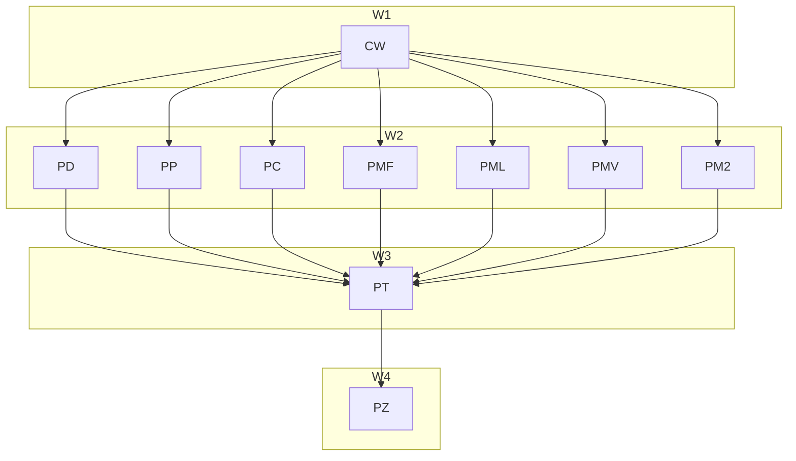

# Plan: Artifact mirroring (`grim-mirror`, PATH plugin dispatch, mirror provenance, `grim convert`)

## Status

- **Plan:** plan_artifact_mirroring
- **Active phase:** 5 — review-fix pass (refinement cycle 2 of 2)
- **Step:** closing re-review of 63da3f77..dd6d0066 (hex-review high, call 3 of 3): Approve, no gating finding, Warns for follow-up issues; awaiting /finalize
- **Last update:** 2026-11-24 (after dd6d0066: docs(mirror): document the second review-fix pass)
- State:   done
- Tier:    xhigh
- Tier-grammar: 5
- Updated: 2026-11-24
- Next:    /hex-finalize
- Reviewed: 8743bca7a336f3bf4a2c8a60af11ad04d9ad25b0

---

## Header

- **Goal contract (binding):** `.agents/goals/artifact-mirroring.md`. Autonomy: never prompt; every doubt runs its § Issue resolution and is recorded here (§ Decisions taken while planning). Granted acts: none, so a push, a PR act, an issue, a workflow dispatch and every act in another repository go to the meta-orchestrator (§ Acts outside this run's grants).
- **Source:** `.agents/discussions/artifact-mirroring.md` (ratified 2026-11-24) and its seven research files `.agents/research/research_artifact_mirroring_*.md` (2026-11-23, at `92ebcf23`; not repeated).
- **Decision record:** `.agents/adr/adr_artifact_mirroring.md` D1–D19, **Status: Proposed**, written by this run's architect seat and reviewed in this plan's review round. Its index row is in `.claude/rules/arch-principles.md` (lands with the ADR, so `task claude:tests` stays green).
- **System design:** `.agents/specs/design_artifact_mirroring.md` (§ 3 grim-side contracts, § 4 `mirror.toml`, § 5 pipeline, § 6 CLI, report, exit codes, § 7 errors, § 8 edge cases, § 9 tests, § 10 rollout). Shapes are cited from it, not restated.
- **Discover inputs:** four read-only reports at HEAD `896dcb6e` (CLI dispatch and workspace map, ocx plugin dispatch, ocx-mirror structure, publish/annotation/dialect claim check). Not committed; every fact the plan relies on is cited `file:line` in the ADR's premise table or below.
- **Classification:** large scope (four Done criteria, one new crate, three grim-side surfaces) · one-way door (high: dispatch rule, `GRIM_BIN`, `mirror` table keys, three annotation keys and their precedence, snapshot grammar of published tags) · tier **xhigh** (requested `high` at minimum; tier-high § Phase 3 routes Large here) · `architect=on` · `research=skip` (persisted research covers the topic) · `adversary=on` (new one-way door, no accepted ADR).
- **Tracking:** no open issue or PR covers this work (`gh issue list --state open`, `gh pr list`, read 2026-11-24). Nearest: #261 "grim copy" (registry-to-registry copy, out of scope per the discussion), #256 (plugin versions for marketplace exports, the export direction).
- **Gate command:** `env -u OCX_GLOBAL -u OTEL_EXPORTER_OTLP_ENDPOINT -u OTEL_EXPORTER_OTLP_HEADERS task --force verify` in the integration tree; docs `env -u OCX_GLOBAL task docs:check` (Node 24). Mid-step: `cargo test -p grim-mirror <filter>`, `cargo test <filter>`, `uv run pytest tests/<file> -k <name>` from `test/`. Python as `/usr/bin/python3`.
- **Host limits:** one shared cargo target; never two cargo builds at once; at most three edit-only worker worktrees under `.agents/worktrees/<pipeline>` (each after `git submodule update --init --recursive`); full test runs only in the integration tree; this host has no Windows side (`/mnt/c` absent), so Windows proof comes from a CI deep run the meta-orchestrator dispatches.

## Objective

An operator lists upstream git repositories and Claude plugin marketplaces in a `mirror.toml`, runs `grim mirror check` on a pull request and `grim mirror sync` on a schedule, and gets one grim artifact per skill, rule and agent at a pinned upstream commit, plus bundles, under the operator's own registry prefix. Each artifact records its upstream origin, commit and licence provenance. Executable kinds are skipped and reported. grim gains three additive surfaces to make it work: PATH plugin dispatch, a `publish.toml` `mirror` table, and an Unstable `grim convert`.

## Scope

**In:** ADR D1–D19 in full; design § 3–§ 10; ADR § Amendments 1–5; the four Done criteria (monorepo → `test_mirror_monorepo.py`, bundles → `test_mirror_bundles.py`, non-skill kinds → `test_mirror_kinds.py`, marketplace → `test_mirror_marketplace.py`).

**Out, with reason:** registry-to-registry copy (discussion § Intent); the repository split, the curated list repository and its scheduled job, `--announce` from the mirror, command → skill translation, an indexer "mirrored" badge (ADR § Deferred — each needs another repository or a consumer ask; filed as follow-ups by the meta-orchestrator); npm/archive/command marketplace sources (owner ruling); the site `changelog.md` entry (written by `/prepare-release` at release time, `workflow-release.md`); a `grim-mirror` release archive (ADR D1: source-only).

## Acts outside this run's grants

For the meta-orchestrator; none blocks `/hex-execute`.

1. Push the branch, open the one PR, run CI; dispatch one `verify-deep` run for the Windows dispatch test (no Windows on this host).
2. File follow-up issues: repository split of `crates/grim-mirror` (ocx repo-split template); curated list repository + its `check`/`sync` job and the GHCR namespace it publishes under; mirror `--announce`; Claude command → skill translation; indexer badge from `com.grimoire.mirror.source`; `grim help <plugin>` rewriting.
3. Owner: flip `adr_artifact_mirroring.md` to Accepted before `/hex-finalize` (ADR amendments 1–2 to the trust ADR and threat model are applied by PZ "on acceptance"; PZ writes them, the owner's flip ratifies them).

## Decisions taken while planning (goal § Issue resolution)

Each: question → research → decision. "Mine" = this orchestrator's, not the owner's.

- **PD-1 Repository scope (mine).** Q: the owner ruled a separate repository; this run may change only this one, in one PR, and Done 1–4 describe mirror behaviour. Research: Discover (workspace map: no crate allowlist blocks a new crate; ocx history: ocx-mirror was a workspace crate before its split, `adr_cli_repo_split_template.md`). Decision: **R2**, a workspace crate `crates/grim-mirror` with its own binary and no dependency on the `grimoire` crate; scored in ADR D1 against grim-side-only (feature cut), a built-in subcommand (contradicts the ruling) and a new repository (outside grants). The split is follow-up 2.
- **PD-2 Tier (mine).** Q: requested `high` at minimum. Research: tier-high § Phase 3 routes Large / one-way-door-high scope to xhigh. Decision: xhigh; the goal-loop prompt pre-approved the single meta-plan gate.
- **PD-3 Minimum grim (mine, amends ADR D13).** Q: the ADR required grim ≥ `MIN_GRIM`. Research: the branch build and the released 0.16.1 report the same version, and a version bump is a release act. Decision: a capability probe — the `grim schema --kind publish` document must define the entry's `mirror` property, and `grim convert --help` must exit 0 when any entry has `dialect = "claude"`; else 69. Applied to ADR D13 and design § 2, § 6.3, § 10.
- **PD-4 Windows dispatch proof (mine).** Q: the design proposed a `grim-mirror.exe` copy on Windows. Research: CI's Windows jobs only download `grim.exe` (`verify-deep.yml:130-133`). Decision: the Windows dispatch test copies `grim.exe` as `grim-probe.exe`; no second Windows binary. Applied to design § 9.
- **PD-5 CI staging of `grim-mirror` (mine).** Q: acceptance jobs download a prebuilt `test/bin/grim` (`acceptance.yml:76-82`); `cargo build --release --locked` at the root builds only the root package. Decision: the test taskfile builds `-p grim-mirror` beside grim and stages `test/bin/grim-mirror`; the CI job that builds the acceptance binary builds and uploads it too; `GRIM_MIRROR_COMMAND` overrides, as `GRIM_COMMAND` does.
- **PD-6 Mirror suites on Windows (mine).** Q: run the `test_mirror_*` suites on Windows? Research: the mirror is an operator CI tool; Done 1–4 do not name a platform; no Windows binary of it is built. Decision: those suites skip on Windows with a reason; `test/SKIP_CEILING` is raised once at integration by their count. Windows support is part of follow-up 2.
- **PD-7 Subsystem rule for the crate (mine).** Q: the crate's invariants (no `grimoire` dependency, no upstream code run, Unstable surface, copied git hardening) live only in the ADR. Decision: PZ adds `.claude/rules/subsystem-mirror.md` scoped to `crates/grim-mirror/**`, with its catalog rows and declared overlap group in `.claude/rules.md`.

## Open questions

None. The ADR settles the discussion's eleven questions (its table "Open question → decision") and the plan's own doubts are PD-1–PD-7.

## Traceability to the source

| Source item | Where | Pipeline |
|---|---|---|
| Done 1 monorepo, many artifacts | ADR D7, design § 5.2 | PMF, PT (`test_mirror_monorepo.py`) |
| Done 2 bundles of mirrored members | ADR D8, design § 5.9 | PM2, PT (`test_mirror_bundles.py`) |
| Done 3 non-skill kinds | ADR D8, design § 5.2–5.4 | PMF, PT (`test_mirror_kinds.py`) |
| Done 4 marketplace input | ADR D7–D8, design § 5.3 | PMF, PT (`test_mirror_marketplace.py`) |
| Tool home + `grim mirror` dispatch | ADR D1–D3 | CW, PD |
| Licence detected or declared, recorded | ADR D4, D11 | PP, PML |
| Dialect translation | ADR D9–D10 | PC |
| Version source tags / snapshot | ADR D5–D6 | PMV |
| No upstream code, no build steps | ADR D12 | PMF |
| Takedown / handover | ADR D15 | PM2 |
| Curated list run | ADR D17 | PZ (docs page, example) |
| Trust and threat-model statement | ADR D18 | PZ |

## Design guarantees

### Backwards compatibility (Principle 9 gate)

| Surface | Change | Additive because | Proof |
|---|---|---|---|
| Unknown subcommand | dispatch only when a `grim-<name>` is found on an absolute PATH entry | without a plugin, clap's error and exit 64 are byte-identical | `test_smoke.py:69-90` unchanged and green; `test_plugin_dispatch.py` not-found case compares stderr with a pre-change capture |
| Global flags | none changed; refused only before a found plugin name | no input that ran before changes | dispatch unit table |
| Env vars | `GRIM_BIN` set for a child only, never read | new variable | env table row, unit test |
| `publish.toml` | optional `mirror` table | manifests without it give byte-identical manifests and reports | `test_publish_mirror_table.py` digest-equal golden |
| OCI annotations | three new `com.grimoire.mirror.*` keys; precedence change only with the table | absent key = "does not say" (`stability.md`) | same suite |
| `grim schema --kind publish` | the document gains the optional table | new optional property | schema golden updated once in PP |
| Subcommands | `grim convert` (27th), Unstable; `--help` and completions list it | new name; help and completion output gain one entry | help/completion goldens updated once in CW |
| JSON reports | `convert` report new; no existing report gains a field | — | `json-interface.md` |
| `grim-mirror` | new binary, Unstable sibling surface | not in `dist-workspace.toml` | `stability.md` § Unstable row; C-024 test |
| Dependencies | `spdx` in `grim-mirror` only (grim already depends on `dunce`, `Cargo.toml:90`) | no behaviour change | `deny.toml` licence allowlist checked in `task verify` |

### Constitution deviations

| Principle / rule | Deviation | Reason |
|---|---|---|
| 5 (one source of truth) | the git hardening of `src/catalog/git_cmd.rs` is copied into `grim-mirror` | no lib split exists and the crate must not depend on `grimoire` (ADR D1, D12); a unit test pins the argument and env set |
| `quality-rust-exit_codes.md` "one enum per workspace" | `grim-mirror` keeps its own `ExitCode` subset | same boundary; a unit test reads `src/cli/exit_code.rs` and asserts equal values by name (launcher precedent, ADR premise 7) |
| `subsystem-cli.md` § Configuration Forwarding | `--config` and `--registry` before a plugin name are refused (64), not forwarded | no variable carries their exact meaning (ADR D3); everything that is forwarded goes through the one new `crate::env::plugin_child_env` |

### TDD approach

Contract-first inside each step: Stub (CW) → Specify (failing tests from the design's contracts, never from the stubs) → Implement. Acceptance suites are written from design § 9 in PT and run only in the integration tree.

## Component contracts

IDs are the coverage join keys. Each cites the design section that holds the exact shape.

- **C-001 Dispatch trigger and scan** (design § 3.1 Trigger, Name grammar): dispatch only on `InvalidSubcommand`; the scan over `OsString` argv stops at `--` or an unknown `-` token; the candidate must equal clap's invalid token; name `^[a-z0-9][a-z0-9-]{0,62}$`. Edge: `grim config nosuch` never dispatches; `grim --format=json x` consumes the flag.
- **C-002 PATH lookup** (§ 3.1 Lookup): `grim-<name>` (`.exe` on Windows, no PATHEXT; a `grim-x.bat` never runs); empty and non-absolute entries skipped; regular file; Unix needs an execute bit, else continue; spawn by the absolute path found.
- **C-003 Child setup** (§ 3.1 Found, § 3.2): argv after the name unchanged (`OsString`); env built only by `crate::env::plugin_child_env`: inherited env + `GRIM_BIN` (absolute, non-verbatim on Windows), `GRIM_OFFLINE=1` for `--offline`, `GRIM_LOCKED=1` for `--locked`; any other global flag before the name → 64 with the exact message; no telemetry, tracing, lock or state.
- **C-004 Execution and exit** (§ 3.1): Unix `exec`; `EACCES` → 77, other exec errors → 69 with `grim: cannot run <path>: <error>`; Windows spawn and wait with Ctrl-C ignored in the parent and the child's full exit code passed through.
- **C-005 Not found** (§ 3.1 Not found): clap's original error, exit 64, no JSON document, byte-identical.
- **C-006 `mirror` table grammar** (§ 3.3 table, Errors): keys, required set, grammar, `deny_unknown_fields`, exit 65 naming `<kind>.<name>.mirror.<key>`, on every kind table.
- **C-007 Annotations and precedence** (§ 3.3): emits `com.grimoire.mirror.source|path|license-source`, `revision`, `licenses`, `source` (https only), deprecation; each set value outranks every authored and derived tier; unset ones follow the existing chain.
- **C-008 Unchanged without the table** (§ 3.3 Unchanged, Read-back): byte-identical manifests and reports; `grim schema --kind publish` gains the table; describe shows the keys in `annotations`.
- **C-009 `grim convert` CLI** (§ 3.4): argv, kind inference, `--out` rules, output paths, exits 0/64/65/74/79, Unstable.
- **C-010 Inverse rules** (§ 3.4 tables): common keys kept (`license` kept on every kind); native→`metadata."claude.<field>"`; shadowed; unrepresentable; unknown dropped; FieldType coercions; semantic round trip per FieldType; key order; body byte-identical.
- **C-011 Convert report and body tokens** (§ 3.4 JSON report, Body tokens): always-present-null object, plain one table, token list with file and 1-based line.
- **C-012 `mirror.toml` grammar** (§ 4): every key (incl. `retire.units`), defaults, validation rows → 78 with `mirror.toml: <key path>: <problem>`.
- **C-013 Fetch** (§ 5.1, ADR D12): hardened git builder (args and env pinned by test), clone and fetch commands, `set-head`, ref resolution through explicit remote-tracking or tag refs, deadlines, candidate commit, `commit-unreachable`.
- **C-014 Enumeration from kind lists** (§ 5.2): units from `ls-tree -z`, globs, `exclude`, unit names, path containment (`unsafe-path`).
- **C-015 Marketplace enumeration** (§ 5.3): plugin selection by glob, the source table and URL grammar, `strict` cases (`plugin-conflict`), per-key add or replace, `pluginRoot` for bare names, root `SKILL.md` plugins, external fetch and inheritance, `skipped` rows per component, one bundle per plugin.
- **C-016 Staging gates** (§ 5.5): symlink/submodule, LFS, template-only, missing `SKILL.md`, invalid name, name collision, `.claude-plugin` dropped with warning, `100755` kept; blobs via `cat-file`, no checkout; convert call and `convert-failed`; licence notice carriage (LICENSE into skills, README companion for single-file units).
- **C-017 Licence** (§ 5.6, ADR D11): tri-state evidence per level, `license-unrecognised`, the header-only matcher and its thresholds, the golden corpus (must-match and must-not-match), GPL-family rule, lax SPDX parse, expression evaluation, allowlist default and override, parenthesised bundle join, outcomes and reasons.
- **C-018 Versions, reconciliation and selection** (§ 5.7, ADR D5–D6): eligible tags merged into the candidate, duplicate-version refusal, modes, watermark ignoring snapshot-shaped versions, reconciliation window, selection above the watermark with `backfill`, snapshot grammar with per-unit base, probe fallback when `latest` is absent, `unchanged` / `upstream-moved` / `version-collision`, `output-drift` warning.
- **C-019 Publish groups and grim driver** (§ 5.8, ADR D13): grim resolution, capability probe, group key incl. content commit, group `publish.toml`, env (`SOURCE_DATE_EPOCH`, `GIT_CEILING_DIRECTORIES`), status mapping, `Skipped` re-read, one retry on 75.
- **C-020 Bundles** (§ 5.9): members only `published` or verified `unchanged`, a failed member fails the bundle, absolute exact refs, partial bundle rows, `empty-bundle`, version from all member commits, `bundle-drift`, check mode from the plan.
- **C-021 Retire** (§ 5.10): `X.Y.(Z+1)` deprecated, `replaced-by`, `retire.units` for units gone upstream, `upstream-unavailable`, idempotent.
- **C-022 Report** (§ 6.2): JSON shape incl. `grim` and `grim_mirror` versions, every key present, item order, plain table, status set.
- **C-023 CLI and exit codes** (§ 6.1, § 6.3): argv incl. `--fail-on` defaults, env read, offline 81, exit order; `ExitCode` values equal grim's by name (test reads `src/cli/exit_code.rs`).
- **C-024 Crate boundary** (ADR D1): `crates/grim-mirror` is a workspace member, `publish = false`, `[package.metadata.dist] dist = false`, absent from `dist-workspace.toml`, no dependency on `grimoire`; `cargo tree -p grim-mirror` names no `grimoire` package (test).
- **C-025 Records** (ADR § Amendments 1–5, D19): stability rows, plugin name-space reservation, trust ADR and threat-model text, AGENTS.md and rule edits, docs pages, catalog drift review.
- **C-026 Failure matrix** (§ 7, § 7.1): every git and grim call outcome (exit 79 vs other describe failures, malformed JSON, timeout, unexpected exit, partial publish) maps to a status and reason; every failed upstream yields a non-zero exit under both `--fail-on` values.

## User-experience scenarios

Action → expected outcome → error cases.

- **S-001** `grim mirror check` with `grim-mirror` on PATH → the mirror runs with argv `check`, `GRIM_BIN` set → exec failure 77/69; `grim --format json mirror check` → 64 with the move-the-flag message.
- **S-002** `grim nosuchcmd`, no plugin → exactly today's clap error, exit 64 → none; a relative PATH entry holding `grim-nosuchcmd` is ignored.
- **S-003** `grim install` with a `grim-install` on PATH → the built-in runs.
- **S-004** `grim publish` of a manifest with `[skills.x.mirror]` → `describe` shows the three keys, `revision` = commit, `license` = the table's even when `SKILL.md` says otherwise → a bad key exits 65 naming it; a manifest without the table is byte-identical.
- **S-005** `grim convert ./skill --from claude --out ./out` → `out/<name>/SKILL.md` with Claude fields under `metadata.claude.*`, report rows, `grim build out/<name>` passes → existing non-empty `--out` 65; `--from cursor` 64; missing path 79.
- **S-006 (Done 1)** `grim mirror sync` over one repository holding three skills, two rules, one agent → six `published` artifacts under `{registry}/{upstream}/{kind}/{name}`; a second `sync` reports six `unchanged`, exit 0.
- **S-007 (Done 2)** a declared `[[upstream.bundle]]` → one bundle artifact whose members are absolute exact-version refs; `grim add <bundle>` installs every member → no admitted member: `refused` `empty-bundle`, 65 under `--fail-on refused`.
- **S-008 (Done 3)** rules and agents publish beside skills; a plugin carrying hooks, `.mcp.json`, `settings.json`, `commands/` → one `skipped` row each, exit 0.
- **S-009 (Done 4)** a marketplace with a relative plugin and a `git-subdir` plugin in a second repository → each plugin's members plus one bundle per plugin; skipped members listed with `bundle` set; an `npm` source → `skipped` `source-unsupported`; a `strict: false` conflict → `skipped` `plugin-conflict`.
- **S-010** licence: a detected file publishes as `detected`; a declared `license` with nothing detected publishes as `declared`; neither → `refused` `license-missing`; an unrecognised licence file → `refused` `license-unrecognised` unless `unit-licenses` declares the unit; MIT plus a non-commercial clause never matches MIT; non-allowed or conflicting → refused; a declaration beside detection → warning, detected wins.
- **S-011** versions: a tagged upstream publishes `X.Y.Z` per new tag merged into the candidate, up to `backfill`; an untagged one `0.0.<ts>`; forced snapshot over tag `1.2.0` gives `1.2.<ts>`; a first `v0.0.1` after a snapshot phase still publishes; a moved tag inside the reconciliation window → `refused` `upstream-moved`; prerelease tags ignored with one `tags-ignored` warning.
- **S-012** `check` → `would-publish` rows, nothing pushed; offline → 81; missing file 79; invalid file 78; grim without the capability → 69; `sync --fail-on infra` with a standing refused unit exits 0, and with a failed fetch exits non-zero.
- **S-013** `retire` → `X.Y.(Z+1)` deprecated with `replaced-by`; a unit deleted upstream is retired through `retire.units`; `grim status --check` shows both; the old exact tag still installs.
- **S-014** a Claude-dialect skill mirrors with `metadata.claude.*` and body-token warnings; `grim install` renders it for each client as the natively published equivalent does.
- **S-015** staging: template-only, LFS, symlink and unsafe-path units refused with their reasons; a `.claude-plugin` at a skill root dropped with `plugin-manifest-dropped`; an executable support file stays executable in staging.

## Contract wave (CW)

Committed once, before any other pipeline starts. Stubs compile (`unimplemented!()` bodies); contract tests compile and fail. CW owns every `mod` line and every `Cargo.toml`/`Cargo.lock` edit; a wave-2 step that needs another dependency stops and reports, and the orchestrator adds it at integration.

- **grim:** `src/cli/plugin_dispatch.rs` (+ its `pub mod` line in `src/cli.rs`) with `pub fn scan(argv: &[OsString], invalid: &OsStr) -> Scan` (`Scan::{NoDispatch, Candidate { name: String, offline: bool, locked: bool, refused_flag: Option<OsString> }}`), `pub fn lookup(name: &str, path: Option<&OsStr>) -> Option<PathBuf>`, `pub fn run(path: &Path, args: &[OsString], env: Vec<(OsString, OsString)>) -> ExitCode`; a `crate::env::plugin_child_env(offline: bool, locked: bool) -> Vec<(OsString, OsString)>` stub in `src/env.rs`; the call site in the parse-error arm of `src/main.rs`, guarded so CW keeps today's behaviour; `Command::Convert(ConvertArgs)` appended to the `Command` enum in `src/main.rs`, with its `src/app.rs` and `src/telemetry.rs` arms; `src/command/convert.rs` (`ConvertArgs`, `run`), `src/api/convert_report.rs` (design § 3.4 types, `Printable`), `src/install/vendor_inverse.rs` (`pub fn invert(kind: ArtifactKind, frontmatter: &str) -> Result<Inverted, ConvertError>`), with their `mod` lines in `src/command.rs`, `src/api.rs`, `src/install.rs`; `MirrorSpec` on `PublishEntrySpec` in `src/command/publish.rs` behind `#[serde(default)]` but **rejected** at validation until PP (CW changes no publish behaviour); annotation key constants in `src/oci/annotations.rs`; help and completion goldens updated for `convert`.
- **grim-mirror:** `crates/grim-mirror/Cargo.toml` (workspace member; dependencies `clap`, `serde`, `serde_json`, `toml`, `regex`, `globset`, `semver`, `sha2`, `time` with `formatting`, `tempfile`, `tokio`, `spdx`; `publish = false`, `[package.metadata.dist] dist = false`) and `src/main.rs` declaring every module. Each module carries its public signatures, so the wave-2 pipelines meet only at these:
  - `model.rs` (shared types, owned by CW, edited by no wave-2 pipeline): `Commit` (40-hex newtype), `Version` (re-export of `semver::Version`), `EligibleTag { name, version, commit }`, `SnapshotInput { base: Option<(u64, u64)>, commit: Commit, commit_time: i64 }`, `Probe { digest, revision, tags }`, `Refusal { reason, message }`, `DriverError`.
  - `spec.rs`: `MirrorFile`, `Upstream`, `BundleSpec`, `Retire`; `pub fn load(path: &Path) -> Result<MirrorFile, SpecError>`.
  - `git.rs`: the `GitCommand` builder; `pub struct Repo`; `pub async fn fetch(url: &str, work: &Path) -> Result<Repo, GitError>`; `Repo::{candidate, ls_tree, cat_file_batch, tags_merged, last_commit_for, peel}`.
  - `enumerate.rs` and `marketplace.rs`: `Unit { kind, name, path, plugin, upstream, content_commit }`, `Skipped { kind, name, reason }`, `Enumeration { units, skipped, bundles }`; `pub fn units(repo, upstream, commit) -> Result<Enumeration, EnumError>`; `pub async fn plugins(repo, upstream, commit, work) -> Result<Enumeration, EnumError>`.
  - `stage.rs`: `pub fn stage(repo, unit, dest: &Path) -> Result<Staged, Refusal>`.
  - `license.rs`: `Evidence::{Absent, Recognised(Expr), Unrecognised(PathBuf)}`, `LicenseVerdict`; `pub fn decide(levels: &[LevelEvidence], declared: Option<&str>, allow: &Allowlist) -> LicenseVerdict`; `pub fn join_bundle(exprs: &[Expr]) -> Expr`.
  - `version.rs`: `VersionPlan { reconcile: Vec<(Version, Commit)>, select: Vec<(Version, Commit)> }`; `pub fn snapshot_version(base: Option<(u64, u64)>, commit_time: i64) -> Version`; `pub fn plan(unit: &Unit, tags: &[EligibleTag], snapshot: Option<SnapshotInput>, published: &dyn Published, mode, backfill: u32) -> Result<VersionPlan, Refusal>` — git facts arrive pre-computed (`run.rs` derives them through `git.rs`), so PMV never calls git.
  - `publish.rs`: `pub trait Published { fn probe(&self, reference: &str) -> Result<Option<Probe>, DriverError>; }` (`Probe` from `model.rs`); `GrimDriver` implementing it plus `capabilities`, `convert`, `publish_group`.
  - `bundle.rs`, `retire.rs`, `report.rs` (`Report`, `Item`, `Status`, `Reason` closed enums per § 6.2 and § 7), `exit_code.rs`, `run.rs`, `cli.rs`.
- **Hub:** root `Cargo.toml` members; `Cargo.lock` regenerated once here.
- **Contract tests:** the `exit_code.rs` parity test against `src/cli/exit_code.rs` (C-023); `report.rs` serialisation of a fixed `Report` equals the § 6.2 JSON (C-022); `convert_report.rs` serialisation equals the § 3.4 JSON (C-011); the `cargo tree` boundary test (C-024); the dispatch `scan` table test with the § 3.1 rows, failing on the stub (C-001).

Gate: `cargo check --workspace`, `cargo test --workspace --no-run`, `task claude:tests`.

## Pipelines

### Parallelization

| Pipeline | Scope | Expected files | Wave | Depends on | Marks | Status |
|---|---|---|---|---|---|---|
| CW | C-001 (stub), C-011, C-022, C-023, C-024 | listed in § Contract wave | 1 | — | | merged |
| PD | C-001–C-005, S-001–S-003 | `src/cli/plugin_dispatch.rs`, `src/main.rs` (parse-error arm only), `src/env.rs` (`plugin_child_env` only), `test/tests/test_plugin_dispatch.py` | 2 | CW | review | merged |
| PP | C-006–C-008, S-004 | `src/command/publish.rs`, `src/oci/annotations.rs`, the publish schema golden, `test/tests/test_publish_mirror_table.py`, `test/data/publish_mirror/**` | 2 | CW | review | merged |
| PC | C-009–C-011, S-005 | `src/command/convert.rs`, `src/api/convert_report.rs`, `src/install/vendor_inverse.rs`, `src/install/vendor_claude.rs` (body-token list constant), `test/tests/test_convert.py`, `test/data/convert/**` | 2 | CW | | merged |
| PMF | C-012–C-016, S-015 | `crates/grim-mirror/src/{spec,git,enumerate,marketplace,stage}.rs` | 2 | CW | hard | merged |
| PML | C-017, S-010 | `crates/grim-mirror/src/license.rs`, `crates/grim-mirror/licenses/**` (embedded texts), `crates/grim-mirror/tests/licenses/**` (golden corpus) | 2 | CW | hard | merged |
| PMV | C-018, S-011 | `crates/grim-mirror/src/version.rs` | 2 | CW | | merged |
| PM2 | C-019–C-023, C-026, S-012, S-013 | `crates/grim-mirror/src/{cli,run,publish,bundle,retire,report,exit_code}.rs`, `crates/grim-mirror/examples/mirror.toml`, `crates/grim-mirror/README.md` | 2 | CW | | merged |
| PT | S-006–S-015 end to end; C-013–C-021, C-026 acceptance | `test/tests/test_mirror_*.py`, `test/src/git_fixture.py`, `test/conftest.py` (`grim_mirror` fixture), `test/taskfile.yml`, `.github/workflows/{verify-basic,verify-deep,acceptance}.yml` | 3 | PD, PP, PC, PMF, PML, PMV, PM2 | | merged |
| PZ | C-025 | `docs/src/content/docs/{commands,json-interface,publishing,artifacts,stability,mirroring}.md`, the env-var reference page, `docs/astro.config.mjs`, `AGENTS.md`, `.claude/rules/{product-context,arch-principles,subsystem-cli-commands,arch-threat-model,subsystem-mirror}.md`, `.claude/rules.md`, `.agents/adr/adr_artifact_trust_model.md`, `.agents/upstream-watchlist.md`, `catalog/skills/grim-usage/**`, `catalog/skills/grim-authoring/**` | 4 | PT | | merged |
| RV1 | S-014 partial, C-016 (convergence, review 2026-11-24) | `crates/grim-mirror/src/{publish,retire}.rs`, `test/tests/test_mirror_dialect.py`, `test/tests/test_mirror_kinds.py` | | PM2, PMF, PT | review | merged |
| RV2 | S-009 partial, C-019 (convergence, review 2026-11-24) | `crates/grim-mirror/src/run.rs` (unit `source`, `commit_time`), `test/tests/test_mirror_marketplace.py` | | PM2, PT | review | merged |
| RV3 | S-010 partial, C-017 (convergence, review 2026-11-24) | `crates/grim-mirror/src/license.rs`, `crates/grim-mirror/tests/licenses/**`, `crates/grim-mirror/src/run.rs` (`plugin_root`, carried notice) | | PML, PT | hard | merged |
| RV4 | C-018 partial (convergence, review 2026-11-24) | `crates/grim-mirror/src/run.rs` tests (`output-drift` wiring) | | PMV, PM2 | | merged |
| RV5 | C-001, C-005, C-009 (review Warns) | `src/main.rs`, `src/cli/plugin_dispatch.rs`, `src/error.rs`, `src/command/convert.rs`, `test/tests/test_{plugin_dispatch,convert}.py` | | PD, PC | review | merged |
| RV6 | C-013, C-015, C-022, C-023 (review Warns) | `crates/grim-mirror/src/{git,cli,report,spec}.rs`, `crates/grim-mirror/src/marketplace.rs` (per-plugin failure rows, source rule) | | PMF, PM2 | | merged |
| RV7 | Done 1–4 evidence against the registry (review Warn, gating) | `test/tests/test_mirror_*.py`, `test/src/git_fixture.py` | | RV1–RV6 | | merged |
| RV8 | C-019 partial (convergence, review round 2 2026-11-24: RV2's bundle entry builder) plus the round's six Warns | `crates/grim-mirror/src/{run,marketplace,enumerate,license}.rs`, `crates/grim-mirror/tests/licenses/`, `test/tests/test_mirror_{marketplace,kinds}.py` | | RV2 | review | merged |

Fix-pass execution (2026-11-24): pipelines FA = RV5, FB = RV1 + RV2 + RV3 (`run.rs` part) + RV4 + the marketplace part of RV6, FC = RV3 (`license.rs` part) + the rest of RV6, FD = RV7 (written in the integration tree against the unfixed binaries, so each new test is red before its fix).

Hub and generated files (no pipeline): `Cargo.lock` after CW, `test/SUITE_FLOOR`, `test/SKIP_CEILING` (PD-6), any golden digest — regenerated once at integration.

- **Critical path:** CW → PMF → PT → PZ (PMF is the largest wave-2 pipeline).
- **Shippable after wave:** 3 — the grim surfaces and `grim-mirror` with Done 1–4 proven end to end; wave 4 adds the docs and records the PR still needs before merge. Wave 2 is an integration checkpoint, not a shipment (its serialisation contract tests can pass before behaviour exists).
- **Parallel width:** the seven wave-2 pipelines are file-disjoint (CW owns every `mod` line, `Cargo.toml` and `Cargo.lock`; PD edits only the parse-error arm of `src/main.rs` and one function in `src/env.rs`). The three-worktree cap queues them critical-path first: PMF, PML, PM2, then PMV, PP, PD, PC.
- **Marks:** `hard` on PMF (git plumbing, marketplace matrix) and PML (licence matcher; a false "allowed" is the costliest defect), 2 of 10; `review` on PD (frozen CLI contract and the PATH concern) and PP (frozen wire format).

### Steps

Each step is one fresh agent. "Test first" = the failing test that step writes before code.

**CW** — 1 grim stubs, `Convert` wiring, `plugin_child_env` stub, help and completion goldens (`cargo check`; existing tests green). 2 `grim-mirror` skeleton with every signature above, workspace member, `Cargo.lock`. 3 The five contract tests; confirm they compile and fail on the stubs.

**PD** — 1 Test first: the § 3.1 scan table (every flag form, `--flag=value`, `--`, nested subcommand, name grammar, non-UTF-8 argv); implement `scan`. 2 Test first: lookup cases (empty and relative entries, non-executable file, `.exe`-only and `.bat` ignored behind `cfg(windows)`); implement `lookup`. 3 Implement `plugin_child_env`, `run` and the `src/main.rs` call site (Unix `exec`, Windows spawn with Ctrl-C ignored and the full exit code, errors 77/69, the flag-refusal message, `GRIM_BIN` via `dunce`); `test_smoke.py:69-90` untouched. 4 `test_plugin_dispatch.py` from design § 9 (Unix script plugin; on Windows `grim.exe` copied as `grim-probe.exe`, PD-4).

**PP** — 1 Test first: the `mirror` table grammar rows (unit, C-006). 2 Implement validation and annotation emission with precedence over every authored tier (unit tests for licence, source, revision, deprecated). 3 `test_publish_mirror_table.py`: annotations via `grim describe`, upstream `license` frontmatter outranked, 65 per bad key, a manifest without the table digest-equal to a golden captured before the change; schema golden.

**PC** — 1 Test first: per-registry-row semantic round trip and the FieldType coercion table (C-010). 2 Implement `vendor_inverse.rs` from the `KnownField` tables and the frontmatter re-serialisation (order kept, body byte-identical, `license` kept). 3 Implement the `grim convert` CLI, report and body tokens (C-009, C-011). 4 `test_convert.py` (Claude skill and agent fixtures; `grim build` of the output passes; a `--client claude` install equals the input's moved keys).

**PMF** (hard) — 1 `spec.rs`: parse and validate `mirror.toml`, every § 4 row → 78 (test first). 2 `git.rs`: the hardened builder copied from `src/catalog/git_cmd.rs:58-88` with args and env pinned by test; clone, fetch, `set-head`, ref resolution, candidate commit; unit tests against temp `file://` repositories. 3 `enumerate.rs`: kind-list units with `ls-tree -z` and path containment (test first: globs, `exclude`, names, `unsafe-path`). 4 `marketplace.rs`: test first from the § 5.3 matrix (sources, URL grammar, `strict`, add or replace per key, `pluginRoot`, root `SKILL.md`, skipped components), reading the facts in `.agents/research/research_artifact_mirroring_plan_review.md` rather than re-researching; implement. 5 `stage.rs`: test first for every § 5.5 gate, mode `100755`, the `.claude-plugin` drop and licence notice carriage; implement with `cat-file --batch`.

**PML** (hard) — 1 The 15 embedded texts and the golden corpus (must-match per text, BSD-2/BSD-3 and MIT/MIT-0 separation, MIT plus a non-commercial clause and other modified variants as must-not-match, GPL-family texts unrecognised). 2 Test first and implement the header-only matcher and its thresholds against that corpus. 3 Test first and implement evidence levels, lax SPDX parse, expression evaluation and the allowlist (`OR`, `AND`, `WITH`, `+`, `LicenseRef`), outcomes and the parenthesised bundle join.

**PMV** — 1 Test first: snapshot grammar (base `0.0`, per-unit base from merged tags, UTC, 14-digit shape), eligible tags merged into the candidate, duplicate-version refusal. 2 Test first: the watermark ignoring snapshot-shaped versions, the reconciliation window, selection with `backfill`, the probe fallback without `latest`, `unchanged`/`upstream-moved`/`version-collision`, against a fake `Published`; implement.

**PM2** — 1 `report.rs` and `exit_code.rs` beyond the contract: ordering, plain table, `--fail-on` exit precedence (§ 6.3), the failure matrix rows (§ 7.1), test first. 2 `publish.rs`: grim resolution, capability probe (PD-3), group key and `publish.toml`, env, status mapping, `Skipped` re-read, retry on 75, the `output-drift` digest compare — test first with a fake grim script. 3 `bundle.rs`: test first for member admission, a failed member, absolute exact refs, version from all member commits, `bundle-drift`, check-mode plan rows; implement. 4 `retire.rs`: test first for `X.Y.(Z+1)`, `retire.units`, `upstream-unavailable`, idempotency; implement. 5 `cli.rs` and `run.rs`: argv, `check`/`sync`, `--upstream`, `--work-dir`, `--fail-on`, offline 81, the § 2 flow over the CW signatures. 6 `examples/mirror.toml` and `README.md` (pinned `cargo install --rev`).

**PT** — 1 `test/src/git_fixture.py` (local repositories with fixed dates and tags, a marketplace, a second repository for `git-subdir`) and the `grim_mirror` fixture; `test/taskfile.yml` builds `-p grim-mirror` and stages `test/bin/grim-mirror`; `verify-basic.yml` builds and uploads it with the acceptance binary, `acceptance.yml` downloads it, `verify-deep.yml` does the same for its Linux and macOS targets (PD-5, PD-6). 2 `test_mirror_monorepo.py`, `test_mirror_bundles.py` (Done 1, 2). 3 `test_mirror_kinds.py`, `test_mirror_marketplace.py` (Done 3, 4). 4 `test_mirror_license.py`, `test_mirror_versions.py`. 5 `test_mirror_staging.py`, `test_mirror_dialect.py`, `test_mirror_retire.py`, `test_mirror_cli.py`; Windows skips (PD-6). 6 Run the Done suites (steps 2–3) in the integration tree to green; fixes go to the owning pipeline's files. 7 The same for steps 4–5, then set `SUITE_FLOOR` and `SKIP_CEILING`.

**PZ** (one pass after the last code fix) — 1 `stability.md` (amendment 3 incl. the plugin name-space rule), `commands.md`, `json-interface.md`, `publishing.md`, `artifacts.md`, env reference, sidebar. 2 New `mirroring.md`: declarations, the pinned install, an example GitHub Actions job (`check` on pull requests with `--fail-on refused`, `sync` on a schedule with a concurrency group), the takedown runbook. 3 `AGENTS.md`, `product-context.md`, `arch-principles.md` § Crate Layout, `subsystem-cli-commands.md`, new `subsystem-mirror.md` and its `.claude/rules.md` rows (PD-7); trust ADR and threat-model amendments 1–2; upstream-watchlist rows (body tokens, the marketplace matrix, Claude Code ≥ 2.1.239). 4 Catalog drift review of `grim-usage` and `grim-authoring` (`catalog/README.md`); `task catalog:verify`, `task claude:tests`, `task docs:check`.

**RV1** (convergence, run-level review 2026-11-24) — 1 Test first: a Claude-dialect agent whose frontmatter `name` differs from its file stem publishes as an agent with its common fields kept (fake-grim argv assertion in `retire.rs`, acceptance case in `test_mirror_dialect.py`/`test_mirror_kinds.py`). 2 Pass `--kind <unit.kind>` to `grim convert` (`publish.rs` `GrimDriver::convert`); make `retire.rs` `payload` return the path staging wrote (`<unit.name>.md`).

**RV2** (convergence) — 1 Test first: `test_mirror_marketplace.py` describes the `git-subdir` member and asserts `com.grimoire.mirror.source` = the external repository, `revision` its commit, and `created` its commit date. 2 Set a unit entry's `source` from `unit.external` when present (`run.rs` unit and bundle entry builders); read `commit_time` from `repo_of(unit)` and make an unreadable time a `failed` row instead of epoch 0.

**RV3** (convergence, hard) — 1 Corpus first: must-not-match variants for a short appended restrictive clause, a restrictive copyright line, a restrictive title line and "Permission is not hereby granted"; a marketplace plugin with no `plugin.json` whose own LICENSE must decide. 2 Tighten header-line dropping and the foreign-bigram bound for short templates; carry the plugin root from enumeration into `license()` instead of rediscovering it from `plugin.json`; carry only the deciding file as the notice.

**RV4** (convergence) — 1 A test that drives a reconcile pass to the `output-drift` warning through `run.rs`, not the predicate alone.

**RV8** (convergence, review round 2) — 1 Test first: `test_mirror_marketplace.py` describes the bundle of the `git-subdir` plugin and asserts `com.grimoire.mirror.source`, `org.opencontainers.image.revision` and `com.grimoire.mirror.path` name one repository (today `source` is the marketplace while `revision` and `path` come from the external repository). 2 In `run.rs` `bundle_version`, set the bundle entry's `source` from the plugin's external URL when `decl.plugin` was loaded from an external repository (keep the URL beside `plugin_repos`), else `self.up.repo`; the carried licence `Notice` `upstream` of an external unit takes the same URL.

## Review record (plan-artifact scope, round 1)

Seats: spec (sonnet), architect panel (sonnet), researcher (sonnet; persisted `.agents/research/research_artifact_mirroring_plan_review.md`), and the cross-model adversary codex `gpt-6.1-sol` on copies of the ADR, design and plan alone in a scratch directory. 4-way triage:

- **Actionable, fixed:** 10 Blocks on the ADR and design from the adversary, panel and researcher (moved-tag reconciliation, probes without `latest`, tag eligibility by ref, the snapshot ordering claim, output drift, bundle versioning and membership, marketplace add/replace and `strict`, licence tri-state evidence and matcher, retire discovery) and 14 Warns (concurrency, per-unit content commit, licence join and notice carriage, git ref and path hygiene, the convert invariant, the failure matrix, configuration forwarding, `--fail-on`, Windows exit and paths, name-space reservation, pinned install, per-unit snapshot base, wording); 2 spec Blocks on the plan (the CW dependency list and missing PM1 signatures → CW owns every dependency and full signatures; PM1 split into PMF, PML, PMV) and its Warns (`src/cli.rs` in CW, named workflows, test-first clauses, step sizing, the research step, Principle 9 rows).
- **Deferred:** none to a human.
- **Stated convention:** command → skill translation stays out (owner kind ruling); the copied git hardening and the exit-code subset (constitution deviations above).
- **Re-validation (one seat, after the fixed Blocks):** all ten design Blocks fixed (three needed ADR pointer lines, added); no new Block; five Warns fixed (the plan wrongly listed `dunce` as new, the golden-corpus path, typed `version.rs` inputs and a `model.rs` home for shared types, the describe bound without `latest`).
- **Trivia or contradicted:** the claim that the Claude agent registry lacks `color`, `isolation`, `initial-prompt`, `auto-compact-window`, `omit-claude-md` (they are at `src/install/vendor_claude.rs:124`); "base drift" from later tags (tags merged into an older revision do not change).

## Execution decisions (goal § Issue resolution)

- **ED-1 Commits under the commit guard (mine).** Q: the guard admits a commit only within 300 s of a green `task verify`, so a contract wave whose tests "compile and fail" cannot be committed, and workers cannot commit at all. Research: `.claude/hooks/pre_commit_verification.py`, `taskfile.yml` `.verify:mark` (stamp written only after a green gate). Decision: workers hand back working-tree diffs; the orchestrator applies them in the integration tree and commits per pipeline after one green gate per wave. The one CW contract test that fails on its stub (the dispatch `scan` table) carries `#[ignore = "stub: removed when implemented"]`, which PD removes as its first edit; stub files carry `allow(dead_code, reason = "stub: removed when implemented")`. Integration check: `grep -rn "stub: removed when implemented"` is empty before the wave-2 commits.
- **ED-2 The `mirror` field hidden from the schema in CW (mine).** Q: CW adds `MirrorSpec` to the entry spec, but the schema golden is updated once in PP. Decision: CW skips the field in schema generation; PP removes the skip with the golden update.
- **ED-3 Blob read deadline (mine).** Q: PMF reported that `cat-file --batch` in a `--filter=blob:none` clone fetches missing blobs lazily, so the 60 s deadline can fail a large upstream. Decision: 600 s for that call, plus a `--batch-check` size pass with per-blob (8 MiB) and per-unit (64 MiB) caps before any content is read, refused as `unsupported-entry`.
- **ED-4 One cargo build at a time across worktrees (mine).** Q: the plan shares one target dir, but PM2 found that worktrees clobber each other's test binaries there (path dependencies hash by workspace path), so a worker's test run can execute another worktree's build. Decision: from wave-2 mid-run each worktree uses a private target dir under `.agents/worktrees/
-target` (removed with the worktree), and every cargo call is serialised with `flock` on one host lock file, which keeps the "never two cargo builds at once" host limit.
- **ED-5 Windows Ctrl-C while a plugin runs (mine).** Q: design § 3.1 asks grim to ignore Ctrl-C and Ctrl-Break while it waits for a plugin child on Windows; `windows-sys` is not a direct dependency and the workspace sets `unsafe_code = "forbid"`, so no raw `SetConsoleCtrlHandler` call is possible. Decision: register `tokio::signal::windows::ctrl_c()` and `ctrl_break()` listeners (tokio is already a dependency) for the duration of the wait, which replaces the default termination handler without new code under `unsafe`. Proof needs the Windows CI deep run.
- **ED-6 Dispatch when grim cannot name itself (mine).** Q: the PD reviewer found that a failing `current_exe()` left `GRIM_BIN` unset by grim, so an inherited caller value would reach the plugin as if grim had set it. Decision: dispatch stops with exit 69 (`cannot determine the path of grim`) rather than run the plugin with an unverified `GRIM_BIN`; design § 3.2 says the value is the running grim, which an inherited value is not.
- **ED-7 Executable bits of mirrored files (mine).** Q: PT found that a `100755` upstream file installs without its execute bit, because grim's packer writes every layer entry as `0o644` (`src/skill/skill_package.rs`); design § 5.5 implied the bit survives. Research: `src/oci/hook.rs` states registry payloads arrive `0o644`; changing the packer changes the layer digest of every existing artifact holding an executable file, which Principle 9 forbids. Decision: the packer is unchanged; the mirror keeps `0o755` in staging, and the published layer must equal a native `grim publish` of the same tree. Design § 5.5 and ADR D12 wording corrected; `test_mirror_staging.py` asserts layer equality with a native publish instead of an executable install.

- **ED-8 Which sources marketplace content may name (mine).** Q: the security seat showed a third-party `marketplace.json` can name a `file://` repository, which the mirror then clones and republishes; the acceptance fixtures need `file://` external repositories, and no HTTPS server exists in the suite. Research: `marketplace.rs` routes every content URL through the operator grammar `spec::repo_ok`; the threat is a remote marketplace naming a path on the runner. Decision: a URL taken from marketplace content must be `https://`; `file://` is admitted only when the marketplace upstream itself is a `file://` repository the operator named in `mirror.toml`, because its content is then as local as the operator's own files. Any other URL is `skipped` `source-unsupported`.
- **ED-9 One broken plugin of a marketplace (mine).** Q: a dead `git-subdir` repository, a gitlink agent or an oversize manifest of one third-party plugin aborted the whole marketplace upstream. Decision: that plugin yields one row (`kind` bundle, the plugin name, `refused`, reason `upstream-unavailable` for a fetch or ref failure, `unsupported-entry` for an unreadable manifest or entry) and the other plugins continue; the upstream stays `ok`. `refused` keeps `check --fail-on refused` red on it while a scheduled `sync` (`--fail-on infra`) publishes the rest.

- **ED-10 Licence matcher bounds (mine, amends design § 5.6).** Q: S-010 says MIT plus a non-commercial clause never matches, but a clause of up to four extra bigrams, or one inside a dropped copyright or title line, matched. Decision: a copyright or title line is dropped only when it has at most 14 words and none of the clause words (`not no non noncommercial commercial commercially only except exception prohibit… never without cannot nor train training ai unless`; "MIT No Attribution" exempt); a kept header line counts as foreign text; templates under 300 bigrams (MIT, MIT-0, BSD-2, BSD-3, ISC, 0BSD, Unlicense) allow at most 2 foreign bigrams, longer ones `max(4, ceil(n/50))`; any foreign bigram holding a clause word refuses on every template. Coverage stays 97 %. Residual: a restriction worded without a clause word ("for educational use") on a long template still matches; the word list is the lever.
- **ED-11 Blob transfer bound (mine, amends ED-3).** Q: `cat-file --batch-check` is the call that downloads blobs in a blobless clone, so the caps applied after the transfer. Research (git 2.43 on this host): `ls-tree -l` fetches every blob, `GIT_NO_LAZY_FETCH=1` reports no sizes, `fetch --filter=blob:limit` ignores the limit for blobs asked by id, the client has no protocol-v2 `object-info`. Decision: batch-check runs one object at a time under the 600 s blob deadline, so the first blob over a cap stops every later transfer. Residual: that one blob is downloaded whole, bounded only by the deadline and the low-speed abort, plus up to 64 MiB of accepted blobs per unit.

- **ED-12 Transient fetch failure or gone repository (mine, amends ED-9).** Q: one external plugin whose fetch failed read `refused upstream-unavailable`, so a scheduled `sync --fail-on infra` exited 0 with nothing published for it. Research: git reports a gone repository only in the remote's own answer: a reachable repository without the pinned commit or ref (`CommitUnreachable`, `RefUnknown`), an HTTPS 404 (`remote: Repository not found.`, `fatal: repository '…' not found`), a path that is no repository (`does not appear to be a git repository`); a DNS, connection, 5xx, slow-transfer, timeout, auth-prompt or object-read failure reads otherwise (local probe: a clone of a repository with emptied objects ends `not our ref`). Decision: only those answers are "gone" and stay a `refused` row; every other git failure of an external plugin, at fetch or while reading its manifest and agent blobs, is one `failed` row of kind `bundle` with the git error's infra code (`git_code(e, true)`: 69, 75 for a timeout). Residual: git's own messages are translated under a non-English locale, so there a gone repository reads as `failed` (the loud direction); GitHub answers a private and a deleted repository alike through the auth prompt, also `failed`.
- **ED-13 Provenance of a plugin bundle (mine).** Q: RV8, the bundle of an external plugin recorded the marketplace as `source` beside the external commit. Decision: a bundle's `source` and `path` follow the repository its `revision` lives in: the plugin's own repository and its root there when the bundle's commit is a member's commit from it, else the marketplace URL and the plugin root (or `.`). The licence `Notice` of an external unit names the unit's own repository. Sites checked for the same fault: unit `GroupEntry` (`stage_version`, already right), bundle `GroupEntry` (fixed), `Notice.upstream` (fixed), `group_epoch`/`bundle_epoch` (`created`, already per repository), retire `GroupEntry` (reads the recorded annotations back, no upstream input), row `upstream` (the entry name, not a URL).
- **ED-14 A failed drift check fails a published row (mine, records RV4's behaviour).** Q: `fail_group` on a reconcile group marks an already-published version `failed` and pushes the infra code. Decision: intended. A run that could not confirm a published version must not report it `unchanged` or exit 0; the row keeps a `drift-check-failed` warning, a grim 65 there reads `refused` `grim-refused` instead. Stated in `mirroring.md` § Exit codes.
- **ED-15 Licence evidence of a plugin at its repository root (mine).** Q: a root plugin has `plugin_root` `None`, so its `plugin.json` `license` was never read and the unit was refused `license-missing`. Decision: for a marketplace unit without a plugin root, the `plugin.json` field joins the repository level beside the root licence files and the `package.json` field; there is no separate plugin level, because both name one directory. A root `LICENSE` that disagrees with the field therefore refuses as a conflict, and a deciding root file is still carried (the self-check seat showed a separate field-only plugin level would outvote a GPL `LICENSE` and drop the carried text).

## Deferred review findings

Review of 2026-11-24 (xhigh). Warns not fixed in this pass, one line each, for follow-up issues:

- `crates/grim-mirror/src/publish.rs:338` — on a grim infra exit the partial report is discarded, so units grim already pushed show `failed` for that run. Conservative: the rerun reports them `unchanged`, nothing publishes twice.
- `crates/grim-mirror/src/run.rs` — `bundle_version` and `stage_version` stay long and the publish-settle logic keeps two copies (the swallowed re-read in both is fixed through one `recorded_of` helper). A refactor, not a fix (two-hats rule).
- `crates/grim-mirror/src/run.rs` — blocking `std::process` and `std::fs` calls inside the async upstream run. No impact on the current-thread, strictly sequential runtime.
- `crates/grim-mirror/src/version.rs:182` — without `latest`, a first mirror probes every eligible tag per unit (up to tags × units `grim describe` calls). The loop is design § 5.7's; bounding it is a design change.
- `crates/grim-mirror/src/run.rs` `license_files` — a `license_check.py` or `licenses.json` counts as a licence file and refuses the unit `license-unrecognised`. Fail-closed, and `LICEN[CS]E*` in the design allows it.
- `crates/grim-mirror/src/run.rs:1215` / `license.rs:456` — a bundle licence join over grim's 256-byte cap is refused as `grim-refused`. Already fail-closed; only the reason is opaque.
- `crates/grim-mirror` vs grim — one cross-check test per copied grammar fed to both sides (architect seat). The git hardening copy and the `repo` grammar now match grim and the hardening copy is pinned against `src/catalog/git_cmd.rs`; `repo_ok` still does not run grim's URL parse.
- `crates/grim-mirror/src/run.rs` `eligible_tags` — uncached per external marketplace unit (1 + 2T git spawns each). Real plugin repositories carry few tags.
- `src/main.rs` — `grim mirror` with no `grim-mirror` on PATH prints only clap's error. A hint would change the not-found output, which C-005 freezes byte for byte.
- `crates/grim-mirror/src/marketplace.rs` — a failed external fetch is not cached, so two plugins naming one dead repository each retry it.
- `crates/grim-mirror/src/run.rs` `stage_version` — a git failure while staging a reconcile pass still only skips the drift check for that unit.

Not defects: codex W2 (a claim in the review brief, no code line), codex W3 (snapshot versions may decrease, accepted by ADR D5).

## Schedule log

(append-only; written by `/hex-execute`)

- 2026-11-24 /hex-execute start at `1bb55796`. Pipelines 10 (CW, then PD ∥ PP ∥ PC ∥ PMF ∥ PML ∥ PMV ∥ PM2 at ≤ 3 live worktrees, PMF/PML/PM2 first; then PT; then PZ). Jobs 3 live × 4 = 12. Classes `sonnet` throughout; `opus` only after a failed `sonnet` attempt on PMF or PML. Review: run-level `/hex-review` by the meta-orchestrator after return. Gates: one `task --force verify` per wave in the integration tree, commits inside its 300 s window, one per pipeline.
- 2026-11-24 CW landed at `be8f5a49` (gate: 4271 passed, 291 skipped, 0 failed; one fix: the pinned top-level command count 26 → 27 in `test_settings_consent.py`). Wave 2 started: PMF, PML, PM2 in worktrees.
- 2026-11-24 PML steps a–b returned (license.rs, 16 templates, 82-file corpus; 33 tests); patch applied to the integration tree, uncommitted until the wave-2 gate. PMV started.
- 2026-11-24 PMF, PML, PMV, PM2 landed in the integration tree (one reconciliation pass on `run.rs`; `cargo test -p grim-mirror` 223 + 3 green); PP and PD landed with their reviewer seats (no Block; Warns on raw-source grammar, schema defaults, `GRIM_BIN` fallback, untested JSON not-found) in one fix pass; PC step b and PT step 1 running.
- 2026-11-24 Waves 2–3 landed at `f7f396d3`..`7c8e3215` (one commit per pipeline). PT found five defects (pathspec magic vs literal pathspecs dropping every unit, retire skill payload path, bundle rows for refused and skipped members, fixture licence text, the executable-bit claim — ED-7); all fixed before the gate. Gate: 4652 cases, 4360 passed, 292 skipped, 0 failed; one fix on the way (bare text I/O in three new test files). SUITE_FLOOR 4384 → 4474, SKIP_CEILING 295 → 359 (54 mirror cases and 10 Unix-only dispatch cases skip on Windows, PD-6). PZ started: docs, records, catalog drift in parallel.
- 2026-11-24 PZ landed: docs pages (stability, commands, json-interface, publishing, artifacts, configuration, new mirroring, sidebar), records (AGENTS.md, product-context, arch-principles, subsystem-cli-commands, new subsystem-mirror, rules catalog, trust ADR and threat-model amendments 1–2 marked Proposed, upstream-watchlist rows) and the catalog drift review (grim-usage command map and plugins note, grim-authoring mirror-table bullet; no version bumps per catalog/README.md). Open for the owner: the ADR's fifth Unstable exception named as `grim convert` by the docs pass.
- 2026-11-24 Review-fix pass (refinement cycle 1 of 2) on the xhigh review of `8743bca7`: pipelines FA (grim side), FB (mirror driver, 4 steps), FC (licence matcher, fetch/CLI/report/spec), FD (registry-backed acceptance tests, written red against the unfixed binaries). Decisions ED-8–ED-11. Gate: 4667 cases, 4375 passed, 292 skipped, 0 failed; cargo nextest 8133 passed. SKIP_CEILING 359 → 296 (Linux 292 measured by this gate, plus the 4 macOS-only skips, subsystem-ci.md § 8; Windows skips are not counted), SUITE_FLOOR 4474 → 4488 (+14 new cases). Docs and records pass after the last code fix; `task docs:check` exit 0; catalog drift review: no skill statement changed (convert row and plugin note still true).
- 2026-11-24 Review-fix pass 2 (refinement cycle 2 of 2, the last) on review round 2 of `8743bca7..63da3f77`: RV8 plus six Warns, applied in the integration tree (licence title fix by one sonnet worker). Each new acceptance test was red against the unfixed binary first. Decisions ED-12–ED-15. Self-check seat (sonnet, delta `63da3f77..`): one functional defect, a field-only plugin level for a root plugin outvoting a disagreeing root `LICENSE` and dropping the carried text; fixed by ED-15's shared repository level, with its own red-first acceptance case. Gate: 4673 cases, 4381 passed, 292 skipped, 0 failed. SUITE_FLOOR 4488 → 4494 (+6 cases); SKIP_CEILING unchanged. `task docs:check` exit 0.
