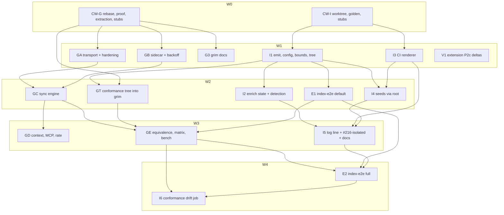

# Plan: Catalog at scale — grim P2a + hardening, indexer P2b, extension P2c

## Status

- **Plan:** plan_catalog_at_scale
- **Active phase:** 4 — closing review approved; landing (finalize in the cross-repo pin order) remains
- **Step:** /hex-review → call 3 of 3: Approve
- **Last update:** 2026-10-23 (closing review approved; `task --force verify` green at `7c9fd39b`)
- State:   landing
- Tier:    xhigh
- Tier-grammar: 5
- Updated: 2026-10-23
- Pins:    2026-10-23, moved to release tags (grim v0.15.0, indexer v0.6.0; [#221](https://github.com/grimoire-rs/grimoire/issues/221)): `INDEXER_REF` is `v0.6.0` and the indexer's `GRIM_REF` is `v0.15.0`; the pin-bump order, the E2 step 2 bump and the I6 step 1 `GRIM_REF` SHA are superseded by tag pins; see the goal file's last pin decision.
- Next:    run `/hex-finalize`, force-push [#210](https://github.com/grimoire-rs/grimoire/pull/210) and dispatch verify-deep; vscode P2c lands after #210
- Repos:
  - `grimoire` `/home/mherwig/dev/grimoire/.agents/worktrees/adr-catalog-at-scale`, branch `hex/adr-catalog-at-scale` ([#210](https://github.com/grimoire-rs/grimoire/pull/210)), head after the closing review (call 3 of 3: Approve), rebased onto origin/main `7b21abce` (not pushed; a push needs force-with-lease). `sccache --stop-server; RUSTC_WRAPPER= task --force verify` green at `7c9fd39b` (later commits are Markdown only): nextest 4431/4431, pytest 2039 passed, 33 skipped, 1 xfailed; `index-matrix` 32 passed, 14 skipped; `test:bench` 7/7; `claude:tests` 91/91; `catalog:verify` green. Local `index-e2e` 7/7 passed at `INDEXER_REF` `66c3621`; the conformance tree carries the clamped record at `8452c5a4`; the dispatched verify-deep run waits for the indexer P2b and #210 pushes. GE's G1 leg skips until grim 0.15.0 is published, and a skip does not count toward go/no-go. Landed: no
  - `indexer` P0: grimoire-rs/indexer@63647d5 ([indexer#11](https://github.com/grimoire-rs/indexer/pull/11)), final, merge-ready, draft. Landed: no
  - `indexer` P2b: `/home/mherwig/dev/grimoire/.agents/worktrees/indexer-p2b`, branch `feat/catalog-at-scale`, local head `66c3621` on P0, with I6 at `9a3de09` (unpushed; [indexer#12](https://github.com/grimoire-rs/indexer/pull/12) needs the finalize force-push). I6 `GRIM_REF` moves to `v0.15.0`. Landed: no
  - `vscode` P2c: grimoire-rs/grimoire-vscode@ce3c524 ([grimoire-vscode#31](https://github.com/grimoire-rs/grimoire-vscode/pull/31)), final, merge-ready, draft. Landed: no

---

## Overview

**Objective.** Implement the KISS-cut catalog-at-scale design in three repositories before the 2026-11-01 deadline:

- grim Phase 2a and the layout-independent hardening (D9, D10, D11, GR-R23, GR-R27) on [#210](https://github.com/grimoire-rs/grimoire/pull/210);
- indexer Phase 2b as its own pull request;
- the remaining extension Phase 2c rows.

The default configuration (`layout: flat`, `legacy: true`) must leave published bytes and client behaviour unchanged. That is proven early and on its own (§ Default-unchanged proof). The default stays `true` in this plan. It flips to `false` in the first indexer release after a grim carrying P2a becomes the supported floor (owner decision 2026-10-22, [#216](https://github.com/grimoire-rs/grimoire/issues/216), cut 1), which is outside this plan.

**Sources (binding, not restated here).**
- `.agents/specs/design_catalog_at_scale.md`: requirements §16.6 (IX), §17.6 (VX) and §18 (GR); phases §12; release sequence §13.2; test layers §14.1.
- `.agents/adr/adr_catalog_at_scale.md` (D1–D23, CD-2…CD-10).
- `.agents/adr/adr_index_site_at_scale.md` (P0, site search; out of scope here).
- Goal file `.agents/goals/pr-210.md` (§ Rules, § Autonomy, § Decisions, Definition of done).

**Classification.**
- Scope: Large (three repositories, about 75 requirement rows).
- Reversibility: one-way door (high). Every one-way decision is covered by the ADR, which the owner answered and cut on 2026-10-22. It is still marked Proposed, and this plan's execution produces the evidence its "Gates before Accepted" list names.
- Tier: xhigh. Classify resolved Large, so the run was re-announced at xhigh. The spawn set is unchanged because no new one-way door exists.
- Overlays: architect=inline (ADR and spec), research=skip (the persisted research artifacts are cited by the spec, §Appendix), adversary=off (no decision outside the ADR).

**In scope.**
- Spec §12 rows P2a (GR-R01, R02, R06, R08–R10, R12–R23, R26–R29, R31, R33–R36, R38), P2b (IX-R01–R10, R12, ~~R13~~, R21–R23, R26–R31, R34, R35, R36, R40–R43, R47–R49, R51, R52; IX-R13 is struck and IX-R34 is folded in from P2e, owner decision 2026-10-22, [#216](https://github.com/grimoire-rs/grimoire/issues/216), cut 8) and P2c (VX-R03–R10).
- The conformance tree (IX-R42, GR-R26), the grim `index-e2e` job (L6, V-41), and grim docs §15 Phase 2a and indexer docs §15 Phase 2b.

**Out of scope.**
- P0 (the site ADR package, worktree `indexer-p0`): handled elsewhere. Here it is the base of P2b and a release-order dependency.
- P1 releases (owner acts).
- P2d (index operations). ~~P2e (IX-R34)~~ is folded into P2b (owner decision 2026-10-22, [#216](https://github.com/grimoire-rs/grimoire/issues/216), cut 8).
- Tree sync (`adr_catalog_tree_sync.md`) and the site search file `c/q/`. The root's `search` member is emitted as `null` until the site ADR builds it.
- The IDs retired or moved by the KISS cut (spec §18 footer).
- §7.5 follow-ups.

## Design guarantees

1. **Backwards compatibility (Principle 9).**
   - `CatalogFile` keeps its byte shape; the sidecar `catalog/<h16>.sync.json` is new and private (§5.4).
   - `all.json`, `stats.json` and `/p/<ns>/<name>/` stay byte-frozen while `legacy` is true (proof: § Default-unchanged proof).
   - Only additive JSON is introduced: `grim context` `registries[].catalog`, always present and `null` when absent, with no `skip_serializing_if` in `src/api/`.
   - The tripwire (Rust tests in `context_report.rs`, `test_context.py`, `json-interface.md`, `commands.md#context`) changes in the same commit as the field (GR-R18).
   - Recorded deviations are the ADR's CD-2…CD-10 only. This plan adds none.
2. **Red-first TDD.**
   - Each contract wave commits stubs plus contract tests. The tests are marked `#[ignore = "contract: <pipeline>"]` in Rust and `it.skip` with a `contract:<pipeline>` tag in Vitest, so every gate stays green between steps.
   - A pipeline's first act on a stub is to un-ignore its contract tests and watch them fail.
   - Every feature step names its failing test before code.
   - Hat-1 moves (CW-G step 3) are characterization-only.
3. **JSON consumer dispatch.**
   - `registries[].catalog` is `null` exactly when no readable version-1 sidecar exists. A consumer branches on that one bit.
   - `layout` is `null` for OCI sources, never absent.
   - `sources[].error` keeps its type and gains wording only (`refresh deferred until <RFC 3339>`, §5.5).
   - The extension reads `sources[]` additively, and absent fields keep today's behaviour (VX-R06).
4. **Exit codes.**
   - grim: none new (GR-R12). Every new failure is a degraded refresh with `sources[].ok = false`, and `grim search --limit 0` → 64 is unchanged.
   - Indexer: no new code; 65 and 69 reuse `EXIT.data` and `EXIT.unavailable` per §5.6.
   - Extension: none.

## Resource rules

- **grim: one cargo build at a time on this RAM-bound host.**
  - Every cargo or `task` invocation that compiles runs under the shared lock: `flock /home/mherwig/dev/grimoire/.agents/cargo-build.lock <cmd>`.
  - Step gates use `RUSTC_WRAPPER= task rust:verify`.
  - The pipeline gate and the final gate are `sccache --stop-server; RUSTC_WRAPPER= task --force verify`.
  - Target dirs stay inside each worktree (never `/tmp`, a RAM-backed tmpfs). `CARGO_TARGET_DIR` stays unset.
- **Indexer:** every step and pipeline gate is `task check` (lint, typecheck, test, smoke, pack-smoke). The conformance drift job and V-19 run outside it.
- **Extension:** `task verify` plus `xvfb-run -a npm test`.
- **Concurrency:** npm and Vitest work may run beside one cargo build. Never run two cargo builds at once, and never run two extension `xvfb` runs at once.
- **Commits.**
  - Conventional Commits.
  - grim: `/usr/bin/git -C <worktree> commit --signoff -S`. The pre-commit marker hook needs `-C`.
  - Indexer and vscode: `-S` only, never `--no-verify`.
  - No `Co-Authored-By`.
- **Privacy.** Run the patterns in the owner's private memory file `privacy-grep-patterns.md` over the PR range, the commit messages and the PR body before every push. Only the neutral 20,000-entry design point and the 100,000 ceiling may appear.
- **Never touch:** the primary checkouts `/home/mherwig/dev/grimoire` (branch `goat`) and `/home/mherwig/dev/grimoire-vscode` (dirty).

## Component contracts

Behaviour is the spec's **[T]** bullets. A tester writes failing tests from the cited section. The contracts below fix the seams the pipelines are cut along. Names are indicative until the contract-wave commit fixes them.

### grim (`src/catalog/` unless noted)

- **C-001 Root grammar** (`index_root.rs`, new; §5.1; GR-R01, R02, R34).
  - `parse_root(bytes) -> Result<Root, RootMiss>`: `schema == 1`, the digest grammar `^[0-9a-f]{64}$` checked before any URL is built, refs `0 < size ≤ cap`, cap 64 KiB.
  - `planes` is an object with untyped members. `search`, `planes.catalog` and `expires` are ignored.
  - Edge cases: uppercase digest, `"planes": {"enrich": "x"}` accepted, `schema: 2` is a miss-200.
- **C-002 Transport** (`index_http.rs`, moved from `index_source.rs` in CW-G; GR-R08, R17, R38; §5.2, §6.5, §6.8).
  - `build_client()` with `Policy::custom` (≤ 5 hops, refuse https → http) and `referer(false)`.
  - `read_capped(resp, cap) -> (Vec<u8>, [u8; 32])` with streaming SHA-256.
  - `inflate_bounded(body, limit)`: one inflate iff the body starts `1f 8b`, else the bytes as served; abort past the limit.
  - `Deadline::{new(total), cap(own)}`.
  - `index_dir(locator)`, `root_url`, `blob_url(digest)` and `stats_url` via `reqwest::Url` (the §5.2 table; a query or fragment means no probe and no stats).
- **C-003 Redaction** (`redact.rs`, new; GR-R27; implemented in CW-G): `redact_url(&str) -> String`.
  - Input is free text that may embed zero or more URLs, such as a reqwest error chain or a `stale_or_err` debug chain.
  - Every `scheme://…` substring loses userinfo, query and fragment, and keeps scheme, host, port and path.
  - Text without a URL passes through unchanged.
- **C-004 Hardened git** (`git_cmd.rs`, new; `index_git.rs` moved from `index_source.rs`; GR-R13; §6.7).
  - `git_cmd(args, cwd, GitOpts { timeout, profile: IndexClone | Announce })` with the argv, environment and process rules of §6.7.
  - Announce gains `GIT_ALLOW_PROTOCOL` and `kill_on_drop`, with `timeout: None`.
- **C-005 Plain-output screen** (`src/cli/printer.rs`; GR-R23): `screen_plain(s, multiline) -> Cow<str>` escapes exactly the GR-R23 code-point list inside `write_row`. It is not `escape_debug`.
  - Notation: each escaped code point becomes the `char::escape_unicode` form, lowercase hex, for example `\u{1b}` and `\u{202e}`.
  - Tab and line feed are kept when `multiline` is true (`description`, `deprecated`) and escaped otherwise.
  - Borrowed (no allocation) when nothing is escaped.
- **C-006 Sidecar** (`sync_state.rs`, new; GR-R14, R16, R29; §5.4, §6.6).
  - `SyncState` (version 1; the fields of §5.4); `sidecar_path(cache)`; `load_bound(cache, source_key, catalog_bytes)`; `store(cache, &state)` (atomic, one Windows rename retry).
  - Backoff `on_failure(now, retry_after)`, `on_success()` and `gate(now) -> Proceed | Deferred(until)`, with an injectable `now`.
  - `RetryAfter::parse` (delta-seconds or HTTP-date) and `context_view()`.
  - `deny_unknown_fields` is dropped from the five cache structs in `registry_catalog.rs`.
  - `Catalog` gains a bytes-returning load and a digest-returning save for the binding.
- **C-007 Engine** (`index_sync.rs`, new; GR-R06, R09, R10, R15, R20, R21, R35, R36; §5.3, §6.3, §6.4).
  - `refresh(ctx, state, previous, refresh: Refresh, now) -> SyncOutcome::{Commit{entries, state}, Restamp{state}, Fail{state, error}}`.
  - `ProbeClass` per the §5.2 table.
  - `Refresh::{No, Yes, StatsForced}` with `From<bool>` in `catalog_service.rs::load_catalog`, so existing callers compile unchanged.
  - `registry_catalog.rs::coordinate` and `build_from_index` consume `SyncOutcome`: a commit writes `CatalogFile`, then the sidecar.
- **C-008 Conditional GET** (inside C-007, isolated; GR-R15; §6.4) [#216 cut 2] (cut by owner decision, #216).
  - `conditional_headers(&state) -> HeaderMap` and the 304 branch of `classify`.
  - Validators are stored only on adoption, and only when ≤ 256 bytes of visible ASCII.
- **C-009 Context object** (`src/api/context_report.rs`, `src/command/context.rs`; GR-R18): `registries[].catalog` per §5.5, read from the sidecar only.
- **C-010 Test fixtures** (`test/src/index_fixture.py`).
  - `IndexHandler`: ETag, request log and a fault table keyed by path, giving a status, headers, a body, a stall or a gzip-encoded body.
  - `write_root_json(root, flat, stats, **overrides)`.
  - `conformance_tree(dest, kind)` with kind `legacy-only | c-plus-legacy | c-only`; L0′ is synthesized as `flat: null`.
- **C-011 Conformance tree** (grim `test/data/conformance/`; IX-R42, GR-R26; V-28).
  - The anchored `dist/` subset: `all.json`, `stats.json`, `c/root.json`, `c/f/sha256/*.json.gz`, `c/p/sha256/*.json`, `c/s/sha256/*.json`.
  - `MANIFEST.json` in canonical JSON: `{"schema":1,"generator":{"indexer_sha","now"},"files":{"<relpath>":{"sha256","size"}}}`.
  - A README forbids hand edits. `.gitattributes` carries `test/data/conformance/** -text`.

### indexer (`grimoire-indexer`)

- **C-012 `sync` config** (`src/config.ts`; IX-R01; §5.7).
  - `parseSync(raw) -> SyncConfig { layout: 'flat' | 'anchored'; legacy: boolean; revalidateMs: number }`. It throws the exit-65 config error per §5.7, `tree` and `legacy: false` with `layout: flat` included.
  - `sync` joins `KNOWN_KEYS`.
- **C-013 Deterministic writers** (`src/emit/serialize.ts`, `src/emit/gzip.ts`; IX-R03, R52).
  - `serializeDeterministic(v, {trailingNewline})`: keys in byte order, no whitespace.
  - `gzipDeterministic(bytes)`: one member, mtime 0, no name or comment, level 9, and header byte 9 (OS) overwritten with `0xff` so the bytes do not depend on the platform zlib.
- **C-014 Record bounds** (`src/emit/records.ts`; IX-R30, shared with IX-R47 ingest).
  - `boundRecord(rec)` (allow-list, per-field bounds, the 8 KiB unlisted budget, clamp in place, never drop a key).
  - `STRIP_SET` and `stripControls(s, multiline)` cover the same code points as C-005.
- **C-015 Published emit** (`src/emit/root.ts`; IX-R05, R06, R12, R48, R52; §5.1, §5.7).
  - `emitPublished(dist, {allJson, statsJson?, planeRef, generation, generatedAt, sync}) -> Root`.
  - Write order: the `c/f` blobs, the legacy copies and their `.gz` siblings, the plane ref, and the root last.
  - `nextGeneration(now, published?)` is a pure function.
  - The root's `search` member is `null` in this plan.
- **C-016 Enrich plane** (`src/state/plane.ts`; IX-R07, R31): the `PlaneIndex`, `Shard` and `EnrichEntry` types, `bucketOf(ref)`, and `emitPlane(entries) -> {files, ref}` (deterministic, shard cap 2 MiB, warn at 1.5 MiB).
- **C-017 State and hand-off** (`src/state/handoff.ts`, `src/state/blobstore.ts`; IX-R35, R41).
  - `STATE_DIR = '.grim-index-state'`; the `Handoff` type (`generation`, `planes.enrich`, `state_epoch`, `next_key`, counters for §5.9); `readHandoff(root)`.
  - `BlobStore{put, get}` at `<state>/b/sha256/<hh>/<hex>`, re-hashed on every read.
- **C-018 Enrich CLI** (`src/cli/enrich.ts`, `src/cli/main.ts`, `src/state/statekey.ts`; IX-R10, R27).
  - `parsePurge(arg) -> {digest} | {ref}`, exit 65 before any I/O.
  - `grim-indexer state-key [--next]` prints one line matching `STATE_KEY_RE = /^[0-9]{1,16}-[0-9a-f]{64}$/`.
  - `STATE_KEY_RE` has one home, `src/state/statekey.ts`. The CLI and the CI renderer both import it.
- **C-019 Seeds** (`src/ratings/seed.ts`; IX-R49): the published fallback of `localOrPublishedSeed` reads `root.stats` through `request()`; failures keep `loadSeed`'s classes.
- **C-020 Retention** (`src/state/retention.ts`, new; IX-R22) [#216 cut 3]: `stagePreviousClosure(site, store, root, until)` and `copyRetained(dist, staged, newClosure)` per §5.8. Kept (owner decision 2026-10-22, [#216](https://github.com/grimoire-rs/grimoire/issues/216), cut 3 rejected).
- **C-021 Conformance generator** (`scripts/gen-conformance.mjs`; IX-R42): `--out <dir>` writes the C-011 tree from a checked-in seed with a fixed `now`; `--check <manifest>` diffs manifests and exits non-zero on drift.

### extension (`grimoire-vscode`)

- **C-022 Windower** (`src/webview/model.ts` `flattenRows`, `windowRows`, `navTarget`; VX-R03): a pure function rendering ≤ 200 rows with spacers and `aria-setsize`/`aria-posinset`, and roving focus.
- **C-023 Unrated probe** (`src/views/details.ts`; VX-R07): `grim rate <ref> --dry-run` before hiding the vote, gated on `RATING_GRIM_VERSION`, with the 420 s timeout.
- **C-024 Version-mix stubs** (`src/test/versionMix.test.ts`; VX-R09): stub grims replay the recorded 0.14.3 and 0.15.0 output. G2 behaves as G1.

### cross-repo

- **C-025 Default-unchanged proof.**
  - Indexer golden `test/data/golden/pre_plane_<sha7>/` plus `test/data/prechange.test.ts`.
  - grim `test/tests/test_index_flat_unchanged.py`.
  - The `index-e2e` legacy:true plus grim 0.14.3 leg (§ Default-unchanged proof).
- **C-026 `index-e2e` job** (grim `.github/workflows/verify-deep.yml`, `test/tests/test_index_e2e.py`, `test/data/index_e2e/`, the pin file `test/data/index_e2e/INDEXER_REF`; V-41).
  - Marker `index_e2e`, excluded from the ordinary run.
  - The test skips unless `GRIM_INDEXER_DIR` and `GRIM_G0_COMMAND` are set; `GRIM_REQUIRE_INDEX_E2E=1` turns a skip into a failure (the `GRIM_REQUIRE_GOLDEN` pattern).
  - The job always sets `GRIM_REQUIRE_INDEX_E2E=1`, so a green job means the test ran and passed, never a skip.
  - grim 0.14.3 comes from the ocx group `g0` (`ocx.sh/grimoire/cli:0.14.3`).

## User-experience scenarios

| ID | Action | Expected outcome | Error cases |
|---|---|---|---|
| S-001 | G2 `grim search` on an L0 index (no `c/`) | Same rows as before P2a, empty stderr, exactly one extra `GET c/root.json` (404) per refresh | Probe transport failure before any adopted root: `/all.json` still used (§5.2) |
| S-002 | G2 on L0′ (`flat: null` root) | Same as S-001; `debug` log only (GR-R09) | — |
| S-003 | G2 on an `anchored` index, catalog unchanged | Root only, ≤ 1 KB catalog bytes; stats fetched once per advertised digest | Stats blob fails verification: carried ratings kept, digest remembered as rejected |
| S-004 | G2 on `anchored` with a bad or missing flat blob | Falls back to `/all.json`; root not adopted; `fallbacks` + 1 | `legacy: false`: refresh fails, cache served, `sources[].ok = false` |
| S-005 | Index host fails after a root was adopted | Cache served, `sources[].error` says `refresh deferred until <time>`; no request until then; `--refresh` bypasses | 429 with `Retry-After` defers at least that long, one redacted `warn` |
| S-006 | `grim context --format json` | `registries[].catalog` with layout, generation, fallbacks, failures; `null` without a sidecar | Cold first failure: `built_at` and `entries` null |
| S-007 | Plain `grim search` over hostile record text | ESC, C1, bidi overrides, U+200B and tag runs are escaped; quotes, é, CJK, ZWJ emoji, LRM and the England flag stay | — |
| S-008 | A locator with userinfo or a query | Never appears in errors, logs or the sidecar; userinfo reaches only the locator's origin | https → http redirect: refused (CD-2) |
| S-009 | A git locator | Hardened clone; an `ext::` URL fails; a stalled server is killed within the deadline | Clone over 300 s or under 1 KB/s for 30 s fails (CD-3) |
| S-010 | Operator upgrades the indexer with the default config | `all.json`, `stats.json`, `/p/` bytes unchanged; `c/root.json` (`flat: null`), `c/f/` stats blob and `.gz` siblings appear | A theme or `public/` file under `c/` or `browse/` exits 65 naming it (S-015) |
| S-011 | Operator sets `"layout": "anchored"` | Root names the flat blob; G2 switches on its next refresh; G0 and G1 unaffected | `layout: tree` exits 65 |
| S-012 | Operator sets `"legacy": false` | Only `c/` published; footer drops the `/all.json` link | With `layout: flat`: exit 65 naming both keys |
| S-013 | Operator dispatches `fresh` or `purge` | Next build re-enriches all, or the purged ref or digest, under a new epoch | Mistyped purge: enrich exits 65, the job fails, nothing deploys |
| S-014 | Cold runner, cache miss or unset `site` | Build deploys and warns; every package deep once under the time budget | GitLab 60 min default: 25 min budget, "re-render required" |
| S-015 | Theme file at `public/c/x` | Build exits 65 naming the file and the move | — |
| S-016 | Extension browse of 20,000 rows | ≤ ~200 rows in the DOM, keyboard roving focus, scroll keeps position | Find-in-page misses off-screen rows (accepted, §17.4) |
| S-017 | Extension unrated row | Vote shown after `grim rate <ref> --dry-run` succeeds | grim older than `RATING_GRIM_VERSION`: vote hidden as today |
| S-018 | Extension with grim 0.14.3 | Paging gated off, first 500 rows | — |

**Error taxonomy.** Use the spec tables instead of restating them:
- grim probe classes (§5.2);
- FLAT, ANCHORED, FALLBACK and STATS outcomes (§5.3);
- backoff (§6.6);
- indexer exit 65, 69 and warn-and-deploy cases (§5.6);
- retention skips (§5.8).

## Trade-offs

| Decision | Options | Chosen, because |
|---|---|---|
| P2b base | (a) cut from origin/main; (b) stack on `fix/p0-hardening` | **(b).** P0 and P2b overlap on 12 files. `src/data/index.ts` (P0's logo loop sits inside P2b's emit rewrite) and `src/enrich/checkpoint.ts` (P2b retires `hydrateFiles`, which P0 edits) are high-conflict. P2b also depends on what P0 adds: the `logoOk` choke point, the `cache-mode` scoping and GitLab `timeout: 2h`. Cutting from main resolves those conflicts twice |
| grim cut | (a) one serial pipeline; (b) a Hat-1 extraction contract wave, then file-disjoint pipelines | **(b).** CW-G moves the transport into `index_http.rs` and the git leg into `index_git.rs`, and extracts the scripted test hosts. The hardening (GA) and the sidecar (GB) can then proceed in parallel, while builds serialize on the lock |
| Hardening order | (a) interleaved with layout; (b) GA and GB first, layout after | **(b).** On a no-go, the layout-independent prefix stays separable (§ Go/no-go) |
| `index-e2e` placement | `verify-basic.yml` or `verify-deep.yml` | **`verify-deep.yml`**, beside `principle-9`. A required check needs branch protection, an owner act (§14.1 known gaps) |
| Conformance pin | grim tag or SHA | **SHA in `test/conformance/GRIM_REF`** until the first grim release that carries the tree. Before #210 merges, no tag holds it |
| Golden base | origin/main or the P2b base | **The P2b base (P0's tip).** P0 changes page HTML, so "pre-change" means the commit P2b starts from |

## Contract waves (W0)

### CW-G — grim, on `hex/adr-catalog-at-scale`, serial

1. **Rebase.** Rebase onto origin/main `7b21abce`.
   - The three new commits touch `registry_catalog.rs` (one test-fixture line), `test/src/helpers.py`, `test/src/registry.py` and `Cargo.lock`.
   - Re-run `task claude:tests`.
   - Push with lease per the goal's grants.
2. **Default-unchanged proof, grim half (C-025).** Write `test/tests/test_index_flat_unchanged.py`.
   - Serve a legacy-only index with `IndexHandler`.
   - Expected `grim search --format json` rows are captured at the rebased base and committed beside the test.
   - Assert: stderr is empty; `catalog/<h16>.json` is byte-identical to grim 0.14.3's once `built_at`, `fetched_at` and the loopback port are normalised (closing review, `7c9fd39b`); per refresh, the request log entries other than `/c/root.json` are exactly `/all.json` and `/stats.json`. These assertions are green at the base and stay green.
   - Contract tests, red until GC step 3 (`#[ignore]`-equivalent: `pytest.mark.skip(reason="contract: GC")`):
     - exactly one `/c/root.json` request per refresh;
     - the same rows and an empty stderr on L0′.
3. **Hat-1 extraction plus stubs (characterization-only, no behaviour change).**
   - Move these out of `index_source.rs`:
     - the transport (constants, `build_client`, `http_client`, `BodyError`, `index_get`, `is_gzip`, `gunzip`, `read_capped`) into `index_http.rs`;
     - `fetch_git` and `walk_metadata` into `index_git.rs`;
     - the scripted hosts (`spawn_scripted_host`, `spawn_fixed_host`, `spawn_capturing_host`, `http_200`, `read_head`, `gzip`) into `#[cfg(test)] pub(crate)` `test_hosts.rs`.
   - Add every `pub mod` and `#[cfg(test)] mod conformance_tests;` declaration to `src/catalog.rs` once. No later pipeline edits `src/catalog.rs`.
   - Implement C-003 `redact_url` in full, with its table test. It is a pure function of about 20 lines, and GA and GB both call it in wave 1.
   - Stub C-001, C-004 to C-008, `Refresh`, and the `Catalog` bytes/digest load and save, each with `unimplemented!()`.
   - Make `forge.rs::next_interval` `pub(crate)`. (Closing review: the doubling was later inlined into `sync_state`, `a780d2ef`.)
   - Implement C-010 `IndexHandler` and `write_root_json` fully, with a self-test. Stub `conformance_tree`.
   - Add a nextest `[[profile.ci.overrides]]` with `retries = 0` for `test(/probe/)`.
   - Add the contract tests, ignored per pipeline.
   - Gate: `flock … RUSTC_WRAPPER= task rust:verify` green; `pytest test/tests/test_index_flat_unchanged.py` green.
   - Commits:
     - `test(catalog): pin flat-index search behaviour before the root probe`
     - `refactor(catalog): move index transport and git into their own modules`
     - `test(catalog): add the shared index fixture handler and sync contracts`

### CW-I — indexer, on `feat/catalog-at-scale`, serial

1. **Create the worktree** `/home/mherwig/dev/grimoire/.agents/worktrees/indexer-p2b` from the P2b base.
   - Base: P0's merge-ready tip (P0 PR open, `task check` green).
   - Fallback: if P0 is not merge-ready by 2026-10-24 12:00 UTC, P0's then-current committed tip.
   - Rebase onto later P0 commits as they land. After P0 merges: `git rebase --onto origin/main <old-p0-tip>`.
2. **Default-unchanged proof, indexer half (C-025).** `scripts/golden-prechange.mjs <base-sha>` adds a temporary git worktree of the base, runs `npm ci` and builds:
   - (a) `compileIndex` over `test/fixtures/dev`, giving `all.json`;
   - (b) `buildSite` over `test/renderer/fixture`, giving `stats.json` and a `dist/` inventory (path → sha256).
   It pins `now` (and every other clock input) to a fixed instant, then builds the base twice. A file that still differs between the two builds is excluded, with the reason recorded. If an excluded file is `all.json`, `stats.json` or anything under `p/`, the script fails instead: frozen bytes are never dropped from the proof. Commit:
   - `test/data/golden/pre_plane_<sha7>/` with a README: regenerate only with the script at the recorded base, never by hand, and again after every rebase onto a new P0 tip;
   - `test/data/prechange.test.ts`.

   The test asserts:
   - the default build and an explicit `sync: {layout: "flat", legacy: true}` both reproduce every golden byte (green at the base);
   - the only additional `dist/` paths are `c/**`, `all.json.gz` and `stats.json.gz` (contract, `it.skip` until I1 step 4).

   The inputs are benign by design: IX-R30 clamps out-of-bound fields on purpose (CD-8), and the conformance tree covers those.
3. **Contract stubs.** `STATE_KEY_RE` is real, in `src/state/statekey.ts`, because I3 consumes it in wave 1. Stub C-012 to C-018 and C-020 (types, constants, regexes, and signatures that throw `unimplemented`), with contract tests skipped per pipeline.
   - Gate: `npx tsc --noEmit` and `task check` green.
   - Commits:
     - `test: pin the default build's published bytes to the pre-change build`
     - `chore: stub the catalog-at-scale emit, state and CLI contracts`

## Parallelization

| Pipeline | Repo | Scope | Expected files | Wave | Depends on | Marks | Status |
|---|---|---|---|---|---|---|---|
| CW-G | grimoire | C-003, C-010, C-025 (grim); stubs C-001, C-004…C-008 | `src/catalog.rs`, `src/catalog/{index_source,index_http,index_git,test_hosts,index_root,index_sync,sync_state,redact,git_cmd}.rs`, `src/catalog/{conformance_tests,registry_catalog}.rs` (empty module; `Catalog` load/save stubs), `src/catalog/forge.rs`, `src/catalog/catalog_service.rs` (`Refresh` only), `src/cli/printer.rs` (stub), `.config/nextest.toml`, `test/src/index_fixture.py`, `test/tests/test_index_flat_unchanged.py` | 0 | — | — | merged |
| CW-I | indexer | C-025 (indexer); stubs C-012…C-018, C-020 | `scripts/golden-prechange.mjs`, `test/data/golden/pre_plane_*/**`, `test/data/prechange.test.ts`, `src/config.ts` (types), `src/emit/*.ts`, `src/state/*.ts`, `src/cli/enrich.ts` (`parsePurge` stub) | 0 | — | — | pending |
| GA | grimoire | GR-R08, R13, R17 (Deadline), R22, R23, R27, R38 (inflate); C-002, C-004, C-005, C-003 call sites; S-007…S-009 | `src/catalog/{index_http,git_cmd,index_git,index_announce,catalog_error,catalog_service,index_source}.rs` (`index_source.rs`: log sites and the two `read_capped` call sites, ~:506 and ~:705), `src/cli/printer.rs`, `test/tests/{test_index_transport,test_index_git}.py` (`test_index_git.py` new) | 1 | CW-G | review | merged |
| GB | grimoire | GR-R14, R16, R28, R29 (math), R35 and R36 (commit side), R27 (`stale_or_err`); C-006; S-005 | `src/catalog/{sync_state,registry_catalog}.rs`, `test/tests/{test_index_stale,test_index_source,test_search}.py` (glob filter, backoff cases) | 1 | CW-G | — | merged |
| G3 | grimoire | Docs §15 Phase 2a (not `json-interface.md`, `commands.md`) | `docs/src/content/docs/{stability,package-index,upgrading,configuration,hosting-an-index}.md`, `.claude/rules/subsystem-file-structure.md`, `catalog/skills/grim-usage/references/{registries,consume}.md` (+ the catalog version bump the drift review requires) | 1 | CW-G | — | merged |
| I1 | indexer | IX-R01…R06, R12, R30, R42 (generator), R48 (`true`), R52; R07 (emit shape), R31 (shard cap); C-012…C-016, C-021; S-010, S-011, S-012 (exit 65), S-015 | `src/emit/**`, `src/state/plane.ts`, `src/config.ts`, `src/data/index.ts`, `src/renderer/index.ts` (reservation scan), `src/validate/core/**`, `scripts/gen-conformance.mjs`, `test/conformance/seed.*`, `test/{emit,data,validate,config}/**` | 1 | CW-I | — | pending |
| I3 | indexer | IX-R21, R26, §3.7 enrich step, dispatch inputs, timeouts; S-013 | `src/ci.ts`, `templates/ci/{github-pages.yml,github-enrich.yml,gitlab-ci.yml,gitlab-enrich.sh}`, `test/cli/ci*.test.ts` | 1 | CW-I | review | pending |
| V1 | vscode | VX-R03, R07, R09, R10; VX-R04 cite check; C-022…C-024; S-016…S-018 | `src/webview/{model,render}.ts`, `src/webview/sidebar/{main.ts,sidebar.css}`, `src/views/details.ts`, `src/test/{model,render,details,versionMix}.test.ts`, `src/test/fixtures/goldens/*.html`, `README.md`, `docs/manual-testing.md` | 1 | — | — | pending |
| GC | grimoire | GR-R01, R02, R06, R09, R10 (engine), R12, R15, R17 (wiring), R20, R21, R29 (header), R34, R35, R36, R38; C-001, C-007, C-008; S-001…S-004 | `src/catalog/{index_root,index_sync,index_source}.rs`, `test/tests/{test_index_scale,test_index_stale,test_index_transport,test_index_source}.py` | 2 | GA, GB | hard | merged |
| I2 | indexer | IX-R06 (wiring), R07 (store), R08, R09, R10, R27, R28, R29 (store-first), R31, R35, R36, R40, R41, R43, R47, R51; C-017, C-018; S-013, S-014 | `src/enrich/{index,checkpoint,marketplace}.ts`, `src/state/{anchor,blobstore,detect,memo,budget,statekey,handoff}.ts`, `src/cli/{enrich,build,dev,main,state-key}.ts`, `src/data/index.ts` (hand-off), `test/{enrich,state}/**`, `test/cli/{enrich,build,dev,state-key}*.test.ts` | 2 | I1 | hard | pending |
| I4 | indexer | IX-R49; C-019 | `src/ratings/seed.ts`, `src/cli/{ratings,downloads}.ts`, `templates/ci/*-stats-seed.*`, `src/ci.ts` (seed steps only, after I3), `test/ratings/**`, `test/cli/{ratings,downloads,ci}*.test.ts` | 2 | I1, I3 | — | pending |
| GT | grimoire | GR-R26, V-28 (grim); C-011 | `test/data/conformance/**`, `.gitattributes`, `src/catalog/conformance_tests.rs`, `test/src/index_fixture.py` (`conformance_tree`) | 2 | CW-G, I1 | — | merged |
| E1 | grimoire | C-025 (e2e leg), C-026; V-41 (legacy:true + 0.14.3) | `.github/workflows/verify-deep.yml`, `test/tests/test_index_e2e.py`, `test/data/index_e2e/**`, `test/pyproject.toml` (markers `index_e2e` and `bench`), `test/taskfile.yml`, `ocx.toml`, `ocx.lock` | 2 | I1 | review | merged |
| GD | grimoire | GR-R10 (rate), R12 (null policy), R18, R19; C-009; S-006 | `src/api/context_report.rs`, `src/command/{context,rate}.rs`, `src/mcp/server.rs`, `test/tests/{test_context,test_rate}.py`, `docs/src/content/docs/{json-interface,commands}.md`, `catalog/skills/grim-usage/**` (drift re-check) | 3 | GC | — | merged |
| GE | grimoire | GR-R31, R33; V-1, V-2, V-4, V-13, V-30 (grim) | `src/catalog/conformance_tests.rs` (equivalence tests), `test/tests/{test_index_matrix,test_index_bench}.py`, `.github/workflows/verify-deep.yml` (bench step), `ocx.toml` (`g1`), `ocx.lock` | 3 | GC, GT, E1 | — | merged; G1 leg skipped (0.15.0 unpublished), not a pass |
| I5 | indexer | IX-R23; [#216] ~~R13~~ (cut 8, dropped fully, owner decision 2026-10-22, [#216](https://github.com/grimoire-rs/grimoire/issues/216)), R22 (kept), R29 (site leg), R48 (`false`, staged flip), published plane (kept); V-19; docs §15 Phase 2b; S-012 (`legacy: false`) | `src/build/logline.ts`, `src/state/retention.ts`, `src/emit/{overlap,legacy,publish-plane}.ts`, `src/cli/{build,enrich}.ts`, `src/renderer/index.ts` (tail), `src/renderer/astro/components/SiteFooter.astro`, `scripts/bench-scale.mjs`, `docs/**`, `test/{build,state}/**` | 3 | I2, I3, I4 | — | pending |
| I6 | indexer | IX-R42 (drift check) | `test/conformance/GRIM_REF`, `.github/workflows/ci.yml` (job `conformance`), `package.json` (script `conformance:check`), `test/conformance/check.test.ts` | 4 | GE, E2 step 1 | — | committed locally (indexer `9a3de09`); `GRIM_REF` `v0.15.0` (indexer repo) |
| E2 | grimoire | V-41 full: anchored, incremental, ~~[#216] 304~~ (cut by owner decision, #216) and `legacy: false`; tree refresh at the P2b head; final pin | `test/data/conformance/**` (refresh), `test/tests/test_index_e2e.py`, `test/data/index_e2e/**` (incl. `INDEXER_REF`) | 4 | GE, E1, I5 | — | committed; `INDEXER_REF` `v0.6.0`; verify-deep pending pushes |

- **Critical path:** CW-I → I1 → I2 → I5 → E2 → I6. The grim chain CW-G → GA/GB → GC → GE → E2 runs beside it.
- **Shippable after wave 1:** the layout-independent grim hardening (GA, GB steps 1–2), separable from #210's later commits under the conditions in § Go/no-go. Shippable after wave 4: everything.
- **Under-parallelization.** All grim pipelines serialize their builds on one lock (RAM-bound host). I2 stays one pipeline because detection, memo, budget, purge and state-key share `src/enrich/index.ts` and `src/cli/enrich.ts`. GD waits for GC because `rate.rs` needs the engine's forced stats.
- **Worktrees.**
  - grim pipelines branch `hex/adr-catalog-at-scale--<slug>` under `.agents/worktrees/cas-<slug>/`.
  - G3 and E1 need no cargo build of their own. E1 first copies a built `grim` out of the #210 worktree to `.agents/worktrees/cas-e1/bin/grim` and runs that fixed copy, so a later rebuild cannot change it mid-run.
  - At most one pipeline at a time runs in the #210 worktree itself, which saves a target dir: GC in wave 2, GD in wave 3, E2 in wave 4. GE runs in its own worktree beside GD.
  - Indexer pipelines branch `feat/catalog-at-scale--<slug>` under `.agents/worktrees/indexer-p2b-<slug>/`.
  - V1 continues in `vscode-p2c`.

## Pipelines and steps

Each step: red-first test first, then code, then the step gate. Every row ID maps to a step in § Traceability.

### GA — transport and hardening (grim, `review`)

1. **Transport prerequisites** (GR-R08 hashing, GR-R17 and GR-R38 primitives). The later steps use these, so they come first.
   - `read_capped` returns the SHA-256; its two callers in `index_source.rs` (~:506, ~:705) take the new return.
   - `inflate_bounded` (GR-R38 primitive).
   - URL derivation (V-6 table; query locators fetch no stats).
   - `Deadline` (GR-R17 primitive).
   - Red-first tests: V-6; V-44 at the unit level; V-43 identity body; a lying `Content-Length`; `Deadline::cap` never exceeds the remaining total.
   - Commit: `refactor(catalog): hash, inflate and derive index URLs in the transport`. Not a hardening commit.
2. **D9 redirects and credentials** (GR-R08 policy, GR-R22).
   - Red-first tests (V-9 part) with scripted hosts:
     - https → http refused;
     - http → http followed for an `http://` locator;
     - cross-origin https followed;
     - the 6th hop refused;
     - no `Cookie` header;
     - a cross-origin redirect arrives without `Authorization`.
   - Commit: `fix(catalog): refuse https-to-http redirects on index requests`.
3. **D10 hardened git** (GR-R13). Implement `git_cmd` per §6.7. `index_git.rs` clones through it with every clause and `min(300 s, deadline)`; announce gains `GIT_ALLOW_PROTOCOL` and `kill_on_drop`.
   - Red-first tests, in the new `test/tests/test_index_git.py` (it reuses the git fixture helpers from `test_index_source.py`, which GB owns this wave):
     - an `ext::` URL fails;
     - a leading `-` is a path argument;
     - a local-path index clones through `--no-local` and the fixtures still pass;
     - a stalled server is killed within the deadline;
     - an inherited `GIT_ALLOW_PROTOCOL=ext` does not re-enable `ext::` for announce;
     - URL credentials never reach an error.
   - Commit: `fix(catalog): run index and announce git through one hardened helper`.
4. **GR-R27 redaction.** Apply `redact_url` at:
   - the `CatalogError::index_fetch` choke point and its Display;
   - `catalog_service.rs` `sources[].error` and the `warn!` sites at ~:380 and ~:394;
   - the `index_git.rs` error text;
   - the `index_source.rs` `warn!` and `debug!` sites (~:479–534, :499, :709, :715).
   - The `stale_or_err` site is GB's.
   - Red-first tests:
     - a failed git clone of a userinfo locator: the error text carries no credential;
     - `sources[].error` and Display with a userinfo locator;
     - a tracing-capture test on the warn sites.
   - Commit: `fix(catalog): redact index locators in errors and logs`.
5. **GR-R23 plain-output screen.** Apply `screen_plain` in `write_row`.
   - Red-first fixtures: the GR-R23 verification column, verbatim, with expected strings in the C-005 notation.
   - Commit: `fix(cli): escape hidden and control characters in plain table output`.

Gate: `flock … RUSTC_WRAPPER= task rust:verify`. Pipeline gate: plus `pytest test/tests/test_index_transport.py test/tests/test_index_git.py test/tests/test_index_source.py`.

### GB — sidecar, backoff, quiet path (grim)

1. **Sidecar** (GR-R14, GR-R36 commit order).
   - Implement C-006 load, store and binding.
   - Drop `deny_unknown_fields` on `RatingSummary`, `DownloadSummary`, `DownloadVersion`, `CatalogEntry` and `CatalogFile`, and flip the tests that pin the old behaviour.
   - Add the bytes and digest load and save.
   - Commit `CatalogFile`, then the sidecar (§6.3).
   - Make the `catalog/*.json` globs at `test_index_source.py:639` and `test_search.py:704` skip `*.sync.json`.
   - Red-first tests: V-7, V-38, the sidecar mix table, no URL stored, and fault injection between the two writes.
   - Commit: `feat(catalog): keep per-source sync state in a bound sidecar`.
2. **Backoff** (GR-R16, GR-R29 math, D11).
   - Add the gate in `coordinate` (bound, not forced, not offline). Serve stale with `sources[].ok = false` and `refresh deferred until <RFC 3339>` plus the redacted last error.
   - A cold first failure writes `catalog_sha256: null`. OCI sources share the gate.
   - Redact the `stale_or_err` debug chain with C-003 (from CW-G).
   - The deferral text is built in `sync_state.rs`. No new `CatalogError` kind (GR-R12), so `catalog_error.rs` stays GA's.
   - Red-first tests:
     - V-8 (`u32::MAX`, `retry_after` a year ahead clamped, clock jump, jitter band, `Retry-After: 120`);
     - L2: transport failure gives stale-serve and backoff; `--refresh` bypasses; `--offline` never reads it.
   - Commit: `feat(catalog): back off after a failed index or registry refresh`.
3. **Quiet path** (GR-R28, GR-R35 commit side).
   - Freshness runs from the later of `built_at` and a bound `checked_at`.
   - `Restamp` writes the sidecar only. A stats-changing restamp commits the entries and the binding together.
   - `SyncOutcome` is consumed from hand-built outcomes.
   - Red-first tests: the V-31 unit half (restamp leaves `CatalogFile` bytes untouched; `applied` is never written ahead of its entries).
   - Commit: `feat(catalog): restamp a quiet refresh in the sidecar only`.

Gate: as GA, plus `pytest test/tests/test_index_stale.py test/tests/test_search.py`.

### G3 — grim docs (grim)

1. Write the §15 Phase 2a pages from the spec contracts:
   - `stability.md`: `c/root.json` and `c/f/`, "presence not promised";
   - `package-index.md`;
   - `upgrading.md`;
   - `configuration.md#data-layout`;
   - `hosting-an-index.md` (`sync` block, `legacy`, `fresh`/`purge`, host ceiling, rollback);
   - `.claude/rules/subsystem-file-structure.md` (the `$GRIM_HOME` entry).
2. Drift-review `grim-usage` `registries.md` (Index Sources, ~141–194: "Neither is capped", gzip, the git clone) and `consume.md`, including the catalog version bump `catalog/README.md` requires.
3. Gates: `task docs:check` (Node 24), `flock … task catalog:verify`, `task claude:tests`.
4. Commits:
   - `docs: describe the index root, flat blob and sync sidecar`
   - `chore(catalog): drift-review grim-usage for index sync`

### GC — sync engine (grim, `hard`)

1. **Root grammar** (C-001; GR-R01, R02, R34).
   - Red-first: the V-5 table.
   - Commit: `feat(catalog): parse and validate c/root.json`.
2. **Parametrize the index tests (Hat 1, test-only).** Parametrize `test_index_scale`, `test_index_stale`, `test_index_transport` and `test_index_source` over legacy-only, `c/` + legacy and `c/`-only. The trees are synthesized with `IndexHandler` and `write_root_json`; GE's matrix, not this step, uses the conformance tree. The per-test handlers are replaced. Only the legacy-only kind runs before step 3; the other kinds are skipped as `contract: GC`.
   - Commit: `test(catalog): parametrize the index tests over index kinds`.
3. **Probe and FLAT** (GR-R21, R09, R17 wiring, R29 header capture, R12).
   - Un-skip CW-G's contract tests and step 2's other index kinds.
   - Red-first tests:
     - V-36;
     - the V-3 probe cases;
     - the request log: exactly one root GET, never `c/p/`, `c/s/`, `c/q/` or `c/root.json.*`;
     - a degraded refresh exits 0 with `ok: false`;
     - a 429 with `Retry-After` gives exactly one redacted `warn` and stores the header for GB's backoff.
   - Commit: `feat(catalog): probe the index root and fall back to all.json`.
4. **ANCHORED, FLATBLOB, FALLBACK** (GR-R06, R36, R38, R17).
   - Red-first tests: V-34; the V-42 grim half; V-43; V-44 at engine level; V-10 (a stalled flat-blob body fails the refresh within the total deadline with the cache served; the test scales the deadline down through a test-only override).
   - Commit: `feat(catalog): sync an anchored index through its verified flat blob`.
5. **STATS** (GR-R20, R35, R10 engine side).
   - Red-first tests: V-33; V-39; V-31 end to end with GB; `Refresh::StatsForced` fetches even an applied or rejected digest.
   - Commit: `feat(catalog): fetch stats once per advertised digest`.
6. **[#216 cut 2] Conditional GET** (C-008; GR-R15) (cut by owner decision, #216).
   - Isolated in `conditional_headers()` and the 304 arm of `classify`. The sidecar's `root.etag` and `root.last_modified` are tolerant.
   - Red-first tests: V-23; the V-3 304 cases (a 304 without its own validators; a 304 with no stored validator is a miss-200).
   - Commit: `feat(catalog): revalidate the index root with a conditional GET`.

Gate: as GA, plus every `test_index_*.py`.

### GD — surfaces (grim)

1. **`grim context` `registries[].catalog`** (GR-R18, R12). The Rust tripwire, `test_context.py`, `json-interface.md` and `commands.md#context` change in one commit.
   - Red-first: V-11.
   - Commit: `feat(context): report each source's catalog sync state`.
2. **MCP description** (GR-R19). `server.rs:61` already covers `limit`, `offset` and `total`. Add only the "tens of megabytes unbounded" and `sources[].capped` wording, and keep the pinned phrases.
   - Red-first: the description test.
   - Commit: `docs(mcp): warn grim_search callers about unbounded large indexes`.
3. **`grim rate`** (GR-R10). An unrated row reloads with `Refresh::StatsForced`.
   - Red-first: an acceptance request log shows one forced stats fetch.
   - Commit: `feat(rate): refetch stats once before reporting a row unrated`.
4. **`commands.md`.** Document the `--refresh` semantics (bypasses backoff, conditional headers and the stats skip rules) and MCP paging.
   - Commit: `docs: document --refresh against the sync sidecar`.
5. **Catalog drift re-check.** GD changed `src/command/{context,rate}.rs` and two docs pages after G3's review, so re-run the `grim-usage` drift review per `catalog/README.md`; bump the skill version only if its text changes.
   - Gate: `flock … task catalog:verify`.
   - Commit (only if changed): `chore(catalog): drift-review grim-usage for context and rate`.

Gate: as GA, plus `pytest test/tests/test_context.py test/tests/test_rate.py test/tests/test_mcp.py`.

### GT — conformance tree into grim (grim)

1. **Check in the tree** (GR-R26, C-011). This is the earliest P2a gate prerequisite (§13.2 step 3), so it runs as soon as I1 step 6 is pushed, beside GC.
   - Take the I1 generator output at the pushed indexer SHA and record that SHA in `MANIFEST.json`.
   - Add the README and the `.gitattributes` rule.
   - Implement a Rust manifest-verifying loader in `conformance_tests.rs` and `conformance_tree()` in `test/src/index_fixture.py`.
   - Red-first: a flipped byte fails the manifest check.
   - Gate: `flock … RUSTC_WRAPPER= task rust:verify`.
   - Commit: `test(catalog): add the catalog conformance tree from the indexer`.

### GE — equivalence, matrix, bench (grim)

1. **V-4 equivalence** (GR-R31) in `conformance_tests.rs`. FLAT(G) equals ANCHORED(G) except `fetched_at`; a duplicate ref resolves to the last occurrence; a schema-2 element projects to nothing.
   - Commit: `test(catalog): prove flat and anchored sync give equal entries`.
2. **V-2 matrix, V-1 and V-30 grim half** (GR-R31), in `test_index_matrix.py`.
   - Legs: G0 0.14.3 (ocx `g0` from E1), G1 0.15.0 (ocx `g1`, gated on the owner's release, see Open questions), and G2 built. Each leg runs against every index kind.
   - Also the 600-row regression and the duplicate-upgrade winner.
   - Commit: `test(catalog): cover the grim and index version mix`.
3. **V-13 bench** (GR-R33). `test_index_bench.py`, marker `bench` (registered by E1), runs as a `verify-deep.yml` step.
   - Synthetic 20,000 entries. Warm search < 1 s and < 300 MB.
   - A quiet refresh < 1 s and < 300 MB with no `CatalogFile` write and ≤ 1 KB.
   - Refresh peak ≤ 2 × warm.
   - Commit: `test(catalog): assert the 20,000-entry sync budgets`.

Gate: `sccache --stop-server; RUSTC_WRAPPER= task --force verify` (the final grim gate runs after E2).

### E1 — `index-e2e`, default config (grim, `review`)

1. **Spike.**
   - At the I1 milestone SHA (pushed), check that `npm ci --ignore-scripts && npm run build` builds the indexer on a clean runner.
   - Check that `node dist/cli/index.js build <root>` builds the hand-written fixture.
   - Check that the ocx group `g0` resolves `ocx.sh/grimoire/cli:0.14.3` (`ocx lock`). Fallback: the release tarball plus `.sha256`.
2. **Test first.** `test_index_e2e.py` (marker `index_e2e`, env gating per C-026) builds `test/data/index_e2e/` with the pinned indexer and the default config. It asserts:
   - `c/root.json` has `flat: null`;
   - `all.json` and `stats.json` have `.gz` siblings;
   - grim 0.14.3 lists exactly the fixture's packages with the fixture rating;
   - the built grim lists equal entries with an empty stderr.
3. **The job.** Add the `index-e2e` job to `verify-deep.yml`:
   - SHA-pinned actions;
   - `permissions: contents: read`;
   - a concurrency block;
   - `task` targets;
   - the shared grim binary artifact;
   - `GRIM_REQUIRE_INDEX_E2E=1` in the job's `env:`, so a skip fails the job.

   Register the `index_e2e` and `bench` markers in `test/pyproject.toml` and exclude both from the default run in `test/taskfile.yml`. Add the `g0` group to `ocx.toml` and `ocx.lock`.
   - Locally, run against the fixed `grim` copy (§ Parallelization, Worktrees), never the live #210 target dir.
   - Gate: a local `GRIM_REQUIRE_INDEX_E2E=1 task test:index-e2e`, then a dispatched verify-deep run on the branch (a granted CI act). Record the run URL and the junit line showing the test passed, not skipped.
   - Commits:
     - `test: add an end-to-end index build and sync test`
     - `ci: run the index end-to-end job in deep verify`

### E2 — `index-e2e`, full (grim)

1. **Refresh the conformance tree at the P2b head.** I2 and I5 change emit after GT took the tree at the I1 milestone. Run `gen-conformance.mjs --out` at the pushed P2b head and compare manifests.
   - If they differ: replace `test/data/conformance/**`, re-run GT's and GE's tests, and commit `test(catalog): refresh the conformance tree at the P2b head`.
   - Either way, record the grim SHA that carries the final tree; I6 pins it.
2. Bump `INDEXER_REF` to the P2b head. Add the `anchored` build:
   - flat and anchored entries are equal;
   - one incremental change fetches exactly one new blob.
3. [#216 cut 2] Add a root 304 on a plain search after the aging helper. The helper backdates `built_at`, recomputes the sidecar's `catalog_sha256` and backdates `checked_at`. It is its own test function. (cut by owner decision, #216)
4. [#216 cut 1] Add a `legacy: false` build: the built grim makes no `/all.json` request. It is its own test function. It stays under the staged flip (owner decision 2026-10-22, [#216](https://github.com/grimoire-rs/grimoire/issues/216), cut 1).
5. Re-run the legacy:true plus grim 0.14.3 leg at the final pin. This is the Done-criterion evidence.
6. Commit: `test: extend the index end-to-end test to anchored and legacy-free indexes`.

Gate: `GRIM_REQUIRE_INDEX_E2E=1 task test:index-e2e` locally, then a dispatched verify-deep run with every `index_e2e` test passed (junit), none skipped. Then the final grim gate: `sccache --stop-server; RUSTC_WRAPPER= task --force verify`.

### I1 — emit, config, bounds, tree (indexer)

1. **Deterministic writers** (IX-R03 for new files, IX-R52 function).
   - Red-first tests:
     - P-3 goldens with keys `"10"` and `"0a"`;
     - `serialize(parse(x)) == x`;
     - equal gzip input gives equal bytes;
     - the header has mtime 0, no name and the pinned OS byte.
   - Commit: `feat(emit): add deterministic JSON and gzip writers`.
2. **`sync` config and reservation** (IX-R01, IX-R02).
   - Red-first tests:
     - one config unit test per §5.7 row (defaults; `tree` → 65; `legacy: false` with `flat` → 65; `revalidate` grammar and range; a non-object → 65; unknown keys warn);
     - an older-indexer warning text;
     - reservation fixtures `public/c/x`, `public/browse/x` and `theme/pages/c/x.astro` → 65 naming the file and the move.
   - Commit: `feat(config): add the sync block and reserve c/ and browse/`.
3. **Record bounds, strip set and plane dedupe** (IX-R30, IX-R04, validate).
   - Red-first tests:
     - a 1 MiB description, and each field over its bound;
     - unlisted keys past 8 KiB clamped in place;
     - one case per strip-set class, with ZWJ, LRM and the flag kept;
     - P-11;
     - a validate fixture where a new duplicate `ref` gets manual review.
   - The CW-I golden stays green.
   - Commit: `feat(data): bound and strip record fields at emit`.
4. **Published emit** (IX-R05, R06 pure, R12, R48 `true`, R52 siblings, write order). The root keeps naming the `c/f` blobs (owner decision 2026-10-22, [#216](https://github.com/grimoire-rs/grimoire/issues/216), cut 7 rejected).
   - `build` without a hand-off writes `planes.enrich: null`, `generation = floor(now)` and `search: null`.
   - Red-first tests:
     - P-1, P-4, P-5 per layout, P-7, P-9 (fault injection), the V-42 producer half and V-45;
     - un-skip the CW-I additive-set test.
   - Commit: `feat(emit): publish c/root.json with the flat and stats blobs`.
5. **Plane emitter** (IX-R07 shape, IX-R31 caps). Write into the hand-off directory only; publishing under `dist/c/{p,s}` is I5's [#216 cut 4] step (kept, owner decision 2026-10-22, [#216](https://github.com/grimoire-rs/grimoire/issues/216)).
   - Red-first tests: P-4 for `c/p` and `c/s`; a 1.5 MiB warning; `bucketOf`.
   - Commit: `feat(state): emit the enrich plane index and shards`.
6. **Conformance generator** (IX-R42 generator, V-28 indexer half).
   - The checked-in seed covers about 300 entries. Its content is the full V-28 list:
     - a duplicate ref, keys `"10"` and `"0a"`, a schema-2 element and a description truncated mid-character;
     - one hostile record per bounded field, including the unlisted default and an element past 8 KiB;
     - one record per strip-set class, beside a kept flag sequence, a ZWJ emoji and an LRM, with `\u` escapes.
   - The seed uses layout `anchored` and a fixed `now`.
   - Red-first: two runs give byte-equal manifests.
   - Push this milestone and hand the SHA to GE and E1.
   - Commit: `test: emit the catalog conformance tree`.

Gate: `task check`.

### I2 — enrich state and change detection (indexer, `hard`)

1. **Command boundary and hand-off** (IX-R35, R36, R28 hand-off cases).
   - Create `<state>/.gitignore` containing `*`. `enrich` writes `<state>/out/handoff.json`. `build` and `dev` read only the hand-off.
   - `enrich --seed` reads the published root.
   - `checkpoint.ts` retires. The plane restore keeps P0's `logoOk` choke point.
   - Red-first tests:
     - V-29 (network-denied `build` and `dev`, with and without `site`; `ci.enrich: false` → `planes.enrich: null`);
     - the V-17 `.gitignore` case;
     - IX-R28 fault injection: a failed `enrich` (no hand-off) makes `build` warn and deploy.
   - Commit: `feat(enrich): hand off to an offline build through the state directory`.
2. **Anchor and blob store** (IX-R08, R29 store-first, R41, R06 wiring, R07 store).
   - The anchor reads the root with a nonce through `request()`, using the explicit https or loopback `site` only.
   - The CAS store is re-hashed on every read; companion files are capped at 1 MiB on ingest.
   - A plane file missing from the store makes its bucket cold. Fetching it from the site is I5's [#216 cut 4] step (kept, owner decision 2026-10-22, [#216](https://github.com/grimoire-rs/grimoire/issues/216)).
   - Red-first tests:
     - V-24: stale edge via the nonce; oversize, gzip bomb, HTML 200 and 3xx refused with a warning; no request with only the default `site`;
     - V-17: an unanchored entry is ignored; swapped bytes fail the re-hash;
     - generation with a clock behind and far behind the published root;
     - IX-R28 fault injection, one test per case, each warns and deploys: an empty or corrupt restored store; a failed anchor fetch; `site` unset; `site` on `http://` that is not loopback. The last two build cold with no anchor request.
   - Commit: `feat(enrich): anchor build state in the published root and a blob store`.
3. **Change detection and time budget** (IX-R09, R43). Per-bucket detection kept (owner decision 2026-10-22, [#216](https://github.com/grimoire-rs/grimoire/issues/216), cut 6 not adopted).
   - Red-first: the V-16 cases:
     - a no-op rebuild makes zero deep calls, and its blobs are byte-identical;
     - due refs make 2 calls, known refs 3, and an enricher bump costs 3 per ref, not 5;
     - a missing blob sends only its ref deep;
     - the budget stop; the skipped buckets come first, with the store restored or lost;
     - no probes after `budget_end`;
     - `CI_JOB_TIMEOUT=3600` gives 25 min plus "re-render required";
     - rotation covers every bucket within `T` despite a skipped build.
   - Commit: `feat(enrich): detect changes per bucket under a time budget`.
4. **Memo, outage rule, 30-day cut, ingest clamp** (IX-R40, R51, R47, R31).
   - Red-first: the V-16 memo and outage cases (the exit-69 denominator is unchanged; an incremental outage exits 0), V-47 and V-32.
   - Commit: `feat(enrich): back off failing refs and cut them to pointer-only after 30 days`.
5. **`--fresh` and `--purge`** (IX-R10).
   - Red-first tests:
     - `""`, `sha256:`, 63 hex and `../x` → 65 before any request;
     - both purge effects;
     - a purge in backoff or with the budget spent;
     - a purge that fails → pointer-only.
   - Commit: `feat(enrich): add --fresh and --purge`.
6. **[#216 cut 5] `state-key` and `state_epoch`** (IX-R27, the epoch parts of IX-R10). Isolated in `src/state/statekey.ts` (`nextEpoch`, `formatKey`, `STATE_KEY_RE`). Kept (owner decision 2026-10-22, [#216](https://github.com/grimoire-rs/grimoire/issues/216), cut 5).
   - Red-first tests:
     - a plane epoch of `"1\nX=y"` → non-zero exit;
     - the V-24 read cases;
     - no plane → a fresh key;
     - weekly renewal; a new epoch on `--fresh` or `--purge`.
   - Commit: `feat(enrich): print the build-state cache key`.

Gate: `task check`.

### I3 — CI renderer (indexer, `review`)

1. **GitHub** (IX-R26, §3.7).
   - `timeout-minutes: 120`, plus `CI_JOB_TIMEOUT: 7200` on the enrich step.
   - The state-key step: `npx --no grim-indexer state-key`. Admit only `STATE_KEY_RE`; anything else means a cold build with no restore and no save.
   - Exact-key restore with no `restore-keys`, in the build job only. Save under `--next` when the key is absent, only on success, on the default branch only. The path is pinned to the blob store.
   - Dispatch inputs through `env:`. The POSIX enrich body is §3.7's. This is the rendered half of IX-R10 (`fresh` and `purge` inputs) and of IX-R27 (the state-key step).
   - Red-first: the V-17 substring assertions.
   - Commit: `feat(ci): cache the build-state blob store in the Pages build job`.
2. **GitLab** (IX-R21).
   - Fixed key `grim-index-state-v1`, `pull-push`, `when: on_success`, only in the protected `pages` job.
   - Never `unprotect` or `fallback_keys`. P0 already sets `timeout: 2h`; do not add it again.
   - The enrich body sits in the `then` branch of the install `if`.
   - Red-first: the V-17 GitLab assertions.
   - Commit: `feat(ci): cache the build-state blob store in the GitLab pages job`.

Gate: `task check`. The seed templates are I4's, not I3's.

### I4 — seeds via the root (indexer)

1. **IX-R49.** An on-disk `.stats.json` from an earlier producer still wins. Otherwise:
   - read `root.stats` from the explicit `site`, inflated and verified;
   - use `/stats.json` only after a root 404, or when a valid root names no stats;
   - any other failure keeps the `loadSeed` classes and publishes nothing.

   - Red-first: the V-40 seed cases (a `legacy: false` site carries the same entries; downloads then ratings keep both; a blob 404, a mismatch or a 5xx root fail and keep the carried ratings).
   - Commit: `feat(ratings): seed stats from the published root's stats blob`.
2. **Seed templates.** `templates/ci/gitlab-stats-seed.sh` fetches `$SITE_URL/stats.json` directly, which a `legacy: false` site does not serve. I4 routes it, and any GitHub twin, through the CLI seed path from step 1. Runs after I3, so `src/ci.ts` and `test/cli/ci*.test.ts` are free.
   - Red-first: rendered-template assertions that the seed step calls the CLI and never fetches `/stats.json` itself.
   - Commit: `fix(ci): seed stats through the indexer instead of fetching stats.json`.

Gate: `task check`.

### I5 — log line, #216-isolated parts, docs (indexer)

Each isolated step is one commit, one module and its own test file, so adopting the matching cut deletes them.

1. **Build log line and budget warnings** (IX-R23).
   - Red-first: each warning fires at its threshold.
   - Commit: `feat(build): print the build log line and budget warnings`.
2. ~~**[#216 cut 8] Overlap `enrich.json`** (IX-R13), in `src/emit/overlap.ts`.~~
   - ~~Red-first: V-20.~~
   - ~~Commit: `feat(build): write enrich.json once more for downgraded indexers`.~~
   - **Cut (owner decision 2026-10-22, [#216](https://github.com/grimoire-rs/grimoire/issues/216), cut 8).** Dropped fully: the indexer never writes `enrich.json`, so no overlap release exists. P2e (IX-R34) is folded into P2b; grimoire-rs/indexer `feat: stop writing enrich.json` (P2b branch, unpushed) covers it.
3. **[#216 cut 4] Publish the enrich plane.** Kept (owner decision 2026-10-22, [#216](https://github.com/grimoire-rs/grimoire/issues/216), cut 4 not adopted). In `src/emit/publish-plane.ts`: `publishPlane()` writes the plane under `dist/c/{p,s}`, and `fetchPlaneFile()` covers the IX-R29 site leg.
   - Red-first tests: V-24 "a missing shard makes only that bucket cold" through the site; P-4 over `dist/c/{p,s}`.
   - Commit: `feat(state): publish the enrich plane under c/p and c/s`.
4. **[#216 cut 3] Retention** (IX-R22; the stage parts of IX-R28 and IX-R29), in `src/state/retention.ts`. Kept (owner decision 2026-10-22, [#216](https://github.com/grimoire-rs/grimoire/issues/216), cut 3 rejected).
   - Two call sites. Prune the store before the save.
   - The log line's retained counters default to 0.
   - Red-first: the §5.8 assertion table; V-15 retention.
   - Commit: `feat(build): retain the previous root's closure`.
5. **[#216 cut 1] `legacy: false`** (IX-R48 `false` branch, P-12), in `src/emit/legacy.ts` `applyLegacy()`. Staged flip (owner decision 2026-10-22, [#216](https://github.com/grimoire-rs/grimoire/issues/216), cut 1): `legacy` stays and the default is `true` now. It flips to `false` in the first indexer release after a grim carrying P2a becomes the supported floor, and that release must also change the default layout or allow `false` with `flat`. grimoire-rs/indexer `docs: deprecate the true default of sync.legacy` (P2b branch, unpushed) carries the dated deprecation note.
   - The `SiteFooter.astro:14` link becomes conditional.
   - Add the "no retention anchor" warning.
   - Red-first: P-12; the V-40 legacy cases.
   - Commit: `feat(config): let legacy: false publish only c/`.
6. **V-19 bench** (L5). `scripts/bench-scale.mjs` uses `scripts/lib/inflate.mjs` for 20,000 and 100,000 entries. It is a manual and release gate; record one run in the PR body.
   - Commit: `test: add the 20,000 and 100,000 entry build benchmark`.
7. **Docs §15 Phase 2b.**
   - `config-schema`, `output-layout`, `cli`, `stats-sidecar`, `index-vs-site`;
   - the `theme-overlay` amendment and its changelog notice, per the indexer's changelog convention;
   - the validate docs and the upgrade notes;
   - a note that a single-writer cache needs a project-dedicated runner.
   - Commit: `docs: document the sync block, the root and the build-state cache`.

Gate: `task check`.

### I6 — conformance drift job (indexer)

1. Write `test/conformance/GRIM_REF`, the grim SHA recorded by E2 step 1 (it carries the tree as of the P2b head). It moves to a tag once a release holds it.
2. Add the `npm run conformance:check` script.
3. Add an indexer CI job `conformance` beside `web-quality`, outside `task check`. It regenerates the tree and diffs `MANIFEST.json` against grim's copy at the pin.
   - Red-first: a perturbed manifest exits non-zero.
   - Commit: `ci: diff the conformance tree against grim's copy`.

Gate: `task check` and `npm run conformance:check` green locally, then the pushed `conformance` job green.

### V1 — extension P2c deltas (vscode)

Status at planning:
- VX-R04: done in `97090cd`.
- VX-R05: done in `3c8a061`.
- VX-R06: done in `0497ecd`.
- VX-R08: done in `97090cd`.
- VX-R03: committed in `b21a463`.
- VX-R07: uncommitted edits in `src/views/details.ts` and `src/test/extension.test.ts`, by a worker still running at planning time.
- VX-R09, R10: missing.

KISS-cut deltas since `a5de87d3`:
- VX-R04 now also cites `sidebar.ts:1016`;
- VX-R06 no longer has a ratchet case (no such test exists);
- VX-R09 is "G2 behaves as G1" (no G3 stub exists; only the gitignored P2c plan's line 151 says G3).

Steps:
1. Re-point the gitignored P2c plan to spec `660ca414` and fix the line 151 wording. Confirm that the `sidebar.ts:1016` post goes through `postChunks`; if not, chunk it (red-first: no post over 1,000 cards).
   - Commit (only if chunking was needed): `fix(search): chunk the remaining sidebar card post`.
2. **VX-R03 check.** The windowing is committed (`b21a463`). Re-run `task verify` and `xvfb-run -a npm test` on it and record the result; no new commit.
3. **VX-R07.** Before starting, check `git status` in `vscode-p2c`: if the running worker's uncommitted edits are still there, that worker owns the step. Wait for its commit, then verify and map it. Otherwise, red-first: an unrated fixture probe reads the recorded `rate-dry-run*.json`; the online probe takes 420 s and the `--offline` one 120 s.
   - Commit: `feat(details): ask grim before hiding the vote on an unrated row`.
4. **VX-R09.** `versionMix.test.ts` uses stub grims replaying 0.14.3 and 0.15.0 for the E2 × G0 and E2 × G1–G2 cells of §13.3.
   - Commit: `test: cover the extension and grim version mix`.
5. **VX-R10.**
   - README: the grim 0.15.0 paging floor; "older grim shows the first 500 rows".
   - `manual-testing.md`: a 20,000-row browse; the focus, keyboard and scroll checklist; the webview memory step.
   - Commit: `docs: document the paging floor and a 20,000-row browse check`.

Gate: `task verify` plus `xvfb-run -a npm test`.

## Isolation of the issue #216 candidate cuts

Owner decisions recorded 2026-10-22 in [#216](https://github.com/grimoire-rs/grimoire/issues/216). Each candidate is a late step with its own commit, module and tests. Adopting a cut deletes them. Each row below names its decision.

| Cut | Where it lives | Deletion recipe |
|---|---|---|
| 1 `sync.legacy` (staged flip, owner decision 2026-10-22, [#216](https://github.com/grimoire-rs/grimoire/issues/216): the default stays `true` and flips to `false` in the first indexer release after a grim carrying P2a becomes the supported floor; I5 step 5 and E2 step 4 stay) | I5 step 5 (`src/emit/legacy.ts`, footer conditional); the `legacy` lines of `parseSync` (I1 step 2); the `c/`-only index kind in the GC and GE parametrizations; E2 step 4 | Drop the I5 commit and E2's test function. Remove `legacy` from `parseSync` and its 65 rule. Drop the `c-only` parameter value |
| 2 Root conditional GET (applied, owner decision 2026-10-22, [#216](https://github.com/grimoire-rs/grimoire/issues/216); the indexer's `sync.revalidate` is kept and unrelated) | GC step 6 (`conditional_headers`, the 304 arm); the sidecar `root.etag` and `root.last_modified`; E2 step 3 | Drop the GC commit and E2's test function. The tolerant sidecar reader ignores the old fields |
| 3 Retention (cut rejected, retention kept, owner decision 2026-10-22, [#216](https://github.com/grimoire-rs/grimoire/issues/216)) | I5 step 4 (`src/state/retention.ts`, two call sites, retained counters) | Drop the commit; the counters stay 0 |
| 4 Published enrich plane (kept, owner decision 2026-10-22, [#216](https://github.com/grimoire-rs/grimoire/issues/216)) | I5 step 3 (`publishPlane`, `fetchPlaneFile`) | Drop the commit. Plane files then live in the store only, and a store miss is a cold bucket (already I2's behaviour) |
| 5 `state_epoch` (kept, owner decision 2026-10-22, [#216](https://github.com/grimoire-rs/grimoire/issues/216)) | I2 step 6 (`src/state/statekey.ts`); I3's key grammar via the shared `STATE_KEY_RE` | Replace `formatKey` and `STATE_KEY_RE` in one file; drop the epoch tests |
| 8 Overlap `enrich.json` (dropped fully, owner decision 2026-10-22, [#216](https://github.com/grimoire-rs/grimoire/issues/216)) | ~~I5 step 2 (`src/emit/overlap.ts`, V-20)~~ | ~~Drop the commit. P2e (IX-R34) is not in this plan~~ P2e (IX-R34) is folded into P2b: grimoire-rs/indexer `feat: stop writing enrich.json` (P2b branch, unpushed) |

Cuts 6 (per-package detection) and 7 (root names `/all.json` directly) reshape I2 and I1 step 4 rather than delete code. Cut 6 is kept and cut 7 is rejected (owner decision 2026-10-22, [#216](https://github.com/grimoire-rs/grimoire/issues/216)); Open question 3 records both.

## Default-unchanged proof

This is the Done criterion "default config proven unchanged". It is built first, in W0, and kept green to the end.

1. **Indexer golden bytes** (CW-I step 2, completed by I1 step 4). `test/data/prechange.test.ts` proves:
   - the default build and an explicit `sync: {layout: "flat", legacy: true}` reproduce the pre-change base build byte for byte: `all.json` over `test/fixtures/dev`, plus `stats.json` and every `dist/` file over `test/renderer/fixture`;
   - the only new paths are `c/**`, `all.json.gz` and `stats.json.gz`.
2. **grim flat-index behaviour** (CW-G step 2, completed by GC step 3). On a legacy-only index and on L0′, rows and stderr are unchanged. The only new request is one `c/root.json` per refresh.
3. **`index-e2e` legacy:true plus grim 0.14.3** (E1, re-run at the final pin in E2 step 5).

Evidence for the goal file:
- the golden test name and its `task check` result at the P2b head;
- the `test_index_flat_unchanged.py` result inside `task --force verify` at the #210 head;
- the verify-deep run URL showing `index-e2e` passed (junit, none skipped) at the pinned P2b SHA.

## Go/no-go

**Checkpoint A, 2026-10-24 12:00 UTC.** Fix the P2b base (CW-I step 1 fallback rule). If CW-G or CW-I is not committed, record "go/no-go at risk" in the goal file.

**Checkpoint B, 2026-10-26 18:00 UTC.** Each red item has a set action; record each in the goal file.
- **GT not in grim:** GT goes to the front of the cargo lock queue; GC's builds wait for it.
- **I2 not green:** I5's isolated steps 2 to 5 stop being serial. They are file-disjoint modules, so each runs in its own `indexer-p2b-<slug>` worktree, in parallel, as soon as I2 lands.
- **GC not green:** GD and GE start on GC's last green commit and rebase, rather than waiting for GC to finish.

**Go/no-go, 2026-10-28 18:00 UTC (T−4 days).** This is a decision rule, not a scope cut. The layout pair (P2a and P2b) goes into the deadline release only if all of these hold:

1. **#210 head.**
   - `sccache --stop-server; RUSTC_WRAPPER= task --force verify` is green.
   - CI is green on the head: every check run is listed, and every skip states its reason.
   - Every §18 P2a row, plus D9, D10, D11, GR-R23 and GR-R27, maps to a commit and a test.
2. **P2b PR head.**
   - `task check` and CI are green.
   - The golden test is green.
   - Every §16.6 P2b row maps to a commit and a test.
3. **Shared gates.**
   - GT and GE are green on the tree refreshed at the P2b head (E2 step 1).
   - GE step 2's G1 leg passed against a published grim 0.15.0. A skip, whatever its stated reason, does not count.
   - I6's drift job is green at the pin.
   - `index-e2e` (E2) passed with `GRIM_REQUIRE_INDEX_E2E=1`, including legacy:true with grim 0.14.3; the junit shows every test passed, none skipped.
4. **Release order (§13.2).** grim 0.15.0 is published, and the P0 indexer PR is merged or merge-ready with green CI. P2a and P2b release after P0, in the owner's order.
5. **Review.** No open Block or High finding from `/hex-review` on #210 or on the P2b PR.

If any of these is red, the outcome is NO-GO for the pair:
- Both PRs stay out of the 2026-11-01 release and continue after it; nothing is deleted.
- The P1 and P0 releases proceed unchanged.
- The hardening prefix can still ship alone, as a split PR the owner opens (Open question 2). It contains the CW-G refactor and `redact.rs`, GA, and GB steps 1–2 (D11 needs the sidecar). It excludes the CW-G stub commit and GB step 3. Conditions: `task --force verify` green on the prefix alone, and zero `unimplemented!` outside `cfg(test)` (`grep -rn 'unimplemented!' src/` lists only test modules).

**P2c go/no-go, same time, judged on its own.** P2c does not depend on P2a or P2b. GO when:
- `task verify` and `xvfb-run -a npm test` are green on the P2c head;
- CI is green on the head, with every skip's reason stated;
- VX-R03…R10 each map to a commit and a test (§ Traceability);
- no open Block or High review finding.

Its release still follows §13.2: the windowing must be live before any index passes about 8,000 entries.

**External dependencies on the release-critical path (owner acts):**
- extension 0.3.8 (E1, already on main), then grim 0.15.0, then the indexer P1 and P0 release;
- GE step 2's G1 leg needs grim 0.15.0 published;
- IX-R45: see § Constitution deviations.

## Done-criteria evidence map

| Goal criterion | Evidence produced by |
|---|---|
| grim P2a + hardening merge-ready on #210 | #210 head SHA; the gate output; § Traceability rows with commit SHAs filled in during execution |
| indexer P2b PR merge-ready | Draft PR URL (opened at I1's green milestone, base `fix/p0-hardening`, retargeted to `main` when P0 merges); `task check`; § Traceability |
| vscode P2c PR merge-ready | Draft PR URL (opened at V1 step 2); `task verify`; `xvfb-run -a npm test`; VX-R03…R10 → commit and test |
| default config proven unchanged | § Default-unchanged proof |

## Traceability

| Row | Step | Row | Step | Row | Step |
|---|---|---|---|---|---|
| GR-R01 | GC1 | GR-R02 | GC1, GC3 | GR-R06 | GC4 |
| GR-R08 | GA1, GA2 | GR-R09 | GC3 | GR-R10 | GC5, GD3 |
| GR-R12 | GC3, GD1 | GR-R13 | GA3 | GR-R14 | GB1 |
| GR-R15 | GC6 | GR-R16 | GB2 | GR-R17 | GA1, GC3, GC4 (V-10) |
| GR-R18 | GD1 | GR-R19 | GD2 | GR-R20 | GC5 |
| GR-R21 | GC3 | GR-R22 | GA2 | GR-R23 | GA5 |
| GR-R26 | GT1, E2.1 | GR-R27 | CW-G3, GA4, GB2 | GR-R28 | GB3 |
| GR-R29 | GB2, GC3 (429 warn) | GR-R31 | GE1, GE2 | GR-R33 | GE3 |
| GR-R34 | GC1, GC3 | GR-R35 | GB3, GC5 | GR-R36 | GB1, GC4 |
| GR-R38 | GA1, GC4 | IX-R01 | I1.2 | IX-R02 | I1.2 |
| IX-R03 | I1.1 | IX-R04 | I1.3 | IX-R05 | I1.4 |
| IX-R06 | I1.4, I2.2 | IX-R07 | I1.5, I2.2 | IX-R08 | I2.2 |
| IX-R09 | I2.3 | IX-R10 | I2.5, I2.6, I3.1 | IX-R12 | I1.4 |
| IX-R13 | ~~I5.2~~ (cut 8; IX-R34 folded into P2b) | IX-R21 | I3.2 | IX-R22 | I5.4 |
| IX-R23 | I5.1 | IX-R26 | I3.1 | IX-R27 | I2.6, I3.1 |
| IX-R28 | I2.1, I2.2, I5.4 | IX-R29 | I2.2, I5.3, I5.4 | IX-R30 | I1.3 |
| IX-R31 | I1.5, I2.4 | IX-R35 | I2.1 | IX-R36 | I2.1 |
| IX-R40 | I2.4 | IX-R41 | I2.2 | IX-R42 | I1.6, GT1, E2.1, I6 |
| IX-R43 | I2.3 | IX-R47 | I2.4 | IX-R48 | I1.4, I5.5 |
| IX-R49 | I4.1, I4.2 | IX-R51 | I2.4 | IX-R52 | I1.1, I1.4 |
| VX-R03 | `b21a463`, V1.2 | VX-R04 | `97090cd`, V1.1 | VX-R05 | `3c8a061` |
| VX-R06 | `0497ecd` | VX-R07 | V1.3 | VX-R08 | `97090cd` |
| VX-R09 | V1.4 | VX-R10 | V1.5 | | |

C- and S-IDs: each pipeline's Scope cell cites them; C-025 and C-026 are covered by CW-G, CW-I, E1 and E2.

## Open questions

1. [NEEDS CLARIFICATION: GE step 2's G1 leg (V-2) needs a published grim 0.15.0, which the owner has not released yet.]
   **Recommended:** pin the ocx group `g1` to 0.15.0 as soon as it is published. Until then the leg skips with the reason "0.15.0 not published", which keeps the gates green while work continues. A skip never counts toward GO (§ Go/no-go, condition 3). The release is on the critical path ahead of the go/no-go anyway.
2. [NEEDS CLARIFICATION: on a NO-GO, should the green hardening prefix ship without the layout?]
   **Recommended:** yes, as a split PR from the prefix commits under the conditions in § Go/no-go. It is layout-independent, and ADR Open question 20 bundled it with P2a only for review.
3. **RESOLVED — owner decision 2026-10-22, [#216](https://github.com/grimoire-rs/grimoire/issues/216).** Cuts 6 and 7 reshape code instead of deleting it. Cut 6 (per-package detection) is kept: per-bucket detection stays. Cut 7 (root names `/all.json` directly) is rejected: the root keeps naming the `c/f` blobs.
   Neither cut is adopted, so I2 and I1 step 4 proceed on the current design with no re-plan.

## Constitution deviations

No new deviation from the constitution beyond the ADR's CD-2…CD-10. Principle 6 ("never push") is narrowed by the goal's pasted grants: draft PRs and milestone pushes in the indexer and the extension, and milestone pushes on #210. Merges, releases, tags and pushes to `main` stay with the owner.

Two plan-level deviations, recorded so they are not mistaken for oversights:

| Deviates from | What the plan does | Why |
|---|---|---|
| Spec IX-R45: release the P1 indexer before P2b *starts* | P2b development starts now, before that release. P2b does not merge before it, and the V-19 bench (I5 step 6), the measured baseline IX-R45 protects, runs only on a P1-released base | The deadline leaves no room to wait for an owner release before starting. Merge order and the measurement still honour IX-R45's reason |
| Goal grant: other-repo worktrees "cut from origin/main" | `indexer-p2b` is stacked on `fix/p0-hardening` and rebased onto origin/main when P0 merges | P0 and P2b overlap on 12 files, two of them heavily (§ Trade-offs). Cutting from main would resolve those conflicts twice. The grant's intent, work in worktrees and off `main`, is kept |

## Schedule log

Targets (set at planning, 2026-10-22):
- W0 (CW-G, CW-I): 2026-10-23.
- W1: 2026-10-24, Checkpoint A at 12:00 UTC.
- W2: 2026-10-26, Checkpoint B at 18:00 UTC.
- W3: 2026-10-27.
- W4 and the final gates: 2026-10-28 12:00 UTC.
- Go/no-go: 2026-10-28 18:00 UTC.

Log:
