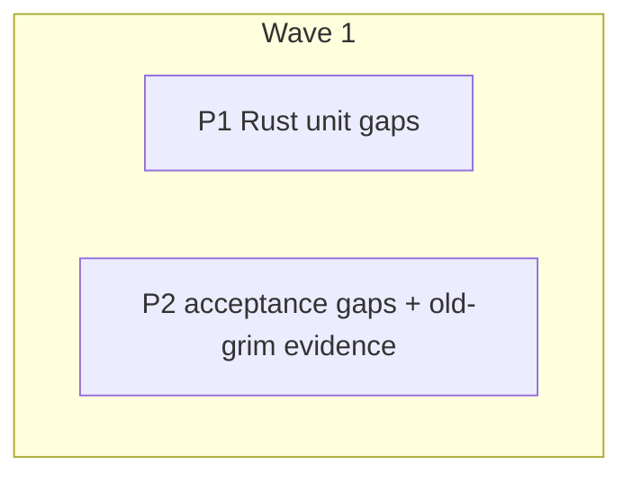

# Plan: Compressed artifact layers — gap closure

## Status

- **Plan:** plan_compressed_artifact_layers
- **Active phase:** 1 — Gap closure (tests + old-grim evidence)
- **Step:** /hex-execute → review
- **Last update:** 2026-10-21 (after 3abffa41: feat: opt-in gzip compression for published artifact layers)
- State:   review
- Tier:    medium
- Tier-grammar: 5
- Updated: 2026-10-21
- Next:    /hex-finalize

---

## Overview

**Related ADR:** [adr_compressed_artifact_layers.md](../adr/adr_compressed_artifact_layers.md) (accepted design; not re-opened)
**Goal file:** [adr-compressed-artifact-layers.md](../goals/adr-compressed-artifact-layers.md)
**Research:** skipped — accepted ADR covers the design.
**Scope:** two-way door. Tests and evidence only; no production-code change is planned.

## Objective

The ADR is implemented in 3abffa41 (cherry-pick of former PR
[grimoire-rs/grimoire#209](https://github.com/grimoire-rs/grimoire/pull/209)).
A three-worker audit mapped every D1–D8 clause to code and tests. All eight decisions are
implemented. This plan closes the few **untested** clauses and captures the ADR's open
old-grim `install` probe as evidence.

## Audit — D1–D8 against 3abffa41

| Decision | Verdict | Evidence |
|---|---|---|
| D1 readers first | covered; 2 test gaps (C-001, C-002) | `src/oci/layer.rs:28-32,93-102,257-280`; `classify_maps_every_gzip_type_exactly`, `classify_refuses_any_zstd_type`, `trailing_bytes_and_second_member_are_refused`, `header_extra_name_and_comment_are_refused`, `mcp_layer_is_never_decoded`; pytest `test_fetch_zstd_layer_is_unsupported_media_type`, `test_install_zstd_layer_is_unsupported_media_type` |
| D2 opt-in writer | covered; notice untested (C-005) | `release.rs:117,285`, `publish.rs:139-140,527,1205`, `layer.rs:249-254`; `run_compression_resolves_flag_then_manifest`, `encode_gzip_is_deterministic_and_annotated`; pytest `test_publish_manifest_compression_gzip`, `test_publish_compression_flag_overrides_manifest`, `test_schema_publish_has_optional_compression` |
| D3 scope by kind | covered; companion push untested (C-003) | `release.rs:289`, `description.rs:184`; `run_compression_is_ignored_for_mcp`; pytest `test_publish_compression_ignored_for_bundle_and_mcp`, `test_release_does_not_adopt_a_gzip_layer_on_bundle_or_mcp` |
| D4 annotation | covered; raw-layer decode untested (C-004) | `layer.rs:161-171,181-189,292-305`; `digest_mismatch_is_refused`, `malformed_sha256_values_are_refused`, `unknown_algorithm_is_skipped`, `descriptor_annotations_survive_conversion`, `oci_descriptor_passes_annotations_and_writes_no_key_without_them`; pytest `test_install_refuses_bad_gzip_layer_without_writing[*]` |
| D5 release guard | covered | `release.rs:270-300,679-698`, `layer.rs:205-245`; `memory_registry_release_pushes_cascade_idempotent_and_guards`, `guard_propagates_existing_manifest_fetch_error`, `equal_across_a_compression_flip`, `zstd_layers_never_match`, `run_compression_flip_adopts_and_force_converts`, `preview_digest_covers_layer_annotations`; pytest `test_release_compression_flip_on_unchanged_content_adopts`, `test_release_content_change_with_compression_flip_is_tag_exists`, `test_release_skip_existing_ignores_compression` |
| D6 decode cap | covered | `layer.rs:148,154-158,270-275`, `fetch.rs:399-406,695`; `expansion_limit_is_the_tightest_bound`, `cap_boundary_limit_passes_limit_plus_one_fails`, `bomb_stops_at_the_cap`, `gzip_layer_decoding_past_the_fetch_cap_is_data_error`, `decode_layer_blocking_cap_is_data_error` |
| D7 stable digests | covered; `build` `layer_digest` untested (C-006) | pytest `test_gzip_annotation_equals_path_lock_hash_and_status_stays_installed`; `json-interface.md:487` |
| D8 describe `compression` | covered; mcp / multi-layer / MCP tool cases untested (C-007) | `describe_report.rs` `compression_is_always_serialised_and_dashed_when_unknown`, `fetch.rs` `describe_reports_layer_compression`; pytest `test_describe_reports_compression`, `test_describe_plain_has_compression_row` |
| Docs list (Compat & migration) | covered | stability, artifacts, json-interface, publishing, commands, configuration, upgrading, `AGENTS.md:173`, grim-usage + grim-authoring catalog refs all in 3abffa41 |
| Old grim 0.14.3 `install` | **open** (C-008) | ADR `## Compatibility & migration`: "`install` is unprobed" |

Deliberately not planned (YAGNI): a test that no `-c` short flag exists, asserting the
`tracing::debug!` on an unknown algorithm, an explicit "size ignored" content-key test (the
flip tests already differ in layer size and media type), and an old-grim pytest (it would
need a pinned 0.14.3 download in CI; one recorded probe answers the ADR's question).

## Component contracts

- **C-001** `fetch_artifact` on a **bundle** layer labelled `…tar+gzip` returns the stored bytes unchanged (no decode, no `LayerError`). Test in `src/fetch.rs`.
- **C-002** `fetch_description` on a gzip companion (custom `+gzip` type, valid annotation) returns the same decoded content as the uncompressed companion. Test in `src/fetch.rs`.
- **C-003** The description companion push (`src/oci/description.rs`) always writes `TAR_LAYER_MEDIA_TYPE` and no `com.grimoire.uncompressed.digest` annotation, whatever `--compression` the release used. Test in `src/oci/description.rs` (or the release test that already pushes a companion).
- **C-004** `decode_layer` on a **raw** tar layer that carries a lying `com.grimoire.uncompressed.digest` returns the tar unchanged and succeeds (annotation checked on gzip only). Test in `src/oci/layer.rs`.
- **C-005** `grim release --compression gzip` prints the consumer-version notice to stderr exactly once at the default log level; `grim publish` with two gzip tar entries prints it once in total; `--compression none` prints nothing. Pytest in `test/tests/test_compression.py`.
- **C-006** `grim build --format json` on a skill reports `layer_digest` equal to the `com.grimoire.uncompressed.digest` annotation of the same skill released with `--compression gzip`, and different from the pushed layer digest. Pytest in `test_compression.py`.
- **C-007** `grim describe --format json` reports `compression: "none"` for an mcp artifact and `null` for a two-layer manifest; MCP `grim_describe` returns the same `compression` value as the CLI for a gzip artifact. Extend `test_describe_reports_compression` parametrization; one MCP assertion where MCP describe is already tested (grep `grim_describe` under `test/tests/`).
- **C-008** grim 0.14.3 `install` (manifest-driven, not `add`, not `fetch`) of a gzip artifact exits 65 and writes no client output, no install-state entry and no lock change. Recorded evidence, not a test.

## User-experience scenarios

- **S-001** Publisher runs `grim release --compression gzip …` → release succeeds, stderr shows one line saying consumers need a gzip-reading grim. Error case: `--compression zstd` → exit 64 (already tested).
- **S-002** Consumer on grim 0.14.3 runs `grim install` on a project that depends on a gzip artifact → exit 65, error names a tar read failure, no client output, no lock change, no install-state record (the empty `.grimoire/state.json` scaffold is created). Error case: none — this scenario *is* the failure path.
- **S-003** Tool (indexer, VS Code extension, MCP client) calls `describe` on mcp / multi-layer / gzip artifacts → `compression` is `"none"`, `null`, `"gzip"` respectively, on CLI and MCP alike.

## Error taxonomy

No new errors. C-004 pins that a raw layer never raises `DigestMismatch`; C-008 pins old-grim exit 65 (`DataErr`).

## Parallelization

| Id | Repo | Scope | Expected files | Wave | Depends on | Marks | Status |
|---|---|---|---|---|---|---|---|
| P1 | grimoire | C-001 C-002 C-003 C-004 | `src/fetch.rs`, `src/oci/layer.rs`, `src/oci/description.rs` (test modules only) | 1 | — | — | merged |
| P2 | grimoire | C-005 C-006 C-007 C-008, S-001 S-002 S-003 | `test/tests/test_compression.py`, `test/tests/test_mcp.py`, `test/src/registry.py`, `.agents/adr/adr_compressed_artifact_layers.md`, `.agents/goals/adr-compressed-artifact-layers.md` | 1 | — | — | merged |

No contract wave: tests only, no stubs. Critical path: P2 (the probe). The two pipelines are file-disjoint.

### P1 — Rust unit gaps (sonnet)

1. C-004: add `raw_layer_with_a_lying_annotation_decodes_unchanged` to `layer.rs` tests.
2. C-001, C-002: add a bundle-raw case and a positive gzip-companion case to `src/fetch.rs` tests, reusing the gzip helpers the existing `fetch_gzip_skill_matches_the_uncompressed_fetch` test uses.
3. C-003: assert the companion descriptor type and absent annotation where the companion push is already exercised.
4. Run `task rust:verify`. If a new test fails, the code violates the ADR: stop and report it (it becomes a bug fix, not a test edit).

### P2 — Acceptance gaps and old-grim evidence (sonnet)

1. C-005: pytest for the notice (release once; publish two entries once; `none` silent).
2. C-006: pytest comparing `grim build` `layer_digest` with the gzip release's annotation.
3. C-007: add an `mcp` → `"none"` case to `test_describe_reports_compression` (`make_artifact` already takes the mcp kind). Two-layer → `null` needs a pushed manifest with two layers: extend `push_artifact` in `test/src/registry.py` or add a small helper there. Extend the existing `grim_describe` test in `test/tests/test_mcp.py` (~line 198, already compares MCP to CLI payload) with a gzip artifact so `compression: "gzip"` matches.
4. C-008 probe, run by hand, evidence recorded:
   - Old binary: `/home/mherwig/.ocx/toolchain/active/bin/grim` (`grim 0.14.3`). New binary: `test/bin/grim` (rebuild via the test taskfile if stale).
   - `docker run -d --rm -p 127.0.0.1:5099:5000 --name gz-probe registry:2` (do **not** use the registries already on 5000/5003/5004). `GRIM_INSECURE_REGISTRIES=localhost:5099` for both binaries; isolated `GRIM_HOME` and workspace under the scratchpad.
   - New grim: `release --compression gzip` a small skill to `localhost:5099/probe/gz-skill:1.0.0`.
   - **Reachability first:** old grim `describe localhost:5099/probe/gz-skill:1.0.0` must succeed over HTTP (0.14.3 may not honour `GRIM_INSECURE_REGISTRIES`). If it fails with a TLS/connect error, fall back in order: a `[[registries]]` entry with `insecure = true` if 0.14.3 accepts it; else re-run the container on `127.0.0.1:80` and use bare `localhost`. A TLS failure is not evidence — never record it as the exit-65 result.
   - Old grim, fresh workspace with a `.claude/` dir: `grim init`, then write the dependency as a `[skills]` line `gz-skill = "localhost:5099/probe/gz-skill:1.0.0"` in `grimoire.toml` (the shape `~/.grimoire/grimoire.toml` uses), then `grim install --client claude`. Snapshot before/after: `find` of the workspace and `GRIM_HOME/state`, and `grimoire.lock` (sha256 or absence). Record exit code and the first stderr line.
   - Pass: exit 65, no new or changed files outside `GRIM_HOME/blobs`/`tmp` (blob cache writes are expected, not a partial install), no `grimoire.lock` change or creation. Anything else: record it and run the goal's § Issue resolution.
   - `docker stop gz-probe`.
   - Record in the ADR's `## Compatibility & migration` (replace "`install` is unprobed"), and as D-evidence in the goal file. Also fix the ADR test plan's stale `test_schema.py` reference (the test lives in `test_compression.py`).
5. Run `task verify` (pytest runs inside it).

## Human-only items (not plan work)

- Artifactory probe of `application/vnd.grimoire.artifact.layer.v1.tar+gzip` + annotation preservation — needs company credentials (ADR open question 1).
- GHCR / GitLab push-pull-install with the new grim — needs publish credentials; ADR lists it as manual.

## Open questions

None.
