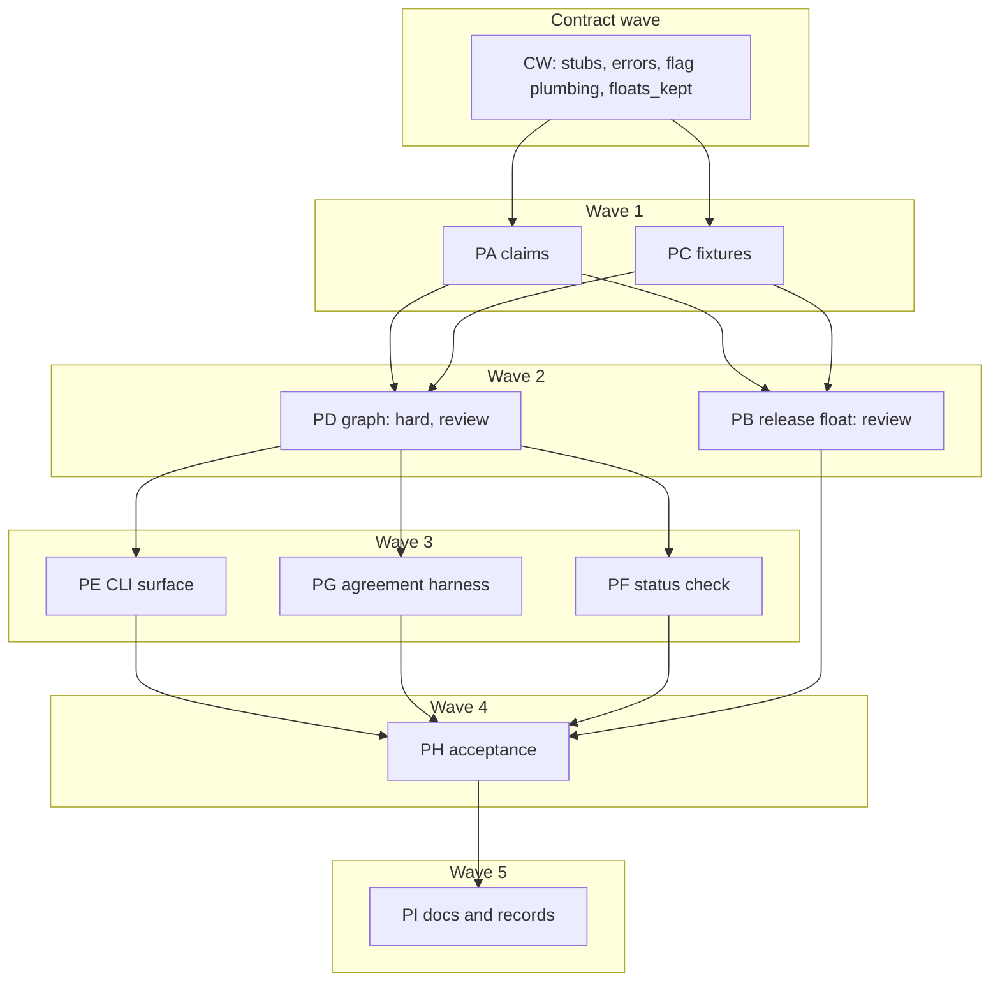

# Plan: Dependency tags as version claims

## Status

- **Plan:** plan_dependency_version_claims
- **Active phase:** all pipelines merged; review-fix pass landed
- **Step:** awaiting /hex-finalize
- **Last update:** 2026-11-15 (after the `--locked` pass: a marketplace run locks a plugin with no part yet; `--locked` / `GRIM_LOCKED` refuses an out-of-sync lock)
- State:   review
- Tier:    high
- Tier-grammar: 5
- Updated: 2026-11-15
- Next:    /hex-finalize
- Reviewed: f11820c9b254d19f0f913ccddc7b41290871fc52

---

## Header

- **Goal.** Turn every `requires` edge tag into a Cargo-style version claim that resolves to the newest release in the claimed major through a sticky fixpoint, so a `B:2` beside a `B:2.1` resolves instead of exiting 78. Make `grim release` and `grim publish` stop moving a cascade float to a lower version, and report the floats they keep.
- **Design (binding, Accepted 2026-11-12):** [`adr_dependency_version_claims.md`](../adr/adr_dependency_version_claims.md). Its "Contract index" is the build order. It amends `adr_artifact_dependencies.md` Decision 3, `adr_lock_pin_stability.md` § The pin rule, D1 and § Validation, and `adr_unified_publish_version_cascade.md` ("floats always move").
- **Research:** [`research_dependency_version_claims_plan_surface.md`](../research/research_dependency_version_claims_plan_surface.md) (cited below as **surface**, by part and section) and [`research_dependency_version_claims_codebase.md`](../research/research_dependency_version_claims_codebase.md) (cited as **map**). Line numbers in both, and in the ADR, are from `32b8d4b6`: every step searches by symbol.
- **Classification:** feature, large. One-way doors per the ADR's reversibility table: the recorded tag of a moved pin, the version annotation as evidence, stamps of a bundle reached by a Range claim, `--allow-downgrade` with reason `major-downgrade`, and `floats_kept`. Tier `high`. Overlays: `architect=inline`, `research=skip`, `adversary=off`.
- **Branch:** `feat/dependency-version-claims`, from `main`. Work never lands on `main` directly. Never push.
- **Lanes:** at most three edit-only worker worktrees under `.agents/worktrees/`, one shared cargo target directory, full gates only in the integration worktree. The `lane.sh` pattern of [`plan_issue_sweep.md`](plan_issue_sweep.md) § Execution rules E-2 (one `flock`, touch the lane's sources before each cargo call) applies.
- **Gates.** Integration worktree only: `env -u OCX_GLOBAL task --force verify`. Each step: its narrow command below plus `cargo clippy --workspace --all-targets --locked -- -D warnings`. The last step of each Rust pipeline: `task rust:verify`. Narrow commands (surface, Part 2 § 7): `cargo test resolve::graph::tests`, `cargo test resolve::pin_agreement_tests::every_writer_holds_the_pin_rule` (75–110 s), `cd test && uv run pytest <files> -n auto` against a lane-built `test/bin/grim`. PI adds `task docs:check` (Node 24), `task catalog:verify` and `task claude:tests`.
- **Related open issues, out of scope** unless a step names them: [#332](https://github.com/grimoire-rs/grimoire/issues/332) (one keep rule refactor), [#328](https://github.com/grimoire-rs/grimoire/issues/328) (harness and oracle gaps), [#264](https://github.com/grimoire-rs/grimoire/issues/264) (dependency closing-review follow-ups), [#265](https://github.com/grimoire-rs/grimoire/issues/265) (vscode "Required by"). PG touches the harness #328 names but closes none of its items.
- **Commits.** Conventional Commits, `git commit -s`, no `Co-Authored-By`. Commits that touch only `.claude/` or `.agents/` are `chore:`. `cargo fmt` before each commit.

## Execution rules (set at `/hex-execute`, 2026-11-12)

- **X-1 Lanes never commit.** The commit hook denies any `git commit` without a `task verify` stamp younger than 300 s in the target worktree, and `--no-verify` does not satisfy it (precedent: `plan_issue_sweep.md` E-3). Every step ends with `git add -A` and `git write-tree` and reports the tree id. It never commits, pushes, runs the full gate or waits.
- **X-2 One build at a time.** Every cargo or task call in every tree goes through `.agents/.tmp/version-claims/lane.sh <tree> <command…>` (one `flock`, one shared `CARGO_TARGET_DIR`, sources touched first). Lane worktrees are `git worktree add --detach .agents/worktrees/vc-<pipeline> <wave base>` plus `git submodule update --init --recursive`.
- **X-3 One landing per wave.** The orchestrator takes each pipeline's patch (`git diff --binary <wave base> <final tree>`), applies the wave's patches in the integration worktree, runs `lane.sh <main> env -u OCX_GLOBAL task --force verify` once, and commits per pipeline with sign-off inside the stamp window. The next wave's lanes start from that commit.
- **X-4 Old binary.** `GRIM_OLD_BIN=.agents/.tmp/issue-sweep/grim-0.15.1/grim` (0.15.1 release asset, fetched and checksummed by the issue sweep).

## Changes to the pipeline cut

- **Stub contract tests land with their implementation, not in the contract-wave commit.** The pre-commit hook (`.claude/hooks/pre_commit_verification.py`) refuses a commit without a green `task verify`, and `#[ignore]` is banned (`rust-quality.md` row 14). The contract wave commits stubs plus tests for everything it completes; the owning step writes the stub tests first and records the red run. This is the precedent of `plan_settings_artifact_kind.md` PD-16.
- **`src/oci/access/registry_client.rs` and `cached_access.rs` join PD**, and a defaulted `OciAccess::list_tags_within` joins the contract wave (Open question 1).
- **`src/resolve/claim_remedy.rs` is new** (stub in the contract wave, filled by PE), so PE never edits the contract-wave file `resolve_error.rs`.
- **`resolve_marketplace` gains its `downgrade` parameter in the contract wave**, because PE and PG would otherwise both edit `pin_agreement_tests.rs` (it calls `resolve_marketplace`) in wave 3.
- **PB depends on PC**, because its acceptance tests use `publish_release` and the shared release helper.
- **PF moves to wave 3** (orchestrator decision A), so PD is free to re-point tests in `status.rs`; PF starts from merged PD.
- **PD keeps the tree green** (decision B). It re-points every existing test its change breaks, in any Rust test module outside PB's three release files and in the Python rows the ledger gives it. That adds PD.10, so PD also depends on PC.
- **Fixture migration to `Fake::release` moves into PD.2** (decision C), and **PD.5 splits into PD.5a and PD.5b** (decision D).
- **PH adds a sweep step** (decision E) and no longer re-points `test_held_back.py`, `test_lock_pins.py` or `test_dependencies.py`.

## Open questions

1. [NEEDS CLARIFICATION: § Target ladder, "Listing bounds", says each walk stops at the smaller of the run's remaining 32 MiB and the 128 MiB cap. `OciAccess::list_tags` takes no byte limit; only the private `RegistryClient::walk_tags(id, limit)` does.]
   Recommended: add a defaulted trait method `list_tags_within(id, max_bytes)` (contract wave, complete default that calls `list_tags` and measures after the fact). `RegistryClient` overrides it to stop the walk in-stream, and `CachedAccess` forwards it online (PD.3). No other implementation changes. Reason: the ADR's bound holds on the real transport, and the other `OciAccess` implementations (36 `impl` blocks in all under `src/`) stay untouched.
2. [NEEDS CLARIFICATION: § Errors marks the `BundleConflict` template "Unchanged" and in the same row says "its hint says 'declare it with a tag'". Under Decision 8 a bare declaration yields, so today's hint ("declare {kind} {name} directly in grimoire.toml to choose one") no longer fixes a Range conflict.]
   Recommended: the hint becomes "declare {kind} {name} directly in grimoire.toml with a tag to choose one". Reason: every pinned substring ("declare skill c directly", "to choose one; its repository is named…") survives, and the fix becomes true under D3.
3. [NEEDS CLARIFICATION: § Errors says the `{fix}` names `{repository}:{from}`, "the digest when no such tag exists". The graph cannot know that a tag exists without an extra read.]
   Recommended: name `{repository}:{from}` only when the held pin's own recorded tag is the full version `{from}`, or this run resolved `{repository}:{from}` (step 2, step 3 or the listing memo) to the pin's digest; otherwise name `{repository}@{pin digest}`. Reason: no extra network call, and the digest form is always correct.

## Component contracts

Each contract names the ADR section it realizes and the validation tests (ADR § Validation) that prove it. Names in `code` are binding; a step that must change a signature reports it, and the orchestrator re-briefs.

### Claim model (`src/oci/`, pure)

**C-001 Claim grammar** (§ Claim grammar). New file `src/oci/version_claim.rs`, registered in `src/oci.rs`.
- `pub enum EdgeOrigin { Requires, BundleMember }`; `pub enum Claim { Any, Range(semver::VersionReq), Literal, Digest }`; `pub fn claim_of(edge: &Identifier, origin: EdgeOrigin) -> Claim`.
- `Claim` derives `Debug, Clone, PartialEq, Eq` and implements `Ord` and `PartialOrd` by hand: variant rank (`Any` < `Range` < `Literal` < `Digest`), then the requirement's `Display` string for two `Range`s. The manual order is needed because `EdgeClaim` derives `Ord` and `semver::VersionReq` does not; it is consistent with `Eq` because `VersionReq`'s `Display` is canonical. Complete in CW.1, with the test `claim_order_ranks_variants_then_requirement_text`.
- A reference carrying a digest is `Digest`, tag or not. A `BundleMember` edge is `Literal` or `Digest`, never `Any` or `Range`, an untagged member included.
- A `Requires` edge: no tag or `latest` is `Any`. Otherwise `_` becomes `+`, build metadata is dropped, and the tag is `Range(^tag)` only when it matches `^(0|[1-9][0-9]*)(\.(0|[1-9][0-9]*)){0,2}$`, or that pattern with exactly three parts plus `-<prerelease>`. Everything else is `Literal`.
- Table rows (one assertion each): `2`, `2.1`, `2.1.3`, `0`, `0.2`, `0.2.5`, `0.0`, `0.0.3`, `2.1.0-rc.1`, `2.1.3_build.5` (Range `^2.1.3`) are Range; `2.x`, `x`, `v2`, `stable`, `02`, `2.1.0.1`, `2.1-rc.1` are Literal; `latest` and no tag are Any; `x:2@sha256:…` is Digest; a member `x:2` is Literal.
- Tests: `a_tag_like_two_x_is_a_literal_claim`, `claim_grammar_matches_every_table_row`.

**C-002 Line and `T(line)`** (§ Claim grammar, last paragraph). Same file.
- `pub struct Line` holds a sorted, deduplicated set of caret requirements. `Line::any()`; `Line::of(reqs)`; `narrow(&mut self, req: &VersionReq) -> bool` (true when the set changed; it never widens); `requirements(&self) -> &[VersionReq]`; `is_any(&self) -> bool` (no requirement); `bounds(&self) -> Option<(Version, Version)>` (lo is the greatest lower bound, hi the least upper bound; `None` for Any); `is_unsatisfiable(&self) -> bool` (lo ≥ hi); `target_tag(&self) -> Option<String>`.
- `target_tag`: hi (M+1).0.0 with M ≥ 1 gives `M`; hi 1.0.0 gives `0`; hi 0.(m+1).0 gives `0.m`; hi 0.0.(p+1) gives `0.0.p`; Any gives `latest`; an unsatisfiable line gives `None`.
- Edge cases: `^2 ∩ ^2.1` is [2.1.0, 3.0.0), `T` `2`; `^0.2 ∩ ^0` is [0.2.0, 0.3.0), `T` `0.2`; `^0.2 ∩ ^0.3` and `^1 ∩ ^2` are unsatisfiable; `^0.0.3` gives `T` `0.0.3`; `^2.1.0-rc.1` has hi 3.0.0. Narrowing in any order gives an equal `Line`.
- Tests: `a_line_intersects_caret_ranges_in_any_order`, `two_majors_make_an_unsatisfiable_line`, `target_tag_names_the_cascade_float_of_the_upper_bound`.

**C-003 `highest_in_line`** (§ Target ladder, step 3). Same file. `pub const MAX_LISTED_CANDIDATES: usize = 8`; `pub fn highest_in_line(tags: &[String], line: &Line) -> Vec<String>`.
- Admits a full-semver tag (after `_`→`+`) whose version matches every requirement by `VersionReq::matches`, and an `X.Y` tag whose span [X.Y.0, X.(Y+1).0) lies inside every requirement's range. It never admits an `X` tag, `latest` or a non-semver tag. An Any line admits every `X.Y` tag and every full-semver tag that is not a prerelease (set during execution, orchestrator's ruling, not reviewed).
- Order: highest lower bound first; on an equal lower bound, the full version before the span; equal versions differing only in build metadata by tag text, ascending. At most 8 entries.
- `pick_highest_version` stays unchanged (it admits prereleases and feeds the catalog).
- Tests: `highest_in_line_orders_full_versions_before_spans`, `highest_in_line_skips_major_floats_and_latest`, `highest_in_line_keeps_eight`.

**C-004 Evidence** (§ Version evidence). New file `src/oci/version_evidence.rs`.
- `pub const VERSION_ANNOTATION: &str = "org.opencontainers.image.version"`; `pub enum Evidence { Exact(Version), Span { lo: Version, hi: Version }, Unknown, Vouched }`; `pub fn annotated_version(annotations: &BTreeMap<String, String>) -> Option<Version>`; `pub fn evidence(annotated: Option<&Version>, reference: &Identifier) -> Evidence`.
- `annotated_version` parses the annotation after `_`→`+`; a raw `1.2` or `canary` gives `None`. `evidence`, first rule that applies: an annotated version gives `Exact`; a full-semver tag gives `Exact`; an `X.Y` tag gives `Span [X.Y.0, X.(Y+1).0)`; an `X` tag gives its caret span ([X.0.0, (X+1).0.0), and [0.0.0, 1.0.0) for `0`); anything else, a digest-only reference included, gives `Unknown`. `evidence` never returns `Vouched`; only the offline caller builds it.
- The graph memoizes `annotated_version` by digest only; tag-shape evidence is computed per reference.
- Tests: `an_annotation_wins_over_a_contradicting_tag`, `a_recorded_two_is_a_span_not_unknown`, `a_non_semver_annotation_falls_back_to_the_tag`.

**C-005 `satisfies` and the compatibility group** (§ Version evidence; § Checks at the fixpoint, Decision 4). Same file.
- `pub fn satisfies(evidence: &Evidence, line: &Line) -> bool`: an Any line is satisfied by every evidence, `Unknown` included. Otherwise `Exact(v)` must match every requirement; a `Span` must lie inside every requirement's [lo, hi); `Unknown` satisfies nothing; `Vouched` satisfies everything.
- `impl Evidence { pub fn in_higher_group_than(&self, chosen: &Version) -> bool }`: true when the evidence's lower bound, read without its prerelease (a `3.0.0-rc.1` pin is a 3.x pin; set during execution, not reviewed), is at or above the caret upper bound of `chosen` (2.6.0 → 3.0.0, 0.2.4 → 0.3.0, 0.0.3 → 0.0.4). `Unknown` and `Vouched` give false.
- Tests: `a_span_satisfies_only_a_line_it_lies_inside`, `unknown_evidence_satisfies_only_an_any_line`, `a_held_three_is_in_a_higher_group_than_two`.

### Resolver (`src/lock/`, `src/resolve/graph.rs`)

**C-006 Settle split: selection and validation** (§ Settle predicates). `src/lock/merge_policy.rs`.
- `EdgeClaim` gains `claim: Claim` (the caller fills it with `claim_of`). New `pub struct Candidate<'a> { pub digest: &'a Digest, pub evidence: &'a Evidence, pub line_target: Option<&'a Digest> }` and `pub fn validate(direct: Option<&DirectClaim>, edges: &[EdgeClaim], candidate: Option<Candidate<'_>>) -> Option<Settled>`. `Settled` gains `Yielded { range_edges, shadowed, publisher_mismatch }`, `InLine { parents }` and `OutOfLine { failing }`. `settle` remains as the Literal-only wrapper until PD.5a removes it.
- Rows D1 to E6 in the ADR's order, first match wins; Any adds no constraint once another claim exists. D2 shadows Range edges its evidence fails and Literal or Digest edges at another digest. D3 needs a direct `:latest` (bare after parse) and a Range claim naming the direct's own registry and repository; edges from elsewhere, and Literal, Digest and bundle-member edges, stay shadowed. E3 accepts unknown evidence only when the candidate digest equals `line_target`.
- `effective_set::settle_origin` passes the locked digest with `Evidence::Vouched`, so its 50 tests pass unchanged and it reads no manifest; with no lock row, differing references stay `Conflicted`.
- Return values: `None` means no verdict, because no direct and no edge claims the key (today's `settle` contract). `candidate: None` is the `effective_set` no-lock-row path: `validate` then returns exactly what today's `settle` returns for the same claims, comparing references literally, so differing references give `Settled::Conflict` and equal ones `Settled::Agreed`. Test: `validate_without_a_candidate_matches_settle`.
- Tests: one per row, `settle_row_d1_…` to `settle_row_e6_…`; `claims_settle_the_same_in_every_order_and_under_every_name` (the existing `permutations` helper plus a key rename); `a_bundle_member_tag_keeps_its_literal_meaning`.

**C-007 Target ladder** (§ Target ladder). `graph.rs`, selection half.
- Step 1: the held pin, when the key is not selected, not in `released`, and carry answers the line (C-009); it records its tag unchanged. Step 2: `T(line)` resolved through `resolve_digests`, once per identifier per run (the `digests` memo); accepted when `evidence(annotation of digest, T)` satisfies the line; records `repo:T@digest`. Step 3: the listing (C-008), `highest_in_line`, each candidate resolved in order, at most 8; the first whose evidence satisfies wins and records its own tag (`x:2.4.1@…` or `x:1.2@…`). None: `NoMatchingVersion` (79).
- An empty learned line is Any and takes `latest`; an Any-only node records `latest`; a Literal node records today's smallest request.
- A `latest` miss on a still-empty learned line (the tag is absent, or offline it is not in the tag cache) is deferred, not final: C-010 owns the rule. Every other step-2 miss falls to step 3 online and exits 69 offline.
- Edge cases: a release candidate retagged `2.5.0` whose annotation says `2.5.0-rc.1` is passed over; a publisher that pushes only `1` and `1.2` with no annotation answers a claim `1.2` at `x:1.2`.
- Tests: `a_retagged_release_candidate_is_skipped_by_the_listing`, `a_claim_above_every_release_exits_79`, `a_partial_tag_publisher_answers_a_minor_claim`, `t_of_a_line_is_resolved_once_per_run`.

**C-008 Listings and the listing budget** (§ Target ladder, "Listing bounds"; Open question 1).
- `OciAccess::list_tags_within(&self, id, max_bytes: usize) -> Result<Option<TagListing>, AccessError>` with `pub struct TagListing { pub tags: Vec<String>, pub bytes: usize, pub complete: bool }`. The default calls `list_tags`, sums the tag-name bytes and sets `complete = bytes <= max_bytes`. `RegistryClient` stops its walk at `max_bytes.min(CATALOG_LISTING_BYTE_LIMIT)`; `CachedAccess` forwards online.
- The graph reads at most one listing per (registry, repository) per run, through `retry_chain` with `per_artifact_timeout`. A run reads at most `MAX_LISTING_BYTES` (32 MiB) in total; a walk that would pass the remainder fails with `GraphTooLarge { limit: GraphLimit::ListingBytes, via: <repository> }` (65). The memo `listings` keeps only full-semver and `X.Y` tags with their lower bounds.
- Tests: `a_listing_past_the_run_budget_exits_65`, `a_listing_is_read_once_per_repository`, and in `registry_client.rs` `list_tags_within_stops_at_the_byte_limit`.

**C-009 Pin answers rows** (§ Pin answers). `src/lock/pin_rule.rs` plus `Carry::answer`/`NodeClaim` in `graph.rs`, graph carry only.
- Range row: a `requires` Range claim in the pin's registry and repository is answered when `evidence(annotation of pin digest, pin reference)` satisfies it. Nothing else answers it: no recorded edge, no equal tag. Any row: a bare direct line is answered by a pin carrying any tag in its repository.
- Untouched, byte for byte: `answers_direct`, `answers_edge`, `answers_listed_edge`, `answers_stamped_edge`, `PinnedIdentifier::answers`, `PinRecord::names`, the restamp gate in `src/lock/edit.rs`, the kept-pin note in `src/command/add.rs` and `src/export/resolve.rs`, and the `part_bundles.rs` caller.
- Tests: `a_held_pin_inside_the_line_is_kept_by_lock`, `a_pin_whose_annotation_contradicts_its_tag_does_not_answer_a_requires_claim`, `a_recorded_edge_does_not_keep_a_pin_whose_evidence_fails_the_claim`, `an_unannotated_latest_pin_on_an_any_line_is_kept`, `a_bare_line_keeps_a_pin_recorded_under_another_tag`, `a_bundle_only_lock_answers_as_before`.

**C-010 Line nodes and passes** (§ Passes, Decision 6).
- A line node has only Range or Any claims in one registry and repository, or is a bare direct line that yields (D3). Literal and Digest references, bundle members and every other direct declaration resolve in the pass that reads them.
- Expand: a line node's candidate comes from its learned line only (step 1, else the ladder). Judge, once per pass: a node is in line when its candidate passes `validate` against its learned line and every claim of every parent present. The teaching set is the in-line roots plus every in-line node with a teaching parent. Every node with a teaching parent narrows its learned line by those parents' same-repository Range claims and records each source `(parent key, parent digest, claim tag)`. A held pin joins `released` when carry no longer answers its learned line and every claim present. Restart when a candidate lies outside its learned line, a node has no candidate yet (a deferred `latest` miss), or `released` or `attested` grew; otherwise stop, and a node still out of line goes to `finish` (78, then cycles 65).
- Deferred `latest` miss (§ Passes, step 1; § Offline; § Edge shapes): when a line node's learned line is still empty and `latest` is absent (offline: not in the tag cache), the node has no candidate in that pass, starts no listing and teaches nothing. If the judge narrows its line, the next pass resolves that line's own `T`. If the line is still empty at the end of the pass, the next pass continues the ladder at step 3, which gives a candidate, 79, or the offline miss (69). Cost: one failed `latest` lookup and one extra pass.
- State: `learned: BTreeMap<NodeKey, Learned { reqs, sources }>`, `evidence: BTreeMap<Digest, Option<Version>>`, `listings` and `work` survive `restart`. The kept walk of `expand_counting_passes` starts with an empty `learned`, copies `evidence` and `listings`, and shares `work`.
- Edge cases: the result does not depend on fold order or node names; a held pin below a raised lower bound moves to the line's target with no flag and reports `disposition: moved`.
- Tests: `a_two_beside_a_two_one_resolves_to_the_newest_two`, `a_line_survives_a_new_minor_release`, `a_literal_or_digest_node_resolves_in_the_pass_that_reads_it`, `a_held_pin_below_a_new_lower_bound_moves_up_and_reports_moved`, `the_kept_walk_learns_nothing_from_the_line_walk`, `a_wide_chain_of_k_nodes_settles_in_k_passes_within_the_budget`, `worked_example_i_settles_in_two_passes_under_any_name`, `worked_example_ii_holds_n2_at_one`, `a_repository_without_latest_resolves_through_its_claimed_major`, `a_bare_claim_without_latest_falls_to_the_listing`.

**C-011 Work budget** (§ Passes, "Work budget"). `pub const MAX_WORK_ADMISSIONS: usize = 16 * MAX_TRANSITIVE_NODES` (32,768) in `resolve_error.rs`. Node admissions are summed over every pass of both walks of one `expand_counting_passes` call. Passing it fails with `GraphTooLarge { limit: GraphLimit::Work { passes }, via }` (65). The per-pass node, byte and depth caps keep resetting in `restart`.
- Test: `a_work_budget_breach_exits_65_and_says_it_is_a_limit` (a chain of about 200 nodes, each pass learning one line).

**C-012 Empty lines and two groups** (§ Settle predicates E5; Decision 5; § Edge shapes). A learned line that turns unsatisfiable exits 78 `BundleConflict` when it is learned, before any ladder step can report 79, flag or not; the dropped-source form of C-014 takes precedence. `0.2` beside `0.3` is 78; `0.2` beside `0` narrows. Tags `2` and `3` naming one manifest now exit 78.
- Tests: `two_majors_on_one_node_exit_78_with_or_without_the_flag`, `two_majors_exit_78_before_the_ladder_can_report_79`, `two_tags_on_one_manifest_in_different_majors_exit_78`.

**C-013 Direct declarations, Decision 8** (§ Settle predicates D1–D4). A typed direct tag or a digest wins over every edge, and the held-back warning lists the shadowed `requires` edges (C-020). A bare direct line, or an explicit `:latest`, yields to a same-repository Range claim and emits one `GraphWarning::Yielded`. A path direct wins. A bare direct with no such claim wins as today.
- Tests: `a_bare_direct_line_yields_only_to_a_same_repository_range_claim`, `a_typed_direct_line_wins_over_every_claim`, `an_explicit_latest_yields_like_a_bare_line`.

**C-014 Decision 7, dropped claims** (§ Checks at the fixpoint; § Decision Outcome, "Dropped versions without a pin").
- Pin form: a held, unselected pin whose final candidate differs, whose evidence satisfies every claim of the final graph and fails only learned Range sources whose parent digest is not in the final graph, exits 78 `UnchosenRequirement` (`shape: Move`). It runs in the conflict step of `finish`, with `BundleConflict`: conflicts (78), then cycles (65), then the downgrade guard last (§ Errors; § Checks at the fixpoint).
- Conflict form: a learned line that turns unsatisfiable or holds no release while one of its binding sources has a parent digest absent from the current pass exits 78 `UnchosenRequirement` (`shape: Conflict`), decided when the line is learned.
- Binding source, unsatisfiable line: a source whose requirement, removed, leaves the line satisfiable. Binding source, line with no release: a source whose requirement, removed, lets `highest_in_line` admit at least one tag of that repository's memoized listing (tag shape only, no new read). When several binding sources dropped, the error names the one with the smallest parent key, then the smallest parent digest.
- A dropped version whose narrowing leaves a line that still holds a release resolves inside it, exit 0, with one `GraphWarning::DroppedNarrowing`. A release from a Literal conflict never triggers either form.
- Tests: `a_pin_moved_only_by_a_dropped_version_exits_78` (backported cascade), `a_line_emptied_by_a_dropped_version_exits_78_in_conflict_form`, `a_literal_conflict_release_never_triggers_the_dropped_claim_check`, `worked_example_d7_refuses_grim_add`.

**C-015 Decision 4, downgrade guard** (§ Checks at the fixpoint; § The flag). Runs last, on an otherwise valid graph. "Held pin" here means the prior lock's pin for that key, whether `Refresh::All` or `Refresh::Names` selected it or not, so the guard fires on `grim update` too. It fires when the node's line came from `requires` Range claims, no typed direct declaration holds the key, and the held pin's evidence is known and `in_higher_group_than` the choice. `Downgrade::Refuse` exits 78 `MajorDowngrade`; `Downgrade::Allow` moves the pin, `pinned = repo:T@…`, `disposition: moved`. Unknown evidence (a non-semver tag and no annotation) moves and reports `moved`. Literal, Any, bundle-member and typed-direct moves never trigger it.
- Tests: `a_major_downgrade_refuses_without_the_flag_and_moves_with_it`, `a_literal_or_any_move_never_asks_for_the_flag`, `an_unknown_held_version_moves_without_the_flag`, `a_bare_update_refuses_a_major_downgrade_too`.

**C-016 Offline** (§ Offline). A held pin's evidence comes from the stored manifest, else its recorded tag's shape. A store miss never releases a held pin: with no tag evidence either, the pin is kept with one warning. `T(line)` reads the tag cache; a miss exits 69, except the deferred `latest` miss on a still-empty line (C-010). A needed listing is always an offline miss (69, `RegistryUnreachable` through `retry_chain`), and `list_tags_within` is never called offline.
- Tests: `an_offline_listing_is_a_miss_not_a_smaller_pick`, `an_offline_store_miss_keeps_the_held_pin_and_warns`, `an_offline_tag_cache_miss_on_the_target_tag_exits_69`, `an_offline_latest_miss_on_an_empty_line_is_deferred` (claim `x:1`, the cache holds `1` but not `latest`: exit 0, `pinned = x:1@…`).

### Errors, flag, warnings

**C-017 Errors and exits** (§ Errors). `src/resolve/resolve_error.rs`, `src/error.rs`. Each kind's text follows the `ResolveError` subject (`skill 'x' (ref): `), which already names kind and name.
- `NoMatchingVersion { repository: String, claims: String, newest: Option<String> }`: `no release of {repository} satisfies {claims}; the newest is {newest}`, or `; it lists no release` when `newest` is `None`. Exit 79, no reason. Tail rule: `{newest}` is the highest release tag the run's listing holds. When this run read that tag's manifest and its version annotation names another version, the tail reads `; the newest is {tag}, whose manifest names version {annotated}`. A listing with no release but with prereleases reads `; it lists only prereleases, the newest is {tag}`, naming the highest prerelease. A listing with no version tag reads `; it lists no release`. The message reads nothing from the registry. `{claims}` is the line's requirements in `Line` order (sorted by their `Display` text), each in `VersionReq` form, joined by `, ` (`^2, ^2.9`), the same text `VersionReq` prints for several comparators. 79 is reached only after step 3, so the memo is always read.
- `UnchosenRequirement { parent: String, dropped: String, claim: String, shape: Unchosen, declare: String, fix: String }` with `pub enum Unchosen { Move { from: String, to: String }, Conflict { claims: String } }`. Move: `would move from {from} to {to} only because {parent} {dropped}, which this resolve dropped, required {claim}; {fix}`. Conflict: `{claims} cannot all hold, and {parent} {dropped}, which claimed {claim}, is no longer in the graph; {fix}`. Exit 78, no reason.
- `MajorDowngrade { from: String, to: String, requesters: String, claim: String, declare: String, fix: String }`: `would move from {from} to {to}, a lower major version, because {requesters} require {claim}; {fix}`. Exit 78, reason `major-downgrade`, appended last to `ErrorReason`; `forceable` and `retryable` false.
- An empty `fix` prints no `; {fix}` tail. `declare` is the reference the fix names (Open question 3; the conflict form names `{repository}:{survivor claim}`).
- `GraphLimit::Work { passes: usize }` and `GraphLimit::ListingBytes`; `MAX_LISTING_BYTES = 32 MiB`. Both exit 65. Full `GraphTooLarge` text, after the `ResolveError` subject:
  - Work: `dependency graph too large: the resolve stopped after 32768 node admissions in {passes} passes; this is a work limit, not proof the dependencies have no answer`. `via` holds the node whose admission crossed the budget, in the existing `kind/name (source)` form; the Work text does not print it.
  - ListingBytes: `dependency graph too large: tag listings passed 33554432 bytes; the listing of {via} crossed the limit; contact that publisher`. `via` holds the line node whose walk crossed the limit, as `kind/name (registry/repository)`.
  - `Nodes`, `RequiresBytes` and `Depth` stay byte-identical (`cap_messages_name_the_limit_its_value_and_the_parent` passes unchanged).
- `BundleConflict` hint per Open question 2. Offline misses stay 69, unchanged.
- Tests: the frozen slug test and `FROZEN_REASON_SLUGS` gain `major-downgrade` at the last position; `export.rs` `literal()` gains its arm; `version_claim_refusals_classify_78_79_and_65`; one `Display` test per new kind and limit.

**C-018 Per-command remedy** (§ Errors, `{fix}`). New file `src/resolve/claim_remedy.rs`. `pub enum RemedyCommand { Lock, Add { target: String }, Update { names: Vec<String> }, Marketplace { manifest: PathBuf, plugin: String } }`; `pub fn with_remedy(err: ResolveError, command: &RemedyCommand) -> ResolveError` fills `fix` on `UnchosenRequirement` and `MajorDowngrade` from `err.grim` (the run's `Invocation`) and returns every other error unchanged.
- Every fix opens with `declare {kind} {name} as `{declare}` in grimoire.toml` (to keep `{from}` for the pin form and `MajorDowngrade`).
- `Lock`: then `, or run `{grim} update` to resolve every pin afresh`; `MajorDowngrade` instead ends `, or rerun `{grim} lock --allow-downgrade` to take {to}`, with no `update` alternative.
- `Add`: the declare clause ends `, then rerun `{grim} add {target}``; `UnchosenRequirement` then adds `, or run `{grim} update`, then rerun `{grim} add {target}`` (shown to work by `test_declaring_the_surviving_claim_clears_a_move_only_a_dropped_version_asked_for[add]`); `MajorDowngrade` instead adds `, or rerun `{grim} add {target} --allow-downgrade``, with no `update` alternative.
- `Update` with names (a named update): `UnchosenRequirement` adds `, or name {name} too: `{grim} update {names…} {name}``; `MajorDowngrade` instead adds `, or run `{grim} update --allow-downgrade -- {names}``. No unflagged "name {name} too" under `MajorDowngrade`: that update exits 78 again. Known doubt: following the declare clause first meets exit 65 "run `grim lock`, then this update" (the stale-lock gate), and its own remedy then works.
- `Update` with no names (bare `grim update`): the declare clause alone, because the user already ran a bare update; `MajorDowngrade` adds `, or rerun `{grim} update --allow-downgrade` to take {to}`. "name {name} too" never appears.
- `Marketplace`: names `include … in plugin '{plugin}' of {manifest}` in place of the declare clause, and `{grim} update --marketplace {manifest} {plugin}` (with `--allow-downgrade` for `MajorDowngrade`).
- The TUI uses `Add` (Install) and `Update` (Update) with its session `Invocation`; the export stage uses `Marketplace`.
- Tests: `the_lock_remedy_names_declare_update_and_the_flag`, `the_add_remedy_ends_with_rerun_add`, `the_update_remedy_names_the_node_too`, `the_bare_update_remedy_never_says_name_it_too`, `the_marketplace_remedy_names_update_marketplace`, `with_remedy_leaves_other_errors_unchanged`.

**C-019 Downgrade switch** (§ The flag). `pub enum Downgrade { Refuse, Allow }` in `src/resolve/resolve_options.rs`, exhaustive. `ResolveOptions.downgrade`, `Default` `Refuse`. `pub struct DowngradeOpts { pub allow_downgrade: bool }` in `src/cli/options.rs` (the `HookTrustOpts` shape) with `downgrade(self) -> Downgrade`, flattened as `downgrade` into `AddArgs`, `UpdateArgs` and `LockArgs`. It reaches `target_lock` through `ResolveOptions` for `add`, `update`, `update --marketplace` (`resolve_marketplace` gains `downgrade: Downgrade`) and `lock`. The TUI and the export stage pass `Refuse`. Not on `install`. No conflict with `--marketplace`.
- Tests: `allow_downgrade_parses_on_add_update_and_lock`, `install_has_no_allow_downgrade`, `resolve_options_default_refuses_downgrades`.

**C-020 Resolve warnings** (§ Reports, plain output; Decision 8). New `GraphWarning` variants, printed by the existing loop in `target_lock` (stderr, either format):
- `Yielded { key, requesters: Vec<(NodeKey, Identifier)> }`: `{label} is declared without a tag, so it follows what {requesters} require; declare it with a tag to choose one`.
- `RaisedBound { key, from: String, to: String, requesters: Vec<(NodeKey, Identifier)> }`: `{label} moved from {from} to {to} because {requesters} require it`.
- `DroppedNarrowing { key, line: String, parent: NodeKey, dropped: String, claim: String }`: `{label} stays in {line} because {parent} {dropped}, which this resolve dropped, required {claim}`.
- `HeldBack` keeps its text and fires for edges D2 shadows (a Range edge the direct pin's evidence fails, or a Literal or Digest edge at another digest) and, as before this change, for Literal and Digest edges at another digest onto a bare direct that D3 yields (`held_back_warnings` in `resolver.rs`).
- Tests: one `Display` test per variant (contract wave); `the_held_back_warning_ignores_a_satisfied_range_edge` (PD.7).

### Status, release, harness, compatibility

**C-021 `status --check` on Range-claimed rows** (§ Reports and `status --check`). `src/command/status.rs`. For a dependency row whose recorded edges are all `Range` claims of one registry and repository, the check builds the `Line`, resolves `T(line)` once and answers `update_available = (digest ≠ pin digest)`, so the row no longer reads as a split. An unsatisfiable line still reads `null` with `split_note`. A vanished `T` reads `false`; a failed resolve reads `null`; the request counts once toward the run's 2048. Direct and bundle-member rows, and rows with any Literal or Digest edge, keep today's path. After a third-party backport moved `2` down, the row reads `true`, which matches what `grim update` would do.
- Tests: `a_range_claimed_row_answers_by_the_target_tag`, `an_unsatisfiable_range_row_still_reads_as_a_split`, plus the re-pointed `a_key_whose_references_name_different_digests_reads_null`.

**C-022 Release float rule** (§ Release float rule; Decision 9). `src/oci/release.rs` (pure) and `src/command/release.rs` (wiring, all four `move_tags` callers).
- `pub enum FloatVerdict { Move, Keep(Version) }`; `pub fn float_verdict(float: &str, current: &Evidence, release: &Version) -> FloatVerdict`. Only `Exact(c)` counts. `Move` when the evidence is not exact, when `c` is a prerelease (set during execution, not reviewed), when `c` lies outside the float's own span ([X.Y.0, X.(Y+1).0) for `X.Y`, the caret span for `X`, none for `latest`), or when `release ≥ c` by precedence with build metadata ignored. Otherwise `Keep(c)`.
- Read: for each float of the cascade set (never the exact tag), resolve it in the push repository. Absent: created. Already the release's target digest: moves, no read. Otherwise read its manifest annotation, store first, then the registry, and judge `evidence(annotation, float)`.
- Order: every float is read and judged after the overwrite guard and before any tag moves; then the exact tag moves first and the moving floats after it. A failed tag or manifest read aborts before any tag moves, with the exit code the overwrite guard's failed lookup returns.
- `--dry-run` runs the same reads. `--force` moves the exact tag only and never lowers a float. `--no-cascade`, a prerelease and a non-semver tag read nothing. Cost: at most three tag resolves and three manifest reads per release.
- Tests: `a_backport_keeps_x_and_latest_on_the_newer_release_and_moves_x_y`, `a_float_without_an_exact_version_moves_as_before`, `a_float_outside_its_own_span_moves`, `a_missing_float_is_created`, `a_rerelease_of_the_same_version_moves_its_floats`, `force_moves_the_exact_tag_but_never_lowers_a_float`, `a_dry_run_reports_the_floats_it_would_keep`, `a_failed_float_read_moves_no_tag`.

**C-023 `floats_kept`** (§ Release float rule, "Report"). `pub struct KeptFloat { pub tag: String, pub version: semver::Version }` in `src/api/release_report.rs`, serialized as `{"tag": "2", "version": "2.9.0"}` (the version as its canonical string through `serialize_with`, so `Cargo.toml` is not touched). Always present on `ReleaseReport` and on every `PublishEntry`, `[]` when none and on skipped and failed entries; `tags` keeps its meaning (a kept float leaves it). Plain output adds one stderr line per kept float: `kept '{tag}' on {C}, above this release {R}`.
- Tests: `floats_kept_is_always_present_and_empty_without_the_cascade` (contract wave, JSON), `a_kept_float_leaves_tags_and_prints_one_line` (PB).

**C-024 Agreement harness** (§ Principle 9, harness row). `src/resolve/pin_agreement_tests.rs`. `Art` gains a version that publishes the annotation and the cascade tags; the `Store` serves listings through its `MemoryRegistry`. `exit-agrees` gains two named exceptions, `MajorDowngrade` and the pin form of `UnchosenRequirement`. `relock-error` admits 79 `NoMatchingVersion` and the two 65 budgets beside 78. `lock --allow-downgrade` and `update --allow-downgrade` join the writers.
- Test: `every_writer_holds_the_pin_rule` passes with the new rows.

**C-025 Compatibility invariants** (§ Principle 9; § Data model). No change to `grimoire.toml`, `grimoire.lock` (`lock_version` 1), `marketplace.lock`, the declaration hash or any published schema. A 0.15.1 lock and config read and install unchanged. A dependency-free lock stays byte-identical after `grim lock` (rows D1, D2, D4 are today's). `pinned` keeps `repo:tag@sha256:…`.
- Tests: `test_golden_pre_dependencies.py::test_golden_locks_reserialize_byte_identically` (unchanged, re-run), `test_old_grim_version_claims.py` (new, `GRIM_OLD_BIN`).

**C-026 Acceptance fixtures** (surface, Part 2 § 2 and "Fixture and helper changes"). `test/src/helpers.py`, `test/src/registry.py`.
- `publish_release(repo, version, files, requires=None, cascade=True, kind="skill") -> PublishedArtifact` pushes the manifest at the exact tag with `org.opencontainers.image.version` set, then retags the cascade set of a full version (`X.Y`, `X`, `latest`) exactly as `cascade_set` computes it (no cascade for a prerelease). A distinct annotation gives each version its own digest.
- `backport(repo, older)` retags `X` and `latest` onto an older release, keeping the newer digest tagged (zot drops untagged manifests).
- `publish_lie(repo, tag, annotated, files)` pushes a manifest whose annotation contradicts its tag.
- `list_tags(repo) -> list[str]` GETs `/v2/<repo>/tags/list`.
- `release_with_grim(runner, repo, version, files, kind="skill")` writes a local source tree and runs the real `grim release`, returning the JSON report.
- Every text read or write names its codec and newline (`test_text_io_hygiene.py`).
- Tests (self-tests in `test_dependency_fixtures.py`): `test_publish_release_stamps_the_version_and_cascades`, `test_backport_moves_only_the_major_and_latest`, `test_release_with_grim_reports_tags`.

**C-027 Docs, catalog, help and rules drift** (§ Principle 9, last row; surface, Part 4). Every page and skill in surface Part 4 § "Table" (a) to (d) states the shipped behaviour: the claim table lives once, in a new `artifacts.md` subsection "What the tag claims", and the other pages link to it. Every existing `{#…}` anchor stays. `src/command/schema.rs` `requires` description and its golden copy `src/command/testdata/settings.schema.json` gain the tag-is-a-claim clause. `stability.md` records the flag, the reason and the release float rule; `upgrading.md` carries the behaviour list of § Principle 9. Gates: `task docs:check`, `task catalog:verify`, `task claude:tests`.

## User-experience scenarios

All run against the acceptance registry with annotated fixtures (C-026) unless stated. "Claim" means a `requires` edge tag.

| ID | Action | Expected outcome | Error cases |
|---|---|---|---|
| S-001 | A requires `B:2`, C requires `B:2.1`; B 2.1.4 and 2.3.0 released, `2` names 2.3.0; `grim lock` | exit 0; B `pinned = …/b:2@<2.3.0>`; no stderr conflict | Today's 78 is gone |
| S-002 | After S-001, B 2.4.0 ships; `grim lock`, then `grim update` | `lock` exit 0, pin unchanged, `disposition: carried`; `update` moves to 2.4.0, row `updated` | none |
| S-003 | A requires `B:1`, C requires `B:2`; `grim lock`, then `grim lock --allow-downgrade` | both exit 78, `code: config`, no `reason`; message names both requests and "directly in grimoire.toml with a tag" | Two tags naming one manifest in different majors also 78 |
| S-004 | Held B 2.1.4, a new parent requires `B:2.3`; `grim lock` | exit 0; B moves to 2.3.0, `disposition: moved`; one stderr line `… moved from 2.1.4 to 2.3.0 because …` | none |
| S-005 | Bare direct `x` held at 3.1.0 (recorded `x:latest@…`), new dependent requires `x:2`; `grim lock --format json`, then `grim lock --allow-downgrade`; then the dependent leaves and `grim lock`, then `grim update` | first: exit 78, `error.reason: "major-downgrade"`, no `forceable` key, message names `--allow-downgrade` and the digest form `repo/x@sha256:…` (the recorded tag is not `3.1.0`, Open question 3); second: exit 0, `pinned = …/x:2@<2.6.0>`, `disposition: moved`; after the leave, `lock` keeps `x:2@…` (Any row) and `update` moves it to `latest` | Same on `grim add` and `grim update`, each fix naming its own command |
| S-006 | Bare `x` vs typed `x:3.1.0`, a dependent requires `x:2` | bare: yields (S-005 path), one `Yielded` stderr line; typed: exit 0, pin stays 3.1.0, held-back warning names the dependent | A claim from another repository: bare still wins with the publisher-mismatch warning |
| S-007 | Lock holds `x:2@…`; edit `grimoire.toml` from `x:2` to `x`; `grim lock`, then `grim update` | `lock` exit 0, pin unchanged; `update` moves to `latest` | none |
| S-008 | Worked example (i), fresh `grim lock` | exit 0; P 2.0.0, C 0.5.0, G 0.3.0; same lock with M renamed to Z | none |
| S-009 | Worked example (ii), fresh `grim lock` | exit 0; N1 2.0, N2 1.0; one stderr line naming N1 3.0 as dropped | none |
| S-010 | Worked example D7: `grim add X`, then `grim update` | `add` exit 78 `UnchosenRequirement` conflict form naming R, Q 1.6.0 `1.5`, Q 1.8.0 `2`, fix "declare … as `…/r:2` …, then rerun `grim add X`, or run `grim update`"; config rolled back; bare `grim update` exit 0 | none |
| S-011 | Held R 2.1.0 with edited files; `grim add X` where X requires `R:2.4`; then `grim add X --force`; then `grim install --force` | first and second exit 65 after saving the lock, naming R and `grim install --force`; third exit 0; every pin identical across the three runs | none |
| S-012 | `grim release` 2.9.0, then 2.3.7 (JSON); same with `--dry-run`; same through `grim publish` | `2` and `latest` stay on 2.9.0, `2.3` moves; `tags` = `["2.3.7","2.3"]`; `floats_kept` = `[{tag:"2",version:"2.9.0"},{tag:"latest",version:"2.9.0"}]`; two stderr `kept '…' on 2.9.0, above this release 2.3.7` lines; dry run moves nothing and reports the same | A failed float read exits before any tag moves |
| S-013 | Offline: a claim needing the listing; a held pin evicted from the store; a `T(line)` not in the tag cache | listing: exit 69; store miss: exit 0, pin kept, one warning; tag-cache miss: exit 69 | none |
| S-014 | Publisher pushes only `1` and `1.2`, no annotation; a dependent requires `x:1.2` | exit 0; `pinned = …/x:1.2@…` | A claim `1.3` against those tags: exit 79 `no release of … satisfies …` |
| S-015 | 0.15.1-written lock and config; `grim install`, `grim lock` | install exit 0 unchanged; a dependency-free lock is byte-identical after `grim lock` | none |
| S-016 | Major downgrade through `grim update --marketplace m.toml p`, the export stage and the TUI | `update --marketplace` exit 78 naming `grim update --marketplace m.toml p --allow-downgrade`, then exit 0 with the flag; export stage and TUI refusals name the CLI command (Rust tests) | none |
| S-017 | A dependency row with edges `1` and `1.2` (one repository); 1.3.0 ships; `grim status --check --format json` | `update_available: true`; no `split_note` line | Edges `1` and `2`: `null` plus the split note |
| S-018 | A dependent requires `x:2.9` while 2.4.0 is newest | exit 79, `… no release of <repo> satisfies ^2.9; the newest is 2.4.0` | none |
| S-019 | Resolve-side backport: 2.9.0 released, then another tool moves `2` to 2.3.7 (`backport` helper); a dependent requires `x:2`, another fixture requires `x:2.5` | claim `2`: exit 0, `pinned = …/x:2@<2.3.7>` (2.3.7 satisfies the line); claim `2.5`: exit 0, `pinned = …/x:2.9.0@<2.9.0>` from the listing | none |
| S-020 | A repository tagged only `1`, no `latest`; a dependent requires `x:1`; `grim lock` | exit 0, `pinned = …/x:1@…`, as today (one failed `latest` lookup, one extra pass) | A bare `requires x` on a repository with full-semver tags and no `latest` takes the highest listed tag |

## Contract wave

Committed once, before any pipeline, in the integration worktree, as one `feat(resolve):` commit. Two serial steps. Every stub body is `unimplemented!()`, and nothing reachable from production calls a stub. Each new item that production does not yet use carries `#[cfg_attr(not(test), expect(dead_code, reason = "…"))]` (the `graph.rs` precedent), and the pipeline that wires it deletes the attribute; the `expect` fails the build if it forgets.

| Item | Stub or complete | Filled by |
|---|---|---|
| `src/oci/version_claim.rs`, `src/oci/version_evidence.rs` (C-001–C-005), registered in `src/oci.rs` | stub (types real, bodies `unimplemented!()`); `Claim`'s manual `Ord`/`PartialOrd` complete | PA |
| `FloatVerdict`, `float_verdict` in `src/oci/release.rs` (C-022) | stub | PB |
| `ResolveErrorKind::{NoMatchingVersion, UnchosenRequirement, MajorDowngrade}`, `Unchosen`, their `Display`; `GraphLimit::{Work, ListingBytes}`, `MAX_WORK_ADMISSIONS`, `MAX_LISTING_BYTES`, `GraphTooLarge` text; `BundleConflict` hint (C-011, C-017) | complete | — |
| `classify_resolve` arms; `ErrorReason::MajorDowngrade` and slug; `export.rs` `literal()` (C-017) | complete | — |
| `src/resolve/claim_remedy.rs` (`RemedyCommand`, `with_remedy`), registered in `src/resolve.rs` (C-018) | stub | PE |
| `GraphWarning::{Yielded, RaisedBound, DroppedNarrowing}` and `Display` (C-020) | complete (never constructed yet) | PD constructs |
| `OciAccess::list_tags_within`, `TagListing` with its default body (C-008) | complete default | PD overrides |
| `Downgrade`, `ResolveOptions.downgrade`, every struct literal set to `Refuse` (C-019) | complete | PD reads it |
| `DowngradeOpts` flattened into `AddArgs`, `UpdateArgs`, `LockArgs`; passed into `ResolveOptions` by `add`, `update`, `lock`; `resolve_marketplace(…, downgrade)`; stage and TUI pass `Refuse` (C-019) | complete plumbing, one-line help | PE finalizes help |
| `KeptFloat`, `ReleaseReport.floats_kept` (`[]` in `new`, `with_floats_kept`), `PublishEntry.floats_kept` copied in `publish_entry_from_release`, `[]` for failed entries (C-023) | complete, always `[]` | PB fills |

**CW.1 Types, errors and stubs** (C-001–C-005 types, C-008 default, C-011, C-017, C-018 stub, C-020, C-022 stub). Files: `src/oci.rs`, `src/oci/version_claim.rs`, `src/oci/version_evidence.rs`, `src/oci/release.rs`, `src/oci/access.rs`, `src/resolve.rs`, `src/resolve/resolve_error.rs`, `src/resolve/claim_remedy.rs`, `src/resolve/graph.rs` (`GraphWarning` and its `Display` only, plus the conflict-text assertions in `different_digests_conflict_and_the_message_says_how_to_choose` and `a_bundle_parent_is_named_with_its_repository_and_tag`, re-pointed to the new hint), `src/error.rs`, `src/command/export.rs`.
- [ ] Write the types and signatures exactly as the contracts name them; bodies of C-001–C-005, C-018 and `float_verdict` are `unimplemented!()`.
- [ ] Tests that pass in this step: `claim_order_ranks_variants_then_requirement_text`, slug frozen list and position, classification of the three kinds and both limits, `Display` of every new kind, limit and warning, the `list_tags_within` default over `MemoryRegistry`, the re-pointed `BundleConflict` assertions in `resolve_error.rs` and `graph.rs`.
- [ ] Gate: `cargo check --workspace --all-targets --locked`, `cargo test error:: resolve::resolve_error command::export`, clippy.

**CW.2 Flag plumbing and report field** (C-019, C-023). Files: `src/resolve/resolve_options.rs`, `src/cli/options.rs`, `src/command/{add,update,lock}.rs` (args, the `target_lock` option, `write_config_and_relock` gains a `Downgrade` parameter at both callers, test literals of `AddArgs`, `UpdateArgs`, `LockArgs`), `src/export/{resolve,stage}.rs` (`resolve_marketplace` parameter and every caller), `src/resolve/{graph,resolver,agreement_tests,pin_agreement_tests}.rs` (struct literals and the one `resolve_marketplace` call only), `src/api/{release_report,publish_report}.rs`, `src/command/publish.rs` (the two `PublishEntry` constructors). Search sites by symbol: `ResolveOptions {`, `LockArgs {`, `resolve_marketplace(` (surface, Part 3 § 1–2).
- [ ] `lock::run` takes `args`, not `_args`. `resolve_marketplace` takes `downgrade: Downgrade` last; if clippy reports `too_many_arguments`, use `#[expect(clippy::too_many_arguments, reason = …)]` as `add.rs` does.
- [ ] Tests that pass: `allow_downgrade_parses_on_add_update_and_lock`, `install_has_no_allow_downgrade`, `resolve_options_default_refuses_downgrades`, `floats_kept_is_always_present_and_empty_without_the_cascade` (release and publish JSON).
- [ ] Gate: `cargo test --locked` (whole suite green, no behaviour moved), clippy; then the orchestrator runs `env -u OCX_GLOBAL task --force verify` and commits.

**Contract-wave gate.** `cargo check` passes, the whole existing suite passes unchanged except the re-pointed hint strings, and no stub is reachable. The stub tests of C-001–C-005, C-018 and C-022 are written first by PA.1, PA.2, PE.1 and PB.1, each recording its red run against the stub.

## Pipelines

Every step: a fresh agent in its lane, briefed with its block, the cited ADR and research sections, and this plan's contracts. Inside a step: Stub (if any) → Specify (write the named tests, record red) → Implement (green). It edits only its pipeline's file set; a needed file outside it is reported, not edited. It reports the tests it added (the collected-case delta for Python), files touched and doubts.

### PA — claim model (wave 1)

**PA.1 Grammar, line, target tag, listing order** (C-001, C-002, C-003). File: `src/oci/version_claim.rs`. Tests first: every row of C-001 to C-003. Use `semver` only, no new crate; the regex is hand-written. `Line` keeps requirements sorted by their string form, so equality does not depend on narrowing order.
- [ ] Remove the `dead_code` expects this step makes reachable from tests only where the lint stops firing in both targets.
- [ ] Gate: `cargo test oci::version_claim`, clippy.

**PA.2 Evidence and satisfies** (C-004, C-005). File: `src/oci/version_evidence.rs`. Tests first: every row of C-004 and C-005, plus a property table crossing `Exact`, `Span`, `Unknown`, `Vouched` with Any, single and intersected lines.
- [ ] Gate: `cargo test oci::version_evidence oci::version_claim`, then `task rust:verify`.

### PC — acceptance fixtures (wave 1)

**PC.1 Publish helpers** (C-026: `publish_release`, `backport`, `publish_lie`, `list_tags`). Files: `test/src/helpers.py`, `test/src/registry.py`, `test/tests/test_dependency_fixtures.py`. Build on `push_manifest`, `make_dependent` and `retag` (surface, Part 2 § 2); the cascade set must match `cascade_set` in `src/oci/release.rs`. Keep a moved-off digest tagged (`retag(..., "keep", ...)` pattern).
- [ ] Self-tests first: `test_publish_release_stamps_the_version_and_cascades`, `test_backport_moves_only_the_major_and_latest`, a lie fixture whose `fetch_manifest` annotation differs from its tag.
- [ ] Gate: `cd test && uv run ruff check src tests/test_dependency_fixtures.py && uv run pytest tests/test_dependency_fixtures.py -n auto`.

**PC.2 Real-release helper** (C-026: `release_with_grim`). Same files. Model it on `_local_skill` in `test_release_nonversion.py` and `test_release_pushes_with_cascade_tags` in `test_release.py`; it writes the source tree under the test's tmp dir and returns the parsed JSON report.
- [ ] Self-test first: `test_release_with_grim_reports_tags` (current binary; cascade upward only).
- [ ] Gate: as PC.1. Report the added case count.

### PD — graph (wave 2, critical path, marks `hard` and `review`)

`graph.rs` is about 5,200 lines; every region below is named by symbol (map § 1 table; surface, Part 1 § 1d). The steps are strictly serial.

**PD keeps the tree green** (orchestrator decision B), because the commit hook needs a green `task verify` when PD merges. Each step re-points every existing test its change breaks, in the test module of any file except PB's `src/oci/release.rs`, `src/command/release.rs` and `src/api/release_report.rs`. Changes are minimal expectation edits, each with a one-line reason in the step report; no test is deleted. PD.10 does the same for Python. A needed edit in `test_release.py` or `test_publish.py` is reported, not made, and the orchestrator merges PB first.

**PD.1 Validation half of settle** (C-006). Files: `src/lock/merge_policy.rs`, `src/lock/effective_set.rs` (`settle_origin` only). Add `EdgeClaim.claim`, `Candidate`, `validate` and the new `Settled` variants. `settle` stays as a Literal-only wrapper so `graph.rs` behaves as today; `effective_set` moves to `validate` with `Evidence::Vouched`.
- [ ] Tests first: `settle_row_d1_…` to `settle_row_e6_…`, `claims_settle_the_same_in_every_order_and_under_every_name`, `a_bundle_member_tag_keeps_its_literal_meaning`, `validate_without_a_candidate_matches_settle`. The ten existing `merge_policy` tests and the 50 `effective_set` tests pass unchanged.
- [ ] Gate: `cargo test lock::merge_policy lock::effective_set resolve::agreement_tests`.

**PD.2 Test registry, memos and fixture migration** (C-004 memo, C-010 state table; decision C). Files: `src/resolve/graph.rs`, and the test modules of `src/resolve/resolver.rs` and `src/resolve/agreement_tests.rs`. In `graph.rs` `mod tests`: `Fake` gains a real `list_tags` (the one returning `Ok(None)` today), multi-tag publish, and a `release(repo, version, requires)` helper that stamps the annotation and the cascade set; `backport` and `lie` helpers. In `Graph`: fields `evidence`, `listings`, `learned` (empty for now), `work`; `read_registry` fills `evidence` from `OciManifest.annotations`; `restart` keeps them; the kept walk in `expand_counting_passes` copies `evidence` and `listings` and starts `learned` empty.
- [ ] Migrate fixtures: every test in the three modules whose fixtures publish numeric tags without an annotation moves to `Fake::release` (cascade plus annotation), or the same annotated publish on the double its module already uses. Migrate only where the expected outcome holds both today and under the ADR; a test whose outcome the ADR changes keeps its fixture until the step that changes the outcome.
- [ ] Tests first: `the_evidence_memo_is_keyed_by_digest_only`, `restart_keeps_the_memos`, `the_kept_walk_copies_memos_but_not_lines`.
- [ ] Gate: `cargo test resolve::graph::tests resolve::resolver resolve::agreement_tests`.

**PD.3 Target ladder and listings** (C-007, C-008, C-016 listing and tag-cache rows). Files: `graph.rs` (a selection function beside `resolve_digests` and `schedule`, not yet called by line nodes), `src/oci/access/registry_client.rs` (`list_tags_within` override over `walk_tags`), `src/oci/access/cached_access.rs` (online forward; offline never reached). Step 2 goes through the `digests` memo; step 3 through `retry_chain` with `per_artifact_timeout`.
- [ ] Tests first (driving the selection function directly): `a_retagged_release_candidate_is_skipped_by_the_listing`, `a_claim_above_every_release_exits_79`, `a_partial_tag_publisher_answers_a_minor_claim`, `t_of_a_line_is_resolved_once_per_run`, `a_listing_is_read_once_per_repository`, `a_listing_past_the_run_budget_exits_65`, `an_offline_listing_is_a_miss_not_a_smaller_pick`, `an_offline_tag_cache_miss_on_the_target_tag_exits_69`, `list_tags_within_stops_at_the_byte_limit`.
- [ ] Gate: `cargo test resolve::graph::tests oci::access`.

**PD.4 Pin answers rows** (C-009). Files: `src/lock/pin_rule.rs` (two new row functions beside `answers_edge`, not inside `PinRecord::names`), `graph.rs` (`NodeClaim` gains the Range and Any shapes; `Carry::answer` dispatches Range claims to the Range row only). Grep every caller of `answers_edge` and `PinnedIdentifier::answers` first (surface, Part 1 § 1e) and leave each byte-identical.
- [ ] Tests first: the six tests of C-009. The 23 `pin_rule` tests and the carry region tests pass unchanged.
- [ ] Gate: `cargo test lock::pin_rule resolve::graph::tests`.

**PD.5a Line-node selection** (C-007 wiring, C-010 expand and the deferred `latest` miss; decision D). File: `graph.rs`: `claims_of`, `settled`, `schedule`, `fold`, `settle_pass`, `restart`. `claims_of` fills `EdgeClaim.claim` with `claim_of`. Line nodes take candidates from the PD.3 selection over `learned`, which stays empty in this step, so every line node takes `latest` or its held pin. `validate` replaces `settle` at both callers, and the wrapper is deleted. A `latest` miss on an empty line is deferred: no candidate, no listing, nothing taught, and `settle_pass` restarts; the next pass continues the ladder at step 3. Yielding D3 directs stay out of line-node handling until PD.7: a bare direct still wins here, as today.
- [ ] Tests first: `a_literal_or_digest_node_resolves_in_the_pass_that_reads_it`, `a_bare_claim_without_latest_falls_to_the_listing`.
- [ ] Gate: `cargo test resolve::graph::tests resolve::agreement_tests`.

**PD.5b Judge, teaching set and restart** (C-010 judge, narrowing and restart rule; C-012). File: `graph.rs`: the judge after `expand` in `settle_pass`, `restart`, `walk_until_settled`, `finish`. Learned lines narrow from teaching parents and record their sources; restart on an out-of-line candidate, a deferred miss, or grown `released` or `attested`; an unsatisfiable learned line exits 78 when it is learned.
- [ ] Tests first: `a_two_beside_a_two_one_resolves_to_the_newest_two`, `a_line_survives_a_new_minor_release`, `a_held_pin_below_a_new_lower_bound_moves_up_and_reports_moved` (graph level: the moved node and the `RaisedBound` warning), `two_majors_on_one_node_exit_78_with_or_without_the_flag`, `two_majors_exit_78_before_the_ladder_can_report_79`, `two_tags_on_one_manifest_in_different_majors_exit_78`, `a_repository_without_latest_resolves_through_its_claimed_major`, `an_offline_latest_miss_on_an_empty_line_is_deferred`.
- [ ] Re-point what PD.2 left on old fixtures, including `a_diamond_resolves_each_tag_once_and_reads_each_node_by_digest` and `equal_digests_behind_different_tags_merge_into_one_read` if not yet migrated (surface, Part 2 § 1 "Rust units").
- [ ] Gate: `cargo test resolve::graph::tests resolve::agreement_tests`.

**PD.6 Fixpoint properties and the work budget** (C-010 kept walk and order invariance, C-011). File: `graph.rs`: `expand_counting_passes` (the shared `work` counter), `fold` (admission count beside the per-pass caps).
- [ ] Tests first: `the_kept_walk_learns_nothing_from_the_line_walk`, `a_wide_chain_of_k_nodes_settles_in_k_passes_within_the_budget`, `a_work_budget_breach_exits_65_and_says_it_is_a_limit`, `worked_example_i_settles_in_two_passes_under_any_name` (also with M renamed to Z, and with claims folded in reverse), `worked_example_ii_holds_n2_at_one` (the resolution only: N1 2.0, N2 1.0, three passes; PD.8 adds its warning assertion).
- [ ] Gate: `cargo test resolve::graph::tests`.

**PD.7 Direct declarations and warnings** (C-013, C-020). Files: `graph.rs` (`settled` D2/D3/D4, yielding D3 directs join line-node handling, `into_graph` warning collection), `src/resolve/resolver.rs` (`held_back_warnings`: shadowing by `satisfies`). `pin_rule.rs` already has the Any row from PD.4.
- [ ] Tests first: `a_bare_direct_line_yields_only_to_a_same_repository_range_claim`, `a_typed_direct_line_wins_over_every_claim`, `an_explicit_latest_yields_like_a_bare_line`, `the_held_back_warning_ignores_a_satisfied_range_edge`; re-verify `a_direct_declaration_wins_and_the_shadowed_version_is_never_read` and `a_path_declared_direct_wins_over_edges_at_different_digests`.
- [ ] Gate: `cargo test resolve::graph::tests resolve::resolver`.

**PD.8 Fixpoint checks** (C-014, C-015, C-016 store-miss row). File: `graph.rs`: the learning code (conflict form, decided when a line is learned); `finish` in the ADR's order: the conflict step holds `BundleConflict` and the `UnchosenRequirement` pin form (78), then cycles (65), then the downgrade guard last, reading `options.downgrade`; `offline_read` (keep the held pin and warn). Delete the `dead_code` expects on the three new kinds and warnings.
- [ ] Tests first: the four tests of C-014, the four of C-015, `an_offline_store_miss_keeps_the_held_pin_and_warns`, and the `DroppedNarrowing` stderr assertion of `worked_example_ii_holds_n2_at_one`.
- [ ] Gate: `cargo test resolve:: lock::`.

**PD.9 Rust sweep** (all PD contracts). Run `cargo test --locked` in the lane, excluding nothing. Re-point what PD broke in any test module outside PB's three files, including `status.rs`, `pin_agreement_tests.rs` (minimal; PG owns the clause work), the command, TUI and export modules. Record every re-pointed test with a one-line reason. Confirm no `unimplemented!()` from PA remains reachable through `graph.rs`.
- [ ] Gate: `task rust:verify`.

**PD.10 Python re-point** (decision B). Files: `test/tests/test_held_back.py`, `test/tests/test_lock_pins.py`, `test/tests/test_dependencies.py`, and any file of the PH.3 sweep list or `test_status_check_edges.py` that PD's change breaks. Minimal expectation edits only, using PC's `publish_release` and `backport`:
- [ ] `test_held_back.py`: bare `x` beside a same-repository Range claim now yields; typed `x:1` keeps the held-back warning and the `status --check` listing; the module docstring loses "The declaration wins, as it always has".
- [ ] `test_lock_pins.py::test_diamond_records_the_winning_tag`, `test_moved_tag_does_not_fake_a_conflict`, `test_remove_of_the_diamond_winner_keeps_the_pin`: annotate with `publish_release` and keep each test's intent. Re-verify the hint substrings in `test_real_tag_disagreement_still_exits_78` and `test_dependencies.py::test_diamond_conflict_lists_all`.
- [ ] Gate (PD's final gate): build `test/bin/grim` in the lane, then `cd test && uv run pytest tests/test_held_back.py tests/test_lock_pins.py tests/test_dependencies.py tests/test_update_scope.py tests/test_status_check_edges.py <PH.3 sweep list> -n auto`, then `task rust:verify`. Report the case delta.

### PB — release float rule (wave 2, mark `review`)

**PB.1 Verdict** (C-022 pure half). File: `src/oci/release.rs`. Tests first, in the existing `oci/release.rs` test module: one row per Compare rule (not exact, outside span, `R ≥ C`, build metadata ignored, prerelease `C` outside `X`'s span, `latest` with exact `C` above `R` keeps).
- [ ] Gate: `cargo test oci::release`.

**PB.2 Wiring and report** (C-022 read, order, failure, dry run, force; C-023 fill). Files: `src/command/release.rs` (a read-and-judge step after the overwrite guard at each of the four `move_tags` callers, the dry-run reports, the stderr line, `--cascade`/`--no-cascade` help: "never to a lower version"), `src/api/release_report.rs`. Find the overwrite guard's failed-lookup error by reading it and reuse its kind.
- [ ] Tests first, beside `memory_registry_release_pushes_cascade_idempotent_and_guards`: the eight tests of C-022 and `a_kept_float_leaves_tags_and_prints_one_line`.
- [ ] Gate: `cargo test command::release api::release_report command::publish`.

**PB.3 Acceptance** (S-012). Files: `test/tests/test_release.py`, `test/tests/test_publish.py`. Use `release_with_grim`. Cases: backport through `release`, the same with `--dry-run`, a `publish` entry's `floats_kept`, `--skip-existing` and `--no-cascade` reporting `floats_kept: []`. `test_rerelease_moves_preexisting_floating_tags` and the `1.0.1 --skip-existing` tag list stay as they are.
- [ ] Gate: `cd test && uv run pytest tests/test_release.py tests/test_release_nonversion.py tests/test_publish.py -n auto`; then `task rust:verify`. Report the added case count.

### PF — `status --check` (wave 3)

PF starts from merged PD (decision A), which may already have re-pointed tests in `status.rs` and `test_status_check_edges.py`; build on them rather than restoring the old expectations.

**PF.1 Range rows** (C-021). File: `src/command/status.rs`: `row_references`, `row_answer`, `fresh_digests`, `split_note`. Tests first: `a_range_claimed_row_answers_by_the_target_tag`, `an_unsatisfiable_range_row_still_reads_as_a_split`; re-point the diamond helpers (`diamond_lock`, `diamond_checks`, `diamond_registry`) whose edges are Range claims.
- [ ] Gate: `cargo test command::status`.

**PF.2 Acceptance** (S-017). File: `test/tests/test_status_check_edges.py`. The `requires` case of `test_status_check_answers_null_where_a_keys_references_name_different_digests` now answers by `T(line)` for same-major edges; add a two-majors case that still reads `null` with the note. Use `publish_release` so the lock holds annotated pins.
- [ ] Gate: `cd test && uv run pytest tests/test_status_check_edges.py tests/test_status_dependencies.py -n auto`; then `task rust:verify`. Report the case count.

### PE — CLI surface (wave 3)

PE starts from merged PD, which may already have re-pointed tests in its files. PE edits files the contract wave also touched (`add.rs`, `update.rs`, `lock.rs`, `cli/options.rs`, `export/resolve.rs`), by design: CW.2 changed only signatures, literals and plumbing there, and PE adds behaviour on top.

**PE.1 Remedy text** (C-018). File: `src/resolve/claim_remedy.rs`. Tests first: the five tests of C-018, each asserting the full fix for one command and one kind, with `Invocation` `grim`, `grim --global` and `grim --config <path>`.
- [ ] Gate: `cargo test resolve::claim_remedy`.

**PE.2 Commands** (C-018 at the seams, C-019 help). Files: `src/command/{add,update,lock}.rs` (map the `target_lock` error through `with_remedy` with `Add { target }`, `Update { names }` and `Lock`), `src/cli/options.rs` (final `--allow-downgrade` help: what it allows, that a major downgrade otherwise exits 78, that it is not on `install`). The `add` refusal keeps rolling the config back.
- [ ] Tests first, in each command's test module: a major downgrade exits 78 with that command's fix; with `--allow-downgrade` the relock succeeds and the row is `moved`; `grim update a b` names the node "too".
- [ ] Gate: `cargo test command::add command::update command::lock cli::options`.

**PE.3 TUI and export** (C-018, S-016). Files: `src/tui/app.rs` (`relock_row`, `held_by`: map through `with_remedy` with `Add` or `Update` and the session `Invocation`; `held_by` still absorbs only `BundleConflict`), `src/export/resolve.rs` (the `map_err` ladder beside the `HeldRequirement` arm: `Marketplace { manifest, plugin }`). The export stage keeps passing `Refuse`.
- [ ] Tests first: a TUI relock refusal names `grim add` / `grim update <binding>` with `--allow-downgrade`; an export-stage refusal names `grim update --marketplace <path> <plugin> --allow-downgrade`.
- [ ] Gate: `cargo test tui:: export::`; then `task rust:verify`.

### PG — agreement harness (wave 3)

PG starts from merged PD, which may have made minimal re-points in `pin_agreement_tests.rs` to keep the sweep green; PG replaces them with the C-024 rows.

**PG.1 Harness model** (C-024 model rows). File: `src/resolve/pin_agreement_tests.rs` (`Store`, `Art`, `Edge`, the writer list). `Art` gains its version; publishing sets the annotation and cascade tags through `MemoryRegistry::put_tag`; the writers gain `lock --allow-downgrade` and `update --allow-downgrade`.
- [ ] Gate: `cargo test resolve::pin_agreement_tests -- --skip every_writer_holds_the_pin_rule`.

**PG.2 Clauses** (C-024 clauses). Same file: the `exit-agrees` arms (two named exceptions), `relock-error` (79 and both 65 limits beside 78), `conflict_key` widened to the two new 78 kinds. Each exception carries the clause name it excuses, so a failure report still names it.
- [ ] Tests first: one table row per exception that fails without it.
- [ ] Gate: `cargo test resolve::pin_agreement_tests::every_writer_holds_the_pin_rule` (75–110 s), then `task rust:verify`.

### PH — acceptance (wave 4)

PH starts from the merged tree of every earlier pipeline. It writes new acceptance cases, runs the sweep, and owns `test/SUITE_FLOOR` and `test/SKIP_CEILING`. It no longer re-points `test_held_back.py`, `test_lock_pins.py` or `test_dependencies.py`; PD.10 did.

**PH.1 Claim scenarios** (S-001–S-007, S-014, S-016 `--marketplace`, S-018, S-019, S-020). New file `test/tests/test_version_claims.py`; S-005's JSON reason check goes in `test/tests/test_json_interface.py`, patterned on `test_error_reason_marks_no_lock`. S-019 uses PC's `backport`; S-020 publishes one manifest tagged only `1`.
- [ ] Gate: `cd test && uv run pytest tests/test_version_claims.py tests/test_json_interface.py -n auto`.

**PH.2 Worked examples and force scope** (S-008–S-011). New file `test/tests/test_version_claims_examples.py`: examples (i), (ii) and D7 end to end, and S-011 (pins compared across the three runs).
- [ ] Gate: `cd test && uv run pytest tests/test_version_claims_examples.py -n auto`.

**PH.3 Sweep of dependent-publishing suites** (decision E). Run on the integrated tree: `test_marketplace_pins.py`, `test_hook_consent.py`, `test_dependencies_{add,install,mutations,contract}.py`, `test_describe.py`, `test_status.py`, `test_settings_*.py`, and the `test_old_grim_*.py` files (with `GRIM_OLD_BIN` where available). Every edit these files needed for `task verify` to be green at PD's merge was PD.10's, not PH's. PH re-points only a test that still passes but no longer exercises what its name says, such as an unannotated numeric edge that now reaches the listing instead of the tag it meant, with a one-line reason each. A failure here is a regression of the last merge: report it to the orchestrator, do not patch it in PH.
- [ ] Gate: `cd test && uv run pytest <the files above> -n auto`.

**PH.4 Offline, compatibility, counts** (S-013, S-015, C-025). New files `test/tests/test_version_claims_offline.py` and `test/tests/test_old_grim_version_claims.py` (`GRIM_OLD_BIN`, skipping without it, patterned on `test_old_grim_lock_pins.py`). Re-run `test_golden_pre_dependencies.py` with `GRIM_TEST_REGISTRY_HOST=localhost:5000` and `GRIM_REQUIRE_GOLDEN=1` where a registry on that port is available. Then raise `test/SUITE_FLOOR` by the net added cases of PB, PC, PD, PF and PH (each pipeline's reported delta) and `test/SKIP_CEILING` by the new `GRIM_OLD_BIN` cases only.
- [ ] Gate: `cd test && uv run pytest tests/test_version_claims_offline.py tests/test_old_grim_version_claims.py -n auto`; then the integration gate `env -u OCX_GLOBAL task --force verify`.

### PI — docs, catalog, help, rules (wave 5)

**PI.1 Reference pages** (C-027). Files: `docs/src/content/docs/artifacts.md` (new "What the tag claims" subsection with an explicit `{#…}` anchor), `concepts.md`, `commands.md`. Follow surface Part 4 § 1 row by row; reference-style links, sentences under 25 words, declarations kept in the first 12 lines.
- [ ] Gate: `task docs:check`.

**PI.2 Contract and guide pages** (C-027). Files: `docs/src/content/docs/{json-interface,stability,upgrading,publishing,configuration}.md`, `docs/src/content/docs/guides/{dependencies,versioning}.md`. `stability.md`'s non-additive list and count gain the release float rule; `upgrading.md` gets the § Principle 9 behaviour list in the 0.16.0 dependencies section and a release item where a publisher looks. Prose only in `guides/dependencies.md` (its `bash-run` blocks are exercised by `test_guide_dependencies.py`).
- [ ] Gate: `task docs:check`; `cd test && uv run pytest tests/test_guide_dependencies.py`.

**PI.3 Catalog, schema text, rules, memory** (C-027). Files: `catalog/skills/grim-usage/{SKILL.md,references/consume.md,references/troubleshooting.md,references/publish.md}`, `catalog/skills/grim-authoring/{SKILL.md,references/release-checklist.md}`, `catalog/README.md` (cascade line), `src/command/schema.rs` and `src/command/testdata/settings.schema.json` (same text), `.claude/rules/subsystem-cli-commands.md` (rows `grim add`, `grim lock`, `grim status`, `grim update`, `grim release`), `.claude/rules/arch-principles.md` (a row for the new ADR; the two amended rows say so), `.agents/memory/hex.md` (the pitfall "`grim release` moves `X`, `X.Y` and `latest` on every release" now holds only for releases before this change). The `.claude/` and `.agents/` edits go in a separate `chore:` commit.
- [ ] Gate: `task catalog:verify`, `task claude:tests`, `cargo test command::schema`, then the integration gate `env -u OCX_GLOBAL task --force verify` and `task docs:check`.

## Invalidated tests ledger

Each existing test the ADR changes, the reason, and the step expected to re-point it. The first pipeline whose merge would break a test re-points it, because every merge must pass `task verify`; under decision B that is usually PD. A step that finds another break reports it with a one-line reason; it never deletes a test to go green.

| Test | Why it changes | Step |
|---|---|---|
| `graph.rs::different_digests_conflict_and_the_message_says_how_to_choose`, `a_bundle_parent_is_named_with_its_repository_and_tag` | `BundleConflict` hint gains "with a tag" (Open question 2) | CW.1 |
| `graph.rs::a_diamond_resolves_each_tag_once_and_reads_each_node_by_digest`, `equal_digests_behind_different_tags_merge_into_one_read` | numeric edge tags are now Range claims and need annotated fixtures | PD.2, else PD.5b |
| `graph.rs::a_direct_declaration_wins_and_the_shadowed_version_is_never_read`, `a_path_declared_direct_wins_over_edges_at_different_digests` | re-verify under D1, D2 and D4; a bare direct may now yield | PD.7 |
| `status.rs::a_key_whose_references_name_different_digests_reads_null` and the `diamond_lock` / `diamond_checks` / `diamond_registry` users | same-major Range rows answer by `T(line)` | PF.1 (PD.9 first, if PD's change breaks them) |
| `pin_agreement_tests.rs` `conflict_key` and the `relock-error` and `exit-agrees` arms | new 78, 79 and 65 outcomes | PG.2 (PD.9 minimal, if PD's change breaks the sweep) |
| `test_held_back.py`, every test | Decision 8: a bare direct line yields | PD.10 |
| `test_lock_pins.py::test_diamond_records_the_winning_tag`, `test_moved_tag_does_not_fake_a_conflict`, `test_remove_of_the_diamond_winner_keeps_the_pin` | the diamond resolves to the newest release; carry answers by evidence | PD.10 |
| `test_lock_pins.py::test_real_tag_disagreement_still_exits_78`, `test_dependencies.py::test_diamond_conflict_lists_all` | hint substrings, re-verify only | PD.10 |
| `test_dependencies.py::test_diamond_equal_digest_merges`, `test_direct_overrides_edge` | re-verify only | PD.10 |
| `test_status_check_edges.py::test_status_check_answers_null_where_a_keys_references_name_different_digests` | its `requires` case now answers | PF.2 (PD.10 first, if PD's change breaks it) |
| `test_release.py::test_rerelease_moves_preexisting_floating_tags` | re-verify: a re-release of the same version still moves its floats | PB.3 |

## Parallelization

Every pipeline starts from the contract-wave commit plus the merged pipelines it depends on.

| Pipeline | Scope | Expected Files | Wave | Depends on | Marks | Status |
|---|---|---|---|---|---|---|
| PA claims | C-001–C-005 | `src/oci/version_claim.rs`, `src/oci/version_evidence.rs` | 1 | — | | merged |
| PC fixtures | C-026 | `test/src/helpers.py`, `test/src/registry.py`, `test/tests/test_dependency_fixtures.py` | 1 | — | | merged |
| PD graph | C-006–C-016, C-020; green tree | `src/lock/{merge_policy,effective_set,pin_rule}.rs`, `src/resolve/{graph,resolver,agreement_tests}.rs`, `src/oci/access/{registry_client,cached_access}.rs`; re-point only: the test module of any `src/**` file except `src/oci/release.rs`, `src/command/release.rs`, `src/api/release_report.rs`; `test/tests/{test_held_back,test_lock_pins,test_dependencies}.py`, and the PH.3 sweep files or `test_status_check_edges.py` only where PD breaks them | 2 | PA, PC | hard, review | merged |
| PB release float | C-022, C-023; S-012 | `src/oci/release.rs`, `src/command/release.rs`, `src/api/release_report.rs`, `test/tests/{test_release,test_publish}.py` | 2 | PA, PC | review | merged |
| PE CLI surface | C-018, C-019 help; S-005, S-016 | `src/resolve/claim_remedy.rs`, `src/cli/options.rs`, `src/command/{add,update,lock}.rs`, `src/tui/app.rs`, `src/export/resolve.rs` | 3 | PD | | merged |
| PG agreement harness | C-024 | `src/resolve/pin_agreement_tests.rs` | 3 | PD | | merged |
| PF status check | C-021; S-017 | `src/command/status.rs`, `test/tests/test_status_check_edges.py` | 3 | PD | | merged |
| PH acceptance | C-025; S-001–S-011, S-013–S-016, S-018–S-020 | `test/tests/{test_json_interface,test_version_claims,test_version_claims_examples,test_version_claims_offline,test_old_grim_version_claims}.py`, the PH.3 sweep files (re-point only), `test/SUITE_FLOOR`, `test/SKIP_CEILING` | 4 | PB, PE, PG, PF | | merged |
| PI docs and records | C-027 | `docs/src/content/docs/**` (pages in PI.1–PI.2), `catalog/**` (PI.3 list), `src/command/schema.rs`, `src/command/testdata/settings.schema.json`, `.claude/rules/{subsystem-cli-commands,arch-principles}.md`, `.agents/memory/hex.md` | 5 | PH | | merged |

Same-wave file sets were compared pairwise. Wave 1: PA and PC share nothing. Wave 2: PD's re-point scope excludes PB's three Rust files, and no PD Python file is `test_release.py` or `test_publish.py`. Wave 3: PE, PG and PF share nothing, because the contract wave already moved every `resolve_marketplace` caller. Files PD already re-pointed in a wave-3 lane's set are a sequence, not an overlap: PD merges first. `src/error.rs`, `src/resolve/resolve_error.rs`, `src/command/publish.rs` and `src/api/publish_report.rs` belong to the contract wave alone.

**Critical path:** CW → PA → PD (eleven serial steps, PD.1 to PD.10 with PD.5a and PD.5b) → PE → PH → PI. PG and PF run beside PE; PG's sweep costs 75–110 s per run, so it can overtake PE if a clause needs a second round.

**Shippable after wave: 5.** The claim semantics narrow "a direct declaration always wins" and change release mechanics, so they ship only with the docs and catalog drift pass that `AGENTS.md` requires for CLI changes.

**Under-parallelization:** waves 1 and 2 run two lanes because PF must start from merged PD, and waves 4 and 5 run one because PH and PI each need every earlier pipeline; only wave 3 fills the three-lane cap.

## Constitution Deviations

| Deviation | ADR reference | Owner acceptance | Simpler alternative rejected because |
|---|---|---|---|
| A cascade float (`X.Y`, `X`, `latest`) no longer moves to a lower version; `grim release` can no longer roll `latest` back (stability.md "release/push mechanics") | Decision 9; § Release float rule; § Principle 9, "Release mechanics" | 2026-11-12, Q1 option a | Trusting the tag (A1, A4) breaks "newest" after any backport; always listing (A2) costs a walk on every pick and fails every offline pick |
| The pin-answer wording: stability.md "keeps every pin whose request is unchanged" becomes "keeps every pin that still answers its request"; commands.md § Which pins stay adds the version answer and the any-tag answer beside "the same tag" | § Pin answers; § Principle 9, "Pin answers" | 2026-11-12, Q2 option a | Tag equality cannot keep a pin whose tag differs while its version satisfies every claim |
| Decision 8 narrows concepts.md's "a direct declaration always wins": a bare direct line yields to a same-repository `requires` Range claim | Decision 8; § Decision Outcome, "Convention calls" | 2026-11-12, owner Decision 8 | Letting a bare line win keeps the held-back case the owner called brittle; a typed tag still wins over every edge |

Everything else keeps exit codes, JSON keys, schemas and layouts. Additions: the `--allow-downgrade` flag, the appended `major-downgrade` reason, four refusals on existing codes (78, 79, 65), and the always-present `floats_kept`. Message text changes: the `BundleConflict` hint (Open question 2). `requires` results change only for an unreleased surface (0.15.1 refuses a second layer).

## Risks

| Risk | Mitigation |
|---|---|
| The work budget (16 × the node cap) and the 32 MiB listing cap are picks, not measurements | PD.6 and PD.3 tests pin both; PD.9 records the passes and admissions of the worked examples in its report |
| `graph.rs` is about 5,200 lines and one pipeline owns all of it, so a late PD step can conflict with an earlier one's region | Strictly serial steps with symbol region hints; PD is reviewed on its own (`review`) before it merges; no other pipeline edits it after the contract wave |
| The agreement sweep runs 75–110 s and can mask a clause failure behind runtime | PG.1 skips it; PG.2 runs it once per change with the clause names in every failure |
| Float read-then-move is not atomic: two concurrent releases into one repository can still leave a float on the lower one | Recorded as the ADR's residual; no lock is added; `publishing.md` states it (PI.2) |
| The `add` kept-pin note and the restamp gate stay on tag equality, so a pin only the Any row keeps gets no note, and an offline edit can leave a lock stale until `grim lock` | ADR § Pin answers accepts it; PD.4 tests that both seams are byte-identical; PI states it in `commands.md` |
| Old-grim checks need `GRIM_OLD_BIN` (and the golden check a registry on `localhost:5000`), which a local lane may lack | The tests skip without it and the ceiling counts them; the deep CI job (`verify-deep.yml`) runs them; PH.4 reports whether they ran locally |
| `status --check`'s held-back note (`held_candidates`, `held_back_notes` in `status.rs`) and `grim why`'s `overrides` stay on digest and tag equality, so a typed direct whose version satisfies a Range edge still gets the note | Accepted residual, deferred at spec review; no step plans it. Follow-up: move both onto `satisfies` in a later change |
| PD now carries eleven steps and the green-tree re-points of other pipelines' test modules, so it is the longest lane by far | The re-points are minimal and listed per step; wave-3 lanes start from merged PD and build on its re-points |

Follow-up, not planned here: `grimoire-vscode` offers `--allow-downgrade` when `add` or `update` returns `error.reason: "major-downgrade"`.

## Schedule log

`/hex-execute` appends merge and step lines here; never edit or reorder them.

## Review record

One spec reviewer, plan-artifact scope, one round, 2026-11-12: 1 Block and 10 Warn applied in one fix pass; 1 Warn deferred as an accepted residual (Risks: the `status --check` held-back note and `grim why` overrides). No second round.
