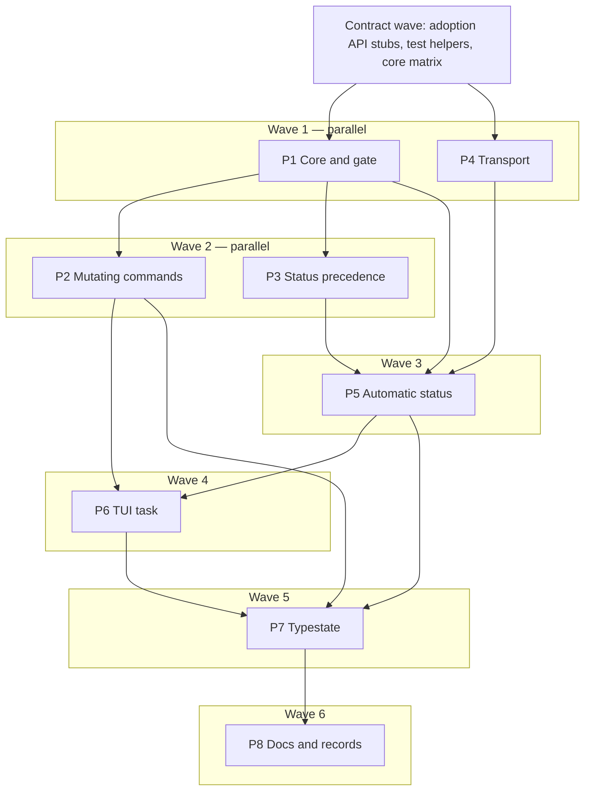

# Plan: Install records as a cache of the disk

## Status

- **Plan:** plan_install_record_cache
- **Active phase:** 7 — Review fixes (closed: review call 3 of 3 approved the RF pass 2 delta)
- **Step:** awaiting /finalize
- **Last update:** 2026-11-16 (hex-review call 3 of 3 over `67c34324..88df9e14`: Approve, no functional defect, converged; 2 Warns left for the PR: `commands.md` ~1527 overstates that a linked or large project MCP config is never read, and no test covers two candidates sharing a good layer)
- State:   done
- Tier:    high
- Tier-grammar: 5
- Updated: 2026-11-16
- Next:    none
- Reviewed: 88df9e14c35a1c4ffa148347047b4367fdbd393d

---

## Header

- **Design record (binding):** [`adr_output_ownership_without_state.md`](../adr/adr_output_ownership_without_state.md), Status Proposed, the model confirmed by the owner on 2026-11-15. Items are cited as A1 to A10 and B1 to B9. Its last revision is unreviewed; this plan does not re-review its decisions.
- **Test design:** [`research_install_record_cache_test_matrix.md`](../research/research_install_record_cache_test_matrix.md). Its IDs are cited as "matrix M07c", "matrix S03", "matrix E07". The ADR's own 36 validation cases are cited as "ADR #8".
- **Facts:** [`research_output_ownership_claim_diff.md`](../research/research_output_ownership_claim_diff.md), [`research_output_ownership_without_state.md`](../research/research_output_ownership_without_state.md), [`research_generated_files_ownership_prior_art.md`](../research/research_generated_files_ownership_prior_art.md).
- **Classification:** scope large-medium (about two weeks) · reversibility one-way (medium): documented exits and the read-only behaviour of `grim status` change · tier high, `architect=inline` (the ADR is the design), `research=skip` (persisted research exists), `adversary=off`.
- **Branch:** `hex/plan-install-record-cache`, created from `origin/main` on 2026-11-15 by the goal loop [`plan-install-record-cache.md`](../goals/plan-install-record-cache.md). This plan, the ADR, the dossier and the research files are the second commit (`chore:`) on it, after the goal file.
- **Approval state:** the owner confirmed the model and ran `/hex-plan` on the ADR. The owner did not answer the three open questions at the end. The goal loop runs them at their recommended answers; that is the run's decision, recorded in the goal file, and it stays open for the owner at PR review.
- **Related issues:** [grimoire-rs/grimoire#257](https://github.com/grimoire-rs/grimoire/issues/257) (gitignore flag, own plan, out of scope), [grimoire-rs/grimoire#353](https://github.com/grimoire-rs/grimoire/issues/353) (prompt for locally edited artifacts, untouched here), [grimoire-rs/grimoire#167](https://github.com/grimoire-rs/grimoire/issues/167), [grimoire-rs/grimoire#295](https://github.com/grimoire-rs/grimoire/issues/295).

## Objective

After a clone, a pull, a branch checkout, a second worktree or a copied workspace, grim behaves as if its install record had never been out of step. Files that are a correct render of the lock are recognised as grim's own. Files a newer version dropped are removed. A real local edit is still refused. Nothing is deleted that grim cannot prove it wrote.

The rule, from the ADR: a record is trusted while the files match it. When they do not and the lock names another pin, the files are compared with a render of that pin, and only a mismatch means a local edit.

| Row | Files vs record | Lock pin vs record pin | State | Today |
|---|---|---|---|---|
| 1 | unchanged | same | `installed` | works |
| 2 | unchanged | changed | `outdated`, `grim install` re-renders | works |
| 3 | changed | same | `modified`, refuse | works |
| 4 | changed | changed | compare with a render of the lock's pin. Match: update the record. No match: `modified`, refuse | broken: always `modified`, exit `65` |
| 5 | no record, files exist | n/a | the same comparison (in `grim update`: against the previous lock) | broken for `grim update` in a clone |

"Pin" means registry, repository and digest. The tag is ignored (`src/oci/pinned_identifier.rs:36-40`). A path source compares its content hash.

### In scope

- Part A: one classifier and one proof (`src/install/adoption.rs`, new), the install gate, status precedence, and the pre-passes of `update`, `uninstall`, `remove` and their TUI forms.
- The credential-transport fix (B9) and the fetch bounds and miss memo (B4).
- Part B: `grim status`, TUI open and the MCP `grim_status` tool apply rows 4 and 5 automatically, with a state-file lock, visible output, and a compile-time rule for future commands (B8).
- Acceptance tests for every row, command and checkout model, and for copy and move scenarios.
- Docs, first-party catalog skills and the two subsystem rules.

### Out of scope

- The `grimoire-vscode` change (pass `--offline` to plain `status` in an untrusted workspace). It lives in a sibling repository. It must ship before a grim release that contains Part B.
- Refusing writes through a link that leaves the workspace in every command (the ADR's open question 3). The ADR recommends its own bugfix plan, and this plan follows that.
- [grimoire-rs/grimoire#257](https://github.com/grimoire-rs/grimoire/issues/257), and any travelling ownership record.
- Proof of hooks, settings, bundles and dev records. They are never proven (A1).
- A hook record in a copied workspace that names the original workspace's payload folder (matrix E24). Unchecked, worth its own check.

## Technical Approach

### Architecture changes

```
                      +---------------------------+
 evidence lock ------>|  src/install/adoption.rs  |<------ files on disk
 install record ----->|  classify -> prove ->     |<------ content (store, or
                      |  rerecord; prepass        |        store then registry)
                      +---------------------------+
        ^            ^              ^              ^             ^
   install gate   status       update, uninstall,  TUI forms   Part B: status
   (installer.rs) overlay      remove pre-passes   (app.rs)    commit, TUI task,
                  (status.rs)  (command/*.rs)                  grim_status
```

One module owns the rule. Every caller hands it an evidence lock, the state, and a way to read content, and gets back proven records and a list of unproven nodes with a typed reason. No caller repeats a comparison.

### Key decisions

All decisions on the model are the ADR's. The rulings below are the planner's, made where the ADR is silent or where the code contradicts it. They are not owner decisions. Each names the situation, the ruling and the alternative.

| # | Situation | Ruling | Alternative not taken |
|---|---|---|---|
| R-1 | A proof cannot run or fails: content not in the store, host down, pin gone, files in CRLF, bytes from another grim version. Example: Bob pulls on Windows with `core.autocrlf`, so every committed output differs from the render. | **Proof only upgrades.** A node that is not proven behaves exactly as it does today, with today's exit and reason. At the gate that is `65` `modified` (row 4) or `65` `untracked-destination` (row 5). | Surface the fetch error (`81`, `69`, `80`) for a row 4 node whose content is missing. Rejected: today's refusal is offline-safe (`src/install/installer.rs:1033`, before staging) and a new exit would be a second behaviour change. |
| R-2 | A4 says a row 4 match "re-materializes identical bytes". The code would then report `updated` (`installer.rs:1680`), change mtimes, and can fail on Windows with an open file. | On a full match the gate re-pins the record, then takes the existing row 1 path. With every output present, no client byte is written, the row reads `unchanged`, and the new record is persisted. When another client's output is absent, the existing path restores it and the row reads what that path reads today (`updated` in `install`, `restored` in `update`). | Rewrite the bytes as the ADR text says. Rejected: it breaks "the same command twice writes nothing" (matrix S59). |
| R-3 | The install gate adopts a live link to a file with identical bytes today (`installer.rs:1259-1262`). A2 says a link is never proven. | The install gate keeps today's behaviour. The new proof used by pre-passes and status never proves a link. Both are pinned by tests (matrix E07). | Refuse links in the gate too. That changes shipped `install` behaviour and belongs to the link bugfix plan (ADR open question 3). |
| R-4 | A3 says `support_dir` keeps its value on a row 4 re-pin. When the new version adds or drops a rule's support directory, the next `status` would read `modified` (matrix S33, S34). | On a re-pin `support_dir` comes from the evidence version, as row 5 already does. `entry` and `adopted` keep their values. | Keep the old value. Rejected: it turns a correct pull into a false edit on the second run. |
| R-5 | `derive_state` is sync, pure and shared by status, `hook list`, the TUI and about 20 tests (`src/command/status.rs:2866`). A5 needs a store read. | Status first builds an in-memory copy of the state with proven records applied, then calls the unchanged `derive_state`. The store reader is built only when at least one node is a row 4 candidate, and a failure to build it means "not proven", exit unchanged. An absent active output still reads `missing` first (matrix E20). A `stale` lock gets no proof. | A second async classifier beside `derive_state`. Rejected: two classifiers drift. |
| R-6 | `grim uninstall` deletes a recorded node's files with no hash check, with or without `--force` (`src/install/uninstall.rs:188-370`, `.claude/rules/subsystem-cli-commands.md:36`). A8 is silent on recorded nodes. | Unchanged for recorded nodes. A8 changes two things only: a node with no record is proven first, and a drifted MCP entry that proves against the evidence entry is removed without `65`. | Gate file deletion on the hash. Rejected: a shipped behaviour change nobody asked for. |
| R-7 | A7 says an unreadable state exits `74`. The code maps permission denied to `77` (`src/error.rs:784-798`). | State, client-set and persist errors keep their existing codes. They now happen before the lock is written. | none |
| R-8 | A9 says `warn_left_behind` names only nodes with a record. It is driven by lock dispositions and takes no state (`src/command/update.rs:742-765`). | `warn_left_behind` is unchanged. One node gets at most one stderr line, in this order: refusal error, kept-entry warning, kept-modified warning, the new unproven line. | none |
| R-9 | B8 would make `InstallState::load*` and `empty` private. About 330 test call sites use them. | `load`, `load_project` and `load_global` become private in non-test builds and keep their names in test builds. `empty` stays crate-visible, because an empty state reads no file and has nothing to adopt. | Rewrite 330 test sites. Rejected: risk with no gain. |
| R-10 | B4's limits "may harden install and `status --check`" (ADR plan order 2). A cap of 64 manifests cannot apply to a large install. | The bounds ship as a tested decorator and are wired only into Part B's fetches. `install` and `status --check` keep today's behaviour. | Apply deadlines to every command. Rejected: a new failure mode for shipped commands. |
| R-11 | B4 does not say what happens to candidates beyond the fetch cap (matrix S56). | They are named with the reason "never attempted (fetch budget)" and are picked up by the next run. | none |
| R-12 | TUI Update and TUI Install share one state load (`src/tui/app.rs:3812`). The pre-pass must run before `save_relock`. | `perform` loads state and runs the pre-pass before `save_relock` for Update. `install_row` stays the install gate. | none |
| R-13 | The ADR names one test file. Parallel pipelines need disjoint files. | Tests live in `test/tests/test_record_cache_*.py`, one or two files per pipeline. | none |

Suggestions from the test-design pass that this plan does **not** take, with the reason:

| Suggestion | Reason not taken |
|---|---|
| Refuse `uninstall` and `remove` in a clone with a cold store (matrix gap 5) | The ADR decided: leave, warn, exit `0` (A8, A9). A new refusal is a behaviour change. |
| A named reason for CRLF, or hash normalisation (gap 6) | Detecting it needs a second comparison. The docs get a `.gitattributes` `eol=lf` note; a test pins today's refusal (matrix E01). |
| Follow a linked ancestor for re-recording (gap 7, stow and yadm users) | A2 requires strict containment, backed by the ADR's threat model. Documented as a known limit. |
| Probe clients this machine does not select (gap 10) | A6 takes candidates from the effective client set. A wider probe is new surface. |
| Reword the row 3 refusal when the files are another version's render (gap 14) | Wording only; no test needs it. |

## Constitution Deviations

| Violation | Why needed | Simpler alternative rejected because |
|---|---|---|
| Principle 9: `install` and `update` exit `0` where they exited `65`, and `status` reads `installed` where it read `modified`, for a node rows 4 and 5 prove | Owner decision 7: the lagging record "should make no difference". The old refusal pointed users at a destructive `--force` | Documenting "run `grim install` first" (ADR option O1) does nothing for row 4. No JSON shape, literal or schema changes |
| Principle 9: `grim status` and the TUI write machine-local records and may fetch (Part B) | Owner decisions 1, 2 and 5 | A status that never writes leaves every clone at `missing` until a mutating command runs. The MCP read-only promise, the only written one, is kept |
| Principle 9: after B9 a pull, a push (`release`, `publish`) or a `_catalog` browse may exit `80` where it sent a credential in cleartext to a host only a project file declares insecure | The fix of a shipped defect class at its one attach site | Leaving it open is not an option once status fetches |
| Principle 9: `update` and `uninstall` fail on state errors before the lock or config edit | The lock save destroys the evidence the pre-pass needs (A7) | Keeping the order loses the proof when the run fails between save and persist |
| Principle 9: in a clone, a bare `update` and an `uninstall` with a warm store now delete files they used to leave. The exit is `0` before and after | This is the fix the dossier asked for; only files proven byte-identical to grim's render are deleted | Leaving them is the reported defect |
| Principle 9: `remove` (and `lock` and `add` under open question 3) now read and write `state.json`. `.claude/rules/subsystem-cli-commands.md` says `grim lock` reads no state | The lock write is the last moment the dropped nodes can be proven | Without it the files become unprovable. A state error in these three commands warns and keeps the exit |
| Principle 9: `grim_status` writes records when the server runs with `--allow-writes` | Owner decision 1; the written read-only default is kept | A status tool that never writes repeats the proof on every call |

## Component Contracts

- **C-001 Classifier** `adoption::classify` (A1). Input: one lock node of kind skill, rule, agent or mcp, its record if any, the evidence lock entry, and the disk. Output per node: row 1, 2, 3, 4-candidate, 5-candidate, or not-a-candidate. Rows 1 to 3 use one file hash per recorded output and one pin comparison, with no render and no content read. A recorded node with every output intact is row 1 or 2. Any drifted output with the same pin is row 3. Any drifted output with another pin is a row 4 candidate. A node with no record and at least one existing destination (tested with `symlink_metadata`, for each effective client that hosts the kind, plus a rule's `<name>/`) is a row 5 candidate. Hooks, settings, bundles and dev records are never candidates. A node the evidence lock does not name is not a candidate.
- **C-002 Proof** `adoption::prove` (A2). A file destination is proven only if all hold: it exists with the preview's file type, and so does its support directory; neither is a symbolic link (tested on the lexical path); it resolves under its anchor with strict containment; its footprint hash equals that of a preview rendered from the evidence entry with that entry's pin string. A rule whose index file is gone is not proven. An MCP member is proven when its value, vendor-owned keys stripped, equals what grim would write for the evidence entry. `prove` returns `Proven` or `Unproven(reason)` and never an error for a disk, render or content failure. Reasons: files differ from the pin; a directory stands where a file belongs; the rule's index is gone; content not in the local store (offline); fetch or verification failed; the host failed earlier in this run; the local source no longer matches; unreadable; render failed; a symbolic link to the resolved target; under a link outside its root; never attempted (no evidence entry, outside the closure, or fetch budget). `prove` writes nothing outside a temporary staging directory.
- **C-003 Record write** `adoption::rerecord` (A3, R-4). Row 4: when every present recorded output proves, the record takes the evidence entry's source and the matched hashes; `support_dir` comes from the evidence version; `entry` and `adopted` keep their values. Otherwise the record is unchanged. *(Open question 2)* When every present output either proves or still matches the record, and not all prove, the record is unchanged and the node is reported to the caller as "mixed"; an output that does neither makes the node row 4 no-match. Row 5: one new record with `dev: false` and outputs for the proven destinations only; file outputs get `adopted: false`, MCP outputs get `entry` and `adopted: true`. No file under a client root is written, no vendor sync and no hook convergence runs. The result is an in-memory state change; the caller persists.
- **C-004 Pre-pass** `adoption::prepass(state, evidence lock, node set, content mode)` (A6). It classifies every node in the set, proves the candidates, applies C-003 and returns the proven nodes, each with its evidence pin and matched hashes (the C-014 re-check needs them), and the unproven nodes with reasons. Content mode is "store only" or "store, then registry". A host that failed once in a run is not contacted again in that run. When every node is rows 1 to 3 it renders nothing, sends no request and changes nothing. With no evidence lock there is no pre-pass.
- **C-005 Install gate** (A4, R-1, R-2, R-3). Where the gate would refuse a drifted recorded output and the record's pin differs from the lock's, the refusal waits for the comparison after staging. Every drifted output proves and no output is absent: the record is re-pinned, the row reads `unchanged`, exit `0`, no client byte written. With an absent output of another client, the row and the write are those of R-2. Any drifted output does not prove, or the lock's content cannot be read: `65`, `reason: modified`, record unchanged. Same pin: refused at once, as today. *(Open question 2)* An output that still matches the record while another output proves against the lock is not an edit: the node installs normally and reads `updated`. The MCP gate follows the same rule. Row 5 at the gate is unchanged: identical footprint adopted, differing footprint `65` `untracked-destination`. Covers `install`, `add`'s install, TUI Install and the gate inside `update`. `--force` behaves as today.
- **C-006 Status precedence** (A5, R-5). Under Part A status evaluates row 4 against the lock as found, with store-only content, in memory, and writes nothing. Match: `installed`, with `outputs` from the proven record. No match: `modified`. Content not in the store: `modified` plus one `warn`-level stderr line that names `grim install`. *(Open question 2)* A "mixed" node (C-003) reads `outdated`. Row 5 reads `missing`. `stale` and `missing` keep their precedence. JSON stdout carries no new key. A run where every node is rows 1 to 3 builds no store reader and creates no directory. Part B replaces the `grim install` line with the C-016 lines. TUI badges come from `status_badge.rs`, which reads the persisted record, so under Part A alone a row 4 badge still shows modified until `install` or Part B writes the record.
- **C-007 `update` order and outcomes** (A6, A7, R-7). The install target and the state load run before the lock save. The pre-pass runs after them and before the save, against the previous lock, with "store, then registry" content: over every node of the previous lock for a bare run, and over `NamedScope::force()` ∩ previous lock for a named run. Proven records are persisted before the lock save; a persist failure exits with its existing code and the lock is unchanged. Outcomes: still shipped, moved pin, proven: `updated`, exit `0`. Carried, proven, nothing missing: `unchanged`, no write. Carried, one client proven, another's destination absent: `restored`. Dropped, proven: `removed`, files deleted. Dropped, proven for one client only: only the recorded output is deleted, the rest is named. Still shipped, unproven: the existing `65`, `refused: true`. Adopted MCP entry dropped: `removed`, entry kept, named in `abandoned_entries`; `--force` removes it. Report rows keep the shape and meaning of today; the unit test `a_dropped_member_with_no_record_keeps_its_removed_row` stays green.
- **C-008 `uninstall` and `remove` pre-pass** (A6, A8, R-6). `uninstall`: evidence is the lock as found, content is store only, nodes are the target plus the `plan_hold` orphans, and the pre-pass runs before the edit; a persist failure exits with its existing code. A node a bundle holds is not proven. `remove`: nodes are those absent from `drop_from_lock`'s result, the pre-pass runs before `save_lock`, a failure warns and the exit is kept; `remove` deletes nothing and a later bare `grim update` prunes. `--force` creates no ownership. A drifted MCP entry that proves against the evidence entry is re-recorded and removed with no `65`. Neither command sends a request. *(Open question 3)* `grim lock` and `grim add` run the `remove` pre-pass for the nodes their lock write drops; a state error there warns and keeps the exit, as in `remove`.
- **C-009 Unproven-files line** (A9, R-8). One stderr line per node left on disk: `<kind> '<name>' left <path>[, <path>…] on disk: grim could not prove it wrote <it|them> (<reason>)`, then `delete it by hand if unwanted`. A link gets "remove the link only"; an ancestor link outside the root gets no removal advice. A node that already has a refusal error, the kept-entry warning or the kept-modified warning gets no second line. No report row says `removed` for a node without also deleting its recorded outputs or naming what stayed. Tests assert kind, name, each path and the resolved link target, never whole sentences.
- **C-010 Scope** (A10). At global scope the evidence lock is `$GRIM_HOME`'s and the state is `global.json`. The gate, the proof and the prune have no scope branch.
- **C-011 TUI forms** (A6, R-12). TUI Update runs the C-007 pre-pass before `save_relock`. TUI delete and member delete run the C-008 pre-pass before `delete_nodes`.
- **C-012 Credential transport** (B9). A file a repository delivers can never cause a stored credential to travel over an unencrypted connection, for every credential kind and every hop (registry, token realm, redirect). The decision is made where the credential is attached. Credential kinds: a username and password from the docker config, an identity token, and a credential a helper returns. Observable, with a header-recording proxy on plain HTTP that only the project file declares insecure: no recorded request on any of the three hops carries an `Authorization` header. The pull then succeeds without the credential when the registry allows anonymous reads, and exits `80` when it demands one.
- **C-013 Fetch bounds and miss memo** (B4, R-10, R-11). A decorator over the content reader enforces: 10 s per call; a per-run deadline (30 s for the CLI and MCP, 60 s for the TUI task); at most 64 manifest and 64 layer fetches per run; a manifest body of at most 4 MiB, refused before its digest check; at most 512 MiB of decoded layers per run. A call past its deadline counts as a host failure. The memo file `$GRIM_HOME/state/adoption-misses.json`, under its own advisory lock, skips a failed host for 10 minutes and a pin answered `404` for 24 hours. Both are internal and unstable.
- **C-014 State commit and lock** (B3). A commit takes `state.json.lock` (project: `.grimoire/state.json.lock`; global: `$GRIM_HOME/state/global.json.lock`) with `try_acquire`, holds it only to reload, re-check and write, and never across a fetch or render. A record is written only for a node unchanged since the proof: same record bytes, same evidence pin, files that still hash to the match. `persist` takes the same lock, polling up to 2 s, then writes unlocked as today. On contention, any I/O error, a read-only directory, or a `.grimoire` or `state.json` that is a link or resolves outside the workspace, the commit is skipped, the report comes from memory and the exit is kept. With nothing proven there is no commit: `state.json` keeps its bytes and mtime, and no `.grimoire/` is created. A commit never takes the config lock.
- **C-015 Automatic adoption in status** (B1, B2). `status::run_with(ctx, args, StatusMode { content, commit })`. `grim status` runs C-004 for rows 4 and 5 against the lock as found, at both scopes, with "store, then registry" content through C-013, and commits through C-014. Offline it reads the store only. Rows 1 to 3 cost what status costs today. A second run with nothing new writes nothing and prints no adoption line. No adoption runs under a `stale` lock.
- **C-016 Visibility** (B5). The `--progress` sink gets `start` with the candidate count, `advance` labelled `adopt <kind> <name>`, and `finish`. Outcome lines are `warn`-level on stderr in both output formats: `adopted <a> artifacts into the install record; <u> left unproven`, `records not written: <cause>`, `offline: <u> artifacts were not proven`. `--log-level off` silences them, `--progress none` hides the running line, and `--format json` stdout has no new key.
- **C-017 MCP `grim_status`** (B7). It reads the store only and never fetches for the rule. It commits only when the server was started with `--allow-writes`; `McpState.allow_writes` becomes the reader. Without writes, a per-process memo keyed by scope, node, pin, client and footprint hash avoids a second render; a unit test with a counting renderer shows one render for two identical calls. The tool description states the gate.
- **C-018 TUI background adoption** (B6). After the first load and on a scope toggle the TUI starts one adoption task per scope. The task never commits; the event loop commits its result between actions through C-014 and re-derives the badges. The status line shows `adopting <n> artifacts in the background…`, then `adopted <a> · <u> unproven (tui.log)`. Input stays live while the task runs. The task reads content through C-013 with the 60 s run deadline. A task that fails or passes its deadline commits nothing, leaves the badges unchanged, writes one `warn` line to `tui.log`, and clears the "adopting" message.
- **C-019 Loader typestate** (B8, R-9). Every loader of the install state returns `Unadopted`. A caller must call `adopt`, `defer` or `exempt(Exempt::…)` to get an `InstallState`. `Exempt` has `InstallGate`, `Browse`, `HookRecords`, `SettingsPreflight`, `DevRecords`, `CrossScopeShadow`. Non-test code that loads state without choosing does not compile. Call-site classes follow the ADR's B8 table, plus: every caller of `load_scope_for_badges` is `Browse`, and under open question 3 the new loads in `lock.rs` and `add.rs` are `adopt`. `InstallState::empty` call sites need no class (R-9). A unit test reads the module's own source and fails when a loader's non-test declaration is `pub`.
- **C-020 Docs, catalog and rules.** The sentences the ADR's Compatibility section lists, plus `configuration.md:822-827` (credentials for a host only a project file declares insecure no longer travel; P4 review) and an `upgrading.md` note for the new exit `80` on such a host, plus `commands.md:1060`, `:1176`, `json-interface.md:1081`, `:1186`, `upgrading.md:177`, the three `grim-usage` reference files, `subsystem-install-state.md` (Reap window), `subsystem-cli-commands.md` (status row, the `grim lock` "reads no state" sentence, the B8 convention line), the code doc comments that call status read-only, and one section in `docs/src/content/docs/guides/shared-skills.md` that explains both checkout models, when to use each, the `eol=lf` note and the linked-ancestor limit; `team-ci.md` and `use-a-marketplace.md` link to it.
- **C-021 Scenario test helpers.** `fresh_runner` (own `GRIM_HOME` and own `HOME`), `clone_workspace` (copy without `.grimoire/`), `pull_from` (lock, config and outputs from another workspace, `.grimoire/` kept), `git_team` (bare origin plus two real clones, committed-outputs or gitignored-outputs model), `state_snapshot` and `assert_unchanged` (bytes, `st_mtime_ns`, inode), `render_at`, `gone_pin`, `to_crlf`, and an OCI proxy with three modes: count requests per path, record request headers, accept and never answer.

## User-Experience Scenarios

"CO" is committed outputs, "GO" is gitignored outputs.

| ID | Action | Expected outcome | Error cases |
|---|---|---|---|
| S-001 | Clone a CO repository, run `grim install` | `unchanged`, exit `0`, `state.json` created, no file byte changed | Files differ from the lock's render: `65` `untracked-destination`, as today |
| S-002 | Clone, run `grim update` to a version that drops a file, a bundle member, or renames a rule | Exit `0`; the dropped files are gone; rows `updated` and `removed` | A hand-edited dropped file stays and is named once; an edited still-shipped artifact: `65` |
| S-003 | Pull a teammate's update (CO), run `grim install` | `unchanged`, exit `0`, record at the new pin; `status` reads `installed` | A local edit on top of the pull: `65` `modified`, record unchanged |
| S-004 | Pull, run `grim status` | Warm store: `installed`. Cold store under Part A: `modified` plus one line naming `grim install`. Nothing written under Part A | — |
| S-005 | Pull, run `grim update` to a third version | The pre-pass re-pins from the previous lock; the run rolls forward, exit `0` | Unreadable state: existing exit, lock unchanged |
| S-006 | Check out an older branch and back (CO), `install` and `status` each time | `unchanged` and `installed` each time; a second `install` keeps file mtimes | — |
| S-007 | Pull or switch branch with GO, run `status`, `install`, `update` | `outdated`; `install` re-renders and reaps; no proof render, no proof request | — |
| S-008 | Add a second git worktree, run `status` then `update` | Part B: record written, `installed`; no request with a warm store | Cold store offline: `missing`, one `offline:` line |
| S-009 | Copy a workspace with `.grimoire/`, copy it without, rename or move it | With state: `installed`, no write, `uninstall` in the copy touches only the copy. Without: adopted from the store | — |
| S-010 | Restore or copy in an older `state.json` | Per node rows 1, 2 or 4; `install` exits `0` with no `65` | A hostile committed record grants no deletion on its own (matrix E23) |
| S-011 | Copy a render in by hand: same pin, another pin, a partial copy, into another client's folder | Same pin: adopted. Other pin or partial: not proven, `65` or named | — |
| S-012 | Edit a file by hand, with or without a moved lock | `modified`, `65`, record unchanged; `--force` overwrites | — |
| S-013 | One artifact at two versions: one client's files at the record's pin, another's at the lock's | *(Open question 2)* `status` reads `outdated`, `install` exits `0` and re-renders | An output matching neither: `65` |
| S-014 | `uninstall` or `remove` in a clone | Warm store: files deleted, or proven then pruned by the next `update`. Cold store or `--force` only: files stay, named once, exit `0` | — |
| S-015 | Run `update` with a cold store online, offline, with the old pin gone, with the host down | Online: old pin fetched, stale files go. Otherwise: no `81` for the old pin, files stay and are named, one attempt per host | New content missing offline: `81` as today |
| S-016 | Files differ without an edit: CRLF, mode bits, mtime, an extra link or empty folder, a link at the destination | Mode, mtime, extra link, empty folder: no effect. CRLF and a changed byte: not proven, today's refusal. A linked destination is never proven by a pre-pass | — |
| S-017 | Run `grim status` twice in a clone (Part B) | First run writes the record, reads `installed`, prints one `adopted` line. Second run writes nothing and prints no line | Read-only or linked-out `.grimoire`: `installed` from memory, `records not written:`, exit `0` |
| S-018 | Call `grim_status` with and without `--allow-writes` | Without: reports `installed`, writes nothing. With: writes. No request either way; a repeated call renders nothing | — |
| S-019 | Open the TUI or toggle scope with records missing | A background task adopts, the badges update, input stays live | Task failure: logged to `tui.log`, badges unchanged |
| S-020 | Run `grim status` against a registry that accepts and never answers | Ends inside its deadline, exit `0`; a second run within 10 minutes sends nothing | — |
| S-021 | Run `status` or `install` with a stored credential and a registry only the project file declares insecure | No credential reaches the registry in cleartext | The pull fails with `80` |
| S-022 | Run `grim --global update` with `global.json` deleted | A dropped skill is removed | A linked ancestor (stow): not proven, stays as today |
| S-023 | Any of the above in a project that declares a hook and a settings package | No hook or settings record is written, no dispatch table or settings file is read or changed | — |
| S-024 | Kinds and shapes: a rule gains or loses a support directory, an MCP entry changes value, a bundle renames a member, three clients share one pool folder | Each follows its row; a second `status` stays `installed`; one proof and one delete for a shared pool | An adopted MCP entry is kept on removal unless `--force` |

## Parallelization

| Pipeline | Scope | Expected Files | Wave | Depends on | Marks | Status |
|----------|-------|----------------|------|------------|-------|--------|
| P1 Core and gate | C-001, C-002, C-003, C-004, C-005, C-010; S-001, S-003, S-006, S-009, S-010, S-011, S-012, S-013, S-016, S-024 | `src/install/adoption.rs`, `src/install/installer.rs`, `test/tests/test_record_cache_install.py`, `test/tests/test_record_cache_install_edges.py`, `test/tests/test_old_grim_record_cache.py` | 1 | — | hard | merged |
| P4 Transport | C-012, C-013; S-021 | `src/oci/access/registry_client.rs`, `src/oci/access/bounded_access.rs` (new), `src/oci/access/miss_memo.rs` (new), `src/oci/access.rs`, `src/context.rs`, `src/command.rs`, `test/tests/test_registry_credential_transport.py` | 1 | — | review | merged |
| P2 Mutating commands | C-007, C-008, C-009, C-011; S-002, S-005, S-007, S-014, S-015, S-022 | `src/command/update.rs`, `src/command/uninstall.rs`, `src/command/remove.rs`, `src/command/lock.rs`, `src/command/add.rs`, `src/install/uninstall.rs`, `src/install/prune.rs`, `src/install/adoption.rs` (fixes only), `src/tui/app.rs`, `test/tests/test_record_cache_update.py`, `test/tests/test_record_cache_update_scenarios.py`, `test/tests/test_record_cache_uninstall_remove.py`, `test/tests/test_record_cache_matrix.py` (four cells whose test, not the code, was wrong) | 2 | P1 | | merged |
| P3 Status precedence | C-006; S-004, S-010, S-013, S-024 (status halves) | `src/command/status.rs`, `test/tests/test_record_cache_status.py` | 2 | P1 | | merged |
| P5 Automatic status | C-014, C-015, C-016, C-017; S-008, S-009, S-017, S-018, S-020, S-023 | `src/install/install_state.rs`, `src/install/adoption.rs` (fixes only), `src/command/status.rs`, `src/main.rs` (the `Status` doc comment), `src/mcp/server.rs`, `src/mcp/state.rs`, `src/mcp/tool_args.rs`, `test/tests/test_record_cache_auto_status.py`, `test/tests/test_record_cache_auto_network.py`, `test/tests/test_record_cache_mcp.py`, `test/tests/test_old_grim_auto_status.py`, `src/context.rs` (one bounded-access constructor), `test/tests/test_record_cache_status.py` and `test/tests/test_record_cache_matrix.py` (Part A assertions that status writes nothing, changed to the Part B expectation) | 3 | P1, P3, P4 | | merged |
| P6 TUI task | C-018; S-019, S-023 (TUI half) | `src/tui/adoption.rs` (new), `src/tui.rs`, `src/tui/app.rs`, `src/command/status.rs` (the adoption fetcher no longer holds a `Context`, so the TUI task can use it) | 4 | P2, P5 | | merged |
| P7 Typestate | C-019 | `src/install/install_state.rs`, `src/command/scope_resolution.rs`, `src/install/installer.rs`, `src/command/{status,update,uninstall,remove,lock,install,add,search,rate}.rs`, `src/command/hook/list.rs`, `src/tui/app.rs`, `src/mcp/server.rs` | 5 | P2, P5, P6 | | merged |
| P8 Docs and records | C-020 | `docs/src/content/docs/{commands,json-interface,upgrading,stability,configuration}.md`, `docs/src/content/docs/guides/{shared-skills,team-ci,use-a-marketplace}.md`, `catalog/skills/grim-usage/references/{consume,updating,troubleshooting}.md`, `.claude/rules/subsystem-install-state.md`, `.claude/rules/subsystem-cli-commands.md` | 6 | P7 | | merged |
| RF1 Fetch bounds (review 1) | C-013 partial, C-018 partial, S-021 partial | `src/oci/access/bounded_access.rs`, `src/oci/access/miss_memo.rs`, `src/oci/access/registry_client.rs` (warning text only), `src/command/status.rs` (the `Fetcher` layer path only), `src/tui/adoption.rs`, `src/main.rs`, `test/tests/test_registry_credential_transport.py`, `test/tests/test_record_cache_auto_network.py` | 7 | P1–P8 | review | merged |
| RF2 Proof and commit safety (review 1) | C-002 contradicts, C-003 partial, C-009 partial, C-014 partial | `src/install/adoption.rs`, `src/install/install_state.rs`, `src/install/installer.rs`, `src/command/remove.rs`, `test/tests/test_record_cache_install_edges.py`, `test/tests/test_record_cache_uninstall_remove.py`; added by the RF pass: `src/command/update.rs` and `src/command/status.rs` at the `PrepassReport.mixed` call sites only (RF2.4), and a new `test/tests/test_record_cache_proof_safety.py` | 7 | P1–P8 | review | merged |
| RF3 Status contract (review 1) | C-006 contradicts, C-015 partial, C-017 partial, S-009 partial, S-024 partial | `src/command/status.rs`, `src/tui/adoption.rs` (line text only), `test/tests/test_record_cache_status.py`, `test/tests/test_record_cache_auto_status.py`, `test/tests/test_record_cache_mcp.py`, `test/tests/test_record_cache_matrix.py`; added by the RF pass: `src/tui/app.rs` (its copy of the outcome line now calls the shared helper) | 8 | RF1, RF2 | | merged |
| RF4 Mutating commands and TUI edges (review 1) | C-009 partial, C-011 partial (open question 3 for TUI Install), C-018 test gaps | `src/command/update.rs`, `src/command/uninstall.rs`, `src/tui/app.rs`, `test/tests/test_record_cache_update.py`, `test/tests/test_record_cache_uninstall_remove.py`; added by the RF pass: `src/tui/adoption.rs` (RF1.2 moved here, its one conflicting test is in `app.rs`), `test/tests/test_record_cache_matrix.py` (M11g, M13g), one `Unproven` variant in `src/install/adoption.rs` with its site in `src/command/remove.rs`, and `content_unread` in `src/command/status.rs` (left unchanged) | 8 | RF2 | | merged |
| RF5 Docs and records (review 1) | C-020 contradicts | `docs/src/content/docs/{commands,json-interface,upgrading,mcp-servers}.md`, `catalog/skills/grim-usage/references/{consume,registries}.md`, `.claude/rules/subsystem-cli-commands.md`, `src/command/mcp.rs` (`--allow-writes` help), `src/cli/progress.rs` (doc), `src/install/install_state.rs` (doc comment), this plan's Constitution Deviations row 3 (edited by the orchestrator) | 9 | RF1–RF4 | | merged |
| RF6 Decode budget and commit read (review 2) | C-013 partial, C-014 partial | `src/command/status.rs` (`charge_decoded`, `prove_nodes`, the commit's evidence read, `fetch_budget_tests`), the shared layer decoder if the budget moves there (`src/oci/layer.rs` or the staging in `src/install/installer.rs`, an optional budget parameter only; `install` passes none) | 10 | RF1–RF5 | review | merged |
| RF7 Project MCP config reads and advice (review 2) | C-001 partial, C-009 partial, C-011 partial | `src/install/adoption.rs` (`destination_present`, `holds_member`, the MCP proof's content-unread branch), `src/command/update.rs` (`unproven_line` advice for `mcp`), `src/command/remove.rs` (share `prove_dropped`'s unsaved handling), `src/tui/app.rs` (TUI Install's `prove_dropped`, two TUI tests), `test/tests/test_record_cache_proof_safety.py` | 10 | RF1–RF5 | review | merged |
| RF8 Docs and records (review 2) | C-018 partial, C-020 contradicts | `docs/src/content/docs/{upgrading,commands}.md`, this plan's Notes (C-018 and C-009 amendments) | 11 | RF6, RF7 | | merged |



**Critical path:** contract wave → P1 → P3 → P5 → P6 → P7 → P8.

**Shippable after wave:** 2 — Part A is complete: clone, pull and checkout work for `install`, `update`, `uninstall`, `remove` and Part A status. If work stops here, run step P8.1 alone for the docs. P4 is shippable on its own after wave 1.

**Parallelization justification:** waves 3 to 6 are single pipelines because `src/command/status.rs`, `src/install/install_state.rs` and `src/tui/app.rs` are each needed by consecutive parts, and P7 touches every caller.

**Always-on review perspectives** (`.agents/memory/hex.md`): security on P4 (`src/oci/**`); doc-reviewer on P2, P3, P5 and P7 (`src/command/**`). Stability (Principle 9) is checked on every pipeline.

## Implementation Steps

> Contract-first TDD: the contract wave commits stubs and contract tests. Inside each step the work is Specify, then Implement. A step that changes behaviour runs the tests it wrote or touched once, with the narrowest command. Acceptance tests follow `.claude/rules/subsystem-tests.md`: text I/O with `encoding="utf-8"` and `newline="\n"`, symlink checks through `test/src/assertions.py`, tokens asserted, never whole sentences. No test is parked, skipped or marked xfail to make a step pass. A scenario that spans commands is split by command: each pipeline's test file holds only the halves its own pipeline can turn green.

### Contract wave

- [x] **CW.1 Stubs:** `src/install/adoption.rs` with the public types (`Row`, `Proof`, `Unproven` with one variant per reason in C-002, `ContentMode`, `PrepassReport`) and the functions `classify`, `prove`, `rerecord`, `prepass` with `unimplemented!()` bodies; `pub mod adoption;` in `src/install.rs`.
  - Files: `src/install/adoption.rs`, `src/install.rs`
  - Public API: as C-001 to C-004. Signatures take the evidence `LockedArtifact`, the `InstallState`, the `InstallTarget` and `AnchorRoots`, and `&Arc<dyn OciAccess>`. `PrepassReport` carries, per proven node, the evidence pin and the matched hashes.
- [x] **CW.2 Test helpers:** every helper of C-021, plus shared `cold_runner`, `move_tag`, `rows_by_name` and `delete_manifest` helpers modelled on the private per-file copies, which stay untouched. One self-test module proves each helper: the clone has no `.grimoire/`, the pull keeps it, two fresh runners do not share `HOME`, the proxy counts and records headers, the hang mode never answers, `git_team` commits outputs in one model and ignores them in the other.
  - Files: `test/src/scenarios.py` (new), `test/src/oci_proxy.py` (new), `test/tests/conftest.py`, `test/tests/test_scenario_helpers.py` (new)
  - Covers: C-021
- [x] **CW.3 Core matrix, rows 1 to 3:** matrix lines 01 to 06, columns a, c, d, e, f, g, h, in both checkout models. These pass on today's binary and are the safety net for every later step. Each asserts state or row, exit, and that nothing was rendered where the matrix says so. "No render" is shown the way ADR #1 does it: the store is emptied and the run is `--offline`, so any content read would fail; the `state.json` snapshot shows no write.
  - Files: `test/tests/test_record_cache_matrix.py` (new)
  - Covers: C-001, C-005, C-006, C-007, C-008; S-007, S-012 (ADR #1)
- [x] **CW.4 Core matrix, rows 4 and 5:** matrix lines 07 to 14, same columns. A cell whose expectation differs from today's binary fails until its pipeline lands: column a until P3; columns c and the install half of h until P1; columns d, e, f, g and the update half of h until P2. Cells that describe today's behaviour (for example line 13 column c) pass now. The step runs the module once and returns, per cell, "passes today" or "fails until P<n>"; the orchestrator records that list under Notes, and it is the reference for every later step.
  - Files: `test/tests/test_record_cache_matrix.py`
  - Covers: C-005, C-006, C-007, C-008, C-009; S-001, S-002, S-003, S-005, S-014

Check: `cargo check` passes; CW.2 and CW.3 tests pass; CW.4 fails only in cells the recorded list assigns to a pipeline.

### Pipeline steps

**P1 Core and gate** (hard)

- [x] **P1.1 Characterization tests.** Unit tests in `installer.rs` that pin two behaviours no test pins today: a live link to a file with identical bytes is adopted by the gate (R-3), and the outcome label when a destination is adopted while a record exists. They pass before any change.
  - Files: `src/install/installer.rs` · Covers: C-005
- [x] **P1.2 Extract the comparisons.** Two refactoring commits with no behaviour change and no test edit: move the preview-and-footprint comparison (`installer.rs:1271-1296`) and the MCP value comparison (`:3223-3272`) into functions in `adoption.rs` that the gate calls.
  - Files: `src/install/installer.rs`, `src/install/adoption.rs` · Covers: C-002
- [x] **P1.3 Classifier and proof.** Unit tests first: one per row of the table, one per `Unproven` reason, the four proof conditions, a `foo.md/` directory with and without a support directory, a tag-only pin change (row 1), the same digest at another repository (row 2 or 4), a legacy unfiltered record hash, an edited `.grimignore`, and file-name key bytes for case and Unicode (matrix E04, E05, E16, E17, E18, E21, E22). A content reader that fails the test on any fetch proves rows 1 to 3 read nothing. Then implement `classify` and `prove`.
  - Files: `src/install/adoption.rs` · Covers: C-001, C-002
- [x] **P1.4 Record write and pre-pass.** Unit tests first: the partial-proof rule, `support_dir` from the evidence version in both directions (R-4), `entry` and `adopted` kept, the row 5 record shape, one attempt per failed host in a run, and no render when every node is rows 1 to 3. Then implement `rerecord` and `prepass`.
  - Files: `src/install/adoption.rs` · Covers: C-003, C-004
- [x] **P1.5a The row 4 gate for file kinds.** Acceptance tests first, failing, `install` halves only: matrix S03, S07, S22, S26, S27, S28, S59, and ADR #2, #3, #6. Then change `integrity_gate` per C-005, with R-1 and R-2. Global scope is covered by one parametrized case (C-010).
  - Files: `src/install/installer.rs`, `test/tests/test_record_cache_install.py` · Covers: C-005, C-010; S-003, S-006, S-010, S-012
- [x] **P1.5b MCP and artifact shapes.** Acceptance tests first, `install` halves only: matrix S33, S34, S35, S36, S38, S40, S41. Then apply the same rule to the MCP gate.
  - Files: `src/install/installer.rs`, `test/tests/test_record_cache_install.py` · Covers: C-005; S-024
- [x] **P1.5c Row 5 and one artifact at two versions.** Acceptance tests first, `install` halves only: matrix S01, S15, S16, S17, S21, and ADR #22. Then the per-output clause of C-005 (open question 2).
  - Files: `src/install/installer.rs`, `test/tests/test_record_cache_install.py` · Covers: C-005; S-001, S-013
- [x] **P1.6 Copies, moves and not-an-edit cases at install.** Acceptance tests, `install` halves only: matrix S23, S25, S29, E01, E02, E03, E06, E07, E08, E17, E18, E23, and the old-grim cases S18 and S65. Most pin behaviour that already holds after P1.5; a failure is fixed in `adoption.rs` or `installer.rs`.
  - Files: `test/tests/test_record_cache_install_edges.py`, `test/tests/test_old_grim_record_cache.py`, `src/install/adoption.rs`, `src/install/installer.rs` · Covers: S-009, S-011, S-016

**P4 Transport** (review)

- [x] **P4.1 Root cause and failing test.** Follow `.claude/rules/workflow-bugfix.md`. Write the regression tests of ADR #33 with the header-recording proxy, parametrized over the three hops (registry, token realm, redirect) and the credential kinds of C-012: no `Authorization` header in any recorded request from `install` or `status --check`, and the exit C-012 names. Record the root cause in this plan's Notes by class, with no step-by-step recipe.
  - Files: `test/tests/test_registry_credential_transport.py` · Covers: C-012; S-021
- [x] **P4.2 Fix where the credential is attached.** Make the decision in `auth_for` and the host-set composition, so that a host whose plain-HTTP status comes only from a project file never receives a stored credential, on every hop grim's own code controls. If the root cause shows a hop only `external/rust-oci-client` can close, stop the pipeline there and report it: the fork is a submodule and a change needs a push only the owner can make.
  - Files: `src/oci/access/registry_client.rs`, `src/context.rs`, `src/command.rs` · Covers: C-012
- [x] **P4.3 Bounded reader.** Unit tests first, with the in-memory registry and paused time: each deadline, each cap, the manifest size refusal before the digest check, and "past the deadline counts as a host failure". Then implement the decorator. It is not wired into any command in this pipeline (R-10).
  - Files: `src/oci/access/bounded_access.rs`, `src/oci/access.rs` · Covers: C-013
- [x] **P4.4 Miss memo.** Unit tests first, with an injected clock: a failed host skipped for 10 minutes, a `404` pin for 24 hours, expiry, a corrupt file treated as empty, lock contention treated as "no memo". Then implement.
  - Files: `src/oci/access/miss_memo.rs`, `src/oci/access.rs` · Covers: C-013

**P2 Mutating commands**

- [x] **P2.1 Reorder `update`.** Tests first: an unreadable `state.json` leaves the lock bytes unchanged and exits with the existing code (ADR #17); a unit test that a failing lock writer leaves the proven records persisted. Then move the install target and the state load ahead of `lock_io::save`.
  - Files: `src/command/update.rs`, `test/tests/test_record_cache_update.py` · Covers: C-007
- [x] **P2.2a Bare `update` pre-pass and outcomes.** Acceptance tests first, failing: matrix S02, S06, S08, S09, S19, S20, S61 and ADR #5, #8, #9, #10, #11. Then call `prepass` before the save for a bare run and apply the outcome table of C-007.
  - Files: `src/command/update.rs`, `src/install/prune.rs`, `test/tests/test_record_cache_update.py` · Covers: C-007; S-002, S-005, S-007
- [x] **P2.2b Named runs, `--force`, warnings and failures.** Acceptance tests first: matrix S14, S46, S47, S63 and ADR #12, #18, #21. Then the named-run node set, and the C-009 line with the one-line rule of R-8.
  - Files: `src/command/update.rs`, `test/tests/test_record_cache_update.py` · Covers: C-007, C-009; S-002
- [x] **P2.3 `uninstall`, `remove`, `lock`, `add`.** Acceptance tests first: matrix S37, S43, S44, the warm and cold halves of M11f and M11g, M05f and M09f (recorded nodes keep today's rule, R-6), and ADR #7, #19, #20. Then add the pre-passes per C-008. Assert with the counting proxy that neither `uninstall` nor `remove` sends a request.
  - Files: `src/command/uninstall.rs`, `src/command/remove.rs`, `src/command/lock.rs`, `src/command/add.rs`, `src/install/uninstall.rs`, `test/tests/test_record_cache_uninstall_remove.py` · Covers: C-008, C-009; S-014
- [x] **P2.4a Store, network and global scope under `update`.** Acceptance tests: matrix S48, S52, S53, S54, S57, E11 and ADR #15, #16 (with the setup of S57), #23. A failure is fixed in `update.rs` or `adoption.rs`.
  - Files: `test/tests/test_record_cache_update_scenarios.py`, `src/command/update.rs`, `src/install/adoption.rs` · Covers: S-015, S-022
- [x] **P2.4b Shapes, copies and links under `update`.** Acceptance tests: matrix S30, S32, S39, S40 (update half), S42, E09, E10, E14, E15, E22, the `update` halves of E07, E08 and E23, and ADR #13, #14. A failure is fixed in `adoption.rs`.
  - Files: `test/tests/test_record_cache_update_scenarios.py`, `src/install/adoption.rs` · Covers: C-002, C-009; S-011, S-016, S-024
- [x] **P2.5 TUI forms.** Unit tests first, in the `app.rs` test module: the pre-pass runs before `save_relock` on Update and before `delete_nodes` on delete and member delete. Then wire them per R-12.
  - Files: `src/tui/app.rs` · Covers: C-011

**P3 Status precedence**

- [x] **P3.1 Row 4 in status.** Tests first: matrix S04, S05, S11, S12, S13, S49, E20, ADR #4, and the `status` halves of S15, S21 (reads `outdated`, open question 2), S26, S27, S33 (two runs, both `installed`) and S34; a run of rows 1 to 3 creates no directory under `$GRIM_HOME` and sends no request; `--format json` has the same key set as before. Then add the in-memory overlay ahead of `derive_state` per R-5.
  - Files: `src/command/status.rs`, `test/tests/test_record_cache_status.py` · Covers: C-006; S-004, S-010, S-013, S-024

**P5 Automatic status**

- [x] **P5.1 State lock and commit.** Unit tests first: the re-check (a record changed, removed or re-pinned by another writer is not overwritten or resurrected), contention skips the commit, `persist` waits at most 2 s and then writes, a linked or outside `.grimoire` is refused for the commit, nothing proven means no write and no directory. Then implement.
  - Files: `src/install/install_state.rs` · Covers: C-014
- [x] **P5.2a `StatusMode` and CLI adoption from the store.** Acceptance tests first: the CLI form of matrix column b for lines 01 to 14, S10, S24, S59 (status half), S60 and ADR #24, #29. Then add `run_with`, run the pre-pass for rows 4 and 5 with store-only content, and commit. Update the doc comments that call status read-only.
  - Files: `src/command/status.rs`, `src/main.rs`, `test/tests/test_record_cache_auto_status.py` · Covers: C-015; S-008, S-009, S-017
- [x] **P5.2b Degradation and what is left alone.** Acceptance tests first: matrix E12, E13 (both skipped as root), the Part B half of S13 (no adoption under a stale lock), the CLI half of S45 (hooks and settings untouched) and ADR #27, #30. Then the skip paths of C-014 in status.
  - Files: `src/command/status.rs`, `test/tests/test_record_cache_auto_status.py` · Covers: C-014, C-015; S-017, S-023
- [x] **P5.3 Visibility.** Tests first: `--format json` stdout has no new key after an adoption from a warm store, ADR #31 (`--progress json`, `--progress none`, `--log-level off`), and the three outcome tokens. Then emit through the progress sink and `warn` lines.
  - Files: `src/command/status.rs`, `test/tests/test_record_cache_auto_status.py` · Covers: C-016
- [x] **P5.4 MCP.** Tests first: matrix S50, ADR #34 and the `grim_status --allow-writes` form of matrix column b through the stdio driver, the router unit tests, and the counting-renderer unit test of C-017. Then make `allow_writes` drive `StatusMode.commit`, add the per-process memo and update the tool description.
  - Files: `src/mcp/server.rs`, `src/mcp/state.rs`, `src/mcp/tool_args.rs`, `test/tests/test_record_cache_mcp.py` · Covers: C-017; S-018
- [x] **P5.5 Fetching, network and interop.** Acceptance tests first: ADR #25, #26, #28 (with `held_flock` on the sidecar and 20 concurrent status runs), #32, matrix S55, S56, S62, and the old-grim read of a state file Part B wrote (S64, ADR #36). Then switch online status to "store, then registry" content through the bounded reader and the miss memo of P4. This step starts only with the C-012 tests green.
  - Files: `src/command/status.rs`, `src/install/adoption.rs`, `test/tests/test_record_cache_auto_network.py`, `test/tests/test_old_grim_auto_status.py` · Covers: C-013, C-014, C-015; S-008, S-020

**P6 TUI task**

- [x] **P6.1 Background adoption.** Unit tests first, calling the functions the loop calls: the task starts after the first load and on a scope toggle, input is handled while it runs, the loop commits between actions, the badges are re-derived, the status line shows both messages, a global scope with `global.json` deleted is adopted (ADR #35, matrix S51), the TUI form of matrix column b, hooks and settings stay untouched on open (the TUI half of S45), and a task that fails or passes the 60 s deadline commits nothing and leaves the badges unchanged. Tests write `.grimoire/state.json`, not the `install-state.json` of `test_ctx`. Then implement with the `JoinSet` pattern of `SettingsGateReads`.
  - Files: `src/tui/adoption.rs`, `src/tui.rs`, `src/tui/app.rs` · Covers: C-018; S-019, S-023

**P7 Typestate**

- [x] **P7.1 The type, added beside the old loaders.** Add `Unadopted`, `Exempt`, `adopt`, `defer` and `exempt`, and an `Unadopted`-returning loader beside each existing one, with unit tests. Nothing is removed, so the crate builds and every test passes at the end of the step.
  - Files: `src/install/install_state.rs`, `src/command/scope_resolution.rs` · Covers: C-019
- [x] **P7.2 Move every caller, then close the old door.** Apply the classes of the ADR's B8 table and C-019, route the TUI's own loader through `scope_resolution::load_state`, then make the old loaders private in non-test builds per R-9 and add the source-reading unit test of C-019. As a one-time check, add a direct loader call to one command file, confirm `cargo check` rejects it, and remove it; the step report states the compiler message. Check: `cargo check` and the full unit suite pass with no other test edit.
  - Files: the P7 row's command, TUI, installer and MCP files · Covers: C-019

**P8 Docs and records** (one pass after the last code fix)

- [x] **P8.1 Part A.** The Part A sentences of C-020, the single place that explains both checkout models with the `eol=lf` note and the stow limit, the three catalog skill files, and the Reap window paragraph.
  - Files: docs, catalog and rule files of the P8 row · Covers: C-020
- [x] **P8.2 Part B.** Status writes and fetches, the MCP paragraph, `stability.md`, the status row and the B8 convention line in `subsystem-cli-commands.md`. Check: `task docs:check`, `task catalog:verify`, `task claude:tests`.
  - Files: as P8.1 · Covers: C-020

### Review round 1 fixes (appended by /hex-review, 2026-11-16, reviewed `cb62a25b`)

Each item names the location and the smallest fix; tests first. Security items are recorded by location and class only.

**RF1 Fetch bounds** (review)

- [x] **RF1.1 Charge the decoded budget.** `bounded_access.rs:153-176`: `charge_decoded` and `decoded_remaining` have no production caller, so the 512 MiB per-run cap of C-013 is never enforced (resource bound). Charge each decoded layer in the status `Fetcher` layer path (`status.rs` near :3700) and cap each decode at `decoded_remaining()`. Add a test that refuses a layer past the run budget through the `Fetcher`, not by calling the counter. Delete the module-wide `#![allow(dead_code)]` in `bounded_access.rs:11` and `miss_memo.rs:10`; `#[expect]` any item that stays unused.
- [x] **RF1.2 TUI deadline order.** `tui/adoption.rs:93`: the outer `timeout` equals `TUI_RUN_DEADLINE` and always fires before the bounded reader's own run clock (started at the first miss, :137), so `Fetcher::finish` never writes the miss memo and every completed proof is dropped. Give the outer bound a margin past the run deadline (or start the reader's clock at task start) so the reader ends the run; keep proofs already made.
- [x] **RF1.3 Process exit inside the deadline** (resource bound, slow resolver). `main.rs:205`: dropping the runtime waits on blocking `getaddrinfo` threads, so `grim status` can outlive its 30 s run. Shut the runtime down with a short timeout after `block_on`.
- [x] **RF1.4 Credential-transport legs.** `test_registry_credential_transport.py:283-285`: add a plain cold-store `status` leg (the gesture-free adoption fetch B9 exists for), assert no `Authorization` header. `:334`: give the helper and identity-token kinds a positive control (a helper marker file; the user-declared host does send the header).
- [x] **RF1.5 Network cases.** `test_record_cache_auto_network.py`: an online row-4 cold case (fetch, re-pin, silent second run) and a `404` pin case (exit 0, `missing`, no request on the second run).
- [x] **RF1.6 Withheld-credential warning.** `registry_client.rs` (the `screen` warning) names "the global config"; name the key (`insecure = true` on a global `[[registries]]` entry, or `grim config registry set <alias> --insecure --global`).
  - Files: the RF1 row plus `src/oci/access/registry_client.rs` (warning text only) · Covers: C-013, C-018, S-020, S-021

**RF2 Proof and commit safety** (review)

- [x] **RF2.1 MCP proof containment at project scope** (link containment, CWE-59). `adoption.rs:783` resolves the vendor config with `AllowRelocatedFile` and no link check, so a committed config link that leaves the workspace lets a member outside it prove and be recorded. At project scope resolve `Strict` and refuse a leaf or ancestor link (`SymlinkTo` / `UnderLinkOutsideRoot`); keep the relocated form for global scope and recorded splices. Acceptance test with a linked `.mcp.json`.
- [x] **RF2.2 No resurrected record.** `install_state.rs:1535-1537` with `:1662-1663`: a status commit for a row-5 node passes the re-check while `uninstall` has deleted the files and saved state but not yet the lock (absent outputs pass). When `prior` is `None`, require at least one present matching output.
- [x] **RF2.3 Lock and directory order.** `installer.rs:636` `persist_progress` saves without the state-file lock; take it as `persist` does or skip on contention. `install_state.rs:1557-1559` creates `.grimoire/` before the re-check; create it only when something is written. `install_state.rs:1451`: skip the lock when `state.json` is a link.
- [x] **RF2.4 Candidates and partial proofs.** `adoption.rs:388-400`: a recordless MCP node is a candidate when the config file exists without its member; count presence per member. `adoption.rs:457`: a present, drifted output of an unparseable client is skipped and the node re-pins with its stale hash; refuse it (`Unreadable`). `adoption.rs:175`: carry the proven outputs in `PrepassReport.mixed` and apply `take_proven` once in `adoption`, so `update.rs:562-566` and `status.rs:3820` stop re-deriving it.
- [x] **RF2.5 Persist failure in `remove`, `lock`, `add`.** `remove.rs:323-338`: on a persist failure the proven nodes are neither recorded nor named; name them from the state before the proof. Test with a read-only `.grimoire/`.
- [x] **RF2.6 Unit gaps in `adoption.rs`.** Delete the vacuous `rows_one_to_three_read_no_content_and_render_nothing` (:1516-1533); add tests for the pointer guard (:808) and the untested branches :570, :600, :635, :642-647, :749-750, :756, :801-803, :376.
  - Files: the RF2 row · Covers: C-002, C-003, C-009, C-014

**RF3 Status contract**

- [x] **RF3.1 Decide the Part A line** (C-006 contradicts). `status.rs:3450` prints the `grim install` line beside the C-016 lines; C-006 says Part B replaces it. Either drop it when a C-016 line prints, or keep it and amend C-006 in Notes (the docs already describe both).
- [x] **RF3.2 MCP memo.** `status.rs:3608-3611`: do not keep `Unproven` outcomes whose content was unread (`NotInStore`), or a long-running server reads `missing` after the store gains the pin. `status.rs:316` (unbounded read, CWE-400): hash a memo-key destination only when it resolves `Strict` and is not a link.
- [x] **RF3.3 Fast path.** `status.rs:3764-3768`: hash each record's outputs once per run and share it between `adoption_candidates` and the report (rows 2 and 4 hash two to three times today, against B2). Record the `--check` store-only choice (`status.rs:357-365`) as a ruling in Notes.
- [x] **RF3.4 Status tests.** S-024 MCP status half (an MCP value changed after a pull reads `installed`, second run silent); S-009 status over a copy with state (`assert_unchanged`); the store-reader build failure branch (`status.rs:3407-3413`); `_assert_recorded_then_silent` (`test_record_cache_matrix.py:286-294`) also asserts the second run's states and the pins; rename the stale `…writes_nothing` / `…reads_missing` tests (`test_record_cache_status.py:245`, `test_record_cache_matrix.py:751, :864, :988`); drop `@not_root` on E12/E13 (`test_record_cache_auto_status.py:505, :565`) and correct the `posix_only` reasons (`:637`, `test_record_cache_auto_network.py:314`).
- [x] **RF3.5 Outcome lines.** `adopted 1 artifacts` and `offline: 1 artifacts` read wrong in the singular (`status.rs` outcome lines, `tui/adoption.rs:126`); the `offline:` line names no remedy.
  - Files: the RF3 row plus `src/tui/adoption.rs` (line text only) · Covers: C-006, C-015, C-016, C-017, S-009, S-024

**RF4 Mutating commands and TUI edges**

- [x] **RF4.1 Unproven line.** `update.rs:615-621` dedups paths only when adjacent (pool clients name `.agents/skills/x` twice); dedup by value. `update.rs:624-632` gives "remove the link only" for the whole node when one path is a link; give advice per path. For reasons that mean "could not check" (not in store, fetch failed, host failed earlier, fetch budget, unreadable) the advice "delete it by hand" points a cold-clone user at grim's own files; say "retry online" first, and record the change to A9's wording in Notes.
- [x] **RF4.2 TUI Install pre-pass** (open question 3, as `grim add`). `tui/app.rs:4160` proves only on `BatchOp::Update`; run the `remove` pre-pass for the nodes a TUI Install relock drops.
- [x] **RF4.3 TUI tests.** A scope toggle while a task runs (guard `adoption.stop()`, `app.rs:5599`, untested: old-scope proofs must not land in the new scope); land through `drain_adoption`, not the test-only `join`; the TUI M07f order (prove before refuse, `app.rs:5797-5801`); `app.rs:13698` sets `clients_global` and asserts `Installed`; start `LogCapture` before the task (`:13860`).
- [x] **RF4.4 Failure-branch tests.** Persist failure before the lock or config edit in `update` (`update.rs:533`) and `uninstall` (`uninstall.rs:365`), asserting exit and unchanged lock and config bytes; client-set `78` before the lock write (`update.rs:204-217`); row-2 sends no proof request (S-007, S19, S61 GO); strengthen M11g cold and M13g (`test_record_cache_matrix.py:954`, `:1067-1068`).
  - Files: the RF4 row · Covers: C-007, C-009, C-011, C-018

**RF5 Docs and records** (one sonnet pass after RF1 to RF4)

- [x] **RF5.1 Wrong statements** (doc accuracy). `commands.md:1530` and the `subsystem-cli-commands.md` status row: the decoded cap (true once RF1.1 lands). `commands.md:1536-1537`, `consume.md:453-458`: `--check` still sends its catalog and tag requests. `commands.md:4628`, `json-interface.md:1340`: `grim_status` never fetches for the proof (`check: true` still reads). `upgrading.md:233-235` and Constitution Deviations row 3: the exit `80` change also covers push (`release`, `publish`) and the `_catalog` browse. `commands.md:659`: `add` only reads state. `commands.md:704-708`: `lock` persists proven records.
- [x] **RF5.2 Gaps.** `commands.md:1837-1839` artifact-states rows; `commands.md:27` `--progress auto` (status draws the bar) and `src/cli/progress.rs:116-119`; `--allow-writes` also gates `grim_status` writes (`commands.md:4648, :4680`, `src/command/mcp.rs:24-25`, `mcp-servers.md:454`, catalog `registries.md:1013, :1022`); `install_state.rs:1305-1307` doc comment; the `update` exit table's `74` row (`commands.md:1318-1330`); the typestate convention line says review owns all three choices; split the eight added sentences over 25 words.
  - Files: the RF5 row · Covers: C-020

### Review round 2 fixes (appended by /hex-review, 2026-11-16, reviewed `67c34324`)

Each item names the location and the smallest fix; tests first. Security items are recorded by location and class only.

**RF6 Decode budget and commit read** (review)

- [x] **RF6.1 Charge every decode** (resource bound; RF1.1 partly closed). `status.rs:3829-3836`: a decode that fails (the expansion bound, a wrong uncompressed digest, corrupt gzip, a cut at 512 MiB while nothing is charged) charges nothing, and the proof then decodes the layer again. A layer the run fetched is also decoded uncharged by a later node's store-only pass (`status.rs:3644`) and by every later run's. Charge each decode a status or TUI run performs, from the store or the registry, success or failure, at the decode site through an optional run budget (`install` and `status --check` pass none, R-10). A failed decode charges what it could decode, and the node is not decoded again in that run. Tests first, through the `Fetcher`: a gzip layer past the 64 MiB floor, a corrupt layer, and two candidates sharing one layer.
- [x] **RF6.2 Commit evidence under the lock.** `status.rs:3941-3946` with `install_state.rs:1545-1551`: with no `.grimoire/`, the commit's evidence lock is read before the state lock and reused by the re-check under it, so a concurrent `grim lock` can let a record land at the old pin. Read it under the lock, or drop the evidence test from the pre-check. Optional: `status.rs:9009` uses a candidate the store would prove, so its "writes nothing" half can fail.
  - Files: the RF6 row · Covers: C-013, C-014

**RF7 Project MCP config reads and advice** (review)

- [x] **RF7.1 Containment before the read** (link containment and resource bound; introduced by RF2.4). `adoption.rs:416-450`: classifying a recordless MCP node at project scope reads its vendor config through a leaf or ancestor link, whole and uncapped, before `vendor_config` refuses the link. It runs on plain `grim status`, read-only `grim_status` and every TUI open. Apply `vendor_config`'s rule first: a link or a `Strict` escape is a candidate without a read, so the proof names it; a contained file is read capped. `adoption.rs:451`: match the member in the vendor's MCP container, not in any top-level table. Unit tests: classify through a linked config and through a linked parent; a name in an unrelated table is no candidate.
- [x] **RF7.2 Advice for an MCP node.** `update.rs:674-690`, `adoption.rs:816`: the unproven-files line names the whole vendor config of an MCP node and advises `delete it by hand if unwanted`, which deletes every other server in the file, or the client's whole config at global scope. The content-unread branch also names config files that do not hold the member. For `mcp`, advise removing the member's entry by hand, and name only files that hold the member. Optional: a lead clause for `NotRecorded` that does not read "could not prove … (proven, …)".
- [x] **RF7.3 TUI Install persist failure.** `tui/app.rs:4250-4257`: when the record save fails, TUI Install's copy of `prove_dropped` keeps the proven records in memory and names them nowhere, the defect RF2.5 fixed in `remove`. Share `remove::prove_dropped`'s handling.
- [x] **RF7.4 Tests.** `app.rs:13708`: assert the old task stopped after the scope swap (the test passes today with `adoption.stop()` removed). `app.rs:13745`: set `clients_global`, so the test no longer depends on the host. `test_record_cache_proof_safety.py:107`: assert `srv` stays unrecorded after `update`.
  - Files: the RF7 row · Covers: C-001, C-009, C-011

**RF8 Docs and records** (one sonnet pass after RF6 and RF7)

- [x] **RF8.1 Wrong statements and gaps.** `upgrading.md:233-236`: a catalog browse warns and lists that source `ok: false`, exit `0`; scope "exits `80`" to pull and push. `commands.md:3845-3846`: a TUI task fetches for at most 60 s and keeps what it proved; one still running 10 s later commits nothing; amend C-018 in Notes accordingly. `commands.md:1539-1540` against RF6.1's charge. `commands.md:1091-1093`: `it` or `them`, and the MCP advice of RF7.2 (amend C-009 in Notes). One sentence that a linked project MCP config is never proven.
  - Files: the RF8 row · Covers: C-018, C-020

### Integration and review

- [x] All pipelines merged; hub files changed once (`1b9827aa`: `SUITE_FLOOR` 3713 to 4073 for the 360 new cases; `SKIP_CEILING` unchanged at 197, Linux skips 196; both old-grim modules registered): raise `test/SUITE_FLOOR` by the number of new cases, re-count skips and raise `test/SKIP_CEILING` only by the Windows-only and root-only skips added (state the number), register the two old-grim modules in `test/taskfile.yml`.
- [x] Integration gate (2026-11-16, on `1b9827aa`; all exit 0: `task --force verify` with unit 7308 passed and acceptance 3877 passed, 196 skipped, floor 4073 cases; `task test:old-grim` 132 passed, 0 skipped; `task docs:check`; `task catalog:verify` inside verify): `env -u OCX_GLOBAL task verify`, `task test:old-grim`, `task docs:check`, `task catalog:verify`.
- [x] RF pass integration gate (2026-11-16, on the merged head after RF5; all exit 0: `env -u OCX_GLOBAL task --force verify` with unit 7344 passed and acceptance 3906 passed, 196 skipped, 4102 cases; `task test:old-grim` against the v0.15.1 release binary, 132 passed, 0 skipped; `task docs:check`; `task catalog:verify` and `task claude:tests` inside verify). Hub file: `test/SUITE_FLOOR` 4073 to 4102 for the 29 new cases; `SKIP_CEILING` unchanged at 197 (Linux skips 196).
- [x] RF pass 2 integration gate (2026-11-16, on `7ecbcd9b`; all exit 0: `env -u OCX_GLOBAL task --force verify` with unit 7366 passed and acceptance 3907 passed, 196 skipped, 4103 cases; `task test:old-grim` against the v0.15.1 release binary, 132 passed, 0 skipped; `task docs:check`; `task catalog:verify` and `task claude:tests` inside verify). Hub file: `test/SUITE_FLOOR` 4102 to 4103 for the one new case; `SKIP_CEILING` unchanged at 197 (Linux skips 196).
- [ ] Windows: the herdr host has no Windows. The acceptance suite on Windows, and a real `core.autocrlf` run, are owed to a CI deep run.
- [ ] `/hex-review` over the landed range, then `/hex-finalize`.

## Rollback Plan

1. Part A and Part B write ordinary install records that 0.15.1 reads, so reverting the code needs no state migration.
2. `state.json.lock` sidecars and `$GRIM_HOME/state/adoption-misses.json` are safe to delete by hand.
3. P4.2 is independent: reverting Part B does not revert the credential fix.
4. Verify with `task verify` and `task test:old-grim` after a revert.

## Risks

| Risk | Mitigation |
|------|------------|
| The credential fix needs a change in the `oci-client` fork | P4.2 stops and reports. Part B's fetching (P5.2) does not ship without C-012 green |
| A wrong proof deletes a user's file | Proof is content-only and strict (C-002); deletion stays record-driven; P1 is marked hard; the matrix covers every row against every command |
| A polling editor makes status write on every run | C-014 writes only when something is proven; a second run writes nothing (ADR #24, matrix S59) |
| Six waves on one critical path | Part A ships after wave 2; P4 ships alone |
| About 150 new acceptance cases slow the suite | Parametrized matrix; shared fixtures; no test sleeps except the bounded deadline cases |
| Review rounds drift | One review per marked pipeline and one `/hex-review` at the end; convergence is reported per area |
| An older `grimoire-vscode` runs fetching status in untrusted workspaces | Out of scope here; the owner ships the extension change before a Part B release |

## Open Questions

- [NEEDS CLARIFICATION: Ratify the ADR's behaviour changes (its open questions 1 and 2): `install` and `update` exit `0` where they exited `65` on a proven node; status reads `installed` where it read `modified`; `update` and `uninstall` fail on state errors before the lock or config edit; status and the TUI write machine-local records and fetch, bounded; `grim_status` writes only under `--allow-writes`; after the credential fix a pull may exit `80`.] Recommended: ratify — these are the owner's confirmed model and decisions 1, 2, 5, 6 and 7, and no JSON shape changes. Declining the Part A changes stops the plan. Declining the Part B changes drops P5, P6, C-014 to C-018 and the `adopt` and `defer` classes of P7; Part A and P4 still ship. Declining the exit `80` drops C-012, and P5.5 (fetching status) then does not ship.
- [NEEDS CLARIFICATION: One artifact at two versions. Example: `.claude/` is committed and arrives at the new pin with a pull, while this machine's `.github/` copilot output is untracked and still at the old pin. The ADR (A3) keeps this `modified` and `install` exits `65`, although no file was edited. Should each output be judged on its own, so that status reads `outdated` and `install` re-renders with exit `0`?] Recommended: yes — it is the table applied per output, teammates with different client sets hit it on every pull, and an output that matches neither side is still refused. Declining removes the marked clauses of C-003, C-005 and C-006, sets S-013 to "`modified`, `65`", and flips the expectation of matrix S21 in P1.5c and P3.1.
- [NEEDS CLARIFICATION: `grim lock` and `grim add` can drop a pin from the lock, like `remove`, and have no pre-pass in the ADR. In a clone the dropped files can then never be proven and nothing names them. Should both run the `remove` pre-pass?] Recommended: yes — it is the same call in two more places, and it closes the one way a lock write can destroy evidence without loading state, which the typestate (C-019) cannot see. Declining removes the marked clauses of C-008 and C-019, takes `lock.rs` and `add.rs` out of P2.3, and matrix S43 and S44 then pin "files stay, unnamed".

## Notes

- The ADR's open question 3 (refuse writes through a link that leaves the workspace, in every command) is not part of this plan, following the ADR's own recommendation of a separate bugfix plan.
- Corrections to the ADR found during discovery, already reflected above: `warn_left_behind` is not record-based; a clone refused at the update gate reads `untracked-destination`, not `modified`; an unreadable state can exit `77`; `status_badge.rs` holds a second classifier that reads the record and so follows committed records with no change; `InstallProgress` is not `Sync`; `AdvisoryFileLock` has `try_acquire` only.
- Root cause of the credential-transport class (P4.1, by class only): the registry client's credential lookup is the one attach site, and it attached the stored credential for every host. The plain-HTTP host set reached the client as one flat list that no longer said which file declared each host, so a project file's `insecure = true` also decided whether the credential crossed a cleartext connection. Fixed in grim for all three hops (registry, token realm, redirect).
- P4 review (security seat, approve, no Block): items fixed in one pass (registry-hop Basic challenge and a positive control in the tests, `fetch_manifest` under the 4 MiB cap, no credential lookup for a withheld host, the warning names the opt-in, a capped memo read). Left for the owner, by location and class: the `grim login` verify ping still sends a typed credential to a host only a project file declares insecure (`src/command/login.rs:124`, `src/auth/verify.rs:67,116`; ADR B9's "login already holds this line" is wrong for the ping); repository-carried environment (`GRIM_INSECURE_REGISTRIES`, a `GRIM_HOME` inside the workspace) is trusted as a user surface (`src/command.rs:750-754`); an HTTPS registry whose challenge names an `http://` realm (fork-only, `external/rust-oci-client/src/client.rs:975-981`); the 4 MiB manifest cap runs after the fork has read the whole body (fork-only, `external/rust-oci-client/src/client.rs:1268-1273`). The fork items need a push only the owner can make; P5.5 wires the decorator as is and records the residual.
- P4 test hang (2026-11-15, found by the meta-orchestrator): a temporary mutation in the fix pass made `fetch_manifest` bypass the reader's guard, and a deadline test then awaited a never-answering inner call with no bound of its own. Production paths all go through the guard. Every test wait on such a host is now capped at 5 s, a test covers all ten forwarded calls, and `lane.sh` hard-caps each cargo run at 900 s.
- Core matrix cell list, recorded by CW.4 on 2026-11-15 against the branch base (`test/tests/test_record_cache_matrix.py`, 125 ids: 80 pass today, 45 fail). Lines 01 to 06 pass (50). Lines 07 to 14: 30 pass today. Fails until P1 (2): `test_lagging_record_install_re_pins_and_exits_zero[CO|GO]`. Fails until P3 (6): `test_lagging_record_status_reads_installed_when_the_lock_pin_is_stored[CO|GO-warm|cold]`, `test_lagging_record_with_foreign_files_status_reads_modified_and_writes_nothing[CO|GO]`. Fails until P2 (37): every `test_lagging_record_{bare_update,named_update,remove_then_update,uninstall_removes_a_drifted_mcp_entry,with_foreign_files_remove_then_update}*` id and every `test_no_record_{bare_update,force_adopts_*-update*,named_update,remove_then_update,uninstall,with_foreign_files_*}*` id except the install halves of the `force` tests. Matrix wording not asserted, with the reason: the `state.json` mtime on lines 01 to 06 (today an unchanged `install`, `update` or `--force` rewrites it with identical bytes, so those cells assert record and output bytes and mtimes); "no pre-pass render" (M03d) and "0 proof requests" (no stable observable without the counting proxy). Bundle members cannot be uninstalled singly, so columns f and g use a direct skill.
- Decisions taken during execution (question, research, decision), the run's and not the owner's:
  - Review call: the hex-execute contract runs one `/hex-review` beside the integration gate, but the goal loop's brief reserves `/hex-review` to itself. Decision: the gate ran here; the review call is the loop's next step (Next above). P4's plan-marked review ran as one security seat, approve, no Block.
  - Shared cargo target: hex's knob sheet says not to share it; the owner's rule says share one and keep worktrees few. Decision: one shared target through a run-local `lane.sh` (touch the tree's sources and build under one flock, hard 900 s cap after a hung test held the lock 24 minutes).
  - Early starts: P3 began from P1's gate commit, P5.1 from the feature branch at the P4 merge, P8 beside P7 (a refactor with no behaviour change). Each was reconciled at its merge; one contract drift (`prove` gained a path-source anchor) took one commit (`426e6dca`).
  - Row 5 proof: P1.3 made it all-or-nothing; C-003 and A7 need it per destination. Decision: per destination (P1.4).
  - One artifact at two versions inside `update` (open question 2 extended from install and status): rolls forward with exit 0 instead of 65; an output matching neither side still refuses (P2.2b).
  - Part A tests that asserted status writes nothing for a node that now proves were changed to the Part B expectation (P5.2); two cold-store status cases run offline (P5.5).
  - Matrix cells whose test was wrong were fixed (M09c, M07g and M11g cold, M13g and M14g); cells whose wording the code does not follow are pinned to the code with the reason (E16, E13, S08 named half).
  - P7 classes that differ from the ADR's B8 table, because the code decides: `perform_local_uninstall` is `adopt` (its state feeds the delete pre-pass), `perform_local` is `DevRecords`, `perform_local_dev` is `InstallGate`; `commit_checked` is a second `adopt` site the table missed.
- Residuals for the owner, none fixed in this run:
  - `grim update`'s pre-pass fetches old pins with the registry client's existing no-deadline transport, so a registry that accepts and never answers can hang an update (it could already hang on the new pins). R-10 keeps shipped commands unbounded; a deadline for the update pre-pass is a follow-up.
  - Security, by location and class (P4 review): the `grim login` verify ping (`src/command/login.rs`, `src/auth/verify.rs`); repository-carried environment trusted as a user surface (`src/command.rs`); an HTTPS registry whose challenge names an `http://` realm and the 4 MiB manifest cap running after the body is read (both need a change in the `external/rust-oci-client` fork, a push only the owner can make).
  - `grim status` prints `adopted 0 …; N left unproven` on every run while a candidate stays unproven, which a polling editor sees each time. The TUI Update names unproven files nowhere (TUI deletes log them to `tui.log`).
  - A7's link refusal names the destination only, not the link target (`src/command/install.rs`).
  - Windows: the acceptance suite and a real `core.autocrlf` run are owed to a CI deep run; 8 new link and chmod cases skip on Windows by design.
- No `## Spec Deltas` block: this plan folds into no spec file under `.agents/specs/`.
- Decisions taken during the RF pass (question, research, decision), the run's and not the owner's:
  - Decoded-byte charge (RF1.1). Question: where is the 512 MiB run budget charged, when the decode happens in the staging the install path shares? Research: the `Fetcher` is the one registry seam of CLI status and the TUI task; staging is shared with `install`, which R-10 keeps unbounded. Decision: `status::charge_decoded` fetches each content layer once through the store-first reader, decodes it capped at what the run has left, and charges it; the proof then reads the layer from the store and decodes it again. Cost: one extra decode per online proof, at most 64 layers a run.
  - RF1.2 placement. Its one conflicting test lives in `src/tui/app.rs`, which RF4 owned, so the step ran in RF4's TUI tree. The reader now starts its run clock with the task; the outer `timeout` is a backstop at the run deadline plus `CALL_DEADLINE`. Its test runs about 12.5 s in real time, because tokio's `test-util` feature (a paused clock) is not enabled.
  - The Part A `grim install` line (RF3.1). Question: drop it when a C-016 outcome line prints? Research: the line names each recorded row whose lock pin the store lacks and the command that fetches it; the outcome lines are counts and name no row; the docs describe both. Decision: keep it. C-006 is amended accordingly: under Part B the line still prints beside the outcome lines. The `offline:` line gains its own remedy (RF3.5).
  - `--check` reads the store for its proof (RF3.3 ruling). Situation: `grim status --check` sends its catalog and tag requests on the shipped transport, which R-10 leaves without the run bounds. Ruling: under `--check` the proof reads the store only (`status::run_with`), so no proof fetch leaves the bounded reader; a cold-store `--check` reads a row-4 node `modified` with the `grim install` line, as Part A did. Alternative not taken: fetch for the proof through the bounded reader beside the unbounded `--check` requests.
  - Retry advice in the unproven-files line (RF4.1 item 3, not done). Question: tell the user to retry online where grim could not check a path? Research: every node the line names is one the run drops from the lock, and `remove`, `uninstall`, `lock` and `add` prove from the store only, so a second run holds no evidence for it and the advice would be untrue. Decision: those paths keep the delete advice. A9's wording changes only by the per-path advice (a link path gets "remove the link only", a path under an outside link gets none), duplicate paths named once, and a new reason `proven, but its record could not be saved` (internal `Unproven::NotRecorded`) for a node `remove`, `lock` or `add` proved but could not record.
  - Outcome lines (C-016 amended): singular for one (`adopted 1 artifact into the install record; …`, `offline: 1 artifact was not proven; run `grim status` again online to prove it`), from one helper the CLI and the TUI share.
  - MCP memo key (RF3.2): at project scope a destination is hashed for the key only when it resolves `Strict` and is not a link; a global MCP config keys through its link, as the proof resolves it there.
- Residuals of the RF pass, none fixed: a linked `.grimoire/` directory (with a regular `state.json`) still holds `persist`'s lock sidecar, the class of the ADR's open question 3; at global scope a commit creates `$GRIM_HOME/state` before its re-check; an output of an unknown client that still matches its record keeps its hash under a moved pin; a row-4 node pays one more hash in `adoption::classify`; `persist_progress` may block its thread up to 2 s under contention, as `persist` does.
- RF pass 2 (outer cycle 2 of 2), class lists. The goal file's ruling asked for every repository-controlled read (Class A) and every layer decode (Class B) on plain `grim status`, `grim_status` (read-only or not) and TUI open, each contained, capped and charged. Mid-pass the owner calibrated the scope (2026-11-16): finish the cited RF6 to RF8 steps, keep the inventories, fix a further site only when it is the same helper or one line, add no new bounds, and mark the rest not fixed. Both inventories were complete before the calibration (read-only, `.agents/.tmp/install-record-cache/reports/INV-A.md` and `INV-B.md`, at `0192f4e3`); every site below was visited. Lines are at `eade0a07`.

  Class A, reads of a repository-controlled project path. "Contained" is the check made before the bytes are read.

  | # | Site | Reads | Contained | Capped | Test, or why no change |
  |---|---|---|---|---|---|
  | A1 | `grimoire.toml`, `project_config.rs:197` | whole, parse | none | 8 MiB | not fixed (calibration): a link to a character device can block the read |
  | A2 | `grimoire.lock`, `lock_io.rs:232` | whole, parse | none; FIFO refused | 8 MiB | ok |
  | A3 | `.grimoire/state.json`, `install_state.rs:1296` | whole, parse | none (the commit refuses a linked `.grimoire`) | none | not fixed (calibration): shared by every command; a cap needs its own decision |
  | A4 | recorded file outputs, `install_state.rs:197` `current_hash`, `content_hash.rs:182` | walk, whole file per entry | `AllowRelocatedAncestor`; leaf link refused | none | not fixed (calibration), shipped code. `Strict` here would loop: `install` writes through an ancestor link, so status would read `missing` where install no-ops (INV-A § 3) |
  | A5 | recorded MCP and settings entries, `install_state.rs:477` `read_entry_value` | whole, parse | forced `AllowRelocatedFile` | none | not fixed (calibration), shipped code; the same loop argument keeps it off `Strict` |
  | A6 | `adoption.rs:419` `destination_present` | metadata only | n/a | n/a | ok |
  | A7 | `adoption.rs:448` `holds_member` via `read_vendor_config` `:925` | capped parse in the vendor's MCP container | project: leaf link and outside ancestor refused before open | 8 MiB, project | fixed (RF7.1): `classify_names_a_linked_project_mcp_config_unread`, `classify_names_a_project_mcp_config_under_a_linked_parent_unread`, `classify_reads_a_project_mcp_config_capped`, `classify_ignores_a_name_in_an_unrelated_table` |
  | A8 | `adoption.rs:685` `precheck` | metadata only | `Strict`; leaf links refused | n/a | ok |
  | A9 | `adoption.rs:725` `matched_footprint` | walk | `Strict` (A8 first) | none | not fixed (calibration): contained, in-tree only |
  | A10 | `adoption.rs:872` `entry_verdict` | capped parse | as A7 | 8 MiB, project | fixed (RF7.1): `entry_verdict_refuses_a_config_over_the_cap`; global guard `a_global_member_behind_a_dotfiles_link_is_a_candidate_and_proves` |
  | A11 | `adoption.rs:852` `unread_reason` (content-unread branch of `prove_entries` `:809`) | as A7 | as A7 | as A7 | fixed (RF7.2): names only configs that hold the member, `prepass_names_only_configs_that_hold_the_member` |
  | A12 | memo key, `status.rs:286` `ProofInputs::read` | MCP: capped text; files: walk | `Strict`, leaf link not hashed | MCP 8 MiB, project; files none | MCP fixed: `the_memo_key_reads_a_project_mcp_config_capped`; file arm not fixed (calibration), contained |
  | A13 | commit re-check, `install_state.rs:1721` `present_matches` | as A4 and A5 | as A4 and A5 | none | not fixed: follows A4 and A5 |
  | A14 | `.grimignore`, `ignore_set.rs:177` | whole | regular file only | 64 KiB | ok |
  | A15 | path-source packs, `status.rs:4102`, `installer.rs:2777` | walk, pack | none (a path the lock names) | 512 MiB, 10,000 files, depth 64 | ok, bounded; the pack is also charged (B11) |
  | A16 | settings rows, `settings_phase.rs:1258` | metadata; one `git ls-files` with a deadline | confined to the workspace | n/a | ok |
  | A17 | hook rows | nothing under the workspace | n/a | n/a | ok |
  | A18 | client detection, `pending_outputs`, `escaping_link` | metadata only | n/a | n/a | ok |

  Global scope keeps today's reads, uncapped: its roots are not repository-controlled, and `~/.claude.json` legitimately grows past 8 MiB.

  Class B, decodes and content reads. One `DecodeBudget` (512 MiB, `bounded_access.rs:44`) per CLI status run (`status.rs:3474`), per TUI task and per `grim_status` call (`status.rs:3552`), `--check` included. `install`, `update`, `uninstall`, `remove`, `lock`, `add`, `export` and the settings phase pass none (R-10). Charged at `installer.rs:2878` `fetch_verified_layer_within`.

  | # | Site | Source | Charged now | Test |
  |---|---|---|---|---|
  | B1 | store-only pass, `status.rs:3622` → `adoption.rs:630` → `installer.rs:2977` | store | yes: decoded length; a failure charges what it decoded; a failed layer is not decoded again in the run (`installer.rs:2946`) | `a_store_only_pass_is_charged`, `a_corrupt_layer_charges_what_it_decoded`, `two_candidates_sharing_a_bad_layer_decode_it_once`, `a_bomb_past_the_expansion_floor_is_charged_once` |
  | B2 | the old `charge_decoded` pre-decode | registry | deleted: each layer decodes once per proof | `a_proven_layer_charges_its_tar_once` |
  | B3 | `Fetcher::prove`, `status.rs:3774` → `installer.rs:2977` | registry, then store | yes, once; a layer larger than what is left is not read (`installer.rs:2950`) | `a_cut_at_the_run_budget_spends_the_remainder`, `the_run_not_the_call_is_charged_for_decoded_bytes`, `a_layer_larger_than_the_remainder_is_never_read` |
  | B4 | requires layer, `installer.rs:3040` | either | no: parsed, never expanded, 512 KiB cap before the read | ok |
  | B5 | MCP descriptor, `adoption.rs:812` | either | no: 64 KiB cap before the read | ok |
  | B6, B7 | settings and hook rows | none | n/a: no layer read | ok |
  | B8 | `Fetcher` manifest, `status.rs:3759` | registry | no: counted, 4 MiB cap (after the fork's read, a recorded residual) | ok |
  | B9 | store manifest hit, `cached_access.rs:104` | store | no: uncapped read of what a writer stored | not fixed (calibration); a cap would change `install` |
  | B10 | layer blob store hit, `cached_access.rs:172` | store | yes, as B1 | `a_store_only_pass_is_charged` |
  | B11 | path-source pack, `installer.rs:2777` | filesystem | yes: packed length; no pack starts on a spent budget | `a_path_source_pack_is_charged_and_none_starts_on_a_spent_budget` |
  | B12 | `--check` catalog, tag and manifest reads | registry | no (R-10); its proof is B1 | ok |
  | B13 | MCP memo replay, `status.rs:3639` | none | a failed decode is not memoized, so each call decodes it again within its own budget | not fixed: bounded per call |
  | B14 | TUI task aborted mid-decode | either | the blocking decode runs to its end; each task has its own budget | not fixed: bounded per task |
- Decisions taken during RF pass 2 (question, research, decision), the run's and not the owner's:
  - Where the decode budget lives. Question: hand it to `BoundedAccess` or move it out? Research: the store-only pass runs before any `BoundedAccess` exists, and the CLI seam opens lazily on the first miss (INV-B § 2). Decision: `DecodeBudget` is its own handle; `BoundedAccess` keeps its fetch counts. `prepass`, `fetch_verified_layer` and `stage_locked_artifact` keep their signatures and pass none; the proof calls `*_within` variants.
  - RF6.1 amended. Question: does `status --check`'s proof take the budget, where RF6.1 said `--check` passes none? Research: under `--check` the proof is the new store-only adoption, not the shipped transport R-10 protects. Decision: it takes the budget; `--check`'s own requests stay unbounded.
  - RF7.1, global scope. Question: cap the global vendor config read too (INV-A F1)? Research: global roots are not repository-controlled, and `~/.claude.json` legitimately exceeds 8 MiB. Decision: the cap and the link refusal apply at project scope only.
  - RF7.1, recorded MCP entries. Question: move recorded entry reads onto the new contained reader (review cluster 2)? Research: `install` splices through a linked config by design, so a `Strict` status read would read `missing` where `install` reads `unchanged`, on every run. Decision: recorded entries keep their containment (A5), a known difference from the review's suggestion.
  - RF7.4, the update leg. Question: assert that `update` records no member behind a linked config? Research: the assertion fails for Claude and Cursor; the proof records nothing (the status leg shows it), and `update`'s install gate then adopts the identical member, as `install` does (R-3). Decision: the test pins that: bytes unchanged, and the one recorded output carries `adopted: true`; the module doc states it.
  - Dropped under the owner's calibration: INV-A F3 to F5 (a byte, entry and depth bound on hashing recorded outputs, a 64 MiB state-file cap, a FIFO guard on a discovered `grimoire.toml`), INV-B OQ2 (a cross-call memory of failed decodes) and OQ7 (a store manifest cap). Each is a row above marked "not fixed".
- C-009 amended (RF7.2). For kind `mcp` the line reads `mcp '<name>' left its entry in <path>[, <path>…]: grim could not prove it wrote <it|them> (<reasons>); remove the '<name>' entry from <it|them> by hand if unwanted`. It never advises deleting the config, names only files that hold the entry, and gives no advice under a link outside its root. A node whose every reason is `NotRecorded` leads with `grim proved it wrote <it|them>`. One helper, `remove::persist_or_name`, serves `remove`, `lock`, `add` and TUI Install (RF7.3).
- C-018 amended (RF1.2 changed it; RF8 records it). A TUI task fetches for at most the 60 s run deadline and keeps the proofs it made by then. Only a task still running 10 s after that (70 s) commits nothing, leaves the badges unchanged and writes the `warn` line.
- C-013 amended (RF6.1). The decoded-bytes bound is charged at the decode, from the store or the registry, failures included, for every status run, TUI task and `grim_status` call.
- Residuals of RF pass 2, none fixed: the rows marked "not fixed" above; `grim lock` writes the lock under the config lock only, so the commit's evidence re-check narrows the race to the locked re-check and write but does not close it (RF6.2); a decode cut by the 512 MiB policy cap on a full budget reads the fetch-budget reason; `warn_kept_modified` says "those files" for an MCP node (wording only).
- Deferred review finding, for the owner: under R-3 `install` adopts a live link to a file while `update`, `status` and `uninstall` call the same link unproven. The matrix (E07) would prefer one answer. The plan keeps two answers until the link bugfix plan (ADR open question 3).
- Review: one spec pass over the decomposition on 2026-11-15, no Block; its High and Warn findings are applied above. The ADR's last revision is still unreviewed.

---

## Schedule log

- 2026-11-15 — `/hex-execute` started (goal loop sub-orchestrator). Open questions 1 to 3 run at their recommended answers (goal file decision record). Build model: every tree shares the integration tree's cargo target through a run-local `lane.sh` (owner rule "few worktrees, one build"); at most 2 pipelines live, 6 jobs each. Contract wave runs on the feature branch in the integration tree.
- 2026-11-15 — Contract wave done: `adoption.rs` stubs (CW.1), scenario helpers and the OCI proxy with 13 self-tests (CW.2), core matrix 125 ids (CW.3, CW.4; cell list under Notes). The orchestrator made the proxy and scenario imports in `test/tests/conftest.py` lazy: an eager import froze the registry host before `pytest_configure`. Gate: `cargo check` 0; helpers plus matrix 93 passed, 45 failed, the 45 exactly the cells assigned to P1, P2 and P3. Wave 1 (P1 ∥ P4) starts from the contract-wave commit.
- 2026-11-15 — P4 merged (`28f475f4`): credential-transport fix, bounded reader, miss memo, review fix pass. Security seat approved with five Warns; three fixed in the pass, the rest recorded under Notes for the owner. File set re-validated; `cargo check` 0 after the merge. Worktree and branch removed.
- 2026-11-15 — P3 started early from P1's branch at `fbe4a964` (the gate commit), not from the feature branch after P1's merge. Reason: P3 is on the critical path and needs only `classify`, `prove` and `rerecord`, which P1 had settled; P3's file set (`status.rs`, its test file) is disjoint from P1's. P1 is still running P1.5b, P1.5c and P1.6. Contract drift risk: an `adoption.rs` signature P1 changes later is reconciled at P3's merge.
- 2026-11-15 — P3.1 done on its branch (`aae38f99`, 15 new status tests; all 6 P3 matrix cells pass); it merges after P1. P5 started early from the feature branch at `837a6ac4` (P4 merged) for P5.1, which touches only `install_state.rs`; the feature branch is merged into P5's branch after P1 and P3 land and before P5.2.
- 2026-11-16 — P1 merged (`f50eb7ad`, steps P1.1 to P1.6; no defect found by P1.6) and P3 merged (`5af67db7`). Contract drift at the P3 merge: P1.5bc added a path-source anchor to `adoption::prove`, so the feature branch took one reconciliation commit (`426e6dca`, status passes the workspace) and dropped the proof's dead-code expectation. One contract-wave edit landed through P1 with the orchestrator's approval: the matrix cell M09c judged all of `state.json` while a sibling node correctly re-pins; it now judges the edited node's record only. Matrix after P1: 84 pass, 41 fail (status, update, uninstall and remove halves). The feature branch was merged into P5's branch (`e7741820`). P2 starts from `426e6dca`.
- 2026-11-16 — P5 merged (`7ac7cbe9`, steps P5.1 to P5.5). File set re-validated; three files outside the row were added to it with the reason (the bounded-access constructor in `context.rs`; Part A test assertions that status writes nothing, changed to Part B's expectation per C-015). The orchestrator ran two cold-store status cases `--offline` (`e0a4ac82`) because online status now fetches. Residual recorded by P5.5: the 4 MiB manifest cap runs after the `oci-client` fork read the body (`shortcut:` note at the wiring site). `clippy --all-targets` clean after the merge.
- 2026-11-16 — P2 merged (`31d644b3`, steps P2.1 to P2.5; matrix 125 of 125 on P2's branch). P2.4 found one defect (a rule whose index is gone named the deleted index, not the support folder left on disk; fixed in `adoption.rs`). Contract-test fixes approved by the orchestrator: M07g and M11g cold run the update online (an offline update with an empty tag cache exits 81 before any prune); M11g and M13g/M14g read the unproven line on `remove`'s stderr (ADR A9 names it there). Matrix wording the code does not follow, each pinned by a test with the reason: E16 (an edited `.grimignore` is an edit, the file is never ignored), E13 (a `.grimoire` file exits 74 at the state load for status and install alike), S08's named half (a pull already dropped the member from the previous lock, so a named run's D3 scope leaves it named, not pruned).
- 2026-11-16 — P6 merged (`3ff7de56`, P6.1: 12 unit tests; a deleted `global.json` is covered by the CLI test, since a unit test cannot point the client's global root at a fake home). Interim check on the feature branch before P6 merged (orchestrator, debug binary): every record-cache module, 357 passed; the full acceptance suite, 3876 passed, 196 skipped, 1 failed (`test_require_all_passed.py`: the two new old-grim modules are not yet in `test/taskfile.yml`, a hub-file step of the integration).
- 2026-11-16 — P7 and P8 run together from `87247fcc`. P8 started before P7 merged because P7 is a refactor with no behaviour change (Two Hats; its tests pass unchanged), so the docs pass still writes against the final behaviour; the one P7-shaped sentence (the B8 convention line) is checked against P7's code at P8's merge.
- 2026-11-16 — P8 merged (`74a454f2`) and P7 merged (`ea84d273`). After them the orchestrator indexed the ADR in `arch-principles.md` (`823fc765`, `claude:tests` needed the row) and corrected two texts against the final code (`8522b7e2`: the `status.rs` module doc still said "no network"; the install-state convention line in `subsystem-cli-commands.md` now names the typestate API P7 shipped). Hub files once (`1b9827aa`). Integration gate green (see the Integration checklist). Execution complete; the review call is left to the goal loop.
- 2026-11-16 — `/hex-execute` RF pass started (goal loop sub-orchestrator, outer cycle 1 of 2) over RF1 to RF5. Waves: 7 is RF1 ∥ RF2, 8 is RF3 ∥ RF4, 9 is RF5 alone after the last code fix. Each pipeline runs two serial steps in one worker worktree under `.agents/worktrees/`, at most two live, sharing the integration tree's cargo target through `lane.sh`. Implementation steps run on opus (`hex.md` override `builder:implement`), the docs step on sonnet. RF2.4's report change reaches the two `mixed` call sites in `update.rs` and `status.rs`, so RF2's file set gains them (call sites only); RF1 touches `status.rs` only in the `Fetcher` path.
- 2026-11-16 — Wave 7 landed. RF1 ran as two disjoint parts: RF1.4 to RF1.6 (`dad35ef2`) and RF1.1, RF1.3 (`99bd4581`). RF1.2 was blocked in RF1's tree, because its one conflicting test (`a_task_past_its_deadline_commits_nothing`) lives in `src/tui/app.rs`, which RF4.2 and RF4.3 own; it ran in the RF4-T tree after RF4.2 and RF4.3 and landed with them (`e7b27ae7`). RF2 merged (`6916f3a5`, RF2.1 to RF2.6) with no conflict; `cargo check --all-targets` exit 0 on the merge. RF2.5 names proven-but-unsaved nodes with the `unreadable` reason for lack of a fitting one; a dedicated internal reason moves to RF4-M (one `Unproven` variant, no JSON or exit change). Wave 8 (RF3 ∥ RF4-M) starts from `6916f3a5`.
- 2026-11-16 — Waves 8 and 9 landed. RF4-M merged (`abada254`: RF4.1, RF4.4, the `NotRecorded` reason; one follow-up commit dropped the retry advice, see Notes). RF3-A merged (`0f1ed1fd`: RF3.2, RF3.3, RF3.5, the store-failure test; a follow-up made the outcome lines singular from one shared helper, which needed `src/tui/app.rs` and one assertion file, and keyed global MCP memo entries through their link). RF5 ran in the integration tree beside RF3-B, since RF3-B changed tests only (`53f32b29` docs, `bc4ef80c` rule). RF3-B merged (`4a240d2a`: S-024 MCP and S-009 status halves, `_assert_recorded_then_silent`, four renamed tests, skip marks). Every worker worktree is removed. The integration gate runs next on the merged head.
- 2026-11-16 — `/hex-execute` RF pass 2 started (goal loop sub-orchestrator, outer cycle 2 of 2, the last fix pass) over RF6 to RF8, under the goal file's class ruling: list every repository-controlled read (Class A) and every layer decode (Class B) on the three gesture-free paths, fix each gap, record both lists in Notes. Two read-only inventory steps (INV-A, INV-B) run beside RF7-B (MCP advice, TUI Install persist failure, TUI tests; `update.rs`, `remove.rs`, `tui/app.rs`). The inventories decide the file sets of RF7-A (Class A fixes) and RF6 (Class B and RF6.2). RF8 runs last, in the integration tree.
- 2026-11-16 — RF pass 2 landed. RF7-B merged (`e5b145e1`: MCP entry advice, `remove::persist_or_name` shared by TUI Install, two TUI tests made able to fail); the orchestrator widened two tests' `_left_lines` to the MCP line (`23dd7b81`). RF7-A merged (`db96ad48`: INV-A F1 and F2, the contained, capped project MCP config reader and the member in its container); its RF7.4 assertion failed on `update`'s install-gate adoption, so the orchestrator pinned that behaviour (`dbb99a2c`, see Notes). The owner then narrowed the pass: RF7-A's second step (INV-A F3 to F5) was dropped and never started. RF6 merged (`eade0a07`: `DecodeBudget`, the evidence factory under the state-file lock, the `:9009` test rebuilt); RF6's file set gained `bounded_access.rs`, `layer.rs`, `adoption.rs` (`Content`, `prove_files`, `prepass_within`) and `install_state.rs` (`commit_proven`, `commit_checked`), as INV-B foresaw. RF8 committed `8922a4f8`. Clippy and the unit suite were clean on the merged code before the docs commit. Every worker worktree is removed.
