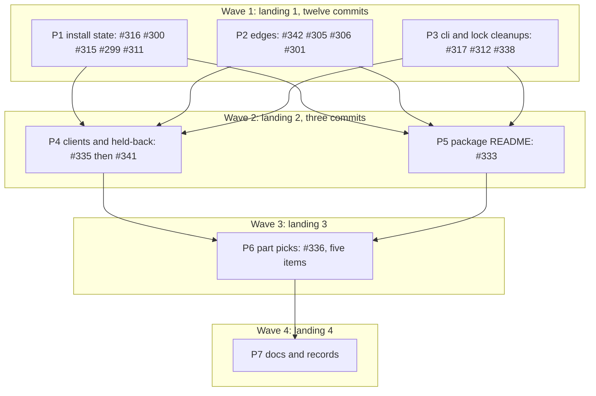

# Plan: Issue sweep (16 issues, one branch)

## Status

- **Plan:** plan_issue_sweep
- **Active phase:** review — execute pass complete, review call 1 done with two fix rounds
- **Step:** /hex-execute → done: seven pipelines merged, integration gate green, review call 1 run, fix rounds 1 and 2 landed and gated, one cross-model read of the fix delta taken
- **Last update:** 2026-11-10 (fix round 2 gated and committed; hand-off to /hex-finalize)
- State:   review
- Tier:    high
- Tier-grammar: 5
- Updated: 2026-11-10
- Next:    /hex-finalize

---

## Header

- **Goal contract (binding):** `.agents/goals/issue-sweep.md`: § Rules, § Autonomy, § Issue resolution, § Emphasis. Autonomy: never prompt. Every doubt ran § Issue resolution and is recorded in § Decisions as question, research, decision. The meta-plan gate is **approved by the goal loop contract**.
- **Issues in scope (16):** [#342](https://github.com/grimoire-rs/grimoire/issues/342), [#341](https://github.com/grimoire-rs/grimoire/issues/341), [#338](https://github.com/grimoire-rs/grimoire/issues/338), [#336](https://github.com/grimoire-rs/grimoire/issues/336), [#335](https://github.com/grimoire-rs/grimoire/issues/335), [#333](https://github.com/grimoire-rs/grimoire/issues/333), [#317](https://github.com/grimoire-rs/grimoire/issues/317), [#316](https://github.com/grimoire-rs/grimoire/issues/316), [#315](https://github.com/grimoire-rs/grimoire/issues/315), [#312](https://github.com/grimoire-rs/grimoire/issues/312), [#311](https://github.com/grimoire-rs/grimoire/issues/311), [#306](https://github.com/grimoire-rs/grimoire/issues/306), [#305](https://github.com/grimoire-rs/grimoire/issues/305), [#301](https://github.com/grimoire-rs/grimoire/issues/301), [#300](https://github.com/grimoire-rs/grimoire/issues/300), [#299](https://github.com/grimoire-rs/grimoire/issues/299). Each issue's "Done when" is its acceptance criterion, read through the owner decisions in the goal's § Rules. **Out:** #297, #257, #295.
- **Branch and checkouts:** `hex/issue-sweep`, from `main` at `1dbf5ac6`. The feature checkout `/home/mherwig/.herdr/worktrees/grimoire/uno` is the **integration worktree**. Worker lanes live under `.agents/worktrees/sweep-{a,b,c}` (at most three). Never touch `~/.herdr/worktrees/grimoire/duo/` or `~/dev/grimoire-rs/`.
- **Classification:** small per issue, sixteen issues, two-way doors. The seven owner decisions settle every design choice with a compatibility cost. Tier `high` (auto, confident). Overlays (planning pass only): `architect=inline`, `research=1`, `adversary=off`. `/hex-execute` keeps the goal's inner loop: each fix pass ends with one cross-model read (Codex, per goal § Rules › Models).
- **Gate command:** `env -u OCX_GLOBAL task --force verify`, in the integration worktree only, under the lane lock (§ Execution rules, E-2). Read the real exit code. The docs pass also runs `task docs:check` (Node 24.21 is present).
- **Research:** [`research_claude_settings_bom.md`](../research/research_claude_settings_bom.md) (the one external question, #306). [`research_issue_sweep_discovery.md`](../research/research_issue_sweep_discovery.md) holds the six Discover reports verbatim (§ X1 … § AX); steps cite it for anchors and test models. Line numbers are from `1dbf5ac6`: search by symbol.
- **Review:** one spec reviewer, plan-artifact scope, one round. See § Review record.

## Objective

Close sixteen issues on one branch with linear history: one Conventional Commit
per issue with `Fixes #N` in its body (#342 and #336 may take more), every
`fix:` built red-first, then one docs pass and one records pass. The PR must
stand without #336.

## Scope

**In:** each issue's "Done when"; the owner decisions; a regression test per fix;
the docs, upgrading guide, schema text and catalog skill updates the changes
require; the amendments to the records the changes contradict.

**Out:** #297, #257; #295 (install and add reports naming an abandoned entry);
any pin-moving code or ADR for #341; any #336 variant beyond its five items; a
JSON key for client sources or held-back requests (PD-12, PD-16); the root
description probe's containment gap (§ Findings, by reference only); every
remote act (§ Acts reserved for the meta-orchestrator).

## Decisions (§ Issue resolution: question → research → decision)

| # | Question | Research | Decision |
|---|---|---|---|
| PD-1 | Tier, overlays, spawn set? | No new one-way door; owner decisions cover the seven issues with a compatibility cost; area counts never raise past `high`. | Tier `high`. `architect=inline`, `research=1` (#306), `adversary=off`. Discover: one architecture explorer and five explorers (baseline 2–4; one extra so #336 gets its own). All on sonnet, the reviewer too: the spawn brief's routing overrides the `hex.md` opus pin for `reviewer:spec`, which a retro already lists as stale. |
| PD-2 | Which twelve are "the eleven small fixes"? | The goal names four issues with a later slot (#335, #333, #341, #336). Twelve remain. | Wave 1 is #342 (the Windows batch, first commit) plus the eleven small fixes: #338, #317, #316, #315, #312, #311, #306, #305, #301, #300, #299. None is classed larger. |
| PD-3 | How do three lanes share one target directory safely? | `plan_artifact_dependencies.md:577` records two trees sharing `target/` running each other's stale test binaries: cargo judges freshness by source mtime, and a tree whose file is older than the other tree's last build reads as fresh. The owner's rule (goal § Rules) still requires one shared directory. Incremental compilation is hash-based, so touched but unchanged files rebuild cheaply. | One `CARGO_TARGET_DIR` (the integration worktree's `target/`). Every cargo call in every tree goes through `lane.sh` (E-2): it takes one `flock`, touches that tree's workspace sources, then runs. The gate takes the same lock. "Edit-only" means: lanes run targeted tests and `clippy`, never the full gate. |
| PD-4 | How does each issue get its own commit when the commit hook needs a gated tree? | `.claude/hooks/pre_commit_verification.py` denies any command containing `git commit` unless `.claude/hooks/.state/commit-verified` in the target worktree is younger than 300 s. Only a green `task verify` writes it. `plan_lock_pin_stability.md:541` records that `--no-verify` does not satisfy it. | Method of `plan_settings_follow_ups.md` PD-2/PD-3 (E-3): lanes never commit; each step stages and reports `git write-tree`; a landing applies the wave's patches in the integration worktree, gates once, then records one commit per issue inside the 300 s window and proves `HEAD` equals the gated tree. The marker is never hand-written and the hook is never edited. |
| PD-5 | Does a red landing check spend an outer cycle? | Goal § Loop shape counts "a red gate's fix pass". The lock-pin run fixed five red landing gates inside its execute run (`plan_lock_pin_stability.md:1190`). | Read: a red **landing check** is repaired inside the same `/hex-execute` run by the owning pipeline and commits nothing; only the run's closing integration gate going red spends a cycle. **Ruling (meta-orchestrator, 2026-11-10), overrides the read above:** the goal file's § Loop shape wins. A red per-wave landing check repaired inside its pipeline is an inner fix round and counts against the inner cap of 2 per pass. A red integration gate that needs a separate fix pass spends an outer cycle: `/hex-execute` does not start that fix pass; it stops, reports the failure with its output, and the meta-orchestrator decides. PD-28 and PD-29 are accepted as written. To keep landings green, every step runs the targeted tests its block names plus `clippy` before it returns. |
| PD-6 | #342: are the five Codex rules-file failures test-side? | grim compares an own file by byte hash (`settings_phase.rs:834`) and normalises no line endings; the fixtures write in text mode, which Windows translates (§ X2 #342). | Test-side: `newline="\n"` at four writes. The batch also takes the two medium-confidence reads (`test_settings_publish.py:342`, `test_telemetry_contract.py:255`). Windows proof is one `verify-deep.yml` run by the meta-orchestrator; what it still shows becomes a second #342 commit. |
| PD-7 | #316: which fix shape? | `toml_splice::member_value` swallows the parse error. `value_at(raw, &[])` fails with `InvalidData` on bad TOML and is what `unparseable_toml` already calls. Every `current_hash` caller either checks `is_present` first or treats any `Err` alike (§ X1 #316). | Call `value_at(&raw, &[])?` first in the TOML arm, keep `member_value`. Delete `unparseable_toml` and its arm. No status output or exit moves; one prune skip warning now names the parse error. |
| PD-8 | #300: where is the drop, and what about `--force` and the settings kind? | `prune.rs:566-570` already keeps the output. The only drop is `is_present` folding "unreadable" into `false` at `prune.rs:525`. Making `is_present` return `Err` would newly fail the install gate (`installer.rs:1928`). `adr_settings_artifact_kind.md:397-398` (rows 7a/7b) drops a settings record on an unparseable file. | Add `ClientOutput::presence` returning `Absent`, `Present` or `Unreadable`; `is_present` becomes a wrapper with identical results. The reap keeps an `Unreadable` output and warns why, also under `--force` (nothing can be spliced out of a file grim cannot read). Settings rows 7a/7b stay as they are: step 1 confirms settings outputs do not pass through this branch, or branches on kind. |
| PD-9 | #299: the issue says "a preserved entry stays in the record". | `reap_relocated_roots`' doc and body: a kept entry leaves the record and is returned as `abandoned`; for MCP outputs `preserved` is always empty. `update` already reports `InstallRun.abandoned` as `abandoned_entries` (§ X1 #299). | Follow the function's doc: `install_mcp` extends its `abandoned` list with the returned one. The record is not changed. Proof is an acceptance test on `grim update --global`. Install and add reports stay as they are (#295). |
| PD-10 | #311: which fix, given it was never reproduced? | The warning comes from every vendor's `mcp_entry`, reached from `integrity_gate` (via `pending_outputs` and `pass_writes`) and again from the planning loop. A first install warns once; a pin roll can warn three times; `grim status` warns through the same probe (§ X1 #311). Deduplicating needs run state around fourteen vendors' own `tracing::warn!` calls. | Step 1 reproduces with the real binary. Fix: the planning loop is the one emitter; the gate's probe calls run with decline warnings silenced. `grim status` is unchanged. Accepted trade: a repeat install with nothing to do prints no decline line (`grim status` still shows it). If step 1 shows no duplicate, no product code changes and the commit is the pinning test alone. |
| PD-11 | #305: does the hook cascade change too? | `remove_nested_handler` calls `remove_member`, so a commented `hooks` container is kept too. Nothing downstream depends on the container vanishing; `remove_every` still terminates (§ X2 #305). | Accept: one rule for every caller. A unit test pins the hook cascade case. Comment-free input stays byte-identical. |
| PD-12 | #335: how does `status`/`install` "say where each client came from"? | `install` prints nothing about clients today. A JSON key needs a `p9_diff.py` allow-list entry, `json-interface.md`, and catalog edits (§ X4 #335, § AX B2). The owner asked for the answer, not for a key. | Human-readable only: `install` prints one stderr line, `status` one note. Stdout (plain and JSON) is byte-identical to `main`. A JSON key can be added later without breaking anything. |
| PD-13 | #335: union semantics, and what must not change? | The reap and the drift fields key on `configured_clients()` and on `scope.options.clients.is_empty()` (§ X4 #335 §3, §6). | The union feeds `clients()` only. `configured_clients()` stays the project list, so `update` never reaps under the union and `clients_missing`/`clients_extra` stay `[]`. Result order is `ClientTarget::ALL` order. A client both detected and global reads `detected`. Nothing detected plus a non-empty global list selects the global list alone: no `agents` pool, not a fallback. |
| PD-14 | #335: a malformed global config at project scope? | Mutating commands already load the global config for registries and exit 78 on a bad one (`command.rs:297`). Read-only commands never loaded it for clients. | Mutating commands propagate as today. Read-only commands (`status`, `context`, `search`, `hook list`, the TUI) warn, use an empty global list, and keep their exit. |
| PD-15 | #333: what is an entry's "fixed place", and what happens on a bad file? | `PlannedEntry.path` is the resolved source for default and explicit `path` alike; the owner's four places are that path for skill and hook, and that path without `.md` for rule and agent (§ X4 #333 §3). A default-on probe must not add a failure to a repository that publishes today. | Derive the place from the entry's resolved path. Bundle, mcp and settings entries are never probed. A probed file that fails containment or is not a regular file is skipped with a warning, and the top-level README stays. Only an `entry_readme` value that is not a single path component is an error (exit 65, before any push). A table that sets only `entry_readme` counts as absent for the root probe. `publish = false` also turns entry READMEs off. |
| PD-16 | #341: when is a request "held back", without new I/O on every run? | The losing edge onto a direct key is never resolved (`graph.rs:1462`). Comparing reference text alone would warn forever where two tags name one digest. The lock-pin ADR promises zero tag resolves on an unchanged declaration (§ X5 #341). | Probe only edges from a parent that is new or moved in this run; a probe failure or an offline run warns nothing. An unchanged run reads nothing extra. `grim status --check`, which is online already, lists the standing cases from recorded edges. Notes go to the existing stderr notes channel: no JSON key. Marketplace part runs print no such warning (their remedy would be a different command). |
| PD-17 | #341: what does the warning advise? | Where the declared tag still names the held pin, `grim update -- x` changes nothing. | One text, always true: it names `grim update -- x` and the alternative of declaring the requested reference (C-049). |
| PD-18 | #336: which cells are measured? | The issue's columns are 0.15.1 / c5e3824 / branch base / branch tip; that branch is now `main`. Tests emulate a c5e3824-written part (`_as_c5e3824_wrote`); the 0.15.1 writer needs the release binary. Building c5e3824 needs a third cold target. | Columns for this sweep: 0.15.1 release / `main` `1dbf5ac6` / sweep tip, per writer (0.15.1, c5e3824-shaped, this grim). The historical c5e3824 binary column is copied from the lock plan where it exists and is not re-measured; item 4, which has no recorded cell, says so. |
| PD-19 | #336 item 4: how to match a held bundle edge by reference? | The edge says `req:1`, the run holds `req:2`: only the repository can match. Two rows of one repository would make the match ambiguous (§ X3 §3). | Binding name first; else exactly one repository match among the run's moved bundles; zero or several keep today's exit. A direct include under another binding is not shadow-checked by repository. |
| PD-20 | #336 item 5: what do the two remedy texts say? | `HeldRequirement` already names the narrow pick first. `MarketplacePinGone` names the whole plugin because a member pick can meet a second gone pin (`export/resolve.rs:454`). `stale_part` already states the cost of the whole-plugin run. | Both texts keep the whole-plugin command only with its consequence ("which moves every pin of the plugin whose tag moved"). `MarketplacePinGone` leads with the row pick if a test shows that command clears the fixture; otherwise it keeps its order and gains the consequence only. Exits unchanged. |
| PD-21 | #336: how does the grim 0.15.1 binary reach the run? | `verify-deep.yml:325-356` downloads the release asset and pins SHA-256 `eec30a069ce12239058b54a9e986340cc2a3db9662504ab5ca467f8167d802c0`. No copy exists locally. | The orchestrator downloads that asset once into `.agents/.tmp/issue-sweep/grim-0.15.1/` **before wave 1** (with `lane.sh`), checks the SHA-256, and exports `GRIM_OLD_BIN` for P3 step 3 (#338 item 3) and for P6. A read of this repository's own release; never a dev build. |
| PD-22 | #317: what is an invalid value, and what does it do? | `EnvFilter::try_new("verbose")` succeeds and silences everything, so a filter parse cannot detect a typo. Today any string exits 0. | The flag takes a level (`off`, `error`, `warn`, `info`, `debug`, `trace`). An invalid value prints one stderr line and the run continues at `GRIM_LOG` or `warn`: no new exit code. Directives stay with `GRIM_LOG`. Tracing starts after clap parses; no environment write, so nothing reaches a child. |
| PD-23 | #312: unit or acceptance test? | The text is inline in an async fn; a unit test would need an extraction in working code. The owner asked for the global-scope test only. | One acceptance test at global scope. No `src/` edit. It cannot be red-first, so the step records a mutation proof. Commit type `test:`. |
| PD-24 | #338: commit type, and "tests pass unchanged"? | `Carry::answer` is `pub`; five test call sites pass the dead third argument. `cliff.toml` lists `refactor` under Changed and skips `chore`. | One `refactor(resolve):` commit. Tests are unchanged in behaviour; five call sites lose one argument. |
| PD-25 | #301: which message shape? | `unidentified` drops registry and tag. `test_mcp_fetch.py:276` pins the substring "not found" (§ X2 #301). | A new kind-neutral constructor that keeps the identifier, and a new `ResolveErrorKind` for the companion miss, classified `NotFound` so the exit stays 79. |
| PD-26 | Where do docs go, given one commit per issue? | Goal § Rules: one docs and records pass after the last code fix. Some Rust tests read pages (§ AX A2). | Pages, the upgrading guide and catalog skills change only in P7. Exception: a page a failing docs-reading test names changes with the code that broke it. Schema text is Rust doc comments and ships with its code. `.agents/upstream-watchlist.md` ships with #306. |
| PD-27 | When does the Windows run for #342 happen, and where does a follow-up commit go? | Only the meta-orchestrator pushes and dispatches, and only between hex-mode runs; the goal allows at most 3 dispatches and wants Windows changes batched first. | The #342 batch is commit 1 so any head carries it. Dispatch 1: on the head `/hex-execute` leaves, covering Windows, goldens, `p9:diff` and old-grim at once. A remaining Windows failure is fixed in the next fix pass as a `test:` commit with `Refs #342`, appended (test-only, so the docs commits stay valid); dispatch 2 runs on that head. `/hex-finalize` may reorder it next to commit 1. |
| PD-28 | #335: the new `clients:` line reaches every `grim install`. What if many tests or a deep gate compare stderr? | Not measured at plan time. `p9_diff.py` and the goldens run only in the deep gate. | P4 step 2 first counts the tests that assert install stderr and reads `test/tools/p9_diff.py` and the golden tests for a stderr comparison. Up to ten test files with that one-line change: edit them (P4 owns them; P5 may not touch them). More than ten, or a deep gate that compares stderr: print the line only when the global list contributed a client, which the owner's wording still covers for the changed case, and record the choice. |
| PD-29 | #336 item 4 has no cell in the issue, but the goal approves 0 to 78 "in the issue's listed cells". | The owner decision reads "all five items" and "record each cell". Item 4's fix cannot land without a refusal appearing where the bundle was not found before. | Read: the approval covers the cells of each of the five listed items. Item 4 moves 0 to 78 only for the one shape it names (a held row that requires a moved bundle under another binding name), measured and recorded per writer. Any other moved cell is reverted and goes to § Residuals. Flagged for the meta-orchestrator (§ Acts). |
| PD-30 | #335, C-038: the plan says `install`, `update` and `add` exit 78 on a malformed global config "as they do today". Do they? | `test_hooks_wp01_review::test_hook_free_commands_ignore_a_malformed_global_config` pins exit 0 for all three when hooks are off; `GlobalConfig::load` also refuses an unknown client name outright. A strict load for the client list would move that exit from 0 to 78. | The freeze wins over the plan's wording: every command warns and reads the global list as empty when the global config does not load, an unknown name included. Registries and hook arming exit 78 where they did. No exit moves. |
| PD-31 | #335, C-039: the `clients:` line under `--progress none` and `--progress json`? | PD-28's count: 3 tests in 2 files break on an unconditional line; two of them pin stderr under `--progress none` and NDJSON-only stderr under `--progress json`. `p9_diff.py` compares only stderr lines matching "warn"; the goldens compare no stderr text. | Print the line in `--progress auto` runs only. `--progress json` stderr stays NDJSON and `--progress none` stays silent. One collateral edit (`test_hooks_qoder.py`). |
| PD-32 | #301: three `test_desc.py` cases pinned "not found" for an explicit `:__grimoire` fetch and went red at the first landing gate. | C-024 fixes the companion-miss text; exit 79 is unchanged. The cases pin a substring of the old text. | The three assertions pin the new text. Counted as inner fix round 1 of landing 1 (PD-5 ruling). |
| PD-33 | #335, C-037: `grim lock`'s settings-conflict pre-check (`src/command/lock.rs`) was not in the plan's site list. | It derives the client set an install would reach; without the global list `lock` would not pre-check a conflict that `install` then meets. | It is a production site under C-037: it passes the global list through the same accessor. |
| PD-34 | #333: the security seat's four Suggest items (an in-tree symlink at the entry README is followed; Windows device and stream names in `entry_readme` are not refused by name; a bad `entry_readme` still exits 65 under `publish = false`; the first entry of a shared repository decides the README). | 0 Block, 0 Warn. The first matches what an explicit `readme` path already allows; the second is skipped by the containment and regular-file checks but is not exercised on Windows. | None fixed here. Listed for the meta-orchestrator as follow-up candidates (§ Findings outside scope). |
| PD-35 | #341: the `status --check` note reads recorded edges without confirming them against the local store, and its sweep has its own read cap beside the existing one. | A hand-edited lock can add one bounded registry read and a misleading stderr note; committed-lock editors are outside the threat model's attackers. | Kept. Listed as a follow-up candidate. |
| PD-36 | #341, review: the held-back probe had no bound beyond C-051's edge count. | Two seats and the cross-model read: sequential reads at 30 s each, and a dependency can list one key many times under different tags. `status --check` already caps the same question. | At most 64 distinct references read per run and one 60 s deadline for the phase; past either the remaining warnings are dropped quietly, as a failed read is. |
| PD-37 | #341, review: what does a declaration pinned by digest get, where PD-17's `grim update` remedy is not true? | A red test showed the tag remedy printed for `x@sha256:…`. | The warning stays (C-049); the `grim update` half is left out and only declaring the requested reference is named. A tag declaration's text is unchanged. |
| PD-38 | #335, review: where does the global list join the active set, and is the lenient client parser reachable? | The cross-model read: a project naming its own clients saw `status` report a removed client's output `missing` where `main` says `installed`. The loader rejects an unknown client name before the lenient parser runs. | The global list is read only where it also joins the install target (the project names no clients, no `--client`); one accessor decides it. The lenient parser and its warning are removed. A `--global` run labels its own list `global`. |
| PD-39 | #311, C-017: which non-decline events sit inside the silenced scope? | Listed in § Schedule log (fix round 1). One is muted and not a decline: Gemini's "timeout dropped" warning. The planning loop prints it in every run that writes. | Accepted under PD-10's trade: a run with nothing to do prints neither it nor the decline lines. No scope change. |
| PD-40 | #300, review: a config under a directory grim cannot search read as absent and its record was dropped. | `Path::exists` folds every metadata error into `false`. | `presence` uses `try_exists`: a missing file or a non-directory parent is absent; any other error is unreadable and the record is kept. |
| PD-41 | Review cap: the cross-model read of the fix delta still names one #341 item. | The launching agent's rule: after two inner rounds, what that read finds is listed as open, not fixed again. | Listed under § Residuals › Review call 1, open. No third round. |

## Constitution deviations (Principle 9)

| Deviation | Why needed | Simpler alternative rejected because |
|---|---|---|
| #333: a repository with package READMEs publishes a different companion on its next run | Owner decision, goal § Rules | An opt-in switch: the owner chose the default |
| #336: a part pick exits 78 where it exits 0 today, in the issue's listed cells | Owner decision: it reports a broken state | Keeping exit 0 writes a dependent beside another version of its requirement |
| #305: uninstall leaves an emptied container when it holds a comment | Owner decision | Dropping it deletes the user's comment |
| #335: a project install with no project list adds the global `options.clients` | Owner decision | Ignoring the global list is the reported defect |

Everything else keeps exit codes, JSON keys, schemas and layouts. One JSON value
changes under an existing key: #299 makes `update`'s `abandoned_entries` name an
entry the reap left behind where it is `[]` today (the issue's "Done when"). Message text
changes: #301, #311 (count only), #317 (one new line), #333 and #341 (new
warnings), #335 (one new line), #336 item 5.

## Execution rules

**E-1 Step protocol (every step).** A step is one fresh agent in its lane's
worktree, briefed with its block below, this section, and the cited `§` of the
discovery artifact. For a `fix:` it follows `.claude/rules/workflow-bugfix.md` in
order: reproduce, state the root cause, write the test and **watch it fail**,
fix, watch it pass, then run the block's targeted tests, `cargo fmt --all` and
`clippy`. It records one mutation: the single-token change that would break the
contract, applied, seen red, reverted. It edits only its block's file set; a
needed file outside it is reported, not edited. No drive-by cleanup. It ends
with `git add -A` and `git write-tree` and reports: tree id, root cause, the red
and green evidence, the mutation, files touched, doubts. It never commits,
pushes, runs the full gate, or waits on anything.

**E-2 One build at a time: `lane.sh`.** The orchestrator writes this to
`.agents/.tmp/issue-sweep/lane.sh` (gitignored) before wave 1, and fetches the
grim 0.15.1 binary in the same setup (PD-21):

```sh
#!/usr/bin/env bash
# lane.sh <tree> <command...>: the only way any tree runs cargo or task.
set -euo pipefail
tree=$1; shift
main=/home/mherwig/.herdr/worktrees/grimoire/uno
export CARGO_TARGET_DIR="$main/target"
exec flock "$main/.agents/.tmp/issue-sweep/cargo.lock" bash -c \
  'cd "$0" && find src crates -name "*.rs" -exec touch {} + && "$@"' "$tree" "$@"
```

Lanes use the debug profile: `lane.sh <tree> cargo test --locked <filter>`,
`lane.sh <tree> cargo clippy --workspace --locked --all-targets -- -D warnings`.
For an acceptance test a lane builds and copies under the lock
(`lane.sh <tree> bash -c 'cargo build --locked && cp -f "$CARGO_TARGET_DIR/debug/grim" test/bin/grim'`),
then runs the single pytest file outside the lock against `<tree>/test/bin/grim`,
the way `test/taskfile.yml` does with `SKIP_BUILD=true`. The gate runs as
`lane.sh <main> env -u OCX_GLOBAL task --force verify`. A new lane worktree is
`git worktree add --detach .agents/worktrees/sweep-<x> <wave base>` followed by
`git submodule update --init --recursive`. Whoever creates a worktree removes it
when its patches are taken (`git worktree remove --force`).

**E-3 Landing (the orchestrator, integration worktree, clean checkout).**
1. An issue's patch is `git diff --binary <tree before its step> <tree after>`,
   saved under `.agents/.tmp/issue-sweep/patches/`.
2. Apply the wave's patches with `git apply --index --3way` in § Landing order.
   A conflict or a red check is repaired here by the owning pipeline's follow-up
   step, and the owning issue's patch is regenerated.
3. Run the gate (E-2). On exit 0 save `git write-tree` as the gated tree.
4. `git reset -q`, then per issue: `git apply --cached <patch>` and record it
   with `git -C <main> commit -s --no-verify`, subject from § Landing order, body
   stating the root cause (for a `fix:`) and `Fixes #N`. No `Co-Authored-By`.
   All commits of a landing fall inside the hook's 300 s window; if it lapses,
   gate again.
5. `git diff --exit-code <gated tree> HEAD` exits 0 and `git status --porcelain`
   is empty. Append the `merged` lines to § Schedule log.

**E-4 Windows-safe tests (every acceptance test this plan adds or edits).**
Every `read_text`, `write_text` and `open` passes `encoding="utf-8"`. A file
grim hashes or compares byte for byte is written with `newline="\n"` or
`write_bytes`. A path written into TOML or JSON goes through `.as_posix()` or
`json.dumps`. Compare `Path` objects, never a `str(Path)` holding `/`.
POSIX-only behaviour carries a `skipif` with a reason; a platform-conditional
product decline branches on `sys.platform`. Only `GrimRunner` isolates the
environment; no hard-coded `/tmp`, `/home` or `/etc`. "Unreadable" in a unit
test is non-UTF-8 bytes, never a permission change.

**E-5 Freeze check (every step).** The report lists each user-visible change.
Anything beyond its block's contracts and § Constitution deviations (an exit
code, a JSON key or value, a schema, a layout) stops the step: it reports the
cell and does not ship it.

**E-6 Review seats for `/hex-execute`** (`hex.md › perspectives.always`):
`reviewer:security` on P5 (`src/command/publish*`) and on P7's `catalog/**`
edits; `doc-reviewer` wherever `src/command/**` changes (P3, P4, P5). Stability
is checked first on every diff.

## Contracts and scenarios

Anchors are `path:line` at `1dbf5ac6`. Each block names its pipeline step.

### #342 Windows acceptance (P2.1)

- **C-001** The four Codex rules own-file writes pass `newline="\n"`: `test/tests/test_settings_matrix.py:977`, `:998`, `:1032`; `test/tests/test_settings_scope.py:724`.
- **C-002** `test/tests/test_catalog_drift.py:124`: the `absolute` form is `.as_posix()`.
- **C-003** `test/tests/test_settings_publish.py:340`, `:342` and `test/tests/test_telemetry_contract.py:255` read with `encoding="utf-8"`.
- **C-004** `test/tests/test_settings_every_host.py:142`: for `warp` on `win32` the test expects `settings_changes == []` and the `no-applicable-settings` cause on stderr; every other host and platform is unchanged.
- **C-005** On Linux the same tests pass with the same assertions as before (no assertion weakened).
- **S-001** The meta-orchestrator dispatches `verify-deep.yml` on the pushed branch → `platform-check-windows` passes. Error case: failures remain → each is traced and lands as a further `test:` commit with `Refs #342`.
- Tests: the edited tests (Linux, targeted pytest); Windows by S-001.

### #316 unparseable TOML is an error (P1.1)

- **C-006** `read_entry_value(.., Mcp, McpConfigFormat::Toml)` on text that is not TOML returns `Err` of kind `InvalidData`; `current_entry_hash` returns that error, not `NotFound`. Anchor: `src/install/install_state.rs:396`, TOML arm `:414-419`.
- **C-007** `is_present` still returns `Ok(false)` for such a file; `grim status` still reads `missing`; no exit code moves.
- **C-008** `unparseable_toml` (`src/install/installer.rs:3405`) and its arm in `remove_stale_entries` (`:3449-3457`) are gone; the existing `Damage::Unparseable` Codex test (near `installer.rs:7318`) passes unedited and still sees the parse error named.
- **S-002** A Codex `config.toml` holding `[mcp_servers.x` → the orphan prune's skip warning names the parse error. Error case: none new; the output is skipped as before.
- Tests: unit beside `read_entry_value_and_current_entry_hash_direct_toml` (`install_state.rs:4033`) covering C-006 and C-007; C-008 by the existing test.
- Files: `src/install/install_state.rs`, `src/install/installer.rs`.

### #300 unreadable dropped-client config (P1.2, after P1.1)

- **C-009** `ClientOutput::presence(..)` returns `Absent` (file or member missing), `Present`, or `Unreadable(error)` (any read or parse failure). `is_present` wraps it and returns what it returns today for every existing caller (`status.rs:2831`, `installer.rs:1928`, `:2038`, `:2448`).
- **C-010** In `reap_dropped_clients` (`src/install/prune.rs:476`, call `:525`) an entry output whose config is unreadable (non-UTF-8 bytes) or unparseable (JSON `{`; Codex TOML `[mcp_servers.x`) stays in the record, is absent from the reaped lists, leaves the file's bytes untouched, and produces one warning naming the output and the error. The same holds with `--force`.
- **C-011** An absent member or absent file still drops from the record (`already_gone_dropped_client_output_still_drops_from_record`, near `prune.rs:1711`, passes unedited). Settings-kind records keep the behaviour of `adr_settings_artifact_kind.md` rows 7a/7b.
- **S-003** A user drops a client from the project list while that client's config is corrupt, then runs `grim update` → the warning says why the entry was kept; after repairing the file, the next `grim update` removes the entry. Error case: the file stays corrupt → the record keeps the output on every run.
- Tests: units in `prune.rs` for the three C-010 inputs and the `--force` case; C-009 by a unit over the three states.
- Files: `src/install/install_state.rs`, `src/install/prune.rs`.

### #315 `.jsonc` only where a client reads it (P1.3)

- **C-012** At project scope `is_own_mcp_member` (`src/install/install_state.rs:1794`) binds the other JSON spelling only when `picks_json_spelling_on_disk(client)` (`:1912`) holds; otherwise the recorded file must equal the client's file. Records naming `.mcp.jsonc` for Claude and `.cursor/mcp.jsonc` for Cursor are dropped on load. An OpenCode record and an Amp record naming `.amp/settings.jsonc` survive. The MCP and settings checks ask that one predicate. Global scope is unchanged.
- **S-004** A hand-edited `.grimoire/state.json` names `.mcp.jsonc` for Claude → `grim status` judges `.mcp.json`, and `grim uninstall` never edits `.mcp.jsonc`.
- Tests: unit cases beside `an_mcp_record_survives_the_json_and_jsonc_spellings` (`install_state.rs:4898`), which passes unedited.
- Files: `src/install/install_state.rs`.

### #299 reap results kept (P1.4)

- **C-013** `install_mcp` (`src/install/installer.rs:3348-3355`) adds the entries `reap_relocated_roots` (`:2403`) returns as abandoned to the run's `abandoned` list. `grim update --global` names such an entry under the existing `abandoned_entries` key, and the old-root file's bytes are untouched.
- **C-014** The install record is handled as the function's doc says (not changed here). A comment states why the preserved-files half is empty for MCP outputs. Install and add report shapes are unchanged.
- **S-005** A global MCP entry is hand-edited, then the vendor root moves and `grim update --global` runs → the report names the entry grim left in the old config. Error case: none new.
- Tests: acceptance in `test/tests/test_global.py`, modelled on `test_global_moved_root_upgrade_uninstall_abandons_a_hand_edited_stranded_entry` (`:2025`), red on `main` with `abandoned_entries == []`.
- Files: `src/install/installer.rs`, `test/tests/test_global.py`.

### #311 one decline warning per run (P1.5)

- **C-015** The step report contains a reproduction made with the built binary before any fix: the commands, the clients, the descriptor, and how often the decline line appears on `main` (expected at least 2 on a pin roll; § X1 #311 gives two recipes).
- **C-016** In one run a vendor's decline line appears at most once per artifact, client and file, and exactly once in a run that plans a write for that client (first install, pin roll, drift, `--force`). The line's text is byte-identical.
- **C-017** Only vendor decline lines are silenced: the step report lists every other `tracing` event reachable inside the silenced scope, and the scope is narrowed until that list is empty or each remaining event is named there. `grim status` output is unchanged.
- **S-006** A project declares an MCP server Zed cannot represent; the user installs, a new version is published, `grim update` runs → one decline line. Error case (accepted, PD-10): a repeat install with nothing to do prints none.
- Tests: the reproduction as an acceptance test in `test/tests/test_mcp_artifact.py` (model `:1627`), asserting a count of exactly 1; a unit with `WarnSink` (`installer.rs:7513`) if it comes cheaply.
- Files: `src/install/installer.rs`, possibly `src/install/expected_outputs.rs`, `test/tests/test_mcp_artifact.py`.

### #305 comments survive removal (P2.2)

- **C-018** `remove_member` (`src/install/json_splice.rs:217`): removing the last member of a container that holds a comment (`//` or `/* */`, before or after the member) keeps the container, emptied, with its comments, and the result parses.
- **C-019** `remove_array_element` (`:317`): the same for the last element of an array.
- **C-020** A container without a comment is removed whole and the output is byte-identical to `main` (`remove_last_member_drops_the_container` `:1982` and `array_remove_last_element_drops_the_whole_member` `:2301` pass unedited). `remove_every` still terminates on a kept empty array. The `remove_nested_handler` cascade (`:652`) keeps a commented container too.
- **S-007** The issue's reproduction: a comment inside `mcp` in `opencode.jsonc`, then `grim uninstall mcp docs-search` → `"mcp": { // keep this note }` remains. Error case: none.
- Tests: units in `json_splice.rs` for both functions in both cases and for the cascade.
- Files: `src/install/json_splice.rs`, `src/install/managed_config.rs` (one doc sentence, `:123-125`).

### #306 BOM-prefixed Claude settings (P2.3)

- **C-021** `settings_env_config_dir` (`src/install/vendor_claude.rs:709`) strips one leading U+FEFF before parsing. A BOM-prefixed user `settings.json` and a BOM-prefixed `managed-settings.json` each yield their `env.CLAUDE_CONFIG_DIR`. A file without a BOM reads as before; two BOMs stay invalid.
- **C-022** `.agents/upstream-watchlist.md` § Config roots and env vars records the answer verified on 2026-11-10 against Claude Code 2.1.321 (the research artifact's proposed row).
- **S-008** The issue's reproduction → the skill lands under the directory the BOM-prefixed file names. Error case: an invalid file is still ignored at debug level.
- Tests: two units modelled on `config_dir_precedence_is_managed_then_user_then_shell`.
- Files: `src/install/vendor_claude.rs`, `.agents/upstream-watchlist.md`.

### #301 fetch miss text (P2.4)

- **C-023** `ResolveError` (`src/resolve/resolve_error.rs:88`) gains a kind-neutral constructor that keeps the identifier, and `fetch::not_found` (`src/fetch.rs:90-98`) uses it. A tag miss reads `'<name>' (<source>): tag not found` with no kind word; a digest miss keeps its `manifest <digest> not found` tail.
- **C-024** A companion miss (`fetch --description`, with `--path`, with `--digest-only`) reads `no description is published for <registry>/<repository>` and never contains `__grimoire`.
- **C-025** Both keep exit 79 and the JSON error `code`; `describe` shows the same texts; the new kind has its arm in `classify_resolve` (`src/error.rs:586`).
- **S-009** `grim fetch --description` on an mcp package with no companion → the C-024 text. Error case: a real transport error is unchanged.
- Tests: a unit pinning each message (extend `fetch_description_missing_companion_classifies_not_found`, `fetch.rs:1527`, and add a plain-miss case); `test_mcp_fetch.py:276` passes unedited.
- Files: `src/fetch.rs`, `src/resolve/resolve_error.rs`, `src/error.rs`.

### #317 `--log-level` applied (P3.1)

- **C-026** `--log-level <level>` sets the log filter for the run; when both are set it wins over `GRIM_LOG`. Levels: `off`, `error`, `warn`, `info`, `debug`, `trace`. `GRIM_LOG` alone behaves as today, directives included.
- **C-027** A value that is not a level prints one stderr line naming the value and the accepted levels; the run continues at `GRIM_LOG` or `warn`; its exit code is what it would have been.
- **C-028** The flag is applied in-process: a pure helper computes the filter from the flag and the environment and writes no environment variable, so no child process sees it.
- **S-010** `grim --log-level trace context --global` → TRACE lines on stderr. Error case: `--log-level nonsense` → the C-027 line, default-level output, exit 0.
- Tests: acceptance `test/tests/test_log_level.py` (flag, `GRIM_LOG`, both ways round, invalid value); a unit for the helper (C-028).
- Files: `src/main.rs`, possibly `src/cli/options.rs` (doc comment), `test/tests/test_log_level.py`.

### #312 global remedy pinned (P3.2)

- **C-029** At global scope the refused-dependency error ends ``run `grim --global install --force` to overwrite them`` with exit 65, and that command then succeeds.
- **C-030** The project text is byte-identical: no `src/` edit; `test_settings_messages_add.py:65` passes unedited.
- **S-011** `grim --global add --force a` over an untracked dependency → the C-029 text. Error case: none new.
- Tests: acceptance in `test/tests/test_dependencies_add.py`, modelled on `test_add_force_transitive_clobber_refused` (`:117`). Mutation proof: with `scope.invocation` replaced by a literal `grim` (`src/command/add.rs:1300`), the test fails.
- Files: `test/tests/test_dependencies_add.py`.

### #338 lock cleanups (P3.3)

- **C-031** `PartCarry::NESTED_BELOW_PICK_KEEPS_PIN` (`src/resolve/graph.rs:651`) and the `below_pick` plumbing are gone. Behaviour is unchanged. Test edits are limited to dropping the dead third argument at `graph.rs:3204` and `src/resolve/resolver.rs:2497`, `:2503`, `:2654`, `:2663`.
- **C-032** `a_pick_keeps_a_recorded_bundle_nested_below_the_picked_one_at_its_digest` (`src/export/resolve.rs:4184`) also asserts the kept row's stamp, and asserts that stamp is not empty. Its doc comment no longer names the deleted constant.
- **C-033** The docstring of `test_the_recovery_from_a_subdirectory_names_the_projects_pair_by_path` (`test/tests/test_old_grim_unwalked_requires.py`, near `:566`) claims only what the test does: the tag moves after the second removal.
- **C-034** Three tests in `src/tui/app.rs`, one per delete path (`perform_uninstall`, `perform_local_uninstall`, `perform_member_uninstall`), pin that the gatekeeper warning is logged after the lock edit and with the edit's notes. Moving `warned_after` before the edit turns each red (recorded as the mutation).
- **S-012** None user-facing. Error case: none.
- Tests: C-031 by the unedited suite; C-032 and C-034 are tests themselves; C-033 by reading.
- Files: `src/resolve/graph.rs`, `src/resolve/resolver.rs`, `src/export/resolve.rs`, `src/tui/app.rs`, `test/tests/test_old_grim_unwalked_requires.py`.

### #335 global clients join detection (P4.1)

- **C-035** The client set at project scope:

  | `--client` | project `options.clients` | detected | global `options.clients` | clients (source of each) |
  |---|---|---|---|---|
  | A | any | any | any | A (`--client`) |
  | unset | P | any | any | P (`project`) |
  | unset | unset | D | empty | D (`detected`) |
  | unset | unset | D | G | D ∪ G in `ClientTarget::ALL` order; members of D `detected`, the rest `global` |
  | unset | unset | none | G | G (`global`); no `agents` pool; not a fallback |
  | unset | unset | none | empty | `agents` (`fallback`), with today's warning and guard |

  A `--global` run is unchanged. A global-list client with no marker in the workspace is installed and its directory created.
- **C-036** `configured_clients()` stays the project list. Under the union `grim update` reaps no client, and `clients_missing` and `clients_extra` stay `[]`.
- **C-037** Every production site that derives a project-scope client set or the active set uses the union through one accessor: the `InstallTarget::parse` sites in `command/{install,update,add,status,context,search,hook/list,tui}.rs` and `tui/app.rs`, and the `detect_clients_or_all` sites beside them (§ X4 #335 §3 lists them). `status` reads a deleted output of a global-list client as `missing`. The `options.clients` key description (`src/command/config_keys.rs:107-116`) states the union instead of "auto-detects when left empty" alone, in the style `.claude/rules/subsystem-config-keys.md` sets.
- **C-038** A malformed global config: `install`, `update` and `add` exit 78 as they do today; read-only commands warn, use an empty global list, and keep their exit. An unknown client name in the global list: mutating commands raise the existing unsupported-client error; read-only commands warn and ignore it.
- **C-039** `grim install` prints one stderr line `clients: <name> (<source>), …`, and `grim status` prints the same line as a note. Plain stdout and `--format json` stdout are byte-identical to `main` for the same client set.
- **C-040** The fallback row's warning text and its global-scope guard are byte-identical to `main`'s. A run whose global list is empty behaves as on `main` in every row, the new `clients:` line aside.
- **S-013** `grim config set --global options.clients claude`, then `grim install` in a repository with `.opencode/` and no project list → outputs for Claude and OpenCode, and the line `clients: claude (global), opencode (detected)`. Error case: a project list is set → the global list is ignored and the line says `project`.
- **S-014** Before that first install `grim status` lists the new client's outputs as pending and exits as today.
- Tests: units in `src/install/target.rs` for every C-035 row, C-036 and C-040; acceptance in `test/tests/test_clients.py` (S-013, S-014, C-039) and `test/tests/test_update.py` (no reap, model `:368`); a unit or acceptance per C-038 branch.
- Files: `src/install/target.rs`, `src/command.rs`, `src/command/{install,update,add,status,context,search,tui,config_keys}.rs`, `src/command/hook/list.rs`, `src/tui/app.rs`, `test/tests/test_clients.py`, `test/tests/test_update.py`. Exception to E-1: P4 step 2 may also edit any test file whose only change is the new `clients:` stderr line, within PD-28's bound, and lists each in its report.

### #341 held-back request warned (P4.2, after P4.1)

- **C-049** In an `add`, `update` or `lock` run at project or global scope: for each directly declared key `x` whose held pin differs from the digest that a request from a **new or moved** parent resolves to, the run prints one warning for `x`. It names the requesting artifact or artifacts, the requested reference, the held pin, and both remedies: `` `grim update -- x` `` to re-read the declared tag, or declaring the requested reference. Exit code and the written lock are identical to `main`'s.
- **C-050** No warning when the request resolves to the held digest, when the probe fails, or when the run is offline. A probe failure never fails the run.
- **C-051** A run over an unchanged declaration and lock makes no registry read `main` does not make. Probes are bounded by the number of edges from new or moved parents onto direct keys.
- **C-052** `grim status --check`, online, prints one note per held-back request it finds from the lock's recorded edges onto direct rows. Its exit stays 0 and its `--format json` stdout is byte-identical to `main`'s. Offline it prints nothing new. A lock with no recorded edges lists nothing.
- **C-053** A marketplace part run prints no held-back warning.
- **S-015** The issue's case: `x` declared with no tag and locked at v1; `grim add y` where `y` requires `x:2` → exit 0, `y` beside `x` v1, and the warning. Error case: offline → no warning, same exit.
- **S-016** Later `grim status --check` → the note for `x`; after `grim update -- x` moves `x` to v2 the note is gone.
- Tests: units in `src/resolve/resolver.rs` or `graph.rs` (C-049, C-050, C-051 with a counting registry, C-053); acceptance in a new `test/tests/test_held_back.py` (S-015, S-016, C-052).
- Files: `src/resolve/graph.rs`, `src/resolve/resolver.rs`, `src/command/status.rs`, possibly `src/lock/merge_policy.rs`, `test/tests/test_held_back.py`.

### #333 package README companion (P5.1)

- **C-041** By default, a skill or hook entry with `<path>/README.md`, and a rule or agent entry with `<path without .md>/README.md`, publishes that file as the README of its companion. `<path>` is the entry's resolved source, explicit `path` included. Changelog, logo and included files still come from the top-level companion (table or probe). An entry without such a file keeps the top-level README. Bundle, mcp and settings entries are never probed.
- **C-042** `[description] entry_readme = "<name>"` picks another file name; `false` turns the probe off; `true` is the default. A value that is not a single path component exits 65 before any push.
- **C-043** A per-entry `description` table still replaces everything for that entry. `description = false` still publishes no companion. Top-level `publish = false` still publishes none.
- **C-044** A top-level table that sets only `entry_readme` leaves the root probe on and raises no "resolves to no files" error.
- **C-045** A probed file is used only if it passes `contained_description_path` (`src/command/publish.rs:2353`) and is a regular file. Otherwise it is skipped with a warning and the top-level README stays. An entry whose source lies outside the manifest directory is not probed.
- **C-046** No artifact's bytes change: a skill, rule and agent publish to the same digest with and without their README being used as the companion.
- **C-047** A top-level `[description]` with at least one file slot and no `readme`, next to a root `README.md`, prints one warning naming the manifest and the fix. Exit and JSON are unchanged.
- **C-048** `grim schema --kind publish` shows `entry_readme` (string or boolean, optional), and the descriptions of the top-level and per-entry `description` fields state the rule: per-entry table, then top-level table, then probe; a table replaces wholesale; a present table turns the root probe off for the slots it omits; `path` does not change which top-level companion an entry gets.
- **S-017** The issue's repository layout, no `[description]` table → each package's companion carries its own README plus the root changelog and logo. Error case: `entry_readme = "../x"` → exit 65, nothing pushed.
- **S-018** The issue's partial table (`logo` only) → the C-047 warning, and each entry with its own README still publishes it beside the logo.
- **S-019** An existing repository with package READMEs publishes again at an unchanged version → artifacts skipped, each companion re-pointed to the package README, no refusal.
- Tests: units in `src/command/publish.rs` (model `plan_descriptions_precedence_per_entry_over_top_level_over_probe`, `:4938`) for C-041 to C-045 and C-047; a schema unit for C-048; acceptance in `test/tests/test_desc.py` reading content through `grim fetch --description` (S-017, S-018, S-019, C-046 by digest).
- Files: `src/command/publish.rs`, `test/tests/test_desc.py`.

### #336 part-pick shapes (P6)

Cells read 0.15.1 release / `main` `1dbf5ac6` / sweep tip, for `team:pack` and
`team:req`, per writer of the part (PD-18). Anchors: `src/resolve/part_bundles.rs`
(`refuse_held_requirements` `:597`, `judge_edge` `:665`, `Lists` `:692`,
`nested_parting` `:700`, `moved_bundle` `:540`, `conflicts` `:801`); fixtures in
`src/export/resolve.rs` (`:4403`, `:4631`, `publish_members` `:2230`).

- **C-054 (item 1)** The nested walk judges a list member per binding and identifier, and descends once per identifier. With `outer:1` naming `req:1` as both `a` and `req`, the pick refuses with 78 on a 0.15.1-written part (65 / 0 / 78) and on a c5e3824-shaped part (78 / 0 / 78). An alias control where `y` stays beside the pick's version exits 0 for both bindings. Cells for this grim's part and the "unchanged beside" picks do not move.
- **C-055 (item 4)** A held bundle edge finds the run's bundle by binding name, else by exactly one repository match; zero or several matches keep today's exit. The step measures and records the cells for a held row requiring the bundle under another binding (expected 78 at tip on the first two writers). That shape is the only place item 4 may move an exit (PD-29). A two-rows-of-one-repository control exits as on `main`.
- **C-056 (item 2)** After a trace with the 0.15.1 binary, the artifact members of a held bundle requirement are judged against the pick. Recorded target: the c5e3824-shaped part refuses with 78. A control where the pick moves `x` to the version the held bundle already lists exits 0. The 0.15.1-written cell is whatever the trace shows and is recorded.
- **C-057 (item 3)** On a c5e3824-shaped part, a held edge's tag republished onto the digest the pick moves to refuses with 78. The existing controls (`src/export/resolve.rs:4531-4552`, `:4582`) still exit 0. The 0.15.1-written cell stays as recorded.
- **C-058 (item 5)** The `HeldRequirement` and `MarketplacePinGone` remedy texts (`src/export/resolve.rs:461`, `:478-484`) offer the whole-plugin `grim update --marketplace <M> <plugin>` only with its consequence, per PD-20. Exits are unchanged, and the command each text names first clears its fixture.
- **C-059 (stop rule)** A step adds a refusal only in its item's cells. A measured shape is the same item when the same seam judges it under the same fixture with one variable changed (a binding, an alias, the writer, the retag direction) and the item's named fix covers it. Anything needing another seam, another judging rule or another kind of evidence is a new variant: it is recorded with its cells in § Residuals and not fixed. An exit that moves outside the item's cells is reverted and reported.
- **C-060 (convergence)** An item that is not green after its step and two fix rounds is dropped: no product change of it lands, its cells and the reason go to § Residuals, and the later items proceed if they do not build on it (item 2 builds on item 4).
- **S-020** A user picks `team:pack` over a part where the pick would leave `y` beside another version of what `y` requires → exit 78 with the held-requirement text naming the narrow remedy. Error case: a list that cannot be read still refuses nothing (by design).
- Tests: per item a unit in `src/export/resolve.rs` over `BUNDLE_WRITERS` plus its control; acceptance in `test/tests/test_marketplace_pins.py` (c5e3824-shaped writer) and `test/tests/test_old_grim_marketplace_pins.py` (real 0.15.1 writer, needs `GRIM_OLD_BIN`); item 5 in `test/tests/test_marketplace_stale_remedy.py`.
- Files: `src/resolve/part_bundles.rs`, `src/export/resolve.rs`, `src/resolve/resolve_error.rs` (fixture text only), the three test files above.

### Docs and records (P7)

- **C-061** Every page, catalog skill and rule line § Docs map names says what the final code does, written from the source, not from this plan. The upgrading guide carries a note for #305, #333, #335 and #341, and #336 if any item landed. `configuration.md` lists `GRIM_LOG`. Closing checklist, one `grep` each, results in the step report: the #305 note in `upgrading.md`; `GRIM_LOG` and `--log-level` in `configuration.md`; `entry_readme` and the three-level precedence in `publishing.md`; the #306 row in `.agents/upstream-watchlist.md` (landed with its code).
- **C-062** `task docs:check`, `task catalog:verify` and the gate pass on the final tree.
- **C-063** The records name what changed: the ADR notes and plan lines in § Docs map, § Residuals of this plan, and the per-issue evidence lines for the goal file.
- Tests: the docs-reading Rust tests and `test/tests/test_docs*.py` inside the gate; `task docs:check`; `task claude:tests` (inside the gate) after rule edits.

## Contract wave

None. The pipelines share no interface: each issue's contract lives in one
pipeline, and no stub is needed by another. What they share is E-1 to E-5 and
`lane.sh`, which the orchestrator sets up before wave 1. Red tests are written
inside each step, as the bugfix workflow requires.

## Parallelization

| Pipeline | Scope | Expected files | Wave | Depends on | Marks | Status |
|---|---|---|---|---|---|---|
| P1 install state | #316 C-006–C-008 S-002; #300 C-009–C-011 S-003; #315 C-012 S-004; #299 C-013–C-014 S-005; #311 C-015–C-017 S-006 | `src/install/{installer,install_state,prune,expected_outputs}.rs`, `test/tests/{test_global,test_mcp_artifact}.py` | 1 | — | | merged |
| P2 edges | #342 C-001–C-005 S-001; #305 C-018–C-020 S-007; #306 C-021–C-022 S-008; #301 C-023–C-025 S-009 | `test/tests/{test_settings_matrix,test_settings_scope,test_settings_publish,test_settings_every_host,test_catalog_drift,test_telemetry_contract}.py`, `src/install/{json_splice,managed_config,vendor_claude}.rs`, `.agents/upstream-watchlist.md`, `src/fetch.rs`, `src/resolve/resolve_error.rs`, `src/error.rs` | 1 | — | | merged |
| P3 cli and lock cleanups | #317 C-026–C-028 S-010; #312 C-029–C-030 S-011; #338 C-031–C-034 S-012 | `src/main.rs`, `src/cli/options.rs`, `test/tests/{test_log_level,test_dependencies_add,test_old_grim_unwalked_requires}.py`, `src/resolve/{graph,resolver}.rs`, `src/export/resolve.rs`, `src/tui/app.rs` | 1 | — | | merged |
| P4 clients and held-back | #335 C-035–C-040 S-013–S-014; #341 C-049–C-053 S-015–S-016 | `src/install/target.rs`, `src/command.rs`, `src/command/{install,update,add,status,context,search,tui,config_keys}.rs`, `src/command/hook/list.rs`, `src/tui/app.rs`, `src/resolve/{graph,resolver}.rs`, `src/lock/merge_policy.rs`, `test/tests/{test_clients,test_update,test_held_back}.py`, plus test files that only gain the `clients:` line (PD-28) | 2 | P1, P2, P3 | | merged |
| P5 package README | #333 C-041–C-048 S-017–S-019 | `src/command/publish.rs`, `test/tests/test_desc.py` | 2 | P1, P2, P3 | review | merged |
| P6 part picks | #336 C-054–C-060 S-020 | `src/resolve/part_bundles.rs`, `src/export/resolve.rs`, `src/resolve/resolve_error.rs`, `test/tests/{test_marketplace_pins,test_old_grim_marketplace_pins,test_marketplace_stale_remedy}.py` | 3 | P4, P5 | hard | merged |
| P7 docs and records | C-061–C-063 for all sixteen | `docs/src/content/docs/**`, `catalog/**`, `.claude/rules/subsystem-*.md`, `.agents/adr/**`, `.agents/plans/**` | 4 | P6 | | merged |



- **Critical path:** P1 (five serial steps) → landing 1 → P4 (#335, then #341) → landing 2 → P6 → landing 3 → P7 → landing 4.
- **File ownership of the shared files:** `installer.rs`, `install_state.rs` and `prune.rs` belong to P1 alone, in the order #316, #300, #315, #299, #311 (hunks far apart; #300 needs #316). `graph.rs`, `resolver.rs` and `tui/app.rs` belong to P3 (#338) in wave 1 and to P4 in wave 2. `export/resolve.rs` belongs to P3 in wave 1 and to P6 in wave 3. `resolve_error.rs` belongs to P2 (#301) in wave 1 and to P6 in wave 3. `status.rs` and `add.rs` belong to P4, #335 before #341. `upgrading.md` and every page belong to P7.
- **Under-parallelization, justified:** file-disjointness would let P5 start in wave 1 and split P4. It does not, because the goal orders the commits (small fixes first), caps lanes at three, and allows one build at a time; and #335 and #341 share `status.rs`.
- **Shippable after wave: 2, plus P7** — fifteen issues closed; the PR stands without #336. Shippable after wave 1 plus P7: twelve issues.
- P6 always ends `merged`, with as many item commits as converged (C-060), so P7 is never stranded.

## Pipelines

### P1 install state (lane `sweep-a`)

1. **#316** — C-006 to C-008. Shape: PD-7. Keep the stranded doc comment above `unparseable_toml` with `remove_stale_entries`. Targeted: the `install_state` and `installer` unit modules.
2. **#300** — C-009 to C-011. Shape: PD-8. First confirm from the code whether a settings-kind output can reach `reap_dropped_clients`' presence branch, and record it. Targeted: `prune` and `install_state` units.
3. **#315** — C-012. Shape: mirror `is_settings_file` (`install_state.rs:1900-1906`). Targeted: `install_state` units.
4. **#299** — C-013, C-014. Shape: PD-9, two lines plus a comment. Targeted: the new `test_global.py` case and its neighbours.
5. **#311** — C-015 first, then C-016, C-017. Shape: PD-10. If the reproduction shows one line only, stop: stage the pinning test alone and report. Targeted: `test_mcp_artifact.py`, `installer` units.

### P2 edges (lane `sweep-b`)

1. **#342** — C-001 to C-005. Edits as listed, plus `import sys` where needed. Run the six edited files on Linux. Report anything else of the four classes seen while editing; do not widen.
2. **#305** — C-018 to C-020. Shape: compute the inner text after the cut; if the container ends empty and still holds a comment, splice the emptied container back; else today's cut. Targeted: `json_splice` and `managed_config` units.
3. **#306** — C-021, C-022. Shape: one `strip_prefix('\u{feff}')` before the parse. Paste the research artifact's proposed row into the watchlist. Targeted: `vendor_claude` units, `task claude:tests` is not needed (the watchlist is data).
4. **#301** — C-023 to C-025. Shape: PD-25. Targeted: `fetch`, `resolve_error` and `error` units, `test/tests/test_mcp_fetch.py`, `test/tests/test_fetch.py`.

### P3 cli and lock cleanups (lane `sweep-c`)

1. **#317** — C-026 to C-028. Shape: PD-22; move the `init_tracing` call after `parse_cli` and pass the flag. Confirm nothing logs before the parse. Targeted: `test_log_level.py`, `main` units, the existing `log_level="warn"` callers (`test_global.py:353`).
2. **#312** — C-029, C-030. Test only, with the mutation proof.
3. **#338** — C-031 to C-034, in item order. For C-032 run the assert and, if the stamp is empty, give `inner` a member that is not a direct include. C-034 needs a fixture whose lock edit emits the unwalked note (§ X5 #338 item 4); if the local path cannot arrange a gatekeeper, pin that path by log order after the lock write and say so. Targeted: `resolve` and `tui` unit modules; with `GRIM_OLD_BIN` set (PD-21) also `test_old_grim_unwalked_requires.py`.

### P4 clients and held-back (lane `sweep-a`, wave 2)

1. **#335 resolver** — C-035, C-036: `InstallTarget::parse_with_global` (keep `parse` as a wrapper), the source per client, the units.
2. **#335 call sites and output** — C-037 to C-040: the accessor beside `global_config_tiers` (`src/command.rs:304`), the call-site switches, the key description, the `install` line and the `status` note, the acceptance tests. Run PD-28's count first. List every collateral test edit.
3. **#341 run warning** — C-049 to C-051, C-053: a `GraphWarning` variant beside `PublisherMismatch` (`graph.rs:160-177`), emitted where `run.grim` is in hand (`resolver.rs:184`); the probe limited to new or moved parents; units with a counting registry.
4. **#341 status note** — C-052 and the acceptance file: extend the `--check` references to recorded edges onto direct rows (`status.rs:940`, note beside `split_note` `:984`).

### P5 package README (lane `sweep-b`, wave 2; mark `review`)

1. **#333 planning** — C-041 to C-046: `entry_readme` on `DescriptionSpec` (`publish.rs:274`, "bool or string" modelled on `ForkSetting` `:157`), the entry place helper, the slot replacement in `plan_descriptions` (`:2145`), units.
2. **#333 warning, schema text, acceptance** — C-047, C-048, S-017 to S-019: the warning, the doc comments at `publish.rs:262-272`, `:485`, `:597`, the acceptance cases.
The pipeline's own review seat is `reviewer:security` (a default-on file probe on the publish path).

### P6 part picks (lane `sweep-a`, wave 3; mark `hard`)

0. **Binary** (orchestrator) — already fetched before wave 1 (PD-21); confirm `test/src/old_grim.py` accepts it.
1. **Item 1** — C-054. Fixture: `publish_members` with two bindings of `req:1`.
2. **Item 4** — C-055. Reuses step 1's fixture; measure before fixing, since no cell is recorded.
3. **Item 2** — C-056. Trace first (§ X3 §4 lists what to print), then fix.
4. **Item 3** — C-057. Trace first; the discriminator from the existing controls is the trace's deliverable (§ X3 §5).
5. **Item 5** — C-058, after the behaviour is final.
Every step obeys C-059 and C-060 and reports its measured cells as a table. One commit per landed item.

### P7 docs and records (lane `sweep-a`, wave 4)

1. **Pages, upgrading guide, catalog skills** (`docs:`) — § Docs map, pages and catalog rows. Read the final code first.
2. **Rules, ADR notes, plan records** (`chore:`) — § Docs map, records rows.

## Landing order

| # | Landing | Subject | Body ends |
|---|---|---|---|
| 1 | 1 | `test: make the last eleven Windows acceptance cases hold` | `Fixes #342` |
| 2 | 1 | `fix(install): report an unparseable TOML config as an error` | `Fixes #316` |
| 3 | 1 | `fix(install): keep a dropped client's output when its config cannot be read` | `Fixes #300` |
| 4 | 1 | `fix(install): bind the other JSON spelling only for clients that pick it` | `Fixes #315` |
| 5 | 1 | `fix(install): report entries the relocated-root reap left behind` | `Fixes #299` |
| 6 | 1 | `fix(install): print a vendor's MCP decline once per run` | `Fixes #311` |
| 7 | 1 | `fix(install): keep an emptied container that holds a comment` | `Fixes #305` |
| 8 | 1 | `fix(install): read Claude settings past a byte-order mark` | `Fixes #306` |
| 9 | 1 | `fix(fetch): name a miss without a kind or the reserved tag` | `Fixes #301` |
| 10 | 1 | `fix(cli): apply --log-level` | `Fixes #317` |
| 11 | 1 | `test(add): pin the global-scope remedy for a refused dependency` | `Fixes #312` |
| 12 | 1 | `refactor(resolve): drop the dead below-pick switch and tighten three tests` | `Fixes #338` |
| 13 | 2 | `feat(install): add the global client list to a project's detected clients` | `Fixes #335` |
| 14 | 2 | `feat(publish): publish each package's own README as its description` | `Fixes #333` |
| 15 | 2 | `feat(lock): say when a declaration holds back a dependency's request` | `Fixes #341` |
| 16–20 | 3 | `fix(resolve): …` one per landed #336 item | `Refs #336`; the last reads `Fixes #336` only when all five landed |
| 21 | 4 | `docs: describe the issue-sweep changes and their upgrade notes` | — |
| 22 | 4 | `chore: record the issue-sweep outcomes` | — |

If #311 does not reproduce, commit 6 is `test(install): pin one MCP decline warning per run`.

## Docs map (P7)

| Issue | Pages and catalog (`docs:`) | Records (`chore:`) |
|---|---|---|
| #305 | `upgrading.md` § Smaller notes | `plan_settings_follow_ups.md` PD-49: one "superseded by" line |
| #333 | `publishing.md` (`#description-companion`, `#description-probe`, `#description-table`); `upgrading.md`; `catalog/skills/grim-usage/references/publish.md`; `catalog/skills/grim-authoring/references/{agent-spec,release-checklist}.md`; `catalog/skills/ai-config-authoring/references/descriptions.md`; `catalog/publish.toml` comment; `catalog/README.md` | `adr_description_companion.md`: dated amendment |
| #335 | `clients.md:87-93`; `configuration.md:44-50`; `commands.md` (`install`, `status`); `guides/scopes-and-clients.md`; `quickstart.md`; `guides/share-settings.md`; `upgrading.md`; `catalog/skills/grim-usage/SKILL.md`, `references/registries.md` | `.claude/rules/subsystem-client-detection.md` ladder; `adr_vendor_config_and_selection.md` D4/D5 note |
| #341 | `concepts.md#bundle-conflicts`; `commands.md` (`add`, `update`, `lock`, `status --check`); `upgrading.md#lock-keeps-pins`; `catalog/skills/grim-usage/references/{consume,troubleshooting}.md` | `adr_lock_pin_stability.md`: the owner ruling as an amendment row |
| #336 | `commands.md:1198`, `:2819`; `stability.md:290`; `upgrading.md:791`; `guides/team-plugin.md`, `guides/hosting-a-marketplace.md` where they quote the remedy | `adr_lock_pin_stability.md`: the cells that moved; `plan_lock_pin_stability.md` row 25: outcomes appended |
| #317 | `commands.md:27`; `configuration.md` environment table (`GRIM_LOG`) | — |
| #300 | `commands.md` reap section (`:931-960`): one sentence | — |
| #301, #299, #316, #315, #311, #312, #338, #342, #306 | none expected; P7 checks `commands.md` `fetch` for a quoted miss text | `.claude/rules/subsystem-install-*.md` only where a line states the old behaviour |

`CHANGELOG.md` is generated and never edited. `docs/public/schemas/` is generated
and ignored. `AGENTS.md` is at its line budget and is not edited.

## Findings outside scope (for the meta-orchestrator)

- Security, by reference only: `src/command/publish.rs`, the root description probe (`probe_conventional_description`), class path containment. Pre-existing; not changed here; reported in full in the DONE block only.
- From review call 1, outside the sixteen issues: whether the other Claude `settings.json` readers and writers (the `claudeMdExcludes` sync, the settings kind) accept a byte-order mark, now that the `env` read does (#306 changed only that read).
- Follow-up candidates, not security: `install_one` discards the preserved-files half of `reap_relocated_roots` (no report sink); an invalid `GRIM_LOG` is silent; `AGENTS.md`'s environment table lacks `GRIM_LOG`; `hex.md`'s `reviewer:*` opus pins are stale.

## Acts reserved for the meta-orchestrator

1. Push `hex/issue-sweep`, open the PR, and dispatch `verify-deep.yml` in the slots PD-27 names (Windows for #342; the deep-only gates this plan cannot run: goldens, `p9:diff`, `test:old-grim` in CI, macOS).
2. Comment the owner's ruling on [#341](https://github.com/grimoire-rs/grimoire/issues/341) (no ADR; the declared pin holds).
3. File follow-up issues from § Findings (never the security item) and from § Residuals, and note any dropped #336 item with its cells on [#336](https://github.com/grimoire-rs/grimoire/issues/336).
4. Tick the goal file's boxes between hex-mode runs.
5. Confirm or override the three readings a different view would change: PD-5 (how a red landing check counts), PD-28 (the fallback for the `clients:` line), PD-29 (item 4's exit scope).
6. Say in the PR body the three places the plan departs from an issue's literal text, each recorded above: #311 prints no decline line on a repeat install with nothing to do (PD-10); #341 prints no held-back warning on a marketplace part run (PD-16, C-053); #305's rule also applies to the hook cascade (PD-11).
7. Review call 1 leaves items open under § Review record: decide the #341 tag-and-digest remedy text and the #335 `Context` memo (fix on this branch or follow-up issues), and take the three owner readings listed there. The PR body also says: #335 departs from C-038 (PD-30) and prints `clients:` only in the default progress mode (PD-31); #336 item 3 moves this grim's own part at a whole-bundle pick from 0 to 78; #341's probe stops at 64 references or 60 s (PD-36).

## Open questions

None open. Every doubt has a decision above; PD-5, PD-28 and PD-29 are the readings the meta-orchestrator may override.

## Residuals

### #336 outcome (P6, 2026-11-10)

All five items landed with no fix round; no item was dropped. Cells read
0.15.1 release / `main` `1dbf5ac6` / sweep tip, all three measured in this run
(the `main` binary is a debug build of `1dbf5ac6`). The historical c5e3824
binary column is copied from the issue (79 for items 1, 2 and 3; none recorded
for item 4) and was not re-measured.

| Item | Part written by | `team:pack` | `team:req` | Note |
|---|---|---|---|---|
| 1 one bundle under two bindings (C-054) | 0.15.1 | 65 / 0 / 78 | 65 / 0 / 78 | |
| 1 | c5e3824-shaped | 78 / 0 / 78 | 78 / 0 / 78 | |
| 1 | this grim | 78 / 78 / 78 | 78 / 79 / 79 | unchanged |
| 4 held edge under another binding (C-055) | 0.15.1 | 65 / 0 / 78 | 65 / 0 / 78 | the one shape PD-29 allows |
| 4 | c5e3824-shaped | 78 / 0 / 78 | 78 / 0 / 78 | |
| 4 | this grim | 78 / 78 / 78 | 78 / 79 / 79 | unchanged; the two-rows control stays 0 |
| 2 artifact member of a held bundle requirement (C-056) | c5e3824-shaped | 78 / 0 / 78 | not measured | the control stays 0 |
| 2 | this grim | 78 / 78 / 78 | not measured | unchanged |
| 2 | 0.15.1 | 79 / 0 / 0 | not measured | unchanged: the part holds no such row |
| 3 retag onto the run's digest (C-057) | c5e3824-shaped | 78 / 0 / 78 | 78 / 0 / 78 | |
| 3 | this grim | 78 / 0 / 78 | 78 / 0 / 0 | `team:pack` moves under C-059 (same seam and fixture, writer changed) |
| 3 | 0.15.1 | 65 / 0 / 0 | 65 / 0 / 0 | unchanged, as recorded |
| 5 remedy texts (C-058) | any | gone-pin pick 79 / 79, held-requirement pick 78 / 78 (`main` / tip) | | text only; 0.15.1 not measured |

Item 5, PD-20: `MarketplacePinGone` keeps the whole-plugin command first and
gains its consequence, because with two gone pins a pick of either row fails;
`HeldRequirement` still names the narrow pick first.

New variants, recorded and not fixed (C-059):

- A nested bundle under another binding name: c5e3824-shaped and 0.15.1 parts stay 78 / 0 / 0 and 65 / 0 / 0. It needs the nested walk to match by repository, another judging rule.
- Two bundles of one repository, `team:pack`: stays 0 where the dependent sits beside the other version. PD-19 keeps the exit when several match.
- Item 2 on a 0.15.1-written part: `team:pack` stays 79 / 0 / 0. The part holds no row to judge, so it needs another kind of evidence.
- Item 2 with a pick of the row itself on the c5e3824-shaped part: 78 / 0 / 0. Not judged; whether the row moves there was not measured.
- Item 3 on a 0.15.1-written part: stays 65 / 0 / 0. The part stamps no row through the held tag.
- A direct include of the dependent (not through a bundle) gives the existing bundle-conflict text at 78, not the held-requirement text. Seen while building item 5's fixture; not changed.

## Schedule log

- 2026-11-10 wave 1, landing 1: P1, P2, P3 `merged`. Twelve patches applied in § Landing order, one gate, twelve commits (#342, #316, #300, #315, #299, #311, #305, #306, #301, #317, #312, #338).
  - #311 reproduced before the fix with the built binary (clients claude + warp, claude + zed; first install 1 line, drift 3, `--force` over an edit 3, pin roll 3). Fixed per PD-10; after the fix every writing run prints 1.
  - #306: the research answer held (Claude Code strips one leading BOM), so the strip shipped with the watchlist row.
  - #342: beyond C-001 to C-004 the batch adds `encoding="utf-8"` to two more docs reads in the same files (`test_telemetry_contract.py` stability page, `test_settings_publish.py` README), the same class as C-003. No Windows claim is made; the deep run decides.
  - #315: the red was shown by reverting the new branch to the old comparison (the mutation), not on an untouched tree.
  - #317: the first worker stalled after its last edit and was stopped; one sonnet retry verified and finished it (red on the pre-fix binary: 5 of 8 cases). Counter: 1 retry, no escalation.
  - Lane use: P3 steps 2 and 3 (#312, #338) ran in lane `sweep-b` after P2 finished, because lane `sweep-c` was held by #317. File sets are disjoint; patches are per-issue tree diffs.
  - P4 step 1 and P5 step 1 started on the eleven-patch tree while #317 was being finished; their file sets do not meet #317's (`src/main.rs`, `src/cli/options.rs`).
- 2026-11-10 wave 2, landing 2: P4, P5 `merged`. #335 and #333 landed behind one green gate, #341 behind the next (PD-30 to PD-35).
  - The first landing-1 gate was red (three `test_desc.py` cases, PD-32); repaired in P2 as inner fix round 1; the rerun was green.
  - P5's security seat (sonnet): 0 Block, 0 Warn, 4 Suggest (PD-34).
  - A `main` (`1dbf5ac6`) debug binary was built once in a throwaway worktree for #336's cells; the worktree is removed.
  - P6 started in lane `sweep-b` on the head that carries #335 and #333 while #341 was finished in lane `sweep-a`; #341's files (`graph.rs`, `resolver.rs`, `status.rs`) are outside P6's set.
- 2026-11-10 wave 3, landing 3: P6 `merged`. Five #336 item commits (items 1, 4, 2, 3, 5) behind one green gate; cells and new variants in § Residuals.
- 2026-11-10 wave 4, landing 4: P7 `merged`. One `docs:` commit (pages, upgrading guide, catalog skills) and one `chore:` commit (rule lines, ADR amendments, older plan records), both written from the final code. The pages describe the global-config behaviour as the code has it (PD-30) and the `clients:` line as printed in the default progress mode only (PD-31). The two P7 steps ran side by side in two lanes; their file sets are disjoint.

- 2026-11-10 closing: integration gate on the landed tree green (`env -u OCX_GLOBAL task --force verify` exit 0, 3259 passed, 189 skipped; `task docs:check` exit 0 after `git lfs checkout` of two image pointers; `task catalog:verify` exit 0; grim 0.15.1 interop 125 of 125). Review call 1 ran beside it (§ Review record).
- 2026-11-10 fix round 1 (inner round 1 of 2): three lanes (`fix-a` #335; `fix-b` #341, #333; `fix-c` #300, #315, #299, #311, #305, #301), ten patches, one gate (verify exit 0, 3267 passed, 189 skipped), ten commits `81d25839` to `6e39347a`. The four cross-model findings went into this round by message to the running lanes (PD-36 to PD-40).
  - #311, the C-017 list (events reachable inside `silenced`, which wraps `pending_outputs` and `writes_output` for every kind): (1) every vendor's `mcp_entry` "skipped for <vendor>" decline warning, the lines the scope exists for, re-emitted by the planning loop; (2) `vendor_gemini.rs` "timeout dropped for gemini", a warning that is not a decline, muted at the gate and printed by the planning loop in every run that writes (PD-39); (3) `vendor_claude.rs` `config_dir_override` debug lines, memoised per process and always primed outside the scope by `AnchorRoots::resolve` during scope resolution, so not lost; (4) `vendor_openclaw.rs` "ignoring ${var}" debug line, also emitted outside the scope by `AnchorRoots::resolve`, so not lost. Not reachable from the two probes: `path_anchor.rs` relocated-ancestor warnings, `target.rs`, `client_target.rs` materialize warnings, `claude_config.rs`, the OpenCode instructions sync.
  - #311 counts on three runs, both clients: first install 1, repeat install 0, drift 1, force with nothing to do 0, force over an edit 1, pin roll 1. The test now asserts 0 for the two runs with nothing to do.
  - #315: no Kilo case was added. Kilo declines MCP, so it has no MCP record; its settings spelling is pinned by an existing test.
  - #316: the S-002 test went red on the landed code (the orphan skip warning printed the path without the parse error). Held out of round 1 and fixed in round 2.
  - #333: the over-long doc comment stays: it is the schema description, and `grim schema` mirrors its line breaks.
  - Two lane workers ran `git submodule update --init` in their lane to build (one cloned over the network, read-only); one copied `external/` from the integration worktree. No gitlink changed.
- 2026-11-10 fix round 2 (inner round 2 of 2): two lanes (`fix-a` #316; `fix-b` docs and records), three patches, one gate (verify exit 0, 3267 passed, 189 skipped; `task docs:check` exit 0; `task catalog:verify` exit 0; grim 0.15.1 interop 125 of 125), three commits `28c0d891`, `436ee774`, `10e3909d`. The docs pass ran after the last code fix. Lanes `fix-a`, `fix-b`, `fix-c` are removed.
- 2026-11-10 cross-model read of the fix delta (`de154648..10e3909d`, Codex on Sol 6.1): its four earlier findings are closed; one Warn remains and is listed open (PD-41).

## Review record

One spec reviewer (sonnet), plan-artifact scope, one round, 2026-11-10. Verdict:
approve with findings: 0 Block, 6 Warn, 5 Suggest. Coverage complete; owner
decisions followed; no same-wave file overlap; 24 code anchors held, one drifted
by five lines (fixed).

| Finding | Severity | Outcome |
|---|---|---|
| F-01 no slot for the Windows dispatch | Warn | Fixed: PD-27 |
| F-02 old binary fetched too late for #338 item 3 | Warn | Fixed: fetched before wave 1 (PD-21, E-2) |
| F-03 `adversary=off` scope unstated | Warn | Fixed: planning pass only; execute keeps the Codex read |
| F-04 `config_keys.rs` description goes stale | Warn | Fixed: C-037 and P4's file set |
| F-05 collateral stderr tests versus E-1 | Warn | Fixed: stated exception and PD-28's bound |
| F-06 item 4 exit scope | Warn | Fixed: PD-29, flagged for the meta-orchestrator |
| F-07 #299 JSON value change unlisted | Suggest | Fixed: named under § Constitution deviations |
| F-08, F-09 departures from literal issue text | Suggest | Kept; § Acts item 6 puts them in the PR body |
| F-10 docs-only clauses had no content check | Suggest | Fixed: checklist in C-061 |
| F-11 procedural contracts | Suggest | Fixed for C-015 and C-017; C-034 left (its fallback is in P3 step 3) |

### Review call 1 (closing review, 2026-11-10)

`/hex-review` over `c43cfe3f..de154648`, tier xhigh (83 files, about 7,000 lines). Seats: four Stage-1 slices (install family; cli, fetch, clients, Windows tests; resolve, lock, marketplace; publish) and four Stage-2 seats (quality with user feedback, security, docs, architecture with performance folded in), all sonnet, plus the cross-model read (Codex on Sol 6.1; its first run hung on an open stdin and was rerun with stdin closed). No researcher seat: a bug-fix sweep.

First pass: native seats 0 Block, 18 Warn, about 30 Suggest; cross-model 4 Block as rated. Verdict at first pass: Request Changes. After two fix rounds and the delta read: every Block closed (confirmed by the cross-model read), 1 Warn open. By the letter that is Needs Work; the inner cap is spent, so the item is listed and the branch goes to `/hex-finalize` for the meta-orchestrator's call.

Root causes, by class: (1) contract clauses that named a behaviour without a bound or an edge (#341 probe bound, path parents, bundles, digest pins; #300 permission errors); (2) a decision taken during execution that left code behind it dead or too wide (#335 lenient parser, active set, after PD-30); (3) secondary contract clauses with no test mapped to them (#315, #299, #333 C-045 and C-046, #316 S-002, which hid a real gap); (4) pages outside the docs pass's listed set.

| Area | Findings above Suggest | Outcome | Convergence |
|---|---|---|---|
| Install family (#316, #300, #315, #299, #311, #305, #306) | #300 permission error read as absent (cross-model); #316 S-002 warning lacked the cause (found by its test); #311 C-017 list missing; #315 and #299 clauses untested | Fixed: `6e39347a`, `28c0d891`, `fda64de4`, `9939b545`, `3c6120d0`, `41a276b1`, `5cb9f1e6`; list recorded (PD-39) | Converged |
| CLI and fetch (#301, #317, #312, #342) | none | Test added for #301 (`11125ace`) | Converged; #342 waits on the Windows run |
| Clients (#335) | status active set moved a JSON value (cross-model); global config loaded and warned more than once; dead lenient parser; `--global` label | Fixed: `81d25839` (PD-38) | Converged; one item open below |
| Held-back (#341) | unbounded probe; path parents never warned; declared bundles skipped by `status --check` (both cross-model); digest pin told to update; plan IDs in test docstrings | Fixed: `a6b30edf` (PD-36, PD-37) | One Warn open below |
| Publish (#333) | digest test could not fail; skip warning unpinned | Fixed: `e77d1edd` | Converged |
| Marketplace and lock (#336, #338) | item 3 moves this grim's own part at a whole-bundle pick 0 to 78 (reading of C-059) | Pages now say it (`436ee774`); the reading goes to the owner | Converged |
| Docs and records | four page gaps (#336, #333, #335 twice) | Fixed: `436ee774`, `10e3909d` | Converged; not re-read by a native seat |

Open after the cap (not fixed, by rule):

- **Warn, #341** `src/resolve/graph.rs` `held_back_update`: a declaration that carries both a tag and a digest (`x:1@sha256:…`) still gets the `grim update` remedy, which cannot move a digest pin. From the cross-model read of the fix delta; not verified by a test here. Remedy named: leave the update half out whenever the declaration has a digest.
- **Warn, #335, partly fixed**: `search` and the TUI still load the global config twice in one run (registries, then clients), and a TUI scope toggle can repeat the broken-config warning. Needs one memo of the loaded global config on `Context` (`src/context.rs`). `update` and `add` are fixed.
- **Suggest, not taken**: #316 `read_entry_value` parses a TOML document twice (unmeasured); #341 probes stay sequential under the new bounds; the #341 ADR amendment row predates the bounds and path parents.
- **For the owner** (a reading or a scope call, no code): #336 item 3's cell for a part this grim wrote under C-059; #317 an invalid `--log-level` prints a plain stderr line under `--progress json`; #335 `add` and `update` print no `clients:` line (C-039 names `install` and `status`).
- **Not reproduced**: #315 Kilo case (Kilo declines MCP).
