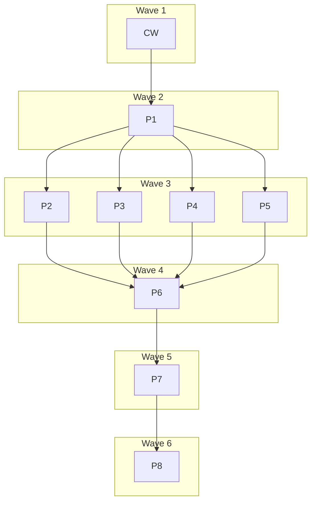

# Plan: Lock pin stability

## Status

- **Plan:** plan_lock_pin_stability
- **Active phase:** 14 — review 10 findings (§ Parallelization row RF10): H1, W1, two remedy texts, review 10's text edits, the records and the CI floor landed on `hex/lock-pin-stability--rf10`; the Codex closing read requested changes, its High recorded as row 25 residual 5 (no review 11)
- **Step:** awaiting /finalize: RF10 is the last pass (owner 2026-11-09, "One last fix, then ship"); its Codex closing read is recorded, and /hex-finalize runs next
- **Last update:** 2026-11-09 (after `9de92c66`: ci: set the suite floor to 3385 cases and the skip ceiling to 188)
- State:   review
- Tier:    xhigh
- Tier-grammar: 5
- Updated: 2026-11-09
- Next:    /hex-finalize .agents/plans/plan_lock_pin_stability.md
- Reviewed: 01facbf59663e79ceacd6dd9a35e2f3a998a0880

---

## Header

- **Goal contract (binding):** `.agents/goals/lock-pin-stability.md`. Definition of done R1–R10, plus PR merge-ready, CI green and deep verify in the DONE block only. Autonomy: never prompt; every doubt runs § Issue resolution and is recorded here.
- **Source (self-contained, ratified):** `.agents/discussions/lock-pin-stability.md`. Its Decisions and closed Threads are not reopened.
- **Design record:** [`adr_lock_pin_stability.md`](../adr/adr_lock_pin_stability.md), Decisions D1–D3, recording the ratified choices; promoted from `.agents/specs/` in P7 (PD-27). Amends `adr_artifact_dependencies.md` Decisions 3 and 4 in P7.
- **Research:** `.agents/research/research_lock_pin_stability_{codebase,prior_art,reconcile,community,archaeology}.md`. Not repeated (`research=skip`).
- **Branch:** `hex/lock-pin-stability`, worktree `/home/mherwig/.herdr/worktrees/grimoire/uno`. It holds the goal file, the design record, this plan and every implementation commit.
- **Classification:** large scope · one-way door (high: the bytes of every lock written from now on) · tier xhigh (auto) · `architect=on`, scoped to recording the ratified decisions · `research=skip` · `adversary=on`, skipped: see PD-22.
- **Tracking:** issue #269 is in scope. #265 overlaps R9 (grant-gated, F-1). No open PR covers this work (checked 2026-11-03: `gh issue list`, `gh pr list`).
- **Gate command (this session):** `/tmp/claude-1000/-home-mherwig--herdr-worktrees-grimoire-uno/738c396c-1cc2-4b7d-a755-824319f81d76/scratchpad/verify.sh` from the worktree under test. Direct test runs prefix `env -u OCX_GLOBAL PATH="<scratchpad>/bin:$PATH"`. A later session needs its own equivalent; plain `task verify` fails while `OCX_GLOBAL=1` is set. Docs steps also run `task docs:check`, catalog steps `task catalog:verify`. Heavy gates run one at a time. `task verify` skips the goldens; P1 and P5 run them explicitly.
- **Discover inputs:** five Discover reports, not committed. Every fact this plan relies on is cited inline as `file:line` at HEAD `a2ca468`, and the orchestrator read the core call sites itself.
- **Review:** one round by the native panel (spec, architecture, security, research, docs). The three Blocks and every finding with a contract edit are folded in below; what was declined is in § Review record.

## Objective

Only `grim update` moves a lock pin. Every other lock write keeps what the lock
already holds, even when a tag moved. `grim update <names>` touches only those
names' closure. The commands that compute a lock share one target function
driven by an explicit refresh set, and every install pass of a scoped update
sees one scope.

## Scope

**In:** R1–R8 of the goal: the re-pin defect, the shared-reference carry defect,
#269, recording the resolving reference in `pinned`, the `Refresh` model,
`marketplace.lock`, one edge-case wave, the docs and ADR contracts, and CI
sharding.

**Out** (source § Out of scope): the dependency model itself, hook trust and
consent, OCI transport and credentials, `grim update <names>` on a stale lock
(exit 65 stays), any change to `grim install` pruning, and release work.

**Deferred (outside this run's grants):**

| # | Follow-up | Why deferred | Needs |
|---|---|---|---|
| F-1 | **R9, grimoire-vscode PR.** `src/grim.ts:324` union gains `restored`. `src/extension.ts:768-796` count record and summary gain it (the union change is a compile error there until then). `StatusItem` (`src/grim.ts:151-192`) gains optional `direct` and `required_by`; `src/webview/model.ts:196-205,268-271` reads them instead of the `source` regex. `DescribeResult` gains `requires`, read at `src/views/pickVersion.ts:27-60`. `UninstallStatus` gains `kept-by-dependency`. Lock dispositions stay optional: lock output is not parsed (`src/views/staleLock.ts:85-91`). No version gate: parsing does not validate (`src/grim.ts:555-588`). Exercise the Update button with cases A and B of #269 through `GRIM_LIVE_BIN=<branch build>`; confirm `--version` in the log, because a suite that sees a too-old grim skips silently. Own gates: `task verify` (`check` + `test:headless`). PR body states grim merges first. | No other-repo write granted | a grant for `~/dev/grimoire-rs/vscode`: branch, commit, push, open PR |
| F-2 | **R10, indexer PR.** `mapMeta` (`src/enrich/index.ts:185-199`) maps `requires` explicitly: `null` to absent, `[]` kept. Not a `META_KEYS` entry: those drop `[]`. Fixed key position (`src/enrich/sidecar.ts:37-50`). `PackageDetail.astro:463-480` gains a Requires list using the `resolveMemberRef` pattern (`:122-133`); `bounds.ts:124-141` and `pagecap.ts:38,94` gain the section cap; `hasContents` must not read a requires-only package as empty. Check `content.config.ts` for a strict `data.json` schema (not read yet). Tests inject `spawnGrim('<branch build>')`. PR body states grim merges first. | No other-repo write granted | a grant for `~/dev/grimoire-rs/indexer`: branch, commit, push, open PR |
| F-3 | Push, open the grim PR, watch CI, `/hex-finalize`'s remote half | No push or PR grant in this run | the goal loop's grant |
| F-4 | **Hook consent ladder.** `Consent::Drifted` gates every hook in the workspace (`src/hook/trust.rs:236-238`), so a named update that brings in a new hook also disarms unnamed hooks. C-042 names them on stderr; keeping them armed is a hook-trust change | Hook trust and consent are out of scope (source § Out of scope) | an owner decision; the goal loop files the issue |
| F-5 | **Neutralizing registry-sourced ids in error text**, by reference only: `src/resolve/resolve_error.rs:119-123`, `src/resolve/graph.rs:798-808`, class CWE-150. Predates this work | Outside this goal; a security finding is never filed as an issue (goal § Issue resolution, item 7). *(RF5: fixed on this branch by `c7dce51a`, which escapes at the value's `Display`; review 5 security seat)* | the DONE block reports it as fixed by `c7dce51a` |

## Decisions taken while planning

Each row is a doubt met while planning, the research that answered it, and the
decision (goal § Issue resolution, step 2). PD-1 to PD-3 close the source's
Open questions. PD-11, PD-17 and PD-32 hold or narrow a ratified line against
the code and are flagged; no other row reopens one.

| # | Question | Research | Decision |
|---|---|---|---|
| PD-1 | Which tag does `pinned` record for a diamond of agreeing edges (`B:1`, `B:1.2`, same digest)? | `merge_policy.rs:85`, `graph.rs:902-921`: `winner_id` is the smallest requested id, already deterministic. `None` sorts first, so a digest-bearing edge wins and the pin is tagless. A winner in another repository is not adopted, so `pinned` keeps the first-read id (`graph.rs:912-919`) | **`winner_id`**, the source's recommendation, with those two cases stated. Every other request on the node travels in `requests` (C-010), not in `pinned` |
| PD-2 | Name of the new `UpdateAction` literal | Issue #269; `artifact_status.rs:450-461` is kebab-case | **`restored`** |
| PD-3 | What does an unknown name do to `grim update` today? | Traced: with a lock it is `NotDeclared`, exit 79 (`resolver.rs:546-548`, `error.rs:482`), after the stale guard. With bundles the check runs after expansion. With no lock names are ignored and everything resolves, exit 0 (`resolver.rs:578-598`). Pinned: `test_update.py:221`, `resolver.rs:1349` | **Keep both.** With no lock the exit stays 0 and the warning names the unknown name (C-029): the source asks only that this not be silent, and 0 to 79 would be an unrequested break |
| PD-4 | The source rejects a `declared` field because `stability.md` promises "byte-identical" locks, but `pinned` with a tag also changes bytes. Lines 139-143, 467-469 and 486-487 say so, and `test_golden_pre_dependencies.py:232,274,331` plus `test_golden_pre_hooks.py:219` byte-compare. Does the ratified choice break Principle 9? | Goal § Emphasis scopes the hard limit to "`stability.md` forward compatibility holds". Those sentences exist so that an older grim keeps reading the file. `declared` makes 0.15.1 exit 78. A tagged `pinned` parses on 0.15.1 (`identifier.rs:350-358`) and the published schema allows it (`lock.schema.json:289-293`). A fresh lock cannot stay byte-identical under the ratified decision | **The ratified choice stands; reading on both sides is the promise that holds.** "Byte-identical" narrows to "identical apart from the advisory tag in `pinned`" (P7). Fixture bytes are never regenerated (their README forbids it). Comparators gain one named equivalence and assert the tags are present (C-018). A real 0.15.1 run proves the read (C-036). Constitution deviation row 1. **Flagged to the goal loop** |
| PD-5 | `state.json` is the other file whose `pinned` does not strip (`install_state.rs:420-433`). Does it move too? | Today `grim install` writes tagless state (tagless lock on disk) and `add`/`update` write tagged state (fresh in-memory lock, `graph.rs:964-965`). `test_golden_pre_hooks.py:233-238` byte-compares install state. `stability.md:467-469` covers state | **State bytes do not move at all.** `fresh_lock` drops advisory tags, so `grim install` and export's lock reads see what they see on main; `add`, `update` and the TUI keep today's tagged form (C-009). Stripping at record time instead would change `add`/`update` bytes and fail `p9_diff` |
| PD-6 | Does a tagged pin fetch through its moved tag? `graph.rs:361-362` says so | `external/rust-oci-client/src/client.rs:2243` builds the manifest URL from the digest whenever one is present, at the same submodule commit on `v0.15.1` and HEAD | **No fetch change needed.** The evidence is that line, not S-001's install, because C-009 strips first. P1 step 8 corrects the comment |
| PD-7 | "No registry contact" for a clean pre-change lock, yet edges must come from the digest-verified manifest (ADR Decision 3) and `StaleDependencies` says `grim lock` repairs them (`install_error.rs:156`). 0.15.1 writes locks that omit dependencies (`stability.md:494`) | Skipping manifests would strand those locks: `install` keeps refusing, and the message points back at `grim lock`. Manifests are read by digest, store first (`cached_access.rs:97-112`) | **Zero tag resolves, always. Manifests stay store-first by digest.** On a warm store that is no registry contact; on a cold store it is by-digest reads only. The unit test counts `resolve_digest` calls |
| PD-8 | There is no separate stamp step in the source's code list. Does one exist? | Fresh pins come from `read.id.clone_with_digest` (`graph.rs:964-965`), so a carried node written through `build_lock` gets the settled request as its tag | **No stamp function.** A tagless pin carries when C-010 answers the claim; the tag then arrives through the normal write |
| PD-9 | `grim add` always changes `declaration_hash`, so a pre-change lock always looks drifted to it | `add.rs:201-202`: the pre-edit set is `scope.set`, still reachable at the relock point. The TUI declares in place (`tui/app.rs:2849-2851`) | **Prove against the pre-edit set** (`Prior::checked`, C-003). The TUI clones before `declare`. Otherwise every first `add` after upgrade would resolve everything |
| PD-10 | A carried pin claimed by a new edge at another tag can fake a conflict: `B:1` carried at D, `B:1.3` fresh at D', tag `1` also at D' | Claims can arrive after the node was read (`fold`, `settle_winners`), so eager release would need retraction. Releasing on any unanswered claim would also move pins needlessly | **Release only on conflict.** A conflict with a carried claim drops that carry and re-expands, memo retained, so no tag resolves twice. Bounded by the key count (C-017) |
| PD-11 | The Verification list says case A is "reported nowhere", but `test_update.py:95` pins an unnamed row `unchanged`, and JSON is frozen. The panel showed the break is avoidable: `json-interface.md:97` defines `action` as the lock diff, so `unchanged` on an untouched binding is true, and #269 complains about the rewrite, not the row | Goal § Emphasis's hard limit names action values, not row sets. vscode's Update button reads only `refused` (`forceRetry.ts:161`). `update --marketplace` keeps such rows on purpose (`update.rs:461-463`). The source's Verification list is settled and this run does not reopen it | **The ratified line stands, on that authority alone.** Rows are the closure, pruned rows, and every node outside the closure whose disposition is not `Carried`, so no lock change goes unreported (C-028). `test_update.py:95` flips. Constitution deviation row 2. **Flagged to the goal loop:** keeping every row is a one-clause change to C-028 and removes the deviation, but it contradicts a settled line, so it needs the owner's word |
| PD-12 | The source says marketplace update re-resolving is a problem, but `commands.md:683-698` promises `update --marketplace` "re-resolves every floating tag" | The per-command table: `grim update` → all. `team-plugin.md:147-151` and `stage.rs:426-441` show the defect is export stage: a stale plugin takes `Whole` and moves every pin | **`update --marketplace` stays `Refresh::All`/`Names`.** Export stage reconciles with `Refresh::Nothing` (C-031, C-032). "Unchanged picks" means unselected picks on update and unchanged includes on export |
| PD-13 | TUI: `BatchOp::Update` and `Install` call the same `perform` (`tui/app.rs:2526`). `Nothing` for both would make Update a no-op | The per-command rule; the TUI knows the kind | **`Update` → `Names` with the kind; `Install` → `Nothing`** (C-012). No PTY harness exists (`test_tui_multi_registry.py:1-14`), so the TUI cases are Rust tests beside `perform_*` (`tui/app.rs:6014`) |
| PD-14 | Path sources under `Refresh::Nothing`: keep or re-pack? | `install_error.rs:144` tells users `grim lock` fixes a changed source. A path hash is a fingerprint, not a tag pin | **Re-pack under `All` and `Nothing`; only `Names` keeps unselected path pins** (`resolver.rs:149-159`) (C-014) |
| PD-15 | Unreadable lock: refuse or warn? `test_update_marketplace.py:493` pins a plugin-scoped lock as absent, exit 0 | Parse failures include merge-conflict markers in `grimoire.lock`. A warn-and-resolve would move every pin, which is exactly R1's defect. A too-new `lock_version` would be overwritten. `ScopeMismatch` has two causes (`grimoire_lock.rs:382-391,399-407`): a flavor mismatch and an invalid entry name | **Refuse with the load error's exit code (78, 77, 74). `NotFound` is absent. A plugin-scoped file stays absent with a warning, so `test_s024` holds; an invalid entry name refuses** (C-005, C-021). Constitution deviation row 3 |
| PD-16 | `grim update <names>` with no lock: refuse or warn? | Refusing turns exit 0 into 79, a behaviour break. Nothing was pinned, so nothing moves | **Resolve everything, warn, install only the closure of the names that matched, prune nothing** (C-022, C-029) |
| PD-17 | Do vendor sync and hook converge take the scope? The source lists both under "every pass" | `claude_config` and `opencode_config` sync only exclude and instruction entries, pure functions of state plus `retired`; neither re-adds an MCP entry. `hook_registrar.rs:336` replaces the dispatch table wholesale, and its test at `:2544` forbids a narrowed roster. Converge's input also holds the hook policy, built from the whole lock (`update.rs:127`), so the scope cannot reach it through `retired` alone | **Both stay whole-state. This narrows the ratified "every pass" list:** `retired` carries the scope for sync and hook removals, and the policy stays workspace-wide (PD-33). Narrowing converge would drop a sibling's rows (C-026). **Flagged to the goal loop** **Narrowed by RD3-5 (RF3):** a named run's vendor sync adds managed entries only for rules in its closure, removals keep using `retired`, and an uninstall adds none; hook converge works per record (C1). |
| PD-18 | How do tests fail first if every commit needs a green `task verify`? And the source says "each failing on 03393c5", though some required tests cannot fail there | The commit hook denies a commit without a gate pass; the goal requires failing tests first. S-009, S-015, S-016, S-017, S-023 and three units pass on HEAD by construction | **Red is observed, then parked.** The contract wave runs each regression test against HEAD, records the failure, and commits it `#[ignore = "<pipeline>"]` or `pytest.mark.skip(reason="<pipeline>")`. The owning pipeline removes the marker. No marker survives (P8 gate). **A test green on HEAD is a characterization test**, committed unparked and listed in the record. A test of a type HEAD lacks proves itself by the mutation check |
| PD-19 | Which acceptance tests may stay under the keep-rule? | Source § Edge-case hunt applies it to wave probes; the Verification list requires the regression tests | Regression tests in S-001…S-031 stay. Wave probes stay only with a finding or a unique case, named in their docstring |
| PD-20 | `test_offline_lock_without_a_cache_still_fails` asserts exit 69 for a seeded offline lock | A carried pin needs no tag cache, so that run now succeeds. Its point is a positive control | **Reframe:** unseeded offline lock still exits 69, seeded succeeds (C-018). The verify-deep count stays 11 |
| PD-21 | Where does a 0.15.1 binary come from? | None exists locally. `test/bin/grim` is unproven: `"0.15." in version` also accepts a dev build (`test_old_grim_dependencies.py:41`). No workflow sets `GRIM_OLD_BIN`, and `ocx.toml` pins only 0.14.3 | **Build tag `v0.15.1` (`cdeedcaa`)** in `.agents/worktrees/v0151` with its own target dir, and record `git describe` with the run (C-036). One recorded run, not a kept CI check: the source's "old-binary run" does not exist in `verify-deep.yml`, and the skip counts in `SKIP_CEILING` |
| PD-22 | Cross-model plan review is on, but `codex:rescue` is not an installed skill and no `codex`, `gemini`, `opencode` or `copilot` CLI is reachable (PATH, `~/.local/bin`, the ocx toolchain) | `adversary.md` § graceful skip: never wait, never retry | **`Cross-model plan review skipped: no second harness on this machine`.** One review layer is missing; the native panel ran in full. Surfaced in the handoff |
| PD-23 | Sharding: basic only, or deep too? Is `acceptance-tests` a required check? | `gh api repos/grimoire-rs/grimoire/rules/branches/main` (2026-11-03) lists `deletion`, `non_fast_forward` and `pull_request` only, so no status check is required today. A context uses a job's `name:`, and a job inside a reusable workflow reports as `caller / called`. `Acceptance Test Results` (`verify-basic.yml:186`) is a published check run, so it survives the move | **One reusable workflow, called by verify-basic and by verify-deep's Linux and macOS legs.** Windows stays one job. The caller keeps the job id `acceptance-tests`, which `needs:` reads. No aggregator job: it would guard a required check that does not exist (C-041) |
| PD-24 | `dropped` entries in the lock report: a row or nothing? | The source wants dispositions to feed the report, additive fields or new literals only | **One row per dropped artifact**, `action: "dropped"`, `pinned` the old pin (C-019) |
| PD-25 | R9 and R10 | No other-repo write granted | **Described in F-1 and F-2; no step scheduled.** Reported to the goal loop |
| PD-26 | Does `grim update <bundle>` work, and does it refresh members? | It exits 79 on main: `declared_names` omits bundles (`resolver.rs:560`) and the post-expansion check reads artifacts only. The ratified scoped-prune case needs it. `grim update <parent>` keeps a child's pin (`resolver.rs:1279-1297`) | **`Names` accepts a bundle binding and selects it alone.** A member moves by its own name, by a changed edge, or under bare `grim update`. A widened failure is additive |
| PD-27 | `test_every_adr_has_an_index_row` needs a row in `.claude/rules/arch-principles.md` for any file in `.agents/adr/`, and its allowlist may only shrink. This run was told never to edit any rule, and the gate cannot pass with an unindexed ADR | The test's own text says fix the source. The planning flow also defines a design record (`AGENTS.md` › Workflow), which carries no index row | **The record ships as a design record under `.agents/specs/`, ADR-shaped, and is not an ADR yet.** P7 step 5 promotes it and adds the row, and the rule edits in C-033 and C-041 need the same confirmation. If the goal loop withholds it, they stay as residue in the handoff. **Flagged to the goal loop** **Goal-loop confirmation (2026-11-04):** confirmed, both gated P7 and P8 steps run. The premise was wrong: the "never edit any rule" line in the plan brief was scoped to the commit gate (do not edit the hook or its rules to get past it), and goal § Rules is `None`. Feature-required rule updates are in scope; `.claude/hooks/**` stays untouched. |
| PD-28 | What may answer a claim? The first C-010 let `requests` answer alone | Security and architecture seats, traced on `resolver.rs:379-381,408` and `graph.rs:759-761`. Main's carry guards the repository, excludes declared keys, and runs only under a fresh hash; generalizing it to every lock write removes all three. An edge onto a direct key is shadowed and was never resolved | **Identity is conjunctive, and `requests` relaxes only the tag, only where the previous lock vouches for it** (C-010). Vouching is computed once from the previous lock: re-validation showed a rule reading the other current claims depends on claim order and can write a tag beside a digest it never named. One narrowing: agreeing edges in two repositories no longer carry the non-winner, so that edge resolves once. Classes CWE-345 and CWE-354, by reference |
| PD-29 | Does a `grim add` target read a carried pin? | `add` selects its target today, so it always resolves fresh (`add.rs:1387-1391`). The gesture means what the registry says now (`adr_artifact_trust_model.md` decision 1) | **A direct key absent from the pre-edit declaration never carries** (`Prior::edited`, C-003). A target the lock already holds as a dependency moves, as the design's row says. Re-adding a declared binding with the same reference carries **Reversed by OD-2 (owner, 2026-11-05):** a direct key new to the declaration keeps a pin that answers its reference, as under `grim lock`; a target the lock holds as a dependency or member at an answering pin carries; any real move of the target is listed in `moved`; one stderr note names `grim update <name>` (`grim --global update <name>` in global scope). |
| PD-30 | Is "pre-change" a property of a lock or of a node? | A merged lock mixes tagged and tagless pins under a hash matching neither, and a clean pre-cache lock can hold a member with no recorded edge. Two texts defined pre-change differently | **Per tagless pin** (C-013). For the source's case, every `pinned` stripped, the outcome is the same; a mixed lock warns where a lock-level rule would move pins in silence |
| PD-31 | `grim remove` restamps the hash on a stale lock (`remove.rs:286-288,460-462`), so `Prior::checked` can pass on a lock that does not match | `adr_effective_set_mutations.md` wants honest staleness. The restamp also launders main's `grim install`, which then installs the old digest for an edited entry | **Restamp only when the lock was fresh against `set_before`** (C-044). `uninstall` and the TUI delete share the seam. Constitution deviation row 10 |
| PD-32 | Can a bundle a part reaches in `marketplace.lock` keep its pin? | A part holds no `[[bundle]]`: `resolve_marketplace` clears it and `grimoire_lock.rs:254-258` refuses the table. No lock field may be added. Review 2: the bundle need not be an include, since one reached through `requires` or through another bundle reads its tag the same way under a carried include | **There is no pin to keep.** Any bundle a part reaches, by include, by `requires` or through another bundle, re-resolves by tag whenever its part is written, and its member set follows; members it still lists keep theirs (C-031). What that changed is named per part: one warning naming the bundles and the rows, on any relock but a whole update, for a bundle the part already held; offline the tag-cache warning names the rows `moved`, `added` and `dropped` instead. **R5 is partial by exactly this. Flagged to the goal loop** **OD-3 (owner, 2026-11-05): R5 ratified as partial; a part keeps no bundle pin, by choice.** A digest in `bundle_tag` would change a frozen field's meaning, and 0.15.1 drops it on its first write (pipeline D's runs). Any bundle a part reaches follows its tag whenever its part is written; one warning per part names every row below it that changed, below a swapped or departed nested bundle included. An include the part already holds reads no tag. A non-winner member of a part stays the named residual (RV-12). *(RF5: the two passages above are history; RF3's OD-3 wording is withdrawn by RF4's OD-3 row.)* **OD-3 (owner, enforced as written; RF4): a part keeps its bundles' pins in the existing `bundle_tag` string, as `<tag>@<digest>`.** 0.15.1 reads that value and its member update writes it back unchanged (review 4). Only a run on the whole plugin moves a bundle; every other write reads it at the recorded digest, so a member it lists keeps its pin (C-031, S-036). *(Amended in RF5 to the landed code, RD5-12:)* a part that records no digest, as a 0.15.1 lock, follows the tag only on a write that selects the bundle (a whole update, a `<plugin>` or `<plugin>:<bundle>` pick, or the export stage on a stale part) and records one there, and the per-part warning names what that changed. A `<plugin>:<member>` pick keeps every row outside its selection as the part holds it, and records no digest for a bundle it neither selects nor finds recorded. |
| PD-33 | Can a named update disarm an unnamed hook? | Yes. `Consent::Drifted` gates every hook (`hook/trust.rs:236-238`), and the policy is built from the whole lock. Main does the same but claims no scope. Hook trust is out of scope | **No ladder change. One stderr warning names what the run disarmed**, since no row can (C-042). Deferred: F-4 |
| PD-34 | A carried pin whose manifest the registry dropped: today's `grim lock` re-pins past it | The read ends in `TagNotFound` naming a tag that exists (`graph.rs:383-388`). Only `grim update` may move a pin. zot drops such a manifest (`subsystem-tests.md:12`) | **Exit 79, the message names the digest and `grim update <name>`, nothing is written** (C-015). The frozen bundle member path stays (`graph.rs:372-382`). Constitution deviation row 11 |
| PD-35 | TUI Update on a stale lock, and two TUI paths with no op | `relock_entry` recovers by a full resolve today, which moves every pin (`add.rs:1391-1401`). The callers at `tui/app.rs:425-453,2526` hold `op`. The CLI keeps exit 65 on a stale lock (source § Out of scope) | **Refuse on the status line, as the CLI does, with nothing written; build the `Prior` before `write_config`; pass `op` down all four functions** (C-012). Constitution deviation row 9 |
| PD-36 | A tag has no grammar at parse, and the writer now round-trips it | Lock parse accepts controls and a 1 MiB tag (`identifier.rs:425-451`). A new parse refusal would be a break. `fresh_lock` has three callers, not one | **Write a tag only if it matches the OCI grammar, else write the pin tagless; strip inside `fresh_lock`** (C-008, C-009). Classes CWE-150 and CWE-20, by reference |
| PD-37 | A kept path entry takes `requires` from the lock under `Names` (`resolver.rs:149-156`), against "edges never come from the lock" | Reading the source instead would pair a fresh edge list with an old hash. A path source and the lock sit in the same commit, so the source is no more trusted than the lock | **Recorded exception** in C-014 and C-015: `Names` only, unchanged from main |
| PD-38 | Does the accepted same-repository residual cover bundles? | The source ratifies carrying a declared bundle by pinned digest while repo and tag hold, and a digest selects the member list | **Yes.** The design's Risks and C-034's amendment name bundles |
| PD-39 | Do the graph caps survive a release pass? | `transitive` and `bytes` live on `Graph` (`graph.rs:490-493`). Keeping them raises a false `GraphTooLarge`; resetting multiplies the read budget by the passes | **Reset per pass; only the memo survives.** The released set only grows, so passes are bounded by the carried keys and the worst case is cap times passes (C-017) **RF3 (H):** a release pass also takes back the last pass's manifest reads at the same key, id and digest (`Graph::reads`); the caps still reset per pass. |
| PD-40 | Does a reader parse `pinned` as a bare digest? | The schema defines an OCI reference with an optional advisory tag (`lock.schema.json:289-293`), and the value always began with a registry. `team-ci.md:59-62` says "a digest, not a tag", which C-033 corrects | **`pinned` stays a reference; no change.** A script keyed on `@sha256:` keeps working |

## Design guarantees

### Backwards compatibility (Principle 9 gate)

| Surface | Change | Why it is allowed |
|---|---|---|
| `grimoire.lock`, `marketplace.lock` `pinned` | gains `:tag` before the digest on `[[skill|rule|agent|mcp|hook]]` | schema already allows it; 0.15.1 parses it; no new field; `lock_version` 1; `declaration_hash` unchanged |
| `[[bundle]]` | none | the sibling `tag` already records the reference (`locked_bundle.rs:227`) |
| `state.json`, `global.json` | none on `grim install`; a named `update` leaves an unnamed row tagless where main rewrites it tagged, and both forms read equal | PD-5 |
| JSON `pinned` fields | none | all go through `provenance()`/`strip_advisory()` (lock, add, status, why, export) |
| `lock` report | `disposition` added; `dropped` row and literal added | field and literal additive; the row set grows, deviation row 7 |
| `add` report | `moved` and `dropped` added | additive |
| `status` report | `moved_nested_bundles` added; `update_available` keeps its per-row meaning | additive (GD-2) |
| `declaration_hash` | no new value form (amended in RF4 to the landed code at `92f55874`; the empty value is withdrawn by OD-1): an edit that leaves the lock unproven and changes its rows writes `sha256("edited:" + old)`, which no declaration produces | same `sha256:<hex>` form; 0.15.1 and every reader that can parse the lock see a stale lock; deviation row 12 |
| `update` report | `restored` added; rows narrow on a named run | additive literal; narrowing: deviation row 2 |
| Error text | `add` and `update` already print a tagged pin (`install_error.rs:46-52`); nothing new on `install` (PD-5) | message text, not a contract field |

### Constitution deviations

| Violation | Why needed | Simpler alternative rejected because |
|---|---|---|
| 1. Principle 9: `stability.md` "byte-identical" sentences narrow; golden comparators gain an equivalence | R2's ratified record of the resolving reference has to live in the lock | A `declared` field keeps old bytes only on old locks and makes every 0.15.1 refuse a new one with exit 78; a sidecar file splits the lock's truth across two files |
| 2. Principle 9: `grim update <names>` stops listing rows for untouched bindings outside the closure | The ratified Verification line "reported nowhere" (PD-11, flagged) | Keeping `unchanged` rows is the alternative the panel prefers; it contradicts a settled line, so it waits for the owner |
| 3. Principle 9: `lock`, `add` and `update` exit 78 on an unreadable lock where they exited 0 | R1: a silent re-resolve moves every pin | A warning still moves every pin |
| 4. Principle 9: `grim lock` stops moving pins; `grim update <names>` stops touching unnamed bindings *(RF6, plan RD6-R4c, owner flag: `grim update <names>` exits 0 beside bundles whose moved tags conflict, where 0.15.1 and c5e3824 exit 78, measured with the v0.15.1 release; this row covers it. `grim lock` in that shape is row 18's diamond whose edges parted after a tag moved. A `<plugin>:<member>` or `<plugin>:<bundle>` pick exits 0 there too, and also where an included bundle it neither selects nor reads is gone from the registry, where 0.15.1 and c5e3824 exit 79 on a part 0.15.1 wrote (already so at 3aa5a09c; RF6 fix round 1, market seat F2); OD-3 as enforced (RD5-12), with rows 17 and 23, covers a part pick, since only a run that selects a bundle reads or moves it. Bare `grim update` and a whole-plugin update still exit 78, and a whole-plugin update still exits 79 on a gone include. A run that selects a moved bundle still exits 78, unless the other bundle names the shared row only under its own moved tag: then it exits 0 and the row takes the selected bundle's version (`grim update <bundle>` in a project, 78/78/0 on 0.15.1, c5e3824 and a764c2ed; Recorded residuals after RF6 item 9 for a part pick). `stability.md` and `upgrading.md` list each among the exits that went the other way.)* *(RF7, plan RD7-b1, narrowed: a part pick now reads every bundle the plugin declares. Over a part that records no digest for the other bundle, as 0.15.1 and c5e3824 write it, a version conflict there exits 78, as on c5e3824 *(true for a direct-include conflict only since FX8; between RF7 and FX8 a pick dropped an unselected, unrecorded bundle before the member check, so `team:m` exited 0 where both references exit 78)*. A gone unrecorded include exits 79, as on both, and the "unless" clause no longer reaches a part pick. The part-pick clauses above hold only on a part that records the other bundle's digest, as this grim writes it. There the pick reads that bundle at its recorded digest, not its moved tag, and exits 0 where c5e3824 exits 78 and 0.15.1 exits 78, or 65 on nested shapes. Worker b measured 57 such cells on the v0.15.1 release, c5e3824, the previous tip and the fix (OD-3 as enforced, rows 17 and 23; owner flag). They are 57 of the 88 cells on such parts that both references refuse and this grim does not; RD7-b1's owner flag classes the other 31 (corrected in RF7 fix round 1, from `both-refuse.txt`, and again by review 8's s1-spec: 88 = 57 + 27 + 2 + 2, two `tip-part team:pack` cells having been counted among the old-part selectors). The project clauses stand.)* *(RF8, owner 2026-11-08, "Allow 78→0", for the 57 cells and STOP-2: a pick beside a pinned sibling whose moved tag conflicts exits 0 and keeps the sibling at its recorded digest, and a whole-plugin update still refuses. Cells as 0.15.1 / c5e3824 / `ebf37aa4`: the 57 measured cells, 43 at 78/78/0 and 14 at 65/78/0, and STOP-2's shape, a recorded nested bundle below an unrecorded parent read at its recorded list (`test_a_pick_reads_a_recorded_nested_bundle_below_an_unrecorded_parent_at_its_recorded_list`, `585acf15`). The redesign builds STOP-2 and STOP-A with one predicate. STOP-A, owner 2026-11-08, "Allow 78→0": a pick of a bundle keeps a bundle nested inside it at the digest the part records and exits 0, where 0.15.1 (65) and c5e3824 (78) follow the nested bundle's moved tag and refuse. Six measured cells, 65/78/0/0 each as 0.15.1 / c5e3824 / `ebf37aa4` / this grim (two more 65/78/0/0 `team:top` cells, `r7_picks[nested_pk2_moves]` and `s8m nested2_pk2_moves`, sit beside a moved sibling `pk2` and fall under row 4's 57 as well): `mk_picks[nested]` `team:top`; `s8m nested2_pack_moves` `team:top` (and `--offline`, 81/78/81/81); `s8v hn_moving_nested` `team:top2`; `s8v_nest[conflict]` `team:top2`; `r7_picks[nested_pack_moves]` `team:top`. A pick that names the nested bundle, or a whole-plugin update, still moves it. Named in code `PartCarry::NESTED_BELOW_PICK_KEEPS_PIN` (`src/resolve/graph.rs`). STOP-B, owner 2026-11-08, "Allow 78→0": a pick of a bundle keeps its members at their pins and exits 0, where 0.15.1 and c5e3824 follow a member's moved tag and refuse 78 on the conflict it brings; the part stays byte-identical; a pick that names the member still moves it. Cell: `sib_dep_moves` `team:pk2` (r7m and st_r7m, part written by this grim) 78/78/0/0. The same registry's `team:b`, `team:extra`, `team:pack` and `team:held` are 78/78/0/0 too and sit under the sibling ruling: their refusal on the references comes from `pk2`, an unselected sibling whose member moved, not from a picked bundle's own member. No code changed for these rulings.)* | Owner classes both as bug fixes (source § Intent; #269 cites the help text) | Leaving them is the defect |
| 5. Principle 9: `grim add`, the TUI actions and the declared export stage stop moving pins, though `guides/team-plugin.md:147-151` names a stale plugin as a way new digests arrive *(RF6 fix round 2, worker q1, measured with the v0.15.1 release, c5e3824, `9f8e4b3b` and the q1 build, each on its own empty `GRIM_HOME`, on a lock 0.15.1 wrote over one skill `s:1` (tag kept or moved) and over a bundle member (tag kept, moved or withdrawn, with or without a dependent 0.15.1 never walked): `grim --offline add --no-install` of the pinned reference goes from 69, files unchanged, to 0 with the pin kept and its tag stamped; `grim --offline add` goes from 69, files unchanged, to 81 after the lock is saved, since the empty store has no files to install; `grim --offline lock` goes from 69 to 0, as row 21 records. Already so at `9f8e4b3b`. Basis: owner decision PD-29/OD-2, `grim add` keeps a pin its reference already answers, which needs no tag read; a record widened, not a behaviour; owner flag on the 81 after a saved lock (RD6-Q4). `stability.md` and `upgrading.md` list it beside the withdrawn-tag bullet. Also under this row (RD7-c1, step 3): `grim add` of a bundle member beside a dependent whose entry records no edges, online with the install, exits 0 with the pin kept where it exited 65 on 0.15.1 and 78 or 65 on c5e3824, a conflict and a cycle back at the pinned digest alike: 65/78/0 and 65/65/0 as 0.15.1 / c5e3824 / this grim. Both pages list it among the exits that went the other way. A cycle back at another digest or a gone tag below the moved manifest keeps the pin too since RF8 (owner 2026-11-08, "Fix: add keeps pin"; row 18, residual 12): `add --no-install` 0/65/65/0 for the cycle and 0/79/79/0 for the gone tag, with the install 65/65/65/0 and 65/79/79/0, offline on a warm store 69/65/65/0 for the cycle, while the gone tag stays 69/69/69/69 (an offline tag miss keeps its exit), as 0.15.1 / c5e3824 / `ebf37aa4` / this grim, project and `--global` alike. Only those two failures keep the pin: an unreachable registry, a refused credential, a timeout or a graph cap below the moved manifest keep their exits (69, 80, 69, 65), as c5e3824.)* | The per-command table and R5 | Leaving any one keeps a path that re-pins |
| 6. Principle 9: a named update stops reaping for the named binding too, not only for unnamed ones | Ratified: "no reap on a scoped update" | A per-binding reap has no client to scope by: a dropped client is a config-wide fact |
| 7. Principle 9: a `lock` report can hold a row for an entry absent from the lock | Source: dispositions feed the report; PD-24 | A report with no such row hides a removal; the row grows the set and removes nothing |
| 8. `rust-quality.md` row 14: `#[ignore]` on regression tests during the run (PD-18) | Goal's failing-tests-first against a hook that denies a commit without a green gate | No marker survives: C-040 fails while one remains. It never turns a check green at the end of the run |
| 9. TUI Update on a stale lock refuses where it silently resolved everything (PD-35) | The recovery was the re-pin defect | Keeping it re-pins from the TUI alone |
| 10. Principle 9: `grim remove` on a stale lock that does not answer the edited declaration leaves it stale, so a later `grim install` exits 65 where it exited 0 (PD-31, RD2-4) | `Prior::checked` must mean what it says; `adr_effective_set_mutations.md` chose honest staleness | Trusting the restamp makes a tagless pin answer an edited entry until `grim update` |
| 11. Principle 9: `grim lock` and `grim add` exit 79 on a carried pin whose manifest is gone, where they re-pinned past it (PD-34) | Only `grim update` may move a pin | Re-pinning is the defect |
| 12. Principle 9: a `grim remove` that keeps a pin answering only part of a key's surviving requests leaves the lock stale, and when it changes the lock's rows it writes `sha256("edited:" + old)`, so a later `grim install` exits 65 where it exited 0 (RD2-1 as amended by OD-1, which withdrew the empty hash; amended in RF4 to the landed code at `92f55874`) | A pin that answers part of a key's surviving requests cannot show a proof, and no field may be added | A restamp states what nothing resolved; dropping the row moves the pin |
| 13. Principle 9: `grim install` reads `unchanged` where it read `updated` for an output its pass does not write (RD-4, RV-9) | `restored` and the integrity gate must judge what the pass writes | Counting such an output repeats `restored` on every run |
| 14. Principle 9: `grim update <member>` exits 79 for a member that exists only under its bundle's moved tag, where it exited 0 and moved the bundle's pin (`stability.md`'s non-additive item 5) | A name selects itself alone (C-002), so a member's name cannot move the bundle that brings it: the #269 fix of row 4 | Following the tag moves an unnamed binding's pin, the defect row 4 removes; `grim update <bundle>` moves the bundle and brings the member |
| 15. *(Withdrawn in RF5 fix round 1 by RD5-35: the kept row takes the bundle's stamp, so `grim install` exits 0 as on 0.15.1, and `stability.md` no longer lists the item.)* Principle 9: `grim install` exits 65, not 0.15.1's 0, after `grim remove` or `grim uninstall` beside a declared bundle with no member list, where the local store shows that bundle provides the key or the key's row carries its stamp; `grim remove <bundle>` keeps such a member of another list-less bundle with the same exit (item 7, D-Y1-1 as narrowed by RD5-22) | R1's "remove plus lock keeps pins": 0.15.1 dropped the row, so the next `grim lock` moved the member's pin | Dropping the row is that defect; keeping it under a fresh hash makes `grim install` re-install what `grim uninstall` removed (RD5-22). Where neither the store nor a stamp shows it, a cold store included, the row drops at exit 0, as on 0.15.1, and the member can re-resolve at the next `grim lock` (RD5-22's residual) |
| 16. Principle 9: `grim uninstall` of an artifact with no direct declaration that the local store shows such a bundle provides keeps its files and reports `kept-by-bundle`, where 0.15.1 deleted them and reported `uninstalled`; the exit stays 0 (item 8, RD4-10). An existing value of `status`, so no new value form | 0.15.1's own `KeptByBundle` doc: a declared bundle still provides it, so its files are kept. The row stays in the lock (row 15) | `uninstalled` with the files deleted reports what the lock does not hold, and the next `grim install` brings the files back |
| 17. Principle 9: `grim update --marketplace <m> <plugin>:<member>` exits 79 for a member only a moved bundle tag would bring, on a part that records that bundle's digest, where 0.15.1 added the row at exit 0 (item 11, RD4-2) | OD-3 as enforced: a part keeps its bundles' pins in `bundle_tag`, and only a run that selects the bundle moves it | Adding the row means following the bundle's tag on a member pick, row 14's defect in a part; `<plugin>` moves the bundle and brings the member |
| 18. Principle 9: `grim lock` and `grim add` exit 0 with the pin kept on a diamond whose edges parted after a tag moved, where they exited 78 (`stability.md`'s other-way list). *(Cells quoted from RD7-c1: the step 3 `grim add` shapes, 0.15.1 / c5e3824 / this grim, are conflict `--no-install` 0/78/0, conflict with the install 65/78/0, and cycle with the install 65/65/0, a cycle back at the pinned digest. RF8 adds a cycle back at another digest, `add --no-install` 0/65/65/0 and with the install 65/65/65/0 (offline warm 69/65/65/0), and a gone tag below the moved manifest, 0/79/79/0 and 65/79/79/0, each ending 0 on this grim, while offline it stays 69/69/69/69; see row 5.)* | Consequence of row 4: the carried pin answers both edges by the previous lock's evidence, so no tag resolves and a moved tag raises no 78 (ADR D2, Diamonds) | Resolving the tags to find the split moves pins; bare `grim update` still exits 78 |
| 19. Principle 9: `grim lock` exits 0 after `grim remove` of a direct declaration that held a version conflict off, and keeps that key's pin, where it exited 78 | Consequence of OD-1 (owner): with no empty hash, a pin naming a recorded edge carries on a stale hash, so the shadowed edge is not resolved (§ RF3 record, "Lost exit 78") | The empty hash that kept 78 was a new value of a frozen field (OD-1); `grim update` still exits 78 |
| 20. Principle 9: `grim install` exits 0 after `grim remove` of a direct declaration that a bundle still lists at a reference its pin's digest answers, where it exited 65 | Consequence of the keep rule (C-044): the kept pin answers every surviving request, so the edit writes a real hash | Leaving the lock stale fails an install whose every row answers its request |
| 21. Principle 9: `grim lock --offline` exits 0 when the lock pins everything the declarations reach, on a clean lock or after `grim remove`, where it exited 69 whenever a bundle was declared or its tag cache lacked a tag *(RF6, plan RD6-C2 and RD6-d5: the row also covers a line deleted by hand, a skill, rule, agent or bundle line and `--global` alike, measured with the v0.15.1 release. The row drops and the lock proves the declaration, so the next `grim install` exits 0 where 0.15.1's stale lock gives 65; c671c035 gives the same exits. A lock whose pins carry no tag yet (0.15.1 wrote it and no later write stamped it) still needs the tag cache after a deleted line: on an empty home the offline lock exits 69 and writes nothing, as 0.15.1 does, so the row does not reach that case (RF6 fix round 1, docs seat F4, re-measured on a764c2ed). Past a dependent whose requires layer the store lacks the row drops too (RD6-F1): `grim install` refuses the dependent with 65 online on both sides and exits 81 offline, as on c5e3824; where a bundle is declared, 0.15.1's offline lock exits 69 and its stale lock gives 65 there. No new row.)* | Consequence of row 4: a carried pin resolves no tag, and a carried bundle the store lacks reads its members from its `[[bundle]]` row at the same digest (ADR D2, Carry) | Reading the tag cache offline lets it move a pin; a lock with no member list, or a selected or new bundle, still exits 69 |
| 22. Principle 9: `grim update <bundle>` exits 0, where it exited 79 | ADR D2, Selection: `Names` accepts a bundle binding, which the ratified scoped-prune case needs; the 79 came from `declared_names` omitting bundles | A 79 leaves no named route to move a bundle, so only a bare update could, moving every pin |
| 23. Principle 9: `grim update --marketplace <m> <plugin>:<bundle>` exits 0, moves that bundle and the rows it reaches, and records its digest, where 0.15.1 and c5e3824 exited 79. *(Cells: `team:outer` over a part 0.15.1 or c5e3824 wrote is 79/79/0, and over a conflict-only part with a moved list that conflicts with a direct include it is 78 since FX8, 79/79/0/78 as 0.15.1 / c5e3824 / 6974aaad / `b8ef3c33`. That 78 is the meta-orchestrator's ruling under this row plus a real conflict, not an owner decision. `stability.md` and `upgrading.md` list it among the exits that went the other way.)* *(RF8, coordinator rulings of 2026-11-08, not the owner's. STOP-1: with H2's carry, a recorded bundle the store lacks offline exits 81, and one whose manifest the registry dropped exits 79. STOP-C: the offline bundle picks (`a_w1_all_direct` `team:pack`, `g_member_check` `team:outer`) give 81/81/0/0 on a home the same pick warmed online, as 0.15.1 / c5e3824 / `ebf37aa4` / this grim; the references' 81 exists only because their online pick refused 79 and cached nothing. Both pages list the offline pick among the exits that went the other way. `team:outer` over a conflict-only part stays 78.)* | The pin rule: a selected node moves, as `grim update <bundle>` does in a project (row 22), and OD-3 as enforced records a digest for a bundle the run selects (RD5-12) | Keeping 79 leaves only a whole-plugin run to move one bundle, and that moves every row of the plugin |
| 24. Principle 9: on a lock with no member list for a declared bundle (written by grim 0.3 or earlier, or with its `[[bundle]]` rows cut by hand), `grim add` of a member's own reference exits 0 and keeps the member's pin when its tag is gone, or offline, where 0.15.1 exited 79 online and 69 offline (RD5-58, `test_current_add_keeps_a_member_pin_whose_tag_is_gone`). *(Measured again in RF6 with the v0.15.1 release, since the module's offline case runs it on the current grim's `GRIM_HOME`: 79 online and 69 offline on that home, on 0.15.1's own home after its own `grim lock`, and on an empty home, files unchanged each time.)* *(Widened in RF6 fix round 1 to what the code does, from the spec seat's m1b and worker d3's probe on the v0.15.1 release, c5e3824 and a764c2ed: with the member's tag withdrawn and its digest still served, the same 79 to 0 (69 to 0 offline, on a warm store and on an empty one; row 5) holds on a clean lock 0.15.1 wrote with its member list, and `grim lock` goes from 79 to 0 on both lock shapes. The basis is unchanged: owner decision PD-29/OD-2 under rows 4 and 5, as RD5-58 argued; a record widened, not a behaviour. Where another artifact asks for the member at another tag the add still reads that tag and exits 79, as 0.15.1 and c5e3824 do (RD6-R6b). `stability.md` and `upgrading.md` list both.)* | Owner decision PD-29 (2026-11-05): `grim add` keeps a pin its reference already answers, as `grim lock` keeps it on that lock (row 5) | Resolving the tag first refuses an add whose answer the lock already holds, and with a moved tag that gained an edge it moves another member's pin (RD5-57) |
| 25. Principle 9: a part pick exits 78 and writes nothing where it would keep a dependent beside another version of a row it requires. There 0.15.1 and c5e3824 exited 0, or 79 on a bundle selector; where the held row requires a bundle, 0.15.1 exited 65 on a part it wrote, since it refuses the nested bundle in the republished list, and c5e3824 exited 79 (cells under RF9 below). *(Owner 2026-11-08: "Refuse with 78". The limit of the same day that follows is coordinator ruling 4, not the owner's: the pick refuses only on proof: the pin rule's evidence, or a manifest or tag read that succeeded. A failed read refuses nothing and keeps the earlier exit. An edge onto a key the plugin includes directly refuses nothing. Shape: team = `pack:1` [`held:1`, leaving], `pk2:1` [y, b], extra, with `y:1` requiring `held:1`; then `pack:1` lists `held:2` and `y:1` moves onto a manifest requiring `held:2`. Cells for `team:held` and `team:pack` as 0.15.1 / c5e3824 / `ebf37aa4` / this grim. On a part c5e3824 wrote: 78/0/0/78 and 78/79/0/78, online and offline, a gone `held:1` tag included, since the recorded `requires` proves the mismatch. On a part 0.15.1 wrote, online: 0/0/0/78 and 79/79/0/78. On a part 0.15.1 wrote, a failed read leaves them unchanged: with a gone tag 0/0/0/0 and 79/79/0/0, offline 81/0/0/0 and 81/79/0/0. Unchanged beside them, from the final characterization run on `ecf138cc` (same order): on a part c5e3824 wrote, `team:extra`, `team:y` and the whole `team` 78/0/0/0, `team:pk2` and `team:pack team:y` 78/79/0/0; on a part 0.15.1 wrote, `team:extra`, `team:y` and `team` 0/0/0/0, `team:pk2` and `team:pack team:y` 79/79/0/0. Offline `--offline team:pack` is deterministic given the tag cache: with both `held` tags cached 78, with one cached 81 (= 0.15.1; c5e3824 69). The project route `grim update pack` already gives 79/78/78/78. Error: `ResolveErrorKind::HeldRequirement` (78). `stability.md` and `upgrading.md` list it. Beside it, owner 2026-11-08, "Keep 0, like main" (1 measured cell): the hold shape on a part 0.15.1 wrote (`pack` drops `held`, `y` is republished with no requires layer) gives `team:held` 79/0/79/0. That is equal to c5e3824; 0.15.1 exits 79, since `held` is an unknown name there. This grim holds `held` for the held `y` (fix round 1b, `970529d7`), so the name is known and the pick exits 0. The closing reads of both fix rounds graded it High; the owner kept the 0 with no code change, and both pages list it among the exits that went the other way.)* *(RF9, review 9 B1: a held row whose requirement is a bundle. Coordinator ruling of 2026-11-09, not the owner's: `team:req` moves with `team:pack`, being the bundle analogue of `team:held` under the owner's "Refuse with 78". Shape: `y:1` requires the bundle `req:1`; team = `pack:1`, `pk2:1` [y, b] and `extra:1`; then `pack:1` lists `req:2` and `y:1` moves onto a manifest requiring `req:2`. The pick of `pack` or of `req` takes `req:2` while `y` stays beside `req:1`. Cells for `team:pack` and `team:req` as 0.15.1 / c5e3824 / `99fb322a` / this grim. On a part 0.15.1 wrote, online: 65/79/0/78 and 65/79/0/78. On a part c5e3824 wrote, online: 78/79/0/78 and 78/79/0/78. On a part this grim wrote: 78/79/78/78 for `team:pack`, which the graph's bundle conflict already refused, and 78/79/0/0 for `team:req`, a no-op there. Unchanged beside them, same order: `team:pk2` 65/79/0/0 on a 0.15.1 part and 78/79/0/0 on the other two; `team:y`, `team:extra` and the whole `team` 65/0/0/0 and 78/0/0/0, except `team:y` on this grim's nested part, 78/0/78/78. Offline on a warm tag cache, `team:pack` and `team:req` are 81/81/81/81 on a 0.15.1 part, 78/81/81/81 on a c5e3824 part, and 78/81/78/78 and 78/81/0/0 on this grim's part, equal to `99fb322a`. A 0.15.1 exit of 78 on a part c5e3824 or this grim wrote is its refusal to parse the part. The same proof limit holds: the bundle the run read must differ by digest, or the previous part must show the pin it moved from answered the edge, or the edge's tag, read now, must resolve elsewhere; a failed tag read keeps the earlier exit where the part stamps no row through the edge's tag, shown by a unit with an `OfflineMiss` on the edge's tag, and a gone tag (404) takes the same branch; RF10's W1 below takes a part that stamps one. A direct include of the bundle still refuses nothing. One residual: an edge onto a bundle matches the run's bundle by binding name, so a held row that names the same repository under another binding than the pick's list refuses nothing and keeps today's exit. Test: `export::resolve::tests::a_pick_refuses_a_dependent_beside_another_version_of_a_bundle_it_requires` and `test_a_pick_over_an_old_part_refuses_a_dependent_beside_another_version_of_a_bundle_it_requires` in `test_old_grim_marketplace_pins.py`.)* *(RF9 fix round 2, Codex's closing read of RF9, High: the requirement is a bundle that a picked artifact's `requires` reaches, not one the pick selects. A coordinator ruling of 2026-11-09, not the owner's, takes it under the owner's "Refuse with 78", as for `team:req`: the pick of a skill that requires the bundle takes the same `req:2` and its members beside the held `y`. Shape: `p:1` is a skill with no requirements and `y:1` requires the bundle `req:1`; team = `p:1`, `pk2:1` [y, b] and `extra:1`; then `p:1` and `y:1` move onto manifests requiring `req:2`. B1's check judged a bundle only if the pick selected it or nested it; it now also judges every bundle a reached row of the run's lock names in its `requires`, with the bundles those nest, and the digest, proof, direct-include and failed-read rules are the same. Cells for `team:p` as 0.15.1 / c5e3824 / `99fb322a` / this grim, which equal the RF9 tip (`f3578e01`) except where marked. On a part 0.15.1 wrote, online: 0/0/0/78. On a part c5e3824 wrote, online: 78/0/0/78. On a part this grim wrote: 78/0/78/78, which the graph's bundle conflict already refused. Offline on a warm tag cache `team:p` is 81/81/81/81 on a 0.15.1 part, 78/81/81/81 on a c5e3824 part and 78/81/78/78 on this grim's, equal to `99fb322a`. The RF9 tip exited 0 on the first two. Unchanged beside it, same order: `team:pk2` 79/79/0/0 on a 0.15.1 part and 78/79/0/0 on the other two; `team:y`, `team:b`, `team:extra` and the whole `team` 0/0/0/0 and 78/0/0/0; `team:req` 79/79/0/78 on a 0.15.1 part, 78/79/0/78 on a c5e3824 part and 78/79/0/0 on this grim's, equal to the RF9 tip. Control, `p:1` moved onto a manifest requiring `req:1` while `y` stays beside `req:1`: `team:p`, `team:extra` and `team` 0/0/0/0 on a 0.15.1 part and 78/0/0/0 on the other two, nothing refused. A 0.15.1 exit of 78 on a part c5e3824 or this grim wrote is its refusal to parse the part. Test: `export::resolve::tests::a_pick_refuses_a_dependent_beside_another_version_of_a_bundle_a_picked_skill_requires`, with the controls `a_pick_refuses_nothing_where_it_reaches_no_other_version_of_a_bundle_a_dependent_requires` (the same version, and picks of `extra` and `b`), and `test_a_pick_over_an_old_part_refuses_a_dependent_beside_another_version_of_a_bundle_a_picked_skill_requires` in `test_old_grim_marketplace_pins.py`.)* *(RF10, review 10 H1: the held row's bundle requirement nests the bundle the pick moves. A coordinator ruling of 2026-11-09, not the owner's, takes it under the owner's "Refuse with 78", as for `team:req`. Shape: `y:1` requires the bundle `outer:1`, which lists `x:1` when the part is written; team = `pack:1` [`leaving`], `pk2:1` [y, b] and `extra:1`. Then `outer:1` is republished to nest `req:1` (`req:1` lists `x:1`, `req:2` lists `x:2`), `y:1` moves onto a manifest requiring `outer:2`, which nests `req:2`, and `pack:1` lists `req:2`. The pick of `pack` or `req` took `x:2` beside `y`, whose `outer:1` reaches `x:1`. The held side is now transitive, as RF9 made the moved side: each held bundle requirement expands into every bundle its list nests, at any depth, each list read at the tag its edge names (the run's own row where the run read that request), and each nested bundle is judged by the one rule a direct edge takes (`judge_edge`). A list that cannot be read expands nothing. Cells for `team:pack` and `team:req` as 0.15.1 / c5e3824 / `99fb322a` / this grim; the RF9 tip `01facbf5` equals `99fb322a` in every cell. On a part 0.15.1 wrote, online: 65/79/0/78. On a part c5e3824 wrote, online: 78/79/0/78. The same at depth 3, where `outer:1` nests `mid:1`, which nests `req:1`. On this grim's part: 78/79/78/78 for `team:pack`, which the graph already refused, and 78/79/79/79 for `team:req`, which names no bundle there. Unchanged beside them, same order: `team:pk2` 65/79/0/0 on a 0.15.1 part and 78/79/0/0 on the other two; `team:y`, `team:extra` and the whole `team` 65/0/0/0 and 78/0/0/0. Offline on a warm tag cache, `team:pack` and `team:req` are 81/81/81/81 on a 0.15.1 part, 78/81/81/81 on a c5e3824 part, and 78/81/78/78 and 78/81/79/79 on this grim's. Controls, equal to `99fb322a`: `outer:1` republished to nest `req:2` itself, and `outer:1`'s manifest deleted (65/79/0/0 and 78/79/0/0). The refusal names the path: "requires req:1 through outer:1". Test: `export::resolve::tests::a_pick_refuses_a_dependent_beside_another_version_of_a_bundle_its_bundle_requirement_nests` (depth 2 and 3), with the control `a_pick_refuses_nothing_where_the_bundle_a_requirement_nests_answers_it_or_cannot_be_read`; `test_a_pick_refuses_a_dependent_beside_another_version_of_a_bundle_its_bundle_requirement_nests` (c5e3824 writer, depth 2 and 3) in `test_marketplace_pins.py`; and `test_a_pick_over_an_old_part_refuses_a_dependent_beside_another_version_of_a_bundle_its_bundle_requirement_nests` (real 0.15.1 writer) in `test_old_grim_marketplace_pins.py`.)* *(RF10, review 10 W1: a gone tag of the bundle a held row requires, on a part c5e3824 wrote. A coordinator ruling of 2026-11-09, not the owner's, takes it under the owner's "Refuse with 78". Ruling 4 stands: only proof refuses, and a failed read refuses nothing by itself. What changed is the proof such a part gives for a bundle. It records no bundle digest, so `Run::moved_bundle` found no previous row, and the failed read of `req:1` left exit 0, though the part records the rows `req:1` brought (`x [req:1]`) and `y`'s requires. Now, where the run's request finds no previous row and the edge's tag read fails, the held edge's request finds the part's record (`Run::record_moved`): a digest the part records for that repository and tag, else the rows it stamps with them, one of which the pick moved. A read that succeeds still decides as before. Shape: RF9's `team:req` shape, then `req:1`'s manifest deleted. Cells for `team:pack` and `team:req`, same order. On a part c5e3824 wrote, online: 78/79/0/78. Offline, from a home a whole update warmed, so `req:1` misses the tag cache: 78/79/0/78. On a part 0.15.1 wrote, which stamps no row through `req:1`, unchanged: online 65/79/0/0, offline 81/79/0/0 (ruling 4's limit). On this grim's part, unchanged: 78/79/79/79 online, its recorded `req:1` digest being gone, and 78/79/81/81 offline. Unchanged beside them: `team:pk2`, `team:y`, `team:extra` and `team`, equal to `99fb322a` on all three parts. Control, unchanged: `req:2` retagged to `req:1`'s digest before `req:1`'s tag is deleted, so the pick moves no stamped row: 78/79/0/0 on a c5e3824 part. Test: `export::resolve::tests::a_pick_whose_bundle_requirement_tag_cannot_be_read_refuses_only_on_the_parts_record` (an `OfflineMiss` on the edge's tag: c5e3824 refuses, 0.15.1 passes; it replaces RF9's `..._refuses_nothing`), with the control `a_pick_whose_bundle_requirement_tag_cannot_be_read_refuses_nothing_where_it_moves_no_stamped_row`, and `test_a_gone_bundle_requirement_tag_refuses_a_pick_on_the_parts_stamps` (c5e3824 writer, `team:pack` and `team:req`) in `test_marketplace_pins.py`.)* *(RF10 residuals, recorded with their cells and not fixed, by the owner's 2026-11-09 decision that RF10 is the last pass. (1) An artifact member of a held row's bundle requirement, moved by the pick with no bundle on the path moved: `y:1` requires `outer:1` = [`x:1`]; then `pack:1` lists `x:2` itself and `y:1` moves onto `outer:2` = [`x:2`]. `team:pack` exits 0 and writes `x:2` beside `y`: 79/79/0/0 on a part 0.15.1 wrote and 78/79/0/0 on one c5e3824 wrote (same order; on this grim's part the graph refuses, 78/79/78/78). Judging the artifact members of a held bundle requirement closes it, at cells this pass was not allowed to change. (2) On a part c5e3824 wrote, a held edge's tag republished onto the digest the pick moves to: the read succeeds and names the run's digest, so the part's stamps are not consulted. `req:1` retagged to `req:2`'s digest gives `team:pack` and `team:req` 78/79/0/0 (65/79/0/0 on a 0.15.1 part). (3) A list that cannot be read, or one past `MAX_TRANSITIVE_NODES` reads in a run, expands nothing, so the bundles below it are not judged (ruling 4's limit). (4) RF9's binding-name residual holds for a nested bundle too: it is matched to the run's bundle by its binding name. (5) RF10's Codex closing read, High: the nested walk marks a list member seen by its identifier alone, so a list that names one bundle under two bindings judges only the binding that sorts first. Shape: H1's depth-2 shape with `outer:1` republished to list `req:1` as both `a` and `req`. The walk judges `a`, which the pick does not move, and skips `req`. `team:pack` and `team:req` exit 0 and write `x:2` beside `y`: 65/79/0/0 on a part 0.15.1 wrote and 78/79/0/0 on one c5e3824 wrote, same order, equal to `99fb322a` (this grim's part 78/79/78/78 and 78/79/79/79). Reach: only a republished list that names one bundle under two bindings, the moved one sorting second. A seen set keyed on binding and identifier would judge both bindings (not built). Not a regression: every exit equals `99fb322a`.)* | R5: a part pick must not write a pair the project route refuses. The 0 left a part `grim export` refuses with 65 and 0.15.1 cannot materialize | Keeping 0 leaves a part that fails at export. Refusing only on the project route keeps the two routes apart |

### TDD approach

Contract-first inside each step. Regression tests are written first, seen red
on HEAD, parked per PD-18. Mutation check in every builder brief: *"what single
token would make this wrong, and does a test fail on it?"*, answered by running
it. A kept test names the C-/S- IDs it covers.

### Exit codes

| Situation | Code | New? |
|---|---|---|
| unreadable or too-new lock on `lock`/`add`/`update`/TUI | load error's own (78, 77, 74) | yes, PD-15 |
| `update <unknown>` with a lock | 79 | unchanged |
| `update <unknown>` with no lock | 0, the warning names it | unchanged, PD-3 |
| `update <names>` on a stale lock | 65 | unchanged |
| unnamed entry modified during `update <names>` | 0 | yes, #269 |
| modified entry inside the named closure | 65 | unchanged |
| real diamond conflict | 78 | unchanged |
| carried pin whose manifest is gone, on `lock`/`add` | 79 | yes, PD-34 |
| `grim install` after `grim remove` on a stale lock that no longer answers its declarations | 65 | yes, PD-31, RD2-4 |
| `grim install` after `grim remove`/`uninstall` beside a declared bundle with no member list (a lock written by grim 0.3 or earlier, or rows cut by hand), where the local store shows that bundle provides the key or the key's row carries its stamp | 0: the row stays and takes that bundle's stamp, and the lock stays proven (0.15.1: 0, the row dropped) | no: RD5-35 restored 0.15.1's exit; D-Y1-1's 65 is withdrawn here |
| the same edit on a lock whose hash proves its declaration, where neither shows it, a cold store included | 0: the row drops and the lock restamps | no: 0.15.1's and c5e3824's; RD5-22 withdrew RF4's 65 here |
| `update <member>` for a member that exists only under its bundle's moved tag | 79 (0.15.1: 0, and the bundle's pin moved) | yes, a name selects itself alone (C-002) |
| `update --marketplace <m> <plugin>:<member>` for a member only a moved bundle tag would bring, on a part that records that bundle's digest | 79 (0.15.1: 0, the row added) | yes, RD4-2 |
| offline marketplace relock (`export plugin`, `export marketplace`, a `<plugin>:<member>` update) at a recorded bundle digest the store lacks | 81 | no: 0.15.1's, restored by RD5-15 (c5e3824: 0); the project path stays 69 |
| `grim install` after a `grim remove` that emptied the hash | n/a | withdrawn by OD-1: no writer empties the hash |
| `grim lock` on a hash read empty from disk | as on any stale lock | no: an empty hash is plain stale (OD-1); exit 78 after `grim remove` where only the emptied hash gave it is gone, a consequence of the owner's decision to drop the empty hash (goal § Issue resolution) |

## Component contracts

### Contract wave (CW)

- **C-001** `PinnedIdentifier::answers(&self, requested: &Identifier) -> bool` (`src/oci/pinned_identifier.rs`), pure. Same registry and repository required. With a digest in `requested`: same tag (or both none) and same digest. Without: same tag. Table (`D`, `E` digests): `a:1` vs `a:1@D` true; `a:2` vs `a:1@D` false; `b:1` vs `a:1@D` false; other registry false; `a:1@D` vs `a:1@D` true; `a:1@E` vs `a:1@D` false; `a@D` vs `a@D` true; `a@D` vs `a:1@D` false; `a:1@D` vs `a@D` false; `a:1` vs `a@D` false. Test: `answers_table`.
- **C-002** `Refresh { All, Names(BTreeSet<Selected>), Nothing }` and `Selected { kind: Option<ArtifactKind>, name: String }` (`src/lock/refresh.rs`, because `src/resolve` depends on `src/lock`, never the reverse, and C-007 needs it). `Refresh::from_names(&[String])` maps empty to `All`. `selects(&NodeKey)`: `All` true, `Nothing` false, `Names` matches name, and kind when known; `None` matches every kind (`test_update_marketplace.py:255`). `repacks(&NodeKey)`: `All` and `Nothing` true, `Names` as `selects`. Test: `refresh_selects_per_kind`.
- **C-003** *(amended in RF4 to the landed code at `92f55874`: `new` dropped in `f25b8af5`; `Prior::edited` reworked and its test replaced by OD-2 in `5bf2d712`)* `Prior<'a> { lock: &'a GrimoireLock, proof: Option<&'a DesiredSet> }` (`src/lock/prior.rs`). `proof` is the declaration the lock's hash matches; it shows that the lock matches that declaration, not that a pin is genuine. `Prior::checked(lock, set)` sets it iff `declaration_hash` matches. `Prior::edited(lock, before, after)` does the same against `before`, or against `after` for a lock still written for `after`; `add` and the TUI's `perform` use it (PD-9, PD-35), and a key new to the declaration keeps a held pin that answers it (OD-2, reversing PD-29). `Prior::attested(lock, set)` sets `proof` unconditionally (marketplace, whose hash is per plugin); `Prior::unproven(lock)` leaves it `None`. Tests: `prior_checks_the_hash`, `prior_edited_proves_against_either_side_of_the_edit` (replaces `prior_edited_names_the_new_keys`).
- **C-004** `LockDisposition { Added, Carried, Moved, Dropped }` and pure `plan_lock(previous: Option<&GrimoireLock>, target: &GrimoireLock) -> Vec<NodeDisposition>`, `NodeDisposition { key: NodeKey, disposition, previous: Option<LockedSource> }`, in key order, artifacts only: a bundle has no report row (`src/lock/disposition.rs`). Same `eq_content` is `Carried`; a tag-only difference is `Carried`. Test: `plan_lock_dispositions`.
- **C-005** `lock_io::load_existing(path) -> Result<Option<GrimoireLock>, LockError>`: `NotFound` is `Ok(None)`; the plugin-scope `ScopeMismatch` (`grimoire_lock.rs:382-391`) is `Ok(None)` with a `tracing::warn!` naming the path; every other error propagates, including the invalid entry name at `:399-407`, which gains its own `LockErrorKind` with today's exit code and text: `classify_lock` (`src/error.rs:405-419`) gains the arm, the doc comment at `lock_error.rs:92-94` follows, and `reject_traversal_capable_entry_names` (`grimoire_lock.rs:764`) flips to it. Test: `load_existing_cases`.
- **C-006** `UpdateAction::Restored` (`restored`) and `LockAction::Dropped` (`dropped`), Display and serde. Test: extends `artifact_status.rs:681`.
- **C-007** `src/lock/closure.rs`: `reachable_lock`, `seed_lock`, `force_nodes` move from `add.rs:807,857,499` unchanged, with `seed_lock`'s callees `single_entry_lock` and `bundle_members_lock` (`add.rs:862,864`), so `src/lock` imports nothing from `src/command` (`refactor:`). This updates `tui/app.rs:29,3925` and the doc link at `locked_bundle.rs:137`. New `closure_nodes(lock, &Refresh) -> BTreeSet<NodeKey>`: `reachable_lock`'s walk over the selected nodes with the stamp guard at every depth (ED-1), so a direct-overridden member stays outside; `All` means every node; a visited set ends a cycle. New `project_lock(lock, &BTreeSet<NodeKey>) -> GrimoireLock`. Tests: `closure_of_a_bundle_and_a_dependent`, `closure_is_a_union`, `closure_spares_a_direct_overridden_member`, `closure_ends_on_a_cycle`.

### P1: lock semantics (mark `hard`)

- **C-008** The artifact writer stops stripping (`grimoire_lock.rs:571`); `marketplace.lock` shares `project`. It writes a tag only if it matches `[a-zA-Z0-9_][a-zA-Z0-9._-]{0,127}`, else the pin tagless; parse gains no refusal (PD-36). A loaded tagless pin re-serializes tagless. `[[bundle]]` is untouched. The `pinned` doc comments and `lock.schema.json` golden change together, entry-level descriptions included. Tests: `round_trip_keeps_a_recorded_tag`, `tagless_pin_round_trips_tagless`, `project_drops_a_tag_outside_the_grammar`; `save_then_load_round_trips` and `serialize_sorts_by_name_and_strips_advisory_tag` are rewritten for the new shape.
- **C-009** `GrimoireLock::without_advisory_tags()`, applied inside `fresh_lock` (`install.rs:419`), so `grim install` and both export readers see tagless pins as on main (PD-5, PD-36). Tests: `install_state_stays_tagless`, `fresh_lock_drops_tags`, the pre-hooks golden unchanged.
- **C-010** *(the evidence below is amended by the pin rule in the design record; § RF2 decisions; amended in RF4 to the landed code at `92f55874`: OD-1 removed the empty hash, `confirm`, `may_keep_pin` and `Graph::unconfirmed` in `be53ce21`, `Prior.new` went in `f25b8af5`, and `d7590313` added `stamp` and `takes_listed_edges`; amended in RF7 to the landed code: `b1180fb6` removed `stamp` (RD6-R6b), and `acc431ae` counts a listed edge only where the parent's previous row records it (RD6-B1))* `Carry { pins: BTreeMap<NodeKey, CarriedPin>, requires: … }` replaces `digests` (`graph.rs:479-484`), and `Graph.digests` stops being seeded from carry (`graph.rs:1007`), so it holds fresh resolves only. `CarriedPin { pin, declared: Option<Identifier>, snapshot, evidence: EdgeEvidence }`: `declared` is the proof's id for a key direct in the proof; `evidence` is `pin_rule::edge_evidence` over every previous edge onto the key, resolved against the parent's pin, with absolute edges of path parents included. `EdgeEvidence { requests, takes_listed_edges }` (`pin_rule::edge_evidence`) holds the recorded edges that answer: a proof with the key direct gives nothing, and a stale hash gives the recorded edges only if the pin names at least one. A proof with the key not direct gives every recorded edge; for a tagless artifact pin it also gives `takes_listed_edges`. A bundle row whose `repo` contradicts its own `pinned` gets no evidence at all. A node `Refresh::selects` names gets no entry, nor does a key the lock lists twice (`pin_rule::listed_twice`). `Graph::digest_of(key, claim)` asks the carry, then the memo; `claims_of`, `schedule`, `resolve_digests` and `fold` use it. The memo stays keyed by `Identifier`. A claim is answered only if these hold (PD-28, GD-1): **(1)** a digest-bearing claim uses its own digest and never reads carry. **(2)** A direct claim is in the pin's registry and repository and passes `PinRecord::names`, or the pin is tagless and `id` equals `declared` (`pin_rule::answers_direct`, which takes no edge evidence). A typed line at the tag its edges stamp keeps a tagless pin only by the graph's attestation (`Graph::stamps_declared`, RD6-R6b) or the second walk (`Graph::confirmable`, RD6-Q1). **(3)** An edge claim is answered when `evidence.requests` holds `id`, in any repository, or it passes `names`, which is bound to the pin's repository (`pin_rule::answers_edge`). An edge of a parent read as the proof shows it (`Graph::read_as_proven`) also answers a pin with `takes_listed_edges` in the pin's own repository (`pin_rule::answers_listed_edge`); where the parent has a previous row, only an edge that row records at that digest counts (`pin_rule::WalkedEdges`, RD6-B1). `Carry::answer` reads all three rules. The answer is a pure function of the carried entry and the claim, computed from the previous lock alone, so it cannot change when another claim arrives. A key settled by agreement keeps its pin only while a claim or a listed edge it answers holds it (`pin_rule::keeps_pin`, read by `Carry::kept` through `Graph::kept`); a key `release_conflicts` released keeps none. Residual, stated in the design: with no proof, a shadowed edge beside a matching edge reads as agreed until `grim update`. Tests: `shared_reference_named_update_resolves_a` (the source's probe: `a`, `b` both `s:1`, `calls == 1`, `a` new, `b` old), `same_named_nodes_of_two_kinds_carry_separately`, `shadowed_edge_never_answers_a_direct_claim`, `undeclaring_a_direct_key_resolves_its_shadowed_edge`, `agreeing_edges_carry_in_any_order_with_no_proof` (a diamond across two depths, non-winner tag moved, both orders, zero resolves, pin unchanged), `shadowed_edge_alone_leaves_requests_empty`, `digest_edge_never_reads_a_carried_digest`, `path_parent_edge_keeps_a_diamond_pin`, and `a_foreign_repository_answers_only_a_recorded_edge_under_a_proof`, `an_unrecorded_edge_never_carries_a_pin_into_another_repository`, `carried_pin_refuses_a_digest_it_does_not_hold`, each driven through a declared root, a `requires` row and a `bundle.member` row with the digest in the store.
- **C-011** *(amended in RF4 to the landed code at `92f55874`: the signature gained `run: LockRun`; OD-2 replaced one test in `5bf2d712`, and `d7590313` renamed it)* `target_lock(set, prior: Option<&Prior>, refresh: &Refresh, access, options, anchor, run: LockRun) -> Result<TargetLock, ResolveError>`, `TargetLock { lock, dispositions, tagless_resolved: Vec<NodeKey> }`, the one function. `resolve_lock_partial`, `roll_forward`, `relock_entry`, `relock_declared` and `is_fresh` are deleted; `resolve_lock` survives only as a `#[cfg(test)]` wrapper. Errors: `Names` with an unproven prior is `StaleLock` (65) before any I/O; with a prior, an unknown name is `NotDeclared` (79), before the network when no bundle is declared; with `prior: None` names select nothing and C-029 reports them. `Names` accepts a bundle binding, which exits 79 on main because `declared_names` omits bundles; it selects the binding alone (PD-26). A pin moves only if selected or if its claim is not answered. Tests: `lock_keeps_every_pin_after_a_tag_moved`, `add_of_a_new_entry_keeps_all_other_pins`, `add_keeps_a_held_target_its_pin_or_its_stamp_answers` (replaces `add_resolves_a_target_the_lock_holds_undeclared`), `tag_edit_re_resolves`, `repository_change_re_resolves`, `digest_declared_and_frozen_members_match_by_digest`, `unpin_keeps_the_digest`, `stale_prior_names_refuse_before_any_access`, `update_names_a_bundle_binding`.
- **C-012** *(amended in RF6 to the landed code: RD5-8's `78` route; the ADR's D2 TUI row says the same)* Call sites: `grim lock` uses `Nothing` with `Prior::checked`; `grim add` and TUI Install use `Nothing` with `Prior::edited`; `grim update` uses `from_names`; TUI Update uses `Names` with the kind and `Prior::edited`, since `perform` re-declares the row at the picked tag. TUI Install on a row the declaration already reaches, a direct entry in the row's repository under any binding, or a reached lock row of that repository, skips `declare` and the config write: the catalog's tag is nobody's request, so `Nothing` and `Prior::edited` run over an unedited set. A picked version re-declares, and so does a `78` on the row's own key when the row names its key outright (a name override) or one of the conflict's requests sits at the row's location, since the `78` says to declare the key (`conflicts_on`, `conflict_elsewhere`, `src/tui/app.rs`); a `78` on a guessed name whose requests all sit elsewhere refuses before any write (`refuse_replacing`). `perform` builds the `Prior` before `write_config`, and an unproven prior returns `StaleLock` with nothing written. `perform`, `perform_local`, `perform_local_declared` and `perform_member` take `op`, which the callers at `tui/app.rs:425-453,2526` hold. The TUI clones the set before `declare`. Marketplace maps today's picks onto `All` and `Names` with `Prior::attested` in P1, and changes behaviour in P4. Tests: `tui_install_keeps_other_pins`, `tui_update_moves_only_the_row`, `tui_update_on_a_stale_lock_refuses` (asserting `grimoire.toml` bytes), `tui_update_to_a_picked_version_moves_only_the_row`, `tui_member_install_keeps_other_pins`, `tui_install_on_a_declared_row_keeps_its_declaration`, `tui_member_install_on_a_declared_row_keeps_its_declaration`, `tui_member_install_on_a_bundle_member_declares_nothing`, `tui_install_on_a_dependency_row_declares_nothing`, beside `perform_*`.
- **C-013** *(amended in RF5 to the landed code at `b7d831d9`: RF4 withdrew RD3-3, so under a proof a tagless pin with no recorded edge keeps its pin through an edge its parent lists, read as the proof shows it (`pin_rule::answers_listed_edge`); `d7590313` renamed the fourth test below from `…_resolves_and_warns`; amended in RF6: `Prior.new` went in `f25b8af5`, and a key the previous lock does not hold has no carry entry, so it never joins `tagless_resolved`; amended in RF7 to RD6-B2 as landed in `acc431ae`: a parent row that records no edge, as 0.15.1 writes every row, shows no walk. So a tagless transitive pin only its listed edge reaches resolves once, or exits 78; the fourth test below was renamed there)* Tagless pin rule, judged per pin (PD-30), for an unselected pin the previous lock holds: a registry pin with no tag met by a tagged request. If C-010 answers the claim it carries with zero `resolve_digest` calls, tags arrive on write, and `generated_at` is kept (`lock_io.rs:112-123`). Otherwise it resolves and its key joins `TargetLock.tagless_resolved`. `target_lock` emits one `tracing::warn!` per call, naming the cause (no tag recorded, and the lock no longer matches the declaration or nothing in it names the requested reference) and those nodes, and the part in a marketplace run. A pin the proof or a recorded edge shows answered a digest never joins it. A selected node, or a key the previous lock does not hold, resolves with no warning. A digest-only request never qualifies. Tagged pins beside it carry as usual, so a merged lock moves only its tagless pins and says so. Judged per part in `marketplace.lock`. Tests: `clean_pre_change_lock_makes_no_tag_resolve`, `drifted_pre_change_lock_resolves_all_and_warns` (a digest-only lock with a hand-added `x:1` does not warn), `mixed_lock_warns_for_each_tagless_pin`, `a_tagless_transitive_pin_keeps_its_pin_only_through_a_recorded_edge`, `update_on_a_pre_change_lock_does_not_warn`.
- **C-014** Path sources follow `Refresh::repacks` (PD-14). An unselected path entry under `Names` keeps its pin and its locked `requires` as edges, unchanged from main (PD-37). Tests: `lock_repacks_a_path_source`, `named_update_keeps_an_unselected_path_pin`.
- **C-015** A carried registry node is read like any other: manifest by digest, store first, edges from the manifest (`read_registry`, `graph.rs:349`). A lock missing edges gains them. Online, the lock's `requires` never supplies a registry node's edge: it is carry evidence under C-010 and the offline fallback of `offline_read`; PD-37 is the one exception, for path entries. A carried pin whose manifest the registry no longer holds fails with exit 79 through a new `ResolveErrorKind`, classified like `TagNotFound` in `classify_resolve` (`src/error.rs:481`), naming the digest and `grim update <name>` (PD-34); the frozen bundle member path at `graph.rs:372-382` is unchanged. Tests: `carried_node_takes_edges_from_its_manifest`, `carried_pin_with_a_gone_manifest_names_update`; `lock_requires_never_trusted_cache` stays.
- **C-016** A declared or transitive bundle carries when `snapshot_matches` holds, `pinned.registry_repository()` equals the request's, and a digest in the request equals the pin's; or when the claim passes C-010's edge rule, so a bundle claimed by two tags at one digest carries. `snapshot_matches` itself stays: `remove` and `effective_set` use it. Members re-read from the manifest by digest. Tests: `bundle_carries_by_digest_while_repo_and_tag_hold`, `bundle_tag_edit_re_resolves`, `bundle_with_a_foreign_pinned_does_not_carry`, `bundle_claimed_by_two_tags_carries`.
- **C-017** Conflict release (PD-10): in `finish`, a `Settled::Conflict` with a carried claim adds that key to the released set and re-expands. Only the memo survives re-expansion; `transitive` and `bytes` reset each pass (PD-39). A conflict with no carried claim is `BundleConflict` (78) as today. Each tag resolves at most once per run. Stated limit: the released set never shrinks, so a pin released in one pass stays released even if a later pass drops the claim that caused it. Tests: `moved_tag_does_not_fake_a_conflict`, `a_real_conflict_still_refuses_after_release`, `release_resolves_each_tag_once`.
- **C-018** Golden comparators: `test_golden_pre_dependencies.py` and `test_golden_pre_hooks.py` gain one equivalence, `pinned-advisory-tag`, stripping `:tag` from `pinned` before comparing, and assert each registry pin carries its declared tag. State files compare unmasked. `test_offline_lock_without_a_cache_still_fails` is reframed (PD-20). `p9_diff.py` gains the same equivalence on `*grimoire.lock` and `*marketplace.lock`, with a self-test that it masks nothing else. `test_dependencies.py:88-95` flips; `:278,298` assert `…/b:1@{digest}`, the only test of a plain transitive tag. `test_bundle_hook_members.py:292` and `test_registries.py:1623` assert the tagged pin. `test_clients.py:548` flips. Fixture bytes do not change. Gate: `GRIM_TEST_REGISTRY_HOST=localhost:5000 GRIM_REQUIRE_GOLDEN=1 uv run pytest -n 0 tests/test_golden_pre_hooks.py tests/test_golden_pre_dependencies.py tests/test_dependencies_contract.py` shows 11 passed, against a throwaway registry on :5000.
- **C-044** *(amended by RD2-1, RD2-4, RD2-29, RD2-98, RD2-100, RD2-101, RD2-107, RD2-109 and RD2-113, § RF2 decisions; the empty hash withdrawn by OD-1, § RF3 decisions, in `be53ce21`; amended in RF4 to the landed code at `92f55874`)* The hash after an edit is the worse of two, restamped or left as it was (`HashAfter`); then an edit that leaves the lock unproven and changed its rows writes `sha256("edited:" + old)` (`edited_hash`, `changed_rows`), which no declaration produces, and one that changed no row keeps the old hash, which still proves those rows. `drop_from_lock` and `legacy_drop_from_lock` restamp a lock whose hash equals `set_before`'s, and a stale lock only where it answers the edited declaration: no key is listed twice; every key the declaration reaches has a row, bundle rows included; every direct row answers by the match rule (a path by its path; a tagless pin never counts); a declared bundle answers by its own declaration, `PinRecord::names` for a registry one, the path for a path one; every other row by an edge its tagged pin names, with no edge naming a digest it does not hold (RD2-107); and no row is left that nothing reaches. The clauses past the direct row go beyond RD2-4: a stamp must change nothing a relock or an install would do, and a ghost row would install, and for a hook arm, on its word. Otherwise the hash stays as stale as it was (PD-31). A pin answering some surviving requests of a key whose declaration left keeps its row and leaves the lock stale; an empty hash read from disk is plain stale. On all three paths, a stale lock whose hash the edit lands on comes back unchanged (RD2-100), and every other edit that RD2-29, RD2-101 and RD2-109 had empty the hash now writes the `edited:` hash when it changed rows. With no closure to read the rows do not stand (RD2-98). `target_only_drop` never restamps, and `legacy_drop_from_lock` keeps a provided row stale since its stamps cannot be re-derived. An edit that ends the proof of a fresh lock stamps kept tagless pins first (RD2-66), and one on a lock already stale stamps nothing (RD2-113). Tests: `remove_on_a_stale_lock_keeps_it_stale`, `remove_on_a_stale_lock_that_answers_the_declaration_restamps`, `a_ghost_row_keeps_a_stale_lock_stale`, `a_pin_no_edge_names_keeps_a_stale_lock_stale`, `an_empty_hash_on_disk_is_stale_and_takes_the_stamp_it_earns` (replaces `an_emptied_hash_stays_empty_past_the_next_edit`), `a_reached_key_with_no_row_keeps_a_stale_lock_stale`, `a_declared_digest_its_row_does_not_hold_keeps_a_stale_lock_stale`, `a_declared_path_its_row_does_not_hold_keeps_a_stale_lock_stale`, `a_proof_the_edit_ends_takes_the_stamps_it_showed` (replaces `a_hash_the_edit_empties_takes_the_stamps_of_its_proof`), `a_key_listed_twice_keeps_a_stale_lock_stale`, `a_declared_digest_under_another_tag_keeps_a_stale_lock_stale`, `a_true_proof_survives_a_tool_undo`, `an_edit_back_to_the_hash_of_a_lock_with_no_closure_returns_it_as_it_is` (replaces `..._proves_nothing`), `a_line_typed_over_a_settled_key_costs_no_proof`, `a_pre_cache_lock_on_the_hash_the_edit_lands_on_is_returned_as_it_is` (replaces `a_pre_cache_lock_says_it_gave_up_the_hash_it_landed_on`), `a_digest_edge_the_pin_does_not_hold_keeps_a_stale_lock_stale`, `a_typed_line_costs_no_true_proof`, and OD-1's `an_edit_that_takes_a_row_from_a_stale_lock_ends_its_hash`, `a_hash_an_edit_writes_is_deterministic_and_no_declarations`; `remove_direct_with_id_mismatch_drops_and_skips_restamp` stays.

### P2: lock and add reports, hygiene

- **C-019** `LockEntry` gains `disposition` (`added|carried|moved|dropped`), serialized last. `action` keeps its meaning. One extra row per dropped artifact: `action: "dropped"`, `pinned` the old pin's provenance. The plain table keeps its four columns. Bundles get no row, as today. Tests: `lock_report_dispositions`, `lock_report_lists_a_dropped_entry`.
- **C-020** `AddReport` gains `moved: [{kind, name, pinned}]`, always present, `[]` when empty, excluding the target, with `pinned` through `provenance()`, and `dropped`, the same shape, each at the pin it held (RD2-45). `pulled_in` is unchanged. Tests: `test_add_reports_a_moved_pin`, `test_add_names_a_pin_it_dropped`.
- **C-021** `lock`, `add` and both TUI sites use `load_existing`. In `add` (`add.rs:308,314`) the load moves before the config write, as P1 step 6 already moved the TUI's (`tui/app.rs:2851,2853`), so a refused lock leaves `grimoire.toml` unchanged. The refusal says that deleting the file moves every pin, and names restoring it from git. Tests: `corrupt_lock_refuses_and_keeps_the_file` for lock and add, asserting both files' bytes, with a variant whose lock path links to a non-lock file (S-8); `test_s024` stays green.

### P3: scoped update (#269, mark `review`)

- **C-022** `grim update` computes `install_nodes = closure_nodes(new_lock, refresh)` and `prune_nodes = closure_nodes(previous, refresh)`. With no previous lock a named run prunes nothing: `only` is `Some(&empty)`, never `None`. Test: `update_names_without_a_lock_prunes_nothing`.
- **C-023** *(amended in RF5 to the landed code: RD5-4 widened the force scope)* The install pass receives `project_lock(new_lock, install_nodes)` on a named run, the whole lock otherwise. `--force` becomes `ForceScope::Only(NamedScope::force)` on a named run: `install_nodes` ∪ the previous lock's named closure the prune judges, the set the file prune already removes under the raw flag. A pruned package's edited settings value is then reached too, and nothing outside both closures is. Tests: `force_on_a_named_update_leaves_an_unnamed_edit`, `named_force_reaches_what_the_run_prunes`.
- **C-024** `prune_orphans` gains `only: Option<&BTreeSet<NodeKey>>`; candidates narrow to it. Deleted = old closure minus new lock. `shared_by_surviving_sibling`, `!r.dev` and the kept-modified gate stay. Test: `test_scoped_prune_removes_a_dropped_member_and_nothing_else`.
- **C-025** A named run skips `reap_dropped_clients`. `refresh_dev_installs` filters to `install_nodes`; dev records sit outside the lock, so a named run refreshes none in practice. Tests: `named_update_never_reaps`, `named_update_leaves_an_unnamed_dev_record`.
- **C-026** *(amended in RF5 to the landed code at `b7d831d9`: RD4-5 replaced PD-17, and the signature gained `adds` and `applied`)* `persist_and_converge(state, before, target, workspace, scope, roots, config_path, adds: SyncAdds, applied: &str)` is extracted from `install_and_persist` (`installer.rs:493-522`) and replaces `update.rs:273-314`. A named update passes `SyncAdds::Within(closure)`, so vendor sync adds only the closure's managed entries, and hook converge writes only the closure's hooks, an element one of them shares, and a registration that still runs the retired shim (RD4-5, RD4-11); a bare run passes `SyncAdds::Every` and converges the whole state. `applied` names the outcome in the vendor-sync failure message. `update`'s pre-prune persist stays. Characterization: `test_update.py` unchanged by the extraction commit.
- **C-027** `build_report` reads `TargetLock.dispositions` in place of its own lock diff and takes the install outcomes: `Carried` with `Installed` or `Updated` is `restored`, which means this run's pass wrote the files, a first write included (RD2-49); `pass_writes` decides what a pass writes; a pin change stays `updated`; a refused row keeps its lock-diff action. Marketplace keeps its per-part diff and passes no outcomes. Test: `test_unscoped_update_reports_restored`.
- **C-028** On a named run, rows are the closure's, pruned rows, and every node outside the closure whose disposition is not `Carried`, so a lock change never goes unreported. `test_update.py:95` flips to assert `b` is absent (PD-11). Tests: `named_update_reports_only_its_closure`, `named_update_reports_a_lock_change_outside_its_closure`.
- **C-029** `update.rs:109` uses `load_existing`. Names with no lock: everything resolves, the exit stays 0, one warning states that and names any name matching no node of the new lock (PD-3, PD-16), and the install scope is the closure of the names that matched. Tests: `update_names_without_a_lock_warns_and_installs_the_closure`, `update_unknown_name_without_a_lock_warns_and_exits_0`.
- **C-030** The refusal message at `update.rs:355-362` matches the run: a bare run keeps today's text; a named run says `--force` overwrites inside the closure and authorizes its prune, with no word about reap. Test: asserted inside `force_on_a_named_update_leaves_an_unnamed_edit`.
- **C-042** *(superseded in part by C1 and RD3-5, § RF3 record; amended in RF4 to the landed code at `92f55874`)* On a named run, every hook outside the closure (`NamedScope.install`) that was armed before the run and is not after it is named in one `tracing::warn!` (`NamedScope::warn_disarmed`), since no row can (PD-33). `Consent::Drifted` stays workspace-wide. Each hook outside the closure whose client hook registration the run wrote is named too (`NamedScope::warn_converged`), and so is each gatekeeper outside it with a dispatch row and no client registration (`NamedScope::warn_unregistered`). A registration outside the closure that still runs the retired `sh` shim is rewritten, and the convergence itself names its hook (`ArmedClient::narrow`, RD4-11). Vendor sync adds no managed entry outside the closure, so no vendor-entry warning remains. Tests: `test_named_update_with_a_new_hook_gates_every_hook`, `the_crossing_warning_blames_hook_convergence_alone`, `test_named_update_warns_for_an_unregistered_gatekeeper_outside_its_closure`, `test_s003_a_run_outside_the_closure_rewrites_a_registration_the_old_shim_cannot_fire`, `a_named_run_leaves_an_unnamed_claude_entry_as_found` (replaces `a_named_run_says_when_it_rewrites_an_unnamed_claude_entry`, `9a5f9ef0`).

### P4: marketplace

- **C-031** *(amended in RF5 to the landed code at `b7d831d9`: RF4's OD-3 row enforced the owner's PD-32 form in `08d464f4`, and RD4-2 added two exits; amended again in RF5 to RD5-12 and RD5-14 as landed; amended in RF6 to RD5-15, RD5-31, RD5-61 and RD6-B3 as landed)* `Whole` is `Refresh::All` with the existing part as `Prior::unproven`, for offline `requires`. `Members` with a part stays `Names` with `Prior::attested`; the stale check stays, and the `declaration_hash` rewrite at `export/resolve.rs:366-376` goes, since `Prior` replaces it. `Members` with no part stays full. New `PluginSelection::Reconcile(BTreeSet<String>)`: `Nothing` with `Prior::unproven(part)`. It is a selection variant so that `PluginPick` stays closed and `update.rs:506-512`, P3's file, compiles unchanged. A bundle a part reaches, by include, `requires` or another bundle, keeps its pin in the existing `bundle_tag` string of the rows below it, as `<tag>@<digest>` (PD-32 as the owner decided it): only a run that selects it moves it, on the whole plugin or by a `<plugin>:<bundle>` pick that names it, which stamps its new digest on each row that carries the bundle's stamp (RD5-31, deviation row 23; narrowed from "every row below it" by the docs pass after review 8), and every other write reads the bundle at that digest, so a member it lists keeps its pin. A recorded bundle manifest that is gone exits 79, and so does a `<plugin>:<member>` only a moved bundle would bring (RD4-2). Offline, a recorded bundle digest the store lacks exits 81 and writes nothing (RD5-15). A pick naming a member or bundle the relocked part lacks exits 79 and writes nothing (RD5-31), and a `<plugin>:<bundle>` pick exits 79 with no part, or for a bundle only a `requires` edge reaches on a part 0.15.1 wrote whose plugin includes no bundle (RD5-61). A part that records no digest, as a lock 0.15.1 wrote, follows the tag only on a write that selects the bundle (a whole update, a `<plugin>` or `<plugin>:<bundle>` pick, or the export stage on a stale part) and records one there. A `<plugin>:<member>` pick holds every row outside its selection's closure byte for byte, stamps included (`hold_outside_selection`). It records a digest only for a bundle it selects or the part recorded, and reads no tag of an unselected, unrecorded bundle that only those rows need (`read_for_rows_alone`). *(Amended in RF7 to RD7-b1 as landed in `d9bf4446`: a pick reads every bundle the plugin declares in one expansion. It reads a recorded one at its recorded digest and an unrecorded one at its tag, and `read_for_rows_alone` is removed. It still records no digest for a bundle it does not select.)* *(Since RF7 fix round 1, RD7-f11, that holds where every member of a bundle no row stamps is also a direct include: `d9bf4446` recorded such a bundle's digest. A bundle a selected bundle nests records its digest.)* *(Since RF7 fix round 2, RD7-g1-1 and RD7-g1-2: a `<plugin>:<bundle>` pick records its digest on a held row the plugin also includes directly, that row's pin and tag unchanged, and below a bundle it newly nests; that nested bundle records its own digest only where no row of the part carries its stamp without a digest.)* A member pick that reaches a dependent 0.15.1 never walked resolves the tags inside its closure afresh (RD6-B3). So `team:pack` there exits 78, as on c5e3824, where 0.15.1 exits 79. `target_lock` names what a followed bundle changed, per part. Tests: `whole_update_rolls_every_pin`, `a_member_update_over_an_old_part_keeps_every_row_it_did_not_select`, `test_a_member_update_over_an_old_lock_keeps_every_row_outside_its_selector`, `test_bundle_include_keeps_its_recorded_digest`, `test_member_update_keeps_a_bundle_and_a_whole_update_moves_it`, `test_bundle_include_follows_its_tag` (no recorded digest), `a_part_warns_when_a_required_bundle_follows_its_tag`, `an_offline_relock_names_what_a_bundle_tag_rolled_back`, unchanged `test_s020`, `test_s021`, `test_s022`; for the part picks over parts 0.15.1 wrote (review 6's H3, review 7's H-b, RD6-d8), `test_old_grim_marketplace_pins.py::test_a_bundle_pick_over_an_old_part_refuses_a_conflict_with_a_sibling_bundle`, `::test_a_pick_over_an_old_part_refuses_a_sibling_whose_member_requires_the_row` and `::test_a_member_pick_beside_a_conflicting_sibling_refuses_the_conflict_first`.
- **C-032** Export stage passes `PluginSelection::Reconcile` for stale plugins (`stage.rs:426-431`). Acceptance: `test_export_keeps_unchanged_includes`, `test_export_resolves_only_the_new_include`. `test_export_plugin.py:1274` flips: it pins a moved tag rolling on an edited plugin.

### P5: 0.15.1 interop

- **C-036** A lock written by this branch, on a registry-only project with moved tags, is read by a grim built from `v0.15.1`: `status`, `install` and `lock` exit 0, and `install` writes the pinned digest's bytes. After 0.15.1's `lock` the tags are stripped and moved tags have re-resolved, and this branch reads that lock as a clean pre-change lock and keeps its pins. `test/tests/test_old_grim_lock_pins.py`, gated on `GRIM_OLD_BIN`, runs in `task test:old-grim` with the other interop modules, and the deep job runs that task against the pinned v0.15.1 release, refusing any skip *(amended in RF6 to RD5-2, which superseded PD-21's one recorded run)*.

### P6: edge-case wave

- **C-037** One wave of 4 `simulator` workers (first-time, power-user, adversarial, automation) and 1 state-matrix `tester` over: 0.15.1-written, pre-change and drifted locks; deleted and hand-edited outputs; moved tags; digest-pinned and `--pin`-frozen members; diamonds; nested bundles; offline. Each writes findings to a file with a repro. Runs once, after the core.
- **C-038** Every finding gets a failing test, then a fix. A probe stays as an acceptance test only with a finding or a unique case, and the W-table names the test. The Verification record tables finding → test → fix commit, and § W flip runs records each row's red run.

### P7: docs, ADR, catalog

- **C-033** Docs, per the docs seat's audit. **Correct:** `concepts.md:113-115,140-141,197-201,244-245`; `commands.md:40,485-489,611-612,642-643,2019-2022,2363-2364,2856`; `guides/team-ci.md:59-62,155`; `guides/team-plugin.md:147-151`; `publishing.md:845,916`; `configuration.md:863-865,876-884,897-898,942,956,976-977,1280-1292` (the `[[bundle]]` samples at `:907,962` stay tagless); `json-interface.md:94,97,492,680`; `stability.md:33-34,139-143,441-449,467-469,486-487`. **Add:** a `stability.md` paragraph near `:136-153` for the additive fields, the named-run rows, the 0-to-78 change and that `grim lock` keeps pins; an exit-code note under `lock`, `add` and `update` in `commands.md`, which has no table for them; a sentence in `guides/versioning.md:36-38,58-62` and `guides/lifecycle.md:38,91` that `grim lock` does not unfreeze a pin. `upgrading.md` gains `{#lock-keeps-pins}` before `## Smaller notes` (`:534`): first write adds tags, `grim lock` no longer rolls, how to roll, how `grim status --check` shows a moved tag, a named `update`'s scope and bundle names, exit 78 on an unreadable lock with its recovery (deleting the file moves every pin, so restore it from git or resolve the conflict), that a lock path linking to another file is refused, that 0.15.1 reads tagged pins, and the new literals and fields. The `grim lock` reference and `upgrading.md` state that `grim lock` no longer re-checks an existing pin: for a checkout you do not trust, run `grim update` or delete the lock; `grim status --check` reports a pin that differs from its tag. **Leave as true:** `commands.md:39,96,561,685-686,879-881,2054,2902`, `concepts.md:189-190`, `publishing.md:858-860`. Keep the anchors `#lock`, `#update`, `#bundle-pinning`, `#pin`. Written from the source, not this plan. The docs gate binds no lock sample, `pinned` value or `action` literal, so this list is review-only. **RF2:** the pin rule on `commands.md` #lock, #remove, #uninstall, #update and the TUI text, `concepts.md`, `upgrading.md` and `stability.md`; a new `commands.md` #lock-empty-hash; `json-interface.md`'s `update_available` and `moved_nested_bundles`; `hooks.md`'s `--trust-hooks`. Gate: `task docs:check`.
- **C-034** `adr_artifact_dependencies.md` Decision 3: "Declared bundles are re-fetched as today" becomes carried by pinned digest, partial-resolve carry generalizes to every lock write, and the same-repository residual names bundles (PD-38). Decision 4 and `:50,447,1340,1341`: "byte-identical" takes the same narrowing as `stability.md`. Changelog row citing the design record. After that, promotion per PD-27.
- **C-035** `grim-usage` (`SKILL.md:84,86`; `references/consume.md:127-129,180-182,203-207,446-450`; `references/publish.md:385-386`; `references/troubleshooting.md:213-215`) and `grim-authoring` (`references/bundle-spec.md:100-101`), plus guidance on `restored`, `moved`, `disposition`, `dropped` and exit 78, per `catalog/README.md:119-130`. **RF2:** a named update's short `items` and its exits, an install record the lock no longer holds, `moved_nested_bundles`, `dropped` on `add`, an empty hash, the consent reach, each sentence grepped across `catalog/**`. Gate: `task catalog:verify`.
- **C-043** Clap help: `src/main.rs:101` says a new artifact gets a pin and existing pins are kept, pointing at `grim update`; `src/command/update.rs:57-59` says a name selects that binding and what it pulls in, and that a bundle binding is accepted. `commands.md:40` changes with them. One line each, no process ID. Gate: `task rust:verify`.

### P8: CI sharding

- **C-039** `test/tools/accept_shard.py`: modules `test/tests/test_*.py` sorted by stem, shard `I` of `N` takes `modules[I::N]`. Task `test:shard` with `SHARD_COUNT`, `SHARD_INDEX`, `SHARD_LABEL`, writing `results/junit-<label>-<i>-of-<n>.xml`; the label is the runner OS, so two calls in one run cannot collide. Test: every module lands in exactly one shard.
- **C-040** `test/tools/accept_floor.py`: over the shard XML of an explicit expected shard set, fails on any failure or error, a missing shard, any duplicate `classname.name`, fewer cases than `test/SUITE_FLOOR`, or more skips or xfails than `test/SKIP_CEILING`, `test/XFAIL_CEILING`, and writes the merged `junit.xml`. Floor values are set from the final count, after P6. Also fails while a PD-18 marker remains (`grep`). Tests: fixture XML for each refusal, and every input test once in the merged file.
- **C-041** `.github/workflows/acceptance.yml` (reusable), inputs: binary artifact name, binary file name inside it (basic `grim`, deep `grim-<target>`; the shard job moves it to `test/bin/grim` and marks it executable), runner OS, check name, merged artifact name. plan → shards (`fail-fast: false`, downloads the caller's binary artifact, `ocx exec`, uploads `accept-junit-<os>-shard-<i>` with `overwrite: true`, retention 3 days) → merge (`accept-junit-<os>-shard-*`, `merge-multiple: true`, runs the floor, holds no `checks: write`, uploads the merged `junit.xml`) → publish (the one job holding `checks: write`, and `pull-requests: write` as the job it replaces has from `verify-basic.yml:12`). `verify-basic.yml:138` moves the binary's retention to 3 days, so a late rerun finds it; deep's binaries already keep 7. verify-basic calls it with the check name `Acceptance Test Results`. verify-deep's matrix job `acceptance-tests` calls it for Linux and macOS with one check name per leg and a `deep-`-prefixed merged artifact, so `test-results` (`verify-deep.yml:466-480`) keeps reading `artifacts/**/junit.xml`; Windows stays one job under a new id, added to that `needs`. Every `uses:` SHA-pinned, least privilege, per `subsystem-ci.md`. Local proof: four local shard runs merged through `accept_floor.py`, recorded here.

## User-experience scenarios

| ID | Action | Outcome | Error cases | Test |
|---|---|---|---|---|
| S-001 | retag `:1`, `grim lock`, `grim install` | pin kept, `unchanged`, `carried`, old bytes installed | — | `test_lock_pins.py::test_lock_keeps_pins_after_a_tag_moves` |
| S-002 | retag, `grim add other` | `other` added, old pins kept | tag not found 79 | `test_add_keeps_other_pins` |
| S-003 | retag, hand-add entry, `grim lock` | only the new entry resolves | — | `test_hand_edit_then_lock_keeps_other_pins` |
| S-004 | retag, `grim remove x`, `grim lock` | remaining pins kept, each with its tag; a pin that answers a surviving edge stays, on every remove path *(Except on a lock 0.15.1 wrote, until one online `grim lock` records the edges. There a row only a dependent with no recorded edge requires drops, and the next online `grim lock` resolves it afresh: residual 1, awaiting the owner.)* | a once-direct key its pin answers in part (amended in RF4 to the landed code at `92f55874`, OD-1): the row stays and the lock stale, with the `edited:` hash when rows changed, `grim install` 65; on a real conflict `grim lock` keeps the pin at exit 0 and `grim update` exits 78 (a consequence of the owner's decision to drop the empty hash, goal § Issue resolution); agreeing edges keep the pin | `test_remove_then_lock_keeps_pins`, `test_remove_of_the_diamond_winner_keeps_the_pin`, `test_remove_of_a_direct_key_keeps_a_pin_both_edges_agree_on`, `test_remove_of_a_direct_key_over_a_conflict_keeps_the_pin` (replaces `..._exits_as_a_fresh_resolve_does`, `be53ce21`) |
| S-005 | retag, `grim add` a bundle sharing a member | shared member keeps its pin | — | `test_bundle_add_keeps_member_pins` |
| S-006 | TUI Install, TUI Update | Install keeps others; Update moves the row | — | `tui_install_keeps_other_pins`, `tui_update_moves_only_the_row` |
| S-007 | edit `:1` to `:2`, `grim lock` | that pin moves, others stay | — | `test_tag_edit_moves_only_that_pin` |
| S-008 | change repository, `grim lock` | that pin moves | — | `test_repository_change_moves_only_that_pin` |
| S-009 | digest-declared entry; `--pin`-frozen member; retag | both stay | — | `test_digest_declared_and_frozen_members_stay` |
| S-010 | `repo:1@D` to `repo:1`, `grim lock`, then `grim update name` | D kept, then moves | — | `test_unpin_keeps_the_digest_until_update` |
| S-011 | `a`, `b` share `s:1`, retag, `grim update a` | `a` moves, `b` stays | — | `test_update_named_moves_a_shared_reference` |
| S-012 | 0.15.1 lock, clean, `grim lock --offline` on a warm store | tags appear, digests same, `generated_at` kept | a transitive pin keeps its pin through the edge its parent's row records (amended in RF5 to the landed code: RF4 withdrew RD3-3; amended in RF7 to RD6-B2: a parent row that records no edge shows no walk, so that pin resolves once, or exits 78) | `test_clean_pre_change_lock_migrates`, `test_pre_change_pin_keeps_its_pin_through_every_relock` |
| S-013 | 0.15.1 lock, hand edit, retag, `grim lock` | all resolve once, warning names the cause | — | `test_drifted_pre_change_lock_resolves_once_and_warns` |
| S-014 | diamond `B:1`, `B:1.2`, same digest | `pinned` records the winner; retag keeps it | a digest-bearing edge leaves the pin tagless; across repositories the first-read id stays | `test_diamond_records_the_winning_tag` |
| S-015 | `B:1` moved, add parent wanting `B:1.3` at the new digest | B moves once, no 78 | a real disagreement exits 78 | `test_moved_tag_does_not_fake_a_conflict` |
| S-016 | change a path source, `grim lock` | hash re-packs, install runs | — | `test_lock_repacks_a_changed_path_source` |
| S-017 | lock missing edges, `grim lock` | edges added at the same pin, install runs | — | `test_lock_repairs_stale_dependencies` |
| S-018 | `grim lock --format json` | rows carry `disposition`; dropped row listed | — | `test_lock_reports.py::test_lock_report_dispositions` |
| S-019 | `grim add` whose edge moves a pin | `moved` lists it | — | `test_add_reports_a_moved_pin` |
| S-020 | corrupt or too-new lock, or a lock path linking to another file, then `lock`/`add` | exit 78, lock and `grimoire.toml` bytes unchanged, pins safe | — | `test_corrupt_lock_refuses_and_keeps_the_file` |
| S-021 | #269 A: delete `beta`, `grim update -- alpha` | `beta` stays deleted, no row, exit 0 | — | `test_update_scope.py::test_case_a[project,global]` |
| S-022 | #269 B: edit `beta`, `grim update -- alpha` | exit 0, edit intact, no row | — | `test_case_b[project,global]` |
| S-023 | modified dependency inside the closure | exit 65, row `refused` | `--force` overrides the closure only | `test_modified_dependency_in_the_closure_exits_65` |
| S-024 | named bundle dropped a member | member pruned, an unrelated orphan stays | modified member `kept-modified` | `test_scoped_prune_removes_a_dropped_member_and_nothing_else` |
| S-025 | delete an output, `grim update` | `restored`, rewritten at the same pin | — | `test_unscoped_update_reports_restored` |
| S-026 | named update on a client-narrowed config | no reap | — | `test_named_update_never_reaps` |
| S-027 | `grim update a` with no lock | warning, full lock, only the closure installs, nothing prunes, exit 0 | an unknown name is named in the warning, exit 0 | `test_update_names_without_a_lock` |
| S-028 | `update --marketplace` with no selector, with a selector | all roll; unselected parts stay byte-identical | existing 64, 65, 79 | existing `test_s020`, `test_s021`, `test_s022` |
| S-029 | add an include, `grim export` | old includes keep pins, the new one resolves | — | `test_marketplace_pins.py::test_export_keeps_unchanged_includes` |
| S-030 | 0.15.1 reads, installs and relocks a branch lock; the branch reads it back | exit 0 throughout; digests hold through `status` and `install`; after 0.15.1's `lock` the branch keeps what that wrote | — | `test_old_grim_lock_pins.py`, in `task test:old-grim`, which the deep job runs against the v0.15.1 release *(amended in RF6 to RD5-2: it was one recorded run, not a CI check)* |
| S-031 | CI on a PR | four shards, one merge, one check; every test once | missing shard or low count fails the merge | `accept_floor` fixtures plus the first PR run |
| S-032 | a shadowed edge names another tag of a direct key: `grim add` that tag over the key, or undeclare the key and `grim lock` | the key resolves; no pin pairs that tag with the old digest, after any sequence of removes | a hand-deleted line keeps a true pair at exit 0, `grim update` exits 78 | `test_lock_pins.py::test_shadowed_edge_does_not_answer`, `test_two_removes_write_no_false_pair`, `test_hand_deleting_a_direct_line_over_a_conflict_carries`, `pin_agreement_tests` |
| S-033 | `grim add x` where the lock already holds `x` as a dependency | amended in RF4 to the landed code at `92f55874` (OD-2): `x` keeps its held pin where that pin answers the reference, and at a tag the pin never held `x` moves alone; other pins kept | — | `test_add_target_held_as_a_dependency_keeps_its_pin`, `test_add_target_held_as_a_dependency_at_another_tag_moves_it_alone` (replace `..._resolves` and `..._keeps_moved_pins`, `5bf2d712`) |
| S-034 | a carried pin's manifest is gone, `grim lock` | exit 79 naming the digest and `grim update <name>`, lock unchanged | — | `test_lock_with_a_gone_manifest_names_update` |
| S-035 | `grim update a` brings in a new hook, no TTY | an unnamed hook gates, stderr names it, exit 0 | — | `test_update_scope.py::test_named_update_with_a_new_hook_gates_every_hook` |
| S-036 | a marketplace bundle include's tag moved, add another include, `grim export` | *(amended in RF5 to the landed code: RF4's OD-3 row)* the bundle keeps its recorded `<tag>@<digest>` and listed members keep their pins; only a run that selects it moves it, a whole-plugin update or a `<plugin>:<bundle>` pick *(amended in RF6 to RD5-31)* | a part with no recorded digest (a 0.15.1 lock) follows the tag once and records one; a tagless member warns, naming the part; *(RF7, RD7-b1)* a pick over such a part reads every bundle the plugin declares, so a conflict with a sibling exits 78, as on c5e3824 *(including a moved list of an unselected bundle that names a direct include, since FX8; `team:held` stays at exit 0, an owner question)* | `test_marketplace_pins.py::test_bundle_include_keeps_its_recorded_digest`, `::test_member_update_keeps_a_bundle_and_a_whole_update_moves_it`, `::test_bundle_include_follows_its_tag`, `test_old_grim_marketplace_pins.py::test_a_bundle_pick_over_an_old_part_refuses_a_conflict_with_a_sibling_bundle`, `::test_a_pick_over_an_old_part_refuses_a_sibling_whose_member_requires_the_row`, `::test_a_member_pick_beside_a_conflicting_sibling_refuses_the_conflict_first` |
| S-037 | hand edit, `grim remove other` | the lock stays stale; `grim lock` resolves the edited entry | `grim install` exits 65 until then | `test_lock_pins.py::test_remove_on_a_stale_lock_keeps_it_stale` |

## Trade-off analysis

Owned by the design record, § Considered Options. Decomposition trade-off: P1 migrates
every lock call site itself, which makes it large. The alternative keeps
`roll_forward` as a wrapper so P3 could start in parallel. That wrapper would
live one wave and the pipelines would still merge one cargo gate at a time.

## Parallelization

| Pipeline | Scope | Expected Files | Wave | Depends on | Marks | Status |
|---|---|---|---|---|---|---|
| CW | C-001…C-007; records and parks the regression tests for S-001…S-005, S-007…S-027, S-029, S-032…S-037 | `src/oci/pinned_identifier.rs`, `src/lock/{refresh,prior,disposition,closure}.rs` (new), `src/lock.rs`, `src/lock/{lock_io,lock_error,grimoire_lock,locked_bundle}.rs`, `src/error.rs`, `src/resolve/resolver.rs` (tests), `src/api/artifact_status.rs`, `src/command/add.rs` (move), `src/tui/app.rs` (import, S-006 record), `test/tests/test_lock_pins.py`, `test_lock_reports.py`, `test_update_scope.py`, `test_marketplace_pins.py` (new) | 1 | — | | merged |
| P1 | C-008…C-018, C-044; S-001…S-017, S-032…S-034, S-037 | `src/resolve/{resolver,graph,resolve_error}.rs`, `src/resolve.rs`, `src/resolve/agreement_tests.rs`, `src/error.rs`, `src/lock/{grimoire_lock,locked_artifact,locked_source,lock_io}.rs`, `src/lock/testdata/lock.schema.json`, `src/command/{lock,add,update,install,remove}.rs`, `src/tui/app.rs`, `src/export/resolve.rs`, `test/tests/test_lock_pins.py`, `test_dependencies.py`, `test_golden_pre_dependencies.py`, `test_golden_pre_hooks.py`, `test_bundle_hook_members.py`, `test_registries.py`, `test_clients.py`, `test/tools/p9_diff.py` | 2 | CW | hard | merged |
| P2 | C-019…C-021; S-018…S-020 | `src/command/{lock,add}.rs`, `src/tui/app.rs`, `src/api/{lock_report,add_report}.rs`, `test/tests/test_lock_reports.py`, `test/tools/p9_diff.py` | 3 | P1 | | merged |
| P3 | C-022…C-030, C-042; S-021…S-027, S-035 | `src/command/update.rs`, `src/install/{installer,prune}.rs`, `src/api/update_report.rs`, `test/tests/test_update_scope.py`, `test_update.py` | 3 | P1 | review | merged |
| P4 | C-031, C-032; S-028, S-029, S-036 | `src/export/{resolve,stage}.rs`, `test/tests/test_marketplace_pins.py`, `test_export_plugin.py` | 3 | P1 | | merged |
| P5 | C-036; S-030 | `test/tests/test_old_grim_lock_pins.py` (new), this plan's Verification record | 3 | P1 | | merged |
| P6 | C-037, C-038 | any, by finding; new tests under `test/tests/` | 4 | P2, P3, P4, P5 | | merged |
| P7 | C-033…C-035, C-043 | `docs/src/content/docs/**`, `src/main.rs`, `src/command/update.rs`, `.agents/adr/adr_artifact_dependencies.md`, `.agents/adr/adr_lock_pin_stability.md`, `catalog/**`; gated (PD-27): `.claude/rules/{arch-principles,subsystem-cli-commands}.md` | 5 | P6 | | merged |
| P8 | C-039…C-041; S-031 | `.github/workflows/{acceptance,verify-basic,verify-deep}.yml`, `test/tools/accept_{shard,floor}.py` (new), `test/taskfile.yml`, `test/{SUITE_FLOOR,SKIP_CEILING,XFAIL_CEILING}` (new); gated (PD-27): `.claude/rules/subsystem-ci.md` | 6 | P7 | | merged |
| RF1 | Review 1 gaps: S-004, C-021, C-035, C-038, C-010; RV-1…RV-25; coordinator additions (see RF1 record) | `src/command/{remove,uninstall,add,lock,update,status}.rs`, `src/resolve/{resolver,graph}.rs`, `src/tui/app.rs`, `src/export/stage.rs`, `src/lock/**`, `catalog/skills/**`, `test/tests/**`, `.agents/adr/adr_lock_pin_stability.md`, `.claude/rules/arch-principles.md`, this plan | 7 | P8 | | merged |
| RF2 | Review 2 gaps (convergence): S-004, S-032, C-010, C-012, C-027, C-031, C-033, C-035, C-038; RV-3, RV-6, RV-7, RV-9, RV-16 incomplete | `src/command/{remove,uninstall,add,status,why,update}.rs`, `src/resolve/{resolver,graph,pin_agreement_tests}.rs`, `src/lock/{pin_rule,effective_set,merge_policy,closure}.rs`, `src/tui/app.rs`, `src/install/installer.rs`, `src/export/resolve.rs`, `src/oci/**`, `src/main.rs`, `docs/src/content/docs/**`, `catalog/skills/**`, `.agents/adr/**`, `.claude/rules/{arch-principles,subsystem-cli-commands}.md`, `test/tests/**` | 8 | RF1 | | merged; § RF2 record |
| RF3 | Review 3 gaps (convergence). Contradicts: S-004, S-006, C-012 and C-038's test for an unrelated kept tag. Partial: C-020, C-023, C-026, C-031, S-036, C-033, C-035, C-036 | `src/tui/app.rs`, `src/lock/{prior,pin_rule}.rs`, `src/command/{remove,uninstall,add,hook_consent,update,status,why}.rs`, `src/install/hook_registrar.rs`, `src/export/resolve.rs`, `src/resolve/{resolver,pin_agreement_tests}.rs`, `test/tests/`, `test/SUITE_FLOOR`, `docs/src/content/docs/**`, `catalog/**`, `.agents/adr/adr_lock_pin_stability.md` | 9 | RF2 | hard | merged (owner-resumed, 2026-11-05); § RF3 decisions, § RF3 record |
| RF4 | Review 4 gaps (convergence). Contradicts: C-026 (a failed `grim add` then `grim install` disarms the workspace), C-031 and S-036 (R5 ratified on a condition the goal's owner decision does not state), C-020 (`grim add` on a 0.15.1-written lock moves a bundle member's pin), the source's pre-change stamp clause (RD3-3). Partial: RF3 step 6 (`--config` remedies), C-033 and C-035 (four doc Accuracy rows, a ninth non-additive change), C-038 (harness add-target exemption). Unrequested: D-Y1-1's exit change (owner ratification). Stale contract rows: C-003, C-010, C-011, C-044, S-004, S-033 | `src/command/{add,hook_consent,status,update}.rs`, `src/config/scope.rs`, `src/api/add_report.rs`, `src/lock/{edit,pin_rule,effective_set,verdict}.rs`, `src/export/resolve.rs`, `src/resolve/{resolver,resolve_error,pin_agreement_tests}.rs`, `src/install/hook_registrar.rs`, `src/tui/app.rs`, `test/tests/`, `docs/src/content/docs/**`, `catalog/**`, `.agents/adr/adr_lock_pin_stability.md`, this plan | 10 | RF3 | hard | merged on the rebased branch (2026-11-06); § RF4 decisions, § RF4 record |
| RF5 | Review 5 gaps (convergence). Contradicts: C-031 and S-036 (a member update over a `marketplace.lock` 0.15.1 wrote stamps a tag its pin never resolved, both directions, and moves rows outside its selector; an offline stale export or member update moves a recorded bundle pin), C-033 (`stability.md` item 11 and the marketplace and offline-69 pages), C-013, S-012 and C-026 (rows stale against the landed code), R2 ("pinned records the resolving reference": RD4-9). Partial: C-033 (four doc Accuracy rows, catalog drift, ADR Decision 3's marketplace clause), R1 (remove-then-lock on a lock with no dependency data; `stamps_rule_out` after a typed bundle line), R4 (TUI Update builds its scope from three walks and runs no file prune; settings `load_armed` below two armed packages; named `--force` and a settings orphan in the prune). Uncarried by any C-/S- ID: the settings pass of a named update, the `task p9:diff` gate (red since RF3 E). Unratified Principle 9 breaks with no Constitution deviations row: RD4-6/RD4-7 on a cold store, `stability.md` item 11 | `src/lock/{pin_rule,edit,effective_set}.rs`, `src/resolve/{resolver,graph}.rs`, `src/export/resolve.rs`, `src/install/settings_phase.rs`, `src/command/{update,uninstall,lock}.rs`, `src/hook/trust.rs`, `src/tui/app.rs`, `test/tools/p9_diff.py`, `test/tests/`, `.github/workflows/`, `docs/src/content/docs/**`, `catalog/**`, `.agents/adr/{adr_lock_pin_stability,adr_artifact_dependencies,adr_hook_workspace_consent,adr_artifact_trust_model,adr_settings_artifact_kind}.md`, `.claude/rules/subsystem-cli-commands.md`, this plan | 11 | RF4 | hard | merged (2026-11-07); § RF5 decisions, § RF5 record |
| RF6 | Review 6 gaps (convergence, review of `c5e3824...3aa5a09c`, the resumed run's last review). Contradicts: R2 ("pinned records the resolving reference"; "old locks migrate"): over a lock or part grim 0.15.1 wrote, a dependent's `requires` edges that 0.15.1 never walked count as listed, so `grim lock`, a member or bundle pick and `grim add` write a tag beside a digest it never served and settle a 78 conflict at exit 0; R2 ("0.15.1 reads them"): an offline relock writes `transitive = true` on a held `[[bundle]]` row of a lock with no dependencies, which 0.15.1 refuses with 78; C-031 and S-036 (the same false pair in a part; a `<plugin>:<bundle>` pick that drops a sibling bundle sharing a member settles a 78 conflict), C-031, S-036, C-036, S-030 (records stale against RD5-31 and RD5-2), C-033 (pages that state an offline relock leaves `grim install` at 65; RD5-61's 79, deviation row 24 and RD5-13 on no page; catalog TUI retry text). Partial: R1 (remove-then-lock moves a pin with no hand edit on a 0.15.1 lock: a removed bundle's kept member stays tagless, a removed bundle's own row drops beside an unread requester; RD5-23's cold-store drop; RD5-38 awaiting the owner), the offline hold (RD5-56) keeping a hand-deleted row, a hook included, under the declaration's hash so `grim install` reinstalls or keeps it armed and `status` hides it, C-012 and C-013 (records), C-038 (three RF5 fixes with no red run), C-041 and S-031 (no CI run yet), R6 (a harness exemption that hides a planted pin drop). Systemic: one "unread requester" rule decided twice with opposite answers (`src/lock/edit.rs`, `src/lock/stored_members.rs`, `src/resolve/graph.rs` `hold_unread`) | `src/resolve/{graph,resolver}.rs`, `src/lock/{pin_rule,edit,stored_members,effective_set}.rs`, `src/export/resolve.rs`, `src/command/add.rs`, `src/tui/app.rs`, `src/install/{hook_registrar,settings_phase}.rs`, `src/command/uninstall.rs`, `src/resolve/pin_agreement_tests.rs`, `test/tests/test_old_grim_{lock_pins,marketplace_pins}.py`, `test/SKIP_CEILING`, `docs/src/content/docs/**`, `catalog/**`, `.agents/adr/{adr_lock_pin_stability,adr_artifact_dependencies,adr_effective_set_mutations,adr_settings_artifact_kind}.md`, `.claude/rules/subsystem-install-layout-hooks.md`, this plan | 12 | RF5 | hard | merged (2026-11-08); § RF6 decisions, § RF6 record; review 7 requested changes (§ RF7) |
| RF7 | Review 7 gaps (convergence, review of `c5e3824...c338e98b`). Contradicts: C-010, C-013, S-012 (rows stale against RD6-B2 and b1180fb6's `EdgeEvidence`), C-036 and S-030 in CI form (the deep job's required 0.15.1 interop step fails when both binaries are named `grim`), residual 1's record (the offline relock's stored-layer arm; the typed-`p`-line clause), residual 13's record (two more records state the consent narrowings as decided), RD6-x4's survivor reasons (H1l survives the tip, FS's unit no longer kills it, T13r's site is gone). Partial: R1 and S-004 (remove-then-lock moves a pin on every lock 0.15.1 wrote: residual 1, which is not the RD5-23 the owner listed, awaiting the owner; `grim add` refuses 78/65/79 where `grim lock` keeps), C-031 and S-036 (a part pick over a part 0.15.1 wrote settles a conflict at exit 0, 78 on c5e3824, when an unselected sibling reaches the row through its member's `requires`; a nested unrecorded root), R4's surfaces RF6 changed (the TUI forced retry confirmable at screen widths 1-6; the settings `--force` remedy's unstated removal; the gatekeeper remedy in a flag-armed workspace and on a stale lock), C-033 (pages and records below), C-038 (H1l, the second walk's `held` guard), C-041 and S-031 (no CI run yet). Owner: residual 1; residual 9 and RD6-R4c under row 4; RD6-d8's 78 to 79 | `test/tests/test_old_grim_lock_pins.py`, `src/resolve/{resolver,graph,pin_agreement_tests}.rs`, `src/lock/{edit,stored_members}.rs`, `src/command/{add,update}.rs`, `src/install/{settings_phase,install_error}.rs`, `src/tui/{confirm,app}.rs`, `test/tests/test_old_grim_marketplace_pins.py`, `docs/src/content/docs/**`, `catalog/**`, `.agents/adr/{adr_lock_pin_stability,adr_artifact_dependencies}.md`, `.claude/rules/subsystem-cli-commands.md`, this plan | 13 | RF6 | hard | merged (2026-11-08); § RF7 decisions, § RF7 record; awaiting review 8 |
| RF8 | Review 8 gaps (convergence, review of `c5e3824...6974aaad`, the third run's last review). Contradicts: C-031 and S-036 (a part pick over a part 0.15.1 or c5e3824 wrote exits 0 where both exit 78 on a direct-include conflict with a stamped, unrecorded sibling; `grim export` moves a recorded nested bundle pin below an unrecorded parent; a pick keeps a dependent beside a newer version of a row it requires), RD7-b1, RD7-f11, row 4's RF7 note and RD7-h1 (FS's survivor reason). Partial: RF7 step 3 (an add cycle back at another digest exits 65 where `grim lock` keeps the pin; residual 12 point 6 is not owner-listed), step 4 (CWE-451 class remedies: the kept-value flag clause, a plain install that disarms every hook, the uninstall remedy in a drifted workspace and beside an Unwalked note; the TUI gate's U+FF9E/FF9F width; the view-0 hint), step 5 (the kept-pin note's update, the recovery under a stale-before-edit lock and `--global`, tui.log's lock advice, the part's 65 and 78 remedies), step 6 and C-033 (pages and records in § RF8 step 7), C-038 (FS). Owner: residual 1; the `team:held` cell; row 4's 57 cells; residual 12 | `src/resolve/{resolver,graph}.rs`, `src/export/{resolve,stage}.rs`, `src/resolve/resolve_error.rs`, `src/install/settings_phase.rs`, `src/command/{uninstall,add}.rs`, `src/lock/{edit,stored_members}.rs`, `src/tui/{confirm,render,app}.rs`, `src/resolve/pin_agreement_tests.rs`, `test/tests/test_old_grim_marketplace_pins.py`, `docs/src/content/docs/**`, `catalog/**`, `.agents/adr/adr_lock_pin_stability.md`, `.claude/rules/subsystem-cli-commands.md`, this plan | 14 | RF7 | hard | open (review 8, 2026-11-08); step 1 landed as FX8 (`c3ef6466`, `b8ef3c33`) and FU8 landed (`4c42fd09`) by the owner's rulings; records and pages made true by the docs pass; steps 2 to 6 and 8 landed in RF8 (`ebf37aa4..99fb322a`); review 9 requested changes (row RF9) |
| RF9 | Review 9 gaps (convergence, review of `ebf37aa4...99fb322a`, tier high, the fourth stretch's last review). Contradicts: row 25 and C-031/S-036 for a held row whose requirement is a bundle: a part pick keeps the dependent beside another version of that bundle at exit 0 (`team:pack` 65/79/0/0 on a part 0.15.1 wrote, 78/79/0/0 on one c5e3824 wrote, as 0.15.1 / c5e3824 / `ebf37aa4` / `99fb322a`; `refuse_held_requirements` looks moved rows up among artifacts only); rows 5 and 18 and both pages' offline gone-tag add cell (the tip exits 69, as every reference). Partial: R4 (the uninstall and TUI-delete gatekeeper remedy on a stale lock beside a record that misses a declared hook), R5 (a first write's member conflict between two bundles names `grimoire.toml`; residual 17's whole-plugin `LocalContentChanged` and `stale_part` remedies, not owner-flagged), C-033 (records: the wave-1 hash citations of § RF8 steps 4 to 6 and 8, `hold_outside_selection` called gone, residual 12 point 7, STOP-A's cell list, row 17's and the nests-nothing pick's reference exits on both pages, lock-pin ADR Decision 3's nested-stamp sentence, row 25's proof limit read as the owner's, this row's predecessor still marked open, twelve sentences over 25 words). Finalize: the eight wave-1 messages describe other diffs; `test/taskfile.yml`'s new old-grim module lands one commit before its file; three red test commits; the floor set | `src/resolve/part_bundles.rs`, `src/export/{resolve,stage}.rs`, `src/command/uninstall.rs`, `src/tui/app.rs`, `test/tests/test_old_grim_marketplace_pins.py`, `docs/src/content/docs/{stability,upgrading,commands,settings}.md`, `catalog/skills/grim-usage/references/consume.md`, `.agents/adr/adr_lock_pin_stability.md`, this plan | 15 | RF8 | hard | landed (RF9, 2026-11-09, on `hex/lock-pin-stability--rf9`): B1 `2018aa40` (row 25 now refuses a held row's bundle requirement on proof; `team:pack` and `team:req` 65/79/0/78 on a part 0.15.1 wrote, 78/79/0/78 on one c5e3824 wrote; `team:req` ruled inside row 25 by the coordinator) and its fix round `b26b5ebd` (a pick also reaches a bundle a selected artifact requires, the Codex closing read's High; `team:p` 0/0/0/78 on a part 0.15.1 wrote, 78/0/0/78 on one c5e3824 wrote, accepted under row 25 by the coordinator), W1 `85e4b8af`, W3 `d350008a`, W2 `abd14141` and `e400638f` (message only), records and pages `76515f98`, `935f43cc`, `c1b62e78` and `3039f4f5`, the CI floor `1c4df54b`. Gate on `3039f4f5`: 6709 unit, 3196 acceptance passed, 183 skipped. Open: the dead `PartCarry::NESTED_BELOW_PICK_KEEPS_PIN` (about 35 lines, over the pass's 15-line limit), a follow-up |
| RF10 | Review 10 gaps (convergence, review of `7fa9a2ed...01facbf5`, tier medium, scoped to RF9's delta; this run's last review). Contradicts: row 25 and C-031/S-036 where a held row's bundle requirement nests the bundle the pick moves: the pick keeps the dependent beside the new version at exit 0 (`team:pack` and `team:req` 65/79/0/0 on a part 0.15.1 wrote, 78/79/0/0 on one c5e3824 wrote, as 0.15.1 / c5e3824 / `99fb322a` / `01facbf5`; `held_edges` gives only the direct edge); ruling 4's record proof for a bundle edge whose tag is gone, on a part c5e3824 wrote (78/79/0/0; `Run::moved_bundle` finds the previous row only under the run's request). Partial: C-033 (`stability.md` and `upgrading.md` give 0.15.1 65 and c5e3824 79 for every bundle requirement, where `team:p` gives 0/0; a 27-word sentence in `commands.md`; row 25 calls the `team:p` extension the owner's ruling). Finalize: review 9's list less the floor commit; the plan's commit-hash citations, `f3578e01` included; `3039f4f5`'s body names the owner's ruling for `team:p`; two unwrapped commit bodies | `src/resolve/part_bundles.rs`, `src/export/resolve.rs` (tests), `test/tests/test_old_grim_marketplace_pins.py`, `docs/src/content/docs/{stability,upgrading,commands}.md`, this plan | 16 | RF9 | hard | landed (RF10, 2026-11-09, on `hex/lock-pin-stability--rf10`, by the owner's "One last fix, then ship"): H1 `ff465c3d` (a held bundle requirement expands into every bundle it nests; `team:pack` and `team:req` 65/79/0/78 on a part 0.15.1 wrote and 78/79/0/78 on one c5e3824 wrote, depth 2 and 3), W1 `af68cd33` (a failed tag read of a held bundle requirement falls back on the part's stamps; gone `req:1` 78/79/0/78 on a part c5e3824 wrote, online and offline), both coordinator rulings under row 25; the two remedy texts `3e261b10` and `a5a56a3f` (message only); review 10's text edits W2-W4 with the pages `ecc63227`, the records `28c47576` and this one, and the CI floor `9de92c66` (3385/188). Gate on `9de92c66`: 6714 unit, acceptance 3201 passed and 184 skipped. Final checks on `9de92c66`: p9 against c5e3824 0 differences (37 checkpoints); old-grim 119/119 in the CI name shape; agreement fuzz 8012001..=8017000 and seeds 143682 and 1327528 green; mutants HT1 (no walk below the first nested list) and W1R (`Run::record_moved` always false) killed by the H1 and W1 units; char table 1176 keys, 0 differences against RF9's column. Codex closing read (Sol 6.1, effort high): request changes. Its High (the nested walk's seen set keys on the identifier alone) is row 25 residual 5. Its Warn is open for the owner: `commands.md` still says a gone tag of a bundle the plugin records no digest for exits `79`, where W1 now gives 78 on a part c5e3824 wrote. Nothing was fixed after the read |

- **Critical path:** CW → P1 → P3 → P6 → P7 → P8.
- **Shippable after wave: 5** — all behaviour, tests, docs and ADR. Wave 6 adds CI speed only.
- **Under-parallelization:** P1 owns every lock call site, so it stands alone. P6 edits unknown files. P7 and P8 are file-disjoint, but the source makes sharding the last milestone and its floor needs P6's final count.
- **Order:** defects first and test-first (CW, P1 steps 1 and 6, P3), with the target function (P1 steps 3 to 5) as the seam step 6 needs; then the remaining architecture (P2, P4), the edge-case wave (P6), and sharding last (P8), per the goal.

## Implementation Steps

### CW

1. Add C-001…C-007 with their unit tests. Unused items use `#[cfg_attr(not(test), expect(dead_code, reason = …))]`, as `graph.rs:104` does. The C-007 move is its own `refactor:` commit with tests unchanged.
2. Write the unit regression tests beside `partial_carries_forward_unselected_entries`, through one test helper over today's API that already takes the pre-edit set, so P1 changes one function. Script a moved tag so "kept" differs from "same digest".
3. Write the acceptance regression tests in the four new files. Keep a pinned digest tagged: `retag(repo, "keep", digest)` (`subsystem-tests.md:12`).
4. Run each against HEAD. Record test, failure and exit in § Verification record. **Characterization, committed unparked and listed as such:** S-009, S-015, S-016, S-017, S-023, S-032, S-033, `tag_edit_re_resolves`, `repository_change_re_resolves`, `digest_declared_and_frozen_members_match_by_digest`. Any other test green on HEAD is a finding. S-006 has no `op` yet: its red record is the Install half through today's `perform`; the Update half goes live in P1. S-028 is existing tests; S-030 is P5's file. Park the rest (PD-18). Run the gate. Commit.

### P1 (mark `hard`)

1. **Defect 3.** `Carry` per node (C-010) on `Refresh`, keeping today's selection semantics. Unpark the shared-reference probe. The identity tests exercise a type HEAD lacks: answer the mutation check on each clause of C-010 by running it, and record the result. `fix(resolve):`.
2. **Reference.** C-008, C-009, and in the same commit C-018's comparators, `p9_diff`, `test_dependencies.py:278,298`, `test_bundle_hook_members.py:292` and `test_registries.py:1623`; the gate cannot pass without them. Run the goldens against a throwaway registry on :5000.
3. **Target function.** `target_lock` with C-011, C-013, C-014, C-015. `roll_forward` and `resolve_lock_partial` delegate to it for one step, so no caller changes behaviour yet. Switch the CW helper to `target_lock` and unpark the unit regressions C-011 and C-013 name.
4. **Bundles.** C-016, through `target_lock`.
5. **Diamonds.** C-017, through `target_lock`. Steps 4 and 5 land before any caller uses `Nothing`, so S-005 and S-015 never go red.
6. **Defect 1, call sites and flips, one commit.** C-012 for `lock.rs`, `add.rs`, `update.rs`, `tui/app.rs` and `export/resolve.rs`, moving the load at `tui/app.rs:2853` above `:2851`. Delete `relock_entry`, `relock_declared`, `roll_forward` and `resolve_lock_partial`, and rewrite the eight test call sites at `resolver.rs:1145-2097`. Unpark `test_lock_pins.py` except `test_remove_on_a_stale_lock_keeps_it_stale`. Flip `test_dependencies.py:88-95`, `test_clients.py:548` and any test that re-pushes a floating tag and then locks. Reframe `test_offline_lock_without_a_cache_still_fails` (PD-20) and rerun the goldens. Each flip gets a line in § Verification record. This commit cannot split: every half alone fails the gate.
7. **Honest staleness.** C-044. Unpark `test_remove_on_a_stale_lock_keeps_it_stale`.
8. **Comments.** Update those that describe stripping or a full re-lock: `src/command/lock.rs:73-81`, `add.rs:20-23`, `grimoire_lock.rs:10,36-38`, `locked_artifact.rs:53`, `locked_source.rs:109-113`, `lock_io.rs:187-190,281`, and `graph.rs:361-362`, whose claim PD-6 refutes. Run `task p9:diff`.

### P2

1. C-019 from `TargetLock.dispositions`. `p9_diff.py` has no `lock` step, so it needs no `disposition` key.
2. C-020, and `moved` in `ADDITIVE_STDOUT_KEYS["add"]`.
3. C-021 at `lock.rs:53`, `add.rs:314`, `tui/app.rs:2853,2996`. Unpark `test_lock_reports.py`.

### P3 (mark `review`)

1. C-026 alone, as `refactor:` with tests unchanged.
2. C-022, C-023, C-030. Cases A and B now hold on disk; their tests stay parked, because they also assert the row step 4 removes.
3. C-024, C-025.
4. C-027, C-028. Flip `test_update.py:95`. Unpark cases A and B.
5. C-029, C-042. Unpark the rest of `test_update_scope.py`.

### P4

1. C-031. Remove the hash rewrite. Keep `test_s020`…`test_s023` unchanged.
2. C-032. Flip `test_export_plugin.py:1274` to assert `a-skill` kept its pin, and add `retag(repo, "keep", digest)` for `a-skill` as `:1254` does for `b-skill`, so the carried manifest cannot vanish. Record the flip. Unpark `test_marketplace_pins.py`.

### P5

1. Gate-only, orchestrator in the background: `git worktree add .agents/worktrees/v0151 v0.15.1`, `git submodule update --init --recursive`, build with its own target dir, record `git describe` and `--version`, remove the worktree after P6.
2. Write `test_old_grim_lock_pins.py`. Run with `GRIM_OLD_BIN`. Record the per-test result.
3. A failure here is a Block on R2: run § Issue resolution before P6.

### P6

1. Five workers, concurrently, read-only on source, each in a scratch root with a fresh `GRIM_HOME`, driving the branch's release binary against one throwaway zot. Each writes a findings file: symptom, exact commands, expected, actual. The state-matrix tester walks lock state × install state × command and writes the matrix.
2. Orchestrator dedups into `W-<n>`, and rejects anything the source declared out of scope.
3. One step per finding, test first, per C-038. A finding that needs an architectural change or a non-goal runs § Issue resolution.
4. Record the table. The kept-test list is the evidence for R6.

### P7

1. C-033 for the concept and command pages, with C-043.
2. C-033 for `stability.md`, `upgrading.md`, `json-interface.md`, and `task docs:check`.
3. C-034.
4. C-035, `task catalog:verify`.
5. Only with the goal loop's confirmation (PD-27): `git mv` the design record to `.agents/adr/adr_lock_pin_stability.md`, add its ADR Index row to `arch-principles.md`, update `subsystem-cli-commands.md:22,34`. Without it: list all three as residue.

### P8

1. C-039, C-040 with fixture tests. Set the floor from the current suite. Run four local shards and merge them.
2. C-041. Validate YAML locally. The first real run is the PR's (F-3).
3. Only with the goal loop's confirmation (PD-27): update `subsystem-ci.md` for the job shape. Without it: residue.

### RF1

1. RV-1, RV-4, then RV-2: failing test first, for every holder shape and each stand-in. Resolve the strip-or-re-tag doubt under § Issue resolution and record it.
2. The other Actionable rows of Review 1, grouped by file. The Deferred rows run § Issue resolution: question, research, decision, recorded here.
3. C-010's row, the W-table's finding → test → fix column, and the ADR sentences the rows name.

### RF2

The steps below are review 2's; § RF2 decisions settles what they left open, and where the two differ the decisions win. Failing test first, for every route. Review 2's report carries each location and remediation; security rows stay by reference (goal § Issue resolution item 7).

1. S-004, S-032: a kept row stays while its pin answers any surviving edge, on the `Implied`, `Conflicted` and `target_only_drop` paths. A was-direct key with a surviving edge the pin does not answer goes stale instead of keeping a label. Fix these two together with step 2: the row fix alone turns the deletion into a relabel.
2. C-010: a carried pin keeps its tag while a claim its pin answers names it (`settle_winners`), and an edge no earlier resolve agreed with cannot vouch. Add an agreement test: after any remove, `target_lock` with `Refresh::Nothing` writes the same pin and label as `drop_from_lock`, with zero resolves.
3. RD-5: a cross-repository diamond's other edge cannot move a pin outside `grim update`, or the ADR and docs state that it can. An owner question stays open on carrying a vouched edge across repositories; until it is answered, the text must be true.
4. C-012: TUI Install on a declared row keeps its declaration.
5. RV-3: `src/command/add.rs:632,660`, class CWE-863 and CWE-345, by reference.
6. RV-7: `update_available` keeps its per-row meaning (`src/command/status.rs:743,757`); nested bundles answer through an additive field. `src/command/status.rs:710` becomes linear.
7. The remaining Actionable rows of review 2, grouped by file, then C-033, C-035 and C-038's records. The Deferred rows run § Issue resolution.

### RF3

Review 3's gaps, by criterion. The goal's two refinement rounds are spent, so whether this pipeline runs is the owner's decision. Failing test first, for every route. Review 3's report carries each remediation; security rows stay by reference (goal § Issue resolution).

1. S-006, C-012: on a state where `grim lock` exits 0 and keeps a pin, TUI Install keeps it. `held_binding` takes the relock's outcome rather than predicting it, and a row declares only where that relock exits 78 on its key (`src/tui/app.rs:2887-2895,2941-3000`). A row at an edge's repository holds. An Install refuses the overwrite `grim add` refuses (`:2893`), and every op resolves the row's real binding.
2. S-004: an edit that changes rows on an unproven lock writes a hash no declaration produces, so a hand undo cannot prove a lost row (`src/command/remove.rs:224,388-401`). The landing branches go with it. Owner question: does the empty hash stay, given that one remove can fail or move an unrelated pin at `grim lock` (`:256`, `src/resolve/resolver.rs:422`)? `test_empty_hash_moves_an_unrelated_kept_tag` asserts that move.
3. C-020: owner question on PD-29 against the source's "X resolves because it is new or its reference changed". Either way the report names a target whose pin moved (`src/lock/prior.rs:44`, `src/command/add.rs:533`).
4. C-023, C-026, by reference: `src/install/hook_registrar.rs:1855,1866,1867`, class CWE-636. `src/command/add.rs:679`, `src/command/hook_consent.rs:298`, class CWE-636. One add or one named update leaves hooks the record covers armed.
5. C-031, S-036: owner question on PD-32, whose stated reason does not hold (`src/export/resolve.rs:428`, `src/resolve/resolver.rs:463`). Either a part's bundle keeps a pin in existing fields, or R5 is ratified as partial and PD-32 and `stability.md:159` are reworded.
6. Printed advice that fails when followed: `src/command/why.rs:182-197`, `src/command/status.rs:725-737,853`, `src/command/update.rs:583-586`, `src/api/add_report.rs:119`.
7. C-033, C-035, C-036: review 3's doc accuracy rows, and an owner answer on RD2-4 for an empty `declaration_hash` as a value of a frozen field, with a kept test for an emptied lock read by 0.15.1.
8. C-038 and the harness: an oracle taken from the relock's own outcome for TUI Install, a clause for `grim install` against reachable rows, a marketplace writer, the five mutants no layer detects, `fuzz_seeds` refusing a malformed value, and `test/SUITE_FLOOR` at the selected count.

**Run shape (owner-resumed, 2026-11-05).** Pipelines cut along review 3's root causes, each in `.agents/worktrees/rf3-<x>` on `hex/lock-pin-stability--rf3-<x>`, owning disjoint files: **A** (hard) per-key verdict from the relock's own outcome for TUI Install and Update, and OD-2 (steps 1, 2 and 3 above); **B** (hard) OD-1, the walk-back Warns, the deciders and `drop_from_lock`'s home (step 2); **C** hook convergence per record and consent (step 4); **S** install scope for vendor sync and `restored`; **D** marketplace under OD-3 (step 5); **E** printed advice (step 6). Wave 2: **F** docs, design record and catalog (step 7), **G** the harness and `test/SUITE_FLOOR` (step 8), **H** release-pass cost. Then one adversarial read over `458e522..tip` (Codex plus a native spec seat) and at most two fix rounds.

### RF4

Review 4's gaps (review of `main...88ee1b2`). Failing test first, for every route. Security rows stay by location and class (goal § Issue resolution).

1. C-026, by reference: `src/command/add.rs:1106-1114`, `src/command/hook_consent.rs:298-309`, class CWE-636. After a failed `grim add <bundle>` that brings a hook, the next non-interactive `grim install` must leave every hook the record covers armed, as `main` does; extend `test_a_retried_add_keeps_a_consented_gatekeeper_denying` with the install step and add the failed-add-then-install case.
2. RF3 step 6: every printed remedy under `--config <path>` names that path (`src/config/scope.rs:25-30`, `src/api/add_report.rs:70-75`, `src/command/{status,update}.rs`, `src/lock/edit.rs:61`); one invocation value, `grim_in` removed; global hook remedies (`src/install/hook_registrar.rs:2077,2082`, `src/command/update.rs:539`) carry `--global`.
3. C-031, S-036: owner question. The goal's condition for ratifying R5 partial ("if 0.15.1 cannot read that") does not hold: 0.15.1 reads `bundle_tag = "<tag>@sha256:…"` and its member update writes it back. Either a part keeps its bundles' pins there, or the owner confirms OD-3's added stability condition and `stability.md` lists the change from 0.15.1's member update.
4. C-020: `grim add` on a 0.15.1-written lock keeps a bundle member's pin its `[[bundle]]` row records (`src/lock/pin_rule.rs:294-298`, `src/command/add.rs:614-630`); drop the harness's add-target exemption (`src/resolve/pin_agreement_tests.rs`, rf3-issues 17); a bundle target's moved pin is reported.
5. C-033, C-035: the four doc Accuracy rows (`commands.md:862-865`, `hooks-troubleshooting.md:131-133`; `stability.md:596-597`, `upgrading.md:716-718`; `stability.md:240-241`, `upgrading.md:672`; `commands.md:1446-1451`), the ninth non-additive change (`grim update <member>` 79), `commands.md:1522-1523`, D-Y1-1 in the ADR's Principle 9 table.
6. Owner questions, recorded as decisions or fixed: D-Y1-1's exit change; RD3-3 against the source's stamp clause; PD-17 against R4's "every pass".
7. Plan rows C-003, C-010, C-011, C-044, S-004, S-033 and the W-table and RV-2 test names amended to the landed code.

### RF5

Review 5's gaps (review of `c5e3824...c671c035`). Failing test first, for every route. Security rows stay by location and class (goal § Issue resolution).

1. C-031, S-036, R2: a member pick over a part with no recorded bundle digest (`src/resolve/resolver.rs:988-995` `proven` None, `src/resolve/graph.rs:760-765` `read_as_proven`, `src/lock/pin_rule.rs:241-248,331-333` listed-edge stamp) carries every row outside its selector as read and never attests an edge of a freshly resolved parent; record a digest only on a run that selects the bundle (the source's refresh set `grim update A…` → {A…}). Turn `test_old_grim_marketplace_pins.py::…[member update]` and the reverse shape into the matching tests, and reword `stability.md` item 11 and the pages that promise the rows move (`stability.md:256-261`, `commands.md:1071-1073,2586-2590`, `upgrading.md:800-803`, `configuration.md:1330-1334`, `guides/team-plugin.md:156-161`). RD4-9's stamp on `grimoire.lock` meets the same R2 wording: decide it with this row.
2. R5, OD-3 "every write path": an offline stale export or offline member update keeps a recorded bundle pin when the store lacks its manifest (`src/export/resolve.rs:648-651`, `OfflineMiss`): exit 81, never the tag cache's digest. Update `export/resolve.rs:2900`'s unit and `commands.md:2595-2596`.
3. R1: on a lock with no dependency data, an edit keeps a row that a declared key with no row, or a stored manifest's `requires` layer the lock lacks, may ask for (`src/lock/effective_set.rs:306-308`, `src/lock/edit.rs:213-216,267-274`); `stamps_rule_out` (`src/lock/edit.rs:292-304`) applies only where the hash proved the set before the edit. Acceptance tests for both sequences; correct RD4-15's residual record and `commands.md:1686-1690`.
4. Principle 9: the cold-store keep of an artifact a list-less bundle does not provide (RD4-6, RD4-7's cold shape) exits 65 where 0.15.1 exits 0; restore 0.15.1's exit or record an owner-ratified Constitution deviations row, and stop calling it a fix at `stability.md:200`.
5. `task p9:diff` (`test/tools/p9_diff.py`, `src/command/lock.rs:120`): name the `bundle '<n>' moved its pin` line on a bare `grim update` as a branch-only warning with a self-test, run the differ and record it; run the `GRIM_OLD_BIN` modules in a gate with a verified 0.15.1 binary and no skips.
6. R4, TUI Update: build one named scope (`NamedScope`) for `BatchOp::Update` and feed projection, gate, force, settings and vendor sync from it, and run the file prune over the CLI's prune set (`src/tui/app.rs:3159-3241,3221,3444-3447,3528-3543,3727-3733`).
7. R4, settings: a named update reads the outside armed layers below two armed packages (`src/install/settings_phase.rs:189`); a named `--force` reaches a refused settings orphan in its prune (`src/command/update.rs:873-877`); the dropped-client remedy states that a bare update moves every pin (`src/install/settings_phase.rs:411-415`).
8. TUI deletes: the forced retry lists every value it removes and says "remove" (`src/tui/app.rs:2689-2696,4030-4040`); the RD4-13 refusal also covers the 78 route (`src/tui/app.rs:3366`); a stale member or Local row refuses as `unheld_guess` does (`src/tui/app.rs:3021,5287-5338`, class CWE-367); a delete warns for a gatekeeper with a dispatch row and no client registration (`src/command/uninstall.rs:371-378`).
9. Docs and records: `stability.md:279-281` and `upgrading.md:776-779` (0.15.1's offline lock exits 69 whenever a bundle is declared), `commands.md:740-741` and catalog `consume.md:852-854` (named update warns for its closure), catalog `consume.md:524-528`; OD-3's withdrawn wording at `adr_lock_pin_stability.md:157,313`, `adr_artifact_dependencies.md:583-588`, plan PD-32 and the RF3 OD-3 row, `.claude/rules/subsystem-cli-commands.md:22`; D3 against RD4-11 (`adr_lock_pin_stability.md:179`); plan rows C-013, S-012, C-026, C-031, S-036 and the "Status after RF4" R8 line; the bisectability of the six replayed commits that do not build or test alone.
10. Owner questions, recorded as proposals awaiting the owner: RD4-3's rewrite of the Accepted consent ADR body and the trust ADR's Decision 1 narrowing; RD4-11's and the shared element's writes past R4's closure.

### RF6

Review 6's gaps (review of `c5e3824...3aa5a09c`, the resumed run's last review). The owner's decisions of 2026-11-07 opened a third run, and this pass ran in it (§ RF6 record). Failing test first, for every route. Security rows stay by location and class (goal § Issue resolution).

1. R2, C-031, S-036 (CWE-345 class): a read at a digest a 0.15.1-written lock records proves no edge that lock's writer never walked (0.15.1 reads no `requires` layer). Count an edge as listed only where the previous lock records it at the read digest (`src/resolve/graph.rs` `read_as_proven`, `fold`; `src/resolve/resolver.rs` `build_carry`; `src/lock/pin_rule.rs` listed-edge answers), for `grim lock`, member and bundle picks, and RD5-52's attestation in `grim add`. Correct RD5-13's recorded reach.
2. R2, Principle 9: a held `[[bundle]]` row (RD5-55) keeps its previous row's `transitive`, so a lock with no dependencies stays 0.15.1-readable; add the shape to `test_old_grim_lock_pins.py`.
3. R1, R2 (systemic): one "unread requester" verdict for the lock edit and the offline relock (`src/lock/stored_members.rs`, `src/lock/edit.rs` `KeepRule::unread_parent`, `src/resolve/graph.rs` `hold_unread`): a kept row is stamped from the previous lock's evidence, a removed bundle's own row is kept for an unread requester, and a relock that holds a row no declaration reaches writes a hash no declaration produces (RD5-56's recorded reach and cost are wrong; a held hook stays armed). Fuzz seed 143682 joins the replays.
4. C-031, S-036: a `<plugin>:<bundle>` pick keeps the root of every unrecorded bundle its selection's closure reaches (`src/resolve/resolver.rs` `read_for_rows_alone`).
5. Owner questions: ratify or reject RD5-23's cold-store drop and RD5-38 as R1 exceptions given Principle 9.
6. C-033, C-036, S-030, C-012, C-013, C-038: the pages and records review 6 names (offline relock and `grim install`, RD5-61's 79, deviation row 24 in `upgrading.md`, RD5-13, the TUI dialogs, the catalog's TUI retry, the lock-pin ADR's evidence table and residuals, Decision 3's offline drop, the effective-set ADR header, the consent narrowings still stated as decided).
7. R6: the `dropped_unread` harness exemption excludes keys the edited declaration still declares; TUI dialogs list every refused package and a delete removes nothing before its dialog is answered.
8. Finalize: correct `c3d7272e`'s body, carry `SKIP_CEILING`'s raise into the first commit whose skip count exceeds it, recompose the seven pre-RF5 commits that do not build or test alone. *(Added by RF6: fold `d2af6e1f`'s removal of the duplicate `test_old_grim_reads_the_bundle_row_an_offline_lock_holds` into `b9360a1e`, whose merge left it; carry each RF6 `SUITE_FLOOR` and `SKIP_CEILING` raise into the first commit whose counts exceed it; consider folding the replaced designs, whose commit bodies describe behaviour the branch no longer has: `b9360a1e`'s hold under an unproven hash (replaced by `9f8e4b3b`), and the 0.15.1-lock keeps of `dc2a2ae4` and `9f8e4b3b` (replaced by `1d6425d7`).)*

### RF7

Review 7's gaps (review of `c5e3824...c338e98b`). Failing test first, for every route. Security rows stay by location and class (goal § Issue resolution).

1. C-036, S-030 (the deep job's evidence for R2's "0.15.1 reads them"): `test_old_grim_lock_pins.py::test_an_offline_lock_past_an_unread_requires_layer_exits_as_old_grim_does` names its clone dirs by `binary.name` (:796), so with `GRIM_OLD_BIN` naming a file called `grim` (`verify-deep.yml:355`) it fails with `FileExistsError` and the required "Old grim interop" step is red. Name the clones by role; run the old-grim modules once with the old binary named `grim`. *(RF7: done in `55e3f1f9`, RD7-a1. The final-tip run in both binary-name shapes is in § RF7 record.)*
2. R5, C-031, S-036 (review 6's H3, incomplete): a `<plugin>:<bundle>` or `<plugin>:<member>` pick over a part 0.15.1 wrote exits 0 and writes the moved row where c5e3824 exits 78 (0.15.1 79), when an unselected sibling reaches the taken row through its member's `requires` (`src/resolve/resolver.rs` `read_for_rows_alone`, the H3 loop); the same for an unrecorded root that nests the row (c5e3824-written parts). Read such a sibling before leaving it unread, or take the owner's ruling in step 8; add the shape to `test_old_grim_marketplace_pins.py`. *(RF7: done in `d9bf4446` (RD7-b1..b3): part picks read every bundle the plugin declares. Narrowed in fix round 1 by `9de9a084` (RD7-f11) and in fix round 2 by `f1bd2a14` (RD7-g1-1, RD7-g1-2). The one cell that now refuses where the previous tip exited 0, `team:outer` at 78, is listed under RD7-b1.)*
3. R1 (`grim add`): on a lock 0.15.1 wrote, `grim add` of a member's own reference exits 78, 65 or 79 where `grim lock` keeps the pin, when the member's moved tag names a manifest that refuses (`src/resolve/graph.rs` the first walk's settled refusal skips the confirm walk). Run the confirm walk there, or record the case in residual 12. *(RF7: done in `ff1d33cd` (RD7-c1..c3). A walk error below that manifest stays in residual 12 (RD7-c2).)*
4. R4 surfaces RF6 changed (TUI and remedies), category c: the forced-retry dialog is confirmable at screen widths 1-6 with nothing drawn, and counts a VS16 glyph as one column (`src/tui/confirm.rs`); the settings kept-value remedy's `--force` also removes edited values of packages that left the lock, unstated, with narrower routes unnamed (`src/install/settings_phase.rs` `warn_kept_beside`); the gatekeeper remedy (`src/command/update.rs` `registration_remedy`) leaves a flag-armed workspace disarmed and fails on a stale lock (CWE-451 class). *(RF7: done in `3491672f` (RD7-t1, RD7-t2) and `ea761028` (RD7-n7, RD7-n8). Fix round 1 amended them in `6316b077` (RD7-f23) and `5b734def` (RD7-f41, RD7-f42).)*
5. Notes RF6 added or changed, category c: the `Unwalked` note names askers whose stored layer does not list the row and gives no recovery after the edit; the TUI delete status line leads with ``run `grim lock`; ``, the move the note warns of; the kept-pin note promises `grim update -- <name>` moves a pin whose tag is gone (79); messages over 25 words; and, category a, `tagless_warning` names moved and unmoved pins alike, and `StaleDependencies` names `grim lock` for a part. *(RF7: done in `ea761028` (RD7-n1..n9). Fix round 1 amended it in `6316b077` (RD7-f21, RD7-f22) and `c087ab58` (RD7-f31..f33).)*
6. C-033 and records, category b: residual 1's offline-relock clause (the stored-layer arm keeps or re-adds the row) and typed-`p`-line clause (the pin moves), with RD5-23's note, the lock-pin ADR :160 ("one verdict", "every arm") and `adr_artifact_dependencies.md` :436-439; plan :555 (R1 status), C-010, C-013, S-012, RD6-E1/E2/E4/E6, RD6-d5, RD6-C5 and RD6-x4 marked or amended; the § Parallelization RF6 row and § RF6's header; residual 13 and the consent narrowings stated as decided in `adr_artifact_dependencies.md` :770-779 and `subsystem-cli-commands.md` :21, :33; `stability.md` and `upgrading.md` lists (RD6-d8, a direct key's withdrawn tag, the offline named update, step 2's exit, offline `team:pack`, the bundle pick as a mover); `commands.md` (the typed line resolves every tagless pin; :1125-1127 nested), catalog `consume.md`, `json-interface.md` (`restored` and a hook). *(RF7: done in `5944bc11` and `018c3ef2`, then in fix rounds 1 and 2 in `9ca37944`, `f5f5ed3e`, `de87a9e8`, `a3faf15a`, `0a30335a` and `cc6ba728`.)*
7. R6, C-038: H1l (`src/lock/edit.rs` legacy bundle keep) survives every test at the tip: add a killing shape and re-plant it; FS's and T13r's recorded reasons are false; the second walk's `held` guard has no test; seed 1327528 is a harness false positive (`check_others_hold` counts a hand-deleted row's edges), so build that oracle from reached rows and replay the seed. *(RF7: done in `dac4dd4f` (RD7-h1..h3); `ff1d33cd` kills the `held` guard's mutant on a user-reachable shape (RD7-c3). The re-plant on the final tree is in § RF7 record.)*
8. Owner questions, no code: ratify residual 1 (the widened RD5-23, a different trade from the one listed on 2026-11-07, forced by Principle 9 as measured) or grant a deviation row for the keep's exits; ratify deviation row 4's RF6 widening to part picks (residual 9, RD6-R4c) and a row for RD6-d8's 78 to 79, or have part picks read every unselected bundle, which also closes step 2. *(RF7: the part-pick half is decided without the owner by RD7-b1. Part picks read every bundle, residual 9 is withdrawn as a part-pick residual, RD6-d8 refuses at 78 as 0.15.1 and c5e3824 do, and row 4 is narrowed back. Residual 1 stays the owner's question, its record made true (RD7-g1).)*
9. Finalize (additions to § RF6 step 8): `/hex-finalize` recomposes from the branch diff, so land the three limit files, `accept_floor.py` and the merge job with or after the last commit that changes an acceptance count; run `cargo check --workspace --all-targets --locked` at every recomposed commit; reuse no message of the ten replaced-design commits (`b9360a1e`, `dc2a2ae4`, `9f8e4b3b`, `f0b606d2`, `4f68948f`, `d80d911a`, `e1a6e4ec`, `d2af6e1f`, `ea639ec1`, `a764c2ed`); type record-only commits `chore:`; keep subjects within 72 characters; run from the primary checkout. *(Added by RF7, from its round 1 CI seat, amended by § RF8 step 9: (a) RF7 raised the acceptance counts (passed, skipped) at `d9bf4446` (3151, 160), `5b734def` (3153, 160), `9de9a084` (3153, 162), `6316b077` (3153, 163, past the ceiling of 162) and `f1bd2a14` (3153, 165). Its last commit lands `SUITE_FLOOR` 3318 and `SKIP_CEILING` 169, so carry each raise into the first recomposed commit whose counts exceed the old limits, and re-derive both if review 8's fixes change counts: floor = the count collected, ceiling = Linux gate skips + 4. (b) Gate the recomposed tree with `task test:old-grim` in the CI shape (old binary at `…/grim-0.15.1/grim`, current at `test/bin/grim`), `p9_diff.py`, `task docs:check` and a sharded `task test:floor`. The tip's runs carry over only where the tree check proves the recomposed tree byte-identical to the gated tip. (c) A human opens or decides the RD5-28 and RD5-29 issue links. (d) The primary checkout `~/dev/grimoire-rs/grimoire` holds another session's branch; a human must free it before the run. (e) `origin/main` is `c5e3824` (checked 2026-11-08), so no rebase is needed. (f) Do not reuse `55e3f1f9`'s body, which says the interop step failed on every dispatch; no dispatch ran it. (g) After review 8 the Status block reads `awaiting /finalize`; after the human's push, dispatch Verify Deep, the first run of R7's oracle.)*

### RF8

Review 8's gaps (review of `c5e3824...6974aaad`, the third run's last review, 2026-11-08; Request Changes). The run's review limit is spent, so no pass is scheduled here: each step is open. Failing test first, for every route. Security rows stay by location and class.

1. R5, C-031, S-036 (review 7's H-b, incomplete): a `<plugin>:<member>` or `<plugin>:<bundle>` pick over a part 0.15.1 or c5e3824 wrote exits 0 where both exit 78 when an unselected bundle a row stamps newly lists an artifact the plugin includes directly at another version (`team:m` 78/78/0/0 as 0.15.1 / c5e3824 / c338e98b / 6974aaad; nested 65/78/0/0; a bundle pick that does not nest it 79/79/0/0): `hold_outside_selection`'s retain (`src/resolve/resolver.rs` ~1089) drops the bundle before `check_bundle_members` (`src/export/resolve.rs` ~493). No deviation row covers it, and row 4's RF7 note, RD7-b1, RD7-f11 and the pages say 78. *(Owner ruling 2026-11-08: fix now, with no new row. Landed as FX8: `hold_outside_selection` returns the bundles it prunes (`TargetLock.pruned_bundles`) and `check_bundle_members` reads kept and pruned bundles, ahead of the selector check over an existing part and after it with no part. `team:m` is 78/78/0/78, the nested cell 65/78/0/78, and `team:inner` stays 79/79/78/78 (0.15.1 / c5e3824 / 6974aaad / `b8ef3c33`). `team:outer` over a conflict-only part is 79/79/0/78: under row 23, c5e3824's 79 became 78 where the moved list conflicts. That exit is the meta-orchestrator's ruling, not the owner's. Tests: `test_a_pick_refuses_a_moved_bundle_list_that_conflicts_with_a_direct_include` in `test_marketplace_pins.py` and the old-grim module, and `test_a_pick_of_an_absent_name_exits_79_before_a_conflict_with_no_part`.)*
2. R5 (missed until review 8): `grim export` re-resolves a nested bundle the part records when it is reached only through an unrecorded parent (`recorded_bundles`, `src/export/resolve.rs` ~702-760), moving its pin outside `grim update` and warning "records no digest to keep". Carry it at the digest its stamp records. *(Done in RF8, with no owner question: the part-pick redesign in `a47cc60f` (red acceptance cells), `6513b0ff` (the step), `585acf15`, `7af5dc2d`, `7e3c4e7d`, `c798ccf6` and `b9180d95` (tests and a rename), then fix round 1b `21e0b545`, `970529d7` and `ecf138cc`. Design of 2026-11-08: one step, `resolve::part_bundles::sort_part_bundles`, decides a part's bundle state after the graph, and every consumer reads it. The part's stamps reach the graph as the carry (`lock::part_stamps`, `PartCarry`): a bundle claim answers at the digest its stamp pair records, through any parent, unless the run selects it, and a bundle read there answers the pin of each row that carries its stamp (`NodeClaim::StampedEdge`, `pin_rule::stamped_edge_evidence` and `answers_stamped_edge`), so no pre-pass rebuilds `[[bundle]]` rows. The step returns `PartBundles { walked, recorded, held_rows }`. It checks every bundle the graph read, walks those a pick selects and every one they nest, and on any other write all of them. A pick holds every row outside its selection's closure, the selected names' previous lists included, whatever kind they now infer, and holds a held row's requirement that the narrowed lock lacks. A held row whose requires a moved taken row no longer answers refuses with 78 on proof only (row 25). `write_stamps` ends with `settle_digests`, one digest for each bundle pair. Gone: `recorded_bundles`, `TargetLock.held` and `TargetLock.pruned_bundles`; the resolver's `hold_outside_selection` is replaced by a private helper of that name inside the step (`src/resolve/part_bundles.rs`). A restored row's stamp keeps no digest the run replaced, and an edge onto a key the plugin includes directly refuses nothing. Offline conflict-first cells now equal c5e3824: `nested2_pk2_moves --offline team:pk2` 81/78/81/78; `req_two_hops`, `third_req` and `third_unrelated` `--offline team:pack` 78/78/81/78 (0.15.1 / c5e3824 / base / this grim). Warn 4: a held dependent's requirement is held with it, so `team:held` on a part c5e3824 wrote is 78/0/79/0. H2 is closed: `grim export` keeps a recorded nested bundle's digest below an unrecorded parent, with exits 65/0/0/0 unchanged (0.15.1 / c5e3824 / base / this grim) and bytes only.)*
3. R5 (owner question): a pick keeps a dependent at its pin beside a newer version of a row it requires, when the dependent's own tag moved onto that version (`team:held` 0/0/0/0, `team:pack` 79/79/0/0; the project route exits 78). Refusing it changes `team:held` against both references, so it needs a deviation row from the owner. *(Done in RF8 with the owner's decision of 2026-11-08, "Refuse with 78", deviation row 25: `6513b0ff` and fix round 1b `970529d7`, which takes the pin rule's evidence as the proof, lets an edge onto a directly included key refuse nothing, and holds the requirement of a held row on a part 0.15.1 wrote too. Cells under row 25. Ruled, by location: `src/resolve/part_bundles.rs` ~196-222, graded High by the closing read of fix round 1: the requirement hold restores `held` from a 0.15.1 part's manifest read, so the hold-shape `team:held` pick on a part 0.15.1 wrote exits 0 where 0.15.1 gives 79 (79/0/79/0 as 0.15.1 / c5e3824 / base / this grim). That cell equals c5e3824. The owner ratified it on 2026-11-08, "Keep 0, like main", with no code change; row 25 records the cell.)*
4. R1 (RF7 step 3, incomplete): an add whose moved manifest cycles back at another digest exits 65 where `grim lock` keeps the pin (`confirmable`, `src/resolve/graph.rs` ~817-838); the kept-pin note offers `grim update -- <name>`, which exits 78 or 65 on those shapes. Residual 12 point 6 is not on the owner's list (owner question). *(Done in RF8 with the owner's decision of 2026-11-08, "Fix: add keeps pin": `f2840927` (the kept walk runs after a refused or failed line walk), `26b64824` (the kept-pin note no longer promises that `grim update` moves the pin) and fix round 1a `744fa818` (the kept walk stands only for a gone dependency, so an unreachable registry, a refused credential, a timeout and a graph cap keep their exits). Cells under rows 5 and 18. Residual 12 points 6 and 7 are closed.)*
5. R4 and R1 surfaces, category c (CWE-451 class): the kept-value remedy repeats `--trust-workspace` without its grant clause, and names a plain install that disarms every hook when the record misses one (`src/install/settings_phase.rs` ~2307-2320); the uninstall and TUI-delete gatekeeper remedy is false in a workspace whose record misses a declared hook and beside an Unwalked note (`src/command/uninstall.rs` ~384-395); tui.log logs the remedy before the edit's notes (`src/tui/app.rs` ~5227); the TUI gate counts U+FF9E/FF9F as 0 columns (`src/tui/confirm.rs` ~153-170); the view-0 hint offers a scroll that never confirms. *(FU8: the view-0 hint reads `widen terminal` or `enlarge terminal`, the queued keys drop before a forced dialog takes input, batch, init and settings popups scroll, and a held delete's refusal leads with its remedy. Still open: the kept-value remedy's flag clause and plain-install disarm (`settings_phase.rs`), the uninstall and TUI-delete gatekeeper remedy in a drifted workspace, tui.log's lock advice beside an Unwalked note, and the U+FF9E/FF9F width count. Done in RF8: the kept-value remedy repeats its flag with its grant clause and the plain-install disarm (`a41f908b`); the gatekeeper remedy names `grim hook allow` first, says it consents to every locked hook and settings package, and tui.log logs once after the edit's notes (`1e3281aa`, `744fa818`); the gate counts U+FF9E/FF9F as one column and a selector after one keeps its column (`1e0b1a1b`, `744fa818`). Closed by these, class CWE-451 and by location only: `src/install/settings_phase.rs` `install_applying` (kept-value remedy), `src/command/uninstall.rs` `Unregistered::remedy` and `src/tui/app.rs` (gatekeeper remedy), `src/tui/confirm.rs` `wrap` (sound marks, and a selector after one). Follow-up issue candidate (coordinator 2026-11-08), not fixed: `src/tui/app.rs` ~15642, Suggest, the log-order test does not drive the real delete caller.)*
6. Notes, category a or c: the Unwalked recovery under a lock a hand edit made stale and under `--global`; a part's 65 remedy moves sibling pins unsaid; a part's 78 names `grimoire.toml`; `team:extra` 0/0/0/65 after an include is republished as a skill (no row); an offline selected bundle needs its superseded manifest; a bundle republished as a skill leaves its old members. *(FU8 #327: the unwalked note names a removed bundle apart from the rows its recovery keeps and keeps each sentence within 25 words, a refused plain install names every other refused file, a nested-bundle member conflict names its include, and the `--check` cut-short warnings say "not checked". Still open: the recovery under a stale-before-edit lock and under `--global`, a part's 65 and 78 remedies, `team:extra` 0/0/0/65, the offline superseded manifest and the bundle republished as a skill. The pages narrow the first two. Done in RF8: the recovery under a stale-before-edit lock and under `--global` (`625f5ce3`), a `--config` run's recovery names the config and its lock by absolute path (`744fa818`), a stale part's 65 names the pick `<plugin>:<name>` (F1, `298d703c`), a part's 78 names the plugin include (`PluginConflict`, F3, `6513b0ff`), `team:extra` 0/0/65/0 and `team:x` 79/0/65/79 after an include is republished as a skill (F2, `6513b0ff`, restoring 0.15.1's 79 under RD5-31), and a bundle republished as a skill no longer leaves its direct members (W4, `6513b0ff`). The offline superseded manifest stays as 0.15.1 (W3, offline 81 held on purpose). Skipped past 60 lines: TUI Update's outside-closure warnings (#326 item 7). Fixed in fix round 2 (`a42bed1a`), both Warns of the closing read of fix round 1: under a walked config found in a parent directory the Unwalked recovery names the pair by absolute path (`src/lock/stored_members.rs`), and the recovery's paths print whole through `escape_controls`, no longer cut at 128 characters by `registry_text` (`src/lock/edit.rs`). Tests: `the_recovery_of_a_walked_config_in_an_ancestor_names_the_pair_by_path`, `the_recovery_names_a_path_past_the_registry_text_cap_whole`, `test_the_recovery_from_a_subdirectory_names_the_projects_pair_by_path`.)*
7. Records, category b: the bundle-pick digest and refresh sentences (lock-pin ADR :151, :158, CLI rule :22, RD7-g1-2, `commands.md`, `configuration.md`, `stability.md`, `upgrading.md`, catalog `consume.md`); ADR :79 (the export's stamp record is a second tag writer) and :280; row 4's and RD7-b1's totals (88 and 31, not 86 and 29); § Status after RF7 (R5, R8, "every counting Warn", "1,082 cells"); the add-cycle pages; the pages of steps 1 to 3. *(Done by the docs pass after `4c42fd09` and again after `a42bed1a`: pages, catalog, both ADRs, the CLI rule and this plan. The narrowings of RD4-3, A3 and A4 read as proposals awaiting the owner in every record.)*
8. R6, C-038: FS's recorded reason is false (RD7-h1): under FS a forced TUI retry removes an adopted MCP entry its dialog never listed. Land the killing unit and correct RD7-h1 and RD6-x4. Owner questions carried: residual 1 (D-1), step 3, row 4's 57 cells, residual 12. *(FU8 #328: QRT has a named killer and LM re-plants as killed; items 2 and 4 are skipped. Done in RF8: FS is killed by `tui::app::tests::settings_rows::a_forced_delete_keeps_an_adopted_entry_its_dialog_did_not_list` (`14146514`), and RD7-h1 and RD6-x4 are corrected. The owner decided the carried questions on 2026-11-08: residual 1 ratified, row 4's 57 cells allowed 78 to 0, step 3 answered 78 (row 25), residual 12 answered by fixing the add.)*
9. Finalize: replace § RF7 step 9 (a)'s and § RF6 step 8's per-raise carry with one `ci:` commit for the floor set at or after the last commit that adds a case; the human runs step 9 (b) and a per-commit `cargo check` before approving the push, since `/hex-finalize` runs no branch-sourced check. *(RF9: the `ci:` floor commit `1c4df54b` landed: `SUITE_FLOOR` 3379, the last gate's 3196 passed plus 183 skipped, and `SKIP_CEILING` 187, Linux's 183 plus macOS's 4 more; finalize keeps it after the last commit that adds a case.)*

## Verification

- **Each commit:** the gate command, then the commit straight away (`--no-verify` does not satisfy the hook). No green-log reading: the true exit code.
- **Integration (after P8):** `task verify` exit 0; `task docs:check`; `task catalog:verify`; `task claude:tests`; the C-018 golden command, 11 passed; `task p9:diff`; `GRIM_OLD_BIN` recorded; `grep` finds no PD-18 marker; the four-shard merge passes.
- **Goal DoD trace** (ticks happen between hex-mode runs, with this evidence):

| Criterion | Pipelines | Evidence | Status after RF2, against the goal's wording, before review 3 |
|---|---|---|---|
| R1 | CW, P1, RF1, RF2 | `test_lock_pins.py`, `pin_agreement_tests`, TUI tests | Review 2: not met (B1, B2, H3). All three are fixed, not yet reviewed. Agreement harness on `ff71ec2`'s source: the table and 100000 fuzz seeds green, TUI Install among the writers. Exceptions on record, each a pin that can still resolve outside `grim update`: a target `grim add` holds as a dependency (PD-29, GD-4), a pin on a stale lock that names no recorded edge, any pin on an empty hash that names none (warns, F6), a tagless pin no claim answers (warns, C-013). RD-5's exception is reversed (GD-1) |
| R2 | P1, P5, RF1, RF2 | C-008…C-013, the recorded 0.15.1 runs, `test_old_grim_exports_a_marketplace_lock_at_its_digests`, `no-false-pair` in `pin_agreement_tests` | Met for all five kinds and `marketplace.lock`: review 2 read tags on `mcp` and `hook` rows with 0.15.1. H1 and H2 are fixed, so no writer records a tag that never resolved. "Every entry" excepts a digest-bearing winner, which leaves a pin tagless (PD-1), and a tag outside the OCI grammar (PD-36) |
| R3 | CW, P1, P2, P3, RF1, RF2 | `target_lock`, `lock::pin_rule`, deleted seams, report tests, hygiene tests | Met with a recorded residual. `drop_from_lock` stays a second lock writer on purpose, takes no `Refresh` and writes no dispositions. It and `target_lock` ask one rule, and `pin_agreement_tests` holds them together |
| R4 | P3, RF1, RF2 | `test_update_scope.py` | Mostly met. "Every pass" is narrowed: vendor sync and hook converge stay whole-state (PD-17, flagged), and a named run now warns when it writes past the closure. Review 2's `restored` Warns are closed by RD2-49 |
| R5 | P4, RF1, RF2 | `test_marketplace_pins.py`, S-028 | Partial by exactly this. A bundle a part reaches, by include, by `requires` or through another bundle, has no pin to keep, and a non-winner member of a part is a named residual. What that changes is now named per part (PD-32, RD-7, flagged). Later superseded by owner decision OD-3 as enforced in RF4: a part keeps its bundles' pins in `bundle_tag` |
| R6 | P6, RF1, RF2 | the W-tables, § W flip runs, the kept-test list | Met with a recorded residual. The wave ran, each finding has a test or a recorded reason, and RF1 added the missing `grim add` call-site test. W-15, W-16 and W-17 were written alongside their fix. RF2 flipped every W row at 063d929: each row has a recorded red run under § W flip runs, W-11 by mutation because RD2-2 withdrew its gate, and W-2 on the `nests` half and on `declaration_left`, because its full revert stays green. Open as follow-ups: the pre-existing rows under § Findings not fixed |
| R7 | P8, RF1 | the local four-shard merge | Local proof only. The oracle is the first PR run (F-3), and macOS is unmeasured |
| R8 | P7, P1, RF1, RF2 | `task docs:check`, `task catalog:verify`, the dependencies ADR changelog, the flip, the clap help, the re-recorded casts | Met, before review 3. A1 to A6, M1 to M5 and the seat's S1 and S3 are closed, and `task docs:check` exits 0 through every step (§ RF2 record) |
| R9, R10 | none | F-1, F-2: gated on a grant | Not met, outside this run's grants |

**Status after RF3, against the goal's wording, before the next review.** On `ef9bbce`'s source: agreement harness seeds 1..=30000 green (18 tests); 0.15.1 interop 16 passed with `GRIM_OLD_BIN`.
- **R1:** met with recorded exceptions. `grim add` keeps a pin its reference answers (OD-2). TUI Install keeps what `grim lock` keeps (unit oracle), and TUI Update is `grim update <binding>`, now also past a gone pin. Remove-then-lock keeps an unrelated pin (OD-1) and, on a lock with no member list, a member's pin (D-Y1-1). Exceptions, each warned: a request the pin no longer answers (the source's rule), a tagless pin with no edge (RD3-3). Lost-78 cases L1 to L4 keep the pin and leave the conflict to `grim update`.
- **R2:** met with recorded narrowings (RD3-3, PD-1, PD-36). No lock field, `lock_version` 1, the edited hash keeps the `sha256:<hex>` form.
- **R3:** met; `drop_from_lock` lives in `src/lock/edit.rs`.
- **R4:** partial, recorded. Scoped force, prune, vendor sync and `restored` hold. A named run still rewrites an unnamed hook's registration, warned per hook (PD-17 narrowed). F1 is closed.
- **R5:** partial, ratified (OD-3): a part keeps no bundle pin, and each part warns what a followed bundle changed.
- **R6:** met with residual RD3-8.
- **R7:** local proof only. `SUITE_FLOOR` and `SKIP_CEILING` match the final tip, macOS included by ED-26's rule.
- **R8:** met except one declined row (D-F1, W1). The eight non-additive changes, D-Y1-1's included, are in `stability.md` and `upgrading.md`.

**Status after RF4, against the goal's wording, before the next review.** On `ff4b11ed`'s source, rebased onto main: agreement harness seeds 1..=30000 green (26 tests); 0.15.1 interop with `GRIM_OLD_BIN` 42 passed and 1 failed (R2 below).
- **R1:** met with recorded exceptions. The agreement fuzz found two writer defects on the target-only path, both fixed test first: a row a bundle with no lock row may provide (seeds 1337 and 2968, `14d96ac2`) and a row a key with no lock row may require (seed 4426, `7b487755`, RD4-15). TUI Install and pick refuse a guessed name the declaration reaches at another repository (RD4-13). A named update moves no pin outside its closure, settings included (RD4-12, S1). Open, flagged: on a lock with no dependency data a row an unlocked artifact requires still drops (RD4-15's gate; keeping it turns 0.15.1-written locks' `grim install` from 0 to 65).
- **R2:** partial: met with recorded narrowings except one open red case. No lock field, `lock_version` 1. `test_the_first_write_over_an_old_lock_follows_the_tag_and_records_it[member update]` fails: after `pack:1` moved, `grim update --marketplace <m> team:extra` over a 0.15.1 `marketplace.lock` writes `held` as `held:2@<digest of held:1>` beside `bundle_tag = "1@<moved digest>"`. That is the residual the design record names (a kept tagless pin stamped with a tag that never resolved it), reached on `marketplace.lock`. Pre-rebase builds place the change between D and E: D (`12e0a82`, rebased `08d464f4`) passes the module's 13 cases, E (`5c89627`, rebased `d7590313`) fails this one; C1 between them was not built. The rebased base `5a58e11e` fails it too, and every gate skips it without `GRIM_OLD_BIN`. Not fixed: found after the second fix round.
- **R3:** met. The new keeps live in `drop_from_lock`'s keep rule (`src/lock/edit.rs`); no writer was added.
- **R4:** met with recorded exceptions. Settings stop at the closure (RD4-12) and keep a value an armed package outside it declares (RD4-14, residual in RD4-12's row). Hook converge honours the closure (RD4-5), except a registration that runs the retired shim, which a named run rewrites (RD4-11).
- **R5:** not re-read in this pass. OD-3 holds through `08d464f4`, and RD4-2's exits are listed. The red case under R2 is on a marketplace path.
- **R6:** met with residuals. Each finding of both inner rounds has a red run or a recorded reason (§ RF4 record). The harness restates its oracles and compares a kept row's digest, not only its presence.
- **R7:** local proof only. `SUITE_FLOOR` 3226 and `SKIP_CEILING` 114 match the final tip. The gate skips the 0.15.1 interop modules, which is how the R2 red stayed unseen.
- **R8:** met. `task docs:check` exits 0 on the final tip, and `task catalog:verify` passed in every gate. `stability.md` lists twelve non-additive changes. Review 5: not met, see § RF5.

**Status after RF5, against the goal's wording, before the next review.** On `328aea71`'s source: agreement fuzz seeds 100001..=130000 green; 0.15.1 interop with the v0.15.1 release binary 51 passed, 0 skipped; the p9 differ 0 differences against c5e3824 (§ RF5 record).
- **R1:** met with recorded exceptions. RF5 fixed every pin move review 5 and both inner rounds found, test first: remove-then-lock on a lock with no dependency data (H1, R-N1 to R-N3, CD-2), `stamps_rule_out` (deleted), the TUI's 78 route, TUI Update's scope, and `grim add` against `grim lock` (RD5-52, CD-1). Exceptions on record, each warned or noted: RD5-38's drop beside a list-less bundle the store cannot show, RD5-56's ghost row, RD5-13's stamp on a lock with no `[[bundle]]` rows, and the earlier OD-1, OD-2 and RD3-3 cases. Review 6 (on `3aa5a09c`): partial — on a lock 0.15.1 wrote, `grim remove bundle` then `grim lock` moves a member pin by two routes (H1), `grim add` moves a member pin on a lock with no member list (a grim 0.3 or hand-cut shape, which the owner's third-run decision records as a residual), and RD5-23's cold-store drop and RD5-38 await the owner.
- **R2:** met with recorded narrowings (RD5-13, PD-1, PD-36). No lock field, `lock_version` 1. RF4's open red case, `[member update]`, is fixed (`792b6b5c`), and every 0.15.1 interop module passes against the release binary. Review 6 (on `3aa5a09c`): partial — over locks 0.15.1 wrote, `grim lock`, part picks and `grim add` write a tag beside a digest it never resolved (B1, so RD5-13's reach is wider than recorded), and an offline relock writes a lock 0.15.1 refuses with 78 (B2), a shape no interop module covered.
- **R3:** met. `target_lock` and `drop_from_lock` stay the two lock writers, both asking `lock::pin_rule`; `c3d7272e` folds the lock's table walks into one iterator.
- **R4:** met with recorded exceptions. TUI Update takes `grim update <binding>`'s closure, prune and force (RD5-7, RD5-16, RD5-17, RD5-41). A named `--force` reaches the prune (RD5-4), and settings outside the closure keep their values (RD5-3, RD5-43). The two hook writes past the closure stay an owner flag (RD4-11).
- **R5:** met with recorded residuals. OD-3 holds on every write path: a member pick keeps every row outside its selection (B1, both directions), an offline relock stops at a recorded bundle the store lacks (H2), and a part attests no pin through a bundle tag it never recorded (RD5-51). Residuals: RD5-61's exit 79, RD5-32's offline exit 0 (documented), RD5-13.
- **R6:** met with residuals. Each finding of review 5 and of both inner rounds has a red run or a recorded reason (§ RF5 record). The harness judges outcomes and kills 51 of 67 writer mutants; RR, BT, T13r and the hook `_KINDS` Suggest stay open (RD5-60; the `_KINDS` Suggest is closed by FU8 #328).
- **R7:** local proof only. `SUITE_FLOOR` 3265 and `SKIP_CEILING` 123 match the final tip. The deep job now runs the 0.15.1 interop modules against the pinned release binary and refuses any skip (RD5-2); the first PR run is the oracle (F-3), and macOS is unmeasured.
- **R8:** met. `task docs:check` and `task catalog:verify` exit 0 on the final tip. RF5's exit changes against 0.15.1 are listed in `stability.md` and in Constitution deviation rows 14 to 24. Review 6 (on `3aa5a09c`): partial — the offline-hold pages claim a `65` that no longer happens and RD5-56's residual is on no page (B3), the exit lists miss B2's `78`, the offline hold's `69` to `0` and `65` to `0` (H2), H3's `78` to `0` and RD5-61's kept `79`, and record Warns stand (deviation row 24 on `upgrading.md`, the catalog's TUI retry text, the lock-pin ADR's evidence table).

**Status after RF6, against the goal's wording, before review 7.** On `1d6425d7`'s source: agreement fuzz seeds 900001..=930000 green (both `any_sequence_` tests, 600 s) and seed 143682 green (both, plus `sequences_past_the_default_seeds`); 0.15.1 interop with the v0.15.1 release binary (`task test:old-grim`) 90 passed, 0 skipped; `p9_diff.py` against c5e3824 37 checkpoints, 0 differences; `task docs:check` and `task catalog:verify` exit 0; review 6's probes for B1, B2, H1, H2 and H3 re-run on its debug binary: B2 `transitive=False` and 0.15.1 exits 0, B1 0 false pairs in 56 tip rows (`nested-old` fails in the probe itself, as at review 6), H1 on 0.15.1 locks 24 of 24 shapes drop and move as on c5e3824 with the note outside cold stores, kept on locks this grim wrote and after one online `grim lock` (4 of 4), H2 nothing held and a hand-deleted hook disarmed, H3 `team:pack` 78 as on 0.15.1 and c5e3824.
- **R1:** partial, awaiting the owner on residual 1 *(ratified by the owner on 2026-11-08 as an R1 exception; corrected in RF7: review 7 found residual 1 is a different trade from the RD5-23 the owner listed on 2026-11-07, D-1)*. `grim lock`, `grim add` (CX3 closed by RD6-Q1), TUI Install and `grim update <names>` keep pins on every measured shape *(corrected in RF7 fix round 1, add seat W2: two exceptions are recorded. A pin the kept pins' edges release moves, as RD6-B1 settles it. On a drifted lock `grim lock` resolves every tagless pin once, with one warning (S-013))*, and the edit keeps them on locks this grim writes. On a lock 0.15.1 wrote, remove-then-lock moves a row only an unwalked dependent requires, as 0.15.1 and c5e3824 do, until one online `grim lock` records the edges (residual 1, RD5-23 widened by RD6-G2: owner ratification needed).
- **R2:** met with recorded narrowings. 0.15.1 reads every lock this grim writes; every lock-edit exit equals c5e3824's own (RD6-G1, RD6-G2); review 6's B1 and B2 are fixed. The remedy lock records dependency rows, which 0.15.1 refuses, as it refuses any dependency lock.
- **R3:** met. `target_lock` and `drop_from_lock` stay the two writers, both asking `lock::pin_rule`; no offline hold remains (RD6-F1).
- **R4:** met with recorded exceptions (RD4-11). TUI dialogs name and show every node their retry forces (RD6-U6, RD6-U9), one narrow-terminal Warn open (closing Codex read).
- **R5:** met with recorded residuals (RD5-61, RD6-R4d, residual 10). H3 is fixed (RD6-R4a); a part relock holds nothing.
- **R6:** met with residuals. Every Block, High and fixed Warn of review 6 and both inner rounds has a red run (§ RF6 record). The harness kills RX, H1l and LM (LM not re-planted after `1d6425d7`); H1s survives, equivalent by trace, owned by a named unit (RD6-x4).
- **R7:** local proof only, met by the owner rule of 2026-11-07. `SUITE_FLOOR` 3309 and `SKIP_CEILING` 162 match the final tip (Linux skips 158, the macOS ceiling 4 above).
- **R8:** met except one open Warn: the TUI confirm gate at a terminal about 6 columns wide (`src/tui/confirm.rs`, closing Codex read). RF6's exit changes are in `stability.md`, `upgrading.md` and the deviation rows' notes; the upgrade remedy is on `upgrading.md`.

**Status after RF7, against the goal's wording, before review 8.** On `cc6ba728`'s source: agreement fuzz seeds 3000001..=3030000 green (both `any_sequence_` tests, 554 s), seeds 143682 and 1327528 green, and `sequences_past_the_default_seeds` green; 0.15.1 interop (`task test:old-grim`) 97 passed, 0 skipped, in both binary-name shapes (the old binary named `grim`, as the deep job names it, and RF6's renamed copy); `p9_diff.py` against c5e3824 37 checkpoints, 0 differences; `task docs:check` and `task catalog:verify` exit 0. Review 7's probes for H-b, D-2, RD6-d8 and step 3 re-run on the tip's release build: every exit cell of RF7's sets (`pr.md` lists 533, 414, 71, 84 and 240 entries; review 8 could not total them to the earlier "1,082") equals the RF7 workers' recorded results, with no pin move. Review 8 reproduced 0 exit differences but found that the check judged cells against the workers' own exits, which hid H1 (`team:m` 78/78/0); FX8 fixed that shape (`team:pack` 78, `team:leaving` 78 and the add 0 with the pin kept stand under RD7-b1 and the coordinator's rulings). The harness re-plant on the final tree, every static patch remade as a text recipe that applies exactly there: baseline green over 28 filters; of 34 rows 26 killed, FS survives, and its recorded reason ("equivalent: the delete preflight refuses first") is false (review 8; § RF8 step 8), 6 are gone with their sites (WS retired for WS2; T13r, B2, R5, H2h, H2k) and H3 is skipped (site gone since `d9bf4446`, covered by PPRfull and PPRskip). The new row UT (`c087ab58`'s walk back on the tag cache) dies in the default run. PPRfull, C3, PPR81, SWH and H1s pass the default run and die by named units. No row moved from killed to survived.
- **R1:** partial, residual 1 ratified by the owner on 2026-11-08 as an R1 exception (D-1, RD7-g1), a different trade from the RD5-23 listed on 2026-11-07. `grim lock`, `grim add` (step 3, RD7-c1), TUI Install and `grim update <names>` keep pins on every measured shape, with the exceptions on record (RD6-B1's settle, a drifted lock's tagless pins, residual 12).
- **R2:** met with recorded narrowings. 0.15.1 reads every dependency-free lock this grim writes. It refuses the remedy lock and an add's lock that records dependency rows, as it refuses any dependency lock. Every lock-edit exit equals c5e3824's.
- **R3:** met. `target_lock` and `drop_from_lock` stay the two writers, both asking `lock::pin_rule`.
- **R4:** met with recorded exceptions (RD4-11). The TUI gate holds at every width, past 65,535 rows and on variation sequences (RD7-t1, t2, f23); the remedies name only what they do (RD7-n7, n8, f41, f42).
- **R5:** *(review 8: not met at `6974aaad`; H1 is fixed by FX8, while H2, MK-F1 and the part Warns remain open)* met with recorded residuals, both flags decided: deviation row 4's 57 part-pick cells (owner 2026-11-08, 78 to 0) and `team:outer`'s 78 (kept under row 23, RD7-b1). Part picks read every bundle, which closes H-b, D-2 and RD6-d8 (RD7-b1); RD7-rp3 is recorded, not decided.
- **R6:** met with residuals. Every Block, High and fixed Warn of review 7 and both inner rounds has a red run (§ RF7 record); H1l, SWH and seed 1327528 have killing shapes (RD7-h1..h3, RD7-c3).
- **R7:** local proof only, met by the owner rule of 2026-11-07. `SUITE_FLOOR` 3318 and `SKIP_CEILING` 169 match the final tip (Linux skips 165, the macOS ceiling 4 above).
- **R8:** *(review 8: partial at `6974aaad`; the docs pass after `4c42fd09` made the pages, catalog, ADR and rules true for that tree, with the open cases above named as open)* met except two open docs Warns from the closing Codex read (§ RF7 record). RF7's exit changes are in `stability.md`, `upgrading.md` and the deviation rows' notes.

**Status after FX8, FU8 and the docs pass, against the goal's wording.** Tree `4c42fd09` on `hex/lock-pin-stability`. FX8 (`c3ef6466`, `b8ef3c33`) fixes review 8's H1: a member or sibling pick over a part 0.15.1 or c5e3824 wrote exits 78 on a moved list that conflicts with a direct include, and the part is untouched; p9 0 differences, `task test:old-grim` 103/103 in both binary-name shapes. FU8 (`5cc4a83b` to `4c42fd09`) fixes [#327](https://github.com/grimoire-rs/grimoire/issues/327) and [#329](https://github.com/grimoire-rs/grimoire/issues/329) and moves [#326](https://github.com/grimoire-rs/grimoire/issues/326), [#328](https://github.com/grimoire-rs/grimoire/issues/328), [#331](https://github.com/grimoire-rs/grimoire/issues/331) and [#332](https://github.com/grimoire-rs/grimoire/issues/332) forward with items left; no exit code or JSON field changed. The docs pass made the pages, the catalog, the lock-pin and dependencies ADRs, the CLI rule and this plan true for that tree, and left the cases below named as open on every page that touches them. Open, each with its owner or issue:
- **H2 (closed in RF8), the export moves a recorded nested bundle pin** below a parent with no recorded digest: [§ RF8](#rf8) step 2, a code defect with no owner question. Pages say "every other write keeps it, except `grim export`".
- **MK-F1, `team:held`** (decided 2026-11-08: row 25, 78 on proof): it exited 0 on all four binaries and the owner's question was whether a 78 needs a deviation row. `commands.md` says such a pick can keep the dependent at exit 0.
- **D-1, residual 1:** ratified by the owner on 2026-11-08 as an R1 exception.
- **The add cycle (fixed in RF8, owner 2026-11-08):** a cycle back at another digest exits 65 where `grim lock` keeps the pin; the owner's question with residual 12 point 6, now point 7.
- **[#326](https://github.com/grimoire-rs/grimoire/issues/326) item 7:** TUI Update prints only the left-behind warning, not the other outside-closure ones; FU8 names the lead (`warn_orphaned`).
- **Remedy and TUI-gate Warns** of § RF8 steps 5 and 6 that FU8 did not touch, and FS's false reason (step 8): done in RF8.
- **Consent and trust narrowings (RD4-3, A3, A4):** proposals awaiting the owner in every record.

**Status after RF8, against the goal's wording, before review 9.** Tree `a42bed1a` on `hex/lock-pin-stability--rf8` plus one test-only commit, `export::resolve::tests::a_pick_writes_back_the_digest_of_a_recorded_bundle_it_does_not_select`, which kills mutant M2a (the `recorded` predicate's stamp clause; it survived every other unit). That makes 21 code commits from `ebf37aa4`, then the docs and records commits. Gate results belong to the coordinator and the final-checks worker and are not recorded here.
- **R1:** residual 1 ratified by the owner on 2026-11-08 as an R1 exception, no code changed. The add keeps its pin past a cycle back at another digest and past a gone tag below the moved manifest.
- **R5:** part picks read the part's stamps (H2 closed) and refuse a held dependent on proof (row 25). Recorded residuals 15 to 18 below; open for review 9: the items of steps 3 and 6 above.
- **R8:** pages, catalog, ADRs, the CLI rule and this plan made true for `a42bed1a`. Still open: #326 item 7, step 9 (finalize).
- **Left to #330 after this pass:** the `reached_rows` doc comment in `src/lock/effective_set.rs` (a source comment; this pass changes no code). Its ADR line is done.

## Review record

One round, plan-artifact scope. Panel: spec, architecture, security, research, docs (native; cross-model skipped, PD-22). Re-validation: one spec pass after the Blocks, a static trace: Spec A-1 and A-01 (a) to (e) and the S-1 cases hold; it raised 14 findings, listed below as N-1 to N-14.

| Disposition | Findings |
|---|---|
| Fixed | Spec A-1 to A-32. Architecture A-01 to A-25, except below. Security S-1 to S-11, D-1, D-2 (by reference). Research G1 to G3, G6. Docs §1 to §7 |
| Declined | Architecture A-06: its fallback is applied, and keeping every row waits for the owner (PD-11). Architecture A-24 in part: `TargetLock` stays, because the source has the target function return dispositions; `Prior` keeps its constructors, because each is a distinct proof. Security D-2's preference to keep the counters: they reset, because a kept counter raises a false cap error (PD-39). Research G1's aggregator job: no required check exists (PD-23). Docs G11, G12: still true |
| Fixed after re-validation, not re-validated | N-1 to N-14. N-1 was a Block in the fix itself: C-010's no-proof clause read the other current claims. Its fix differs from the reviewer's remediation, which tracked per-claim state: `requests` is now vouched once from the previous lock, so an answer cannot change with claim order. The orchestrator traced N-1's repro, A-01 (a) to (e) and the digest-winner diamond by hand against the new text; no second reviewer read it, because the plan-artifact loop allows one re-validation |
| Deferred | F-4 (hook ladder), F-5 (by reference; fixed since, in `c7dce51a`, see F-5) |
| Flagged, not closed | PD-4, PD-11, PD-17, PD-27, PD-32. Later: PD-27 confirmed by the goal loop (2026-11-04), PD-32 decided by owner decision OD-3, PD-17 replaced by RD4-5; PD-4 and PD-11 stay flagged |

## Verification record

(Filled during execution: CW red table, flip list, goldens, `GRIM_OLD_BIN`, W-table, shard merge.)

**Goldens (P1 step 6):** 11 passed, exit 0, `GRIM_REQUIRE_GOLDEN=1` on a throwaway zot at `localhost:5000`. **`task p9:diff` (P1 step 8):** 35 checkpoints per binary, 0 differences, exit 0.

**P1 files beyond its Expected Files, each justified:** `src/lock/{refresh,prior,disposition}.rs` and `src/oci/pinned_identifier.rs` (dead-code attributes follow first use, `pub` on two helpers); `src/oci/identifier.rs` and `src/command/publish.rs` (`is_valid_oci_tag` moved so `lock` need not import `command`); `src/command/uninstall.rs` (doc comment and a flipped test, C-044); `src/catalog.rs` (`test_hosts` visible to the TUI tests, `#[cfg(test)]` only); `test/tests/test_update_marketplace.py`, `test_json_interface.py`, `test_path_deps.py`, `test_update.py` (tag-only asserts, comments).

**0.15.1 interop (C-036, one recorded run, P5):** grim built from tag `v0.15.1` (`cdeedcaa`, sha256 `7f101972e621b0cc`), `GRIM_OLD_BIN` set, `-n 0`, branch at `816de62`, 4 passed: `test_old_grim_reads_recorded_tags_and_installs_the_pinned_bytes`, `test_current_grim_keeps_the_pins_old_grim_relocked`, `test_current_grim_reads_the_tagged_state_old_grim_wrote`, `test_old_grim_reads_a_current_install_on_the_same_home`. Unset, the 4 skip with a stated reason, so the suite's skip count rises by 4 and `SKIP_CEILING` (P8) counts them. Not covered: `mcp` and `hook` entries, `marketplace.lock`; dependents are out, because 0.15.1 already refuses `requires` with 78.

**Wave 3 files beyond Expected Files, each justified:** P2: `src/resolve/resolver.rs`, `src/api/artifact_status.rs`, `src/lock/lock_io.rs` (dead-code attributes follow first use), `test/tests/test_hooks_flag_off.py` (its closed key set takes `moved`). P3: `src/install/hook_registrar.rs` (the sync-loop floor falls from four to three because one loop is gone; the per-file guard is unchanged; flagged for review as an edited assertion), `src/lock/closure.rs` (attribute). P4: `src/lock/prior.rs` (attribute). **Commit granularity lost to the gate:** P2's three steps and P4's two share one commit each, because their paths overlap or a step alone fails clippy.

**Four-shard merge (P8, C-039…C-041, S-031):** four `task test:shard` runs, `SHARD_COUNT=4`, label `local-linux`, 12 workers, each exit 0: 684, 778, 508, 470 cases, longest shard 48.26 s by pytest's clock. `accept_floor.py` exit 0: 2440 merged cases, 2376 passed, 64 skipped, 0 xfailed, 0 failed, 0 duplicates. The merged node IDs equal the unsharded `-m "not index_e2e and not bench"` collection, 0 differences either way, and all 143 modules land in exactly one shard. With shard 2 withheld it exits 1, naming the missing report and 1932 cases below the floor of 2440. `task test:floor` exits 0 with `ocx` and `uv` off PATH, as the merge job has them. Limits: `SUITE_FLOOR` 2440, `SKIP_CEILING` 68 (ED-26), `XFAIL_CEILING` 0. No task wraps actionlint or zizmor, so the workflows got a YAML parse plus a script over pins, `needs` and inputs: 0 unpinned, no new action or SHA, no inline expression in `run:`. The callers hold `checks: write` and `pull-requests: write`, so the called publish job's scopes are not above them. The first real run is the PR's (F-3); CI timing and macOS are unmeasured.

**P8 divergences from C-041:** a sixth input `shard-count` (default 4), because `env` is unavailable in `matrix`. The merged artifact is written even on a refusal, so a refused run still publishes. `test:floor` is a task, not named by the contract, because `subsystem-ci.md` makes CI call tasks; `test/.gitignore` gains `/results/`. **Differences from the jobs replaced:** `-n auto` is new, since the old job ran serially, and is unproven on macOS until the first dispatch; `-v` now reaches pytest; checkout uses `persist-credentials: false`; `GRIM_ALLOW_NO_REGISTRY` is dropped from Linux and macOS, where it was empty, and Windows keeps `"1"`. **Fork PRs:** the publish step is the same action at the same pin, so a fork's run behaves as before; tests no longer run beside a write token. **Deferred:** `subsystem-ci.md` is 244 lines against the 200-line budget (222 before P8).

### Integration gate and review 1

**Integration gate on `d34b850`:** `task verify` through the wrapper, exit 0: 5062 unit passed, 2376 acceptance passed, 64 skipped, 0 failed, tree clean. `task docs:check` exit 201 at `check_urls.py` on the two Git LFS pointers only (`git-lfs` is not installed here, P7 gates above); its later steps by hand: declaration 0, theme 0, landing 0, `npm audit` 0 with 0 vulnerabilities, `npm test` 0. `task catalog:verify` 0. `task claude:tests` 0, 91 passed. Goldens 11 passed, exit 0, `GRIM_REQUIRE_GOLDEN=1` on a throwaway zot at `localhost:5000`. `task p9:diff` 35 checkpoints, 0 differences, exit 0. `GRIM_OLD_BIN` with the real 0.15.1 binary: 4 passed, exit 0. `git grep lock-pin-park -- src test crates`: 0 hits. Four `task test:shard` runs each exit 0, `task test:floor` exit 0: 2440 cases, 64 skipped, 0 xfailed, 0 failed.

**Review 1 (first of three), tier xhigh, `main...d34b850`, verdict Request Changes.** Seats: spec and test for CW+P1 and P3; combined spec+test for P2, P4+P5, P6, P8; seams; quality, user-feedback, security, performance, doc-reviewer (carrying P7's spec), architect, one native adversary. Cross-model skipped: no harness (PD-22). researcher skipped: `research=skip`. The first test seat for CW+P1 stalled with no process running and could not be stopped; a narrower replacement covered removed assertions, comparator masking, carry mutants and vacuous tests. The findings below are open. Security rows are by reference (goal § Issue resolution item 7).

| RV | Severity | Class | Location | Finding | Remediation |
|---|---|---|---|---|---|
| RV-1 | Block | Actionable | `src/command/remove.rs:200,243`, `src/resolve/resolver.rs:510` | `grim remove` of the diamond holder whose tag won keeps that tag on the pin. W-11 then finds no recorded edge that answers it, so the next `grim lock`, `grim add` or `grim update other` resolves the survivors: the pin moves, exit 0, no warning; with three holders it exits 78. Observed by four seats. Breaks R1, S-004 and `stability.md:33,148`. `uninstall` and TUI delete share the seam | Test first, for two holders, three holders, two bundles, `uninstall`. In `drop_from_lock`, a kept pin no longer answering the surviving winner gets the winner's tag or `strip_advisory()`, digest unchanged. Architect prefers the strip, since it cannot write a false pair; seams and adversary prefer the re-tag, since it keeps the tag. Decide under § Issue resolution. One sentence in D1 |
| RV-2 | High | Actionable | `src/command/add.rs:722`, `src/resolve/graph.rs:629` | T3, CWE-345: consent write, offline lock-row stand-ins (W-10 widened it; the `requires` stand-in predates it) | Reference only. Test each stand-in; the seat's remediation is in the run's report |
| RV-3 | Warn | Deferred | `src/command/add.rs:722`, `.agents/adr/adr_lock_pin_stability.md:163` | T3: consent write, member set through a carried pin | Does PD-38's residual cover the consent write? |
| RV-4 | Warn | Actionable | `src/resolve/resolver.rs:510` | A transitive `[[bundle]]` row has no tagless spelling, so RV-1 reaches it, and ED-10's premise is false at tip: after `remove bundle p`, `lock --offline` exits 69 | `proven` also holds for a transitive snapshot row |
| RV-5 | Warn | Actionable | `src/tui/app.rs:2866` | TUI Install writes the config, then the relock fails 79 with no rollback; recovery loops 65/79 until bare `grim update`. `add` guards this window | Snapshot and restore on relock failure, sharing `restore_config` |
| RV-6 | Warn | Actionable | `src/export/stage.rs:432`, `src/command/lock.rs:100`, `src/lock/disposition.rs:37` | W-4 partial: no offline warning on the export stage, and none for a moved `[[bundle]]` pin | Warn per part as `run_marketplace` does; diff `[[bundle]]` pins in the warning |
| RV-7 | Warn | Actionable | `src/command/status.rs:222` | PU F7 variant: a nested bundle's moved tag has no `--check` row, then bare `grim update` changes members. Neither fixed nor rejected | Add the check or a rejection row |
| RV-8 | Warn | Actionable | `src/command/update.rs:403` | A retry after a crash past the lock write has nothing to prune; only bare `grim update` removes it | A named run warns, naming each non-dev record the new lock lacks |
| RV-9 | Warn | Deferred | `src/command/update.rs:850`, `src/install/installer.rs:1663` | `restored` repeats on every run while an output of a client outside the target stays gone | Must `restored` mean the output came back? If yes, count an absent output only for a target client; else amend `json-interface.md:212` |
| RV-10 | Warn | Deferred | `src/resolve/graph.rs:608,1018` | A cross-repository diamond relock resolves an edge every time: "0 tag resolves" and PD-7 are false there, and offline with no tag cache it exits 69. Main also exits 78 | Accept with an ADR exception, or revisit PD-28? |
| RV-11 | Warn | Deferred | `src/resolve/graph.rs:615` | A lock laundered by 0.15.1 `remove` reads clean, so tip never heals it: `a:2@<digest of a:1>` | Name it in ADR Risks and `upgrading.md:640`, or spend one resolve at migration? |
| RV-12 | Warn | Deferred | `.agents/adr/adr_lock_pin_stability.md:112`, PD-32 | "Members it still lists keep theirs" is false for a non-winner diamond member: a part holds no `[[bundle]]`, and a fix needs a lock field | Reword as a residual inside PD-32? |
| RV-13 | Warn | Actionable | `.claude/rules/arch-principles.md:65`, `.agents/adr/adr_artifact_dependencies.md:570`, `.agents/adr/adr_lock_pin_stability.md:153` | "One `target_lock` computes every lock write" is wrong: `drop_from_lock` writes too. The downgrade line overclaims | Say "every relock"; name the downgrade case |
| RV-14 | Warn | Actionable | `src/command/lock.rs:92` | C-021 partial: the too-new refusal lost "deleting the file moves every pin", and nothing asserts it | Keep the clause; assert it at `lock.rs:245` and `test_lock_reports.py:212` |
| RV-15 | Warn | Actionable | `src/tui/app.rs:3205` | `failure_line` prints only the outer context, so an I/O failure reads as "restore it from git" | Render the first line of `{e:#}` |
| RV-16 | Warn | Actionable | `src/command/update.rs:429,454,503`, `src/resolve/resolver.rs:184`, `src/main.rs:218` | T3, CWE-117 and CWE-150: new warnings print lock names raw; the new error reach prints raw snippet text | `registry_text` at the four sites; `escape_controls` at the seam |
| RV-17 | Warn | Actionable | `src/resolve/resolver.rs:114,187` | ED-11's premise is false: a digest-only pin on a current lock gets the "predates recorded references" warning | Drop digest-holding keys from `tagless_resolved`; reword |
| RV-18 | Warn | Actionable | `src/command/add.rs:268` | A plain `grim add` that moves a pin prints nothing; only JSON gets `moved` | One stderr line, mirroring `pulled in` |
| RV-19 | Warn | Actionable | `catalog/skills/grim-usage/references/{consume,troubleshooting,registries}.md`, `src/command/update.rs:76` | C-035 partial: `consume.md:221,239`, `troubleshooting.md:206`, `registries.md:546` stale; no exit 79 guidance; `--check` dependency rows missing; `dropped` not tied to `grim lock`; `--force` help silent on a named run | Apply each |
| RV-20 | Warn | Actionable | `src/command/update.rs:402,480,1617`, `test/tests/test_update_scope.py:65,420` | Untested: a named run whose closure grows (C-022's `new_lock` half), a no-lock bundle name, `known unknown` together; `_rows` hides doubled rows | Add each; assert `len(items) == len(rows)` |
| RV-21 | Warn | Actionable | `test/tests/test_golden_pre_dependencies.py:383`, `src/resolve/graph.rs:608`, `src/command/add.rs:494`, `src/lock/lock_io.rs:949` | Vacuous tag-cache golden, untested registry half of the repository guard, untested `.with_moved`, no test pins 77 on a lock load | Fix or add each |
| RV-22 | Warn | Actionable | `src/resolve/resolver.rs:96,395,527,556,4572`, `src/command/status.rs:1484`, `src/export/resolve.rs:375`, `src/command/update.rs:1559`, `src/install/installer.rs:506` | Quality: `Prior` by value forces five clones; duplicated member-to-id and kind-to-table logic; stale comments; `(C-034)` in a divider; a hand-rolled `LogCapture`; doc blocks over the code-docs cap | Apply each |
| RV-23 | Warn | Actionable | `src/lock/closure.rs:99,143` | One walk per selected root, each with linear scans | Build one index, share `seen` |
| RV-24 | Warn | Actionable | this plan, W-table | C-038 partial: no finding → test → fix table | Add the table |
| RV-25 | Warn | Deferred | `docs/src/content/docs/{stability,upgrading,commands,configuration,guides/team-ci}.md` | ED-25: 0.16.0 is written as the release number while `Cargo.toml` is 0.15.1 | Is 0.16.0 confirmed, or does the release step own the number? |

**Suggests, reported, gating nothing:** `src/api/artifact_status.rs:463` doc; `src/export/resolve.rs:164,461,1200`; `.claude/rules/subsystem-cli-commands.md:31`, `publish.md:643` "re-resolves"; `src/lock/lock_io.rs:53` warning text on `remove`; `src/resolve/resolve_error.rs:157` backticks; `src/resolve/resolver.rs:190` internal terms; `src/command/lock.rs:90,121`; `src/command/update.rs:220,507,519`; `src/command/add.rs:348,501`; `src/resolve/resolver.rs:54`; `src/api/lock_report.rs:40`; `src/command/remove.rs:1841`, `src/command/uninstall.rs:764` log sinks; `src/command/status.rs:602,1466`; `src/resolve/graph.rs:1259`; `src/lock/closure.rs:264` test fixture; `test/tests/test_hooks_flag_off.py:342`, `test_hooks_fixes_hook_free.py:97`, `test_update_marketplace.py:586`, `test_export_plugin.py:1278`; `test/tools/accept_floor.py:67,106`, `test/taskfile.yml:145`, `.github/workflows/acceptance.yml:108`, `.claude/rules/subsystem-ci.md:78`; `.agents/adr/adr_lock_pin_stability.md:163,204`; no `marketplace.lock` case in `test_old_grim_lock_pins.py`; `subsystem-tests.md` not named in P8's record; LNK-01 and bare IDs in tests (question for the owner).

**Root causes.** (1) RV-1, RV-4, RV-13: D1 made the tag provenance, and `drop_from_lock` stayed a second lock writer that does not re-derive it; W-11 then read the tag as proof, and S-004 only tested a flat lock. Systemic fix: a writer that keeps a row keeps its tag honest, and every remove test gets a diamond. (2) RV-2, RV-3: a lock row standing in for a manifest feeds a trust decision; a stand-in may inform a report, never a consent record. (3) RV-6: a warning placed per call site stopped at the call sites a finding named; move it to the seam every lock writer crosses. (4) RV-19: P7's drift list named the catalog lines it knew; the catalog needs a grep for each corrected sentence.

**Convergence:** S-004 contradicts. C-021, C-035, C-038 partial. C-010 partial in letter only: the behaviour matches W-11, W-13 and ED-10, and the row is not amended. S-031 partial: its oracle is the first PR run (F-3). Gaps appended as pipeline RF1. **Fold-Back:** not performed, verdict not Approve.

### RF1 doubts

Each row is question, research, decision (goal § Issue resolution, step 2). None reopens a closed thread.

| # | Question | Research | Decision |
|---|---|---|---|
| RD-1 (RV-1) *(withdrawn: GD-3)* | Does a kept pin that no surviving edge answers lose its tag, or take the surviving winner's? | Reviewers split. A stripped pin carries only under a proof (`build_carry`), so a later hand edit plus `grim lock` moves it, which is R1 again. `grim status --check` re-resolves the recorded reference (W-12), so a stripped pin loses that signal until the next write. A `[[bundle]]` row has no stripped form. The claim the re-tag writes is one `requests` already trusts: every edge on a node agreed on one digest, or the graph exits 78 | **Re-tag to the surviving winner, digest unchanged, gated on vouching:** only if an edge of the previous lock answered the pin, so W-11's resolve still happens for a pin nothing vouched for. The worker corrected the brief: the re-tag does not exclude every false pair. A shadowed edge beside a matching one can take the tag, as the ADR's "reads as agreed" residual already says of carry. No freshness gate: one would move an honest three-repository pin on a second remove. Named in the ADR Risks |
| RD-2 (RV-4) | Does `proven` need widening to transitive rows? | The written remediation widens the rule W-11 narrowed. The same pass re-tags a `[[bundle]]` row, and the red tests went green with no widening | **Not widened.** `a_transitive_bundle_row_a_remove_kept_reads_offline` |
| RD-3 (RV-3) | Does PD-38's same-repository residual cover the consent write? | `consent_key` is `binding@registry/repository`, not a digest (`src/hook/consent.rs:175`). On an honest lock a node reached only through a carried pin was already in the lock, so it cannot be `newly`. Such a hook arises only where the lock was edited or lacked edges | **Not widened; fixed.** A hook is consentable only if the target reaches it through nodes the relock resolved. An honest lock loses nothing. A lock with missing edges leaves the hook unconsented, exit 0. Part of the consent reach proposal awaiting the owner (residual 13). **Corrected by RF2 (CWE-863):** "nodes the relock resolved" was too wide, so the rule now names the edge: its child is not carried, is not a pre-edit direct key, and settled at the repository the edge names; a carried target is not walked and consents only to a pin its repository serves (`resolved_reach`, `consentable_hooks`, `src/command/add.rs`) |
| RD-4 (RV-9) *(amended: RD2-49)* | Must `restored` mean the output came back? | `json-interface.md:212` says so. The installer counted an output of a client outside the target, which this pass never writes. The drift branch beside it already guarded on target clients | **Yes, fixed.** One function, `pass_writes`, decides both branches, and a present edited output outside the target gets the same rule. `grim install` now reports `unchanged` for that record. `grim status` is unchanged. Amending the contract instead would have documented the defect away |
| RD-5 (RV-10) *(reversed: GD-1)* | Accept the cross-repository relock resolve, or revisit PD-28? | The repository guard is a T3 control: the store serves a manifest by digest whatever repository asks, so a foreign `pinned` could pick a bundle's member list. `requests` relaxes only the tag, by PD-28's ratified rule. Main also exits 78 on such a moved tag | **Accepted, PD-28 stands.** An ADR exception to "0 tag resolves" and PD-7: a cross-repository diamond's other edge resolves once per relock; offline with no tag cache it exits 69 |
| RD-6 (RV-11) | Name a lock 0.15.1's `remove` laundered, or spend one resolve at migration? | A clean tagless pin and a laundered one read the same. A resolve at migration would move every moved tag, which is the defect, and S-012 needs the offline migration | **Named in the ADR Risks and `upgrading.md`,** with `grim status --check` as the signal and `grim update <name>` as the remedy |
| RD-7 (RV-12) | Reword "members it still lists keep theirs"? | A part holds no `[[bundle]]`, so nothing records a non-winner member's edge, and a fix needs a lock field | **Reworded as a residual inside PD-32,** in the ADR and any page repeating it |
| RD-8 (RV-25) | Is 0.16.0 confirmed, or does the release step own the number? | The pages name the coming version before its release commit: `0be8082` and `0dd75f2` wrote "needs grim 0.15.0" ahead of `release: v0.15.0`, and main's own pages already say 0.16.0. `cliff.toml` sets `features_always_bump_minor = true`, and main holds `feat:` commits since v0.15.1, so `git-cliff --bumped-version` reads 0.16.0 by configuration. `git-cliff` is not installed here, so that was read, not run | **The convention stands: the pages keep 0.16.0.** ED-25's decision holds, no edit. The release step would change them only if it picks another number |
| RD-9 (RV-1 root cause) | "Every remove test gets a diamond": every test function? | Most remove tests pin something a diamond does not reach. What the root cause names is a path that was only ever tested flat | **Every remove path and caller:** the effective-set path, the flat-bundle path, `target_only_drop`, `legacy_drop_from_lock`, `undeclare_and_unlock`, TUI delete, and S-004 through the binary |
| RD-10 (RV-7) *(reversed: GD-2)* | Where does a nested bundle's moved tag surface? It has no row | A new field reaches no consumer until it adopts it, `notes` alone is skipped in JSON, and the item key set is frozen | **The nearest row's existing `update_available`, plus one note naming the bundle.** Stated trade, documented in `json-interface.md`: a row can read `true` while its own pin holds, and `null` where it read `false` if the nested resolve fails |

### Rebase decisions

**Rebase record (2026-11-06):** `hex/lock-pin-stability` (`fe4d4ab`, base `03393c5`, 120 commits and 27 merges) was rebased linearly onto origin/main `c5e3824`, merges dropped, every commit signed off. The pre-rebase tip stays at `hex/lock-pin-stability-pre-rebase-20261106` (= `fe4d4ab`), and `.claude/state/lock-pin-stability-rebase/sha-map.txt` maps every old commit to its new one. Goal ticks and the SHAs in older records name pre-rebase commits.

**Bisectability (recorded in RF5 from `conflicts.md` and the rebase report; not re-run).** Seven replayed commits do not build or test alone. Six do not compile alone: `30b12ceb` (`adbb91f'`) and `4250eddb` (`985b9a7'`), whose state `2c59dace` carries; `2b372974` (`0118ba55'`, R2-128), carried at `4ead0922`; `f25b8af5` (`a8e970d1'`) and `30f9afc2` (`abbb0fd4'`), R2-138, carried at `bb3d89cc`; and `82f5dee7` (`b415b34'`, R2-47), whose test literal `31bdab22` completes. One compiles with a red unit test: `ac50b021` (`938201f'`, R2-48), green from `31bdab22`. Review 5's rebase seat counted six; the seventh is that red test. **The branch lands through `/hex-finalize`, which recomposes the series from the diff, never by fast-forward,** so none of the seven reaches main as it stands.

**Suite limits after the rebase.** `SUITE_FLOOR` 3205, the count `-m "not index_e2e and not bench"` collects on the rebased tip (3095 passed and 110 skipped in its gate). `SKIP_CEILING` 114 by ED-26's rule: the Linux count is now 110 plus macOS's 4. Main's new modules skip 27 cases here (11 settings goldens need a registry on 5000, 10 need `GRIM_OLD_BIN`, 6 need real harness binaries), and RF4's landed old-grim cases skip 15 more without `GRIM_OLD_BIN`. With a `registry:2` on 5000 the deep job's golden step reads 22 passed, 0 skipped.

Behaviour-changing conflict resolutions (question, research, decision). RB-3 was withdrawn in the run and is superseded by RB-7.

| # | Question | Research | Decision |
|---|---|---|---|
| RB-1 | Upstream's global hook and settings remedies (`33d7312`, `grim config set --global …`) meet the branch's `Invocation` remedies. Which one prints? | Both render the same remedy. The branch's `Invocation` also covers `--config <path>`, review 4's CFG Block | **The branch's `Invocation` wins**: the remedy reads `grim --global config set …`. Upstream's expectations moved to that spelling (`policy.rs` and `status.rs` units, `test_hooks_flag_off.py`, `test_settings_gate.py`, `test_settings_status.py`). Fix round 2, from the cross-model read: the settings gate `status` and the TUI read (`SettingsGateScope`, `SettingsGateRequest`) also take the run's `Invocation`, so `grim --config <path> status` names that config (`test_flag_off_names_the_config_it_ran_under`, red first). The other settings-only causes keep their static text, an RF4 task |
| RB-2 | Does a named `grim update` run upstream's settings phase on the whole lock or on its closure? | Upstream's `SettingsRun::Full(&new_lock)` plans the whole lock and writes nothing outside the settings files. A scoped settings pass needs a new code path | **Plan the whole lock, prune at the previous closure.** A named update runs `SettingsRun::Named(&new_lock, &prune)`: it plans every settings package the lock holds, so an edited value outside the closure still fails a named run. Neither `commands.md#update-names` nor `settings.md` says so yet, an RF4 docs task (W). It removes the values of a package that left the lock only when that package is inside the previous lock's closure, as the file prune does (fix round 2, from the cross-model read: `Full` removed an orphan outside the closure; `test_a_named_update_leaves_an_orphan_outside_its_closure`, red first). A settings pass scoped to the closure for writes is an RF4 task (R4). **Superseded by RD4-12:** a named update now arms only its closure's settings packages |
| RB-4 | Does `grim add`'s consent gesture cover settings packages? | Upstream's `consentable` covers every gated kind through `consent_key_for`. A hooks-only gesture leaves `grim add --kind settings` without consent and skips the CWE-345 repository check for a carried settings target | **Widened**: `consentable_keys` walks every gated kind, the carried-target check covers settings, and `add_would_record` gates each key on its own kind's flag (`consent::is_settings_key`). Test first: `an_add_would_record_a_key_only_under_its_own_kinds_flag` |
| RB-5 | Do upstream's settings install errors follow the branch's rule that every install error escapes what it prints (CWE-117, CWE-150)? | Five settings variants printed paths, clients and package names raw | **Yes**: paths through `shown_path`, names through `escape_controls`. The hostile-name test gained the five variants and was red first. Clean names print byte for byte as before |
| RB-6 | Under hook drift, does an add that brings no new hook keep the covered hooks armed (branch, CWE-636) or arm none (upstream's `adding_a_package_leaves_a_drifted_hook_gated`)? | The branch lets an add that exits 0 disarm nothing, held by acceptance tests. Upstream's rule is right for settings, where no record adoption happens without a new key | **Hooks adopt the record as it stands**, with the hooks flag on. Settings keep upstream's rule. Flagged for the owner's review. *(RF5: the settings analogue `conflicts.md` R2-115 deferred to RF4 task R6, an add under settings drift, was never carried. It is a record gap, closed here: settings keep a per-package answer (R2-135), and a withheld package keeps its values with a `Skipped` row, so drift removes no settings value and there is no CWE-636 analogue; review 5 rebase seat.)* |
| RB-7 | When does an add record consent, now that the branch records hooks ahead of the install (`528ea04`) and upstream records settings at decision? | Both sides record before the install. Upstream's `--no-install` path and TUI Install record no settings key | **Both kinds are recorded at decision, ahead of the install, in one record write** (`hook_consent::gesture`). `--no-install` (`record_without_install`) and a TUI Install that declares (`consent_site`, hooks only) record hooks alone, so upstream's settings behaviour on those two paths is unchanged |
| RB-8 | Does the TUI member action, which upstream extracted into `member_action`, keep `528ea04`'s hook lead on a failed Install? | The resolution of that conflict dropped `hooks_ahead(&e).map(HookNote::lead)` from the failure line, so a member Install that consented to a hook and then failed did not say so. Found by the port check of RF4's patches | **Restored, test first, in its own commit**: `a_failed_member_install_names_the_hook_it_consented` (a skill member that requires a hook) was red before the fix |
| IF-1 | Does a marketplace part keep the pin of a bundle whose only members are settings packages? | `export::resolve::rows_mut` (`12e0a82`) listed five kinds. `record_bundle_pins` and `read_stamps` skipped settings rows, so such a bundle recorded no `<tag>@<digest>` and its pin moved on the next relock | **Fixed test first, in its own commit**: `rows_mut` lists settings rows. `a_settings_row_records_and_reads_back_its_bundle_digest` was red before the fix |

### RF5 decisions

Decisions for the RF5 pass (2026-11-06), answering review 5's rows: question, research, decision (goal § Issue resolution, step 2). Each is a goal-loop decision proposed by RF5, none an owner decision. Security rows stay by location and class.

| # | Question | Research | Decision |
|---|---|---|---|
| RD5-1 (review 5 H4) | May the Principle 9 differ tolerate the warning a bare `grim update` prints for a moved `[[bundle]]` pin, given C-155's "hook-free runs must not gain any warning"? | `task p9:diff` against c5e3824 exited 1 with two differences since RF3 E (`2dc6b79d`), both this line, so verify-deep's "Principle 9 (golden + p9 diff)" job failed and the goal's "Deep verify passed" could not be met. `stability.md` says stderr is not a contract; C-155 guards hook disarm announcements; the lock bytes stay compared | **One named stderr rule**, `bare-update-bundle-pin-moved` in `test/tools/p9_diff.py`: only on `update` with no names, either scope, exactly the `bundle '<n>' moved its pin from <a> to <b>` form with two different pins. The self-test plants it and proves it still counts on a named update, `lock`, `install`, `add` and seven near-miss forms. The scenario gains a `grim lock --format json` step per scope, where only `disposition: carried` may be added. Run against c5e3824: 37 checkpoints, 0 differences. Amended in RF5 fix round 1 (stability seat S-1): "no names" means `update` or `update --global` matched whole, in either order, after an optional leading `--config <path>`. A name after `--` and `--marketplace[=]<m>` count as names. The self-test also plants `update -- -b`, `update --global -- -b`, `update --force -- --weird` and `update --marketplace=m.toml`. Re-run after the change: 37 checkpoints, 0 differences |
| RD5-2 (review 5 Q10; rf4b-issues 2; supersedes PD-21's "one recorded run, not a kept CI check") | How does the documented verification run the `GRIM_OLD_BIN` modules? | No gate ran them, so `[member update]` stayed red from RF4 E to review 5. The source's Verification names "the `verify-deep.yml` old-binary run". The v0.15.1 release ships `grimoire-x86_64-unknown-linux-gnu.tar.gz` (SHA-256 `eec30a06…`, equal to its `.sha256` asset and to GitHub's asset digest; build attestation from `release.yml` at tag `v0.15.1`, commit `cdeedcaa`). pytest exits 0 on an all-skip run, and three of the five selections never import `src/old_grim.py` | **The deep job runs them.** `principle-9` downloads that archive over https, checks it against a SHA-256 pinned in the workflow (the `.sha256` asset only cross-checks it), extracts `grim` alone, and runs `task test:old-grim`. The task requires `GRIM_OLD_BIN`, runs `test_old_grim_{dependencies,lock_pins,marketplace_pins,settings}.py` and the old-grim case of `test_catalog_kindless_upgrade.py`, and `tools/require_all_passed.py` fails on any case that did not pass, a skip included, and on a module with no case. `task verify` still skips them (no network there), so `SKIP_CEILING` keeps counting them. Each RF5 integration gate also runs them against the release binary |
| RD5-3 (review 5 H5; rf4b-issues 4) | With one armed package outside the closure, may a named update remove a settings value that package declares? | The conflict preflight reads no layer beside a single armed package, because one package cannot conflict, so RD4-14's keep found no outside declarer and the named run removed the value; c5e3824 kept it (its named run applied the whole lock). The preflight's own reader (`load_document`) is store first and falls through to the registry online | **Keep it.** When a named settings pass has orphans, it reads each armed package outside the closure that the preflight left unread, through the same reader; an offline miss or a failed layer protects nothing and stays silent, as RD4-14's residual says (superseded by RD5-43: such a layer now stops the pass before any write). No read happens on a pass without orphans. Test first: `a_named_pass_keeps_a_value_the_one_armed_package_outside_it_declares`, `test_a_named_update_keeps_a_value_the_one_armed_package_outside_it_declares` |
| RD5-4 (review 5 Warn, named `--force`) | Does a named `--force` reach what the named run prunes? | `--force` was `ForceScope::Only(closure)`, but the settings prune judges the previous lock's closure, so an edited value of a pruned package refused even under `--force` (65, `forceable: true`), and once the lock was saved without the package no named rerun could reach it. The file prune already removes under the raw `--force` | **Closure ∪ prune for every kind's force scope,** the set the file prune already authorized. A refusal that still remains warns once and names `grim uninstall --force settings <name>` with the run's `Invocation`, and the orphan warning stops naming the plain uninstall for that record (one remedy per record, also for a value kept beside an outside package). A named `--force` over an edited pruned value now exits 0 where it exited 65: settings behaviour no release carries |
| RD5-5 (review 5 B3) | What does the dropped-client warning of a named update name? | A user followed "run `grim --global update` to take them out" and an unrelated pin moved. Only a bare update reaps a dropped client; `grim uninstall` undeclares the whole package, and a hand edit leaves the record's pin hold, so there is no scoped route | **Name the bare update and its cost:** the warning adds that the bare update also moves every pin, as its neighbours' remedies do. Text only |
| RD5-6 (review 5 Warn, s2-user F3) | How does the kept-beside warning read? | 25-plus words with internal terms, and it said "keeps" beside a row that said updated or removed | **Under 25 words, naming the package, the piece and `grim install`,** pluralised by pieces and by declarers. Text only |
| RD5-7 (review 5 A1, A2; s1-tui F3) | After one scope, which closure, force and prune does a TUI Update take? | RD3-1 makes Update `grim update <binding>`. The TUI built its scope from three walks (`reachable_lock` for the install, `closure_nodes` for the settings prune, `force_nodes` for the Overwrite force), so for a member a direct line overrides inside a nested bundle the install held it where the CLI does not, and Update ran no file prune, so a member its bundle dropped kept its files and record. `grim update --force <name>` reaches the closure and the prune (RD5-4) | **One `update::NamedScope` per Update** (`RowScope`) feeds the projection, integrity gate, Overwrite force, settings run and vendor sync, so the forced retry also reaches a dependency inside the closure (it used to name it on the status line only). The file prune of the previous lock's closure runs after `install_and_persist` and converges a second time only when it removed something, rather than reworking the shared seam; the end state equals the CLI's one converge. Install keeps `grim add`'s scope. The TUI has no exit code or JSON. Test first: `tui_update_leaves_a_nested_member_a_direct_line_overrides`, `tui_update_overwrite_reaches_the_rows_closure`, `tui_update_prunes_a_member_its_bundle_dropped` |
| RD5-8 (review 5 Warn, s1-tui F1; RD4-13 on the 78 route) | How does a TUI Install know where the requests of a `78` on the row's key sit, so RD4-13's refusal also covers that route? | Install answered a `78` on the row's own key by declaring it at any repository, so a catalog row at a third repository replaced every conflicting request and moved the key's pin. s1-tui F1 offered (a) the requests' locations on the conflict or (b) `reached_elsewhere` over the prior lock; (b) misses a conflict with no prior lock row (both parents typed by hand) and refuses the side at a second repository | **(a): `BundleConflict.locations`, internal,** the `registry/repository` of each request; the `#[error]` text is unchanged, so the CLI's `78` bytes and exit stay. Install or a pick declares only when a request sits at the row's location, else it refuses before any write and names `grim add --name`. A member row (exact) keeps declaring, since RD4-13 covers guessed names only. Test first: `tui_install_on_a_conflict_refuses_a_row_no_request_names`, control `tui_install_on_a_conflict_declares_a_row_a_request_names` |
| RD5-9 (review 5 Warn, printed remedies on Windows) | How does a printed `--config <path>` read on Windows? | PowerShell is the default shell; cmd.exe keeps single quotes literally; inside double quotes PowerShell expands `$` and the backtick (and reads U+201C to U+201E as `"`), and cmd.exe expands `%`; the CRT argv parser reads `\"` as an escaped quote; a Windows file name cannot hold `"` | **Host-chosen quoting** (`ShellFamily`, by `cfg!(windows)`), as corrected in fix round 1 (security seat F1, F2; Codex C-5): a word of `[A-Za-z0-9\/._:-]` stays bare. A word holding `"` or any of `&|<>^()%!` gets no command: a path prints `<path>`, a name the `<kind> <name>` form, because cmd.exe keeps single quotes as text and expands `%` and `!` inside double quotes, and Windows PowerShell 5.1 splits an argument at an embedded `"` (CWE-78, CWE-88 class). A name starting with `-` gets the generic form too, since PowerShell's handling of a printed `--` is not verified. Otherwise double quotes, which both shells read as one word; text holding `$`, a backtick or a smart double quote, or ending in `\`, takes PowerShell single quotes with each single-quote character doubled, which cmd.exe reads as part of the path. POSIX output keeps its forms, except that `\` is written `'\\'` outside the quotes, which fish and POSIX shells read alike. No Windows host runs the unit tests in CI. Residual, traced only: the single-quote form with a space reaches cmd.exe as several words, which the fixed tail of every printed command makes clap refuse, and a single-quoted word with a space and a trailing `\` reaches a PowerShell 5.1 native argument as an escaped quote (CWE-88 class) |
| RD5-10 (review 5 Warn, bare remedies) | Which `grim` do the remaining bare remedies name? | A failed consent record printed bare `grim hook allow`, so under `--global` or `--config` it consented whatever workspace another directory walks up to. Marketplace project-plugin remedies said "run `grim update` there" or "in <dir>", and a named config such as `team.toml` walks to another project. A `grim update --marketplace <M>` retry printed the manifest path unquoted; a dropped pin named `-x` printed `grim uninstall mcp -x` | **The site's own `Invocation`:** the consent remedy takes it; a project plugin or `--project` export names `grim --config <its config>` (bare `grim` only for a walked `--project`); the marketplace retry quotes the manifest through `shell_word`; a name that reads as a flag gets the generic `<kind> <name>` form, as `update::uninstall_command` does. Stderr and error text only |
| RD5-11 (review 5 Warn, s2-performance; security CWE-400 Suggest) | Does `grim status --check` bound its wall time, not only its work? | c5e3824 had no per-call deadline and no cap (only concurrency 8), so the branch's 30 s per re-resolve and 2048 per run is already narrower than main's, but the worst case was 2048 / 8 × 30 s, about 2.1 h (computed, not run) | **One sweep deadline of 300 s** across rows and nested bundles (`CheckLimits::run`): a reference left unanswered reads `null`, the documented no-answer value, and one warning counts the rows and nested bundles it left. 300 s leaves about 1.2 s per reference at the 2048 cap and 8 at a time, several registry round trips, so a healthy large lock is not cut off. JSON shape and exit codes unchanged. Test first: `a_silent_registry_ends_the_sweep_at_the_run_deadline` |
| RD5-12 (review 5 B1, both directions; s1-spec F1, s1-market-interop) | What does a `<plugin>:<member>` update over a part 0.15.1 wrote keep, and which reads attest a tagless pin? | Over such a part the pick followed the moved bundle tag: it wrote `held:2` beside `held:1`'s digest and added and dropped rows it never named. `build_carry` counted an unpinned bundle as proven (`proven = None`), so a freshly read parent's list attested tagless pins (`Graph::read_as_proven`, `pin_rule::answers_listed_edge`). OD-3 is the owner's: a part keeps its bundles' pins in `bundle_tag` | **A pick holds every row outside its selection's closure byte for byte** (`hold_outside_selection`) and restores the part's own stamp bytes; a part never counts an unpinned key as proven and a selected key is never proven-None, so only a parent read at a digest the previous lock records attests an edge. It records a digest only for a bundle it selects or the part recorded, and reads no tag of an unselected, unrecorded bundle only those rows need (`read_for_rows_alone`). *(Amended in RF7 by RD7-b1: a pick reads every unselected bundle, a recorded one at its recorded digest and an unrecorded one at its tag. It still holds every row outside its selection byte for byte, and `read_for_rows_alone` is removed.)* The RF3 wording "a part keeps no bundle pin by choice" is withdrawn. Test first: `a_member_update_over_an_old_part_keeps_every_row_it_did_not_select`, `test_a_member_update_over_an_old_lock_keeps_every_row_outside_its_selector`, `test_a_member_update_writes_no_false_pair_over_a_member_the_old_grim_moved` *(Amended in RF7 fix round 1 by RD7-f11: it records a digest only for a bundle it selects, one a selected bundle nests, or one the part recorded. A bundle no row stamps stays read for the member check and records no digest.)* *(Narrowed in RF7 fix round 2 by RD7-g1-2: a bundle a selected bundle nests records its digest only where no row of the part carries its stamp without a digest.)* |
| RD5-13 (review 5, RD4-9 on `grimoire.lock`) | Does "a parent read at a digest the previous lock does not record attests no edge" also hold for a declared bundle with no `[[bundle]]` row? | Withholding the attestation leaves the tagless pin with no evidence, so it resolves once and moves under `grim lock`. Keeping it without a stamp fails one run later: the first lock writes the bundle row at its moved digest, and the second lock's recorded edge stamps the same `m:2@<m:1 digest>`. `generated_by` reads "grim 0.15.1" for both writers, so nothing in the file tells them apart (by code read, not run) | **Keep the stamp and record RD4-9 as a residual** (lock ADR): reach is a declared bundle with no `[[bundle]]` row whose tag moved (a lock grim 0.3 or earlier wrote, or one whose `[[bundle]]` rows were cut by hand); `grim status --check` reports it as an update and `grim update` fixes it. Only a new lock field closes it, which Principle 9 rules out. The selected sub-case is fixed (`!refresh.selects(&key)` in `build_carry`), and parts never reach RD4-9 now (a bundle reached through a member's `requires` edge still did, until RD5-51). *(Reach corrected at the RF5 close-out, from the round 1 spec seat: the first record also named a 0.15.1 `grim remove`, but 0.15.1 writes `[[bundle]]` rows and its `grim remove` keeps them, shown on the real 0.15.1 binary.)* *(RF6: reach corrected by RD6-B4. Closed for locks 0.15.1 wrote over a dependent whose `requires` it never walked, since an edge counts as listed only where the parent's row records it (RD6-B1); it stays for a declared bundle or key with no row, from grim 0.3 or earlier or cut by hand, as Recorded residuals after RF6 item 7 states.)* |
| RD5-14 (review 5 B1 follow-ons) | What does a pick that names a row the part lacks read, and when does a kept tagless row warn? | 0.15.1 reads every bundle there and adds the row, exit 0. In an all-plain 0.15.1 part tagless pins are the norm | **The pick still reads every bundle** (exit 0, the row added, as 0.15.1) but records no digest for an unselected, unrecorded bundle, so the stamps never mix in a way a later relock could answer falsely. `warn_kept_tagless` names `grim update --marketplace <m> <plugin>` only when the part records some digest. A pick that selects a bundle binding (`team:pack`) was not probed *(Missed until RD7-f11. Where every member of a bundle is also a direct include and no row stamps it, the pick recorded that bundle's digest on the added row. c338e98b did too.)* |
| RD5-15 (review 5 H2) | What does an offline marketplace relock do at a recorded bundle digest the store lacks? | `recorded_bundle` skipped an offline store miss, so the relock followed the tag cache and exited 0. 0.15.1 exits 81 on the same shape (`test_an_offline_relock_stops_at_a_recorded_bundle_this_machine_never_read`, 3 passed against the 0.15.1 release build). The relock's own read classifies `RegistryUnreachable(OfflineMiss)` as 69, the project path the lock ADR keeps. Corrected in RF5 fix round 1 (stability seat W-1): "0.15.1 exits 81 on the same shape" holds for a part that records a digest. On a part 0.15.1 wrote (plain `bundle_tag = "1"`), 0.15.1 also exits 81 offline in `export plugin`, `export marketplace` and the member update, moved tag or not, while c5e3824 and this branch exit 0 from the tag cache (RD5-32) | **Refuse in `recorded_bundle` with `AccessError::OfflineMiss` (81)**, restoring 0.15.1, for both exports and an offline member update; the project offline path stays 69. Test first: the three-case acceptance test above, `an_offline_relock_stops_at_a_recorded_bundle_the_store_lacks` |
| RD5-16 (follow-on of RD5-4 and RD5-7) | Which set does a TUI Update's Overwrite force once a named `--force` reaches the prune? | RD5-4 made the CLI's force `ForceScope::Only(closure ∪ prune)`, but RD5-7's `RowScope` still forced the closure alone. A `pack` row refused for a dropped package's piece was then read as a refused dependency, so no dialog opened, where `grim update --force pack` reaches both values | **One method, `NamedScope::force` (closure ∪ prune),** builds the force set for `update.rs` `force_scope` and the TUI's `RowScope::of`, so the two cannot drift. The dialog still opens only for a refusal inside that set. Test first: `settings_rows::a_forced_update_removes_an_edited_value_its_bundle_dropped`, unit `named_force_reaches_what_the_run_prunes` |
| RD5-17 (follow-on of RD5-16) | What does the TUI's Overwrite retry prune, given the refused attempt already saved its relock? | That save leaves the dropped key out of the retry's previous lock, so the retry's prune never reached a dropped package's edited value or files, though the dialog offered it. On the CLI the second run has the same limit, which RD5-4 meets with a warning naming `grim uninstall --force` | **The retry is one `grim update --force <name>`:** the refused attempt's dropped pins inside the row's previous closure (`PinChanges::prunable`) ride the dialog with `moved` and `dropped`, and the retry adds them to the prune before `NamedScope::force`. The status line is unchanged and the CLI's two-run sequence keeps RD5-4's warning. Test first: `tui_update_overwrite_removes_an_edited_member_its_bundle_dropped`; the carried prune removed turns both TUI tests red |
| RD5-18 (review 5 Warn, s1-tui F2, s2-user F2) | What does a TUI forced delete retry override? | `DeleteEnv.force` was a bool, so the retry overrode every node it removed: a second package's edited value the dialog never listed was removed. `settle` writes as it judges, so no read-only judge exists to collect every drift up front. The dialog also worded each value as an overwrite beside an Uninstall button | **Force only the listed nodes** (`ForceScope::Only` through `PendingForce.force` and `TuiAction::ForceRetry.force`); a refusal the dialog did not list reopens it with that node added, and the listed set only grows, so the loop ends. The dialog words each value as a removal and Cancel names the TUI remedy. The CLI's `grim uninstall --force` keeps forcing everything it removes. Test first: `a_forced_delete_removes_no_value_its_dialog_did_not_list` |
| RD5-19 (review 5 Warn, s1-tui F5; rf4b 6, 8) | When does a refused delete open the forced-retry dialog, and what does a bundle member's drifted MCP entry get? | `refusal_held` covered settings only, so a drifted MCP member of a declared bundle wedged the delete: neither remedy the status line named could act. `grim uninstall --force` cannot help a node a declaration still reaches, since uninstall keeps it | **The dialog opens only for a drift on a node a declaration still reaches** (`files_held_by`; `delete_targets` returns `HeldRefusal` for `SettingsDrifted` and `EntryModified` alike). A drift nothing else holds keeps the panel, which names `grim uninstall --force <kind> <name>`, MCP entries included. Test first: `a_drifted_mcp_member_opens_the_forced_delete` |
| RD5-20 (review 5 Warn, s2-security, CWE-367; s1-tui F4) | May a member or Local row delete a package another binding has since taken? | A view's stale member row or Local row deleted another repository's package, its config line, lock row and files, with no attacker (the user's own second grim). A nested bundle row's delete removed a member's files while config and lock stayed | **Refuse before any write** when another binding took the name (`refuse_bound_elsewhere`): a member row checks its repository, only when no bundle holds it, so a direct override line under a holding bundle still drops; a Local row refuses only when a registry binding took its name, and path against path is not compared. A nested bundle row takes its binding from `row_binding` and keeps what its parent provides, as `grim uninstall` keeps a member. Test first: the two stale-row witness tests, `deleting_a_nested_bundle_row_keeps_what_its_parent_provides` |
| RD5-21 (review 5 Warn, s1-scope-hooks) | Does a delete path say when it leaves a gatekeeper without a client registration? | `grim uninstall` and the TUI delete converge on an empty closure and were silent about a gatekeeper with a dispatch row and no registration (after `git clean -fdx` deleted `settings.local.json`), where a named update warns | **`delete_nodes` warns of each one** (`unregistered_gatekeepers`, `Deletion.unregistered`), and the TUI names it on the status line. A kept-by-bundle `grim uninstall` also names the bundle that keeps the artifact and the two commands that remove it (`kept_by_bundle_note`). Stderr only. Test first: `test_uninstall_warns_for_an_unregistered_gatekeeper[project\|global]`, `test_uninstall_kept_by_bundle_names_the_bundle` |
| RD5-22 (review 5 H3; supersedes RD4-6 and RD4-7 on a cold store) | May an edit beside a bundle with no member list, on a lock 0.15.1 reads, keep exit 65 where 0.15.1 exits 0? | Exit codes are frozen, and H3 was a break with no deviation row. Keeping the row under a fresh hash fails: `grim install` materializes every lock row, so it re-installs what `grim uninstall` removed, and keeping it stale is the 65 itself. Real 0.15.1 (`p9-probe2-h3.log`): the cold unrelated remove and uninstall, the member remove and the bundle remove all leave `grim install` at 0 | **Restore 0.15.1's exit 0 on a cold store.** On a lock with no dependency data whose hash proves the declaration before or after the edit, a list-less bundle keeps a row only where the local store shows it provides the key or the row carries its stamp; otherwise the row drops and the lock restamps as on 0.15.1. A warm store keeps D-Y1-1's keep (since RD5-35 under the bundle's stamp, at exit 0). Residual (Principle 9 reason): on a cold store a real member can re-resolve at the next `grim lock`, as on 0.15.1. Test first: `a_fresh_lock_drops_a_direct_row_nothing_offline_shows_a_bundle_provides`, `test_a_cold_store_edit_beside_a_bundle_with_no_member_list_exits_install_0[remove\|uninstall]`, `test_a_cold_store_bundle_remove_evicts_a_member_as_0_15_1_does` |
| RD5-23 (review 5 H1; corrects RD4-15's residual) | On a lock with no dependency data, may an edit drop a row that a key whose edges only the next relock reads may require? | No lock 0.15.1 writes carries dependency data, so `effective_set` read such a key as a leaf. On 0.15.1, `add --no-install p` (`p` requires `m`); then the tip's `grim remove skill m` and `grim lock` moved `m`'s pin with no hand edit, and a typed `p` line did the same. Keeping on no evidence would turn every leaf-only 0.15.1 lock's `grim install` from 0 to 65 | **Keep where the edges are unread** (`KeepRule::unread_parent`): a declared key with no row on a lock no hash proves, and a surviving row with no recorded edge whose stored manifest carries a `requires` layer while the store lacks its content. An installed row skips install's edge check, so keeping for it would turn 0 into 65 (reason corrected by RD5-36: "installed" is this scope's install record at the row's pin, not content in the store). The row stays with a `RequestUnknown` note and the lock stays stale; `grim install` already exits 65 on each such lock. Residual: a dependent whose manifest this store never read, or whose content it holds, still lets the row drop, and the next `grim lock` resolves it afresh, as on 0.15.1. Test first: `a_stale_lock_with_no_dependency_data_keeps_a_row_a_typed_line_may_require`, `a_row_whose_stored_manifest_requires_more_than_its_edges_keeps_what_it_may_require`, `test_current_remove_keeps_the_pin_an_old_grim_dependent_requires` *(RF6: widened by RD6-0 to the offline relock, which reads a requester the store never read as a leaf, and on the edit side to bundle rows (RD6-E2); its reach and cost now stand in § RF6 decisions, Recorded residuals after RF6 item 1.)* *(RF6 fix round 2, RD6-G1 and RD6-G2: **widened** to every lock 0.15.1 wrote, whatever the store holds; the keep this row decided is gone except for a typed line. Review 5's H1 (`add --no-install p` on 0.15.1, then `grim remove skill m` and `grim lock`) moves `m` again on every store; its typed-`p`-line case stays fixed. Item 1 gives the reach, cost and remedy; owner flag.)* *(RF7, correcting the note above from review 7's D-1: the typed-`p`-line case keeps `m`'s row but not its pin. The pin records no tag, so the next `grim lock` on that stale lock re-resolves it, and it moves if its tag moved. The offline relock drops the row only where the store lacks the dependent's manifest or requires layer. The widened residual is a different trade from the RD5-23 the owner listed on 2026-11-07, awaiting the owner; item 1 states both.)* |
| RD5-24 (review 5 Warn, s1-relock F2; T-07) | When may a bundle's stamps rule a row out? | `stamps_rule_out` dropped `m` when a row carried two stamps and a bundle line was typed since the last lock, so the next `grim lock` moved `m` silently | **Only under a proof before or after the edit**: the lock's hash proves the declaration before it, or the edit lands on the lock's own hash, whose stamps were written for that declaration. Test first: `a_bundle_line_typed_since_the_last_lock_is_not_ruled_out_by_stamps` |
| RD5-25 (review 5 B2 low-harm rows; catalog drift review) | What exit does the catalog state for an offline run? | The skills said 81 for every offline failure. A probe on 0.15.1, c5e3824 and b7d831d9 alike gives 69 on `grim lock`, `grim update`, `grim update x` and `grim add` against an uncached tag (`test_lock_pins.py`, `test_golden_pre_dependencies.py` agree), and 81 on a cold `grim install --offline`. RD5-15 keeps the project path at 69 and gives the marketplace's recorded bundle 81 | **State 69 for an offline resolve of `lock`, `add` and `update`, 81 for the content, store and marketplace paths.** No code change: 0.15.1 parity. The same review corrects the offline add consent (an edge the stored parent manifest lists counts), a named `--force` reaching the prune, the `grim update -- <name>` remedy form, and TUI Update's prune and refusals |
| RD5-26 (review 5 rf4b 15; consent decision 6 re-read) | Do consent decision 6's two `grim add` sentences contradict Accepted decision 4 as the owner accepted it? | The sentences were inserted on this branch (`fc56a922`) with no changelog row. They restate c5e3824's shipped `resolve_for_add`, which records under `--trust-hooks` and skips under `--no-trust-hooks`, citing decision 6's "never persisted". Decision 4 as accepted lists `grim add` as a writer with no flag condition. Inner round 1 (docs seat W4): the test applied to decision 4 and trust decision 1, whether Accepted text is the owner's, was not applied here, though the sentences are true of c5e3824 | **No contradiction, and decision 6 is restored to the owner's accepted text, byte for byte** (amended in RF5 fix round 1; it first kept the sentences in place). Its two `grim add` sentences move to a block after it, labelled a clarification of shipped behaviour and no owner decision, and the 2026-11-07 changelog row points at that block |
| RD5-27 (review 5 E's Suggests; RD5-2's deep run) | How does a 0.15.1 interop module know `GRIM_OLD_BIN` is the release and not a dev build? | `Cargo.toml` stays at 0.15.1 until the next release, so `--version` cannot tell them apart; the dependency, settings and kindless-upgrade modules checked only `"0.15." in version`, and with a dev build the dependency module ran 2 passed and 7 failed on behaviour, the settings module errored 9 times | **One helper, `src.old_grim.checked_old_grim`**, which refuses a binary that accepts a lock field added after the tag, in every module `task test:old-grim` runs. A wrong binary errors, never skips. The settings module's own kind check is subsumed: every build knowing the settings kind also accepts that field |
| RD5-28 (review 5 Codex C5, rf4b 5) | Must `grim uninstall` of a settings package keep a value an armed surviving package with no record declares? | `settings_phase::uninstall` and `load_armed` were byte-identical on c5e3824 when researched in RF5, and upstream documents the rule (`settings.md`, the settings ADR's removal and ownership decisions): a value is owned by its record, and uninstall removes what the removed package recorded. The branch has since split `uninstall` into `uninstall_pass` (`settings_phase.rs`), keeping the recorded behaviour (`armed: Vec::new()`) | **Not changed in this pass: out of the goal's scope.** It is upstream's documented rule on a path the diff leaves alone, not a pin or closure defect; a change is an amendment to the settings ADR, for the owner |
| RD5-29 (review 5 s2-architect A7) | Must the keep rule in `src/lock/edit.rs`, a list of gates, become one per-key Reach/Gone/Unknown classification? | Review 5's relock findings sat in its gates, and the harness skip set restated them. RF5 fixed the gates that held defects test first (H1 `unread_parent`, `stamps_rule_out`, H3: RD5-22..24). Inner round 1's relock seat ran 12 writer mutants: 10 go red, and `stamps_rule_out`'s only call survived the unit suite (fix round 1 deleted that gate as unreachable from any lock a grim writes, RD5-39). The harness no longer restates the rule (RD5-30). The goal's § Emphasis puts defect fixes, test first, ahead of restructuring, and builds no up-front planner | **Not restructured in this pass.** Each gate a defect reached is fixed and unit-tested, and the harness judges outcomes instead of the gates. A restructure is a behaviour-preserving refactor, a separate change after the goal |
| RD5-30 (review 5 s1-harness Warns) | How does the agreement harness judge the marketplace rule, an edit's keep and the TUI 78 route without restating the writer's helpers? | Review 5 found the part clause, the edit clause and the declaration-left skip set mirroring the writer. 51 writer mutants (review 5's 44 plus 7 at RF5's gates), run against the old and new harness on one build | **Clauses judge outcomes.** An export moves only a pin below a followed bundle or a tagless pin, and names it in the warning. A member pick holds every row outside its closure, and stamps a digest only on a closure row at a pair the registry serves. An edit's drop must equal what `grim lock` over the previous lock does; a kept row needs a request, a note naming it, or a recorded edge onto it (a note-kind filter gave 33 false failures and was rejected). The TUI 78 route reads `grim lock`'s own 78 on the row's key and demands the refusal when no request sits at the row. New shapes go to the table and replay lists only, so fuzz seed numbering holds. Default run: 41 of 51 mutants killed, 30 before; 7 survivors are killed by named units, BT has no shape that reaches it (coverage gap, open), and PRr is equivalent until the false-pair fix in fix round 1. Amended in fix round 1 (RD5-31): the part clause runs the export on the same part before each member pick, and demands exit 79 exactly when that export writes no row for the picked name, exit 0 when it does; a whole update was rejected as the yardstick, since it gave 32 false failures on parts that record bundle digests. A mutant that disables the writer's check fails 8 part picks. Narrowed in fix round 2 (RD5-59, RD5-60): which gates the harness witnesses and which it leaves to units, and where it accepts RD5-38's drop |
| RD5-31 (inner round 1: market seat F1, F2; Codex C-1) | What does a `<plugin>:<member>` or `<plugin>:<bundle>` pick write when the bundle's tag moved, and which rows does it stamp? | On a part 0.15.1 wrote, a member pick whose name the moved tag dropped removed the row at exit 0 with no report row, where 0.15.1 exits 79 and `commands.md` promised 79. A `<plugin>:<bundle>` pick exits 0 and moves the bundle (0.15.1 and c5e3824: 79), as the pin rule wants, but the pages did not say so. Restoring every row equal to the prior part's also restored members inside the selection, so a picked bundle's members kept the old digest or mixed stamps | **A pick checks every selected name against the relocked part: one it lacks exits 79 and writes nothing, prior part or not** (0.15.1's exit); over an existing part a bundle binding counts as a name. A `<plugin>:<bundle>` pick over an existing part exits 0, moves the bundle and stamps its new digest on every row below it; with no part it stays 79. `target_lock` returns the keys `hold_outside_selection` held, and only those are restored. The pages list the bundle pick among the exits that went the other way. *(RF6 fix round 1, market seat F6: beside a sibling bundle whose list conflicts with the moved tag, `team:leaving` over a part 0.15.1 wrote exits 78 on 0.15.1 and c5e3824, which meet the conflict before the missing name, and 79 on this grim, which never reads the unselected sibling (RD6-R4c); all three refuse and write nothing. On a part this grim wrote, which records `pack`'s digest, the same pick exits 0 and changes nothing (RD6-R4c's reach). Measured on the v0.15.1 release, c5e3824 and a764c2ed; already so at 3aa5a09c. One refusal code for another, recorded here with an owner flag: no deviation row names it.)* *(RF7, RD7-b1: restored. The pick reads the unselected sibling, so `team:leaving` over a part 0.15.1 wrote exits 78, as on 0.15.1 and c5e3824, and writes nothing (worker b; `test_a_member_pick_beside_a_conflicting_sibling_refuses_the_conflict_first`). The owner flag is withdrawn. On a part this grim wrote the pick still exits 0, under RD6-R4c's narrowed reach.)* |
| RD5-32 (inner round 1: stability seat W-1) | Offline over a part 0.15.1 wrote, `export plugin`, `export marketplace` and a member update exit 0 from the tag cache where 0.15.1 exits 81: fix or document? | c5e3824 and this branch exit 0 there, and 0.15.1 exits 81 on the three, moved tag or not (probed on the three binaries). The part records no digest, so RD5-15's refusal has nothing to refuse at. Exports follow the tag cache, and the member update keeps the rows outside its selection | **Keep c5e3824's exit 0 and document it** as an exit that stops failing (`stability.md`, `upgrading.md`), and correct RD5-15's research line. A refusal here would move the branch away from upstream's behaviour for no pin the run moves |
| RD5-33 (inner round 1: security seat S1) | May a project plugin's refusal print its `project` path as a command? | `run_marketplace` printed `grim --config <project>/grimoire.toml update` for any manifest value before a containment check (CWE-22 class), where `export marketplace` refuses a path outside the manifest directory | **Only a path inside the manifest directory becomes a command**; any other gets the reason and no command. Exit 64 is unchanged |
| RD5-34 (agreement harness, worker F Doubt c) | Must the relock warning name a tagless include it re-resolves beside a digest edge? | D1: a tagless pre-change pin "resolves once with a warning". The warning dropped a key a digest edge answered, so an export moved such an include's pin unnamed | **A tagless key every known declaration names by tag is warned when it re-resolves**, even beside a digest edge. Stderr only |
| RD5-35 (inner round 1: relock seat N1; narrows D-Y1-1 and RD5-22's warm keep) | May a kept member of a list-less bundle leave a proven lock 0.15.1 reads stale? | On a real grim 0.3 lock (tagless pins, `bundle`/`bundle_tag` stamps, no `[[bundle]]` rows) with a warm store, `grim remove bundle ba` beside `bz` kept `m`'s row unstamped: `grim install` exited 65 where 0.15.1 exits 0, and the advised `grim lock` then moved `m` anyway. The same held for a member remove or uninstall on such a lock | **Keep the row under the stamp of the bundle the store or the row's own stamp shows provides it**, so the lock stays proven: `grim install` exits 0 as on 0.15.1 and the next `grim lock` keeps the pin. `uninstall`'s keep reads the same evidence, so its files and its row agree. `stability.md`'s non-additive item for this exit is withdrawn (ten items). Test first: `a_removed_bundle_restamps_a_member_the_store_shows_another_bundle_provides`, `test_a_bundle_remove_on_a_grim_0_3_lock_keeps_a_member_another_bundle_provides` |
| RD5-36 (inner round 1: relock seat N2, Codex C-2; corrects RD5-23's reason) | What shows that install checked a 0.15.1-locked dependent's edges? | RD5-23 took store content as that evidence, but `grim fetch` and another project on the same `GRIM_HOME` store the content with no install here; the edit then dropped a row the dependent requires and the next `grim lock` moved its pin. `installer.rs` `refuse_stale_edges` skips only a row this scope records at its pin | **This scope's install record at the row's pin is the evidence; store content is not.** With no record the row is kept, and install already refuses the stale edges there, so no exit changes. An unreadable install state counts as no record. Test first: `test_current_remove_keeps_the_pin_an_old_grim_dependent_requires[fetched\|other-project]` *(Reopened as residual 1 in RF6 fix round 2: `grim fetch` stores no requires layer (RD6-G3), and the edit keeps nothing for an edge-less requester in any arm (RD6-G2), so both cases drop as on 0.15.1 and c5e3824 and the install-record exemption is deleted; the test is replaced by drop-and-note cases.)* |
| RD5-37 (inner round 1: relock seat N3) | Offline, a dependent's stored manifest names a requires layer the store lacks and the row records no edge: refuse with 69, or keep? | The relock read such a node as requiring nothing and dropped what the edit kept for it, and the next online `grim lock` moved the pin. 0.15.1's offline `grim lock` exits 0 on the same shape, so 69 would be a new exit | **Keep every carried pin nothing else reaches while such a layer is unread, warn naming it, exit 0.** An online relock judges the rows. Test first: `offline_a_requires_layer_the_store_lacks_keeps_what_nothing_else_reaches`, `test_current_remove_keeps_the_pin_an_old_grim_dependent_requires[manifest-only]` *(RF6: narrowed by RD6-C2, RD6-C3 and RD6-C5. The hold keeps no hook or settings row, writes a hash no declaration produces, and never fires in a `marketplace.lock` part. Reopened by RD6-F1: the relock holds nothing, so a row the edit kept here drops offline and the next online `grim lock` moves its pin if its tag moved; residual 1.)* |
| RD5-38 (inner round 1: Codex C-4, relock seat S4) | RD5-22 drops a member a cold store cannot show at exit 0, so the next `grim lock` may move its pin: does that weaken R1 without an owner decision? | Offline, nothing tells a member of a list-less bundle from a stranger, and the source forbids a registry read in a lock edit. Keeping the row is the 65 review 5 recorded as a Principle 9 break (H3). The goal's § Emphasis names Principle 9 the hard limit, and its § Issue resolution asks for a recorded decision, not an owner prompt | **Keep RD5-22's drop, with exit and lock bytes unchanged, and say so at the edit:** a note names the bundle whose member list is unknown and the cost, that the next `grim lock` resolves the artifact afresh. The R1 residual stays recorded and is flagged to the owner in the run report |
| RD5-39 (inner round 1: relock seat N4; amends RD5-29) | The writer mutant that makes `stamps_rule_out` always rule out survived 3670 unit tests: test the gate or delete it? | With dependency data the gate is reached only for the edit's own target, whose row carries no stamp on a lock proving the before-declaration, and whose stamps name still-declared bundles on one proving the after-declaration. Only a hand-stamped declared row on a hand-cut lock reaches it | **Delete the gate.** The one hand-edited shape it changed now keeps its row stale rather than dropping it, the safe direction |
| RD5-40 (inner round 1: tui seat T4, security seat F3; amends RD5-20) | When does a TUI delete of a Local or member row refuse because another source took the name? | A stale Local row deleted a name rebound to another path, a path line that replaced a registry install refused, and `r` never cleared it; a member delete under a holding bundle dropped another repository's direct line (CWE-367 class, run in the seats' probes) | **A Local row refuses when `grimoire.toml`, else the install record, binds the name to a registry or to another path than the row's; the lock is not read, so a leftover registry row never refuses while the path line stands. A member row under a holding bundle refuses when the direct line sits at another source.** Both refuse before any write. This replaces RD5-20's "only when no bundle holds it" and "path against path is not compared" |
| RD5-41 (inner round 1: tui seat T1-T3, security seat F4; amends RD5-7 and RD5-18) | What does the TUI Overwrite dialog list, and what does its retry force? | The Install/Update dialog showed one unnamed refusal, and the retry overwrote every edited artifact and pruned an edited dropped file it never listed; a lone edited dropped file was kept silently; a delete dialog listed one of two drifted MCP entries of one record; a failed delete lost its unregistered-gatekeeper note | **The dialog lists every refusal by kind and name, and every kept-modified prune row; its retry forces `ForceScope::Only` of the listed nodes within the row's scope, and a refusal it did not list reopens it, so the list only grows.** Kept edits with no dialog go on the status line with their `uninstall --force` command. Every drifted entry of a record is listed. TUI Update refuses a settings conflict before it saves its lock, as the CLI does, and the unregistered-gatekeeper note leads the status line on a failed or held delete too (amends RD5-21). TUI and stderr only |
| RD5-42 (inner round 1: tui seat T5) | Does a TUI delete of a Local (path) bundle row remove the members only it provided? | The Local arm skipped `bundle_uninstall_targets` and `files_held_by`, so members' files and records stayed. There is no `grim uninstall bundle` to match: the CLI takes no bundle kind | **The Local bundle row deletes as the registry bundle row does**, through `bundle_uninstall_targets` and `files_held_by` |
| RD5-43 (inner round 1: settings seat F1, Codex C-3; supersedes RD5-3's residual) | What does a named settings pass do when it would remove a leftover value and an armed package outside the closure has a layer it cannot read? | The tip removed the value and exited 0: offline (F1), and online when the blob is unavailable or the document malformed (C-3), because `Preloaded::beside` dropped the read's error and the package sits outside `Phase::armed`. c5e3824, probed: 81 offline and 65 for a malformed layer, the value kept; in both legs c5e3824 and the fix save the lock and install the closure's other files first, leaving the same state | **Stop before any settings write with that read's own error (81 offline, 65 malformed), keep the value and its record, and warn naming the value and the install.** Only when a removal is pending; otherwise the pass goes on at 0, narrower than c5e3824, which failed on any unread layer. The settings kind is unreleased, so the exits follow c5e3824 |
| RD5-44 (inner round 1: settings seat F2, docs seat S5) | What does a named run's refusal name for an edited value of a package the saved lock dropped? | "Rerun with --force" led nowhere: the next named run never sees that package, so the named `--force` exited 0 and changed nothing | **One error line names `<invocation> uninstall --force settings <name>`**, and the bare `update --force` that also works but moves every pin; locked packages keep "rerun with --force". Exit 65 and the JSON are unchanged |
| RD5-45 (inner round 1: settings seat F3) | How does the kept-value remedy carry the run's consent answer? | When `--trust-workspace` alone armed the declarer (no record, no terminal), the printed `grim install` arms nothing and the followed remedy removed the value | **Repeat `--trust-workspace` when the flag armed a declarer at project scope.** Naming `consent allow` first was rejected, since it records every declared package, a wider grant than the run's answer |
| RD5-46 (inner round 1: settings seat F4) | Does the refused pass name the kept values a forced uninstall would also remove? | The `uninstall --force` remedy also removed a kept-beside value that nothing named | **A warning on the refused pass names each kept value and the install that writes it back.** The kept set is known only in the phase, so the update's uninstall line stays as it is |
| RD5-47 (inner round 1: settings seat S5) | Which consent command does a kept settings pin's remedy name? | `grim consent` is a visible alias of `grim hook`, and every settings refusal already spells `consent allow` | **Settings name `<invocation> consent allow`, hooks `<invocation> hook allow`** |
| RD5-48 (inner round 1: security seat S3, S2; docs seat S4) | Which lock names get no paste-ready command? | `registry_text` cuts a name at 128 characters and `escape_controls` spells hidden code points, so a printed word can name another row; a kept-by-bundle note printed a dash-led name as a command | **`name_word` refuses a name over 128 characters, or one `escape_controls` changes;** `uninstall` and `remove` refuse a leading `-` in every shell, and Windows `update` does too. Such a name gets the `<kind> <name>` form. The kept-by-bundle note goes through `Invocation::uninstall` and `Invocation::remove`. Stderr only |
| RD5-49 (inner round 1: security seat F5) | When does the `status --check` 300 s deadline start, and what does a catalog load it cuts off read? | `load_catalog` joins every registry before it returns, so a load cut off has no partial result; the load ran before the clock started, unbounded (CWE-400) | **The clock starts when `CheckLimits` is built, before the catalog load, and the load runs under that deadline.** A load past it leaves every `deprecated` and `replaced_by` `null`, cached registries included, with the existing warning; the re-resolve sweep shares the deadline. JSON shape and exit codes unchanged, `null` being the documented no-answer value |
| RD5-50 (inner round 1: docs seat W1) | Where does an unregistered-gatekeeper remedy come from? | `grim uninstall` and the TUI delete said `grim install` restores the registration even when the client file does not parse, where install registers nothing | **One `registration_remedy` (in `install::hook_registrar` since FU8 #332; it was `update::registration_remedy`) serves the named update, `grim uninstall` and the TUI delete,** naming an unparseable client file before `grim install`. A delete reads `unparseable_surfaces` only when a gatekeeper is left unregistered. Stderr only |
| RD5-51 (fix round 1: harness finding, F Doubt b) | How may a part attest a pin below a bundle it records no digest for? | RD5-12 has a part never count an unpinned key as proven, but a bundle a member requires has no row in the part at all: a pick of `p` read `pack` at its moved tag, and a listed edge there attested `held`'s tagless pin, so the part wrote `held:2` beside `held:1`'s digest (`Graph::read_as_proven`, CWE-345 class). The agreement harness's `no-false-pair` clause found it over 3618 scenarios | **Under a part only a recorded digest proves a read, or a listed edge that names the digest read** (`Carry::recorded_only`, set in `target_lock`'s part block); a bundle a part names by digest stays attested. `held` then follows `pack`'s list inside `p`'s closure, as `grim update <name>` follows a changed edge, with no warning, since the harness forbids the follow warning on a member pick. The project-lock analog, a declared bundle with no `[[bundle]]` row, stays RD5-13's residual: `a_member_of_a_bundle_with_no_row_keeps_its_tagless_pin` keeps the pin, and any sound rule there moves a pin under `grim lock` (R1). Test first: `a_part_attests_no_pin_through_a_bundle_tag_it_never_recorded`, `a_part_attests_a_pin_through_a_bundle_named_by_digest`, `test_a_member_update_writes_no_false_pair_below_a_bundle_its_member_requires` (red on the real 0.15.1 part) |
| RD5-52 (fix round 1: harness finding, F Doubt a) | Does `grim add` keep a tagless pin `grim lock` stamps from a listed edge? | `pin_rule::answers_direct` honours a tagless pin's stamp from a recorded edge only. A pre-cache bundle has no member list, so the stamp exists only as a listed edge met during the walk, after the direct root resolved, and `grim add` resolved the typed line afresh where `grim lock` keeps the pin (OD-2: `grim add` keeps what `grim lock` keeps). The add test chained no `TABLE_SPECS` shape, so the harness never ran this one | **Yes: the graph attests a direct key whose every edge answers its pin, and stamps the typed reference** (`attest_direct_claims`, beside `release_conflicts`; the sets only grow, so the passes end). No lock field, no exit change. Test first: `a_typed_line_keeps_a_tagless_pin_its_edges_stamp_with_it`; the add test now chains `TABLE_SPECS`. Open (Suggest): the take-back branch (`unattested`) has no test owner and no reachable shape was found *(RF6: narrowed by RD6-R6b. `answers_direct` no longer honours the recorded stamp, so attestation is the only keep, and a line at the stamp waits for the walk.)* |
| RD5-53 (fix round 2: fuzz seeds 71933, 76510) | Is a TUI Install that declares a row the agreement harness calls held a writer defect against R1? | Traced both seeds against `grim lock`'s relock and `grim add`. On 71933 the relock exits 78 on `y` with a request at the row, so the documented 78 route declares the row at the catalog's tag, which the registry lacks: the 79 is the same refusal `grim add` gives. On 76510 the relock moves `pack` off `pack:2` and drops `n`, so nothing holds the row and the Install declares, as `grim add` does. The harness's held judge walked every lock pin, so a member reached only through a pin the relock moves counted as held | **Harness defect, writer unchanged.** The judge's sure holder also needs the walk that keeps only pins that must stay, and a declaring 78 on the row's own line may refuse with that line's tag not found. Both only withdraw a demand: two planted writer defects of the same class and F's seven TUI mutants still fail. Fuzz 1..=3000 and 70001..=85000: 0 failures. Open (Suggest, harness precision): `Owed.asked` still reads a moving parent at its old digest |
| RD5-54 (fix round 2: Codex delta CD-2, regressed R-N3; extends RD5-37) | Offline, a node whose manifest the store lacks and whose edges the lock does not record: read it as requiring nothing, refuse, or keep? | Codex's sequence reproduced: 0.15.1 locks `m` and adds `p` (p requires m:1), the tip's `grim remove skill m` keeps m with a stale lock, m:1 moves, then `GRIM_HOME=<empty> grim --offline lock` exits 0 and drops m's row, and the next online `grim lock` pins m at the moved digest. 0.15.1 and c5e3824 exit 69 on that cold offline lock and leave the lock unchanged; the tip's 0 is `stability.md`'s recorded offline item (deviation row 21) | **Keep every carried pin nothing else reaches, warn `GraphWarning::UnreadRequires`, exit 0,** as RD5-37 does for a requires layer the store lacks: a manifest `OfflineMiss` on a non-bundle node sets `requires_unread`, and `read_node` marks the stand-in unread only when the lock records no edge at that digest. The exit is deviation row 21's 0, which this row does not move. Test first: `offline_a_manifest_the_store_lacks_keeps_what_nothing_else_reaches` (the old test that asserted the drop is inverted; its narrowing survives as `offline_a_manifest_the_store_lacks_holds_nothing_the_locked_edges_leave_out`), the harness leg `an_offline_relock_on_an_empty_store_keeps_what_grim_lock_keeps` (955 failures over 11040 scenarios before), `test_an_offline_lock_on_an_empty_home_keeps_the_pin_an_old_grim_dependent_requires` (with 0.15.1's 69 and unchanged bytes asserted) *(RF6: superseded by RD6-0 and RD6-C2. A manifest the store lacks reads as a leaf again, as on 0.15.1; only a missing requires layer holds.)* |
| RD5-55 (fix round 2: found by RD5-54's harness leg) | May the offline hold keep a carried `[[bundle]]` row? | The leg failed 3 `cold-relock` cases on `declared-bundle-over-two-tags`: `hold_unread` skipped every bundle, so the row dropped and the next relock resolved the bundle's tag afresh | **Yes: it keeps the row with its pin, source and member list, `transitive = true`, since no declaration holds it.** A row whose members do not parse is not held, as before. Held rows carry no `bundle` or `bundle_tag` stamp, as RD5-37's do; the next online relock restores it. Test first: `offline_unread_requires_keep_a_bundle_row_nothing_else_reaches` *(RF6: the held row keeps its previous row's `transitive`, not `true` (RD6-C1), and the hold fires only past an unread requires layer (RD6-C2).)* |
| RD5-56 (fix round 2: RD5-54's reach) | The hold now fires on most offline relocks over an empty store, since every leaf's manifest misses: accept it, and what does it keep that it should not? | Narrowing it to locks with no dependency data fails: a row the tip carried through an offline stand-in records no edge either, so a second offline run would bring CD-2 back. Offline, a row a hand-deleted line leaves cannot be told from one an unread manifest requires: both are carried rows nothing known reaches, and a 0.15.1 lock marks neither | **Accept, with a recorded residual.** Every carried row nothing reaches survives that run, warned, and the next online relock judges it (RD5-37). Residual: a row whose line was deleted by hand also survives an empty-store offline relock, which writes the declaration's hash, so a `grim install` before any online relock installs that pin again (`src/resolve/resolver.rs` `build_lock`; not run). Before this row the tip dropped it, and 0.15.1 exited 69 on that offline lock and left the lock stale. A hash no declaration produces whenever rows are held would stop it, but turns that `grim install` from 0 to 65. Owner flag *(RF6: superseded by RD6-0, and this residual is gone. A hand-deleted line drops offline except past an unread requires layer, where its row is held under a hash no declaration produces and `grim install` exits 65; a hook or settings line always drops (RD6-C2, RD6-C3).)* |
| RD5-57 (fix round 2: Codex delta CD-1, new in RD5-52) | May a typed line that a held tagless pin may answer read its tag before the walk has met the edges onto its key, and may a pass that read it so commit a conflict release? | Codex's shape reproduced: a lock with no `[[bundle]]` row for a declared `pack:1`, tagless members x and y; x:1 republished with a new requires edge onto y:2, y:1 moved to y:2's digest; `grim add --kind skill <reg>/x:1` read x's new manifest in pass 1, its `y:2` edge released y for good, and attestation then restored x's old pin, so y moved where `grim lock` keeps it (OD-2: `grim add` keeps what `grim lock` keeps). The harness republished moved tags with their old edges, so it never met the shape | **No to both.** Such a line (`Graph::may_attest`: a tagless pin in the line's repository that the carry does not answer, which a listed or recorded edge at the line could stamp) reads no tag until the walk has met the edges onto its key; it then reads its pin, or resolves its tag and never attests again. A pass that changed attestation commits no release; the next pass recomputes it. The passes still end: attested, unattested and released only grow. *(Corrected in RF6: `attest_direct_claims` takes a key out of `attested` when its line no longer shows answered (`Graph::attest_direct_claims` in `src/resolve/graph.rs`), so `attested` can shrink. The passes still end because the key then enters `unattested`, which only grows and which `may_attest` never re-reads: each key changes state at most twice.)* Closes RD5-52's open take-back owner (`a_line_no_edge_stamps_any_more_resolves_its_tag`). Test first: `a_typed_line_its_edges_stamp_moves_no_pin_its_moved_tag_asks_for`, harness `a_tag_that_gains_an_edge_moves_no_pin_grim_lock_keeps` (4 failures before). Residual: a waiting line's tag resolves one pass later, so when it is gone and another node of the first walk fails too, that node's error is reported; a single failure keeps its exit |
| RD5-58 (fix round 2: Codex delta CD-3; Principle 9 exit, owner decision PD-29) | On a lock with no member list for a declared bundle, may `grim add` of a member's own line fail on a tag `grim lock` never needs? | A tagless member of such a bundle has no recorded-edge stamp, so the line failed `answers_direct` and `resolve_digests` resolved its tag before the bundle's attesting edge was read. Real 0.15.1 (`test_current_add_keeps_a_member_pin_whose_tag_is_gone`): with the `x:1` tag deleted and its manifest kept by digest, 0.15.1's `grim add --no-install` exits 79 online (`tag not found`) and 69 offline (on the bundle's manifest, before x), leaving both files unchanged; `grim lock` keeps x. 0.15.1 never writes the row-less lock itself: the reach is a lock grim 0.3 or earlier wrote, or one whose `[[bundle]]` rows were cut by hand (RD5-13's reach) | **Exit 0 with the pin kept, as `grim lock` keeps it** (RD5-57's deferral). This is the owner's decision PD-29 (2026-11-05: `grim add` keeps a pin its reference already answers) on one more lock shape, so it is a fix under deviation row 5, recorded as deviation row 24 and in `stability.md`'s other-way list. A line no edge stamps still resolves and refuses as before (`TagNotFound` 79, offline 69). Test first: `a_typed_line_its_edges_stamp_needs_no_tag`, `test_current_add_keeps_a_member_pin_whose_tag_is_gone[online, offline]` (79 and 69 with the fix reversed) |
| RD5-59 (fix round 2: spec seat SP-2; RD5-38 in the harness) | Where may the agreement harness accept a lock edit's drop that `grim lock` would not make? | The edit clauses demanded a keep on every shape, so RD5-38's recorded residual (0.15.1's drop beside a declared bundle with no member list the store cannot show) was never exercised: the spec seat's shape failed 130 lines on Remove and Undeclare, and a writer that dropped such a row without a note, or one more row, would pass unseen | **Only on a dependency-free lock proven before or after the edit, beside a list-less bundle the store cannot show, and only with the `LeftUnread` note naming the row** (`dropped_unread`); the no-move rule stands everywhere else. Shape `direct-key-a-list-less-bundle-lists` joins `TABLE_SPECS`. Planted writers P2n (drop with no note) and P2m (drop one more row) both fail the default run *(RF6: narrowed by RD6-x1. Only a row the edited declaration no longer reaches once the unreadable list-less bundles leave the walk qualifies; a still-declared key never does.)* |
| RD5-60 (fix round 2: spec seat SP-3, SP-4; narrows RD5-30's coverage claim) | Which writer gates does the harness witness, and which does it leave to units? | No `<plugin>:<bundle>` pick was generated (HSeq, C-1's revert, survived), and the store was always cold with every dependent's `requires` recorded (UPt, KS, KSd, IRn, IRa survived; units killed them) | **Part relocks also pick each shape's bundle bindings**, and a row below a picked bundle must carry the digest its tag serves. **`STORE_SPECS` adds six edit-table shapes** with a warm store of real manifest JSON, install records, a typed line, a 0.15.1 lock without edges and a lock with one bundle stamp per row; they run in the edit table only (no fuzz draw). New clauses `unchecked-parent` (RD5-23, RD5-36) and `stamped-member` (RD5-35). All six target mutants now die in the default run; of 67 mutants re-run, 51 die, 7 do not apply at the tip, and 9 survive the harness: FS, BR, RR, F1a, MCPa, MCPb, S1a and T13r each die by a named unit, and BT has no killer (F's reason stands). Seed 8575 joins the replays (HPN). Still open: RR (the harness never runs the TUI's `perform`), BT, T13r (lost at f5d3de88, not by this row), the hook `_KINDS` Suggest (`test_update_scope.py:197`) *(RF6: corrected by RD6-x2 and RD6-x4. BT now dies in the default run; FS, BR, RR, F1a, MCPa, MCPb, S1a and T13r survive it and each dies by a named unit; the hook `_KINDS` Suggest is a follow-up issue; closed by FU8 #328.)* |
| RD5-61 (fix round 2: y3 Doubt 1, against RD5-31) | Does `grim update --marketplace <m> <plugin>:<bundle>` take a bundle only an edge asks for, over a part 0.15.1 wrote? | `unknown_names` (`src/resolve/resolver.rs`; cite corrected in RF6, by symbol since RF6 fix round 1) finds no row, since `recorded_bundles` returns none when no stamp records a digest (its early return on an empty `recorded` set, `src/export/resolve.rs`): the pick exits 79, while the same part's export stage writes that bundle and the same pick on a part this grim wrote exits 0. 79 is 0.15.1's own exit for every bundle pick | **Keep 79 and record it.** Nothing regresses against 0.15.1, and a `<plugin>` pick moves the bundle with the rest of the plugin. The harness tolerates exactly this case (`unrecorded_edge_bundle`). Owner flag: whether RD5-31's bundle pick should also cover a bundle only an edge reaches on an old part. *(Reach stated in RF6, from review 6's probe re-run on the v0.15.1 release, c5e3824 and `3aa5a09c`: the 79 holds where the plugin includes no bundle, since `unknown_names` refuses only with no declared bundle. Beside an included bundle the same pick exits 0 and relocks the edge-only bundle's rows, where 0.15.1 and c5e3824 exit 79, the exit change deviation row 23 records. The pages now state the 79.)* |

### RF7 decisions

Decisions for the RF7 pass (2026-11-08), answering review 7's rows: question, research, decision (goal § Issue resolution, step 2). Each is a goal-loop decision proposed by RF7, none an owner decision. The coordinator ruled five of them as goal-loop decisions under the owner decisions of 2026-11-07, not as owner decisions. They are: a part pick reads every bundle and the six `requires` cells keep c5e3824's 78 (both RD7-b1), `team:outer`'s 78 (RD7-b1, RD7-g1-2), `grim add`'s step 3 cells (RD7-c1), and D-1 changes no code (RD7-g1). The letter in an ID names the RF7 worker whose measurement backs the row; an RD7-f row comes from RF7's fix round 1, the first digit naming its worker. Security rows stay by location and class.

| # | Question | Research | Decision |
|---|---|---|---|
| RD7-a1 (review 7 H-a; goal-loop decision proposed by RF7) | How does the run prove the deep job's required 0.15.1 interop step locally? | RF6's 90 of 90 ran `GRIM_OLD_BIN` named `grim-0.15.1-release`. The deep job names the old binary `grim-0.15.1/grim` and the current one `test/bin/grim`. With both files named `grim`, one case reused a clone dir and failed with `FileExistsError`, 89 of 90 (worker a's red run) | **Interop helpers name their clone dirs by role, never by a binary's file name.** The local proof runs `task test:old-grim` in both shapes, the CI shape first: 90 of 90, 0 skipped, in each (worker a). Landed `55e3f1f9` |
| RD7-b1 (review 7 H-b and D-2, s1-market F2, RD6-d7, RD6-d8, the O(B²) Warn; goal-loop decision proposed by RF7) | Which bundles does a part pick read? | Worker b measured 533 cells on the v0.15.1 release, c5e3824, the previous tip and the fix. 69 cells change, each to a refusal 0.15.1 or c5e3824 gives. No pin moves: no false pair, and no digest recorded for an unselected bundle. Six `requires` cells differ from 0.15.1, which reads no `requires`. H-b's `team:held` and `team:extra`, and the `sib_dep_moves` shape's `team:b` and `team:extra`, go from 0/78/0 to 78 (0.15.1 / c5e3824 / previous tip). `team:pack` in both shapes goes from 79/78/0 to 78 (RF7 round 1 stability seat S1; worker b's table). There 0.15.1 refuses the bundle selector (row 23), and this grim meets the conflict first, as c5e3824 does | **Every bundle the plugin declares, in one expansion: a recorded one at its recorded digest, an unrecorded one at its tag.** The coordinator took this option of § RF7 step 8 as a goal-loop decision under the owner decisions of 2026-11-07, not as an owner decision. The pick records no digest for a bundle it does not select (`Carry::recorded_only`) and holds every row outside its selection byte for byte (`hold_outside_selection`). The six `requires` cells keep c5e3824's 78 on RD6-R4b's basis, a dependency-reading exit 0.15.1 cannot see (the coordinator's goal-loop decision under the owner decisions of 2026-11-07, not an owner decision). Withdraws residual 9's part-pick form, restores RD6-d7's 79 and RD6-d8's 78, and narrows deviation row 4 and RD6-R4c. Removes `read_for_rows_alone` and the per-root re-resolve. *(Amended in RF7 fix round 1 by RD7-f11. Since `d9bf4446`, over a part 0.15.1 or c5e3824 wrote, the pick recorded a digest on the member it took for a bundle no row stamps. The plugin also includes that bundle's members directly. Worker b's cells never reached that shape. The bundle is now held, so the pick records no digest for it.)* *(Amended in RF7 fix round 2 by RD7-g1-2, the coordinator's goal-loop decision of 2026-11-08: one more cell refuses, outside worker b's 533. 0.15.1 or c5e3824 writes team = [`outer:1` (y), `inner:1` (m), `x:2`]; `inner:1` then lists [m, `x:1`] and `outer:1` lists [bundle `inner:1`]; `team:outer` exits 65 / 79 / 0 / 78 (0.15.1 / c5e3824 / fix round 1's tip / this grim), "skill 'x' is supplied by both x:2 and inner:1", as the whole-plugin update exits 78 on c5e3824 and every build since. 0.15.1's 65 is its refusal of a nested bundle. The 78 holds where the part records no digest for `inner`; on a part this grim wrote, which records it, the same pick exits 0 (worker g2, `SP/rf7/g2/out-g1x/w2-member-check.md`). No new deviation row.)* Tests: `a_pick_over_an_unrecorded_part_reads_the_root_that_nests_the_row`, `a_pick_over_an_old_part_reads_a_sibling_whose_moved_tag_newly_names_the_row`, `test_a_pick_over_an_old_part_refuses_a_sibling_whose_member_requires_the_row`, `test_a_member_pick_beside_a_conflicting_sibling_refuses_the_conflict_first`. Landed `d9bf4446`. Owner flag, each cell as 0.15.1 / c5e3824 / this grim. On parts 0.15.1 wrote, the six `requires` cells exit 0/78/78 (four) and 79/78/78 (`team:pack`, two), on RD6-R4b's basis. On parts this grim wrote, which record the other bundle's digest, 88 cells refuse on both references and not here (worker b's `both-refuse.txt`; corrected from 86 by review 8's s1-spec, which counted two `tip-part team:pack` cells among the old-part selectors). 57 are picks beside a conflicting sibling: 78/78/0, or 65/78/0 on nested shapes (deviation row 4, RD6-R4c). 27 are bundle selectors at 79/79/0, 65/79/0, 78/79/0 or, offline, 81/79/0 (deviation row 23), two of them `team:pack` on tip-written parts. 2 are `team:arriving` in `sib_member_requires` at 78/78/79: row 17's 79 lands where c5e3824 meets the conflict first. 0.15.1's 78 there, and in the other `requires` cells, is a parse refusal of the part's `[[skill.requires]]` rows, not a conflict (review 8 s2-stability); the exit numbers are true. 2 are an offline `team:extra` after an online pick at 81/81/0 (`[after-tip-pick]`); RD5-32 covers only parts 0.15.1 wrote. The `team:arriving` and offline `team:extra` cells predate RF7: the previous tip gives the same (RF7 round 1 spec seat S6) *(Amended by FX8, 2026-11-08, after review 8's H1: the claim that a pick reads every bundle held for the stamp walk only; the prune dropped an unselected, unrecorded, stamped bundle before `check_bundle_members`, so `team:m` over a conflict-only part exited 0 where 0.15.1 and c5e3824 exit 78. FX8 returns the pruned bundles (`TargetLock.pruned_bundles`), and the member check reads kept and pruned bundles. `team:outer` over a conflict-only part is 79/79/0/78 and `team:inner` 79/79/78/78; an absent name with no part still exits 79 first. Open and unchanged: `team:held` exits 0 on all four binaries, which refusing would make a new exit against both references, an owner question.)* |
| RD7-b2 (follows RD7-b1; goal-loop decision proposed by RF7) | What does an offline marketplace relock give for a tag the cache lacks? | Reading every bundle turned the cold-tag cell `team:extra --offline` into 69, an exit neither reference gives. In every offline marketplace cell worker b measured, 0.15.1 gives 81 and no reference gives 69. The arm reaches further *(RF7 round 1 market seat S1, `out/off81/off81-fair.md`)*: ad-hoc `grim export plugin <ref> --offline`, a lock-less `export plugin --plugin`, and lock-less or whole `update --marketplace` relocks. There, for a member's or dependency's tag the cache lacks, c5e3824 gives 69 and this grim 81, which restores 0.15.1's 81. No cell has 0.15.1 at 0 and this grim at 81 | **81, as the declaration read and 0.15.1 give** (`resolve_marketplace`, `src/export/resolve.rs`). On a cold home `team:extra`, `team:held` and `team:leaving` over a 0.15.1 part, and `team:held` over a part this grim wrote, exit 81, as on 0.15.1 and c5e3824 (worker b). No acceptance test can build a cold tag cache from the shipped binaries; units pin it (`an_offline_pick_refuses_a_bundle_tag_the_cache_lacks_as_offline`, `an_offline_pick_refuses_a_member_tag_the_cache_lacks_as_offline`). Landed `d9bf4446` |
| RD7-b3 (note; goal-loop decision proposed by RF7) | Does a pick over a part 0.15.1 or c5e3824 wrote change a selected row's stamps? | On the newly-naming sibling's shape the selected row `held` gains a plain stamp for `pk2`, whose moved tag now names it at the same digest. The pin is unchanged and no pair is false (4 cells, worker b) | **Recorded, as a whole update writes it.** 0.15.1's export, member pick and whole update over that part exit 0, as over the previous tip's part |
| RD7-c1 (review 7 s1-add finding 1, § RF7 step 3; goal-loop decision proposed by RF7) | Should `grim add` run the confirm walk when the line's walk settled a refusal? | Worker c on the v0.15.1 release, c5e3824, the previous tip and the fix: where a member's moved manifest conflicts with a member or forms a cycle, the add exited 78 or 65 and wrote nothing. `grim lock` keeps the pin at exit 0, and 0.15.1's add exits 0, since it reads no `requires` | **Yes. Its result stands only when it succeeds with every confirmed key still attested; otherwise the refusal stands.** The add keeps the pin and writes what `grim lock` writes, apart from `generated_*`. *(Corrected in RF7 fix round 1, which measured what this row first denied; RF7 round 1 add seat S1, S3 and S6.)* It moves no pin `grim lock` keeps. It does move a pin the kept pin's edges release, as `grim lock` and 0.15.1 do (RD6-B1's settle; S3: `z` from Z0 to Z9, listed in `moved` and warned). Exits, as 0.15.1 / c5e3824 / this grim. `--no-install` online: 0/78/0 and 0/65/0, 0.15.1's 0. With the install: 65/78/0 and 65/65/0 (S3 and S6 65/78/0); 0.15.1 moves the pin to a manifest of two layers it cannot install. That is the dependency feature's additive boundary: 0.15.1 refuses any artifact that carries a `requires` layer with exit 65, and this grim installs the kept pin. Offline after one online run warmed the store, `--no-install`: 69/69/0, 69/65/0, 69/78/0 (S3) and 69/69/0 (S6); c5e3824's offline exit after its own failed online add varies from run to run (69 or 78, review 8 s1-add). *(Closed in RF8: the add also keeps the pin past a cycle at another digest and a gone tag below the manifest; see row 5.)* *(Review 8: the cycle wording holds for a cycle back to the member at its pinned digest only. A cycle back at another digest exits 65 and writes nothing, project and global, `--no-install`, online and offline on a warm store, where `grim lock` keeps the pin and c5e3824 also exits 65: residual 12 point 7.)* That is deviation row 5's class: an add that keeps a pin its reference answers needs no tag read. The coordinator's goal-loop decision of 2026-11-08: keep both groups with no new row, and list their cells on `stability.md` and `upgrading.md` under the dependency feature's boundary and deviation row 5. Amends RD6-Q1. Test: `a_typed_line_keeps_a_pin_where_its_moved_manifest_refuses`, a unit over a hand-built carry shaped as 0.15.1 writes it. No acceptance case runs step 3 over a lock the real 0.15.1 wrote (add seat S5). Landed `ff1d33cd` |
| RD7-c2 (goal-loop decision proposed by RF7) | Does a walk error below that manifest take the same route? | The first walk's error returns inside a pass, so the graph holds a half-expanded pass, and `confirmable` would judge edges the walk never met | **No: recorded as residual 12, point 6** *(Reversed in RF8 by the owner's "Fix: add keeps pin": a gone tag below the moved manifest keeps the pin and exits 0.)* |
| RD7-c3 (review 7 s1-harness F4, mutant SWH; goal-loop decision proposed by RF7) | Is the second walk's `held` guard equivalent, or killed? | Worker c built a user-reachable shape. Without the guard `grim add` moves another pin, `z`, which no command names, as the adds of 0.15.1 and c5e3824 do; this grim's `grim lock` refuses that shape with 78. With the guard the add keeps `z` | **Killed by `a_kept_pin_its_walk_stops_attesting_leaves_the_lines_walk`**, the one red unit of 6462 under SWH. It joins RD6-x4's killed list. Landed `ff1d33cd` |
| RD7-t1 (review 7 TUI Warn, s1-tui F1 and F4; goal-loop decision proposed by RF7) | How does the forced-retry dialog stay truthful on a screen narrower than its buttons? | At widths 1 to 6 the text area was 0 columns wide while the body wrapped to one column, so Overwrite or Uninstall became choosable with nothing drawn. At 7 a two-column glyph counted as shown and was never drawn. Worker t's sweep found 42 such dialogs over widths 1 to 40 | **`confirm::gated_layout` gives the forced-retry dialog no body rows on a screen narrower than its buttons, 21 columns or fewer, so its action is never choosable there.** The state and the draw both use it. Rejected: that floor in `layout` for every popup, since the batch prompt would lose its body below 22 columns while staying confirmable. Test: `a_force_confirm_draws_every_row_whole_before_it_confirms_at_any_width`. Landed `3491672f` *(Amended in RF7 fix round 1 by RD7-f23: a body of more than 65,535 rows gets no rows too.)* |
| RD7-t2 (review 7 s1-tui F2; goal-loop decision proposed by RF7) | Record or code for a variation-sequence glyph counted as one column? | A text-default emoji with VS16, or a curly quote with VS2, draws two columns and was counted one, so up to half a row stayed undrawn while the gate counted it read. `unicode-width` is already a direct dependency | **`wrap` measures a character and a following variation selector (U+FE00 to U+FE0F) as one unit.** Worker t scanned 27,960,907 two-code-point sequences and found none drawn wider than counted. Test: `a_force_confirm_wraps_a_variation_sequence_at_the_width_it_draws`. Landed `3491672f` |
| RD7-n1 (review 7 notes Warn, s1-edit W4; goal-loop decision proposed by RF7) | Which surviving rows does the `Unwalked` note name? | It named every edge-less row whose stored manifest names requires, though its stored layer may not reach the dropped row. A direct-listing rule would under-name a chain through dropped rows (`pack` lists `n` and `m`, `p` requires `n`, `n` requires `m`) | **A row whose stored requires, followed through the store at the previous lock's pins, may reach a dropped row; the note names only those rows.** It says "requires" where the store holds every link and "may require" past a missing one (`StoredReach`, `src/lock/stored_members.rs`). The bundle closure is unchanged. Test: `a_note_names_a_dependent_only_where_its_stored_requires_may_reach_the_row`. Landed `ea761028` *(Amended in RF7 fix round 1 by RD7-f31: a member with no row in that lock is a link the store lacks, whatever the tag cache holds.)* |
| RD7-n2 (harness; goal-loop decision proposed by RF7) | How does the agreement harness judge RD7-n1? | Its oracle demanded the old over-naming | **The oracle takes the same rule from its own walk over the harness store (`World::stored_reach`).** It checks the names it requires, and the default run kills both over-naming and under-naming (the round 1 harness seat's NRover and NRunder, RD7-h1), beside the edit units. Landed `ea761028` *(Amended in RF7 fix round 1 by RD7-f31: `World::stored_reach` reads no tag cache either.)* |
| RD7-n3 (goal-loop decision proposed by RF7) | What counts as a sentence in a printed message? | `quality-rust-errors.md` joins an error's clauses with "; " | **At most 25 words per "; " clause: one for what happened, one per command.** Landed `ea761028` |
| RD7-n4 (review 7 notes Warn; goal-loop decision proposed by RF7) | When does a TUI delete's status line lead with a command? | It led with "run `grim lock`;", the move the note warns of | **No lead when any distinct note in the batch warns of the lock** (`EditNote::lock_command`). Landed `ea761028` *(Amended in RF7 fix round 1 by RD7-f21: the line shows the note that warns of the lock.)* |
| RD7-n5 (review 7 notes, missed, category a; goal-loop decision proposed by RF7) | Which re-resolved pins does the tagless warning name? | It named moved and unmoved pins alike. S-013 asks for one warning when a drifted lock resolves everything once | **Every re-resolved pin, and which of them moved**; it fires where it fired before. Landed `ea761028` |
| RD7-n6 (review 7 notes, missed, category a; goal-loop decision proposed by RF7) | What does a part's stale-dependency 65 name? | It named `grim lock`, which never writes a part | **`grim update --marketplace <M> 
` for a declared part, and its project's `grim lock` for a project-backed plugin.** An ad hoc export is unchanged; exit 65 and reason `stale-lock` stay. Landed `ea761028` |
| RD7-n7 (review 7 remedies, s1-scope F1; amends RD6-U5, supersedes RD6-U7; goal-loop decision proposed by RF7) | What does the kept-value remedy print first? | The printed `--force` also removed edited values of packages that left the lock, unstated | **One narrow step first: delete or restore the value, then run the install.** `--force` follows as the alternative, and says it overwrites every edit outside grim at that scope and removes those of artifacts that left the lock. Test: `test_the_kept_value_remedy_clears_a_value_changed_outside_grim_first`. Landed `ea761028` *(Amended in RF7 fix round 1 by RD7-f42: the step says to delete the value or restore it to the one grim wrote. It adds that the install writes no settings while it refuses any other settings value at the scope.)* |
| RD7-n8 (review 7 remedies, s1-scope F2, CWE-451 class; amends RD6-U8; goal-loop decision proposed by RF7) | What does the gatekeeper remedy name when the flag alone armed the hook, or the lock is stale? | A plain `grim install` declined consent and left the gatekeeper gated; on a stale lock it exited 65 | **It repeats the user's `--trust-workspace` where the gatekeeper's verdict is the flag at project scope, and grants nothing new.** A delete's warning names `grim lock` first for a stale lock; a named update omits it, since its saved lock is fresh. Landed `ea761028` *(Amended in RF7 fix round 1 by RD7-f41. The remedy repeats the flag only where it armed a gatekeeper the consent record alone would not arm. It then says the flag also arms every hook and applies every unconsented settings package; beside such a record it names the plain install. "Grants nothing new" was false where a record already armed the gatekeeper.)* *(Amended in RF7 fix round 1 by RD7-f22: a delete's warning names `grim lock` first for a stale lock except beside a note that the next `grim lock` may move a pin.)* |
| RD7-n9 (review 7 s2-docs W-b, § RF7 step 5; recorded in RF7 fix round 1, spec seat S8; goal-loop decision proposed by RF7) | What does the kept-pin note offer where the kept pin's tag is gone? | The note named `grim update -- <name>` as the move, which exits 79 where the tag is gone. Worker n's probe: 0.15.1 and c5e3824 refuse that `grim add` with 79; this grim's add exits 0 and keeps the pin, and the named update then exits 79 | **The note names two routes: `grim update -- <name>` to pin what the tag names now, or declaring a reference that exists if that tag is gone** (`kept_pin_note`, `src/command/add.rs`), with the run's `Invocation`. Stderr only. On step 3's shapes that update refuses with 78 or 65, and its own error names the fix (RF7 round 1 add seat S4; no change). Tests: the `command::add::tests::kept_pin` units. Landed `ea761028` |
| RD7-g1 (review 7 D-1, § RF7 steps 6 and 8; goal-loop decision proposed by RF7) | Does RF7 change residual 1's code? | Review 7 measured every keep as an exit change against 0.15.1 (s1-edit, Codex C1), and a new deviation row needs the owner | **No: records only.** Residual 1, RD5-23 and the lock-pin ADR (:160) state its reach, its difference from the listed RD5-23 and each keep's exits; the dependencies ADR states the reach only, and `subsystem-cli-commands.md` the reach and "awaiting the owner". R1 reads partial until the owner rules. "Records only" is the coordinator's goal-loop decision under the owner decisions of 2026-11-07, not an owner decision; residual 1 itself still awaits the owner |
| RD7-h1 (review 7 s1-harness F2; amends RD6-x4; goal-loop decision proposed by RF7) | Which harness survivors stay, and why? | RF7's re-plant kit (`SP/rf7/h/mutants/`) on worker h's tree and on `d9bf4446` plus it: 0eed64bc's delete preflight refuses every node the dialog did not list before `delete_nodes` runs; b1180fb6 deleted T13r's site and its unit | **FS dies by `tui::app::tests::settings_rows::a_forced_delete_keeps_an_adopted_entry_its_dialog_did_not_list`** *(RF8; the earlier reason, equivalence outside one window, was false: under FS a forced TUI retry removes an adopted MCP entry its dialog never listed, no race needed)*. **T13r is retired with its site and unit**; its inverse R6 dies by held-pin 1 + 3 and `a_line_at_the_stamp_of_a_pin_keeps_it_only_where_grim_lock_does`. **H1l dies in the default run** (RD7-h2). BR, RR, F1a, MCPa, MCPb, S1a and H1s die by their named units; SWH by `a_kept_pin_its_walk_stops_attesting_leaves_the_lines_walk` (RD7-c3). NV, NS, LM (re-planted after `1d6425d7`), WS, RX, H1d, PUD2, BT, R6 and B1 die in the default run. H3's site is gone since RD7-b1. *(Extended in RF7 fix round 2 by the round 1 harness seat's re-plant on `dac4dd4f`.)* RF7's own writer branches: PPRfull (the pre-`d9bf4446` read loop) passes the default run and dies by two `resolve::resolver` and two `export::resolve` units; PPRskip (skip every unread unselected bundle) dies in the default run (part-pick 78, part-exit-agrees 29, part-error 10); PPR81 dies by the two offline units; C3 (`ff1d33cd` reverted) passes the default run and dies by `a_typed_line_keeps_a_pin_where_its_moved_manifest_refuses`; NRover and NRunder die in the default run (unwalked-note 588 + 84, and 2040). WS's site moved with `ea761028`: its re-made recipe WS2 (`unrecorded_reach(..).is_some()`) dies in the default run. H3, T13r, B2, R5, H2h and H2k are gone with their sites |
| RD7-h2 (review 7 s1-harness F1; amends RD6-x16; goal-loop decision proposed by RF7) | Which shape witnesses the pre-cache edit's keep for an unread requester? | Since `1d6425d7`, `unread_parent` names only a declared key with no row; the 0.15.1 shape's `q` has a row, so H1l passed every unit (review 7) | **`STORE_SPECS` `a-typed-dependent-requires-a-declared-bundle-beside-a-typed-bundle`** (declared `pack`, `q` and `other` typed by hand). Under H1l: declaration-left 12, no-move 12 |
| RD7-h3 (review 7 s1-harness F3; goal-loop decision proposed by RF7) | Which recorded edges vouch for a pin in `check_others_hold`? | At fuzz seed 1327528 a line deleted by hand leaves a ghost row whose edges the writers drop (`pin_rule::reached_requests`); the old oracle demanded `x` stay, a false positive (the tip, `3aa5a09c` and c5e3824 agree on the writer side) | **Only edges of rows the declaration reaches over the previous pins**; seed 1327528 joins `sequences_past_the_default_seeds_hold_the_pin_rule` beside 1337, 4426, 8575 and 143682. Over the default run and seeds 1..=3000 the two oracles disagree on that one verdict only. Harness residual, coverage only: the oracle walks a new key's edges where `reached_rows` treats that key as a leaf. *(Completed in RF7 fix round 2, round 1 harness seat F2.)* It is laxer than the writer in two regions, and only there could a pin move pass: (a) where `reached_rows` is `None` (a declared bundle with no matching snapshot: a list-less or pre-cache lock, or a bundle line retyped at another tag), the writer keeps every recorded edge, while the oracle drops every row its store walk misses; (b) for a line typed at other bytes than its pin, the oracle's walk reads the line, while `reached_rows` follows the stale row, so rows below that row lose their edges in the oracle only. No harness shape reaches region (a); a resolver unit reaches region (b) since FU8 (#328 item 12). The seat logged both oracles at every verdict over the default run and seeds 1..=3000 and 2000001..=2003000: one verdict differs, seed 1327528's |
| RD7-f11 (RF7 Codex round 1 W1, round 1 market seat F1; amends RD7-b1, RD5-12, RD5-14; goal-loop decision proposed by RF7, fix round 1) | Which bundles may a part pick record a digest for, and which does it still read? | Over a part 0.15.1 or c5e3824 wrote, no row stamps a bundle whose members the plugin also includes directly. `hold_outside_selection` keeps such a bundle so the export checks its members against the direct includes. Without that, alldirect-moves `team:x` and `team:extra` go from 78/78/78 to 0 (0.15.1 / c5e3824 / tip). The export then recorded its digest on the member the pick took, since `d9bf4446`. It did the same on a row a pick adds, c338e98b included (RD5-14's path, missed). Later picks read the bundle at that digest: over the leaked part `team:x` and `team:w` exited 0 where 0.15.1 and c5e3824 exit 78 and 79 (market seat) | **A pick reads every bundle, and records a digest only for a bundle it selects, one a selected bundle nests, or one the part recorded.** *(Narrowed in RF7 fix round 2 by RD7-g1-2: a bundle a selected bundle nests records its digest only where no row of the part carries its stamp without a digest.)* The bundle stays read, so its member check still exits 78 (`TargetLock::held` names it; `resolve_marketplace` drops it before `record_bundle_pins`) *(false for a bundle the prune dropped until FX8; review 8's H1)*. Worker f1 measured no exit change against 0.15.1, c5e3824 or the RF7 tip in 71 shape cells and worker b's 533. The leak cells lose the digest and match c338e98b's bytes. After the roll, `team:x` exits 78 and `team:w` 79, as on both references. Tests: `a_pick_holds_an_unselected_bundle_no_row_of_the_part_stamps`, `a_bundle_pick_does_not_hold_a_bundle_it_nests`, `test_a_member_pick_records_no_digest_for_a_bundle_it_did_not_select` (`[x]`, `[y]`) |
| RD7-f21 (RF7 round 1 tui seat Warn, edit seat W3; amends RD7-n4; goal-loop decision proposed by RF7, fix round 1) | Which note does a TUI delete line show beside one that warns of the lock? | The `Unwalked` note comes last and the line showed the first distinct note. At 400 columns it drew another note's "run `grim lock`" while the warning hid behind "(1 of 2 notes)" (worker f2's red run) | **The first distinct note that warns of the lock, else the first; with no lead** (`delete_notes`, `src/tui/app.rs`). Test: `a_delete_line_beside_a_lock_warning_draws_no_lock_ahead_of_it_at_any_width` |
| RD7-f22 (RF7 round 1 tui seat Warn, scope seat Warn 3; amends RD7-n8; goal-loop decision proposed by RF7, fix round 1) | What does the gatekeeper remedy say for a stale lock beside a note that the next `grim lock` may move a pin? | Following its "run `grim lock` first" moved the pin the note warns of; the note's own steps kept it and restored the gatekeeper (scope seat P1). Right after the edit a plain `grim install` exits 65, so dropping the clause would print a false "restores it" | **"If the lock is stale, first follow the note that says the next lock may move a pin", then the install remedy** *(RF8: the text is now "follow the steps of the note ... first, because `grim install` exits 65 until then", with `grim hook allow` named before the install when the record misses a hook; RF9: on a stale lock the consent is judged against the lock's hooks and settings packages and the config's own `[hooks]` and `[settings]` entries, a hook only a bundle brings being still unseen there)*, from one function for `grim uninstall` and the TUI (`Unregistered::remedy`, `src/command/uninstall.rs`). `grim uninstall` now prints that warning after the lock edit's notes. Rejected: drop the clause, false as above; put the hook lead after the note, which hides the gatekeeper at 80 columns. Tests: `the_gatekeeper_remedy_names_no_lock_beside_a_note_warning_of_it`, `test_old_grim_remove_unread.py::test_an_uninstall_beside_an_old_grim_dependent_names_no_lock_for_a_gatekeeper` |
| RD7-f23 (RF7 Codex round 1 W2; amends RD7-t1; goal-loop decision proposed by RF7, fix round 1) | How does the forced-retry gate stay true past 65,535 rows? | The scroll offset is a `u16`, so a longer body reached a shortened end, counted as read, and Enter forced every listed node unread (Codex, by trace; the sequence was not built) | **`gated_layout` gives a body of more than 65,535 rows no rows**, as on a screen narrower than the buttons; exactly 65,535 still confirms. Rejected: a `usize` scroll, a state, render and event change for an edge. Test: `a_gated_body_longer_than_a_scroll_offset_counts_never_shows_its_end` |
| RD7-f31 (RF7 round 1 edit seat W1; amends RD7-n1, RD7-n2; goal-loop decision proposed by RF7, fix round 1) | Does a dependent's stored-reach walk follow a member with no lock row through the tag cache? | The next online `grim lock` reads that tag from the registry. With a stale cache the walk counted as whole, so the edit printed nothing and the relock re-added `m` at a moved pin (edit seat, `test_rf7e.py::test_chain_through_rowless_dependency`). The bundle closure is keep and drop evidence and must keep the cache | **A dependent's walk reads lock pins only: a member with no pin is a link the store lacks, its key shown, the walk not whole, and the note says "may require" past it. The bundle closure still reads the cache.** On worker f3's build the chain shape prints "may require it", with the lock outcome unchanged. Cost: every edit that drops a row prints the note, "may require", beside a dependent whose stored requires name an entry with no lock row. On a lock 0.15.1 wrote that is any undeclared dependency (`test_walk_cost_many_askers` now notes). The harness oracle reads the same rule. Test: `a_requester_walk_shows_nothing_past_a_member_only_the_tag_cache_pins`. It also closes the round 1 harness seat's F1, a cached tag on the dependent's path that moved: its probe `test_rf7h_stale.py` on the fix round 1 binary prints the note in the `silent` case, and in `silent-nomove`, where the cached tag still holds, the note now says "may require" too |
| RD7-f32 (RF7 Codex round 1 W3; goal-loop decision proposed by RF7, fix round 1) | How is the walks' cost bounded? | Built before the drops were known, with fresh state per dependent, blobs re-read and re-hashed and a lock scan per edge: 2701 blob reads for a chain of 50 dependents, on every edit (worker f3's red run) | **Reaches are computed on first ask, and asked only when the edit drops a row; one view shares a memo of stored members and a pin index.** 202 reads for that chain, and none for an edit that drops no row. Each dependent still keeps its own visited set, capped at 2048 digests per walk (left open, Suggest). Test: `an_edit_reads_a_chain_of_requesters_a_linear_number_of_times` |
| RD7-f33 (RF7 Codex round 1 W4, edit seat S4; amends RD6-G5's recovery; goal-loop decision proposed by RF7, fix round 1) | Which config does the recovery name? | Under `--config` the config can have another name, while the lock is always the `grimoire.lock` beside it; the note named `grimoire.toml` | **The file name of the config the edit changed**, carried by `StoredMembers` from `EditTarget::stored_members`, the one seam `grim remove`, `grim uninstall` and the TUI delete share. Measured under `--config proj/dev.toml`: "restore dev.toml and grimoire.lock" *(RF8: under `--config` the note names the config and its lock by absolute path; fix round 2 (`a42bed1a`) names them by absolute path wherever the pair is not in the working directory, a walked config found in a parent included, and prints each path whole; a walked run in the project directory and a global run still name the file)*. Test: `the_recovery_names_the_config_the_edit_changed` |
| RD7-f41 (RF7 round 1 scope seat Warn 1, CWE-451 class; amends RD7-n8; goal-loop decision proposed by RF7, fix round 1) | When does a printed remedy repeat `--trust-workspace`? | The flag outranks the consent record, so every run given the flag read the flag's verdict. The printed command then repeated the flag where the record alone armed the gatekeeper or the settings package (scope seat, measured; worker f4's probes) | **Judge with the flag withheld (`HookPolicy::without_flag`), and repeat it only where it armed what the record alone would not**, at both sites: `restoring_install` (`src/command/update.rs`) and `install_applying` (`src/install/settings_phase.rs`). Where the gatekeeper remedy repeats it, it says the flag also arms every hook and applies every unconsented settings package. Stderr only. Tests: `the_gatekeeper_remedy_drops_the_flag_where_a_record_arms_it`, `the_kept_value_install_drops_the_flag_where_a_record_arms_the_declarer` |
| RD7-f42 (RF7 round 1 scope seat Warn 2 and Suggest 4; amends RD7-n7; goal-loop decision proposed by RF7, fix round 1) | Does the kept-value step hold while another settings value at the scope was changed outside grim? | A refused run writes no settings, so the printed step left the value empty while another value at the scope refused (scope seat P3). Naming that other value needs a verdict over pieces outside the pass, a new code path | **State the hold-back in one clause.** The step reads: delete the value or restore it to the one grim wrote, then run the install; that install writes no settings while it refuses any other settings value at the scope (`warn_kept_beside`, `src/install/settings_phase.rs`). Stderr only. Test: `test_the_kept_value_remedy_says_another_edited_value_holds_the_install_back[in-lock,left-the-lock]`; the RD7-n7 test asserts the new text |
| RD7-rp1 (RF7 round 1 stability seat W3; goal-loop decision proposed by RF7, fix round 1) | Is "the store holds the pinned content" a condition of the offline marketplace bullet for the updates too? | Worker rp on a 0.15.1 writer's home: the whole, `team`, `team:extra` and `team:pack` offline updates exit 0 with or without the content (81 on 0.15.1), and warn that the content is carried from the lock unverified; an export exits 81 without the content and 0 with it | **The condition is for exports only**, and the pages say so. No code or exit change |
| RD7-rp2 (RF7 round 1 add seat W3; goal-loop decision proposed by RF7, fix round 1) | May the withdrawn-tag item name TUI Install without a run? | `plan_row` (`src/tui/app.rs`) relocks with `Prior::checked`, then `Prior::edited`, the carry path `grim lock` and `grim add` take | **The page names TUI Install keeping the pin, with no 0.15.1 comparison.** Trace only; no TUI run measured it (rp's return) |
| RD7-rp3 (RF7 round 1 stability seat W2 and W3, worker rp's doubt 1; recorded, not decided) | Which row covers two exit changes against 0.15.1 that c5e3824 already makes? | `grim update <member>` for a member its bundle's moved tag no longer lists exits 0 where 0.15.1 exits 79 (79/0/0/0: 0.15.1, c5e3824, review 7's tip, this grim); a whole-plugin `grim --offline update --marketplace` exits 0 where 0.15.1 exits 81 (81/0/0/0) | **The pages list both against 0.15.1; no deviation row names them.** Both predate this branch (c5e3824 already exits 0), so no RF7 change moved them. *(Measured further in RF7 fix round 2, worker g2, `SP/rf7/g2/out/`.)* c5e3824's 0 on the dropped member is other behaviour: it moves the bundle, drops the member and adds the new one. This grim keeps the bundle's pin, and the member resolves the reference that pin lists, so it moves only if its own tag moved; on a part 0.15.1 wrote, the pick still exits 79. Owner flag: place them under a row or confirm the pages suffice |
| RD7-g1-1 (RF7 Codex round 2 W1; amends RD5-31, RD7-f11; goal-loop decision proposed by RF7, fix round 2) | Does a `<plugin>:<bundle>` pick record its digest on a row the plugin also includes directly? | A direct include carries no bundle provenance, so it falls outside the bundle's closure and is held; the export's held-row restore then erased the stamp `record_bundle_pins` wrote, so the part recorded no digest for the bundle the run selected (review 7's tip, RF7 round 1 and fix round 1's tip alike; worker b's cells never reached it). Worker g1: team = [`pack:1` (`x:1`), `x:1`, `extra:1`], `team:pack` over a 0.15.1 or c5e3824 part: 79 / 79 / 0 / 0 (0.15.1 / c5e3824 / fix round 1's tip / this grim) | **A held row keeps its pin, tag and stamps byte for byte, and gains only the stamp of a bundle the pick selects that it lacked, at the digest the pick read.** No exit change in worker b's 533 cells or the 155 leak-probe cells. Tests: `a_bundle_pick_records_its_digest_on_a_member_the_plugin_also_includes`, `test_a_bundle_pick_records_its_digest_on_a_member_the_plugin_also_includes` |
| RD7-g1-2 (RF7 Codex round 2 W2; amends RD7-f11, RD7-b1; goal-loop decision proposed by RF7, fix round 2) | What does a `<plugin>:<bundle>` pick record below a bundle the picked one newly nests? | On a part 0.15.1 or c5e3824 wrote, the prune dropped a plainly stamped nested bundle before the nesting was known, so the picked bundle's digest stopped there and neither digest was recorded. Recording the nested bundle's digest too fails the agreement harness's `part-stamps` clause in 10 of 4470 scenarios: a row the nested bundle's new list drops keeps its plain stamp, so a digest on the other rows reads as two records of one bundle | **The pick keeps every bundle the picked one nests for the stamp walk; a nested bundle a row stamps with no digest is held and records none.** *(Narrowed by the docs pass after review 8: the picked bundle's digest lands on each row that carries its stamp, as a whole update does. A bundle no row stamps passes its stamp to every row below it, a held direct include's row too, whose pin and tag stay. A row below a nested bundle carries that bundle's stamp, not the picked one's.)* Kept for the walk, that bundle meets the direct-include check, so one shape refuses where fix round 1's tip exited 0 (RD7-b1's amendment: 65 / 79 / 0 / 78); the coordinator kept the 78 as a goal-loop decision of 2026-11-08, since both references refuse there and the whole-plugin update gives 78. Tests: `a_bundle_pick_keeps_a_bundle_it_newly_nests_though_a_row_stamps_it`, `test_a_bundle_pick_records_its_digest_below_a_bundle_it_newly_nests` |
| RD7-g2-1 (RF7 Codex round 2 W3; goal-loop decision proposed by RF7, fix round 2) | Does a dropped member keep its pin under `grim update <member>` or a `<plugin>:<member>` pick? | Selecting the member takes its pin out of the carry, so it resolves the reference the kept bundle pin lists for it. Worker g2: with `leaving:1` retagged, this grim keeps `pack@P1` and moves `leaving` L1 to L2; with it unchanged, nothing moves; 0.15.1 exits 79 in both | **The pages say the bundle keeps its pin and the member moves only if its own tag moved.** Text only (`a3faf15a`) |

### RF6 decisions

Decisions for the RF6 pass (2026-11-07), answering review 6's rows: question, research, decision (goal § Issue resolution, step 2). Each is a goal-loop decision proposed by RF6, none an owner decision; RD6-0 is the orchestrator's verdict on review 6's root 2, also a goal-loop decision. The x2 rows (RD6-x5 to RD6-x13) describe the harness shapes landed in `7f16061d`. Security rows stay by location and class.

| # | Question | Research | Decision |
|---|---|---|---|
| RD6-0 (review 6 root 2: s2-architect A1, RD5-29 wrongly deferred; goal-loop decision proposed by RF6) | One fact, "a requester whose edges this machine cannot read", was decided twice with opposite answers: the edit dropped beside a missing manifest (`stored_members.rs`), the offline relock held every carried row (`graph.rs`). Which single verdict do both lock writers take? | Review 6's remedy, hold plus a non-proving hash on a missing manifest, measured on the v0.15.1 release: on a home 0.15.1 locked into, 0.15.1's offline lock exits 0 and drops, then `grim install` 0, so the remedy's `grim install` would exit 65 where 0.15.1 exits 0, a new exit against 0.15.1 (r3, `measure-pre.log`) | **Three arms, the same answer in both writers.** A manifest the store never read is a leaf, as 0.15.1 reads it: the row drops, and the next online `grim lock` resolves it afresh (RD5-23's residual, now on both writers). A manifest read whose edges the lock does not record: the edit keeps (lock stale), the relock reads the layer and holds nothing. A stored manifest whose requires layer the store lacks: the edit keeps (stale); the offline relock holds every carried row nothing reaches, never a hook or settings row, under a hash no declaration produces. Steps: e1 (edit side, landed `dc2a2ae4`) and r3 (relock side, landed `b9360a1e`) *(RF6 fix round 1, RD6-F1: the offline relock holds nothing in any arm, so arm 3 reads "the edit keeps (stale), the relock drops"; the split is the price of an unchanged 0.15.1 exit, owner flag. RD6-F2: the edit judges every edge-less row by the store, on any lock.)* *(RF6 fix round 2, RD6-G1 and RD6-G2, Principle 9: the lock edit keeps nothing for a requester whose row records no edge, in any arm, so every edit exit equals c5e3824's own. The arms now read: never read, both writers read a leaf; requires layer missing, both read the edges the row records; layer stored, the relock reads the stored edges and the edit reads the recorded ones, so a row the edit dropped re-resolves at the next relock and its pin moves if its tag moved (residual 1, owner flag). The store read stays for the edit's note only (RD6-G5).)* |
| RD6-C1 (review 6 B2; goal-loop decision proposed by RF6) | What `transitive` does a `[[bundle]]` row the offline hold keeps carry? | RD5-55 set `true`. On a project with no dependencies whose bundle line was deleted by hand, 0.15.1 then refused the relocked lock with 78 on `status`, `install` and `install --offline`; `transitive` is serialized only when true, and four readers take a transitive row as dependency data | **The held row keeps its previous row's `transitive`**, so it adds no field the previous lock lacked; 0.15.1 exits 0, 0, 0 on it, as on its own lock (`offline_a_held_bundle_row_keeps_the_previous_rows_transitive`, `test_old_grim_reads_the_bundle_row_an_offline_lock_holds`). Supersedes RD5-55's `true`; its row, pin, source and member list stand. Landed `f0b606d2` *(Moot since RD6-F1 (`9f8e4b3b`): no offline relock holds a row, and both tests named here were removed. B2 stays pinned by the bundle cases of `test_a_line_deleted_by_hand_stays_gone_after_an_offline_lock`, where 0.15.1's `install` exits 0.)* |
| RD6-C2 (RD6-0's relock side; goal-loop decision proposed by RF6) | Which arm of RD6-0 holds offline, and under which hash? | r3 measured each arm on the v0.15.1 release, c5e3824 and the fix. Arm 3 (0.15.1 lock, `add --no-install p`, a line deleted): 0.15.1 offline 0 and drops, then `install` 65 ("expected a single-layer artifact"); the fix holds, hash unproven, `install` 65 | **Only arm 3 holds** (`Graph::hold_unread`, `ExpandedGraph::holds_unread`), and `target_lock` writes `edited_hash(<declaration hash>)`: the same hash on every offline run, one no declaration produces (OD-1), so `grim install` exits 65 until an online `grim lock`, which the warning names with the run's invocation (`an_offline_hold_leaves_the_lock_unproven`, `a_cold_offline_relock_drops_or_holds_as_its_reads_allow`). Supersedes RD5-54 and RD5-56; narrows RD5-37 *(Superseded by RD6-F1: no arm holds; RD6-C1, C3, C4, C5 and C6 are moot, nothing being held.)* |
| RD6-C3 (review 6 H2, CWE-672 class; goal-loop decision proposed by RF6) | Which kinds may the hold keep? | A held hook stays armed and a held settings package stays applied after its line was deleted by hand (s2-security). Nothing acts on a held skill, rule, agent or MCP row before an online relock: `grim install`, `update <names>` and `export --project` refuse the stale lock with 65; bare `update` carries no pin; `add` and TUI Install install only the target's projection | **Never a hook or settings row**; every other kind is held under the unproven hash. `offline_an_unread_requires_layer_holds_no_hook_or_settings_row`, `test_a_hook_line_deleted_by_hand_disarms_after_an_offline_lock`. Its one exception, the marketplace part path, is closed by RD6-C5 and RD6-C6 *(Moot since RD6-F1 (`9f8e4b3b`): no offline relock holds a row of any kind. The unit test named here was removed; the acceptance test stays.)* |
| RD6-C4 (goal-loop decision proposed by RF6) | What does `grim status` report on a lock the hold wrote? | Measured: `status` reads the lock as stale under the unproven hash, a held undeclared row keeps Source `dependency`, and `status --check` exits 0 on a stale lock, as on c5e3824 | **Status JSON unchanged; only `grim install` refuses.** The pages must not claim `status --check` refuses |
| RD6-C5 (r3's "Left open", part path, CWE-672 class; goal-loop decision proposed by RF6) | Does RD6-C2's hold apply to a marketplace part, and under which hash? | r5 on the real binaries: `update --marketplace` never reaches the hold (whole and `<plugin>` picks carry no pin; a member pick on a stale part refuses 65 first). Only the export stage's offline reconcile reached it, beside a dependent the export never fetches (a rule, hook, settings package or a kind no selected client admits; a fetched one exits 81 first). There r3's tree shipped an include deleted by hand under the per-plugin hash; c5e3824 dropped it. Option A (hold under `edited_hash(per-plugin hash)`) still shipped the include and turned 0.15.1's member pick on that part from 0 to 65 | **No hold in a part** (`Carry::drops_unread`): a part's rows are its includes and bundle members, so a row nothing reaches is an include deleted by hand, and it drops, as on c5e3824. Loses no pin 0.15.1 kept, since 0.15.1 never walks `requires` (`an_offline_part_relock_holds_nothing`, `an_offline_reconcile_past_an_unread_requires_layer_drops_a_deleted_include`). r3's recorded reach for the part path was wider than real *(Superseded by RD6-F1; `Carry::drops_unread` and `an_offline_part_relock_holds_nothing` were removed in `9f8e4b3b`.)* |
| RD6-C6 (goal-loop decision proposed by RF6) | Does RD6-C3 keep its part-path exception? | RD6-C5 | **No: RD6-C3 holds with no exception** |
| RD6-E1 (review 6 H1 route 1; goal-loop decision proposed by RF6) | Which edge stamps a kept tagless pin once the proof ends? | On a lock 0.15.1 wrote, `grim remove bundle pack` kept a member for an unread requester but left it tagless, so the next `grim lock` resolved it afresh and moved it (real 0.15.1) | **An edge the edited lock still records first, else the winner among the previous lock's edges from rows the proof reached, in the pin's repository** (`pin_rule::stamp_kept_pins`): the next relock reads only edges the lock keeps, and previous edges from reached rows are vouched by the proof. `a_stamp_takes_an_edge_the_edit_took_only_where_none_survives` kills both order mutants *(Its route is gone since RD6-G2 (`1d6425d7`): the edit keeps no member for a requester whose row records no edge, so route 1 returns as residual 1. The stamp order stands in `pin_rule::stamp_kept_pins`.)* |
| RD6-E2 (review 6 H1 route 2, fuzz seed 143682; goal-loop decision proposed by RF6) | May a kept undeclared `[[bundle]]` row take `transitive = true`? | The bundle's own row dropped beside an unread requester (`drop_rows`, `legacy_drop_from_lock`). On a lock with no dependency data 0.15.1 refuses the field (B2) | **The row is kept for an unread requester through `unread_parent`, and keeps its previous `transitive`**; the next relock writes `transitive` when it reads the edge. The harness `transitive` clause exempts a row held as it was on a dependency-free lock (landed with `dc2a2ae4`) *(Superseded by RD6-G2 (`1d6425d7`): no bundle row is kept for a requester whose row records no edge, so route 2 returns as residual 1. `unread_parent` now keeps a row only for a key that has no row.)* |
| RD6-E3 (goal-loop decision proposed by RF6) | Do bundle rows take the list-less `may_provide` arms? | Only `unread_parent` is needed for route 2 | **No: only `unread_parent`, on both paths** |
| RD6-E4 (goal-loop decision proposed by RF6) | Does a later edit keep such a bundle row again? | `a_bundle_row_kept_for_an_unread_requester_stays_through_the_next_edit` | **Yes, while an unread requester remains**; it leaves with its last requester *(Superseded by RD6-G2 (`1d6425d7`): no such row is kept, and the test named here was removed.)* |
| RD6-E5 (s1-relock F4; goal-loop decision proposed by RF6) | What does `LeftUnread` name beside several list-less bundles the store lacks? | The note named the first bundle only | **Every such bundle**; one bundle keeps the text it had (`a_row_that_leaves_beside_two_unread_bundles_names_both`) |
| RD6-E6 (goal-loop decision proposed by RF6) | One name for RD6-0's verdict? | e1 and r3 share it | **`lock::stored_members::RequesterEdges { NeverRead, NoRequires, Unrecorded, LayerMissing }`** *(gone since FU8 #332: `RequesterEdges` collapsed into `StoreView::names_requires`)* with `unread()` true for the last two; the install record (RD5-36) stays an edit-side exemption outside the enum *(Amended by RD6-G2 (`1d6425d7`): `unread()` is now `names_requires()`, read only for the edit's note, and the install-record exemption was deleted. The relock never reads the enum: it reads its own stored or registry edges, and the recorded ones only on an offline miss (review 7 s2-architect A-2).)* |
| RD6-B1 (review 6 B1, CWE-345 class; goal-loop decision proposed by RF6) | Which edges does a read at a digest the previous lock records prove? | 0.15.1 writes `[[bundle]]` member lists (since 0.4.0) and never a `requires` row; c5e3824 and the branch record `requires` for every node they read. The tip counted every edge of such a read as listed, so `grim lock`, part picks and `grim add` wrote a tag beside a digest it never served, at exit 0 | **Only the edges the previous row at that digest records** (`pin_rule::WalkedEdges`); a key with no row keeps `read_as_proven`'s judgment. Over a 0.15.1 lock the relock settles those edges as c5e3824 does: the correct pin, or 78. RD5-51's arm and RD5-52's attestation read the same `listed`, so they close with it. Landed `acc431ae` |
| RD6-B2 (goal-loop decision proposed by RF6) | Hand shapes with a transitive tagless row beside a parent row that records no edge? | No grim writes one | **Such an edge is unwalked, so the pin resolves once, or 78.** Narrows RF4's RD3-3 withdrawal and S-012's and C-013's "kept with no edge" reach to parents with no row; six unit and two acceptance fixtures on such hybrid shapes converted |
| RD6-B3 (goal-loop decision proposed by RF6) | What does a member pick reaching a dependent 0.15.1 never walked do? | Probes s1-market `test_s6m_unwalked` and the matrix | **Tags inside its closure follow as a fresh resolve**; 78 on `team:pack`, c5e3824's exit (0.15.1 exits 79 there) |
| RD6-B4 (RD5-13 reach, corrected; goal-loop decision proposed by RF6) | How far does RD5-13's residual reach after RD6-B1? | `test_rd49_on_add` still writes `m:2@<m:1 digest>` at exit 0 on `lock`, `add z` and remove-then-lock | **Closed for locks and parts 0.15.1 wrote over a dependent whose `requires` it never walked. Stays, an owner residual, for a declared bundle with no `[[bundle]]` row or a declared key with no row (grim 0.3 or earlier, or cut by hand) whose tag moved** |
| RD6-B5 (review 6 add W2; goal-loop decision proposed by RF6) | Does OD-2's note cover an attested keep? | The add kept the pin silently | **The note fires when the relock stamps a tagless pin with the typed tag and read no tag** (`stamped_unread`) *(Corrected in RF7: since `d8cc756f` the note fires whether or not the relock read the line's tag (`stamped_unread`, `src/command/add.rs`; review 7 s1-spec).)* |
| RD6-x1 (review 6 s1-harness F2, Codex C3; narrows RD5-59; goal-loop decision proposed by RF6) | Which drops beside a list-less bundle the store cannot show may the agreement harness accept? | P-UDm2 (drops a still-declared row too, names it in the note) passed 29/29 under RD5-59, and a user's next `grim lock` moved that pin | **Only a row the edited declaration does not reach once the unreadable list-less bundles leave the walk**; a declared key is a root and never qualifies. P-UDm2 fails the default run (no-move 36). Landed `672ebc07` |
| RD6-x2 (s1-harness F3; closes RD5-60's BT; goal-loop decision proposed by RF6) | Which shape witnesses an edit that retags a kept bundle row? | BT survived: `lock::edit` 158/158 under it | **`TABLE_SPECS` `a-bundle-retagged-by-hand-beside-another`**: BT fails the default run (no-false-pair 11, no-move 12). Landed `672ebc07` |
| RD6-x3 (s1-spec C-038 letter; goal-loop decision proposed by RF6) | Do `0c6d477c`, RD5-46 and RD5-47 have red runs? | Each reverted in a throwaway tree | **Yes**: `the_target_only_note_names_what_it_kept` and `test_remove_offline_incomputable_keeps_files` (`0c6d477c`), `a_refused_pass_names_the_kept_value_its_forced_uninstall_also_removes` (RD5-46), `a_kept_pin_remedy_names_the_consent_command_of_its_kind` (RD5-47). The two call sites (`settings_phase.rs`, the refused pass's warning; `add.rs`, the kind passed to the kept-pin remedy) have no test: a coverage gap, Suggest, follow-up issue *(closed by FU8 #328: the call sites are tested)* |
| RD6-x4 (corrects RD5-60's survivor list; goal-loop decision proposed by RF6) | Which harness survivors stay, and why? | Re-run on `3aa5a09c`'s source | **FS, BR, RR, F1a, MCPa, MCPb, S1a and T13r survive the default run and each dies by a named unit; BT dies in the default run; the hook `_KINDS` Suggest has no mutant (follow-up issue)** *(RF8: FS is killed by `tui::app::tests::settings_rows::a_forced_delete_keeps_an_adopted_entry_its_dialog_did_not_list`; the old reason was false.)* *(RF6 fix round 1, x3, RF6's own writer branches re-planted at `9f8e4b3b`: H1l (`lock/edit.rs`, the pre-cache path keeps a bundle row for an unread requester) dies in the default run on `STORE_SPECS` `a-0.15.1-dependent-requires-a-declared-bundle-beside-a-typed-bundle` (declaration-left 18, no-move 18); LM (`lock/stored_members.rs`, a missing requires layer read as never read) dies in the mixed-store leg (after RD6-G2 those two arms differ only in the note, which `unwalked-note` judges; LM was not re-planted on that tree; *RF7: false since `1d6425d7`, which moved that shape off the branch, so H1l survived every test at review 7; H1l now dies on RD7-h2's shape, FS dies by a named unit (RF8) and T13r is retired, RD7-h1*); H2k has no code left, the offline hold being removed (RD6-F1); H1s (`lock/pin_rule.rs`, the stamp's fallback to the previous lock's edges) survives the default run, is equivalent by trace on every in-scope shape, and dies by `a_stamp_takes_an_edge_the_edit_took_only_where_none_survives`.)* |
| RD6-x5 (harness, landed `7f16061d`; goal-loop decision proposed by RF6) | How does the harness hold writers to a lock 0.15.1 wrote over a dependent whose edges it never walked? | 0.15.1 reads no requires layer (s1-market F1/F3, s1-add B1) | **`Spec.unwalked` with `publish_unwalked`**: after the 0.15.1-shaped write the harness republishes the dependent at its tag with those edges; `UNWALKED_SPECS` feeds the edit table, the add test and the part relock (Old vintage) |
| RD6-x6 (harness, landed `7f16061d`; goal-loop decision proposed by RF6) | What refuses a part relock that settles a conflict? | A from-nothing part write exits 78 on these shapes | **`part-exit-agrees`**: fails when, where `fresh_part_conflict` refuses, the write changes the key's digest, drops a bundle stamp or joins a request; parts no grim writes are skipped |
| RD6-x7 (harness, landed `7f16061d`; goal-loop decision proposed by RF6) | Does the add test judge its own lock? | The add's own lock was never checked for pairs the registry never served | **`no-false-pair` runs on the add's lock**; the held-pin peer is skipped where the proof's own relock refuses and the previous lock holds a tagless pin |
| RD6-x8 (harness, landed `7f16061d`; goal-loop decision proposed by RF6) | What does the listed-request oracle count on a lock with no dependency data? | Under a B1 fix the old oracle repeated B1's root | **A row other than a bundle's lists only the edges it records** |
| RD6-x9 (harness, landed `7f16061d`; goal-loop decision proposed by RF6) | How does the harness treat RD5-23's residual? | The judges must accept the drop the residual records and nothing wider | **`dropped_for_unread_askers` feeds `left_unread`** for a dropped key only the residual's askers reach *(Replaced by `left_beside_unwalked` in `1d6425d7`, RD6-G4.)* |
| RD6-x10 (harness, landed `7f16061d`; goal-loop decision proposed by RF6) | Where does H3 live? | Review 6 H3 (s1-market F2) is a part pick | **`PART_SPECS`**, through the per-bundle picks (RD5-60); three-flat-bundles' Old picks count as H3 |
| RD6-x11 (harness, landed `7f16061d`; goal-loop decision proposed by RF6) | H1 route 2 in the harness? | The fresh fuzz found it at seed 143682 | **Fuzz seed 143682 joins `sequences_past_the_default_seeds`**, beside the `STORE_SPECS` twin `a-0.15.1-dependent-requires-a-declared-bundle` |
| RD6-x12 (harness, landed `7f16061d`; goal-loop decision proposed by RF6) | H1 route 1 in the harness? | No shape held a member kept for an unread requester | **`STORE_SPECS` `a-0.15.1-dependent-beside-the-bundle-that-lists-its-requirement`**, judged by `stamped` *(Corrected in RF6 fix round 1, harness seat F2: that shape runs route 1's edit, but `stamped` does not judge where the stamp comes from. The edit keeps `pack`'s `[[bundle]]` row for the unread requester, so the edited lock still lists `m` and the stamp needs no previous-lock edge; H1s passes the default run at `a764c2ed` and `9f8e4b3b`. The fallback is owned by `a_stamp_takes_an_edge_the_edit_took_only_where_none_survives` (RD6-x4).)* |
| RD6-x13 (harness, landed `7f16061d`; goal-loop decision proposed by RF6) | Where does B1's bundle-digest sequence live? | The harness walk reads a bundle's edges at its pin | **`PART_SPECS` only**; the project route is a recorded coverage gap *(closed by FU8 #328: the project route is in `STORE_SPECS`)* |
| RD6-x14 (RF6 round 1 harness seat F1; goal-loop decision proposed by RF6) | Does the harness hold a declared key that a dependent's unrecorded edge asks for, on a lock with no dependency data? | Plant RX moved `x` on `grim lock` at exit 0 over a real 0.15.1 lock (seat) and passed the default run (29/29 at `a764c2ed`, 30/30 at `9f8e4b3b`). No writer resolves an edge onto a direct key (`Graph::fold`) | **A declared key holds whatever edge it gains (`Owed::holds`), and the relock's released set takes no declared key.** RX now fails the edit table 108 times and the mixed-store leg 75. Narrows RD6-x8 |
| RD6-x15 (RF6 round 1 harness seat F3; goal-loop decision proposed by RF6) | Do the cold relock and the TUI table read past `UNWALKED_SPECS`? | TUI: 128 scenarios over `UNWALKED_SPECS` (41 actions, 87 refusals judged); cold relock: 356 judged, 40 skipped where the online relock refuses | **Both run them, and both are green.** Closes x2's doubt 2 and r6's doubt 3 (TUI Install unjudged there) |
| RD6-x16 (RF6 round 1 harness seat F2; goal-loop decision proposed by RF6) | Which shape witnesses the pre-cache edit path's keep for an unread requester? | H1l survived the default run (seat) | **`STORE_SPECS` `a-0.15.1-dependent-requires-a-declared-bundle-beside-a-typed-bundle`**: a typed bundle line leaves the lock no list, so `grim remove bundle pack` takes the pre-cache path. LM needs no shape at `9f8e4b3b`. *(RF7: superseded by RD7-h2; since `1d6425d7` this shape's edit drops the row, so it no longer reaches the pre-cache keep.)* |
| RD6-U1 (review 6 T6-1; goal-loop decision proposed by RF6) | Must the TUI settings refusal dialog name every package its retry forces? | Past six values the popup clipped a forced package | **The dialog leads with the CLI's heading, which names every refused package**; value lines stay capped at six. Landed `0eed64bc` |
| RD6-U2 (review 6 T6-2; goal-loop decision proposed by RF6) | May a TUI delete remove anything before its dialog is answered? | It removed members first while Cancel "removes nothing" | **A read-only preflight of every refusal runs before any removal**; it may over-refuse, never under-refuse; `delete_nodes` and the CLI are unchanged. Landed `0eed64bc` |
| RD6-U3 (goal-loop decision proposed by RF6) | What does the delete dialog's heading name? | It counted values and named no package | **Each node its retry forces, grouped by kind**. Landed `0eed64bc` |
| RD6-U4 (review 6 s1-scope W1; goal-loop decision proposed by RF6) | Which files does the unregistered-gatekeeper remedy name? | It named every unparseable hook file at the scope | **Only the unparseable files of the clients that lost the registration**, else the install that restores it (u1 part B) |
| RD6-U5 (review 6 s1-scope W2; goal-loop decision proposed by RF6) | What does a kept value's remedy name when the value was edited outside grim? | The named `grim install` exited 65 on the edit | **`<install> --force`**, the scope `grim install`'s own refusal names (u1 part B). Owner flag: that `--force` is project-wide *(Amended by RD7-n7: the remedy names one narrow step first, deleting or restoring the value and then the install; the project-wide flag now rides on the `--force` alternative.)* |
| RD6-U6 (RF6 round 1 tui-scope seat F1, regressed T6-1; goal-loop decision proposed by RF6) | What does the Install/Update dialog's first line name? | At 80x24 a pack of ten edited skills plus an edited settings package left two skills and the package undrawn while the retry overwrote them; `delete_refusal_detail` already led with its nodes | **The count plus every node in this dialog's refused set, grouped by kind** (`forced_heading`, landed `633d2fb8`). A re-opened dialog names its own new refusals, not nodes earlier dialogs listed, though its retry forces those again (the delete dialog behaves the same) |
| RD6-U7 (RF6 round 1 tui-scope seat F2; goal-loop decision proposed by RF6) | Name the plain install first, or disclose the `--force` remedy's reach? | A refused plain `grim install` names only its first refused file artifact (`install::finish` keeps `first_error`); `grim status` reads `gated` for an edited, flag-armed settings package, so neither lists every edit | **Keep the single forced command and state its reach in the line**: that install also overwrites every other file and value changed outside grim at this scope (landed `633d2fb8`). The plain install's first-error report is a follow-up issue *(done by FU8 #327: a refused plain install names every other refused file artifact, uncapped; a settings row is not named again)* *(Superseded by RD7-n7 in `ea761028`: the line leads with the narrow step, and the forced command follows as the alternative with its reach stated.)* |
| RD6-U8 (RF6 round 1 tui-scope seat F3; goal-loop decision proposed by RF6) | Reword the gatekeeper remedy, or check the registration first? | No narrower command restores a registration; `grim install` always converges, then exits 65 beside an unrelated edit | **Reword both branches**: the restore happens anyway and needs no `--force` (landed `633d2fb8`) *(Amended by RD7-n8 in `ea761028` and RD7-f41: the remedy repeats the user's `--trust-workspace` only where the flag armed a gatekeeper the record alone would not, and a delete's warning names `grim lock` first for a stale lock, except beside a note that the next `grim lock` may move a pin (RD7-f22).)* |
| RD6-U9 (RF6 Codex round 2 Warn, root T6-1; goal-loop decision proposed by RF6) | How does a dialog whose forced set exceeds the screen stay truthful? | At 80x24 an Update of 80 edited skills left 38 undrawn and a delete of 80 drifted MCP entries left 22 undrawn while the retry forced them all; the delete path has no CLI command to name instead (`grim uninstall` keeps what a declaration reaches), and a plain install names only its first refusal | **The body scrolls and the action is choosable only once its last row was drawn**, on both dialogs, from one pure geometry (`tui::confirm::layout`) the draw and the gate share. Rejected: offer no Overwrite and name a CLI command *(Amended in RF7 by RD7-t1: the draw and the gate share `confirm::gated_layout`, and a screen narrower than the dialog's buttons shows no body rows, so the action is never choosable there.)* |
| RD6-U10 (goal-loop decision proposed by RF6) | What does a resize do to a half-read dialog? | A new width re-wraps the body, so a kept offset can skip rows | **Any size change sends the body to its top and clears the read mark**; an Overwrite selection drops unless the body now fits |
| RD6-U11 (goal-loop decision proposed by RF6) | Which keys scroll, and does the `?` legend grow? | TUI keys carry no compatibility promise (`stability.md`); up, down, j, k, PgUp, PgDn used to dismiss this dialog; the `?` overlay already fills 80x24 | **Those keys scroll, `End` is unbound (it would skip rows), and the dialog's bottom hint names the keys**; no `?` row *(Corrected in RF7: `End`, `Home`, `G`, space and every other key the dialog does not bind close it as Esc does, forcing nothing (`handle_confirm_force`, `src/tui/event.rs`).)* |
| RD6-U12 (goal-loop decision proposed by RF6) | How is the popup sized? | The old estimate used character counts and ratatui percentages a pure state cannot reproduce | **Integer arithmetic (60% width, 35% height) and word wrap by display width**; a popup that fits can be up to two rows shorter than before; the batch, init and settings popups force nothing and keep their old clipping. Residuals: at about 6 rows or fewer the body gets no rows and the action is never choosable (Cancel or a larger terminal); a grapheme ratatui measures wider than its code points can clip a row's last column *(Corrected in RF7 by RD7-t1 and RD7-t2. On a screen 6 rows or fewer (7 where the buttons stack, below 37 columns), or 21 columns or fewer, the body gets no rows. There the action is never choosable, the remedy is Cancel or a larger terminal, and the bottom hint still reads "scroll to the end to confirm". The clip recorded here was wider: a row lost one column per variation-sequence grapheme, up to half its text. The wrap now measures a character with its variation selector, and no two-code-point sequence of the 27,960,907 worker t scanned draws wider than counted. Longer sequences are unmeasured.)* |
| RD6-d1 (review 6 F5, row 9; goal-loop decision proposed by RF6) | Does F5 need docs edits? | A span-aware prose filter finds no RF5 docs sentence over 25 words; F5 cites code messages | **No docs change**; stderr is not a contract, so a Warn there is fixed only in code the pass changes, else a follow-up issue |
| RD6-d2 (goal-loop decision proposed by RF6) | How wide is RD5-61's kept 79? | The probe re-run and `unknown_names` | **"When 0.15.1 last wrote the plugin and its `include` lists no bundle"**, on every page and record |
| RD6-d3 (goal-loop decision proposed by RF6) | Should the catalog's TUI retry text mirror `commands.md` word for word? | u1's T6-1 was not landed then | **No** at d1; after RD6-U1 landed the catalog says the retry changes nothing the dialog did not show (step d2) |
| RD6-d4 (goal-loop decision proposed by RF6) | Should ADR § Validation define the `cold-relock`, `unchecked-parent` and `stamped-member` clauses? | Their briefs were still changing them at d1 | **Not at d1; done in step d2** once RD6-0 landed |
| RD6-d5 (goal-loop decision proposed by RF6) | Which records state RD6-0's hold, and is a held entry a new exit row? | `commands.md`, `concepts.md`, the dependencies ADR Decision 3 and `subsystem-cli-commands.md` stated the old hold (B3); deviation row 21 already covers the offline 0 | **Every one states the three arms, project lock only; row 21's reach gains the line deleted by hand, and no deviation row is added** *(Superseded by RD6-F1: no offline relock holds a row, in a project lock or a part, so no record states a hold. Row 21's reach stands.)* |
| RD6-d6 (round 1 spec seat F1; goal-loop decision proposed by RF6) | Is row 24 narrower than the code? | A withdrawn member tag whose digest is still served, on a clean lock 0.15.1 wrote: `grim add` 79 to 0 (69 to 0 offline) and `grim lock` 79 to 0 (0.15.1 / c5e3824 / tip, measured) | **Widen the record, not the behaviour**: row 24 and both pages state every lock; the basis stays PD-29/OD-2 under rows 4 and 5, no new row |
| RD6-d7 (round 1 market seat F2; goal-loop decision proposed by RF6) | What covers a part pick's 79 to 0 where an unselected, unrecorded bundle include is gone? | 79/79/0 measured; a whole-plugin update still exits 79; present at 3aa5a09c | **Row 4's note cites OD-3 as enforced (RD5-12) with rows 17 and 23**; the owner flag rides with RD6-R4c *(Restored by RD7-b1: the pick reads the gone include, so it exits 79, as 0.15.1 and c5e3824 do, on parts they wrote (worker b). The flag is withdrawn for this exit.)* |
| RD6-d8 (round 1 market seat F6; goal-loop decision proposed by RF6) | `team:leaving` beside a conflicting sibling on a part 0.15.1 wrote? | 78/78/79 (0.15.1 / c5e3824 / tip), every binary writes nothing; present at 3aa5a09c; the unselected sibling is not read, so the name check fires first | **Recorded in RD5-31 with an owner flag**; a change means reading unselected bundles (RD6-R4c's owner question) *(Restored by RD7-b1: 78, as on 0.15.1 and c5e3824, with nothing written; the flag is withdrawn.)* |
| RD6-R4a (review 6 H3; goal-loop decision proposed by RF6) | Which unrecorded bundles must a part pick read? | A part records a bundle's claim only as a plain stamp on its rows. Dropping a bundle that stamps a row the pick re-resolves settled the row without that claim (78 to 0, stamp lost); 0.15.1 and c5e3824 read every bundle | **Each unselected bundle with no recorded digest whose stamp sits on a row the pick takes from the graph**, found after each expansion; one that stamps only kept rows stays unread (RD5-12 unchanged) *(Amended by RD7-b1: a pick reads every unselected bundle in one expansion. So it reads a sibling whose member requires the taken row, a root that nests it, and a sibling whose moved tag newly names it. It still holds every row outside the selection byte for byte, and records a digest only for a bundle it selects or the part recorded. RD7-f11 adds a bundle a selected bundle nests, and holds a bundle no row stamps.)* |
| RD6-R4b (goal-loop decision proposed by RF6) | `team:x` over a 0.15.1 part: 0.15.1 0, c5e3824 78, fix 78? | 0.15.1 never reads x's `requires` layer; the tip's 0 replaced pack's member | **A restoration of c5e3824's exit**, the basis RD6-B1 and RD6-B3 took; no new deviation row |
| RD6-R4c (owner flag; goal-loop decision proposed by RF6) | What covers the 78 to 0 that remains: `grim lock`, `grim update <names>` and a member or bundle pick beside bundles whose moved tags conflict? | r4 measured 78 on 0.15.1 and c5e3824, 0 on the fix; the conflict comes only from an unselected bundle's moved tag, which a carried or unselected bundle no longer reads | **Deviation row 4 for `grim update <names>`, row 18 for `grim lock`, OD-3 as enforced (RD5-12) with rows 17 and 23 for part picks**; `stability.md` and `upgrading.md` list the exit change. Bare `grim update`, a whole-plugin update and a run selecting the moved bundle still exit 78, unless the other bundle names the shared row only under its own moved tag (residual 9; in a project, `grim update <bundle>` gives the same 0 under row 4). A part pick also exits 0 where an unselected, unrecorded bundle include is gone (RD6-d7). Owner flag: whether these reaches stand, or part picks read every unselected bundle (round 1 market seat, which measured no exit change against 0.15.1 for that option and built nothing) *(Narrowed by RD7-b1, which took the second option. Over a part that records no digest for the other bundle, a part pick now exits 78 on that conflict, as c5e3824 does, and 79 on a gone include. The part-pick clauses stand only on a part that records the other bundle's digest. There the pick reads that bundle at the recorded digest and exits 0 where c5e3824 exits 78 and 0.15.1 exits 78, or 65 on nested shapes (57 cells of worker b's 86, RD7-b1). The owner flag stays for that narrowed reach. The project clauses stand.)* |
| RD6-R4d (residual; goal-loop decision proposed by RF6) | What does RD6-R4a leave? | Closing it means reading bundles whose recorded rows the pick never touches, which RD5-12 rules out for member picks and which turns row 23's 0 into 79 or 81 when an unrelated sibling is gone or uncached | **A recorded residual** (Recorded residuals after RF6, below) *(Withdrawn as a part-pick residual by RD7-b1: on the newly-naming sibling's shape `team:pack`, `team:held`, `team:leaving` and `team:extra` go from 78/78/0 to 78 (0.15.1 / c5e3824 / previous tip, worker b). Its project form, `grim update pack` 78/78/0, stays under deviation row 4.)* |
| RD6-R6a (x2's add peer, OD-2; goal-loop decision proposed by RF6) | Over a 0.15.1 lock with an unwalked dependent, `grim add` of a member's listed tag and `grim lock` over the typed line pinned different digests. Which writer is wrong? | The add answered the line from the recorded stamp (`EdgeEvidence.stamp`) before the walk, so attestation never ran. `grim lock` releases the pin where the unrecorded edge resolves elsewhere (RD6-B1); `grim lock` over the typed line, 0.15.1 and c5e3824 resolve the tag (r6, real binaries) | **The add.** The harness peer (RD6-x7) stands; no harness change |
| RD6-R6b (goal-loop decision proposed by RF6) | What may keep a tagless pin for a line at the tag its recorded edges stamp? | RD6-R6a | **Only attestation** (`Graph::stamps_declared`: every edge onto the key answers the pin and the stamp is the line). `pin_rule::answers_direct` takes no edge evidence, and `EdgeEvidence.stamp` is removed. Where the line's tag is gone the add exits 79, as 0.15.1 and c5e3824 do, where the tip exited 0 |
| RD6-R6c (residual; goal-loop decision proposed by RF6) | An edge onto the typed key the carry does not answer, whose tag still serves the pin | An edge onto a direct key is never resolved (`Graph::fold`), so attestation cannot see the agreement; resolving it adds a tag read 0.15.1 never makes, and a refusal when that tag is gone | **Attestation stays strict** (Principle 9): a recorded residual (Recorded residuals after RF6, below) *(Superseded by RD6-Q1: the add now settles that edge as `grim lock` does; residual 12 narrowed.)* |
| RD6-F1 (inner round 1: Codex CX1 Block, spec seat F2; goal-loop decision proposed by RF6) | Under which hash does arm 3's offline hold write, or does it hold? | f1 on the v0.15.1 release, c5e3824, the tip, C' (hold under the declaration's hash) and B (no hold): cold and warm, skill and rule dependents, bundle declared or not, each command on its own home copy. 0.15.1 and c5e3824 give [status, install, install --offline] = [0,65,81] on their own lock and 0.15.1 reads theirs alike; the tip's edited hash gave [0,65,65] on its own lock and on 0.15.1's read, a new exit. C' gave [0,65,81], but 0.15.1's `install` wrote the held row and `export --project` shipped it beside a rule dependent (CWE-672 class). B equals c5e3824 on every command measured. r3's earlier "main [0,65,65]" ran the commands in sequence on one home, where the online install's edge check stores the layer | **No hold in any arm (B)**: a requester whose manifest or requires layer the store lacks requires what its row records, so every row nothing reaches drops, any kind, in a lock or a part, under the declaration's hash. Supersedes RD6-C2 and RD5-37; withdraws residual 8; RD6-C1, C3, C4, C5, C6 are moot. Cost: residual 1's offline route (below) and arm 3's edit/relock split, owner flag |
| RD6-F2 (inner round 1: Codex CX2 High, relock-add seat F1; goal-loop decision proposed by RF6) | Does an edit judge an edge-less row by the store on a lock where other rows record edges? | A mixed offline lock (one dependent's layer read, another's missing) made `has_dependency_data` true, so `StoredMembers::read` skipped every requester and `grim remove`, `grim uninstall` and the TUI delete dropped a row only the unread dependent requires; the next `grim lock` moved its pin (real 0.15.1) | **Yes, per row** (`StoredMembers::read`, `KeepRule::stored_parent`): a row that records an edge costs no store read; the install record exemption (RD5-36) stands *(Superseded by RD6-G2 in fix round 2: the edit keeps nothing for such a row, so CX2's mixed-lock pin move returns as residual 1; the per-row store read stays for the note (RD6-G5), and the install-record exemption is deleted.)* |
| RD6-F3 (owner flag; goal-loop decision proposed by RF6) | The edit's keep for a requester whose requires layer the store lacks leaves the lock stale: `grim install --offline` exits 65 where 0.15.1 and c5e3824 exit 81 | Present on pure 0.15.1 locks since RD5-23 (RF5); RD6-F2 extends it to mixed locks. Online `grim install` exits 65 on both sides; both refuse and write nothing | **Keep (R1)**; the option that changes no exit, the edit dropping in arm 3 too, moves the pin on 0.15.1 `add --no-install`, `grim remove`, `grim lock` (review 6's H1 route 1). Owner to choose, or to file it under deviation row 12 *(Withdrawn in fix round 2: Codex round 2 graded the keep a Block, and RD6-G1 takes the option that changes no exit; coordinator decision on the goal's Principle 9 rule.)* |
| RD6-F4 (inner round 1: relock-add seat F2; goal-loop decision proposed by RF6) | A hook row the edit keeps in arm 3 drops at an offline relock | Under RD6-F1 every kind drops there. Holding only an edit's kept rows is not buildable: a relock cannot tell an edit's stale lock from one a hand edit left stale, so it would keep a hook line deleted by hand armed | **Residual 1's offline route covers it**, owner flag *(Withdrawn in fix round 2: the edit keeps no row for such a requester, a hook included (RD6-G2), so the edit and the offline relock agree in arm 3.)* |
| RD6-F5 (inner round 1: spec seat F3, relock-add seat F3; goal-loop decision proposed by RF6) | Residual 12 breaks OD-2 ("grim add keeps what grim lock keeps") | `Graph::stamps_declared` needs every claim on the typed key answered by the carry; an unwalked edge onto a direct key is never resolved (`fold`), so the add resolves the listed tag where `grim lock` keeps the pin | **Open in fix round 1**; a fix must resolve that claim and attest only where it lands on the pin, keep the add's 79 where the tag is gone, and never refuse on a gone or uncached unwalked tag *(Closed in fix round 2 by RD6-Q1.)* |
| RD6-Q1 (RF6 Codex CX3, spec seat F3, relock-add seat F3; goal-loop decision proposed by RF6) | How does `grim add` settle an edge grim 0.15.1 never walked onto a typed member line? | q1 on the v0.15.1 release, c5e3824, `9f8e4b3b` and its build, each on its own home: residual 12's shape (`pack:1` lists `held:1` at D1, `x:1` asks `held:2` at D1, `held:1` moved to D9): `grim lock` keeps D1, the add moved to D9 online and offline on a warm store; 0.15.1 moves on add and lock, c5e3824 moves on add and exits 78 on lock | **As `grim lock` settles it**: the walk probes the edge's tag with a read that refuses nothing and sorts after every read that does; after the first walk, a typed line whose own tag was read, whose every claim the carry answers or resolved onto its pin, and whose stamp is the typed reference is confirmed (`Graph::confirmable`), and a second walk seeded with the first walk's digests keeps those pins. That result stands only if it succeeds with every confirmed key attested; otherwise the first walk's stands. The add now keeps D1 online and offline on a warm store; no exit changes against 0.15.1, c5e3824 or `9f8e4b3b` on any shape measured. Supersedes RD6-R6c; closes RD6-F5 *(Amended by RD7-c1: the second walk also runs after the first walk settles a refusal. Where the member's moved manifest conflicts with a member or forms a cycle, the add keeps the pin at exit 0, as `grim lock` keeps it. Online, 0.15.1's `--no-install` add exits 0 there and c5e3824's 78 or 65 (worker c). With the install, and offline after one online run, 0.15.1's 65 and 69 become 0 too (RD7-c1's cells). So "no exit changes against 0.15.1" no longer holds on these shapes. A pin the kept pin's edges release moves, as under `grim lock` (RD6-B1's settle). *(Corrected in RF7 fix round 1, add seat W1.)* A walk error below that manifest, such as a gone tag, still ends the add first (residual 12, point 6).)* |
| RD6-Q2 (goal-loop decision proposed by RF6) | What if keeping the pin walks into a refusal the line's own walk does not meet? | Refusing there would be a new exit against 0.15.1 | **The add takes the line's digest at exit 0, as 0.15.1 does**, where `grim lock` refuses; offline with the asked tag uncached it follows the line's cached digest at exit 0 (residual 12, points 2 and 3) |
| RD6-Q3 (goal-loop decision proposed by RF6) | What does the second walk cost? | Measured by q1 on the walk's counters | **One more walk under the same per-walk bounds**, only for an add that confirms a pin: tag reads are not repeated (digests carried), manifests are read again store first, and `passes` counts both walks. Not measured on a large graph |
| RD6-Q4 (docs accuracy, q1's doubts; goal-loop decision proposed by RF6) | Do the pages state the typed-line `grim lock` keep and the empty-home offline add truly? | `commands.md` claimed typing the line and running `grim lock` keeps the pin like `grim add`; on every 0.15.1 shape q1 ran it moves to D9 (the pin records no tag, so the stale lock resolves the typed tag). Offline on an empty `GRIM_HOME`, on a 0.15.1 lock over one skill or a bundle member: `add --no-install` 69 to 0, `add` 69 (files unchanged) to 81 with the lock saved, `lock` 69 to 0, the same on `9f8e4b3b` | **State both as measured**: `commands.md` § add and catalog `consume.md` give the typed-line keep only on locks this grim wrote; `stability.md` and `upgrading.md` gain the empty-home offline bullet; deviation row 5 records the exits (owner flag: the 81 after a saved lock, and OD-2's "as under `grim lock`" holding only on locks this grim wrote) |
| RD6-G1 (RF6 Codex round 2 Block, plan RD6-F3; goal-loop decision proposed by RF6, confirmed by the coordinator on the goal's Principle 9 rule) | Does the edit keep a row for a requester whose stored manifest names a requires layer the store lacks? | g1 on the v0.15.1 release, c5e3824, `9f8e4b3b` and its build, each binary's own edit on its own home copy: the keep left the lock stale, so `grim install --offline` exited 65 where 0.15.1 and c5e3824 exit 81 (0.15.1 reading that lock gave 65 too); no deviation row covers it | **No: arm 3 drops at the edit**, as 0.15.1, c5e3824 and the offline relock (RD6-F1) read it. Measured [status, install, install --offline] = [0,65,81] on every arm-3 shape, as on both. Withdraws RD6-F3, RD6-F4 and residual 14 |
| RD6-G2 (g1's measurement; goal-loop decision proposed by RF6, accepted by the coordinator with three conditions: the plan records it as a widening of RD5-23 with its reach, cost and returned shapes; a note names the dropped row and the remedy; the remedy is on `upgrading.md` and pinned by a test) | Does the edit keep a row for a requester whose stored manifest and requires layer the store holds, while its lock row records no edge? | The keep changed exits against both 0.15.1 and c5e3824: offline `grim update -- m` 65 vs 79/79, `update -- p` on an empty home 65 vs 69/69, 0.15.1 reading the lock 65 vs 81 on c5e3824's; no deviation row covers it | **No: the edit keeps no row for a requester whose row records no edge, in any arm** (`KeepRule::stored_parent`, `survives`, the install-record closure and `install_records` deleted). Every measured edit exit (remove, uninstall, bundle remove, a hook row, mixed locks with the layer missing or stored) equals c5e3824's own edit's, and 0.15.1 reads the edited lock as after c5e3824's. Kept: the typed-line and rowless-key keeps, the list-less bundle keep, the offline relock. Cost: residual 1, widened, owner flag |
| RD6-G3 (goal-loop decision proposed by RF6) | Does `grim fetch` leave a requires layer in the store? | g1's probe `test_what_each_command_stores` | **No**: it stores the manifest and content layer only, so a fetched requester is arm 3. RD5-36's premise that `fetched` keeps was false as measured |
| RD6-G4 (harness; goal-loop decision proposed by RF6) | How does the agreement harness judge the widened residual? | The old residual feeders skipped bundle targets and members (102 failures in two `STORE_SPECS` bundle shapes before the fix) | **`left_beside_unwalked`**: a row the edit dropped that the edited declaration reaches over the previous pins only through rows recording no edge is the residual, on any lock, bundles included; `unchecked-parent` still owes the target drop on a proven lock; a new clause `unwalked-note` judges the note; the mixed-store leg runs each unread set with the layer restored after the offline relock and without (1344 to 2352 scenarios) |
| RD6-G5 (coordinator condition 2; goal-loop decision proposed by RF6) | How is the user told that an edit dropped such a row? | The remove and uninstall reports carry no notes field, so a JSON entry would change a shape | **One lock-edit note, `NoteKind::Unwalked`**, on stderr and the TUI status line: it names the dropped rows, the surviving requesters whose stored manifest names requires, and the remedy with the run's `Invocation`. No exit or report field changes. A requester the store never read gets no note: on a cold store every 0.15.1 row is one, so the note would fire on every edit *(Narrowed by RD7-n1: the note names a surviving requester only where its stored requires may reach a dropped row, followed through the store at the lock's pins. It names only those rows. It says "requires" where the store shows the link and "may require" past a link the store lacks. It now gives the recovery after the edit: restore `grimoire.toml` and `grimoire.lock`, run one online `grim lock`, repeat the edit.)* *(Amended in RF7 fix round 1: an entry the previous lock does not pin is a link the store lacks, so the note says "may require" past it (RD7-f31); the recovery names the config the edit changed (RD7-f33).)* |
| RD6-G6 (coordinator condition 3; goal-loop decision proposed by RF6) | What is the upgrader's remedy, and is it pinned? | Measured KEPT after the remedy on skill, bundle and uninstall shapes; the test is green on `9f8e4b3b` too, since a recorded edge already kept the row there | **One online `grim lock` after upgrading, before `grim remove`, `grim uninstall` or a TUI delete**, so the lock records each dependent's edges and the edit keeps the pins they reach (`upgrading.md`, `commands.md` § remove, `stability.md`, `concepts.md`, catalog `consume.md`; `test_an_online_lock_before_the_edit_keeps_the_pin_an_old_grim_dependent_requires[remove\|uninstall\|remove-bundle]`). That lock records dependency rows, which 0.15.1 refuses (78 on `status` and `install`), so a team still on 0.15.1 cannot take it and keeps 0.15.1's drop; the page says so |

**Recorded residuals after RF6.** Owner decision 2026-11-07: a residual holds no criterion unmet only if this plan records its reach and cost truthfully and the DONE block lists it for the owner. Each page that mentions one says the same.

1. **RD5-23, widened by RD6-G1 and RD6-G2 in fix round 2. Ratified by the owner on 2026-11-08 as an R1 exception (no code changed): it is a different trade from the RD5-23 the owner listed on 2026-11-07 (review 7, D-1).** That RD5-23 kept the row wherever the store showed the dependent's requires. It dropped the row only on a cold store and for installed dependents. This one drops it on every lock 0.15.1 wrote, warm stores included. Reach: every lock 0.15.1 wrote, and any row that records no edge (a mixed offline lock included), until one online `grim lock` records the dependents' edges. The edit drops in `grim remove`, `grim uninstall`, the TUI delete and a bundle remove, whatever the local store holds. An offline `grim lock` after a line deleted by hand drops only where the store lacks the dependent's manifest or its requires layer. Past a stored layer it reads the stored edges: it keeps the deleted line's row, and after an edit it re-adds the row from the tag cache with a warning. It falls back to the recorded edges only on an offline miss (`read_node`, `src/resolve/graph.rs`; review 7 s1-edit, `test_warm_offline_relock`). Cost: a row only such a dependent requires drops at exit 0, as on 0.15.1 and c5e3824. The next online `grim lock` resolves it afresh, so its pin moves if its tag moved, as on c5e3824: one pin move against R1. 0.15.1 never brings the row back, since it reads no `requires`. With `p`'s line typed by hand, the edit keeps `m`'s row, but the pin records no tag. The next `grim lock` on that stale lock re-resolves it, so it moves if its tag moved (the drift rule, S-013; review 7 s1-probes W1, 28 cases). Every edit exit equals c5e3824's own (RD6-G2's table; review 7, 12 of 12 cells; `test_an_edit_beside_a_stored_requires_layer_drops_what_old_grim_drops`, `test_an_edit_past_a_requires_layer_the_store_lacks_exits_as_old_grim_does`). CD-2's sequence stands as RF6 measured it: on an empty home 0.15.1's offline lock exits 69 and leaves the bytes; its test was replaced in `1d6425d7`. Practical reach: on such a lock the first `grim install` exits 65, names `grim lock` and changes nothing, on this grim and on c5e3824. 0.15.1 cannot install such a dependent either (65). That `grim lock` is the remedy, so the residual stands until the first online `grim lock` with this grim; a 65 install before it changes nothing (RF7 round 1 edit seat W2, `test_rf7e.py::test_install_first_then_edit`: `install` 65 twice with the lock bytes unchanged, then `remove skill m` prints the note and `grim lock` moves `m`). Told: the edit's note names a dropped row that the dependent's stored requires reach through entries the previous lock pins, or may reach past a link the store lacks. An entry with no row in that lock is such a link whatever the tag cache holds, since the next online `grim lock` reads its tag from the registry (RD7-f31). It names the dependent and the recovery: restore the config the edit changed (`grimoire.toml`, or the file `--config` names) and the `grimoire.lock` beside it, run one online `grim lock`, repeat the edit (RD6-G5 as narrowed by RD7-n1, RD7-f31 and RD7-f33; worker n measured the pin kept in 18 of 18 shapes, and worker f3's build repeats all 18). On a store that never read the dependent the edit is silent. An offline `grim lock` shows the drop only as a `dropped` report row (review 7 s1-spec, by code read). Remedy: one online `grim lock` after upgrading, before the edit; the edit then keeps the pins those edges reach (RD6-G6, measured KEPT, pinned by `test_an_online_lock_before_the_edit_keeps_the_pin_an_old_grim_dependent_requires`; review 7 kept 9 of 9 and 4 of 4). That lock records dependency rows, which 0.15.1 refuses with 78, so a team still on 0.15.1 cannot take it. Why no keep: each keep measured changes an exit, and one still moves the pin (review 7 s1-edit, Codex C1). The stale-hash keep turns offline `grim update -- m` from 79 into 65 and `grim update -- p` from 69 or 81 into 65. On its edited lock 0.15.1's `install --offline` gives 65, not 81. A keep under a proving hash changes the `grim update -- m` exits (0 and 81 measured) and still moves `m` at the next lock. A keep that records `p`'s edge writes a lock 0.15.1 refuses with 78. A fourth keep, reading the stored layer as the row's edges, is traced and not measured (review 7 s2-architect A-3). By trace it lets `grim update -- m` run where it exits 79, so it needs a deviation row too. The owner's choice: ratify this as an R1 exception on locks 0.15.1 wrote until one online `grim lock`, or grant a deviation row for a keep. Shapes this returns to the residual: review 5's H1 (`add --no-install p` on 0.15.1, then `grim remove skill m` and `grim lock`) on every store; its typed-`p`-line case moves by the drift rule (S-013), as it did at 3aa5a09c, not by this residual (review 7 s1-edit F3; corrected in RF7 fix round 1, edit seat W2); RD5-36's `fetched` and `other-project` keeps; review 6's H1 route 1 (a removed bundle's member kept tagless for `p`) and route 2 (a removed bundle's own row beside an unread requester, seed 143682's `grim fetch` shape) on a 0.15.1 home; Codex round 1's CX2 (the mixed offline lock). Writer-tip shapes, whose rows record their edges, stay kept. Pages: `commands.md` § remove, `concepts.md` § dependency-offline, `upgrading.md` § lock-keeps-pins, `stability.md`, catalog `consume.md`. Owner flag, listed first in the DONE block.
2. **RD5-38.** Reach: `grim remove`, `grim uninstall` or the TUI delete on a lock with no dependency data proven before or after the edit, beside a declared bundle with no member list (grim 0.3 or earlier, or `[[bundle]]` rows cut by hand) that the store cannot show, for a row neither the store nor its own stamp shows that bundle provides. Cost: the row drops at exit 0 with the `LeftUnread` note naming every such bundle (RD6-E5), and the next `grim lock` resolves it afresh, so a real member's pin moves if its tag moved. Pages: `commands.md` § remove, `upgrading.md` Other paths. Owner question open (§ RF6 step 5).
3. **RD5-61.** Reach: `grim update --marketplace <m> <plugin>:<bundle>` for a bundle only a `requires` edge reaches, when 0.15.1 last wrote the plugin and its `include` lists no bundle. Cost: exit 79, as on 0.15.1; selecting `<plugin>` moves the bundle and every other row of the plugin. Pages: `stability.md`, `upgrading.md`, `commands.md`, catalog `consume.md` (RD6-d2).
4. **RD4-11.** Reach: a named `grim update`, `grim uninstall`, a TUI delete or a TUI Update (added in RF7: review 7 s1-scope traced the TUI Update's converge to the same narrowed sync; not measured) beside an unnamed hook whose registration still runs the retired `sh` shim (written by grim 0.15.0) while a dispatch row stands for it. Cost: the run rewrites that registration outside its closure, warned per hook, a write past R4's "every pass"; leaving it fails a gatekeeper open (CWE-636). Only a whole converge deletes the shim. Page: `commands.md` § update-names. Owner question open.
5. **RD5-28.** Reach: `grim uninstall` of a settings package whose value an armed surviving package with no record also declares. Cost: the value leaves with the removed package's record, as `settings.md` § Ownership and § Uninstall document, until the next `grim install` writes it for the surviving package. Not a pin or closure defect; a change is a settings ADR amendment for the owner.
6. **s1-add W1 (review 6).** Reach: a lock with no `[[bundle]]` member list for a declared bundle (grim 0.3 or earlier, or cut by hand) where `grim add` of a new artifact requests a member at the member's own tag and that tag moved. Cost: one pin move to the tag's current digest, the digest 0.15.1's add also pins, warned and listed in `moved`, exit 0; `grim lock` before the add keeps the pin. Page: `commands.md` § add.
7. **RD5-13, after RD6-B4.** Reach: a declared bundle with no `[[bundle]]` row, or a declared key with no row (grim 0.3 or earlier, or cut by hand), whose tag moved; `grim lock`, `grim add` and remove-then-lock. Cost: a tag beside a digest it never served (`m:2@<m:1 digest>`), exit 0; the digest stays, `grim status --check` reports the update and `grim update` repairs it. Closed for locks 0.15.1 wrote over a dependent whose edges it never walked. Pages: `commands.md` § lock-pins, `upgrading.md` § lock-keeps-pins, the lock-pin ADR's Residuals.
8. **0.15.1 reading the hold's lock (r3's owner flag): withdrawn by RD6-F1.** No offline relock holds a row, so with no bundle declared 0.15.1 and this grim read the offline lock as 0.15.1 reads its own, [status, install, install --offline] = [0,65,81]. With a bundle declared, 0.15.1's offline lock exits 69 and leaves its stale lock, [0,65,65]; this grim exits 0 and writes a proving lock, [0,65,81], as c5e3824 does: row 21's consequence. The text below is the residual as it stood. Reach: a home where 0.15.1's `add --no-install` stored a dependent's manifest without its requires layer, a line deleted by hand, and this grim's offline `grim lock` holding past that layer; then 0.15.1 runs on that lock. Cost: 0.15.1's `status`, `install` and `install --offline` exit 0, 65 and 65, where, with no bundle declared, on the lock its own offline relock writes they exit 0, 65 and 81 (with a bundle declared that relock exits 69 and writes nothing; RF6 fix round 1, docs seat F7). Both refuse and write nothing. The option that changes no exit, no hold in arm 3, reopens RD5-37's pin move. Page: `upgrading.md` § If part of the team stays on 0.15.1. Owner to confirm no deviation row is needed.
9. **RD6-R4d: withdrawn as a part-pick residual by RD7-b1.** A part pick now reads the sibling, so on this shape it exits 78, as 0.15.1 and c5e3824 do (worker b). The project form, `grim update <bundle>` 78/78/0, stays under deviation row 4. The text below is the residual as it stood. Reach: a `<plugin>:<member>` or `<plugin>:<bundle>` pick over a part whose unselected bundle records no digest and whose tag moved since onto a list that newly names a row the pick resolves at another version. Cost: exit 0 where 0.15.1 and c5e3824 exit 78; the row takes the pick's version; the sibling's plain stamps stay on its old rows, so no false pair; the next whole-plugin update exits 78. Pages: `stability.md` and `upgrading.md` (RD6-R4c's bullet).
10. **RD6-C5, part side (RD5-23 class).** Reach: a part 0.15.1 wrote, a dependent the export never fetches whose stored manifest lacks its requires layer, and an include it requires whose line was deleted by hand; `grim export … --offline`. Cost: that row leaves the part and the export at exit 0, as on c5e3824; 0.15.1 refuses that offline export with 81 and writes nothing, and its next online export drops the row (it reads no `requires`, so it never brings the row back). The part's hash proves the plugin, so the row stays out until an online `grim update --marketplace <m> <plugin>` resolves it afresh as a dependency, which moves its pin if its tag moved (RF6 fix round 1, market seat F4 and docs seat F6, measured by d3 on the v0.15.1 release, c5e3824 and a764c2ed). Pages: `commands.md` § remove, `concepts.md` § dependency-offline. Under RD6-F1 the part side and `grimoire.lock` behave alike; RD6-C5 is moot.
11. **RD6-U2's preflight.** Reach: a TUI delete whose settings record the real run would withhold. Cost: the dialog can list a value the real run keeps; the retry does what the real run does. A value edited between the preflight and the removal still reaches the old half-applied path.
12. **RD6-R6c, narrowed by RD6-Q1 (fix round 2).** On a lock 0.15.1 wrote, an edge it never walked onto a member line now settles as `grim lock` settles it, so `grim add` of the member's own reference keeps the pin online and offline on a warm store (`test_an_add_at_the_lists_tag_keeps_the_pin_grim_lock_keeps`). What remains, each measured by q1 on the v0.15.1 release, c5e3824, `9f8e4b3b` and the fix: (1) the line's tag is read first, so a gone line tag exits 79 where `grim lock` keeps the pin, as on 0.15.1 and c5e3824 (RD6-R6b); (2) where keeping the pin walks its own manifest into a refusal the line's walk does not meet, or into an edge onto the key that lands elsewhere, the add moves to the line's digest at exit 0, as 0.15.1 does, while `grim lock` refuses (RD6-Q2; worker c measured the second form: add 0 on 0.15.1, c5e3824, the previous tip and the fix, lock 0/78/78/78); another pin those edges released keeps its pin there (RD7-c3); (3) offline with the asked tag uncached, the add follows the line's cached digest at exit 0, where `grim lock --offline` cannot read that tag, as c5e3824 and `9f8e4b3b` do, and 0.15.1 exits 69; (4) a key that becomes confirmable only in the second walk is not chased (one extra walk, never a loop); (5) typing the line by hand and running `grim lock` on the 0.15.1 lock resolves every tagless pin once with one warning, not only the typed one, since the pins record no tag and the lock is stale (RD6-Q4; the drift rule, S-013; review 7 s1-add); where the dependencies of the manifest a moved tag names conflict or form a cycle, that relock exits 78 or 65 and writes nothing, while `grim add` of the line keeps the pin at exit 0 (RF7 round 1 probes seat W1, worker rp's step3.log); (6, added in RF7 by RD7-c2; closed in RF8, the add keeps the pin, 0/79/79/0 as 0.15.1 / c5e3824 / `ebf37aa4` / this grim) where the manifest the line's tag now names cannot be walked, such as a gone tag below it, the line's walk stops before it settles. That add exits with that read's code, 79 for a gone tag, and writes nothing. `grim lock` keeps the pin at exit 0 there. 0.15.1 exits 0 and moves the pin; c5e3824 and the previous tip exit 79. (7, added by review 8, `graph.rs` `confirmable`; closed in RF8, the add keeps the pin, 0/65/65/0) a cycle back at another digest than the pin: a 0.15.1 lock where `pack:1` lists `held:1` (D1) and `x:1` requires `held:2` (D1), then `held:1` moves to D9 which asks `w:1` which asks `held:7` (D7). The line's walk settles the cycle (65); `confirmable` counts an edge only D9 reaches, so the confirm walk never runs, and the add exits 65 and writes nothing where `grim lock` exits 0 and keeps `held:1@D1`. c5e3824 and c338e98b also exit 65, 0.15.1 exits 0 at D9. The kept-pin note's `grim update -- held` also exits 78 or 65 on those shapes. Decided by the owner on 2026-11-08, "Fix: add keeps pin", for points 6 and 7. Its remedy, measured by worker c: run `grim lock` first, and the same add exits 0 and keeps the pin. The second walk reads the kept pin's own edges, so it moves a pin they release, as `grim lock` does (RD6-B1's settle). It moves no pin `grim lock` keeps (RF7 round 1 add seat: on 29 shapes the add writes what `grim lock`, the line typed by hand and a second `grim lock` write; on SWH it keeps `z` where that sequence moves it). On a moved manifest that conflicts or cycles, the add's exits move (RD7-c1). Online, c5e3824's 78 and 65 become 0.15.1's 0, a cycle back at another digest included since RF8 (7; rows 5 and 18). With the install, 0.15.1's 65 and c5e3824's 78 or 65 become 0, the dependency feature's additive boundary (0.15.1 cannot install a `requires` artifact). Offline after one online run, c5e3824's 69, 65 or 78 and 0.15.1's 69 become 0, deviation row 5's class. No new row (the coordinator's goal-loop decision, RD7-c1). Owner flag: OD-2's "as under `grim lock`" holds against the untyped relock, not the hand-typed one, on a lock 0.15.1 wrote. Pages: `upgrading.md` § lock-keeps-pins, `commands.md` § add.
13. **The consent and trust narrowings (RD4-3, A3, A4).** Unchanged by RF6 and RF7 in code. Eight records state them as proposed, awaiting the owner. They are the consent ADR (the blocks after decision 4), the trust ADR (under decision 1), the lock-pin ADR (Risks), the settings ADR (Gesture), the hooks rule, `arch-principles.md`, and, marked in RF7, the dependencies ADR (Hook and settings consent) and `subsystem-cli-commands.md` (the `grim add` and `grim tui` rows). Review 7's s2-docs found the last two stated as decided; review 8 found all eight and the plan's rows RD-3, RD3-6, RD4-3 and "TUI consent" worded as proposals, and the docs pass after `4c42fd09` made the dependencies ADR header say so. Owner pending.
14. **RD6-F3, the edit's stale keep: withdrawn by RD6-G1 and RD6-G2 (fix round 2).** The edit keeps nothing for such a requester, so `grim install --offline` exits 81 there, as on 0.15.1 and c5e3824. The text below is the residual as it stood. Reach: `grim remove`, `grim uninstall` or the TUI delete keeping a row for a requester whose stored manifest names a requires layer the store lacks, on a lock 0.15.1 wrote or a mixed one (RD6-F2). Cost: `grim install --offline` exits 65 where 0.15.1 and c5e3824 exit 81; online `grim install` exits 65 on both sides; both refuse and write nothing. The option that changes no exit, dropping at the edit too, moves the pin (review 6's H1 route 1). Page: `commands.md` § remove. Owner to choose, or to file it under deviation row 12.
15. **Warn 3 (RF8).** Reach: parts the unreleased c5e3824 wrote with a nested bundle, after the include turns from a bundle into a skill. Cost: the old nested members stay until a whole-plugin update; exit 0 everywhere, bytes only. No heuristic built.
16. **#326 item 7 (RF8).** TUI Update prints none of the CLI's outside-closure warnings (`warn_orphaned`, `warn_converged`, `warn_unregistered`, `warn_disarmed`); skipped as past 60 lines. Open.
17. **Same class as F1 (RF8); the `LocalContentChanged` half fixed in RF9.** The
   hint (`pick_update`, `src/export/stage.rs`) now names `grim update
   --marketplace <M> <plugin>:<name>`, which relocks only the drifted row and its
   dependencies. `stale_part`'s retry (`src/export/resolve.rs`) keeps the
   whole-plugin update, the only command that relocks a stale part without writing
   an output tree, and now says it moves every pin of the plugin whose tag moved;
   `grim export plugin --plugin 
` also relocks the part and keeps sibling pins,
   but writes an output tree. Two whole-plugin retries stay as they were:
   `MarketplacePinGone`'s (`update_command`, `src/export/resolve.rs`) and the
   `HeldRequirement` "or run" clause, which names the pick that takes the
   dependent too. A follow-up.
18. **Pre-existing, unchanged (RF8).** `grim lock` over a typed line whose moved manifest asks an unreachable registry exits 69 on c5e3824 and this grim, 0 on 0.15.1.

### RF4 decisions

Decisions for the RF4 pass (2026-11-05), answering review 4's deferred rows: question, research, decision (goal § Issue resolution, step 2). OD-3 is the owner's; the rest are goal-loop decisions, made by the loop above this run and recorded here. A builder record never stands in for an owner decision: a doubt a worker meets is recorded below as RD4-n with its research, and flagged in the run report. Security rows stay by location and class.

| # | Question | Research | Decision |
|---|---|---|---|
| OD-3 (owner, enforced as written; review 4 M1) | Does a marketplace part keep its bundles' pins in the existing `bundle_tag` string? | The owner's only fallback condition was "if 0.15.1 cannot read that". Review 4 ran 0.15.1 over `bundle_tag = "<tag>@sha256:…"`: it reads the value, and its member update writes it back unchanged. RF3's added condition (no change of the field's meaning by `stability.md`'s words) came from the coordinator's brief, not from the owner | **The fallback does not apply; RF3's condition is withdrawn.** A part keeps its bundles' pins in `bundle_tag`. The digest is honoured on every write path and kept on the first write; every JSON field keeps its value form, so a JSON output that echoes `bundle_tag` keeps today's form. PD-32, `stability.md:159-160` and the R5 record are reworded to match; 0.15.1's member update keeping `held` and `leaving` where this branch moves them is listed in `stability.md` or closed |
| D-Y1-1 (goal loop; review 4 High) | Does `grim install` exit 65 after a remove beside a bundle with no member list, for every key? | Principle 9 forbids a break on keys the bundle does not provide: 0.15.1 and main exit 0 there. A member's pin must not move (R1), which is what RF3's keep protects | **Narrowed.** `grim install` exits 65 after such a remove only for keys that bundle may provide; every other key keeps 0.15.1's exit 0. `stability.md`'s list, `upgrading.md` and the design record's Principle 9 table say so. Narrowed again by RD5-35: on a lock 0.15.1 reads whose hash proves its declaration, the kept row takes the bundle's stamp, so `grim install` keeps 0.15.1's exit 0 there too |
| TUI consent (goal loop; review 4 High, pre-existing on `main`) | How does TUI Install stop disarming every hook when it brings a hook the record does not cover? | Location `src/tui/app.rs`, the TUI hook policy; class CWE-636 (by reference). `grim add` adopts the record since `f14611f`; root cause 2 of review 4 is that consent is written only after a successful install while drift gates every hook | **The TUI adopts the consent record the way `grim add` does.** Root cause 2 is fixed once for `grim add`, a retried add followed by `grim install`, and TUI Install: consent is recorded from what the run resolved, not only after a successful install, so drift never disarms every hook. RF3's text that accepted the disarm is withdrawn. The reach and timing are a proposal awaiting the owner (residual 13) |
| RD3-3 (goal loop; review 4 Warn) | Does the source's stamp clause hold for a tagless pin whose lock records no edge? | `.agents/discussions/lock-pin-stability.md`: "Pre-change locks: if `declaration_hash` matches, stamp the current requests onto the existing pins with no registry contact". R1: lock keeps pins, even for moved tags. No owner decision covers RF3's narrowing | **The source's clause wins; RD3-3 is withdrawn.** A tagless pin with no recorded edge keeps its pin, as the clause says |
| PD-17 (goal loop; review 4 Warn) | Does hook converge take the named closure? | R4's literal text lists hook converge under "every pass". RF3 made convergence per record (C1) | **Hook converge honours the named closure:** a named run leaves an unnamed hook's registration and payload byte-identical, and TUI Update stops passing `SyncAdds::Every`. If that cannot be done without a new state field or a frozen-contract break, the reason is recorded here, PD-17 stays, and the run reports it for the owner |
| RD4-1 (T-34, rf3-issues 1) | Is the first run over a chain of C moved tags an accepted cost, or is it bounded? It took 62 s against `main`'s 4 s at C = 320 | Each link costs four requests in series, confirmed by an ordered proxy trace: the exposed tag, the released tag, the new manifest, its requires layer. A key's conflict exists only once the previous key's manifest is read, and a carried pin's claim resolves no tag (`commands.md#lock-pins`). `release_conflicts` already releases every qualifying conflict of a pass, so a batched release changes nothing. A pass cap changes pins or exit codes. A tag wave saves one request of four. A bound needs the moved manifests and layers read ahead, which is `main`'s whole walk on every run that releases a pin. Neither the goal nor the source sets a performance bound, and chains under 10 cost under 2 s more locally | **Accepted as a recorded cost,** in the design record's Quantified Impact. No read-ahead and no pass cap. T-34 named the owner, so this goal-loop decision is flagged in the run report. The CPU half stays open: two bookkeeping cuts sit outside the tree, unverified |
| RD4-2 (OD-3 consequences) | Do two 0 to 79 exits against 0.15.1 stay: a gone recorded bundle manifest, and a `<plugin>:<member>` only a moved bundle brings? | `stability.md` freezes documented exit codes, and its list holds changes that fix a shipped path. OD-3 honours the digest on every write path, so following the tag past a gone digest is the defect it removes. Evidence table in pipeline D's run: a lock 0.15.1 created keeps exit 0, and both exits need a recorded digest, which only this branch writes | **Kept, as owner decision OD-3's consequence,** and named in `stability.md`'s list in the same commit. Flagged in the run report |
| RD4-3 (TUI consent reach) | Does a TUI Install that declares record consent, or only adopt the record? | The TUI consent row fixes root cause 2 once, TUI Install included. Adopt-only leaves the next plain install reading drift. This reverses C-113 and S-119 of `plan_hooks_pr98_revival.md`. Location `src/tui/app.rs`, class CWE-636. The same gesture rule holds as for `grim add`; attackers T1-T5 are reasoned in the run's record. Disclosure comes after the press, as `grim add`'s stderr does | **A declaring Install records; held Install, Update and the local and dev paths only adopt.** A proposed narrowing, awaiting the owner (the owner's 2026-11-07 decision calls RD4-3, A3 and A4 proposed narrowings), flagged in the run report and marked in the consent ADR's changelog |
| RD4-4 (drift residuals) | Does the TUI consent row's "drift never disarms every hook" reach every kind of drift? | The row names `grim add`, a retried add plus `grim install`, and TUI Install. `adr_hook_workspace_consent.md` states that every hook in a workspace arms or none do. Location `src/hook/policy.rs`, class CWE-636 | **The three named paths are closed; the ladder stays.** Other drift keeps the ADR's rule: changing it reverses an ADR statement, which is the owner's call. Reported by location and class only |
| RD4-5 (PD-17) | Can hook converge honour the named closure without a new state field or a frozen-contract break? | It can: a hook outside the closure keeps its surface element as it reads, keyed on event and matcher, and keeps a row only where one stands. Consent and payload checks still cover every hook. `grim status` reads only the dispatch table, so a gatekeeper whose registration was removed reads as installed; reading the surface would change `state` values | **PD-17 is replaced.** A named run leaves an unnamed hook's registration and payload byte-identical; an element shared with a closure hook is written and still warned; `grim uninstall` and TUI delete take an empty closure. A gatekeeper with a row and no registration gets one additive warning. Status stays as it is, reported by location and class |
| RD4-6 (D-Y1-1, cold store) | With no stored member list, does `grim install` exit 65 after a remove of a key the bundle does not provide? 0.15.1 exits 0 | Exit codes are frozen by `stability.md`, whose list holds fixes of a shipped path. With a cold store nothing offline tells a member from an unrelated key, and a network read is out for `grim remove` (`adr_effective_set_mutations.md`). Restoring 0 drops the row, so a member's pin can move silently on the next `grim lock`, which is D-Y1-1's recorded defect. Keeping 65 fails loudly on a lock grim 0.3 wrote or one with cut rows, loses nothing, and `grim lock` clears it. The change is one rule, and for an unrelated key it is that rule's cost, not a fix | **Kept: "may provide" means a key nothing offline rules out.** Named plainly in `stability.md`'s list and `upgrading.md` in the same commit. Flagged in the run report for the owner as a non-restoration. Superseded on a cold store by RD5-22, which restores 0.15.1's exit 0 |
| RD4-7 (T-07) | Does `grim remove <bundle>` go 0 to 65 where another list-less bundle may provide a member? | 0.15.1 evicts the member and restamps the lock fresh, so the member is reached with no row and the next `grim lock` re-resolves it: recorded defect T-07. The exit is D-Y1-1's rule | **Kept, as a recorded defect fix,** named in `stability.md`'s list in the same commit. Flagged in the run report. Superseded on a cold store by RD5-22 |
| RD4-8 (RD3-3 consequence) | Does `grim lock` exit 79 on a list-less tagless pin whose manifest is gone? 0.15.1 exits 0 and moves the pin | With RD3-3 withdrawn the pin is carried, and a carried pin whose manifest is gone exits 79 (`stability.md`). Restoring 0 releases the pin, which moves it outside `grim update` against R1. `grim update` recovers both shapes, cut `[[bundle]]` rows and a 0.15.1 remove | **Kept,** and named in `stability.md`'s 79 item in the same commit. Flagged in the run report |
| RD4-9 (GD-3 against the stamp clause) | May a no-row bundle whose tag moved stamp `m:2@<digest of m:1>`, a tag that never resolved that digest? | GD-3: an honest lock never gets a false pair. The source's clause: "stamp the current requests onto the existing pins with no registry contact", which the RD3-3 row says wins. The digest does not change and `status --check` reports the update. Nothing offline can tell, and leaving the pin tagless contradicts the clause | **The newer decision binds, so the stamp stays,** with a residual in the design record. The two decisions conflict on this shape, so the run report names the conflict for the owner |
| RD4-10 (C2, T-32; JSON `status` of `grim uninstall`) | Does `grim uninstall` report the existing `kept-by-bundle` instead of `uninstalled` for an artifact with no direct declaration that a bundle in the local store provides, when the lock holds no member list? | 0.15.1 deleted that artifact's files and reported `uninstalled` while the bundle still provided it, so the next `grim install` after `grim lock` brought them back. `kept-by-bundle` is an existing value of that field, documented for an artifact a bundle keeps; `stability.md` forbids a new value form, not reporting an existing value for the case it names. The exit stays `0`, and the lock row stays, which keeping the files needs | **Kept, as a fix of a shipped path:** no value is added; one existing value is reported for a case it describes. Named in `stability.md`'s list and in `upgrading.md` in the same commit. Flagged in the run report for the owner as a change of JSON output |
| RD4-11 (F1's scoped converge against the retired shim; security, by location and class) | May a named run leave an unnamed hook's registration byte-identical when that registration still runs the retired `sh` shim, and may it delete the shim? | Location `src/install/hook_registrar.rs` (`ArmedClient::narrow`, `converge_on`) and `src/install/launcher.rs` (`retire_legacy_shim`); class CWE-636. A registration a grim older than the native launcher wrote runs the shim, which cannot enforce a decision. RD4-5 kept every unnamed registration as it read, and any arming converge deleted the shim. A run on a real v0.15.0 upgrade showed an unnamed gatekeeper failing open after `grim update -- <name>` and after `grim uninstall`, on both layouts, where 0.15.1 rewrote every registration on every run and denied. Retiring the shim only on a whole converge closed the side-by-side layout, not the in-place one | **A scoped run rewrites such a registration.** A named update, `grim uninstall` and the TUI delete write an element outside the closure that still runs the retired shim, exactly as a whole converge writes it, when a dispatch row stands for that hook; a hand-removed row keeps its element as it reads. A warning names each rewritten hook. Only a whole-set converge deletes the shim. No exit code changes. This is an exception to RD4-5's byte-identical rule, for an element no current grim can fire. Settings, which RB-2 planned over the whole lock, follow the closure since RD4-12 |
| RD4-12 (rebase task; settings on a named update, R4) | Should a named `grim update <names>` stop its settings writes, its edited-value refusal, `--force` and its prune at the closure, as files and hooks do? | Under RB-2 a named run arms every consented settings package. An edited value outside the closure refuses the whole settings step (65, nothing written, the closure's own values included); its "rerun with `--force`" remedy cannot reach that value, since force is scoped to the closure; the 65 can come with no `refused` row, since the report keeps closure rows only; and a missing value outside the closure is restored. That contradicts `commands.md#update-names` and `stability.md` ("overwrites and restores only inside the closure"). The settings writer splices only the pieces it judged, so a scoped write leaves another package's values in a shared file byte-identical. Upstream installs the whole lock on a named run with force for all. No release carries the settings kind (`git tag --contains 0e31b38` is empty; `settings.md`: ships in 0.16.0), and `stability.md` lists its exit codes and fields as not yet stable, so no frozen contract decides it. Research: a sub-orchestrator's read of `5a58e11e` and `c5e3824`, options (a) keep RB-2 and document it, (b1) arm only the closure, (b2) plan every package and filter pieces by closure stake | **Scoped (b1), superseding RB-2's whole-lock plan.** A named update arms only its closure's settings packages: writes, missing-value rewrites, the edited-value refusal, `--force`, pin moves and report rows stop at the closure, and the prune stays at the previous closure. Consent, the conflict preflight (78 before the lock is saved), the removal guard over every record, and one verdict per shared piece still read the whole lock, as hook consent does under RD4-5. An edit outside the closure leaves a named run at exit 0; `grim install` restores or refuses it. TUI Update takes the same settings run as `grim update <binding>` (RD3-1): the prune the CLI computes from the previous lock, and the row's own closure, which its files and vendor sync already use; that closure differs from the CLI's only for a member a direct declaration overrides inside a nested bundle. Residual, narrowed by RD4-14: a package outside the closure with no record protects a value the closure drops only when this run may apply it and the preflight loaded its layer; the closure's record then keeps the value on its previous pin. A package consent leaves out, a layer that failed to load, or a prune beside only one applied package (no layer is read) protects nothing, and `grim install` writes the value back. Test first in its own commit |
| RD4-13 (T-33; review 4 Warn, deferred to the owner) | Does TUI Install refuse when its guessed name is a key the declaration reaches at another repository? | The TUI has no `--name`. A catalog row at another repository whose guessed name equals a reached dependency or member key (`acme/fork/d` while `s` requires `acme/d`) was installed: it declared `d = acme/fork/d:1`, moved d's pin and replaced what `s` asks for, against R1. 0.15.1's TUI Install declared the guessed name unconditionally (read from its source), and `grim add` refuses only a declared key at another repository (`DeclareConflict`), so both replace a reached key. The TUI already refuses a guessed name bound elsewhere | **Refuse, goal-loop decision.** TUI Install and a picked version refuse before any write when the guessed name is a key the declaration reaches at another repository or a path (`lock::verdict::reached_elsewhere`, `refuse_replacing`), and the status line names `grim add --name`. Update keeps its 79 on such a row; `grim add` is unchanged. Flagged in the run report |
| RD4-14 (RF4b inner round 1, Codex High on RD4-12's residual) | May a named update remove a settings value that an armed package outside its closure still declares, when that package has no install record? | Under RD4-12 the closure dropped such a value and the next `grim install` wrote it back: settings package `a` drops `/model`, while `b`, added with `--no-install` and armed by `--trust-workspace`, declares it. The conflict check of a named run already reads the layer of every armed package in the whole lock (`refuse_settings_conflict`, `settings_phase::preflight`, store first) and hands them to the settings phase, which used only the closure's. So the outside wants were in memory with no new request or resolve | **Keep the value, goal-loop decision.** A piece only the closure's records hold, which an armed package outside the closure declares, gets no verdict on a named run: the value stays, the closure record keeps it on its previous pin, and a warning names `grim install` (the run's `Invocation`), which hands it over as grim's own. The outside package still gets no write, record, refusal or report row; an unarmed one protects nothing. Visible: `grim status` reads the closure package `outdated` until that install. Narrows RD4-12's residual. Test-first: `a_named_pass_keeps_a_value_an_armed_package_outside_it_declares`, `test_a_named_update_keeps_a_value_an_armed_package_outside_it_declares` |
| RD4-15 (RF4b, agreement fuzz seed 4426; R1) | On the target-only path, may an edit drop a row that a key with no lock row may require? | The keep rule asked only bundles (`KeepRule::reach`, `bundles_without_rows`). A non-bundle key with no row, a line typed since the last `grim lock` or a dependency another row's edge names whose row an earlier edit dropped, has edges only the next relock reads, so its requests counted as none: the row dropped and the next `grim lock` moved its pin (real-grim probe: moved before, held after). The walk already reads such a key as unknown on a lock with dependency data (`effective_set::expand`). No lock 0.15.1 writes carries dependency data (`test_old_grim_dependencies`; probe on a 0.15.1-written lock: 0.15.1, the tip and the fix drop alike, install 0, equal bytes) | **Keep, goal-loop decision.** `KeepRule::key_without_row` keeps the row on a lock with dependency data, with a `RequestUnknown` note, and the lock stays stale as the target-only path always leaves it; no exit code changes. No local-store rule-out: a rowless key resolves its tag afresh at the next relock, so a stored manifest is no evidence. Closes the triage's edge-named residual too. Residual, corrected by RD5-23: on a lock with no dependency data, a row only a dependent requires still drops when nothing offline shows that dependent's edges, a dependent 0.15.1's `grim lock` pinned whose manifest this store never read, or one whose content the store holds. The next `grim lock` resolves it afresh, as on 0.15.1 |

### RF3 decisions

Owner decisions of 2026-11-05 (OD-n), answering review 3's open questions, and this pass's doubts (RD3-n): question, research, decision (goal § Issue resolution, step 2). Security rows stay by location and class.

| # | Question | Research | Decision |
|---|---|---|---|
| OD-1 (owner; W1, E1, C1) | Does the empty `declaration_hash` stay? | Review 3: an empty hash is a new value of a frozen field by `stability.md`'s own words (C1); one remove empties it for every key, so `grim lock` exits 78 on an untouched diamond or moves a pin (E1); the stale branch keeps an old hash a hand undo can match (W1). The architect's trials 1 and 2 removed the empty hash and the landing branches: only `exit-agrees` and one fixture failed | **Dropped.** An edit that leaves a lock unproven and changed its rows writes a well-formed hash no declaration produces (`sha256("edited:" + old)`). The landing branches and the empty-hash machinery go. Every `remove::` unit that goes red is triaged as a deliberate contract change or a regression. Losing exit 78 after `grim remove` where only the emptied hash gave it follows from dropping the empty hash (goal § Issue resolution); the lost cases are listed in § RF3 record |
| OD-2 (owner; A1) | PD-29: does `grim add` at the reference that resolved a held pin move it? | Review 3 A1: it moves silently with `moved: []`, while hand-typing the line and `grim lock` keeps it; `grim lock`'s own 78 remedy leads there | **PD-29 is reversed: `grim add` keeps a pin its reference already answers**, the outcome of hand-typing the line and running `grim lock`. Any real move of the target is reported in `moved` |
| OD-3 (owner; M1) *(withdrawn by RF4's OD-3 row)* | PD-32: does a part keep its bundles' pins in the existing `bundle_tag` string? | The owner's test: take it only if 0.15.1 reads it, including a full 0.15.1 `update --marketplace`, and only if it is not a non-additive change by `stability.md`'s own words. `bundle_tag` is documented as "the declared bundle tag" (`lock.schema.json`, `locked_artifact.rs:20`); it holds the declared tag or the declared digest, and readers match members to a bundle by comparing it with the declared tag (`closure.rs:318`). `stability.md` § Additive fields: a release "never changes an existing field's type or meaning". A resolved digest in that field records resolution, not declaration | **R5 is ratified as partial.** The form changes a frozen field's meaning, which `stability.md` calls non-additive, so a part keeps no pin for its bundles by choice. PD-32 and `stability.md:159` read "keeps none by choice" instead of "has no pin". Pipeline D records the 0.15.1 evidence; the per-part warning names every change a followed bundle makes |
| RD3-1 (TUI Update Warn) | Does TUI `u` mean `grim update <name>`, or "move to the catalog's tag"? | `commands.md:3201-3202` says Update moves the row's own pin "as `grim update <name>` does"; RD2-32 holds that the catalog's tag is nobody's request and a pick is | **`grim update <binding>` on the row's real binding.** No line is written unless a pick names a tag; a via-bundle row and a group select their member bindings without writing direct lines; a digest declaration keeps its digest |
| RD3-2 (TUI acceptance tier Warn) | Is unit tier accepted for the source's "TUI install → old pins kept"? | No PTY harness exists (`test_tui_multi_registry.py`); the unit tests drive the real `perform` and `perform_member` against a registry | **Accepted.** S-006's record states the tier |
| RD3-3 (relock Warn `pin_rule.rs:199-219`) | Does the source's stamp clause hold for a tagless pin whose lock records no edge? | Reach: a lock older than v0.10.0 or a hand-removed row. With no recorded edge no request is known offline, and a stamp would guess a tag | **No.** The clause holds where the lock records the request; elsewhere the pin resolves with the existing warning. The design record states the narrowing |
| RD3-4 (harness Warn `pin_rule.rs:209`) | May a ghost row's edge vouch on a stale hash? | RD2-28 already says a ghost's edge is no claim; the names test still reads every recorded edge | **No.** Edges of a parent the declaration no longer reaches leave the evidence before the names test (pipeline B); if that reopens a decided shape, it is recorded as a residual instead |
| RD3-5 (scope Warn `installer.rs:560`, PD-17) | May a named run's vendor sync re-add a managed entry of an unnamed rule? | An exclude or `instructions` element can be added per closure rule with no sibling lost; removals already go through `retired` | **No.** On a named run additions stop at the closure; removals keep using `retired`; a bare run converges the whole set. PD-17 narrows to the hook table's per-record rule |
| RD3-6 (security Warn `add.rs:1008`) | Must a carried hook target's typed tag still name the pin before an add consents? | Location `src/command/add.rs:1008`, class CWE-345; `adr_lock_pin_stability.md:208-209` records the residual, and OD-2 makes more targets carried | **Yes,** at one tag read gated by `add_would_record`; otherwise the pin stays, the hook is not consented, and one warning names the remedy. Part of the consent timing and reach proposal awaiting the owner (residual 13) |
| RD3-7 (performance Warn `graph.rs:389-407`) | Is "no tag resolve" on a cold store the meaning of the source's "no registry contact"? | The source's own "edges come from the digest-verified manifest, store first" forces a manifest read on a cold store; PD-7 records it | **Yes.** The pages say "no tag resolve" |
| RD3-8 (wave Warn, plan line 444) | Do post-hoc flips satisfy "test-first" for wave rows whose history cannot show the order? | Every W row has a recorded red run at 063d929, after its fix; fix commits hold test and fix together | **They prove each test detects its defect, not the order.** R6 stays met with that residual, and § P6 result names the rows |
| RD3-9 (harness Warn, file set) | Are the 25 files RF2 changed outside its declared set accepted? | `src/api/{add_report,artifact_status,status_report,why_report}.rs`, `src/cli/{options,printer}.rs`, `src/command/{command_error,hook_consent,lock}.rs`, `src/hook/policy.rs`, `src/install/{claude_config,expected_outputs,install_error,vendor,vendor_claude,vendor_opencode}.rs`, `src/lock.rs`, `src/lock/{grimoire_lock,lock_error,lock_io}.rs`, `src/lock/testdata/lock.schema.json`, `src/resolve.rs`, `src/resolve/{agreement_tests,resolve_error}.rs`, `test/tools/p9_diff.py`: each is a site an RF2 fix reached (reports, printing, errors, vendor sync, hook policy) | **Accepted under RF2,** recorded here |

### RF2 decisions

The pin rule is stated in the design record, § The pin rule, before any code changed. Rows GD-n are the goal loop's decisions, recorded here as it asked. Rows RD2-n are this pass's doubts: question, research, decision (goal § Issue resolution, step 2).

| # | Question | Research | Decision |
|---|---|---|---|
| GD-1 (H3) | May a cross-repository diamond's other edge move a pin outside `grim update`? | Review 2: both tags moved, a no-edit `grim lock` moves the digest, exit 0, silent. That contradicts R1 and the owner's "Lock was never meant to update" | **RD-5 is reversed.** A key whose only unanswered contributors are edges the previous lock recorded is not released. PD-28's repository guard stays for any edge the lock did not record, so a pin is never carried into a new repository. RV-10's design-record exception and PD-7's amendment go back |
| GD-2 (B4) | Is RD-10's premise, that the item key set is frozen, true? | `stability.md:50-54`, `json-interface.md:457,503`: additive fields are allowed | **False. `update_available` keeps its per-row meaning;** nested-bundle information goes in an additive field |
| GD-3 (H1) | May an honest lock get a false pair? | Review 2: two plain removes write `x:2@D1`. RD-1's "every edge agreed on one digest" is false for a once-direct key | **Never. RD-1's premise is withdrawn** |
| GD-4 | PD-29 and PD-11 | The source settles PD-11; PD-29 is a recorded decision | **Both stay as they stand.** PD-11's compatibility risk goes in the DONE block |
| GD-5 | Inner rounds | `hex-core/references/loop.md` caps a review-fix loop at 2 fix rounds, the goal file leaves that limit untouched, and the prompt's 'Fix what they find inside this pass' left it open | **Inner round 4 is the last.** No round 5 and no new seat over its fixes. Review 3 is the next independent read. Anything not closed goes to the report as an open item. |
| RD2-1 (B1, H1, H2, H4) | What single rule says what a pin answers, and what becomes of a once-direct key? | The graph holds a set of requests and `pinned` one reference. Seats split: `answers` over any surviving edge alone turns the row deletion into a relabel (architect P6); dropping on any unanswered edge keeps the pin-loss (lock-carry F1). Neither fixes both, because the lock cannot tell a shadowed edge from an agreed one, and a stale hash cannot say why it is stale: a hand edit elsewhere must keep an honest diamond (PD-10), so a relock on a stale lock cannot refuse | **The pin rule in the design record, owner `src/lock/pin_rule.rs`.** A writer that did not resolve a tag does not write it, so `retag_kept_pins`, `surviving_request` and `restamp_member` go. A once-direct key whose pin answers some but not all surviving requests keeps its row and empties `declaration_hash`, which no reader takes for a proof, 0.15.1 included. No field is added. The next relock resolves every edge of such a key: disagreement exits 78, agreement keeps the pin. **Flagged for the DONE block:** an empty hash is a new value of a frozen field |
| RD2-2 (W-11 against L2) | Does "a tagged pin no recorded edge answers vouches for no edge, proof or not" survive? | With no re-tag, a diamond whose holder left is that exact shape on an honest lock (RV-1, RV-4), and `x:2@D1` is the bytes W-11 feared being written. W-11's finding was the relabel, and a hand-merged lock is the only way to reach it otherwise | **Narrowed.** Under a proof, on a key not direct in it, every recorded edge answers. No relabel can follow, so a hand-merged lock keeps a true pair and reads as agreed, the residual the design record already names |
| RD2-3 (H4, hand edit) | Does a hand-deleted direct line exit 78 where a fresh resolve does? | A stale hash carries no reason, and a resolve gives the same digests for a once-direct key and for an honest diamond whose other tag moved. Refusing there breaks PD-10 on the commonest flow, `grim lock` after a hand edit | **No: exit 0, pin and tag true, recorded in the design record as the one exception to the agreement test's third clause.** `status --check` shows it, `grim update` exits 78, and a later declaration of the shadowed tag resolves |
| RD2-4 (H6, PD-31) | Can `grim install` keep exit 0 after `remove` on a stale lock, without laundering? | The restamp launders only where the declaration and the lock disagree. Where every direct key of the edited declaration is answered by its row, the restamp states a fact | **Yes for that lock, no otherwise.** `drop_from_lock` restamps a stale lock whose rows answer every declaration, so `grim install` keeps exit 0 there. A lock that does not answer stays stale and exits 65, as does a tagless pin, which cannot show what it answered: the refusal stays, joins the `stability.md` change list, and goes to the owner in the DONE block. An emptied hash is the same list's second entry |
| RD2-5 | Does `exit-agrees` hold as worded, a fresh 78 meaning a relock 78? | R1 forbids it: an honest never-direct diamond with one tag moved has fresh 78 while `grim lock` must carry exit 0 | Encoded narrower: a fresh 78 means a relock 78 when no tag moved (hand edit excepted), or under an empty hash unless the pin names every edge |
| RD2-6 | May a relock exit 78 where a fresh resolve exits 0? | Only `direct-over-another-digest/[Hand(x)]/PinTagJoinsOther`: a tag moved and the pin names an edge | Yes, there only. The relock reads the record, and only `grim update` follows a tag |
| RD2-7 | Does RD2-3 cover a digest edge at another digest? | A digest edge names its bytes, so no tag can have moved under it | No, it stays 78. RD2-3 persists past the carrying relock, which is a fixed point |
| RD2-8 | Confirm, plus a digest edge at another digest the tags agree with | The digest edge names what the tags now give | `keeps_pin` false, the pin moves to that digest |
| RD2-9 | Does a digest-bearing request at the pin's digest count as answered? | The pin's digest names it | Yes, and the pin keeps its tag |
| RD2-10 | *(amended by RD2-66)* What may stamp a tagless kept pin? | An edit resolved nothing | Only a relock, from a claim in the pin's own repository. An edit writes no tag |
| RD2-11 | Does a tagless pin's proof declaration answer an equal edge once the declaration left? | The ADR table says direct claims; the rule sentence covers it, a resolve of that request gave this digest | Yes, through `classify_undeclared` |
| RD2-12 | What does `release_conflicts` do with a recorded digest edge at another digest? | GD-1 says a recorded edge is not released on | Literal: a hand-merged lock exits 78 with the pin unmoved |
| RD2-13 | Unreadable edge on a key | `Conflicted` with empty requests | Row dropped, lock stale |
| RD2-14 | *(widened by F1, § RF2 record)* How far does H6 reach? | RD2-4 asks that every direct key is answered; a ghost row would install, and for a hook arm, on the stamp's word | Narrower than RD2-4: also refused for a ghost row, `Conflicted`, an `Implied` pin naming no edge, and a tagless pin. A legacy `All` stays stale and `target_only_drop` never restamps |
| RD2-15 | A bundle row whose `repo` disagrees with its `pinned` | No writer leaves one; a digest selects a member list and the store serves it whatever repository asks | Evidence of nothing (`contradicts_itself`). `bundle_with_a_foreign_pinned_does_not_carry` stays unchanged |
| RD2-16 | `effective_graph`'s repository guard | It returned `None` for any key with an edge at another repository on a dependency-bearing lock, so `grim remove` there went target-only and the next `grim lock` moved a surviving pin. It was the last request-versus-pin comparison outside `pin_rule`, and it reopened B1 | Removed, a GD-1 consequence |
| RD2-17 | Does GD-1 reach the ADR's "Same-repository residual"? | Under a proof, an edge-reached row with a consistent hand-edited pin in another repository now carries | The residual widens and the ADR text must say so. No new boundary: insiders with commit access are a non-goal. Location and class only |
| RD2-18 | Can `Empty` arise on a marketplace part? | `Prior::unproven` and `attested` parts carry real per-plugin hashes; the synthesized lock at `install.rs:321` is not a relock prior | No |
| RD2-19 | Offline confirm with no tag cache | Nothing can confirm | Exits 69, pinned by an acceptance test |
| RD2-20 | `resolved_tags`: a field on `TargetLock`? | `add.rs` and `update.rs` construct and destructure it, and both are out of bounds | No new field: computed in `target_lock` and passed to `warn_relock` |
| RD2-21 | Boundary with A2 | RV-6 reworks `warn_relock`, `moved_pins`, `offline_warning`, `tagless_warning` | I did only the digest comparison and the tag-resolved filter |
| RD2-22 | Which recorded edges stamp a tagless key no declaration holds: the old lock's, or those the edit kept? | A stamp from a holder that left names no edge that stays. On a stale hash such a pin vouches for nothing, so the surviving edge resolves once and the pin moves, now silently, because the tagless warning no longer fires. A stamp from an edge that stayed names it, so `Stale` evidence holds and nothing moves. Both are true pairs: the kept edges are a subset of what the proof vouched for, and they are what the next relock reads | **The edges the edited lock still records.** No fallback to a departed holder's edge: such a pin stays tagless and the relock warns. This narrows the brief's "winning recorded edge" to the edges that stay |
| RD2-23 | F3 as briefed is `keeps_pin` with "a claim it names". Can `schedule` ask that? | No. A read cannot wait for the last claim. With edges at two depths the nearer one arrives alone, the pin names none yet, and the node reads the resolved digest: B1 back through wave order, exit 0 | **The rule stands, on a pass's final claims.** `keeps_pin` is the briefed rule, slice and all. `may_keep_pin` is the same rule without the naming clause, used while claims arrive. `Graph::unconfirmed` asks `keeps_pin` when a pass ends and releases the pin as a conflict does, a pass that released no conflict since RD2-74. The pass bound holds: `released` only grows. Cost: a crafted lock's pin is read once in a discarded pass; nothing from that pass is written |
| RD2-24 | A pin to confirm read at wave one, then a digest edge at another digest one level down | The same order problem, older than this branch: the node stood on the pin's manifest while `settle_winners` took the digest-only id, so the lock wrote `x@D1` under an edge naming `x@D2`, exit 0, and the second relock exited 78 | **Closed by the same release.** New agreement clause `held-digest` |
| RD2-25 | What may `emptied_warning` name? | `grim update` asked for its moves. A declared key moved by the user's edit. A tagless pin has `tagless_warning` | Only on `Refresh::Nothing`, and only keys neither direct nor tagless-resolved. It also fires for a pin F3 released |
| RD2-26 | Where does `none` live? | `previous_hash` and `locked` are error fields, and `export/resolve.rs` builds the same variant | In `Display`, through `pin_rule::printed_hash`. The value site at resolver.rs:190 keeps the raw hash, and export gets the word for free |
| RD2-27 | A declared row carrying `bundle` provenance under H6's restamp | Fuzz seed 5023: the lock restamped with `bundle = b2` on a declared row, and a relock wrote no such field. Not in the adversary's triage | **Defect, fixed.** The `Origin::Direct` arm clears `entry.bundles`, as a relock does |
| RD2-28 | The harness's `no-move` read every recorded edge, a ghost row's too | With F3 a ghost's edge is no claim, so a pin naming only it moves, and a fresh resolve agrees. 18 table rows | **The clause was wrong, not the code.** It reads `surviving_edges`: recorded and still made by the resolve, the module doc's own "surviving request" |
| RD2-29 | Fuzz seed 27688 of 40000, on 29fb3ef: is it F8, left open, or a new defect? | A stale lock lost `p`'s row. A hand retyped `q` and `p`, then `grim uninstall`/TUI delete of `q` landed the declaration on the hash the lock still held. The edit's verdict was stale, so it left that hash in place, and the hash then matched: install would exit 0 with `p` absent. Same root as F8, but here grim itself writes the false proof and has the facts in hand. Clearing costs nothing past this rare state, because F8's widening (every stale edit) does not apply. `a8567d2` first asked `answers`, which emptied true proofs: `a_true_proof_survives_a_tool_undo` red, RD2-75 | **Fixed, narrowly, by `adbb91f`; narrowed by round 3.** On a stale lock, an edit whose result reads fresh empties the hash unless the rows stand (`rows_stand`): no key twice, every reached key has a row carrying the bundles a relock writes, and no row is left that nothing reaches. With no closure the rows do not stand (RD2-98). A lock whose rows already stand comes back as it was (RD2-100). Pins are not asked, because every tool that writes a pin also writes the hash (RD2-99). F8's by-hand undo stays open: there no writer runs at the moment the hash starts to match. Tests `an_edit_back_to_a_stale_hash_proves_no_lock_that_lost_a_row`, the seed as a named row, and `a_true_proof_survives_a_tool_undo` |
| RD2-30 | A legacy lock's bundle member with no `[[bundle]]` row | No recorded edge names it, so no tag is known | It stays tagless, the relock resolves it, and the tagless warning names it |
| RD2-31 (A2-1) | What is a "declared row" for Install? | A row guesses its name from the repository, so `grim add --name` leaves a row whose binding differs. A bundle member and a dependency are locked and reached with no direct entry, and `declare` on them moved the pin too: run through `perform_member` and `perform`, red above | **Any row the declaration already reaches in the row's repository**: a direct entry under any binding, or a reached lock row, `[[bundle]]` rows included (RD2-72). A member names its own binding, so only that binding answers, at any repository or a path while a declaration holds it (RD2-73). A row the lock cannot show reaching is declared as before |
| RD2-32 (A2-2) | Does a picked version re-declare on Install? | `tui_failed_relock_restores_the_config_and_the_next_run_proceeds` pins Install at a pick on a declared row; `pinned_version` is documented as what install and update target | **Yes.** The catalog's tag is nobody's request, a pick is. `perform_member` passes no pick, so a pick on the matching catalog row is not honoured by an Install on a declared member |
| RD2-33 (A2-3) | Does TUI Install on a dependency row stay PD-29's add? | PD-29 and GD-4 keep it for `grim add`. R1 names the TUI with no exception, and `commands.md:3125` promises a pure repair | **No.** The TUI repairs. PD-29 stays literal for `grim add`. C-012 stays literal: `Nothing` with `Prior::edited`, over an unedited set |
| RD2-34 (A2-4) | Two tests declared a via-bundle row through Install | `op_allows(Install, ViaBundle)` is false, so only a fictional `row.state` reached that. Update is allowed on `ViaBundle` and does declare | Setup moved to Update, assertions untouched |
| RD2-35 (A2-5) | How must a row compare to a declaration? | `member_registry_repository` keeps `ghcr.io/acme` as the registry, while a parsed reference splits at the host, so field-by-field compares unequal | **`registry_repository()` whole.** `tui_install_finds_a_declared_row_of_a_namespaced_registry` and `tui_install_finds_a_namespaced_declaration_no_lock_row_holds` |
| RD2-36 (A2-6) | Which names reach the status line? | Own row and a bundle's own members are what the user asked to move. A failed install keeps the saved lock | Every `moved_pins` key beyond `force_nodes` and the row. A failure carries them as a typed context, so a batch still lists them and `failure_line` does not repeat them. That rule holds for an Update and a declaring Install. A repair declares nothing, so it names every pin it moved (RD2-79) |
| RD2-37 (A2-7) | May the status line say `tui.log` holds the cause? | `warn_relock` warns only for a tagless or offline move; an unanswered edge on a stale lock moves with no warning | **No.** Names only |
| RD2-38 (A2-8) | Which `Added` and `Dropped` rows may blame the tag cache? | F7's class: a warning false for a move no tag made. A hand-removed include drops rows too, and a first lock adds everything | Only rows tracing to a tag read: an `Added` row below a read and not itself declared; a `Dropped` row a read bundle stamped, a row of a read's reach required, or what only those required. With no previous lock nothing is named |
| RD2-39 (A2-9) | Does the part warning cover includes too, or only `requires`? | One cause, no pin in a part. Separating them adds a condition and hides the same silent change | **Any bundle the part already stamped, by repository.** Nested bundles under a moved include are covered. A retagged include warns too, and the sentence stays true. A bundle new to the part stays quiet, an offline run has its own warning, and a whole update asked for it |
| RD2-40 (A2-10) | Keep `dedup` when no batch fixture can produce a duplicate? | The first relock saves the moved pin, so a duplicate needs the tag to move again between two rows. Deleting it leaves "skill 'a', skill 'a'" on that race | **Keep it, inside `moved_note`**, where a unit test feeds the duplicate |
| RD2-41 (RC-1) | Which edges may carry a consent, FIX-C or better? | FIX-C reads the repository of the edge's absolute id. That closes p1a, p1b, p1d, p1f and p42, but not a shadow declared in the repository the edge names, and not a carried hook leaf. The ADR's pin rule already says an edge onto a key direct in the proof is shadowed, was never resolved, and proves nothing. `provided_before`/`newly` read two repository files, so they can only narrow | **Better than FIX-C.** An edge counts only if its child is not carried, is not a pre-edit direct key, and settled at the repository the edge's absolute id names. `resolved_reach`, `src/command/add.rs`. `provided_before` stays a narrowing, its doc corrected (CWE-863) |
| RD2-42 (RC-2) | Must a carried target be walked? | `carried()` is true for every lock-chosen digest, including a carried bundle target's, and that row selects the member list. `the_target_is_walked_even_when_carried` pinned the opposite. Honest re-add consents to nothing new, and a retried `grim add <bundle>` already routes to `grim hook allow` | **No.** A carried target is its own whole reach. `a_carried_target_is_not_walked` replaces the old test, whose name stated the defect. Documented retry route unchanged (CWE-345) |
| RD2-43 (RC-3) | How does a carried target's digest stay out of a record that rests on a pin string, with no tag resolve (PD-29)? | The carry guard compares strings and the store answers by digest, so only a carried node can hold a lock-chosen digest. After RC-1 and RC-2 the only carried node still consentable is a typed hook target. A typed digest and a digest-bearing edge are named by the user or publisher, not the lock. `test_a_failed_offline_add_leaves_no_consent` and the documented typed-target retry need a carried target to keep consenting online | **One read, at the consent decision.** For a carried hook target, and only when a record would change (`add_would_record`), read the manifest by digest from the source through `CachedAccess::fetch_manifest_bytes`, which skips the store and hashes what it gets. No answer, 404 or error: no consent, one warning, exit 0, hook gated, no payload. Offline: no consent, with no tag-cache rung (YAGNI). No graph.rs hunk, no trait change, no new fetch rule elsewhere (CWE-345, `src/command/add.rs`, `src/oci/access/cached_access.rs`) |
| RD2-44 (RC-3b) | What bounds the RC-3 read? | `registry_config` (`src/oci/access/registry_client.rs:178`) sets no timeout, and `adr_fetch_service_extraction.md:97` records that as deferred. Before RC-3 a carried target's `add` could finish with no network call, so RC-3 added an unbounded await on that path. `ROOT_PROBE_TIMEOUT` is the codebase's bound for one probe, at 10 s | **10 s, at the call.** `REPOSITORY_READ_DEADLINE` wraps the one read. No answer in time is the same as any failed check: gated, one warning, exit 0. The client-wide gap stays out of scope, see the DONE block |
| RD2-45 (RC-4) | Does `dropped` fit the frozen `add` shape? | `moved` is a list of `{kind, name, pinned}` and always present. A sibling of the same shape is additive, and `skip_serializing_if` stays banned. `pinned` for a dropped row has no new value, so it carries the pin held | **Yes.** Additive always-present `dropped: [{kind, name, pinned}]`, each at the pin it held, `[]` when none, plus one stderr line naming a bare `grim update` as the route that prunes the file |
| RD2-46 (RC-5) | How does a rollback avoid destroying a concurrent non-grim save? | The config lock binds grim alone. `restore_config` is called by `add`, `remove` (pipeline A1) and the TUI at `tui/app.rs:2874` (A2) | **Compare first.** `restore_config_unless_edited(path, original, written)` restores only while the file still holds the bytes this run wrote, else one warning and the file stays. `restore_config` keeps its signature, so other callers compile untouched. A failed read-back leaves nothing to compare and the rollback runs as before |
| RD2-47 (RC-6) | Does a reference count as the gesture when the checkout's config chose where it lands? | Pre-existing on main, it reaches every kind, and trust-model decision 1 makes the gesture the grant. A consent-only gate stops honest projects arming on `add`, and a resolution change breaks shipped aliases under Principle 9 | **Not fixed here; an owner decision.** Security finding, DONE block, no issue. Locations `src/command/add.rs:169`, `src/config/registry_resolve.rs:519`, `src/config/project_config.rs`, class CWE-863 |
| RD2-48 (RC-7) | `--trust-hooks` on `add`: does the code or `hooks.md:86` change? | `add` records because the gesture records. The flag itself writes nothing, and only `--no-trust-hooks` keeps a record out. Skipping the record on `Some(true)` would make the more explicit answer weaker than a plain `add`, and the next `install` would disarm | **The code stays, the sentence changes.** Docs pipeline fixes `hooks.md:86` and names the `add` case, and `adr_hook_workspace_consent.md` decision 6 gets the same note. Pinned by `an_add_under_trust_hooks_records_like_a_plain_add`, a characterization test (green before any change here) |
| RD2-49 (RD-4) | Is a first write at an unchanged pin (new client, deleted file, fresh runner) "rewritten at the same pin"? | The source reads "rewritten at the same pin ... derived from the install outcome, not the lock diff". `build_report` sees only the install outcome. Narrowing leaves a real write reported `unchanged`, or needs `updated` with old equal to new (frozen meaning), or a second literal | **Code kept; RD-4 amended.** `restored` means the pin was carried and this run's install pass wrote the artifact's files, a first write included. The "came back" wording goes from code docs and `json-interface.md` |
| RD2-50 (RV-9) | Does an output of a client this build cannot parse still count as written? | No pass has a layout for it. `reap_moved_outputs` guard 4 preserves an edit on a pin change. The untracked gate still refuses when a target client writes that destination | **Not written, in both gate branches.** A third instance is fixed the same way: an MCP entry on a surface the vendor cannot write. Grim `install` then reads `unchanged` for such an output, a change `stability.md` lists |
| RD2-51 (D third crossing) | What can the PD-17 warning name? | Vendor sync reports the rules whose managed entry it added. Hook registrations are per event, not per hook | **The rules by name, the registrations as a group.** The warning stays silent when the closure holds a hook, and removal stays out of it. R4's wording stays recorded as narrowed by PD-17 |
| RD2-52 (D disarmed) | What may the disarmed-hook warning skip? | A hook in the old closure can stay in the lock through a sibling and lose its arming, with no row | **Only a hook with a prune row of this run.** The test reads the run's `pruned` rows, not `self.prune` |
| RD2-53 (D escaping) | Where is each value neutralized, RV-16? | `Identifier` Display feeds the declaration hash, so it stays canonical. `registry_text` cuts at 128 characters. The chain seam keeps LF for a quoted TOML file | **At `Display` of the error types, with `escape_controls`.** The TOML message is the one value handled at the seam, by exact `message()` match |
| RD2-54 (D log events) | Sweep every raw `tracing` sink, or take the writer? | About 90 raw-name sinks exist in the files owned here alone. An event is one `write_all` with no layout, so the writer can tell a value's line break from the event's end. `%` fields reach it with ESC intact | **The writer, a seam on purpose.** Only the format's own nine colour codes pass |
| RD2-55 (B D1) | What does the nested-bundle field look like? | GD-2 fixes one additive, always-present item field. `skip_serializing_if` is banned in `src/api`, and report fields use `null` for "no answer" | `moved_nested_bundles`, `null` or a list of `{name, reference}`, last key, sorted by name. `null` when `checked` is false, when a reached bundle has no answer and none moved, or when the graph is incomputable or the budget passed. Absence never lies as "nothing moved" |
| RD2-56 (B D2) | A row reaches one moved and one failed bundle: `null` or a list? | A list states known facts, and `null` would hide a moved bundle a user can act on | The list, without the failed one. `null` only when there is nothing known to report |
| RD2-57 (B D3) | Is H5 a child-to-parents map plus memo? | A memo over a hostile cyclic graph depends on visit order, union sets stay rows times bundles, and the output itself is that product, so a budget is needed either way | Walk down from each row with a per-row `seen` set, iterative, under a budget of 1 MiB units, one per edge and one per listed byte. Past it every row reads `null`, with one warning. The walk runs only if something moved or has no answer |
| RD2-58 (B D4) | Is the tag gate a typed error at `reference_for` (CWE-20, CWE-74)? | An `Err` changes exits on `fetch`, `describe` and `release`, which Principle 9 forbids. Every call site was read: only `resolve_digest` puts the tag in a URL | Filter in `reference_for`, so digest pins stay readable. `resolve_digest` returns `Ok(None)` before it, the same 79 as a 404, and status `answerable` skips the check so the row reads `null`. Residual: a lenient registry that holds an out-of-grammar tag reads not found |
| RD2-59 (B D5) | Which order does the cap take? | Rows are what the user declared, and a nested bundle is secondary | Rows first, nested bundles with the room left, past the cap `null` plus one warning |
| RD2-60 (B D6) | Close the Deferred row "plain output shows nothing `update_available` says"? | The table columns are frozen, and stderr is not | Yes: one stderr note per row reading `true`, and one per moved nested bundle |
| RD2-61 (B D7) | `registry_text` or `escape_controls` for a path? | `registry_text` cuts at 128 characters, and a real absolute path passes that | `escape_controls`; a name keeps `registry_text` |
| RD2-62 (F-1) | How can W-11 show a red run when `ff4964f`'s gate is gone? | `aa539e8` removed it under RD2-2 and inverted its test. The finding was the relabel, and the design record's first consequence, "a kept pin keeps its tag", is what stops it | Mutate `Graph::kept_reference`. It writes the finding's exact bytes, `x:1@<digest of x:2>`, and goes red. The gate is also put back as a second mutation, which shows the narrowing is pinned |
| RD2-63 (F-2) | What counts for a helper test a call-site revert leaves green, when a true revert deletes the helper and its test? | A deleted test proves nothing, and compile failure is no assertion | Revert at the call for the row, then one mutation per helper test, labelled mutation. Green on the call revert is not a finding |
| RD2-64 (F-3) | What counts for a refusal test a revert cannot reach? | The revert refuses or stays quiet too, so the test passes for the wrong reason | Green on the revert is expected. It counts only with a red on a mutation of its own guard: W-8, W-10, W-15 |
| RD2-65 (F-4) | Is `49d44e0`'s claim checkable when its revert does not compile at the tip? | The fix's parent builds, and the test file of that commit runs on it | Run the commit's own test file on `50e1a8e` and on `49d44e0`, then state the tip separately, since the test changed in `01d2a56` |
| RD2-66 (F2's stamp) | May an edit write a tag? An empty hash takes the proof from every tagless pin, and a pre-change lock then moves pins on its next relock | Inner round F2: a clean pre-change lock, one `grim remove` over a two-request key, and the next `grim lock` re-resolved everything, against R1. The edit holds the proof and nothing after it does | **Yes, once.** An edit that leaves a proven lock unproven stamps kept tagless pins first, the one write of a tag by a writer that resolved nothing, because the edit is the last holder of the proof. The pin rule's sentence gains that exception and the design record's Migration item 1 is amended. See `pin_rule::stamp_kept_pins` |
| RD2-67 (F4) | Is `status --check` the signal for a hand edit, as RD2-3 says? | Inner round F4: pin `x:1`, shadowed edge `x:2`, line deleted by hand: every row reads `false` and `grim update` exits 78. `recorded_reference` asks the pin's own tag while an edge names it | **No, and `recorded_reference` stays.** The signal is `grim update`, exit 78. `status --check` reads `true` only once the pin's own tag moves. `commands.md` #lock and the design record say so. RD2-3's clause stands corrected |
| RD2-68 (F5) | Can a `remove` restamp reach the hand-edit residual? | Inner round F5: hand delete over a real conflict, then `grim remove` of another key: the row names one edge, the gate passes, and `grim install` exits 0 where it exited 65. A `grim lock` gives the same pins, so no wrong bytes follow | **Yes, and it stays, but for a digest edge the pin does not hold (RD2-107).** Asking for every edge at the gate adds a refusal, and a tie against a new refusal goes to no refusal (Principle 9). The design record's sentence is reworded |
| RD2-69 (F7) | Is there a way through an empty hash offline? | Inner round F7: `grim lock --offline` exits 69 on a shadowed tag no run cached, and `grim install` stays at 65 | **No, and it is stated:** `commands.md` #lock, #remove and the design record. Nothing is lost and nothing moves |
| RD2-70 (M5) | Is `grim install`'s 78 on an unreadable lock new, and is it documented? | `git show main:src/command/install.rs` reads the lock through the same `lock_io::load`, so it predates the branch, and `status`, `why` and a project `export` read the same on both binaries (stability seat). No exit table exists under `grim install` | **Pre-existing, documented.** One sentence under #lock-unreadable and one under #install. No code change |
| RD2-71 (Frozen row) | What does the frozen `grimoire.lock` row promise? | The source asks for "a clause that `grim lock` keeps pins". "Only `grim update`" is wider, and PD-29, C-013 and a stale or empty hash each make it false | **The source's clause.** `stability.md`, `upgrading.md` and the `grim-usage` skill word it as the command that moves a pin whose request held, and name the cases under #lock-pins |
| RD2-72 (G1) | Does TUI Install hold a bundle only an edge or an include reaches? | `reached` walked `iter_artifacts`, which holds no `[[bundle]]` row, and such a bundle reads `NotInstalled`, so `i` declared it through `grim add`'s path and moved its pin. Extended fuzz: 253 `tui-held` failures, all on bundle keys. Red on `d7f6228` plus the tests: `held_binding_finds_a_bundle_an_edge_requires`, left `None`, right `Some("inner")`; `tui_install_on_a_nested_bundle_row_declares_nothing`, config bytes differ | **Fixed, `adbb91f`.** `held_binding` reads `[[bundle]]` rows the closure reaches, at the row's repository |
| RD2-73 (G2) | Does a declaration of a member's own binding hold at another source? | A direct declaration wins over a member, yet `declared` filtered by the member's repository and `reached` by the pin's, so `declare` overwrote an override with upstream bytes. A path binding went the same way. Red: `tui_member_install_keeps_a_direct_override`, `tui_member_install_keeps_a_path_override`, config bytes differ | **Fixed, `adbb91f`.** In the `exact` branch any declaration of the binding holds, registry at any repository or a path. A catalog row's guessed name stays a Warn. A member row whose key a bundle reaches at another repository is the orchestrator's one-line follow-up in the same branch, not run by this pass |
| RD2-74 (G3) | Can `unconfirmed` release a pin agreeing edges keep? | In a pass that already released a conflict a parent stays unread, so a key can end that pass holding one claim, and `released` never shrinks. Red: `a_pin_named_only_in_a_later_pass_stays`, left `4e3d…`, right `2d2a…` | **Fixed, `adbb91f`.** `if grew { return true; }` ahead of `unconfirmed`: that pass is not the last, and the final pass always checks |
| RD2-75 (G4) | Does `a8567d2` close an edit landing on a stale lock's own hash? | Seed 27688 and the tool-undo probe are closed, but `a_true_proof_survives_a_tool_undo` is red at `d7f6228`, left `""`, right `sha256:340a…`. `answers` is false for a tagless pin and for a kept pin naming no surviving edge, so the walk-back emptied true proofs, every one on the legacy and target-only paths. Red too: `an_edit_back_to_the_hash_of_a_tagless_lock_stays_a_proof`, `an_edit_back_to_the_hash_of_a_lock_with_no_closure_stays_a_proof` | **Not closed; fixed in `adbb91f`.** The walk-back asks `rows_stand`, the part of `answers` that reads rows: no key twice, every reached key has a row, every row carries the bundles a relock writes. Pins are left out because every writer of a pin also writes the hash. `answers` is `rows_stand` plus the pin checks |
| RD2-76 (G4) | With no closure to read, does the walk-back empty the hash? | `effective_set` is `None` on a pre-cache lock, a closure the lock cannot follow, and a declared bundle whose row reads `transitive` or is gone. Clearing there costs a true proof what an emptied hash costs. The reason given here was that an edit only takes a key that is direct or what a direct key carried, so landing back on the hash means that key is direct again. Round 3 showed that false: the key was direct only in the hand's line, and the proof reached it by an edge | **Withdrawn by RD2-98.** `adbb91f` counted the declared rows, and that said yes on the very lock the walk-back exists for. With no closure the rows do not stand. `the_target_only_path_never_leaves_a_stale_hash_reading_as_a_proof` stays green |
| RD2-77 (G5) | May a lock that lists a key twice restamp? | `answers` asked each row alone, so both rows of a keep-both merge passed and the stamp went past the install gate. Probe `test_duplicate_rows_laundered[True]` on the base: `install after: rc=0`. Red: `a_key_listed_twice_keeps_a_stale_lock_stale`, `a_bundle_listed_twice_keeps_a_stale_lock_stale`, restamped hash, right `sha256:ffff…` | **No, fixed in `adbb91f`.** `listed_twice` moved to `pin_rule`, and `rows_stand` is false where it holds anything. The same file under a matching hash installs today and still does: no new refusal |
| RD2-78 (G6) | Does a lock's hash reach stderr unescaped? | Location `src/command/command_error.rs`, `LockStale`, class CWE-117. Red: `a_hostile_lock_hash_stays_on_one_line`. `printed_hash` has two callers, `LockStale` and `StaleLock`, and no `tracing` line prints a lock hash | **Fixed, `adbb91f`.** `escape_controls` over `printed_hash`, as `StaleLock` does. Location and class only |
| RD2-79 (G7) | Which pins does an Install that declares nothing name? | RD2-36's "a bundle's own members are what the user asked to move" holds for an Update and fails for a repair. A declared path row is a repair too. Red: `tui_install_of_a_held_bundle_names_a_member_it_moved`, `tui_install_of_a_declared_path_bundle_names_a_member_it_moved`, left `[]`, right `[(Skill, "m")]`; `tui_install_of_a_held_row_names_its_own_pin_it_moved`, left `[]`, right `[(Skill, "a")]` | **Every pin it moved, fixed in `adbb91f`.** `relock_row` takes `asked`, the row the action means to move: `perform` passes it where it declared, `perform_local_declared` on Update |
| RD2-80 (G8) | Does the release loop need a pass cap? | One release per pass, each pass re-reading every node: n=256 took 257 passes and 66049 manifest reads, 4.0 s, debug build, in memory. Passes ≤ pins + 1 and nodes per pass ≤ 2048 bound it, and `release_conflicts` had the same growth | **No change.** The bound holds. No test kept |
| RD2-81 (G9) | Does the legacy path still restamp a row it cannot stamp? | Seeds 26046 and 59144 replay green at `d7f6228` and on `adbb91f`'s source, and `test_legacy_restamp_row_without_stamp` exits 65 on both. `entry.bundles == origin.contributors()` closes it | **Closed by `a8567d2`, no legacy-path change.** `a_restamp_waits_for_the_stamp_an_earlier_edit_took` keeps the seed as a named row |
| RD2-82 (F8's shape) | How wide is F8 in the harness? | The old flag asked `check_proof` for a gap, and seed 25318's row has none: the edit only marked a declared bundle `transitive`. Red with the old check put back: `a_hand_undo_counts_a_row_an_edit_changed`, `1 failures over 1 scenarios: {"remove-agrees": 1}` | **`World::edited_under` records the hash an edit left on a stale lock it changed, and a hand walking the declaration back to it sets `undone`, sticky until a relock.** Set from every hand write. No product change: F8's scope did not move, and the exception now matches its text |
| RD2-83 (harness) | Default seeds never reach a bundle row by TUI Install: first failures at seeds 99, 122, 152 | The writer picks a row at random | **`a_tui_install_on_any_reached_row_changes_no_declaration`** steps every row of every shape in the default run; RF4 replaced it with `every_action_on_every_row_takes_the_binding_that_holds_it`, which steps Install, Update and a pick on every row |
| RD2-84 (seed 84032) | Seed 84032 of 100000: F8, a harness exception, or a defect? | A hand typed `x:2@<x:1's digest>` over a stale lock holding `x:1@` that digest, and the remove restamped through `answers_direct`, where a digest names itself. A relock writes the declaration's own reference, so no relock writes that row. Red: `a_declared_digest_under_another_tag_keeps_a_stale_lock_stale`, left the restamped `sha256:c272…`, right `sha256:ffff…` | **Defect, fixed in `adbb91f`.** The direct arm of `answers` asks `pin.answers(id)`, the match rule, as C-044 says. The hand edit made the lock stale and `install` already exited 65, so this adds no refusal. A digest-only declaration over a tagged row at that digest takes the same rule (RD2-105): no relock writes that row, and `grim lock` relabels it, exit 0. `a_declared_digest_under_its_own_tag_lets_a_stale_lock_restamp` holds the other side |
| RD2-85 (orphan row) | Does a row nothing reaches stand on a walk-back? | Survivor of the first mutation run: `rows_stand` read it as standing, and only `answers`' own `None => false` refused it. No relock writes such a row | **It does not stand.** `an_edit_back_to_a_hash_over_a_row_nothing_reaches_proves_nothing` |
| RD2-86 (replay) | Each hunt took a seed's run from seed 1 | The adversary's `ADV_*` knobs were not committed | `GRIM_PIN_FUZZ_FROM`, test-only, replays a seed alone |
| RD2-87 (`node_keys`) | Who owns a lock's keys now that `listed_twice` left the resolver? | `listed_twice` and `rows_stand` both need them | `GrimoireLock::node_keys` replaces the resolver's private helper and the inline pair in `answers` |
| RD2-88 (S1, Block by the Accuracy mapping) | Where else does B5's sentence live? | `grim add --help` and `grim-authoring/SKILL.md:153-154`. Seat's probe `test_add_trust_hooks_writes_a_record`: `add --trust-hooks --kind hook` exits 0 and the record holds the hook. One `Args` struct serves all three commands. The grep over `src`, `crates`, `catalog`, `docs/src`, `test/tests`, `test/data` left `test_hook_consent.py:512`, `test_hook_arming.py:667`, `catalog/hooks/README.md:144` and `guides/agent-hooks.md:92`, each about `install` and true. No test or golden pins the help text, and no cast under `docs/public` holds the word `trust` | **Text fixed, `5b39dc1`.** The flag writes no record of its own, `add` records its gesture when its install succeeds, and only `--no-trust-hooks` keeps it out. No cast re-recorded |
| RD2-89 (S2) | Why does `task p9:diff` exit 1 on the tip? | `ADDITIVE_STDOUT_KEYS["status"]` lacks `moved_nested_bundles`, which GD-2 added. Seat's run of `p9_diff.py`, `b4317ba` against `d7f6228`: 43 differences, all that key, exit 1. With the key on its copy: 35 checkpoints, 0 differences, exit 0 | **One line, `5b39dc1`:** `lambda v: v is None`. `task p9:diff` runs in the integration gate, not here |
| RD2-90 (S3) | Does `grim remove` keep every digest? | Seat's `test_spec_probe5.py`: `x:2` direct, `p` asks `./x:1`; `remove skill x` exits 0, the row is gone, `install` exits 65, `grim lock` writes `x:1`. That is the pin rule | **The sentence narrows, `5b39dc1`:** `upgrading.md` says "the digest of every row they keep", and the next bullet gains the dropped case |
| RD2-91 (S4) | Does `troubleshooting.md` keep the retired width? | RD2-71 retired "only `grim update` moves one" for the `grim-usage` skill | **Fixed, `5b39dc1`**, in the words of `stability.md` |
| RD2-92 (S5) | Does the dependencies ADR's residual still hold? | After GD-1 a recorded edge in another repository answers, and RD2-17 asks that text to say so | **Fixed, `5b39dc1`.** An edge the lock did not record never carries, and the sentence points at `adr_lock_pin_stability.md` |
| RD2-93 (S6) | Where does PD-29 go? | Seat's `test_spec_probe2.py`: `grim add --name dep` of a held dependency after its tag moved exits 0, the pin moves, `moved` is `[]`, stderr is empty. `add.rs` `moved_pins` leaves the target out, by `moved_lists_the_other_pins_and_skips_the_target`. `stability.md` and `upgrading.md` carry no list and link to #lock-pins | **A fifth bullet under #lock-pins, `5b39dc1`**, which reads "Five cases". `consume.md` gains the clause. GD-4's decision stands; the sentence was missing |
| RD2-94 (S7) | Is "0.15.1 included" true? | Seat's `test_old_grim_on_empty_hash`: on a lock with `[[skill.requires]]` and an empty hash, 0.15.1 `install` exits 78, `unknown field requires`. `stability.md` already says it refuses such a lock. Adversary round 2's flat lock reads as stale | **"Any reader that can parse the lock", `5b39dc1`:** `commands.md`, `stability.md`, `upgrading.md`, the design record and the compatibility table above |
| RD2-95 (S8) | How much of the design record's Risks line stays? | RD2-17 and the run's rule ask for location and class. The line gave the residual's shape and what it survives | **"It also widens the same-repository residual", the location, the class and N1, `5b39dc1`.** The sentence after the shape went too, so nothing past location and class is left on that line. `commands.md` #lock-pins is the user-facing text |
| RD2-96 (TUI sentences) | Do `commands.md` and the TUI row stay true after G1, G2, G7 and the follow-up on `held_binding`? | The list omitted a bundle another bundle or an edge reaches, and a member row held at another source. "Beyond its row" was too narrow for a repair. A catalog row's guessed name still declares (`tui_install_of_a_row_in_another_repository_declares_it`) | **Reworded for the code with the follow-up merged, `5b39dc1`.** At `adbb91f` alone the member sentence is true of a declaration and not yet of a key a bundle reaches at another repository. `registries.md` gains one line on the repair: the drift review of `grim-usage` found the rest true |
| RD2-97 (seat's Suggests) | Which of the nine are free? | Each read at the tip | **1, 2, 3, 4, 5, 6, 7, 8, 9 done, `5b39dc1`.** Suggest 3 moved the clause list to the design record's § Validation. Suggest 7 also reworded the `grim update` row of `subsystem-cli-commands.md`, and left `stability.md:191` and `consume.md:149`, which speak of one pin whose request held. `src/command/lock.rs:8` has the same width and is outside `5b39dc1`'s lines: left |
| RD2-98 (T1, High) | With no closure, does counting the declared rows show the rows stand? | Round 3 on `adbb91f`: a lost row is what makes a closure unreadable. On a dependency-bearing lock `locked_digest` turns a key with no row into `None`, so `rows_stand` fell to the count, and the count said yes on the lock the walk-back exists for. Red on `c0c81bf`: `adv3_walk_back_over_a_lost_dependency_row`, `adv3_any_sequence` `{"adv3-edge-no-row": 25, "remove-agrees": 16}` over 3000 seeds, `an_edit_back_to_the_hash_of_a_lock_with_no_closure_proves_nothing` left the old hash, right `""` | **No. With no closure the rows do not stand, fixed in `8e5a4b0`.** `rows_stand` returns false, and the count and its reason are gone. Honest locks lose nothing, because a relock writes every reached row. `the_target_only_path_never_leaves_a_stale_hash_reading_as_a_proof` stays green, and `an_edit_back_to_a_hash_over_a_declared_row_marked_transitive_proves_nothing` stays as another way to lose a closure |
| RD2-99 (T2) | Is "every pin writer also writes the hash" true? | True of every tool, false of a hand or a merge. Location `src/command/remove.rs`, `drop_from_lock`, class CWE-345. No capability is gained: the same file installs under a matching hash | **Text only.** "Every tool that writes a pin", here, in RD2-29, in the code comment and in the design record, and the walk-back joins the Residuals' CWE-345 sentence |
| RD2-100 (T3) | What does a line typed over a settled key cost? | The hash in hand proves `set_after`, and that proof settled the key, yet `drop_rows` reargued it: true proof over a diamond, typed line, removed, hash emptied, `install` 65. Red on `c0c81bf`: `adv3_sweep_typed_reached_key` 20 of 56 scenarios, `a_line_typed_over_a_settled_key_costs_no_proof`, `a_typed_line_costs_no_true_proof` `120 failures over 396 scenarios` | **Nothing, fixed in `8e5a4b0`.** At the head of `drop_from_lock` a lock already stale whose hash equals `set_after`'s and whose rows stand comes back unchanged. `drop_rows` also pruned a `[[bundle]]` row nothing reaches, which the guard would keep, so `rows_stand` now asks that of bundle rows too: `a_bundle_row_nothing_reaches_leaves_on_the_way_back`, characterization, killed by its mutant |
| RD2-101 (T4) | Does a walk-back that empties a hash say so? | It printed nothing: `remove` exit 0, empty stderr, then `install` 65. `adv3_every_true_proof_survives_a_typed_line`: 10 of 152, all in the five `no_snapshot` shapes. A pre-cache lock's declared bundle has no row, and the lock cannot tell that from a lost row. Red: `a_pre_cache_lock_says_it_gave_up_the_hash_it_landed_on`, left `[]` | **One note, in the words of the other empty-hash note, fixed in `8e5a4b0`.** The true proof that shape gives up is RD2-98's price, in the design record's Residuals, and the harness's recorded exception `shows_no_rows` |
| RD2-102 (T5) | May `unconfirmed` release two pins in one pass? | `adv3_two_pins_released_in_one_pass`: a released pin's new manifest brings the claim the other pin names, after that pin left, and release is sticky. It needs an empty hash, two pins to confirm, a hand edit and a tag move. Releasing one key per pass narrows it and depends on key order | **Recorded beside RD2-74 in the design record, no code.** `grim lock` names the move |
| RD2-103 (T6) | Does a hand-deleted key keep its row on the `Conflicted` path? | S-004 and S-032 say a kept row stays there. The `Implied` arm carried the condition, this arm dropped the row, and its note said the bundles disagree even at one digest, since a dependency-free walk has no digest to share. Red on `c0c81bf`: `no-move` 2 in 3000 seeds, `an_unstamped_row_either_tag_names_stays_and_the_hash_empties`, `an_unstamped_row_neither_tag_names_leaves_without_calling_them_a_conflict` | **Both arms ask `once_direct`, fixed in `8e5a4b0`.** A pin that names one tag stays and the hash empties, as the table in `commands.md` says. A pin that names neither leaves, with a note saying the lock cannot show they agree. `go_stale` and the arm's inner branch are gone |
| RD2-104 (T7) | Does a key in conflict hold a TUI Install? | `adv3_member_install_on_a_conflicted_key`: with the row gone, `held exact Some("x")`, the held relock exits 78, the declaring one succeeds. The 78's text says to declare the key, and a member row has no pick. But `Origin::Implied` alone fails `tui_member_install_keeps_a_key_a_bundle_reaches_elsewhere`: a flat cross-repository diamond at one digest reads `Conflicted`, RD2-103's walk, so that alone reopens what `985b9a7` closed. A hash that proves the declaration says a relock settled the key, and under it no relock exits 78 | **Only an `Origin::Implied` node holds, or a `Conflicted` one under a proof.** Fixed in `8e5a4b0`, in `reached` and in the `exact` line. Any other `Conflicted` key declares, which reverses `985b9a7`'s refusal on a stale lock: Install is how the TUI answers the 78. A direct key no longer holds by its row alone, as `held_binding_takes_no_row_over_a_repointed_declaration` shows. Tests `held_binding_leaves_an_unsettled_key_to_declare`, `held_binding_holds_a_key_a_proof_settled`, `a_member_install_declares_a_key_the_lock_cannot_show_settled`. RD2-31's "reaches" reads through this |
| RD2-105 (T8) | Does RD2-84 regress a digest-only declaration? | `pin.answers` also refuses `x@D` over a tagged row `x:1@D`, where `answers_direct` let it stamp. Same rule as seed 84032: no relock writes that row, and the hand edit already exited 65 | **No code.** Named in RD2-84 |
| RD2-106 (T9) | Why was the harness green over RD2-98? | `check_proof` iterated a `None` closure as empty, `hand-redeclare` retyped only declared keys, and `walked_back` also ran after a tool edit, so a tool landing read as F8's hand undo | **A clause, a step, and a narrower exception.** On a matching hash every recorded edge has a row. `round_trip_step` types a reached key and takes it out, and `a_typed_line_costs_no_true_proof` walks every such key of every shape in the default run. `walked_back` runs from hand writes alone, and the round trip's typed line is one (seed 405320). The step's first draw changes the stream: seeds named before `8e5a4b0` hold as named rows, and the numbers below replay |
| RD2-107 (seed 46699) | Seed 46699 of 100000: F8, a harness exception, or a defect? | A hand deleted `x`, whose edges are a tag the pin names and a digest it does not hold, and removing a typed line restamped through `answers`, RD2-68's gate. RD2-68's reason, that a relock gives the same pins, is false there: the relock exits 78, and with the tag's holder gone the next edit left a proof holding the pin against the digest, which a relock moves. The round-trip step gave the shape the third key the old harness lacked. Red: `no_stamp_holds_a_pin_against_a_digest_edge`, `a_digest_edge_the_pin_does_not_hold_keeps_a_stale_lock_stale` and `a_digest_edge_a_bundle_row_does_not_hold_keeps_a_stale_lock_stale` with the clause out | **Defect, fixed in `8e5a4b0`.** `held_by_edges`, both edge arms of `answers`: a pin answers only if no edge names a digest it does not hold. Same class as RD2-84, a stamp stating a row no relock writes. The hand edit made the lock stale and `install` already exited 65, so this adds no refusal. The proof clause now reads held digests |
| RD2-108 (U1) | Does a `Conflicted` row keep a stamp no relock writes? | Round 4: `x` under three bundles at three tags of one digest, a fresh lock, `grim remove bundle b3`. The hash restamps, the row stays stamped `b3`, `grim status` names the gone bundle, and `grim lock` rewrites the row at exit 0. `rows_stand` then reads a true proof as off, so a typed line costs it, against RD2-100. Under a proof the key is settled, so the arm's comment was false. No shape had three flat bundles. Red on `8e5a4b0`: `every_writer_holds_the_pin_rule`, `72 failures over 4056 scenarios: {"remove-agrees": 72}`, all shape `three-flat-bundles` | **No, fixed in this commit.** The arm writes `contributors`, as the `Implied` arm does. Pins and installed bytes were right before it |
| RD2-109 (U2) | What may an edit take from a stale lock it lands on with no closure to read? | Round 4: a declared bundle with no row, member `m`, a true proof. A line typed over `m` and removed: T3's guard declines with no closure, the legacy path sees no provider because the bundle has no row, and `remove_row` takes `m`. Target-only does the same when no recorded edge holds the key. The hash empties, so a moved tag moved `m` at exit 0 with an empty stderr, wider than the Residuals said. Red on `8e5a4b0`: `a_typed_line_costs_no_true_proof`, `6 failures over 456 scenarios: {"round-trip": 6}`, all shape `pre-cache-bundle-with-a-member`, the rows changed | **No row, fixed in this commit.** Beside RD2-100's guard, that lock comes back with its rows untouched, its hash cleared and the walk-back note. Nothing the hash proved leaves, and a row already lost stays lost under an empty hash, which a relock answers. RD2-98 stands. C-044 and the design record's Residuals and laundering guard say so |
| RD2-110 (U3) | How much does a lock that shows no rows excuse? | `shows_no_rows` exists for the hash, and its `return` also skipped the rows compare, which is what hid RD2-109. With that compare on, every older shape stays green | **The hash alone.** `check_round_trip` sets the hash aside on such a lock and compares the rows. The `pre-cache-bundle-with-a-member` shape joins `SPECS` |
| RD2-111 (U4) | When does a typed line stop resting **exit-agrees**? | `redeclare` sets `typed`, the round trip runs on a third of the steps, and the flag lasted until the next relock though the line had left. Restoring it surfaced 3 failures in 6000 seeds, each a real conflict on an emptied hash, where a fresh resolve exits 78 too | **When the line leaves.** `type_and_take_out` restores `typed`, and the "must carry" arm asks `!emptied`: an emptied hash carries nothing. No defect was behind the flag. Mutant `u4-no-emptied`: `3 failures over 6000 scenarios: {"exit-agrees": 3}` |
| RD2-112 (U5) | Does the edge clause need `no_snapshot`, and can the fuzz pass on nothing? | A declared bundle already leaves by `direct`, so the exception was never used. `GRIM_PIN_FUZZ_SEEDS` is the last seed, and `GRIM_PIN_FUZZ_FROM=600001 GRIM_PIN_FUZZ_SEEDS=200000` printed `1 passed`, 0 scenarios, 0.00 s | **The exception goes, and the fuzz asserts a non-empty range,** so that pair exits 101 with `no seeds in 600001..=200000`. The doc comment names the last seed. No recorded claim rested on an empty range: § RF2 record |
| RD2-113 (A6 Warn 1) | Must a walk-back stamp kept tagless pins before it empties the hash? | `commands.md` said an edit that ends a proof stamps first. `stamp_kept_pins` is not called on a walk-back, and the lock was stale before the edit, so it has no proof to stamp from. Tag claims come from a proof, which is the pin rule | **No, the sentence was wide.** A walk-back writes no tag, and a tagless pin there resolves once, named by a warning. `commands.md` now says a fresh lock, C-044 the same, and the design record already said nothing is stamped on a lock already stale. No code |
| RD2-114 (A6 docs) | Do the TUI texts still hold after RD2-104? | `held_binding` as it stands: `Origin::Conflicted` stays in `nodes` only under `Prior::checked(..).proof`, and both `reached` and `exact` read `nodes`, so such a key declares | **`commands.md` #tui and the `grim tui` row of `subsystem-cli-commands.md` name the exception.** RD2-31 reads through RD2-104 and stays. No catalog line says either |

### RF7 record

One pass, 2026-11-08, from `d24ae899` (review 7 read `c338e98b`). Each change was built test first in `.agents/worktrees/rf7-<x>` on `hex/lock-pin-stability--rf7-<x>`, moved onto the tip in one landing worktree, gated with the session gate on its exact tree (tree id recorded before and after), committed only on exit 0 and fast-forwarded one at a time. Two inner rounds. Inner round 1 read `c5e3824...dac4dd4f` with Codex Sol 6.1 and ten native seats (edit, add, TUI, probes, market, scope, harness, spec, stability, CI): 0 Block, 0 High. Fix round 1 landed f4, f1, f2, f3 and their records and pages. Codex read fix round 1's delta (`dac4dd4f..f5f5ed3e`): 3 Warns. Fix round 2 landed g2 and g1 and their records and pages. The closing Codex read covered `f5f5ed3e..cc6ba728`: 0 Block, 0 High, 2 Warns (docs accuracy, open, below). Nothing was fixed after it. Gate columns: unit tests, acceptance passed, acceptance skipped.

| Commit | Gate | Item | Red run (before the fix) |
|---|---|---|---|
| `55e3f1f9` | 6605, 3151, 158 | H-a: 0.15.1 interop clones named by role (RD7-a1) | `FileExistsError` in `_copied`, `1 failed, 89 passed` with the old binary named `grim` (task exit 201) |
| `3491672f` | 6607, 3151, 158 | TUI gate below the button width; VS16 width (RD7-t1, t2) | `render.rs:3629` "42 dialogs confirmed text never drawn"; `render.rs:3663` with only the wrap hunk removed |
| `ff1d33cd` | 6609, 3151, 158 | step 3: the add's settled refusal runs the confirm walk; SWH (RD7-c1..c3) | `a_typed_line_keeps_a_pin_where_its_moved_manifest_refuses` (`BundleConflict`); `a_kept_pin_its_walk_stops_attesting_leaves_the_lines_walk` with SWH planted |
| `d9bf4446` | 6613, 3151, 160 | H-b, D-2, RD6-d8: part picks read every bundle; an offline tag miss exits 81 (RD7-b1..b3) | interop `0 == 78` on review 7's tip; D-2 and nested-root units; RD6-d8 `79 == 78` |
| `ea761028` | 6620, 3151, 160 | notes and remedies (RD7-n1..n9) | one unit or interop red per item |
| `5944bc11` | 6620, 3151, 160 | records: residual 1, RD5-23, both ADRs, CLI rule (RD7-g1) | docs, no red |
| `018c3ef2` | 6620, 3151, 160 | pages and catalog | docs, no red |
| `dac4dd4f` | 6620, 3151, 160 | harness: H1l shape, seed 1327528, FS and T13r reasons (RD7-h1..h3) | H1l planted: `24 failures over 6804 scenarios`; seed 1327528 red with the oracle unchanged |
| `5b734def` | 6622, 3153, 160 | fix round 1, f4: scope seat Warn 1 (CWE-451 class), Warn 2, Suggest 4 (RD7-f41, f42) | `the_gatekeeper_remedy_drops_the_flag_where_a_record_arms_it`; `the_kept_value_install_drops_the_flag_where_a_record_arms_the_declarer` |
| `9de9a084` | 6624, 3153, 162 | fix round 1, f1: Codex W1, market seat F1 (RD7-f11) | interop `assert "@" not in …` x2 |
| `6316b077` | 6627, 3153, 163 | fix round 1, f2: TUI and scope notes, the 65,535-row gate (RD7-f21..f23) | `app.rs:10467` tail; hook lead at 400 columns; `confirm.rs:233` `over.view` 18, not 0 |
| `c087ab58` | 6630, 3153, 163 | fix round 1, f3: the `Unwalked` walk, its cost, the file it restores (RD7-f31..f33) | `a_requester_walk_shows_nothing_past_a_member_only_the_tag_cache_pins`; `an_edit_reads_a_chain_of_requesters_a_linear_number_of_times`; `the_recovery_names_the_config_the_edit_changed` |
| `9ca37944` | 6630, 3153, 163 | records of fix round 1; RD7-c1 cells, residual 12, RD7-rp1..rp3 | docs, no red |
| `f5f5ed3e` | 6630, 3153, 163 | pages of fix round 1 | docs, no red |
| `de87a9e8` | 6630, 3153, 163 | fix round 2 records: harness regions, re-plant rows (RD7-h1, h3, n2, f31) | docs, no red |
| `a3faf15a` | 6630, 3153, 163 | fix round 2, g2: Codex round 2 W3 (RD7-g2-1). Gate-17 on the same tree passed, but the commit came more than 5 minutes later and the hook refused it; gate-18 re-ran the tree and the commit followed in one chained call | docs, no red |
| `f1bd2a14` | 6632, 3153, 165 | fix round 2, g1: Codex round 2 W1, W2 (RD7-g1-1, g1-2) | interop `assert None == '1@sha256:…'` and `assert {} == {'inner': '1', 'outer': '1@sha256:…'}`; units with each keep disabled |
| `0a30335a` | 6632, 3153, 165 | fix round 2 records: RD7-g1-1, g1-2, RD7-b1's 78 cell | docs, no red |
| `cc6ba728` | 6632, 3153, 165 | fix round 2 pages: bundle-pick digests and the 78 cell | docs, no red |

The closing read's two Warns stay open for review 8. (1) RD7-g1-1, as the lock-pin ADR :158, `commands.md` :1149 and RD7-g1-1 state it, is wider than the code: a `<plugin>:<bundle>` pick records no digest on a held direct include when another member of the bundle already stamps it (`src/export/resolve.rs` skips the supplementary stamp walk). (2) `configuration.md` :1330, `upgrading.md` :895 and `commands.md` :1141 say a pick of a bundle that newly nests one moves it; a nested bundle the part already records carries at its recorded digest, and `team:<inner>` refreshes it. Neither moves a pin or changes an exit. *(Review 8: both are real and wider than stated. Corrected by the docs pass after `4c42fd09` in the lock-pin ADR, the CLI rule, RD7-g1-2 and the pages: the digest lands on each row that carries the bundle's stamp, and a nested bundle the part records keeps its digest on a pick.)*

Final checks on `cc6ba728`: see Status after RF7 above. Issue candidates (14, none filed) and the report are RF7 session files, not committed.

### RF6 record

One pass, 2026-11-07 to 2026-11-08, from `768942dc` (review 6 read `3aa5a09c`). Each change was built test first in `.agents/worktrees/rf6-<x>` on `hex/lock-pin-stability--rf6-<x>`, moved onto the tip in one landing worktree, gated with the session gate on its exact tree (tree id recorded before and after), committed only on exit 0 and fast-forwarded one at a time. Two inner rounds: inner round 1 read `c5e3824...a764c2ed` (Codex Sol 6.1 and six native seats); fix round 1 landed d3, u2, f1 and x3; Codex read fix round 1's delta (`a764c2ed..9f8e4b3b`); fix round 2 landed u3, q1 and g1; the closing Codex read covered `9f8e4b3b..1d6425d7` (0 Block, 0 High, 1 Warn, open). Nothing was fixed after it. Gate figures: unit passed, acceptance passed, skipped.

| Commit | Gate | Item | Red run (before the fix) |
|---|---|---|---|
| `f0b606d2` | 6576, 3146, 121 | B2 (RD6-C1) | unit `the previous row's` true vs false; interop `[78, 78, 78] == [0, 0, 0]` |
| `0ea2df1b` | 6576, 3146, 121 | records: RD5-61's 79, row 24 on `upgrading.md` | docs, no red |
| `701be64a` | 6576, 3146, 121 | records brought to review 6 | docs, no red |
| `672ebc07` | 6576, 3146, 121 | harness `dropped_unread` exemption, BT (RD6-x1, x2) | P-UDm2 and BT red on the new harness |
| `dc2a2ae4` | 6583, 3146, 123 | H1 routes 1 and 2, seed 143682, RD6-0 edit side (RD6-E1..E6) | `a_member_kept_for_an_unread_requester_takes_the_tag_its_removed_bundle_listed`; `a_removed_bundle_keeps_its_row_for_a_requester_the_lock_records_no_edge_for`; seed 143682 |
| `acc431ae` | 6587, 3146, 130 | B1 three routes, add W2 (RD6-B1..B5) | `an_edge_its_parents_row_does_not_record_answers_no_pin`; interop on `3aa5a09c` 7/7 `0 == 78`; `add.rs:3028` note |
| `0eed64bc` | 6592, 3146, 130 | TUI T6-1, T6-2 (RD6-U1..U3) | `an_update_dialog_names_every_package_its_retry_overwrites`; `a_cancelled_bundle_delete_removes_no_member` |
| `b9360a1e` | 6594, 3147, 136 | H2, RD6-0 relock side (RD6-C2..C4; replaced by `9f8e4b3b`) | 4 units, 8 interop, hook `armed ['fmt-gate', 'shell-guard']` |
| `df05415e` | 6594, 3149, 136 | scope W1 (RD6-U4) | `test_an_unregistered_gatekeeper_remedy_names_no_other_clients_file` |
| `739a8896` | 6594, 3150, 136 | scope W2 (RD6-U5) | `test_the_kept_value_remedy_forces_a_value_changed_outside_grim` |
| `11913917` | 6596, 3150, 138 | H3 (RD6-R4a..d) | `held:1 and held:2 name two digests`; interop `0 == 78` |
| `d2af6e1f` | 6598, 3150, 138 | part relock holds nothing (RD6-C5, C6); duplicate test removed | `an_offline_part_relock_holds_nothing`; harness 96 failures |
| `b1180fb6` | 6598, 3150, 142 | the add keeps a stamped pin only through attestation (RD6-R6a..c) | held-pin 3; interop 4/4 |
| `7f16061d` | 6598, 3150, 142 | harness B1, H1, H3 shapes (RD6-x5..x13) | red on `0eed64bc` for the unfixed rows |
| `ea639ec1` | 6598, 3150, 142 | pages and catalog | docs, no red |
| `a764c2ed` | 6598, 3150, 142 | plan, ADRs, CLI rule | docs, no red |
| `b7a82423` | 6598, 3150, 142 | fix round 1, d3 (RD6-d6..d9) | docs, re-measured probes |
| `633d2fb8` | 6600, 3151, 142 | fix round 1, u2 (RD6-U6..U8) | `an_update_dialog_names_every_artifact_its_retry_overwrites`; `test_an_unregistered_gatekeeper_remedy_needs_no_force_beside_an_unrelated_edit` |
| `9f8e4b3b` | 6598, 3151, 146 | fix round 1, f1: Codex CX1 Block, CX2 High (RD6-F1..F5) | interop `[0,65,65]` vs `[0,65,81]`; mixed-lock remove moved `m` |
| `c21f295c` | 6598, 3151, 146 | fix round 1, x3 (RD6-x14..x16) | plant RX green on the old harness; 183 failures on the new |
| `70a66ba2` | 6606, 3151, 146 | fix round 2, u3: Codex round 2 Warn (RD6-U9..U12). Gate-21 on the same tree failed one timing-bound telemetry test under load (2.37 s against 1.8 s); gate-22 passed | `forced_unseen_at(80x24)`: 38 skills, 22 MCP entries unseen |
| `d8cc756f` | 6608, 3151, 150 | fix round 2, q1: Codex CX3, docs rows (RD6-Q1..Q4) | `test_old_grim_unwalked_requires.py:321` add D9 vs lock D1; unit `kept, typed = true` |
| `1d6425d7` | 6605, 3151, 158 | fix round 2, g1: Codex round 2 Block RD6-F3, RD6-G2 (RD6-G1..G6) | interop `[0, 65, 65] == [0, 65, 81]` x3, note `assert False` x7; harness `unwalked-note` 2160 |

Final checks on `1d6425d7`: see Status after RF6 above. Issue candidates (31, none filed) and the report are RF6 session files, not committed.

### RF5 record

One pass, 2026-11-06 to 2026-11-07, from `c671c035`. Each change was built test first in `.agents/worktrees/rf5-<x>` on `hex/lock-pin-stability--rf5-<x>`, moved onto the tip in one landing worktree, and gated with `task verify` on its exact tree, with the tree id recorded before and after. It was committed only on exit 0 and fast-forwarded one at a time, so the branch stays linear. Every gate below exited 0 with `task claude:tests` at 91. Five gate runs exited non-zero and committed nothing. Two were telemetry timing tests (`test_slow_git_yields_no_vcs_and_is_killed`, `test_export_failure_never_changes_outcome[hang-success]`) that passed unchanged on the next run. Three were landing catches where two workers' trees met (`every_sync_config_loop_is_followed_by_converge_for`, `remove_then_lock_keeps_a_key_a_bundle_with_no_row_may_provide`, `every_part_relock_holds_the_pin_rule`), each fixed in the landing tree and gated again before its commit. Red runs and mutations per item are in the run's scratch return files, not committed.

| Commit | Gate (unit, acceptance passed, skipped) | Item | Red run (before the fix) |
|---|---|---|---|
| `b7d831d9` | 6485, 3116, 110 | Review 5's verdict and the § RF5 steps | docs, no red |
| `5e7cd4e2` | 6485, 3116, 110 | H4 (RD5-1); s2-stability S1, the `grim lock --format json` step | Differ against c5e3824: `#12 grim update` and `#30 grim update --global` carry the branch-only `bundle 'p9-bundle' moved its pin` line, 2 differences, exit 1. Self-test: `gained(args, moved) == []` failed on `('update',)`. Lock step: `disposition added by branch, not an additive key` |
| `4b311258` | 6485, 3125, 110 | Codex C7 (rf4b 2), Q10: the deep job runs the `GRIM_OLD_BIN` modules with no skip (RD5-2) | `task test:old-grim` without `GRIM_OLD_BIN` exit 201; the same selections under pytest exit 0 with 42 skipped; `require_all_passed.py` on that report exit 1, naming each skip |
| `acc9333e` | 6485, 3125, 110 | B2's `stability.md:279-281`, `upgrading.md:776-779` and catalog `consume.md:524-528`; s2-docs F7; s2-user F6; the consent wording rf4b 15 names | docs, no red |
| `398e9759` | 6485, 3125, 110 | s2-architect A3, A4: the Accepted consent and trust text restored, the narrowings marked proposed (RF5 step 10) | docs, no red |
| `be8c1544` | 6485, 3125, 110 | s2-architect A5 (D3 against RD4-11); s1-spec F2's plan half (PD-32, the RF3 OD-3 row), F3, F7; s2-security's F-5 Suggest; s1-tui F6; s1-rebase's bisectability and R2-115 Suggests; s1-spec's lost-78 Suggest | docs, no red |
| `b5116461` | 6487, 3128, 110 | H5 (RD5-3), s1-settings W2 (RD5-4), B3 (RD5-5), s2-user F3 (RD5-6); B2's `commands.md:740-741` and catalog `consume.md:852-854` | `a_named_pass_keeps_a_value_the_one_armed_package_outside_it_declares`: `[team /model Removed]`; acceptance twin `{}` for `{"model": "sonnet"}`. `test_a_named_force_removes_an_edited_value_its_bundle_dropped`: `65 == 0`. `a_held_pin_names_the_run_that_moves_each_client`: the dropped-client assert. `test_a_named_update_keeps_a_value_an_armed_package_outside_it_declares`: `assert kept in result.stderr` |
| `722640ed` | 6493, 3128, 110 | s2-architect A1, A2, s1-tui F3 (RD5-7); the RD4-14 TUI test s1-harness found missing | `tui_update_leaves_a_nested_member_a_direct_line_overrides`: left `Some("skill 'm'")`, right `None`. `tui_update_prunes_a_member_its_bundle_dropped`: `x's record is pruned`. The RD4-14 test was green before; a mutant passing the projection turns it red |
| `9102278b` | 6495, 3128, 110 | s1-tui F1, RD4-13 on the 78 route (RD5-8) | `tui_install_on_a_conflict_refuses_a_row_no_request_names`: the Install wrote `moved: [(Skill, "d")]` |
| `54c9fba0` | 6502, 3129, 110 | s1-spec F4, F5 (rf4b 14), F6 (rf4-interim 7), F8; s2-security's dash-name Suggest (RD5-9, RD5-10) | `hook_consent.rs:907`: the log ends `then run grim hook allow`. `test_s036_update_marketplace_leaves_project_plugins_to_the_project`: ``run `grim update` there``. `scope.rs:225`: left `'C:\\Users\\me\\grimoire.toml'`, right bare. `add_report.rs:297`: a dash-led name printed as a command |
| `b25234b0` | 6502, 3130, 110 | s2-user F5; s1-scope-hooks' `update.rs:716-728` Suggest | `test_s003_*`, 4 cases: `assert 0 == 1` on the 28-word "outside its closure" line. `test_a_named_update_names_an_unparseable_client_config_instead_of_install`: the warning said `` `grim install` restores it `` |
| `94190261` | 6503, 3130, 110 | s2-performance Warn, s2-security's CWE-400 Suggest (RD5-11) | `status.rs:3952`: `the run deadline ends the sweep: Elapsed(())` |
| `792b6b5c` | 6507, 3130, 111 | B1 both directions (s1-spec F1, s1-market-interop F1 and F2, Codex C3; rf4b 1, rf4-interim 2); s2-stability F2 (item 11); s1-relock F3's selected sub-case; B2's pages; OD-3 wording (s1-spec F2's ADR half, s2-architect A6, s2-docs F5, F6, Codex's Warn) (RD5-12 to RD5-14) | `a_member_update_over_an_old_part_keeps_every_row_it_did_not_select`: left `held:2@50284…`, right tagless. `test_a_member_update_over_an_old_lock_keeps_every_row_outside_its_selector`: adds `arriving`, writes `held:2@d4cf1…`. Reverse: `test_a_member_update_writes_no_false_pair_over_a_member_the_old_grim_moved`: `bundle_tag '1@sha256:9c38…' != '1'`. Selected sub-case: `x:2@dc6147…` for `x:2@1bdb41…` |
| `ea7b8d59` | 6507, 3133, 111 | H2 (RD5-15) | `test_an_offline_relock_stops_at_a_recorded_bundle_this_machine_never_read[export plugin\|export marketplace\|member update]`: `assert 0 == 81`, 3 of 3; 0.15.1 passes all three |
| `c3d7272e` | 6507, 3133, 111 | s1-market-interop F3 Suggest: one kind-to-table seam | refactor, no red. Dropping settings from `tables_mut` fails `a_settings_row_records_and_reads_back_its_bundle_digest` and `stamp_kept_pins_tags_a_settings_pin_from_its_declaration` |
| `05138a0d` | 6510, 3133, 111 | RD5-16, RD5-17: TUI Update's force reaches the prune (follow-on of RD5-4 and RD5-7, worker C's doubt) | `settings_rows::a_forced_update_removes_an_edited_value_its_bundle_dropped`: left `SettingsResult`, right `ConfirmForce`. The retry's prune: both new tests fail with the carried prune removed |
| `dc7df9d6` | 6517, 3136, 111 | s1-tui F2 and s2-user F2 (RD5-18); s1-tui F5, rf4b 8 (RD5-19); s1-tui F4 and s2-security's Warn, CWE-367 class (RD5-20); s1-scope-hooks Warn (RD5-21); s2-user F7 | `a_forced_delete_removes_no_value_its_dialog_did_not_list`: `an unlisted edit went`. `a_cancelled_forced_delete_names_a_remedy_the_tui_can_follow`: the detail read "overwrite". `a_drifted_mcp_member_opens_the_forced_delete`: left `List`, right `ConfirmForce`. `deleting_a_nested_bundle_row_keeps_what_its_parent_provides`: the member's record and files gone. Two stale-row witness tests: `Ok(Deleted {…})`. `test_uninstall_warns_for_an_unregistered_gatekeeper[project\|global]`: `0 == 1`. `test_uninstall_kept_by_bundle_names_the_bundle`: `0 == 1` |
| `e1a6e4ec` | 6525, 3139, 112 | H1, rf4b 3 (RD5-23); s1-relock F2 (RD5-24); H3 (RD5-22) | `a_stale_lock_with_no_dependency_data_keeps_a_row_a_typed_line_may_require`: left `[]`, right `["m"]`. `test_current_remove_keeps_the_pin_an_old_grim_dependent_requires`: `assert "skill 'p'" in ''`. `a_bundle_line_typed_since_the_last_lock_is_not_ruled_out_by_stamps`: `m` missing. `a_fresh_lock_drops_a_direct_row_nothing_offline_shows_a_bundle_provides`: left `["m","y"]`, right `["y"]`. `test_a_cold_store_edit_beside_a_bundle_with_no_member_list_exits_install_0[remove\|uninstall]`: `'no member list' not in …` |
| `0c6d477c` | 6526, 3139, 112 | s2-user F4: lock-edit notes name the rows they keep | none recorded (text only; the pinned note strings moved with it) |
| `f8fb06b7` | 6526, 3139, 112 | B2's low-harm rows, the catalog drift review (RD5-25) | docs, no red |
| `50ff81d5` | 6526, 3139, 112 | The deep old-binary run named in `stability.md`; prose splits; consent decision 6's changelog row (RD5-26); Codex C5 recorded (RD5-28) | docs, no red |
| `21c2c0f3` | 6526, 3139, 112 | RD5-27: worker E's Suggest, the modules that checked only `0.15.` | Dev build as `GRIM_OLD_BIN`: the dependency module 2 passed, 7 failed on behaviour (`test_old_grim_rejects_a_nested_bundle_manifest`, `assert 0 == 65`); the settings module errored 9 times |
| `58b230c5` | 6526, 3139, 112 | Round 1 D-W3, D-W5, stability W-2 | docs, no red |
| `26f80268` | 6526, 3139, 112 | Round 1 D-W4 (RD5-26 amended) | docs, no red |
| `03de7872` | 6526, 3139, 112 | Round 1 D-W2, D-S6 | docs, no red |
| `8f967846` | 6526, 3139, 112 | Round 1 stability S-1 (RD5-1 amended) | Self-test on the old rule: `('update', '--', '-b'): the line counts off a bare update` |
| `24eca7f2` | 6527, 3139, 112 | s1-harness's three Warns and its ALE Suggest; the harness half of t's 78-route doubt; seed 62581 (RD5-30) | Writer mutants, new harness: PW `part-warning: … skill/m … unnamed`; DD `no-move: remove pack: the edit dropped skill/q`; KR seed 4426 `no-move`; ALE `remove-agrees: … resolved ["ghcr.io/acme/m:1"] under a proof`; T2r `tui-held: … declares: true on a 78`. Seed 62581 red on the old harness. Default run kills 41 of 51 mutants, 30 before |
| `d80d911a` | 6531, 3140, 114 | Round 1 R-N1 (RD5-35), R-N2 and C-2 (RD5-36), R-N3 (RD5-37), C-4 and R-S4 (RD5-38), R-N4 (RD5-39), R-S1, R-S2 and M-S1, R-S3, stability S-2, D-S1 | `a_removed_bundle_restamps_a_member_the_store_shows_another_bundle_provides`: stamp `ba` for `bz`. `test_a_bundle_remove_on_a_grim_0_3_lock_keeps_a_member_another_bundle_provides`: `'no member list' not in …`. `test_current_remove_keeps_the_pin_an_old_grim_dependent_requires[fetched\|other-project]`: `"skill 'p'" in ''`. `[manifest-only]` and `offline_a_requires_layer_the_store_lacks_keeps_what_nothing_else_reaches`: `m` dropped. `a_fresh_lock_drops_a_direct_row_nothing_offline_shows_a_bundle_provides`: no note. `a_stamped_row_holds_its_files_on_a_cold_store`. Mutant `is_none_or` to `is_some_and`: `a_requires_layer_the_store_lacks_counts` red |
| `1cb0b2bb` | 6544, 3140, 114 | Round 1 T1, T2 and S-F4 (RD5-41), T3 (RD5-41), T4 and S-F3 (RD5-40), T5 (RD5-42), tui S1, S2, S3 | `the_overwrite_dialog_names_each_edited_member`: the detail named no artifact. `a_forced_update_overwrites_no_edit_its_dialog_did_not_list`; `a_forced_update_removes_no_dropped_edit_its_dialog_did_not_list`. `an_update_names_the_command_that_removes_a_dropped_edit_it_kept`. `a_stale_local_delete_leaves_a_name_rebound_to_another_path`; `a_stale_member_delete_under_its_bundle_leaves_another_repositorys_line`; `a_local_delete_over_the_registry_install_its_line_replaced_proceeds`. `deleting_a_local_bundle_row_removes_its_members`. `a_forced_delete_lists_every_drifted_entry_of_one_server`. `a_tui_update_refuses_a_settings_conflict_before_saving_its_lock`: lock bytes changed. `a_failed_delete_names_a_gatekeeper_left_without_a_registration` |
| `8e0b729d` | 6549, 3142, 115 | Round 1 M-F1, C-1, M-F2 (RD5-31), W-1 (RD5-32), S-S1, CWE-22 class (RD5-33), M-S2, D-S3; worker F's Doubt c (RD5-34) and its part-pick clause (RD5-31) | `a_member_pick_of_a_row_its_moved_bundle_let_go_matches_nothing`: `expect_err` panicked; acceptance `assert 0 == 79`. `a_bundle_pick_records_its_new_digest_beside_an_added_member`: `held` at the old digest; acceptance `{'held': '1@<old>'} != {'held': '1@<new>'}`. S-S1: the `update.rs` project remedy printed a command. Doubt c: `warning.contains("skill 'x'")` failed. Part-pick clause: an accept mutant fails 8 `part-pick` cases |
| `a8c0bef2` | 6555, 3145, 115 | Round 1 settings F1 and C-3 (RD5-43), F2 and D-S5 (RD5-44), F3 (RD5-45), F4 (RD5-46), S5 (RD5-47), S1, S4 and D-S2 | `test_an_offline_named_update_keeps_a_value_an_unread_package_outside_it_may_set`: `returncode == 81`, got 0. `test_a_named_update_keeps_a_value_a_package_outside_it_with_an_unreadable_layer_may_set`: `== 65`, got 0. `test_a_named_refusal_names_the_uninstall_that_clears_a_dropped_value`: `"rerun with --force" not in` failed. `test_the_kept_value_remedy_repeats_the_answer_that_armed_the_package_outside`: got `['install']`. F4 and S5: none recorded |
| `cb3f2033` | 6562, 3145, 115 | Round 1 S-F1, S-F2 and C-5 (RD5-9 corrected), S-S3, D-S4 and S-S2 (RD5-48) | `src/config/scope.rs` units red at `:295` (CWE-78 class), `:319` and `:337` (CWE-78, CWE-88 class), `:367` (the 128-character cut). `uninstall.rs:1263`: a dash-led name printed as a command |
| `d47bb700` | 6564, 3146, 115 | Round 1 D-W1 (RD5-50), S-F5, CWE-400 class (RD5-49) | `test_uninstall_names_an_unparseable_client_config_instead_of_install`: `str(surface) in warning[0]` failed. `a_delete_names_an_unparseable_client_file_before_the_install`. `a_stuck_catalog_load_ends_at_the_run_deadline`: `Elapsed(())` after 5 s |
| `f5d3de88` | 6567, 3146, 116 | Worker F's Doubts b, CWE-345 class (RD5-51), and a (RD5-52); closes round 2 SP-1 | `every_part_relock_holds_the_pin_rule`: `no-false-pair`, 2 failures over 3618 scenarios; acceptance over the real 0.15.1 part: `held:2` beside `held:1`'s digest. The add test chaining `TABLE_SPECS`: `held-pin`, 3 failures over 1194 scenarios |
| `7bec5acd` | 6567, 3146, 116 | Round 2 FZ-1, seeds 71933 and 76510: a harness defect (RD5-53) | Seed 71933: `check_row_refusal` rejected `tag not found` for the owed line. Seed 76510: `Install took RowWrote { binding: "n", declares: true } where n holds the row`. Test only, writer unchanged |
| `4f68948f` | 6571, 3146, 117 | Round 2 CD-2 (RD5-54 to RD5-56) | `offline_a_manifest_the_store_lacks_keeps_what_nothing_else_reaches`: left `["skill/p"]`. `offline_unread_requires_keep_a_bundle_row_nothing_else_reaches`: no `bundle/pack`. Harness leg: 955 failures over 11040 scenarios. `test_an_offline_lock_on_an_empty_home_keeps_the_pin_an_old_grim_dependent_requires`: `'skill/m kept at the pin the lock holds' in` failed |
| `6fc37197` | 6575, 3146, 119 | Round 2 CD-1 (RD5-57), CD-3 (RD5-58) | `a_typed_line_its_edges_stamp_moves_no_pin_its_moved_tag_asks_for`: `x:1, newcomer = false`. Harness `no-move`, 4 failures over 24 scenarios. `a_typed_line_its_edges_stamp_needs_no_tag`: `TagNotFound`. `test_current_add_keeps_a_member_pin_whose_tag_is_gone[online\|offline]`: `79 == 0`, `69 == 0` |
| `328aea71` | 6575, 3146, 119 | Round 2 SP-2 (RD5-59), SP-3, SP-4 (RD5-60), SP-5's HPN; y3's Doubt 1 (RD5-61) | Shape `direct-key-a-list-less-bundle-lists`: `declaration-left` 24, `install` 54, `no-move` 24, `remove-agrees` 24. HSeq, UPt, KS, KSd, IRn and IRa survive the old harness and die in the new default run |

**Review 5's rows.** Every Block, High and Warn of review 5's ledger, and each follow-up it reclassified, with its fate. Red runs are in the commit table above. A row not changed in code names its recorded reason.

| Review 5 row | Severity | Fate |
|---|---|---|
| B1 (s1-spec F1, s1-market-interop F1 and F2, Codex C3) | Block | Fixed `792b6b5c` (later `8e0b729d`, `f5d3de88`) |
| B2 (s2-docs F1 to F4) | Block (Accuracy) | Fixed `792b6b5c` (F1), `acc9333e` (F2, F4), `b5116461` (F3), `f8fb06b7` (catalog drift, RD5-25) |
| B3 (s2-user F1) | Block | Fixed `b5116461` (RD5-5) |
| H1 (s1-relock F1, Codex C1) | High | Fixed `e1a6e4ec` (RD5-23; later `d80d911a`, `4f68948f`) |
| H2 (Codex C2) | High | Fixed `ea7b8d59` (RD5-15) |
| H3 (s2-stability F3, Codex C6) | High | Fixed `e1a6e4ec` (RD5-22; later `d80d911a`, RD5-35, RD5-38) |
| H4 (s2-stability F1) | High | Fixed `5e7cd4e2` (RD5-1; later `8f967846`) |
| H5 (s1-settings W1, Codex C4) | High | Fixed `b5116461` (RD5-3; later `a8c0bef2`, RD5-43) |
| s2-stability F2 | High | Fixed `792b6b5c` (item 11 removed, RD5-12) |
| Codex C5 (rf4b 5) | High | Not changed: byte-identical on c5e3824 and upstream's documented ownership rule, on a path the diff leaves alone; a change is a settings ADR amendment for the owner. RD5-28 |
| s1-relock F2 | Warn | Fixed `e1a6e4ec` (RD5-24; gate deleted in `d80d911a`, RD5-39) |
| s1-relock F3 | Warn (Deferred) | `792b6b5c` (selected sub-case only). Residual kept and named: withholding the stamp moves a pin, a tagless row re-stamps one lock later, and only a new lock field closes it, which Principle 9 forbids. RD5-13. The selected sub-case is fixed (`x:2@dc6147…` for `x:2@1bdb41…` before) |
| s1-spec F2 | Warn | Fixed `792b6b5c` (ADRs, changelog), `be8c1544` (plan; later `58b230c5`) |
| Codex OD-3 wording (extends s1-spec F2) | Warn | Fixed `792b6b5c` |
| s1-spec F3 | Warn | Fixed `be8c1544` (C-031 later `58b230c5`) |
| s1-spec F4 | Warn | Fixed `54c9fba0` (RD5-10) |
| s1-spec F5 | Warn | Fixed `54c9fba0` (RD5-10) |
| s1-spec F6 | Warn (Deferred) | Fixed `54c9fba0` (RD5-9; later `cb3f2033`) |
| s1-spec F7 | Warn | Fixed `be8c1544` |
| s1-settings W2 | Warn | Fixed `b5116461` (RD5-4; later `05138a0d`, `a8c0bef2`) |
| s1-scope-hooks Warn | Warn | Fixed `dc7df9d6` (RD5-21; later `d47bb700`, RD5-50) |
| s1-tui F1 | Warn | Fixed `9102278b` (RD5-8) |
| s1-tui F2 | Warn | Fixed `dc7df9d6` (RD5-18) |
| s1-tui F3 | Warn | Fixed `722640ed` (RD5-7) |
| s1-tui F4 | Warn (missed) | Fixed `dc7df9d6` (RD5-20) |
| s1-tui F5 | Warn (missed) | Fixed `dc7df9d6` (RD5-19) |
| Codex C7 (rf4b 2) | Warn | Fixed `4b311258` (RD5-2) |
| s2-docs F5 | Warn | Fixed `792b6b5c` |
| s2-architect A6 (= s2-docs F6) | Warn (Medium) | Fixed `792b6b5c` |
| s2-docs F7 | Warn (Medium) | Fixed `acc9333e` (later `50ff81d5`) |
| s2-architect A1 | Warn | Fixed `722640ed` (RD5-7) |
| s2-architect A2 | Warn | Fixed `722640ed` (RD5-7) |
| s2-architect A3 | Warn (Deferred) | `398e9759`: the Accepted consent text restored as the owner accepted it; the branch's narrowing stands as a proposed amendment for the owner (owner flag) |
| s2-architect A4 | Warn (Deferred) | `398e9759`: the trust ADR's Decision 1 restored; the narrowing stands as a proposed amendment for the owner (owner flag) |
| s2-architect A5 | Warn | Fixed `be8c1544` |
| s2-architect A7 | Warn | Not restructured: each gate a defect reached is fixed test first and unit-tested (RD5-22 to RD5-24, RD5-39), and the harness judges outcomes (RD5-30); § Emphasis puts defect fixes ahead of restructuring. RD5-29 |
| s2-user F2 | Warn | Fixed `dc7df9d6` (RD5-18) |
| s2-user F3 | Warn | Fixed `b5116461` (RD5-6) |
| s2-user F4 | Warn | Fixed `0c6d477c` |
| s2-user F5 | Warn | Fixed `b25234b0` |
| s2-user F6 | Warn | Fixed `acc9333e` |
| s2-security Warn | Warn (missed) | Fixed `dc7df9d6` (RD5-20; later `1cb0b2bb`, RD5-40) |
| s2-performance Warn | Warn | Fixed `94190261` (RD5-11; later `d47bb700`, RD5-49) |
| s1-harness Warn (edit no-move) | Warn (missed) | Fixed `24eca7f2` (RD5-30) |
| s1-harness Warn (skip set) | Warn | Fixed `24eca7f2` (RD5-30) |
| s1-harness Warn (part clause, PW) | Warn (regressed) | Fixed `24eca7f2` (RD5-30) |
| s1-rebase bisectability | Suggest (report: Records Warn) | Fixed `be8c1544` |
| rf4b 1 | Block (was Warn) | Fixed `792b6b5c` |
| rf4b 3 | High (was Warn) | Fixed `e1a6e4ec` |
| rf4b 4 | High (was Suggest) | Fixed `b5116461` |
| rf4b 8 | Warn (was Suggest) | Fixed `dc7df9d6` (RD5-19) |
| rf4b 14 | Warn (was Suggest) | Fixed `54c9fba0` |
| rf4-interim 2 | Block (was Suggest) | Fixed `792b6b5c` |
| rf4-interim 7 | Warn (was Suggest) | Fixed `54c9fba0`, `cb3f2033` |

**Inner review.** Codex `gpt-6.1-sol` was the cross-model adversary in both rounds: `codex exec`, read-only and ephemeral, through a read-only file server over the tip's, c5e3824's and v0.15.1's sources, the range patches, the decision rows and the workers' returns, with no shell and no network. Round 1 read the whole branch diff `c5e3824...21c2c0f3`, beside seven native seats on `21c2c0f3`: relock, TUI, settings, marketplace interop, docs, security and stability. The spec seat ran later, on fix round 1's `8e0b729d`, so that its R1 to R8 grading and its writer mutant table read the tree fix round 2 started from; its findings went to fix round 2. Round 2 was Codex's read of the fix delta `21c2c0f3..f5d3de88`, beside agreement fuzz seeds 70001..=85000 on `f5d3de88`. Two fix rounds, the brief's limit; there was no third.

**Inner round 1** (seven native seats on `21c2c0f3`, Codex on `21c2c0f3`; fix round 1, workers x1 to x7)

| Finding | Fate |
|---|---|
| Stability W-1 (Warn): offline over a part 0.15.1 wrote, both exports and a member update exit 0 where 0.15.1 exits 81 | Behaviour kept, documented as an exit that stops failing, RD5-15's research line corrected: `8e0b729d`, RD5-32 |
| Stability W-2 (Warn): the deviation table lacks items 5, 7, 8, 11 and the other-way exits; the exit-code table is stale | Fixed `58b230c5`: deviation rows 14 to 23 and the exit-code rows |
| Stability S-1 (Suggest, x5): the p9 bare-update rule counts flag-led arguments as bare | Fixed `8f967846`, RD5-1 amended |
| Stability S-2 (Suggest, x6): uninstall's `parent_provides` ignores the row's stamp on a cold store | Fixed `d80d911a`: uninstall reads the same evidence (RD5-35) |
| TUI T1 (Warn): `refuse_drifted_entries` returns the first drifted entry, the retry empties both | Fixed `1cb0b2bb` by x1 (assigned to x4): every drifted entry of a record is listed, RD5-41 |
| TUI T2 (Warn): the Overwrite dialog names no artifact; its prune removes an unlisted edited file | Fixed `1cb0b2bb`, RD5-41 |
| TUI T3 (Warn): Update keeps a lone edited dropped file silently | Fixed `1cb0b2bb`: the status line names its `uninstall --force` command, RD5-41 |
| TUI T4 (Warn): a Local row whose path line replaced a registry install over-refuses | Fixed `1cb0b2bb`, RD5-40 |
| TUI T5 (Warn, missed): a Local bundle row delete orphans its members | Fixed `1cb0b2bb`, RD5-42 |
| TUI S1 (Suggest, x1): TUI Update saves its relock before the settings conflict preflight | Fixed `1cb0b2bb`, RD5-41 |
| TUI S2 (Suggest, x1): a failed delete drops the unregistered-gatekeeper note | Fixed `1cb0b2bb`, RD5-41 (amends RD5-21) |
| TUI S3 (Suggest, x1): `commands.md:3509` misstates what TUI Update selects | Fixed `1cb0b2bb` (commands page, TUI section) |
| Settings F1 (Warn): offline, a lone unread outside layer lets a named update remove the value, exit 0 | Fixed `a8c0bef2`, RD5-43 |
| Settings F2 (Warn): "rerun with --force" for a pruned package's value leads nowhere | Fixed `a8c0bef2`, RD5-44 |
| Settings F3 (Warn): the kept-value remedy drops the run's consent answer | Fixed `a8c0bef2`, RD5-45 |
| Settings F4 (Warn): the forced-uninstall remedy also removes a kept value nothing names | Fixed `a8c0bef2`, RD5-46 (no red run recorded) |
| Settings S1 (Suggest, x2): `upgrading.md:683` says `--force` stops at the closure | Fixed `a8c0bef2` |
| Settings S4 (Suggest, x2; = docs D-S2): settings ADR rule row 6 and Gesture bodies unchanged | Fixed `a8c0bef2`: amendment blocks and changelog rows in the settings ADR |
| Settings S5 (Suggest, x2): `add.rs:1384-1401` names `grim hook allow` for settings | Fixed `a8c0bef2`, RD5-47 |
| Settings N1 (owner, Deferred): settings records key on the workspace path as typed, so a `--config ../a` run does not see `a`'s records; it fails safe | Not changed: the same on c5e3824 and outside the goal's scope (§ Issue resolution 6); owner flag below |
| Market M-F1 (Warn): a member pick whose name the moved bundle dropped exits 0 with the row gone (0.15.1: 79) | Fixed `8e0b729d`, RD5-31 |
| Market M-F2 (Warn): `<plugin>:<bundle>` exits 0 and moves the bundle, unstated on the pages | Behaviour kept, pages name it: `8e0b729d`, RD5-31 |
| Market M-S1 (Suggest, x5, record only): `c3d7272e`'s body claims a seventh kind is a compile error | `d80d911a` makes `tables_mut` name every lock field (= relock R-S2). The commit body's claim is wrong and is corrected when the branch is finalized (What RF5 leaves) |
| Market M-S2 (Suggest, x3): the `--marketplace` 81 row omits RD5-15's refusal | Fixed `8e0b729d` |
| Docs D-W1 (Warn): uninstall and TUI delete say `grim install` restores a registration when the client file does not parse | Fixed `d47bb700`, RD5-50 |
| Docs D-W2 (Warn): `commands.md:991-1000` paragraph has 6 sentences | Fixed `03de7872` |
| Docs D-W3 (Warn): pre-RD5-4 force scope in ADR D3, `arch-principles.md:65`, plan C-023, `subsystem-cli-commands.md:34` | Fixed `58b230c5` (the rules row in `a8c0bef2`) |
| Docs D-W4 (Warn, regressed A3): consent decision 6 holds two branch sentences | Fixed `26f80268`, RD5-26 amended |
| Docs D-W5 (Warn): PD-32, C-031 and the exit-code row contradict RD5-12 and RD5-22 | Fixed `58b230c5` |
| Docs D-S1 (Suggest, x5; done by x6): say "whose hash matches its declaration" | Fixed `d80d911a` |
| Docs D-S2 (= settings S4) | Fixed `a8c0bef2` |
| Docs D-S3 (Suggest, x3): catalog offline exits for `add` and the marketplace | Fixed `8e0b729d` (catalog `troubleshooting.md`, `registries.md`) |
| Docs D-S4 (Suggest, x4): the kept-by-bundle line when no bundle is named | Fixed `cb3f2033`, RD5-48 |
| Docs D-S5 (= settings F2) | Fixed `a8c0bef2`, RD5-44 |
| Docs D-S6 (Suggest, x5): `stability.md:192` and `commands.md:1788` re-wrapped, not split | Fixed `03de7872` |
| Security S-F1 (Warn): `src/config/scope.rs` `posix_word`, CWE-78 class | Fixed `cb3f2033`, RD5-9 corrected |
| Security S-F2 (Warn, regressed s1-spec F6): `src/config/scope.rs` Windows forms, CWE-78 and CWE-88 class | Fixed `cb3f2033`, RD5-9 corrected; two traced residuals recorded there |
| Security S-F3 (Warn, regressed): `src/tui/app.rs` Local and member rows, CWE-367 class | Fixed `1cb0b2bb`, RD5-40 |
| Security S-F4 (Warn, missed): `src/tui/app.rs` Overwrite dialog, CWE-356 class | Fixed `1cb0b2bb`, RD5-41 |
| Security S-F5 (Warn, regressed RD5-11): `src/command/status.rs` catalog load, CWE-400 class | Fixed `d47bb700`, RD5-49 |
| Security S-S1 (Suggest, x3): `src/command/update.rs` project remedy, CWE-22 class | Fixed `8e0b729d`, RD5-33 |
| Security S-S2 (Suggest, x4): `src/command/uninstall.rs` `kept_by_bundle_note` dash guard | Fixed `cb3f2033`, RD5-48 |
| Security S-S3 (Suggest, x4): `src/config/scope.rs` name cut at 128 before quoting | Fixed `cb3f2033`, RD5-48 |
| Relock R-N1 (High, missed): a grim 0.3 lock's `remove bundle` leaves a kept member unstamped, install 65, the advised lock moves it | Fixed `d80d911a`, RD5-35 |
| Relock R-N2 (Warn, regressed H1): store content stands in for an install | Fixed `d80d911a`, RD5-36 |
| Relock R-N3 (Warn, regressed H1): offline, an unread requires layer reads as none | Fixed `d80d911a`, RD5-37. Its cold-manifest variant came back as round 2 CD-2 |
| Relock R-N4 (Warn): the `stamps_rule_out` mutant survives 3670 units | Gate deleted in `d80d911a`, RD5-39 (amends RD5-29) |
| Relock R-S1 (Suggest, x6): the `is_none_or` mutant survives the units | Fixed `d80d911a`: `a_requires_layer_the_store_lacks_counts` kills it |
| Relock R-S2 (Suggest, x6; = M-S1): `tables_mut` doc claim | Fixed `d80d911a` |
| Relock R-S3 (Suggest, x6): kept-pin notes say "keeps its pin" where the relock re-resolves | Fixed `d80d911a`: the notes say the pin resolves afresh |
| Relock R-S4 (Suggest, x6): RD5-22's cold-store drop is silent | Fixed `d80d911a`: a `LeftUnread` note names the bundle and the cost, RD5-38 |
| Codex C-1 (High): a `team:pack` pick restores members' old stamps | Fixed `8e0b729d`, RD5-31 |
| Codex C-2 (High, = R-N2, wider through `grim fetch`) | Fixed `d80d911a`, RD5-36 |
| Codex C-3 (High, = settings F1, online too) | Fixed `a8c0bef2`, RD5-43 |
| Codex C-4 (High): RD5-22's cold-store drop reopens a remove-then-lock pin move without an owner decision | Recorded decision RD5-38: the drop stays, exit and bytes unchanged, a note at the edit (`d80d911a`); the R1 residual is flagged to the owner in the run report |
| Codex C-5 (Warn, = S-F2) | Fixed `cb3f2033`, RD5-9 |

**Fix round 1, rows taken from worker F's return** (not in the round 1 ledger)

| Finding | Fate |
|---|---|
| F Doubt a: `grim add` moves a tagless pin `grim lock` keeps | Fixed `f5d3de88`, RD5-52 |
| F Doubt b: a part's false pair below a bundle a member requires, `src/resolve/graph.rs`, CWE-345 class | Fixed `f5d3de88`, RD5-51 |
| F Doubt c: an export moves a tagless include unnamed | Fixed `8e0b729d`, RD5-34 |
| F Doubt e: the harness tolerates 79 where a pick must add the row | Closed by F's follow-up in `8e0b729d`: a pick is judged against the export of the same part (RD5-31 amends RD5-30) |

**Inner round 2** (Codex's fix-delta read on `f5d3de88`, the round 1 spec seat on `8e0b729d`, fuzz 70001..=85000 on `f5d3de88`; fix round 2, workers y1 to y4)

| Finding | Fate |
|---|---|
| CD-1 (High, new in RD5-52): `attest_direct_claims` runs after a conflict released a key, so `grim add` moves a pin `grim lock` keeps | Fixed `6fc37197`, RD5-57 |
| CD-2 (High, regressed R-N3): offline over an empty `GRIM_HOME` a missing manifest reads as requiring nothing | Fixed `4f68948f`, RD5-54; bundle rows RD5-55; breadth accepted with a residual and owner flag, RD5-56 |
| CD-3 (Warn): a tagless member's line resolves its tag before the attesting edge is read | Fixed `6fc37197`, RD5-58 (deviation row 24) |
| SP-1 (Warn): the add test skipped `TABLE_SPECS` | Closed at `f5d3de88` by x7, RD5-52 |
| SP-2 (Warn): the edit clauses contradict RD5-38 and no shape reaches it | Fixed `328aea71`, RD5-59 |
| SP-3 (Warn): no `<plugin>:<bundle>` pick generated | Fixed `328aea71`, RD5-60 |
| SP-4 (Warn): the harness store is always cold | Fixed `328aea71`, RD5-60 |
| SP-5 (Suggest, orchestrator and y3): `rf5-unfixed` understates RR, HPN, SKs, hook `_KINDS` | HPN closed in `328aea71` (seed 8575). RR, BT, T13r and hook `_KINDS` stay open, named in RD5-60; SKs does not apply at the tip (y3). The full list of what is left is below (What RF5 leaves) |
| SP-6 (Suggest, orchestrator): RD5-13's reach "or a 0.15.1 `grim remove`" is unshown | Fixed in this record's commit: RD5-13 and the ADR's residual name a lock grim 0.3 or earlier wrote, or one whose `[[bundle]]` rows were cut by hand |
| SP-7 (Suggest, owner Deferred): `c3d7272e` and RD5-11 answer no review row | Owner flag below (What RF5 leaves) |
| SP-8 (Suggest): RD5-28 and RD5-29 need a follow-up issue link | Owner action below: no issue may be opened in this run, so the links are added when the branch is finalized |
| SP-9 (Suggest): the plan Status block is stale and there is no "Status after RF5" | Fixed in this record's commit: the Status block, the phase table and § Verification's status after RF5 |
| FZ-1 (graded by cause): seeds 71933 and 76510 fail `tui-held` | Harness defect, writer unchanged: `7bec5acd`, RD5-53 |

**Fix round 2, rows taken from worker returns** (not in the round 2 ledger)

| Finding | Fate |
|---|---|
| y3 Doubt 1: `team:pack` of a bundle only an edge reaches, over a part 0.15.1 wrote, exits 79 | Kept at 79 and recorded, harness tolerates it (`unrecorded_edge_bundle`), owner flag: `328aea71`, RD5-61 |
| y3 long fuzz, seed 206796 (200001..=210000 on the `f5d3de88` harness): `tui-held`, a held Install of `skill/x` at a missing tag on `direct-over-a-digest-at-two-depths` | A harness defect, closed by `7bec5acd` (RD5-53, test only): replayed alone with `src/` at `f5d3de88` it fails `tui-held`, at `7bec5acd` and at the final tip it passes |

**Checks on the final tip (`328aea71`).**
- Agreement fuzz seeds 100001..=130000, both `any_sequence_*` tests: 2 passed in 537.5 s.
- The 0.15.1 interop gate, `task test:old-grim` with `GRIM_OLD_BIN` the v0.15.1 release binary (sha256 `3d6d42a9d62b35b9`): 51 cases, 51 passed, 0 skipped.
- `task p9:diff`'s differ against c5e3824's build (sha256 `78adb4b7f93403bc`) and the final tip's (`26e1b37aa7ebac13`): self-test ok, 37 checkpoints per binary, 0 differences, exit 0.
- `task docs:check` exit 0, `task catalog:verify` exit 0.
- The kept probes re-run on the final binary, each module beside a baseline run at its seat's own tip. Review 4's 93 modules (843 tests): 87 closed, 27 changed by a recorded decision, 717 unchanged and never a defect, 10 still showing a behaviour recorded before RF5, 2 not judgeable. Review 5's and round 1's 98 modules (840 tests): 71 closed, 41 by a recorded decision, 728 unchanged, none still reproducing. No probe shows an unrecorded defect. Rust unit probes, mutation runs and the 80-column TUI probe were not re-run.
- Seed 206796, a `tui-held` failure y3's fuzz found on `f5d3de88`, fails replayed alone with `src/` at `f5d3de88` and passes at `7bec5acd` and at the tip: a harness defect `7bec5acd` closed (RD5-53).
- This record's commit is gated with `task verify` on its own tree, like every commit above.

**What RF5 leaves.** Each item carries a recorded reason.
- Not changed in code: Codex C5 (RD5-28: the same on c5e3824 and upstream's documented rule; a change is a settings ADR amendment for the owner), s2-architect A7 (RD5-29), s1-relock F3 and RD4-9 (RD5-13: only a new lock field closes it, which Principle 9 forbids), round 1 settings N1 (the same on c5e3824, outside the goal's scope).
- Residuals recorded as decisions and flagged to the owner: RD5-38 (an edit beside a list-less bundle the store cannot show drops a row as 0.15.1 does, and the next `grim lock` may resolve it afresh), RD5-56 (a line deleted by hand keeps its row through an empty-store offline relock, warned), RD5-61 (a bundle pick of a bundle only an edge reaches, over a part 0.15.1 wrote, keeps 0.15.1's exit 79), RD4-11 (two hook writes past a named update's closure).
- Exit changes against 0.15.1: Constitution deviation rows 14 to 24, row 15 withdrawn. Row 24 is RD5-58's `grim add` exit 0 under owner decision PD-29.
- Owner answers awaited: the narrowings of the Accepted consent ADR and of the trust ADR's Decision 1 stand as proposed amendments (RD4-3, review 5 A3 and A4). `c3d7272e` is a refactor no row asked for, and RD5-11 answers a behaviour main already had (round 1 spec SP-7). RD5-28 and RD5-29 need follow-up issue links (SP-8); no issue may be opened in this run, so the links come when the branch is finalized.
- Harness limits (RD5-60): of 67 writer mutants 51 die in the default run, 7 do not apply at the tip, and 9 survive it. Eight of the nine die by a named unit; BT has no killer. RR stays open because the harness never runs the TUI's `perform`, and so does the hook `_KINDS` Suggest (`test/tests/test_update_scope.py:197`; closed by FU8 #328).
- Precision notes from fix round 2, no defect: a double failure on a line waiting for its tag reports the other node's error first (RD5-57); rows the offline hold keeps carry no `bundle` or `bundle_tag` stamp until the next online relock (RD5-56); the held judge's `Owed.asked` still counts a moving parent's request at its old digest (RD5-53).
- Security, by location and class, each fixed in RF5: `src/tui/app.rs` stale member and Local rows, CWE-367 (RD5-20, RD5-40); `src/config/scope.rs` printed words, CWE-78 and CWE-88 (RD5-9, with two traced Windows residuals there); `src/command/update.rs` project remedy, CWE-22 (RD5-33); `src/resolve/graph.rs` part attestation, CWE-345 (RD5-51); `src/command/status.rs` re-resolve sweep and catalog load, CWE-400 (RD5-11, RD5-49); `src/tui/app.rs` Overwrite dialog, CWE-356 (RD5-41). Open, Suggest: `src/export/stage.rs`, CWE-22 class, `export plugin --marketplace` checks no containment before it prints a project remedy.
- Behaviour review 4's probes still show, each recorded before RF5 and the same on c5e3824: a laundered proof's stamp pair (RD4-9, the design record's residual; `src/lock/pin_rule.rs`, CWE-345); a forged `[[bundle]]` member id that silences `status --check` for a member row (`src/command/status.rs` `member_declared_id`, CWE-345, the design record's "not a T3 signal"); registry text echoed in an exit-65 error (`src/oci/text.rs` `registry_text`, CWE-451, review 5's security Suggest); a registry that accepts and never answers stalls `grim add` (the registry client's request timeout, CWE-400, § RF2 record's Security findings left); a clone's committed `default_registry` resolving a short id, and `grim add` recording consent for it (RD2-47, CWE-863, owner); a dependency row's `update_available` null with no plain line on a cold clone whose tag moved (review 4 S-30, Suggest). Two probes could not be judged on the test registry: zot drops an untagged manifest, and its manifest `DELETE` answers 404.
- `grim add --no-install` records consent where c5e3824 recorded none (review 4 probe p13). It rests on the consent ADR's proposed amendment, so it waits on the owner with the narrowings above.
- The body of `c3d7272e` says a seventh lock kind fails to compile; `d80d911a` made `tables_mut` name every lock field, and the body is corrected when the branch is finalized.

**Suite limits after RF5.** `SUITE_FLOOR` 3265, the count `-m "not index_e2e and not bench"` collects on the final tip (3146 passed and 119 skipped in its gate). `SKIP_CEILING` 123 by ED-26's rule: the Linux count is 119, plus macOS's 4.

### RF4 record

Two passes. The first (2026-11-05) landed pipelines A (`74ad7011`), B (`39ad2618`), D (`08d464f4`), C1 (`f3bedd42`), E (`d7590313`) and F1 (`113a4fca`), named here by their rebased SHAs; the branch was then rebased onto main (§ Rebase decisions), and the rebased tip `5a58e11e` gated exit 0 with 6416 unit, 3097 acceptance passed and 110 skipped. The second (2026-11-06) resumed on the rebased branch. Each change was built test first in `.agents/worktrees/rf4r-<x>` on `hex/lock-pin-stability--rf4r-<x>` and gated with `task verify` on its exact tree, with the tree id recorded before and after. It was committed only on exit 0 and fast-forwarded one at a time, so the branch stays linear. Every gate below exited 0 with 110 skipped and `task claude:tests` at 91. Red runs and mutations per item are in the run's scratch return files, not committed.

| Commit | Gate (unit, acceptance passed) | Item | Red run (before the fix) |
|---|---|---|---|
| `14d96ac2` | 6417, 3097 | Seeds 1337 and 2968: a writer defect (below) | `a_row_a_bundle_only_an_edge_reaches_may_provide_stays`: left `["p"]`, right `["m", "p"]` |
| `a9830e5a` | 6423, 3101 | F2 shim, RD4-11. Location `src/install/hook_registrar.rs`, class CWE-636 | `a_named_converge_rewrites_an_unnamed_element_that_runs_the_retired_shim` left 0 right 1; four `test_s003_…_rewrites_a_registration_the_old_shim_cannot_fire` cases, `assert 'guarded' in ''` |
| `92f55874` | 6439, 3103 | C2 ported: T-29, T-31, T-32, T-36, the store read; RD4-10 | Mutants of the final form on the rebased base: T-29 `!skills/y exists`; T-31 10 failed; T-32 `uninstalled` where `kept — provided by a bundle` was expected. T-36 and the store unit cite their pre-rebase reds, code unchanged |
| `96a960fd` | 6444, 3111 | RD4-12 (RB-2 superseded) and S1, a pin moved past a dropped client | A1, A2, A4 `65 == 0`; A3 the deleted value restored; S1 the held-pin warning missing, also with only its fix removed; TUI `an_update_leaves_an_edit_outside_its_row` left `sonnet` |
| `35591857` | 6456, 3111 | The 13 static settings remedies name the run's `Invocation` | One red log per row; the TUI hint and legend 5 of 5 |
| `ff1701d2` | 6465, 3114 | F2 rows: T-28, T-30, T-33 (RD4-13), T-35, S-24 stated | T-28 `a_ghost_row_holds_no_row` left `Some("o")`; T-30 the frame lacked the warning; T-33 `moved: [(Skill, "d")]`; T-35 left `Some(true)` right `None` |
| `5825796d` | 6465, 3114 | W and P: pages, records and plan rows | docs, no red |
| `a8322588` | 6472, 3114 | H: the harness restates its oracles and holds settings rows | RD4-13's oracle by a scratch revert of the refusal |
| `d8e074aa` | 6472, 3114 | FD: spec seat W1, W2, W4 and its Suggests | docs, no red |
| `2e7ba7ed` | 6478, 3114 | FB: Codex C1-2, C1-3, spec W3, the add report's dropped-pin wording | `a_stale_delete_leaves_a_name_now_bound_at_another_repository`: the other repository's `d` deleted; the panel printed `grim install --force` under `--global`; the pick test by an in-place revert: `d = "…/acme/fork/d:2"` declared |
| `789cd6aa` | 6480, 3116 | FC: Codex C1-1, RD4-14 | `a_named_pass_keeps_a_value_an_armed_package_outside_it_declares`: `/model` `Removed`; acceptance `{'language': 'en'}` |
| `7b487755` | 6482, 3116 | FA: seed 4426 and the triage's edge-named residual, RD4-15 | `a_row_a_declaration_with_no_lock_row_may_require_stays`: left `["p"]`, right `["m", "p"]`; seed 4426 `{"declaration-left": 1, "no-move": 1}` |
| `4a78616e` | 6483, 3116 | GH: Codex C2-2, the edit oracle compares a kept row's digest | The clause catches 17 of 17 digest swaps in the harness's remove writer |
| `ff4b11ed` | 6485, 3116 | GB: Codex C2-1, a refused TUI bundle delete offers a forced retry | `a_refused_bundle_delete_offers_a_retry_that_removes_its_values`: the panel named `grim uninstall --force settings team`; the batch panel the same |

**Triage of seeds 1337 and 2968.** A real writer defect against R1, one cause for both seeds. On a closure it cannot follow offline, an edit takes the target-only path, whose keep rule asked only declared bundles. It never asked an undeclared bundle that another row's edge names but that has no row. A round trip of a member dropped its row, and the next `grim lock` moved the pin; a real-grim probe showed the move, and the fixed binary holds it. Exits are unchanged against the branch and 0.15.1. The harness's `declaration-left` clause gained the `unread` exemption for that bundle, and the pre-fix writer still fails `no-move` on both seeds. H's fuzz then found seed 4426, a second writer defect of the same family: a non-bundle key with no row counted as requesting nothing. `7b487755` keeps the row (RD4-15), which also closes the triage's own residual, a target only a non-bundle key with no row reaches.

**Inner review.** Codex `gpt-6.1-sol` was the cross-model adversary in both rounds: `codex exec`, read-only and ephemeral, with a read-only file server over the tip's, the base's and v0.15.1's sources, the range patch, the decision rows and the workers' returns, and no network. Round 1 read `5a58e11e..5825796d`, beside one native spec seat over the same range. It started before H landed; H is test-only and was read in round 2. Round 2 was one Codex read of `5825796d..7b487755`. No third round.

| Finding | Fate |
|---|---|
| Codex R1 High C1-1 (`src/install/settings_phase.rs:1267`): a named update deletes a value an armed package outside its closure, with no install record, still declares | Fixed `789cd6aa` (RD4-14). The preflight had already loaded those layers and discarded them; RD4-12's residual is narrowed to what no loaded layer holds |
| Codex R1 High C1-2 (`src/tui/app.rs:2934`): a stale TUI delete falls back to the row's guessed name after another repository took it, and deletes that package | Fixed `2e7ba7ed`: refuses before any write when a declaration, lock row or install record binds the name elsewhere |
| Codex R1 Warn C1-3 (`src/tui/app.rs:4133`): the settings panel prints a fixed `grim install --force` and an uninstall with no kind or name | Fixed `2e7ba7ed` for single packages; the bundle case came back as C2-1 |
| Spec W1 to W4, and its Suggests | Fixed `d8e074aa` (W1, W2, W4, the Suggests) and `2e7ba7ed` (W3, the pick test). T-35's new null stays in the additive paragraph, with the reason: 0.15.1 records no edges and refuses a bundle member whose references differ |
| Spec R1 and R6: seed 4426 open | Fixed `7b487755` |
| Codex R2 Warn C2-1 (`src/tui/app.rs:4147`): after a refused bundle delete, `grim uninstall --force settings <member>` keeps the member, so the remedy cannot act | Fixed `ff4b11ed`: a single-row delete a declaration still reaches opens the forced-retry dialog; a batch panel names the delete of that row alone |
| Codex R2 Warn C2-2 (`src/resolve/pin_agreement_tests.rs:2519`): the edit oracle checks a kept pin's presence, not its digest | Fixed `4a78616e`, test only; no writer moved a digest |

Codex's round 2 read round 1's High findings as closed, C1-1 within RD4-14's scope, and C1-3 as closed except C2-1.

**Fix-round decisions.** RD4-14 and RD4-15 (rows above). **FB:** a TUI delete acts on a guessed name only when nothing binds it at another repository, which keeps the legacy record deletion of the row's own repository. **GB:** the forced retry forces the whole delete, as `grim uninstall --force` does. *(RF5: the mechanism first recorded here, a member's drifted or adopted MCP entry removed unlisted, did not reproduce in review 5: a drifted MCP member stops the first attempt before any dialog opens, and the first attempt keeps an adopted entry. The real unlisted removal is a second settings package's edited value: the delete stops at the first drifted settings target, so the dialog lists that one, and the retry also removes the other's value. § RF5 step 8 owns the fix.)* **H:** the held-pin clause is narrowed to the target's own refusal, by OD-2's definition of the target's pin; a harness record, not an owner decision.

**Checks on the final tip (`ff4b11ed`).** Agreement fuzz seeds 1..=30000: 26 passed. The shim probe against a hook armed by the real v0.15.0: 12 passed; the tip rewrites the registration to the native launcher, and the gatekeeper denies after a named update and after an uninstall of another package in both layouts. Before any grim command runs after an in-place upgrade, a 0.15.0 registration still fails open, as on 0.15.1 (`src/install/hook_registrar.rs`, CWE-636, by reference). FA's probe: seed 4426's shape keeps the pin on the fixed binary and moves it on the one without the keep; a lock 0.15.1 wrote comes back byte-equal and `grim install` exits 0, while the keep without its dependency-data gate exits 65. `task docs:check` exit 0. 0.15.1 interop with `GRIM_OLD_BIN` (four `test_old_grim_*` modules and `test_catalog_kindless_upgrade.py`): 42 passed, 1 failed, the R2 case under § Verification.

**Suite limits after RF4.** `SUITE_FLOOR` 3226, the count `-m "not index_e2e and not bench"` collects on the final tip (3116 passed and 110 skipped in its gate). `SKIP_CEILING` stays 114 by ED-26's rule: the Linux count is still 110, plus macOS's 4.

### RF3 record

Owner-resumed run (2026-11-05), one outer cycle. Pipelines on 22b7eb9 in `.agents/worktrees/rf3-<x>`, each merged onto the feature branch after its own gate: A (`f7da853`, `0118ba5`, `06aa5b2`), B (`9e30cce`, `a8e970d`, `abbb0fd`, `88126d7`, `a76ccbd`, `2edee03`, `852b4a9`), C (`2b22244`, `f14611f`, `6ff7a31`), S (`9e1f8ba`, `40d1163`), D (`27e3326`), E (`2c36c54`), V (`b7fcdb3`, S's vendor-sync patch, which needed three pipelines' files), F (`6ed403b`, `a240acf`, `5eaa2c9`, `26d10d8`, `1c3610c`), G (`10cf503`), H (`95ba1e1`). Gate on the merged tree `860cc5a`: exit 0, 5465 unit, 2460 acceptance, 67 skipped (the two new `test_old_grim_lock_pins.py` cases skip without `GRIM_OLD_BIN`). Inner fix rounds: X1 (`8651f02`) and X2 (`c81e7bd`, `9a02093`) in round 1, Y1 (`ef9bbce`) in round 2. Red runs and mutations per item are in the run's scratch return files, not committed.

| Review 3 row | Disposition | Commit | Red run (before the fix) |
|---|---|---|---|
| F1 (Block) | Fixed: hook convergence per record; a second trigger (unreadable `hook.toml`) closed with it. Location `src/install/hook_registrar.rs`, class CWE-636 | `2b22244` | `a_deleted_hook_payload_disarms_that_hook_alone`: left `[]`, right `["keep"]`; `test_a_named_update_keeps_a_gatekeeper_denying_when_another_hook_payload_is_gone`: `assert set() == {'gate'}` |
| T1, T2, T3, T4, T5, B1 | Fixed: TUI Install and Update take the relock's outcome through `lock::verdict::row_binding`; `held_binding` is gone; a row bound elsewhere refuses as `grim add` does; Update is `grim update <binding>` (RD3-1) | `0118ba5` | 13 of 21 new tests red, e.g. T1 a `d` line written, T2 pin `y:2@118330d9` for `y:1@0b538cda`, T3 pin moved to `acme/mirror/d`, T4 `Ok(installed)` for a refusal, T5 a second binding `x` |
| W1 (Block) | Fixed by OD-1 | `9e30cce` | `test_a_hand_undo_proves_no_lock_an_edit_took_a_row_from` 4 shapes: `assert 0 == 65` |
| S1 (Block) | Fixed: an add adopts the record when it consents to nothing new; offline an edge counts only where the stored parent manifest lists it. Location `src/command/{add,hook_consent}.rs`, class CWE-636 | `f14611f` | `an_add_that_consents_to_nothing_keeps_what_the_record_covers` panicked; three `test_hook_arming.py` cases: no grim-owned registration left |
| D1 (Block by mapping) | Fixed, except one row declined (D-F1: 0.15.1 cannot express `remove bundle inner` on a nested include, so no released exit changed) | `6ed403b`, `a240acf` | docs: no red; each row backed by a run in the docs return |
| A1 (High) | Fixed by OD-2 | `f7da853` | `held_pin::*`: add pinned `1c1fdee0`, `grim lock` kept `bf73e7fc` |
| E1 (High) | Fixed by OD-1 | `9e30cce` | `test_a_remove_keeps_an_unrelated_diamond_pin`: `assert 78 == 0` |
| M1 (High) | R5 ratified partial (OD-3); the warning names every row below a followed bundle | `27e3326` | part warning tests: `left: 0 right: 1` |
| N1, N2 (High) | Fixed | `2c36c54` | `a_declaration_that_overrides_an_edge_gets_no_removal_note`: a removal note printed; `a_global_note_names_the_global_flag`: `grim update` without `--global` |
| C1 (High) | Closed by OD-1: nothing writes an empty hash; the schema description is main's again | `9e30cce` | removal, no red |
| C2 (High) | Fixed: the forward-compatibility sentences state the stale-lock difference; two kept 0.15.1 cases | `6ed403b`, `5eaa2c9` | kept tests on the pre-OD-1 writer: `assert edited != proven`, `''.startswith('sha256:')` |

**Lost exit 78 after `grim remove` (a consequence of OD-1).** On a stale hash a pin that names a recorded edge carries, so a shadowed edge that disagrees is no longer resolved by `grim lock`; `grim update` still exits 78. L1: a direct key over a real conflict, `grim remove` then `grim lock` online and offline exit 0 keeping `x:1` (before: 78 online, 69 offline), also through `grim uninstall` and TUI delete. L2: an unrelated honest diamond after a remove of a direct override (E1's shape), 0 (before 78). L3: a direct key over two flat bundles at conflicting tags, 0 (0.15.1: 78). L4: every key `Answered::Some` keeps, same mechanism, not run shape by shape.

**Superseded by this pass:** C-042 and RD2-51 (registrations named as a group, silent when the closure holds a hook): each hook outside the closure whose registration or dispatch row a run wrote is named (C1). C-017 and RD2-80 (each release pass re-reads every node): a pass takes back the last pass's reads at the same key, id and digest (H). C-020 (OD-2), C-031 and S-036 (OD-3). RD2-1's empty hash (OD-1). RD2-104 and RD2-31 (the TUI's own predicate) by B1's fix. Seed 812 of the agreement fuzz (combining A's oracle with B's ghost-edge rule) was the harness counting "kept" by digest alone; the oracle now compares repository too (G).

**Inner review.** Round 1 read `458e522..860cc5a`: the cross-model adversary (Codex `gpt-6.1-sol`, read-only, ephemeral; nox-review refused for want of established containment, so `codex exec` ran directly with the diff in its prompt and no file or network access) in two slices, and one native spec seat with probes. Round 2 was one Codex read of the fix delta `860cc5a..e32fb95` alone. No third round.

| Finding | Fate |
|---|---|
| Codex R1 Block: TUI Update cannot recover a gone pin on an alias or reached row (`held_by`'s preserving relock exits 79 first) | Fixed `8651f02` (X1-D1, D2, D3). Red: 3 of 4 new `tui::` tests, four 79 texts |
| Codex R1 High: the carried-hook refusal advice drops `--global` | Refuted by run (X1-D4): global scope keeps no consent record, so the advice never prints there; probe 6 passed, the 3 project controls print it |
| Codex R1 Warn: reversed fuzz bounds run nothing (`seeds_between`) | Fixed `ef9bbce` (D-Y1-3). Red: `a_first_seed_past_the_last_is_refused` did not panic |
| Spec H1: one unrelated remove beside a bundle with no member list exits `install` 65 where main and 0.15.1 exit 0 | Fixed `c81e7bd` (D-X2-1) |
| Spec W1: `stability.md:184` omits `remove bundle inner` | Declined, D-F1 confirmed on 0.15.1: its `grim lock` exits 65 on a nested member, so no released exit changed (D-X2-4) |
| Spec W2: `test/SUITE_FLOOR` stale | Fixed with this record (below) |
| Spec W3: plan cites a missing § RF3 record | This section |
| Spec W4: the hidden-edge note says `grim lock` checks the edge, which after OD-1 it does not | Fixed `9a02093` (D-X2-2) |
| Spec S1: "writes a hash no declaration produces" holds only when rows change | Fixed `9a02093` (stability, upgrading, commands) and the two catalog references |
| Spec S2: a named Update ran two relocks | Fixed `8651f02` with the Block |
| Codex R2 High: removing a real legacy bundle member drops its row, so the next `grim lock` may move it | Confirmed by a unit probe (a moved tag moves `m` after X2's drop) and fixed `ef9bbce` (D-Y1-1), reversing D-X2-1 with a recorded exit change. Red: `remove_then_lock_keeps_a_key_a_bundle_with_no_row_may_provide`, the pin went to the moved tag's digest |
| Codex R2 Warn: the hidden-edge note drops `--global` | Fixed `ef9bbce` (D-Y1-2). Red: `test_a_global_remove_note_names_the_global_commands`, a global remove printed plain `grim lock` |

**Fix-round decisions.** **X1-D1:** an Update, and any action at a picked version, reads its binding from a lock whose hash proves the declaration through `lock::verdict::row_binding` and runs only its own relock; Install without a pick keeps the relock it saves; stale or no lock unchanged. **X1-D2:** picks share the cause, so the same fix. **X1-D3:** with no lock the relock that found the binding is the Update (no prior means `Nothing` and `Names` build one graph). **X1-D5:** the gone-pin fixture rewrites the pinned digest to one neither registry nor store holds. **D-X2-1, legacy keep rule:** on a lock with no member list for a declared bundle, an offline remove keeps a row only where a member list or the row's own stamp names a bundle, or where the lock was already stale; otherwise it drops, restamps and names the bundle in a note. Chosen over F5's fresh-lock keep because 0.15.1's exit 0 is the frozen contract; F5's legacy fresh test flipped (`a_fresh_lock_drops_a_direct_row_a_bundle_with_no_member_list_may_provide`). **D-X2-2:** the note gives sequential advice (`grim lock` keeps the pin, then `grim update -- <name>`, 78 on different digests). **D-X2-3:** the target-only path never restamps, so it keeps F5's row. **D-Y1-1, legacy remove keeps the row (reverses D-X2-1):** offline nothing tells a member from a non-member. A relock stamps no bundle on a declared row, and grim 0.3.0 did not either (`merge_bundle_members`). A lock with no member list for a bundle holds no digest for it, so the store has nothing to read by pin; only a possibly newer tag cache could answer. Dropping the row moves a real member's pin at the next `grim lock` once its tag moved (unit probe). Keeping it keeps the pin, tagged or stamped (`stamp_kept_pins`). So `remove`, `uninstall` and TUI delete keep every declared row beside a bundle with no member list and leave the lock stale; `grim lock` keeps a member's pin and drops a non-member. `grim install` exits 65 until then, where 0.15.1 exits 0, recorded in `stability.md` and `upgrading.md`. Reach: a lock last written by grim 0.3 or earlier and never relocked, or `[[bundle]]` rows cut by hand. X2's residual (the pin can move) is closed by it; X2's flips 1 and 2 and the acceptance test flip back. **D-Y1-2:** `drop_from_lock` takes the `ConfigScope` and stays pure; every command a lock-edit note names is the scope's own `grim`, and the TUI delete line leads with it. **D-Y1-3:** a first fuzz seed past the last panics, as a malformed seed does. **Residual (D-Y1-1):** `grim remove hook h` on such a lock leaves the hook armed until `grim lock` then `grim install`, or `grim uninstall hook h`.

**Accepted behaviour shift (X1):** a picked action whose relock fails on another key now writes the declaration first and restores it after the failure, as `grim add` does. **Residuals (X1, by reading):** a hand-added orphan row under an intact hash holds no row (RF4 correction, T-28: `row_binding` reads `effective_set`), so TUI Update exits 79 before any write, where `grim update <name>` exits 0 and prunes it, and 0.15.1's TUI declared and installed it; on a lock written before edges were recorded, a key pinned at another repository but requested at the row's has no edge to show it, so TUI Update exits 79 where `grim update <name>` works.

**Checks on the final tip (`ef9bbce` plus this record).** Agreement fuzz seeds 1..=30000: 18 passed. Probes against its release build: the spec seat's member-list probe shows tip `install` 65 after the unrelated remove where main and 0.15.1 exit 0 (D-Y1-1), path bundles 0 on all three; the walk-back seat's d4 keeps `m:1`'s old digest through a tag move and `grim lock`, d5 drops the unrelated `y` and keeps `m`; X1's global hook-advice probe 6 passed; `test_old_grim_*` with `GRIM_OLD_BIN` 16 passed. `task catalog:verify` 0, `task claude:tests` 0 (91 passed), `task docs:check` 201 at `check_urls.py` on the two Git LFS pointers only (`og-card.png`, `favicon.png`), as in every earlier record; the build and internal links pass.

**Suite limits after RF3.** `SUITE_FLOOR` 2530, the count `-m "not index_e2e and not bench"` collects on the final tip (2463 passed and 67 skipped in its gate). `SKIP_CEILING` 71 by ED-26's rule: the Linux count is now 67, because `5eaa2c9` added two `test_old_grim_lock_pins.py` cases that skip without `GRIM_OLD_BIN`, plus macOS's 4. Left at 69, every macOS acceptance merge would have failed at 71 skips.

### RF2 record

Outer cycle 2 of 2. Pipeline A ran serially (A1, A2, then A3 on the inner adversary round's findings), B, C and D in parallel with it, F flipped the W rows, and E wrote the docs and these records. Each code commit went through a real gate in its own tree. Red evidence is by test name; the run's report holds the logs. A test marked *token* was written with its fix, and its red is that fix undone. Security rows are by reference (goal § Issue resolution item 7).

| Finding | Disposition | Commit | Evidence |
|---|---|---|---|
| B1 | Fixed, RD2-1 | `aa539e8` | Agreement harness on base: 509 failures over 2802 scenarios, 30 of 64 seeds, among them `no-move: direct-larger-over-diamond/[Remove(x)]/None`. `test_remove_of_a_direct_key_keeps_a_pin_both_edges_agree_on`, `test_remove_of_the_diamond_winner_keeps_the_pin` red on a base binary |
| B2 | Fixed, RD2-31 | `e8944e5` | `tui_install_on_a_declared_row_keeps_its_declaration`, `tui_member_install_on_a_declared_row_keeps_its_declaration` and 4 more: 6 failed on `063d929` |
| B3 | Fixed, RD2-41, by reference: `src/command/add.rs`, CWE-863 | `01d2a56` | `test_add_consents_no_hook_behind_an_edge_it_did_not_resolve` (5 params), `test_add_consents_no_hook_row_a_lock_carried`, 7 of 14 `consent_reach` units red on `56b95c5`. 16 of 16 mutants killed |
| B4 | Fixed, GD-2 | `2c5a0d3` | `red_b4_a_rows_own_answer_survives_a_moved_nested_bundle`, `red_b4_a_failed_nested_resolve_leaves_the_rows_own_answer` on `56b95c5`, final names `a_rows_own_pin_answers_for_it_beside_a_moved_nested_bundle`, `only_a_rows_own_failed_resolve_reads_null` |
| B5 | Fixed as text, RD2-48 | this pass | `hooks.md`, `commands.md`, `consume.md`, `adr_hook_workspace_consent.md` decision 6. `an_add_under_trust_hooks_records_like_a_plain_add` pins the behaviour, characterization |
| H1 | Fixed, GD-3, RD2-1 | `aa539e8` | `no-false-pair: direct-smaller-over-conflict/[Remove(x),Remove(p)]/None` on base; `test_two_removes_write_no_false_pair` |
| H2 | Fixed, RD2-1 | `aa539e8` | `no-false-pair: direct-larger-over-conflict/[Hand(x)]/None` on base; `kept_reference`, `settle_winners` |
| H3 | Fixed, GD-1 | `aa539e8` | `no-move: cross-repository-diamond/[]/AllToOne` on base; `test_a_no_edit_relock_keeps_a_cross_repository_diamond` |
| H4 | Fixed for `remove`, `uninstall`, TUI delete; the hand edit stands by RD2-3 | `aa539e8` | `exit-agrees: direct-smaller-over-conflict/[Remove(x)]/None` on base; `test_remove_of_a_direct_key_over_a_conflict_exits_as_a_fresh_resolve_does`, `assert 0 == 69` on a base binary |
| H5 | Fixed, RD2-57, CWE-407 | `2c5a0d3` | `red_h5`: each doubling cost 8 times, `steps <= 8 * depth` failed at depth 25; `the_nested_walk_is_linear_in_a_chain`. N=2000 went from 60 s to 1.6 s |
| H6 | Fixed, RD2-4, RD2-14; on the `stability.md` list | `aa539e8`, `29fb3ef` | *Token:* `remove_on_a_stale_lock_that_answers_the_declaration_restamps`, `a_ghost_row_keeps_a_stale_lock_stale`, `a_pin_no_edge_names_keeps_a_stale_lock_stale`, `a_tagless_pin_keeps_a_stale_lock_stale` |
| Inner F1, Block | Fixed: the restamp's gate | `29fb3ef` | `proof:` rows of the harness, new in `SPECS`; `a_reached_key_with_no_row_keeps_a_stale_lock_stale`, `a_declared_digest_its_row_does_not_hold_keeps_a_stale_lock_stale`, `a_declared_path_its_row_does_not_hold_keeps_a_stale_lock_stale` |
| Inner F2, High | Fixed, RD2-66, RD2-22 | `29fb3ef` | `stamped:` rows of the harness; `a_hash_the_edit_empties_takes_the_stamps_of_its_proof` and five siblings |
| Inner F3 | Fixed, RD2-23 | `29fb3ef` | `a_confirmed_pin_needs_a_claim_it_names` |
| Inner F4, F5, F7 | Text only, RD2-67 to RD2-69 | this pass | `commands.md` #lock and #remove, design record |
| Inner F6 | Fixed, RD2-25 | `29fb3ef` | `an_empty_hash_names_the_pin_a_relock_moved`, acceptance probe `assert "moved skill 'x'" in ''` |
| Inner F8 | Left open on purpose, the by-hand undo alone; see Warns left | none | Design record Residuals. RD2-29 covers the case a writer can see, G4 below. The harness exception now matches F8's text (RD2-82) |
| Inner F9 | Fixed, RD2-26 | `29fb3ef` | `an_empty_hash_prints_as_none`, in `command_error` and `resolve_error` |
| Round 2 G1, High | Fixed, RD2-72 | `adbb91f` | `held_binding_finds_a_bundle_an_edge_requires`, `tui_install_on_a_nested_bundle_row_declares_nothing`; fuzz `tui-held` 253 failures before, none after |
| Round 2 G2, High | Fixed, RD2-73 | `adbb91f` | `tui_member_install_keeps_a_direct_override`, `tui_member_install_keeps_a_path_override` |
| Round 2 G3 | Fixed, RD2-74 | `adbb91f` | `a_pin_named_only_in_a_later_pass_stays` |
| Round 2 G4 | Fixed, RD2-29, RD2-75, RD2-76; `a8567d2` had closed the seed and broken true proofs | `a8567d2`, `adbb91f` | `a_true_proof_survives_a_tool_undo`, seed 27688 |
| Round 2 G5 | Fixed, RD2-77 | `adbb91f` | `a_key_listed_twice_keeps_a_stale_lock_stale`, probe `test_duplicate_rows_laundered[True]`, `rc=0` before, `rc=65` after |
| Round 2 G6 | Fixed, RD2-78, by reference: `src/command/command_error.rs`, CWE-117 | `adbb91f` | `a_hostile_lock_hash_stays_on_one_line`, probe `test_hash_with_controls` |
| Round 2 G7 | Fixed, RD2-79 | `adbb91f` | `tui_install_of_a_held_bundle_names_a_member_it_moved` and two siblings |
| Round 2 G8 | No change, RD2-80 | none | The bound holds |
| Round 2 G9 | Closed, RD2-81 | `a8567d2` | Seeds 26046, 59144 replay green; `test_legacy_restamp_row_without_stamp` `rc=65` |
| Seed 84032, past the brief | Fixed, RD2-84 | `adbb91f` | `a_declared_digest_under_another_tag_keeps_a_stale_lock_stale` |
| Round 3 T1, High | Fixed, RD2-98 | `8e5a4b0` | `an_edit_back_to_the_hash_of_a_lock_with_no_closure_proves_nothing`, `a_line_typed_over_a_lost_row_ends_the_hash`; `adv3_any_sequence` `adv3-edge-no-row` 25 and `remove-agrees` 16 before, none after |
| Round 3 T2 | Text, RD2-99, by reference: `src/command/remove.rs`, CWE-345 | `8e5a4b0` | Design record Residuals |
| Round 3 T3 | Fixed, RD2-100 | `8e5a4b0` | `a_line_typed_over_a_settled_key_costs_no_proof`, `a_typed_line_costs_no_true_proof` |
| Round 3 T4 | One note, RD2-101; the emptied proof is recorded | `8e5a4b0` | `a_pre_cache_lock_says_it_gave_up_the_hash_it_landed_on` |
| Round 3 T5 | Text, RD2-102 | `8e5a4b0` | Design record, D2 |
| Round 3 T6 | Fixed, RD2-103 | `8e5a4b0` | `an_unstamped_row_either_tag_names_stays_and_the_hash_empties`, harness `no-move` |
| Round 3 T7 | Fixed, RD2-104, with a proof's clause the finding did not have | `8e5a4b0` | `held_binding_leaves_an_unsettled_key_to_declare`, `a_member_install_declares_a_key_the_lock_cannot_show_settled` |
| Round 3 T8 | Text, RD2-105 | `8e5a4b0` | RD2-84 |
| Round 3 T9 | Fixed, RD2-106 | `8e5a4b0` | Harness clause and step |
| Seed 46699, past the brief | Fixed, RD2-107 | `8e5a4b0` | `no_stamp_holds_a_pin_against_a_digest_edge`, `a_digest_edge_the_pin_does_not_hold_keeps_a_stale_lock_stale` |
| Round 4 U1 | Fixed, RD2-108 | this commit | `every_writer_holds_the_pin_rule`, shape `three-flat-bundles`, `remove-agrees` 72 before, none after |
| Round 4 U2 | Fixed, RD2-109 | this commit | `a_typed_line_costs_no_true_proof`, shape `pre-cache-bundle-with-a-member`, `round-trip` 6 before, none after; probe `test_pre_cache_member_typed`, `remove` and `uninstall`: row kept, `install` 65, a moved tag, `grim lock` exit 0, `moved False`, where `8e5a4b0` printed `moved True` |
| Round 4 U3 | Fixed, RD2-110 | this commit | Red with U2: the same 6 |
| Round 4 U4 | Fixed, RD2-111 | this commit | Mutant `u4-no-emptied`, `3 failures over 6000 scenarios: {"exit-agrees": 3}` |
| Round 4 U5 | Fixed, RD2-112 | this commit | `no seeds in 600001..=200000`, exit 101, where the same pair printed `1 passed` |
| A6 Warn 1 | Text, RD2-113 | this commit | `commands.md`, C-044 |
| A6's docs items | Text, RD2-114 | this commit | `task docs:check` exit 0 |
| Spec S1, Block | Fixed as text, RD2-88 | `5b39dc1` | `src/cli/options.rs`, `grim-authoring/SKILL.md`. `an_add_under_trust_hooks_records_like_a_plain_add` pins the behaviour, characterization. Printed text read from a built `grim add --help` |
| Spec S2, High | Fixed, RD2-89 | `5b39dc1` | `p9_diff.py`. The seat's run; `task p9:diff` follows in the integration gate |
| Spec S3 to S8 | Fixed as text, RD2-90 to RD2-95 | `5b39dc1` | The seat's probes. Sentences checked against the code at `adbb91f` |
| `moved_pins` on a repository-only change | Fixed | `aa539e8` | `a_repository_change_at_one_digest_moves_no_pin` |
| Offline warning false for a digest move | Fixed | `aa539e8` | `a_digest_a_declaration_names_never_blames_the_tag_cache` |
| `Names` re-packs an unselected path bundle | Fixed | `aa539e8` | `named_update_keeps_an_unselected_path_bundle`: `BundleConflict` on base |
| `surviving_request`, a repository-changing retag, its missing note, the relabel of a `[[bundle]]` row, a relative child moved by a new edge | Gone: the retag is deleted | `aa539e8` | `a_kept_row_keeps_the_anchor_of_its_relative_children`; adversary `test_bundle_row_relabel` found no defect |
| "What a pin answers" in 8 sites; `merge_policy` doc | Fixed: `lock::pin_rule`, agreement test | `aa539e8` | 44 mutation tokens, all killed |
| W-10's gate on a row the retag moved | No new defect, the row came from the deleted retag | `aa539e8` | `a_kept_row_stands_in_offline_for_an_edge_in_another_repository`, characterization |
| `holds_digest`, edge row clause without a killing test | Fixed | `aa539e8` | `a_row_written_for_a_declaration_must_hold_a_digest_the_edge_names`, `a_row_answers_an_edge_no_recorded_row_holds` |
| No config rollback on `remove`, `uninstall` lock save | Fixed | `aa539e8` | *Token:* `a_failed_lock_save_restores_the_config` |
| Raw names on stderr, `remove.rs`, CWE-117, CWE-150 | Fixed | `aa539e8` | *Token:* `a_hostile_name_reaches_every_note_escaped`, `an_unreadable_locks_cause_reaches_the_log_escaped` |
| Raw names on stderr, `why.rs`, `status_report.rs`, `why_report.rs`, path sources, CWE-117, CWE-150 | Fixed | `2c5a0d3` | `a_control_character_in_a_path_source` red on base; *token:* `a_redundant_note_neutralizes_both_names`, `a_note_is_screened_on_its_way_to_stderr`, `plain_screens_the_overrides_line` |
| Offline export rollback, a `requires`-reached bundle, RV-6 | Fixed, RD2-38, RD2-39; PD-32 widened | `efd7610` | `an_offline_relock_names_what_a_bundle_tag_rolled_back`, `an_offline_relock_names_what_left_or_arrived_below_a_member`, `a_part_warns_when_a_required_bundle_follows_its_tag`, `a_part_warns_when_a_bundle_include_follows_its_tag` |
| A pin the TUI moves warns only into `tui.log` | Fixed, RD2-36 | `e8944e5` | *Token:* `tui_status_line_names_a_pin_the_action_moved`, `tui_failed_install_still_names_the_pin_its_relock_saved` |
| `restore_config` overwrites a concurrent edit | Fixed, RD2-46 | `18edd00`, `e8944e5` | `a_failed_relock_leaves_a_config_saved_meanwhile`; *token:* `tui_failed_relock_leaves_a_config_saved_meanwhile` |
| `src/command/add.rs:664`, CWE-345 | Fixed, RD2-42 | `01d2a56` | `test_add_of_a_carried_bundle_consents_to_no_member` |
| `src/resolve/graph.rs:615`, `src/oci/access/cached_access.rs:104`, CWE-345 | Fixed for the consent record, RD2-43; open elsewhere, design record Risks | `01d2a56`, `05c7047` | `test_a_carried_hook_target_consents_only_to_a_pin_its_repository_serves`, `manifest_bytes_come_from_the_source_with_the_digest_stored`, `a_repository_that_never_answers_leaves_the_hook_gated` |
| `test_hook_consent.py`: four tests passed with both reach gates removed | Fixed | `01d2a56` | Mutant `both-gates` reds all four; RV-2's sentence in § RF1 record |
| `dropped` never reaches `add`; false comments in `add.rs`; `add_report.rs` doc over cap | Fixed, RD2-45 | `18edd00` | `test_add_names_a_pin_it_dropped`: `KeyError: 'dropped'` on base |
| RD-10's `null` path without a seam test; false comments in `status.rs` | Fixed | `2c5a0d3` | `only_a_rows_own_failed_resolve_reads_null`, `a_failed_nested_resolve_never_reads_as_held_still` |
| `--check` sweep with no deadline or cap, CWE-400, CWE-770 | Fixed per call and per run; a sweep-wide deadline is left, see Security findings left | `2c5a0d3` | `a_silent_registry_reads_null_at_the_deadline`, `the_sweep_stops_at_its_cap_and_reads_null_past_it`, red with both limits out |
| A lock tag reaching a request URL, `status.rs`, `registry_client.rs`, CWE-20, CWE-74 | Fixed, RD2-58 | `2c5a0d3` | *Token:* `dependency_reference_skips_a_tag_outside_the_grammar`, `a_reference_no_registry_can_answer_reads_null_with_no_request`, `resolve_digest_sends_no_request_for_a_tag_outside_the_grammar` |
| `pass_writes` true for an unknown client or one no longer hosting the kind, RV-9 | Fixed, RD2-50 | `0a51d0c` | `integrity_gate_judges_only_the_outputs_this_pass_writes`, `integrity_gate_skips_an_output_of_a_target_client_that_stopped_hosting_the_kind`, `an_output_no_pass_writes_never_reads_restored` |
| A pruned hook called outside the closure; the third closure crossing | Fixed, RD2-51, RD2-52 | `0a51d0c` | `a_pruned_hook_is_never_named_as_disarmed`, `a_named_run_says_when_it_rewrites_an_unnamed_claude_entry`, `a_named_run_says_when_it_rewrites_the_opencode_glob` |
| The two orphan warnings; `restored` first writes | Fixed, RD2-49 | `0a51d0c` | `a_named_run_names_a_record_the_lock_lacks_until_a_bare_update_prunes_it` |
| `escape_chain` keeps LF and U+202E, RV-16; the call site without a test | Fixed, RD2-53, RD2-54 | `ee7372c` | `printed_chain_never_lets_a_tag_forge_a_line`, `a_hostile_reference_stays_on_one_line`, `a_logged_value_never_forges_a_line`, `every_escape_covers_what_a_table_cell_screens`; mutant `rv16-call-site` |
| 65 text jargon, W-16 loop, five unreadable-lock messages | Fixed | `ee7372c` | `test_every_command_words_an_unreadable_lock_alike` (4 params) on a pre-fix binary |
| Doc blocks over cap, bare plan IDs in the added Python docstrings | Fixed in the files each pipeline owned; other test docstrings are left, see Warns left | `0a51d0c`, `ee7372c`, `18edd00` | Read, no test |
| No W row had a recorded red run, RV-2's "seen red" | Fixed, RD2-62 to RD2-65 | this pass | § W flip runs; 8 cited tests or pins that proved nothing are corrected in the W-table |
| `stability.md`, `upgrading.md`: RD-4's change, the count, the frozen row, the exits that succeed; M1 to M5; A1 to A6; the design record's Risks and Hygiene | Text only | this pass | The gates below |
| PD-29, `remove` through `target_lock`, RD-1's trade | Stand: GD-4, GD-3, review 2's architect reading | none | Agreement test instead of a merged writer |
| `grim status --check` plain output | Closed, RD2-60 | `2c5a0d3` | `the_sweep_names_a_moved_row_for_plain_output` |
| `removed` and `updated` rows with nothing done on a named run | Stands, documented | none | `json-interface.md` § the `update` rows, ED-18 |

**Docs gates on this pass's tree.** `task docs:check` exit 0 through every step, because `git-lfs` is installed now: build, `check_urls`, declaration, theme, landing, `npm audit`, `npm test`. By hand beyond it: `links_raw` 0 on the edited pages, `nav_depth` 0, and `prose` reports nothing on an added line. `page_type` exits 1 on two findings older than this pass, `upgrading.md:18` and `hooks-troubleshooting.md:16`. `task catalog:verify` 0. `task claude:tests` 0, 91 passed.

**Inner round 2 and the spec seat.** The adversary read `063d929..29fb3ef`: 2 High, 6 Warn, 1 Suggest, no Block. Of round 1's findings F1, F2, F3, F6 and F9 held closed, and F8 read wider than written, which is G4. The spec seat read `b4317ba..d7f6228`: 1 Block, 1 High, 6 Warn, 9 Suggest, with 21 of 21 reverted guards killed by a test, and the code fixes for B1 to B4 and H1 to H6 held. Pipeline A's fourth step fixed G1 to G7 in `adbb91f`, and pipeline E's second step fixed S1 to S8 and the seat's nine Suggests here.

On `adbb91f`'s source, by that pipeline's return: `task --force verify` exit 0, 5346 unit passed, 2426 acceptance passed, 65 skipped. Fuzz at `GRIM_PIN_FUZZ_SEEDS=100000`: exit 0, 1052 s, with TUI Install as a writer, the nested shape and F8's full shape. Its first run at that count found seed 84032. Seeds 27688, 26046, 25318 and 59144 replay green. A new seed surfaced about once in 30000 to 100000, so this does not rule out another. Mutation on these fixes: every token killed, after two first-run survivors each gained a test. The orchestrator's follow-up on `held_binding` closes the member row at another repository and is not part of these runs.

**Gates on the inner rounds' tree.** The wrapper gate on `5b39dc1`'s content: exit 0, 5346 unit passed, 2426 acceptance passed, 65 skipped. `task docs:check` exit 0 through every step, with the casts untouched. `task catalog:verify` 0. `task claude:tests` 0, 91 passed. `links_raw` 0 on `commands.md`, `stability.md` and `upgrading.md`, `nav_depth` 0, and `prose` reports nothing on an added line. `page_type` exits 1 on the same two findings as above.

**Inner round 3.** The adversary read `d7f6228..adbb91f`: 1 High, 6 Warn, 2 Suggest, no Block. T1 was a regression over `d7f6228`, and the harness stayed green over it, which is T9. Pipeline A's sixth step fixed T1, T3, T4, T6, T7 and T9, and T2, T5 and T8 are text. T7 went past the finding's words: `Origin::Implied` alone reopens `985b9a7`, so a `Conflicted` key holds under a proof (RD2-104). The adversary's own run on `c0c81bf`, `adv3_any_sequence` over 3000 seeds: 329 failures. On `8e5a4b0`'s source, under the committed harness that carries those clauses, the fuzz at `GRIM_PIN_FUZZ_SEEDS=100000` first exited 101 on seed 46699, fixed as RD2-107, then exited 0 in 1212 s. Mutation on these fixes: every token killed but two. `stale` in the guard is an equivalent mutant, and `walked_back` after a tool edit showed no seed in 3000. The guard's hash survived the first run and gained two tests. The step's first draw changed the stream, so seed numbers before `8e5a4b0` replay only as named rows (RD2-106). All 45 adversary probes pass, and every exit code of the 34 older ones equals the run before.

**Inner round 4, the last (GD-5).** The adversary read `c0c81bf..8e5a4b0`: no Block, no High, 3 Warn, 2 Suggest, and every line of that delta held. U1 and U2 are older than it, U2 a recorded residual wider than written, and U3 to U5 sit in the harness. Pipeline A's seventh step fixed all five: RD2-108 to RD2-112. A6's Warn 1 closed as text, RD2-113, and its two TUI sentences went in, RD2-114. The fuzz over `600001..=800000` on `8e5a4b0`, the adversary's four shards: exit 0 each, 575 to 578 s, no failure line. On this commit's source, `1..=100000` in four shards: exit 0 each, 364 to 369 s, no failure line, and `800001..=830000`: exit 0, 347 s. **Fuzz claims:** no recorded claim rests on an empty range. Each run still on disk shows a scenario count or a run time that fits its seeds, the shortest pass 64.65 s, and the one 0.00 s run is the adversary's own inverted pair, which its report calls empty and nothing here claims. Adding two shapes changes the stream again, so seed numbers before this commit replay only as named rows. Mutation on these fixes: `u1-arm-keeps-the-stamp`, `u2-guard-off`, `u2-guard-any-closure`, `u2-hash-stays`, `u2-no-note` and `u4-no-emptied` all red. The old `return` with the guard off stays green, which is how the harness hid U2, and `typed` left set stays green, as it only widens an exception. `test_adv_r3.py`, `test_adv_r4.py` and `test_a6_probe.py`: `21 passed`, and the one step whose exit changed from `8e5a4b0` is `install` after a typed line over three flat bundles, 65 to 0, which is U1.

**Security findings left.** These go to the DONE block by location and class, never as issues. RC-6 and the client-wide timeout. `src/lock/lock_io.rs:52`, CWE-59. Consent narrowed in a goal that scoped it out, `src/command/add.rs:632`. `check_updates` in `src/command/status.rs`, CWE-400. `put_tag` in `src/oci/access/registry_client.rs`, CWE-20. Per-row scans in `src/command/status.rs` and `src/command/why.rs`, CWE-407. `find_cycle` in `src/lock/effective_set.rs`, CWE-407.

**Warns left, not security, each with a ready issue in the run's report.** F8; a hook in the closure hides a rewired unnamed registration; `restored` on an MCP adoption that wrote no byte; a malformed local `bundle.toml` prints on one line; `marketplace.lock` readers name no recovery; a lock path with a control character prints raw; the TUI member refusal drops its remedy; the part warning misses a row of a bundle that left its parent; TUI re-declare across repositories, a catalog row's guessed name alone now; a reached bundle's row reads not installed after a repair; `derive_artifact_state` compares by field; a declared member ignores a pick; `seed_lock` beside `LockIndex::seed`, `node_label` beside `pin_name`; a failed install after a good relock keeps the lock moved; plan IDs in older test docstrings; `snapshot_answers_edges` and `nests` hold one result twice; `src/command/lock.rs:8` and `pin_rule::proves_nothing` keep two sentences wider than the pages. `answers` belongs beside the pin rule once a second caller appears. From the last two fix steps: a member row at another repository reads not installed while its key is installed; a TUI Install still declares where the lock shows no closure; a member Install declares a `Conflicted` key a stale lock would carry; an uninstall on a walk-back deletes files of a row the lock keeps, and no bytes are lost.

**Integration gate on `ff71ec2`.** `task --force verify` through the wrapper, exit 0: 5366 unit passed, 2426 acceptance passed, 65 skipped, 0 failed, tree clean. The 65 skips equal the baseline on `b4317ba`. `task docs:check` here exit 201 at `check_urls.py` on this worktree's two Git LFS pointers only; on the same commit in a worktree with the real files it exits 0 through every step, and here its later steps by hand give declaration 0, landing 0, theme 0, `npm audit` 0, `npm test` 0. `task catalog:verify` 0. `task claude:tests` 0, 91 passed. Goldens 11 passed, exit 0, `GRIM_REQUIRE_GOLDEN=1` on a throwaway zot at `localhost:5000`. `task p9:diff` 35 checkpoints, 0 differences, exit 0. `GRIM_OLD_BIN` with the real 0.15.1 binary: 5 passed, exit 0. `git grep lock-pin-park -- src test crates`: 0 hits. Four `task test:shard` runs each exit 0, `task test:floor` exit 0: 2491 cases, 65 skipped, 0 xfailed, 0 failed.

### RF1 record

Outer cycle 1 of 2. Pipelines RFA (serial), RFB and RFE in parallel, RFD in parallel with RFA's last step, then RFF. Each commit went through a real gate in its own tree. Security rows are by reference (goal § Issue resolution item 7).

| RV | Disposition | Commit | Evidence |
|---|---|---|---|
| RV-1 | Fixed, RD-1, RD-9 | `be16837` | `removing_the_holder_whose_tag_won_retags_the_pin`, `a_removed_winner_leaves_a_pin_every_relock_keeps`, `three_holders_whose_tags_part_ways_keep_the_pin_a_remove_left`, `removing_one_of_two_flat_bundles_retags_their_shared_member`, `the_target_only_path_crosses_the_retag`, `the_legacy_path_crosses_the_retag`, `undeclaring_the_holder_whose_tag_won_retags_the_pin_it_kept`, `perform_uninstall_retags_the_pin_only_the_row_answered`, `test_remove_of_the_diamond_winner_keeps_the_pin[2,3]` |
| RV-2 | Fixed | `49d44e0` | `test_offline_add_records_no_consent_for_a_stand_in` per stand-in, `test_a_failed_add_leaves_no_consent_and_arms_nothing`, `test_a_failed_offline_add_leaves_no_consent`, `test_a_stand_in_hook_stays_gated_on_the_next_online_install`. With `49d44e0`'s test file the stand-in cases are red on the fix's parent `50e1a8e` (4 failed) and green on `49d44e0` (4 passed) |
| RV-3 | Fixed, RD-3; incomplete at review 2, completed by `01d2a56` and RD-3's correction (§ RF2 record) | `49d44e0` | `test_add_consents_no_hook_reached_only_through_a_carried_bundle`, `test_add_leaves_a_hook_behind_repaired_edges_unconsented`, `test_add_consents_a_hook_reached_through_what_it_resolved` |
| RV-4 | Fixed, RD-2 | `be16837` | `a_transitive_bundle_row_a_remove_kept_reads_offline`, `a_transitive_bundle_row_moves_its_tag_and_its_members_stamp_together` |
| RV-5 | Fixed | `5936a11` | `tui_failed_relock_restores_the_config_and_the_next_run_proceeds`, `tui_member_failed_relock_restores_the_config`, `tui_failed_relock_removes_the_config_it_created` |
| RV-6 | Fixed, at the seam every relock crosses: `warn_relock` inside `target_lock`; incomplete at review 2, completed by `efd7610` | `378d403` | `an_offline_stage_warns_per_plugin_about_a_pin_it_moved`, `an_offline_relock_names_a_bundle_pin_it_moved`, `tui_offline_relock_warns_about_a_pin_it_moved`, `test_offline_named_update_warns_once`. The TUI warning cannot fire in a real run today, because `run_batch_with_progress` refuses offline install and update; the test enters through `perform` |
| RV-7 | Fixed, RD-10; RD-10 reversed by GD-2, `2c5a0d3` | `2aa6410` | `test_status_check_reports_a_nested_bundle_tag_move`, `a_nested_bundle_lands_on_the_rows_nearest_it` |
| RV-8 | Fixed | `e93d458` | `a_named_run_names_a_record_the_lock_lacks_until_a_bare_update_prunes_it`, `the_orphan_warning_names_only_what_no_other_warning_says` |
| RV-9 | Fixed, RD-4; incomplete at review 2, completed by `0a51d0c` | `b415b34`, `e93d458` | `an_output_outside_the_target_stays_gone_and_never_reads_restored`, `an_edited_output_outside_the_target_never_reads_restored`, `a_deleted_output_of_a_target_client_reads_restored_once`, `integrity_gate_judges_only_the_outputs_this_pass_writes` |
| RV-10 | Accepted, RD-5 | `ae7a224` | ADR Quantified Impact row and Risks bullet |
| RV-11 | Documented, RD-6 | `ae7a224` | ADR Risks, `upgrading.md`. Known by reading the v0.15.1 source, not observed on a 0.15.1 run |
| RV-12 | Reworded, RD-7 | `ae7a224` | ADR line 112, `commands.md`, `configuration.md`, `guides/team-plugin.md` |
| RV-13 | Fixed | `ae7a224` | `arch-principles.md:65`, `adr_artifact_dependencies.md:570,589`, the downgrade line |
| RV-14 | Fixed | `378d403` | `a_too_new_lock_names_the_upgrade_and_a_corrupt_one_the_recovery`, `test_corrupt_lock_refuses_and_keeps_the_file` |
| RV-15 | Fixed | `5936a11` | `failure_line_shows_the_cause_on_one_line`, `failure_line_strips_what_a_terminal_would_act_on` |
| RV-16 | Fixed; incomplete at review 2, completed by `ee7372c`, `2c5a0d3` and `aa539e8` | `e93d458`, `378d403`, `d659cf2` | `a_control_character_in_a_name_is_neutralized_in_every_warning`, `a_control_character_never_reaches_the_tagless_warning`, `printed_chain_escapes_what_it_quotes_and_keeps_its_lines`, `printed_chain_leaves_a_chain_with_no_control_character_as_it_was`, which pins byte identity. `render::frame` also sanitizes the TUI status line, class CWE-150: `frame_clears_the_status_line_of_terminal_control_sequences` |
| RV-17 | Fixed | `378d403` | `a_pin_that_answered_a_digest_is_no_tagless_resolve`, `a_hand_edited_digest_declaration_warns_without_blaming_the_lock`. Only a digest the proof or a recorded edge shows can be dropped; with a drifted hash nothing records the old declaration, so that pin stays named, with a true cause. ED-11's "only affects pre-change locks" stands corrected |
| RV-18 | Fixed | `c53f108` | `test_add_names_a_moved_pin_on_stderr_when_plain[plain,json]`, `notes_name_the_pins_it_moved_on_one_line` |
| RV-19 | Fixed | `ae7a224`, `e93d458` | Each sentence corrected in the docs grepped across `catalog/**`; found beyond the list: `consume.md:196`, `troubleshooting.md:67,406`, `registries.md:690,700`. `task catalog:verify` 0 |
| RV-20 | Fixed | `e93d458` | `a_named_closure_installs_the_new_lock_and_prunes_the_old`, `a_no_lock_warning_knows_a_bundle_binding`, `a_known_and_an_unknown_name_without_a_lock_warn_about_the_unknown_one`, `test_named_update_installs_what_its_closure_gained`, `_rows` asserts `len(items) == len(rows)`. Coverage gaps, not defects: green on arrival, each proved by a flip |
| RV-21 | Fixed | `ac55646`, `5936a11` | `test_offline_lock_matches_the_baseline[both]`, `a_pin_answers_a_repository_path_only_on_its_own_registry`, `load_existing_of_a_lock_it_may_not_read_exits_77`, `a_path_add_reports_the_other_pins_it_moved` |
| RV-22 | Fixed | `b415b34`, `2aa6410`, `e93d458`, `4c3321a` | `target_lock` takes `Option<&Prior>`, every clone gone, `Clone` dropped from `Prior`. `DesiredSet::table` replaces 4 copies; `BundleMember::absolute_id` and `GrimoireLock::recorded_edges` replace copies in `resolver`, `status`, `why`, `effective_set`. Log capture, comments and doc caps. Two look-alikes stay apart as different concepts: `effective_set::locked_entry`, `tui::bundle_members::absolute_member` |
| RV-23 | Fixed | `81c75c4` | Closure tests unchanged. One index, one `seen`: from one walk per root to one walk over the union |
| RV-24 | Fixed | `d7bc1ec` | § W-table: finding to test to fix |
| RV-25 | Kept, RD-8 | none | RD-8 |

**P1 test edges (the stalled seat's gap).** Concurrent writers, damaged locks, partial writes, empty selections and boundaries were each assessed against the existing tests, and no lock-pin defect was found. Kept because nothing else covered the case: `test_a_lock_writer_refuses_while_another_holds_the_flock` (five writers), `a_damaged_lock_refuses_rather_than_reading_as_absent` (14 rows), `a_relock_after_a_crash_in_remove_keeps_the_diamond_pin`, `a_release_pass_is_held_to_the_node_cap`, `a_release_pass_is_held_to_the_byte_cap`, `offline_a_ring_in_the_locks_requires_is_refused`. Probed, no test kept: an entry-boundary truncation parses as a smaller lock, and nothing in the file can detect it; uppercase hex digest fails closed; `Refresh::Names` of an empty set is unreachable; sha384 and sha512 carry and exit 79 on a registry that lacks them.

**R2 and `marketplace.lock` (`6f19e31`).** `test_old_grim_exports_a_marketplace_lock_at_its_digests`, on the real 0.15.1 binary: it reads recorded tags, `export` renders the pinned digest over moved tags, and the file bytes stay unchanged until `update --marketplace` rolls and strips it. 5 passed with `GRIM_OLD_BIN` set.

**The extra skips.** With `GRIM_OLD_BIN` unset the suite skips 5 more than main, all in `test_old_grim_lock_pins.py`. The merged JUnit and a fresh `-rs` agree; every other skip-bearing module is untouched or has main's test count.

**RV-2's open question.** Answered by a test, not by code reading: `test_a_stand_in_hook_stays_gated_on_the_next_online_install`. With `49d44e0`'s test file it is red on the fix's parent `50e1a8e`, where the next online `grim install` arms the hook, and green on `49d44e0`. At the tip, in the form `01d2a56` gave it, it goes red only with both the offline rule and `resolved` out of `Added::consents_to`, because each rule covers for the other. Each rule alone is pinned by other tests: the offline rule by `test_offline_add_consents_to_what_its_stored_manifests_list`, `resolved` by the `test_add_consents_no_hook_*` cases, both by `a_gesture_covers_its_target_and_what_it_newly_resolved`. The record's place after the install is pinned by the failed-add tests. Detail in the run's report, by reference (goal § Issue resolution item 7).

**Files beyond RF1's Expected Files, each justified:** `src/lock/merge_policy.rs` (`winning_request`, so the re-tag and the graph share one ordering); `src/hook/{consent,policy}.rs`, `src/resolve/graph.rs` (doc text the order change falsified); `src/api/{status_report,add_report}.rs`; `src/context.rs` (`#[cfg(test)]` `with_config`, so W-17 stays a Rust test); `test/tests/test_lock_edges.py` (new); `.agents/adr/adr_hook_workspace_consent.md`, decision 4.

**Beyond the rows, found on the way and fixed:** `grim add` now restores the config on a failed lock save too (`a_failed_lock_save_restores_the_config`), as `relock_row` does. C-013's "the caller emits" is now `target_lock`, and its cause text changed. The two casts P7 left stale are re-recorded through the real recorder; `team-ci.yaml`'s own `expect` still named a tagless pin and was corrected, and no other cast prints a `pinned` line. Three `ruff` findings in touched tests cleared with `uvx ruff` 0.17.3 (not a project gate); four touched test files were already unformatted at `e42b066` and stay so.

**Suite limits (C-040):** `SUITE_FLOOR` 2466, the final collected count. `SKIP_CEILING` 69, by ED-26's rule: the Linux count, now 65 with `GRIM_OLD_BIN` unset, plus macOS's 4. RFE proposed keeping 68, which would have redded every macOS leg.

**Suggests not taken:** `src/resolve/resolver.rs:54`, 17 test callers. `src/command/lock.rs:90`, `src/export/resolve.rs:164`, `src/api/lock_report.rs:40`, `src/command/add.rs:348,501`, `src/command/update.rs:507,519`: the record gives only a location, and the seat reports are gone, so nothing says what they ask.

**Residuals, not fixed:** three flat bundles that disagree take the `Conflicted` branch, which keeps the removed bundle's stamp until the next relock; the pin is unaffected. A retried `grim add <bundle>` after a failed install sees the member as provided and needs `grim hook allow`, read from `provided_before`, not run. `--trust-hooks` on a failed add keeps its rows armed by the flag until the next plain converge (N4), read from code. A relative child of a row that changed repository resolved once on the next relock; RF2 deleted the retag behind it (`a_kept_row_keeps_the_anchor_of_its_relative_children`).

**Integration gate on `93ce50c`:** `task verify` through the wrapper, exit 0: 5155 unit passed, 2401 acceptance passed, 65 skipped, 0 failed. `task docs:check` exit 201 at `check_urls.py` on the two Git LFS pointers only, as before; its later steps by hand: declaration 0, landing 0, theme 0, `npm audit` 0, `npm test` 0. `task catalog:verify` 0. `task claude:tests` 0, 91 passed. Goldens 11 passed, exit 0, `GRIM_REQUIRE_GOLDEN=1` on a throwaway zot at `localhost:5000`. `task p9:diff` 35 checkpoints, 0 differences, exit 0. `GRIM_OLD_BIN` with the real 0.15.1 binary: 5 passed, exit 0. `git grep lock-pin-park -- src test crates`: 0 hits. Four `task test:shard` runs each exit 0, `task test:floor` exit 0: 2466 cases, 65 skipped, 0 xfailed, 0 failed. The first gate of the tree exited 201 on one test: `test_marketplace_warning_names_the_part` pinned the old cause wording RV-17 replaced, and the fix was in the assertion. The 65 skips are main's 60 plus the five `GRIM_OLD_BIN` tests.

### P6 result (R6)

One wave: 4 simulators (first-time ran twice: the first stalled inside one tool call with its scenario written and was stopped) and 1 state-matrix tester, against the release build of `cb06e84` and a throwaway zot. Matrix: 450 core cells (9 lock states × 5 install states × 10 commands), 350 matched; every other cell traces to a W row or a rejected row below; 208 extension cells cannot occur, because 0.15.1 cannot install a `requires` artifact.

Fix commits: W-1, W-2, W-8 `6d79172`. W-10, W-11, W-13 `ff4964f`. W-3, W-4, W-6, W-7, W-9, W-14 `8988835`. W-12 `88ae4fd`. W-15, W-16, W-17 `da5fef8`.

**Kept acceptance tests, each naming its W-n:** `test_lock_pins.py` W-1 (`grim remove` plus `grim lock`, the source's bullet), W-2, W-10; `test_lock_reports.py` W-4 and W-9's `too-new` variant; `test_update_marketplace.py` W-4; `test_update_scope.py` W-14; `test_status.py` W-12. Each found its defect or covers what a unit test cannot: W-4 needs `--config` with a real registry, W-12 needs `--check`, W-10 needs a cold and a warm store. No wave probe stayed without a finding.

**C-010 after W-11:** `build_carry` leaves `requests` empty when the key is direct in the proof, because such an edge is shadowed and was never resolved, and otherwise unless a recorded edge passes `records` (the pin answers it, or a bundle's row names it at a digest the pin holds) or the pin is tagless under a proof, because a tag says what the pin answered and the hash proves a declaration, never a pin.

**W-10's gate:** a carried key means the key's `Carry.pins` entry, which selected, new and twice-listed keys lack, with the row at the same digest and repository. A row with no members does not stand in, so a pre-member-cache lock stays 69.

**W-2:** a non-`transitive` row for an undeclared bundle must answer every edge onto it, or `effective_graph` returns `None`; `has_dependency_data` counts nested bundles. A row at the version the include asks for stays fresh and becomes `transitive`. A digest-only include the row holds only under a tag stays stale, conservatively.

**W-7:** a new `ResolveErrorKind::MarketplacePinGone { digest, retry }`, exit 79, names the whole `<plugin>`. **W-9:** a too-new `lock_version` is `TomlParse`, pinned by tests, so `needs_newer_grim` re-reads the file for that kind only.

**Open after P6, outside this step's set:** `grim export plugin --offline` on a stale part could move a pin through the cache with no warning, closed by RV-6 and `efd7610`. `plan_lock` compares against the last row of a key listed twice, so a merge whose last row equals the resolved pin reports `carried` (Suggest).

### W-table: findings to fix (P6, C-038)

Sources, the wave's scratch reports, not committed: AD = adversarial, AU = automation, PU = power-user, MX = state matrix.

| W | Source | Finding | Decision | Step |
|---|---|---|---|---|
| W-1 | PU F2, MX F1 | `remove`/`uninstall` strip every nested `[[bundle]]` snapshot from a current lock: `why` exits 65, the next `lock` follows a moved nested tag, an orphan still installs | Fix: the drop keeps the snapshots of bundles still in the effective set | A |
| W-2 | PU F11 | Removing a direct bundle that overrides a nested include restamps a wrong lock as fresh: `install` exits 0 with the wrong members | Fix: the lock stays stale when the remaining set is not what the lock holds | A |
| W-3 | AD F1 | A `plugin =` line reads the lock as absent, so every pin moves | Same effect as deleting the file, which the docs state moves every pin, and it needs a lock edit. PD-15 and `test_s024` stand. Fix: the warning says every pin resolves fresh | C |
| W-4 | AU 5 | Offline, `grim update` and a due `lock` resolve through a stale tag cache and can move a pin backward; online `lock` no longer heals it | Pre-existing, and the cache is the documented offline source: no behaviour change. Fix: a warning names each pin an offline run moved | C |
| W-6 | AU 2, PU F3 | Two gone pins: each 79 hint sends the user to a command that fails on the other | Fix: the hint also names bare `grim update` | C |
| W-7 | ED-16 | Export hits `PinnedManifestGone`, whose hint names no marketplace command | Fix: the marketplace path names `grim update --marketplace` | C |
| W-8 | AD F3, PU F10 | `remove`/`uninstall` on an unreadable lock edit the config, exit 0, silently | Exit stays 0 (0.15.1 does the same, no pin moves). Fix: one warning | A |
| W-9 | AD F4 | A too-new lock is told to restore or repair it, with no upgrade hint | Fix: the too-new refusal names upgrading grim | C |
| W-10 | AU 3 | A carried bundle does not carry offline even after `install`: `lock --offline` exits 69 | Fix: a carried bundle offline takes its members from the lock's snapshot, as `requires` does. The 69/81 exit stays, and goes to the follow-ups | B |
| W-11 *(fix narrowed by RD2-2)* | MX F4 | With a fresh hash a member pinned `m:2@X` is relabelled `m:1@X`, reported `carried`, though X is not `m:1` | Fix: a tagged pin that no recorded edge answers vouches for no edge, proof or not | B |
| W-12 | AU 6, PU F7 | `status --check` gives `update_available: null` on a dependency whose tag moved, while `update` moves it | Fix: a dependency row re-resolves its recorded reference. `grim lock` no longer rolls, so this is the only signal | D |
| W-13 | MX F5 | A keep-both merge relocks silently: the last entry wins, `carried`, at a stale digest | Fix: a key listed twice is not carried, so it resolves, as on 0.15.1 | B |
| W-14 | PU F5 | `update <bundle>` reports `kept-modified`; rerun with `--force` shows no row and keeps the file | Fix: a named run's `kept-modified` says bare `grim update --force` removes it | C |

### W-table: finding to test to fix (C-038, RV-24)

W-5 was never allotted. A unit test is the right level where the row says so: the behaviour is a pure function or a refusal before any I/O, so an acceptance run would only repeat an exit code another test already pins.

| W | Test | Level | Fix commit |
|---|---|---|---|
| W-1 | `test_remove_then_lock_keeps_a_nested_bundle_pin`; `removing_an_unrelated_skill_keeps_a_nested_snapshot`, `removing_one_of_two_nesting_bundles_keeps_the_include`, `undeclare_keeps_a_nested_bundle_snapshot` | acceptance and unit | `6d79172` |
| W-2 | `test_remove_of_an_overriding_bundle_leaves_the_lock_stale`; `removing_a_bundle_that_hid_a_nested_include_leaves_the_lock_stale`, `a_second_parent_at_another_version_ends_the_proof` (renamed from `..._empties_the_hash` by OD-1 in `be53ce21`), `a_row_written_for_a_declaration_answers_only_the_edge_it_matches`, `a_row_written_for_a_declaration_must_hold_a_digest_the_edge_names` | acceptance and unit | `6d79172`, then `aa539e8` |
| W-3 | `load_existing_cases` | unit: one warning string on a load seam; `test_s024` pins the exit | `8988835` |
| W-4 | `test_offline_run_warns_about_a_pin_it_moved`, `test_offline_update_warns_about_a_pin_it_moved`; `only_a_moved_registry_pin_is_named`, `a_moved_name_reaches_the_warning_escaped`, `the_offline_warning_names_what_moved_and_the_plugin` | acceptance and unit | `8988835`; the seam moved in RF1, RV-6, which renamed two of these |
| W-6 | `gone_pin_names_the_digest_and_the_command_that_moves_it` | unit: message text; `carried_pin_with_a_gone_manifest_names_update` and `test_lock_with_a_gone_manifest_names_update` pin the exit and the named retry | `8988835` |
| W-7 | `a_gone_pin_in_a_part_names_the_marketplace_update_that_moves_it`, `gone_pin_in_a_marketplace_part_names_its_retry` | unit: message text on a mock access | `8988835` |
| W-8 | `an_unreadable_lock_warns_once_and_the_remove_still_succeeds`, `an_unreadable_lock_warns_once_and_the_uninstall_still_succeeds`, `a_missing_lock_is_not_worth_a_warning` | unit: a warning on an unchanged exit | `6d79172` |
| W-9 | `test_corrupt_lock_refuses_and_keeps_the_file` (`too-new` variant); `a_too_new_lock_names_the_upgrade_and_a_corrupt_one_the_recovery` | acceptance and unit | `8988835`; the refusal moved to `lock_io::with_recovery` |
| W-10 | `test_offline_lock_takes_a_carried_bundle_from_its_row`; `carried_bundle_offline_takes_its_members_from_the_lock_row`, `carried_nested_bundle_offline_takes_each_row`, `selected_bundle_offline_still_refuses`, `new_bundle_its_pin_answers_relocks_offline_from_its_row` (replaces `new_bundle_offline_still_refuses`, reversed by OD-2 in `5bf2d712`), `a_row_at_another_digest_is_not_this_bundles_offline_read`, `a_row_of_another_repository_is_not_this_bundles_offline_read`, `a_row_with_no_members_does_not_stand_in_offline`, `a_tampered_bundle_row_is_never_read_online`, `a_failing_registry_never_falls_back_on_a_bundle_row` | acceptance and unit | `ff4964f` |
| W-11 | `a_pin_no_recorded_edge_names_carries_under_a_proof`, `agreeing_edges_carry_in_any_order_under_a_proof` | unit: counts `resolve_digest` calls, which only the harness can see | `ff4964f`, narrowed by `aa539e8` (RD2-2); the guard is `Graph::kept_reference` |
| W-12 | `test_status_check_answers_for_a_row_only_requires_reaches`; `dependency_reference_of_a_tagless_pin_is_the_smallest_edge` and three siblings, `pin_rule::tests::check_reads_the_pins_tag_only_while_an_edge_names_it` | acceptance and unit | `88ae4fd`; the helper moved to `pin_rule::recorded_reference` in `aa539e8` |
| W-13 | `a_key_listed_twice_is_not_carried`, `a_bundle_listed_twice_is_not_carried` | unit: same reason as W-11 | `ff4964f` |
| W-14 | `test_scoped_prune_keeps_a_modified_member`; `a_kept_orphan_warns_once_and_names_uninstall_before_the_bare_forced_update` (renamed from `..._names_the_bare_forced_update` in `2dc6b79d`) | acceptance and unit | `8988835` |
| W-15 | `only_the_prune_scope_clears_a_dropped_node_of_the_left_behind_warning`, `a_dropped_member_with_no_record_keeps_its_removed_row` | unit: `left_behind` is a pure function of dispositions and the prune rows, and only the second test pins the row | `da5fef8` |
| W-16 | `a_stale_lock_with_a_gone_pin_names_the_bare_update`, `partial_stale_refusal_for_an_undeclared_name_hides_the_placeholder`; `stale_prior_names_refuse_before_any_access` pins the refusal before any I/O | unit; `test_update.py::test_partial_update_with_stale_lock_exits_65` pins exit 65 | `da5fef8` |
| W-17 | `a_carried_pin_is_named_with_the_command_that_moves_it` and six siblings on the helper, of which OD-2 reversed `a_first_add_says_nothing_even_over_a_matching_pin` into `a_first_add_over_a_pin_that_answers_it_is_named` and added `a_first_add_over_a_pin_at_another_tag_says_nothing` (`5bf2d712`); `re_adding_a_declared_reference_notes_the_pin_it_kept` through `run` at the call site | unit: the log capture sees the note, so no acceptance run adds anything | `da5fef8`; call-site test `5936a11` |

### Findings not fixed, each with its reason

| Source | Finding | Reason |
|---|---|---|
| PU F1 | `add` of a name held as a dependency moves that pin | PD-29, a ratified gesture: `add` means what the registry says now. `moved` excludes the target by contract (C-020) |
| AD F2, AU 9 | A warm store answers the gone-manifest check, so a foreign digest carries until a cold store | Store-first by digest is C-015 and PD-7. A same-repository hand edit is the accepted T3 residual; `install` honours such a lock on main too |
| AD F5 | `install`, `status --check`, `export` accept a pin in another repository | Same on 0.15.1; T3 gains nothing over `grimoire.toml`. Follow-up |
| AU 1 | Mixed-version teams churn every `pinned` line | Stated in the design's Negative consequences |
| AU 4, PU F8 | A moved bundle pin has no report row; `update <bundle>` leaves members `unchanged` | C-004 and C-019: a bundle has no row. PD-26: a bundle binding selects itself alone. P7 documents it |
| AU 7 | The closed-enum list: `dropped` on `lock`, `restored` on `update` | Informational; P7's `upgrading.md` input |
| AU 8 | A fresh runner's `update` rows read `restored` | C-027 as ratified. P7 narrows `json-interface.md:97` |
| AU 10 | `grim tui` with no terminal exits 0 with prose | Pre-existing, outside the goal. Follow-up |
| AU 11, AD F8, AD F9, PU F4 | Other gone-manifest paths name other or no remedies | Pre-existing text on `install`, outside C-015. Follow-up |
| AU 12, PU F12 | Report `pinned` omits the tag | PD-40 |
| AU 13 | `update <typo>` with no lock exits 0, JSON silent | PD-3 |
| AD F6, MX F3 | Drift warning wording on a request the user changed | ED-11, low severity. Follow-up |
| AD F7, AD F10, AD F11 | Uppercase digest text, FIFO lock, unescaped lock row names | Pre-existing Suggests. AD F11 by reference only. Follow-up |
| MX F2 | `add` and `update` write tags into `state.json` | PD-5, deliberate |
| PU F6, PU F13, PU F14, PU F15 | `why` note, dropped dependency on `add`, plain output, `add --force` on a dependency | Pre-existing or Suggest. Follow-up |
| PU F9 | `status` names a bundle that left the lock | Consequence of W-1; recheck after it |

### W flip runs

RF2, at `063d929`, no edit to the tree outside each flip. A revert puts back what the fix replaced. A mutation changes one guard token, where a revert would delete the test's subject or a test guards against an over-fix. "Green, helper" means the test reaches a helper the call-site revert leaves in place, and its own mutation row proves it. Unit: `cargo test --locked -j 4 --bin grim -- --test-threads=4 <names>`. Acceptance: debug `grim`, `pytest -p no:cacheprovider -n 4 --tb=short -q <ids>`. Baseline, no edit: 48 unit and 22 acceptance cases passed. Commits and table text use the names the tests had then. Each row marked **finding** is folded into the W-table above.

| W | Reverted or mutated | Test | Failing assertion | Result |
|---|---|---|---|---|
| W-1 | revert: `None` arm of `lock.bundles.retain_mut` in `drop_from_lock` to `None => false` | `test_remove_then_lock_keeps_a_nested_bundle_pin` | `grim why skill member failed (rc=65)` | red |
| W-1 | same | `removing_an_unrelated_skill_keeps_a_nested_snapshot` | "the lock's only pin of the nested bundle must survive" | red |
| W-1 | same | `removing_one_of_two_nesting_bundles_keeps_the_include` | `left: ["second"] right: ["inner", "second"]` | red |
| W-1 | same | `undeclare_keeps_a_nested_bundle_snapshot` | "the nested snapshot must survive" | red |
| W-2 | revert: both halves of 6d79172, the `snapshot_answers_edges` call and `nests` | `test_remove_of_an_overriding_bundle_leaves_the_lock_stale` | none | **stayed green, finding** |
| W-2 | same | `removing_a_bundle_that_hid_a_nested_include_leaves_the_lock_stale` | none | **stayed green, finding** |
| W-2 | same | `a_second_parent_at_another_version_empties_the_hash` (the table's old name was `..._leaves_the_lock_stale`; now `a_second_parent_at_another_version_ends_the_proof`, OD-1, `be53ce21`) | none | **stayed green, finding** |
| W-2 | revert: `snapshot_answers_edges` call alone | the same three | none | stayed green |
| W-2 | same, whole unit suite, 5108 tests | `a_row_written_for_a_declaration_answers_only_the_edge_it_matches` | `effective_graph(...).is_none()` | red, not in the row |
| W-2 | same, whole unit suite | `a_row_written_for_a_declaration_must_hold_a_digest_the_edge_names` | `effective_graph(...).is_none()` | red, not in the row |
| W-2 | same, 20 lock and bundle acceptance files | 182 cases | none | stayed green (22 skipped) |
| W-2 | revert: `nests` alone | `removing_a_bundle_that_hid_a_nested_include_leaves_the_lock_stale` | "a restamp would call a lock fresh that holds what the removed bundle asked for" | red |
| W-2 | same | `test_remove_of_an_overriding_bundle_leaves_the_lock_stale` | `assert 'grim lock' in ''` | red |
| W-2 | same | `a_second_parent_at_another_version_empties_the_hash` (now `..._ends_the_proof`) | none | stayed green |
| W-2 | mutation: both halves out and the `Stale` line of `declaration_left`'s `Answered::None` arm out | `removing_a_bundle_that_hid_a_nested_include_leaves_the_lock_stale` | "a restamp would call a lock fresh..." | red |
| W-2 | same | `test_remove_of_an_overriding_bundle_leaves_the_lock_stale` | `a stale lock must refuse: assert 0 == 65` | red |
| W-2 | mutation: the `Empty` line of the `Answered::Some` arm out (superseded: OD-1 removed that line in `be53ce21`) | `a_second_parent_at_another_version_empties_the_hash` (now `..._ends_the_proof`) | "the lock proves no declaration": `left: "sha256:7456..." right: ""` | red |
| W-3 | revert: the warning without ", so every pin resolves fresh" | `load_existing_cases` | "the warning names the cost" | red |
| W-3 | same | `test_s024_lock_writers_treat_a_plugin_scoped_grimoire_lock_as_absent` | none | green, the table calls it the exit pin |
| W-4 | revert: `offline_warning(run, &moved)` call in `warn_relock` to `None` | `test_offline_run_warns_about_a_pin_it_moved[lock]`, `[add]`, `[update]` | `assert 0 == 1`, count of "local tag cache may be older than the lock" | red |
| W-4 | same | `test_offline_update_warns_about_a_pin_it_moved` | same count | red |
| W-4 | same | `only_a_moved_registry_pin_is_named`, `a_moved_name_reaches_the_warning_escaped`, `the_offline_warning_names_what_moved_and_the_plugin` | none | green, helper |
| W-4 | mutation: digest filter out of `moved_pins` | `only_a_moved_registry_pin_is_named` | `left: ["skill 'local'", "skill 'moved'", "bundle 'moved-pack'"]` | red |
| W-4 | mutation: `pin_name` writes the raw name | `a_moved_name_reaches_the_warning_escaped` | `left: ["skill 'a\u{1b}[2J'", ...] right: ["skill 'a\\u{1b}[2J'", ...]` | red |
| W-4 | mutation: `offline_warning` drops the plugin prefix | `the_offline_warning_names_what_moved_and_the_plugin` | the scoped text lacks `plugin 't\u{1b}[2J' skill 'a'` | red |
| W-6 | revert: the clause naming `grim update` with no names out of `PinnedManifestGone` | `gone_pin_names_the_digest_and_the_command_that_moves_it` | `left: "...run `grim update code-review` to move this pin"` | red |
| W-6 | same | `carried_pin_with_a_gone_manifest_names_update` | none | **stayed green, finding** |
| W-6 | same | `test_lock_with_a_gone_manifest_names_update` | none | green, the table calls it the exit pin |
| W-6 | same, `resolve::` and `error::` filters, 391 tests | only `gone_pin_names_...` red | as above | one owner |
| W-7 | revert: the `PinnedManifestGone` arm out of `resolve_marketplace` | `a_gone_pin_in_a_part_names_the_marketplace_update_that_moves_it` | the error says `run `grim update a` to move this pin` | red |
| W-7 | same | `gone_pin_in_a_marketplace_part_names_its_retry` | none | green, helper |
| W-7 | mutation: variant text loses "run ... to move the pin" | `gone_pin_in_a_marketplace_part_names_its_retry` | `left: "...; `grim update --marketplace /m.toml team`"` | red |
| W-8 | revert: `load_for_edit` to `lock_io::load(path).ok()` | `an_unreadable_lock_warns_once_and_the_remove_still_succeeds` | `left: 0 right: 1`, WARN count | red |
| W-8 | same | `an_unreadable_lock_warns_once_and_the_uninstall_still_succeeds` | `left: 0 right: 1`, WARN count | red |
| W-8 | same | `a_missing_lock_is_not_worth_a_warning` | none | green, guards an over-fix |
| W-8 | mutation: warn on every load error, not-found included | `a_missing_lock_is_not_worth_a_warning` | `logs.is_empty()`: `WARN ... the lock was not updated: ... No such file or directory` | red |
| W-9 | revert: `with_recovery` always `RestoreOrRepair` (the refusal moved here from `command/lock.rs`) | `a_too_new_lock_names_the_upgrade_and_a_corrupt_one_the_recovery` | the text says "restore it from git or repair it" | red |
| W-9 | same | `test_corrupt_lock_refuses_and_keeps_the_file[too-new-lock]`, `[too-new-add]` | `assert 'upgrade grim' in ...` | red; the 4 other damage cases stay green, the fix never touched them |
| W-10 | revert: `offline_members` refuses every bundle | `test_offline_lock_takes_a_carried_bundle_from_its_row` | `grim lock --offline failed (rc=69)` | red |
| W-10 | same | `carried_bundle_offline_takes_its_members_from_the_lock_row` | `relock succeeds: ResolveError` | red |
| W-10 | same | `carried_nested_bundle_offline_takes_each_row` | `relock succeeds: ResolveError` | red |
| W-10 | same | the seven refusal tests below | none | green, a revert refuses too |
| W-10 | mutation: `refresh.selects` out of the `build_carry` skip | `selected_bundle_offline_still_refuses` | "a selected bundle has no pin to keep" | red |
| W-10 | mutation: `prior.new` out of the skip (superseded: `Prior.new` dropped in `f25b8af5`; OD-2 reversed the case in `5bf2d712`, now `new_bundle_its_pin_answers_relocks_offline_from_its_row`) | `new_bundle_offline_still_refuses` | "declaring it asks the registry" | red |
| W-10 | mutation: `same_pin` loses the digest compare | `a_row_at_another_digest_is_not_this_bundles_offline_read` | "the row describes another digest" | red |
| W-10 | mutation: `same_pin` loses the repository compare | `a_row_of_another_repository_is_not_this_bundles_offline_read` | unexpected `ResolveError` on `q`: the row answered | red |
| W-10 | mutation: empty-row filter out | `a_row_with_no_members_does_not_stand_in_offline` | "it never recorded the members" | red |
| W-10 | mutation: `read_node` serves a bundle row before the registry | `a_tampered_bundle_row_is_never_read_online` | `left: [q] right: [m]` | red |
| W-10 | mutation: `read_node` falls back on any failure | `a_failing_registry_never_falls_back_on_a_bundle_row` | "the row stands in for a store miss, not an outage" | red |
| W-11 | **revert not feasible**: aa539e8 withdrew ff4964f's gate under RD2-2. mutation of what stands: the tagged-pin return out of `Graph::kept_reference` | `a_pin_no_recorded_edge_names_carries_under_a_proof` (old name `tagged_pin_no_edge_answers_resolves_under_a_proof`, outcome inverted) | `left: x:1@<digest of x:2> right: x:2@...`, the finding's relabel | red |
| W-11 | same | `agreeing_edges_carry_in_any_order_under_a_proof` | `left: x:2@...`, order `x:2` then `x:1` | red |
| W-11 | mutation: the withdrawn gate back on `HashProof::Indirect` | `a_pin_no_recorded_edge_names_carries_under_a_proof` | `evidence.requests.contains(X1)` | red |
| W-11 | same | `agreeing_edges_carry_in_any_order_under_a_proof` | none | stayed green: the pin names an edge there |
| W-11 | mutation: `HashProof::Indirect` gives no evidence | `agreeing_edges_carry_in_any_order_under_a_proof` | `relock succeeds: ... BundleConflict`, a false 78 | red |
| W-11 | mutation: `HashProof::Stale` takes every recorded edge | 6 red, among them `evidence_follows_what_the_hash_shows`, `proof_vouches_for_the_recorded_edges_of_a_transitive_pin` | "no proof, no edge passes" | red, not in the row |
| W-12 | revert: `.or_else(dependency_reference)` call out | `test_status_check_answers_for_a_row_only_requires_reaches` | `{'still': None} != {'still': False}` | red |
| W-12 | same | the five `dependency_reference_*` tests | none | green, helper |
| W-12 | mutation: smallest edge to largest | `dependency_reference_of_a_tagless_pin_is_the_smallest_edge` | `left: dep:2 right: dep:1` | red |
| W-12 | mutation: no edge answers with the pin itself | `dependency_reference_of_a_tagless_pin_with_no_edge_is_unknown` | `left: Some(dep@sha256:...) right: None` | red |
| W-12 | mutation: tag grammar filter out | `dependency_reference_skips_a_tag_outside_the_grammar` | `left: Some("ghcr.io/acme/dep:a b") right: None` | red |
| W-12 | mutation: digest-bearing edge branch out | `dependency_reference_keeps_a_digest_bearing_edge` | `left: dep:1 right: dep:1@sha256:...` | red |
| W-12 | mutation: `recorded_reference` builds the id with its digest | `dependency_reference_reads_the_pin_tag_without_its_digest` | none | **stayed green, finding** |
| W-12 | same, whole unit suite | `pin_rule::tests::check_reads_the_pins_tag_only_while_an_edge_names_it` | `recorded_reference(BTreeSet::new(), ...)` keeps the digest | red, not in the row |
| W-13 | revert: `twice.contains(&key)` out of the skip | `a_key_listed_twice_is_not_carried` | `left: x:1@<one side>`, expected the fresh pin | red |
| W-13 | same | `a_bundle_listed_twice_is_not_carried` | digest differs from the fresh one | red |
| W-14 | revert: `warn_kept_modified(&pruned)` call out | `test_scoped_prune_keeps_a_modified_member` | `assert 'bare `grim update --force`' in ...` | red |
| W-14 | same | `a_kept_orphan_warns_once_and_names_the_bare_forced_update` (now `..._names_uninstall_before_the_bare_forced_update`, `2dc6b79d`) | none | green, helper |
| W-14 | mutation: `KeptModified` filter out | `a_kept_orphan_warns_once_and_names_the_bare_forced_update` (now `..._names_uninstall_before_the_bare_forced_update`) | WARN count, the text names `skill 'pruned'` | red |
| W-15 | revert: `left_behind` to `changed_outside` alone | `only_the_prune_scope_clears_a_dropped_node_of_the_left_behind_warning` | `left` adds `skill 'member'` | red |
| W-15 | same | `a_dropped_member_with_no_record_keeps_its_removed_row` | none | green, guards an over-fix |
| W-15 | mutation: `build_report` reads `left_behind` | `a_dropped_member_with_no_record_keeps_its_removed_row` | `left: [] right: [("member", Removed)]` | red |
| W-15 | same | `test_scoped_prune_removes_a_dropped_member_and_nothing_else`, `test_scoped_prune_keeps_a_modified_member` (the table's "S-024") | none | **stayed green, finding** |
| W-16 | revert: `retry: "a full resolve"` | `a_stale_lock_with_a_gone_pin_names_the_bare_update` | the message ends `run a full resolve` | red |
| W-16 | same | `partial_stale_refusal_for_an_undeclared_name_hides_the_placeholder` | exact text assertion | red, not in the row |
| W-16 | same | `stale_prior_names_refuse_before_any_access` | none | **stayed green, finding** |
| W-16 | same | `test_partial_update_with_stale_lock_exits_65` | none | green, the exit pin |
| W-17 | revert: the `kept_pin_note` call out of `run` | `re_adding_a_declared_reference_notes_the_pin_it_kept` | `left: 0 right: 1`, count of the note | red |
| W-17 | same | the seven `kept_pin` tests | none | green, helper |
| W-17 | mutation: note text | `a_carried_pin_is_named_with_the_command_that_moves_it` | `left: "...a `grim update` moves it"` | red |
| W-17 | mutation: `pin_of`'s bundle branch to `None` | `a_carried_bundle_pin_is_named_too` | "a note" | red |
| W-17 | mutation: `carried.then` to always | `a_moved_pin_says_nothing` | `left: Some(...) right: None` | red |
| W-17 | mutation: `is_some_and` to `is_none_or` on the declaration (superseded: OD-2 reversed the case in `5bf2d712`, now `a_first_add_over_a_pin_that_answers_it_is_named`) | `a_first_add_says_nothing_even_over_a_matching_pin` | `left: Some(...) right: None` | red |
| W-17 | mutation: no earlier pin still compares true | `a_target_with_no_earlier_pin_says_nothing` | `left: Some(...) right: None` | red |
| W-17 | mutation: reference compare out | `a_changed_reference_says_nothing` | `left: Some(...) right: None` | red |
| W-17 | mutation: digest clause out | `a_digest_reference_says_nothing` | `left: Some(...) right: None` | red |
| RV-2 | mutation: `consents_to` without the offline rule | all four named tests, 6 cases | none | stayed green |
| RV-2 | same, wider | `a_gesture_covers_its_target_and_what_it_newly_resolved`, `test_offline_add_consents_only_its_target` (now `test_offline_add_consents_to_what_its_stored_manifests_list`, `4b47602a`) | | red, not in the row |
| RV-2 | mutation: `consents_to` without `resolved` | all four named tests, 6 cases | none | stayed green |
| RV-2 | same, wider | `a_gesture_covers_...` and 9 cases: `test_add_consents_no_hook_behind_an_edge_it_did_not_resolve[5 params]`, `..._reached_only_through_a_carried_bundle`, `test_add_leaves_a_hook_behind_repaired_edges_unconsented`, `test_add_consents_no_hook_row_a_lock_carried`, `test_add_of_a_carried_bundle_consents_to_no_member` | | red, not in the row |
| RV-2 | mutation: `consents_to` without both | `test_offline_add_records_no_consent_for_a_stand_in[3 params]` | the record is not empty | red |
| RV-2 | same | `test_a_stand_in_hook_stays_gated_on_the_next_online_install` | line 996, the hook armed | red |
| RV-2 | same | `test_a_failed_add_...`, `test_a_failed_offline_add_...` | none | stayed green: they guard the write's order |
| RV-2 | mutation: `resolve_for_add` records ahead of the install | `test_a_failed_add_leaves_no_consent_and_arms_nothing`, `test_a_failed_offline_add_leaves_no_consent` | `assert <record> is None` | red |
| RV-2 | same, wider | `test_a_failed_add_keeps_what_the_record_already_armed`, `an_add_arms_at_once_and_records_only_on_commit`, `a_withdrawn_add_keeps_only_what_the_record_covers` | | red, not in the row |
| RV-2 | mutation: both gates out and the record ahead, the pre-fix shape | all four named tests | 6 of 6 | red |
| RV-2 | **history**: `49d44e0`'s test file on `50e1a8e`, the fix's parent | `test_a_stand_in_hook_stays_gated_...`, the 3 stand-in params | lines 992 and 952 | red, 4 failed |
| RV-2 | history: same file on `49d44e0` | same | none | green, 4 passed |

W-5 was never allotted. `01d2a56`'s test file gave 4 passed on its parent `56b95c5` and on `01d2a56`, so that rewrite of these cases was not itself red first; the file's red cases at that commit ran under `rf2/c`, § RF2 record. A green claim above covers the named tests only: the whole acceptance suite ran under no flip, and wide selections ran only where a row says so.

### First-time pattern, second run (FT, the first-time scratch report, not committed)

| W | Source | Finding | Decision | Step |
|---|---|---|---|---|
| W-15 | FT F7 | On a fresh clone `update <bundle>` warns that a dropped member changed outside the closure | Fix: `left_behind` leaves out what the run pruned | E |
| W-16 | FT F3, F6 | A stale lock plus one gone pin loops between `lock` 79 and `update <name>` 65; the 65 ends in `retry with a full resolve`, no command | Fix: the 65's text names `grim lock`, and a bare `grim update` for a gone pin. Exit stays 65 | E |
| W-17 | FT F2 | Re-running `grim add` on a declared reference with a moved tag reports `added` for a no-op, no word about `grim update` | `status` stays. Fix: one stderr note says the pin was kept and names `grim update <name>` | E |

| Source | Finding | Reason |
|---|---|---|
| FT F1 | `grim lock --help`, `--check`, `[NAMES]` help | P7, C-043 |
| FT F4, F5, F8, F10, S1-S4 | Pre-existing message text | Follow-up |
| FT F9 | `update <parent>` prints a dependency `unchanged` although its tag moved | PD-26's rule that a name selects itself; P7 documents it |

**P7 gates:** `task catalog:verify` exit 0. `task docs:check` exit 201 at `check_urls.py` on two findings only, `docs/dist/og-card.png` and `favicon.png`, `[DOC-URL-01] a Git LFS pointer`: `git-lfs` is not installed on this machine, and the same pointers sit in the main checkout. The steps after it were run by hand on the P7 tree: see the integration record. Casts `docs/public/casts/{team-ci,lifecycle}.cast` still show tagless `pinned` lines and need re-recording; a recording needs a real run, outside this step.

### Doubts met during execution

Each row is question, research, decision (goal § Issue resolution, step 2).

| # | Question | Research | Decision |
|---|---|---|---|
| ED-1 | C-007 says the union of `reachable_lock` keeps a direct-overridden member outside. Does it, at depth? | A probe on `pack -> inner -> x` with `x` direct gave `closure_nodes` = `{m,x,y}` and `force_nodes` = `{m,y}`: the nested walk has no stamp check, so `grim update pack --force` would overwrite `x`, never named. A first fix put the guard in `reachable_lock`; the gate refused it, because `test_add_force_bundle_spares_directly_declared_nested_member` pins that `grim add` keeps such a member in its install scope and refuses with 65 | **`closure_nodes` carries the guard; `reachable_lock` stays as shipped.** One private walk, `reachable_nodes(lock, target, StampScope)`: `Target` for `reachable_lock`, `EveryBundle` for `closure_nodes`, the stamp test shared with `force_nodes`. A member reached by a `requires` edge stays reached. C-007's wording follows: `closure_nodes` is the same walk with the stamp guard at every depth, no longer the union of `reachable_lock`. Consequence: `grim add` refuses on such a member with 65, a named `grim update` leaves it outside its scope. Tests: `closure_spares_a_nested_direct_overridden_member`, `closure_keeps_an_overridden_member_a_requires_edge_reaches`, `reachable_lock_keeps_a_nested_direct_overridden_member` |
| ED-2 | `drifted_pre_change_lock_resolves_all_and_warns` is green on HEAD, outside the characterization list | HEAD's full re-resolve is the correct outcome for a drifted lock, and the warning has no observable until `TargetLock.tagless_resolved` exists | **Split.** The resolve half stays unparked as characterization. The warn half is `drifted_pre_change_lock_names_each_tagless_resolve`, parked P1 |
| ED-3 | S-035 is green on HEAD, outside the characterization list | Green only because HEAD's install walks the whole lock, the #269 defect, which prints the hook's not-installed line. Narrowing the install drops it | **Unparked as P3's guard.** C-042 must replace that line |
| ED-4 | S-001 expects `carried`, but `disposition` is C-019 in P2, after P1 | Plan table rows | **Asserted in `test_lock_report_dispositions` on the same moved tag.** S-001 keeps the pin, `unchanged` and the bytes |
| ED-5 | S-023's `--force` error case overwrites an unrelated edit on HEAD, though S-023 is characterization | Its main test is green; only the error case is red | **Split:** `test_force_overrides_the_closure_only`, parked P3. S-033 gains `test_add_target_held_as_a_dependency_keeps_moved_pins`, parked P1: its row's "other pins kept" cannot fail on an unmoved tag |
| ED-6 | Does C-010 hold after the unreviewed no-proof fix (first check of P1)? | P1 step 1 traced every listed case against the code and wrote the tests first: purity under claim order, digest-bearing claims, `declared`, both `requests`-empty rules, path-parent edges, the two-depth diamond, the digest-winner diamond, the shadowed residual. 28 mutations, all caught; one survivor at first (relative rows dropped from `requests`) gained `relative_row_is_a_request_against_its_parents_pin` | **C-010 holds, no rewrite.** The stated residual is too narrow in wording: with no proof, any recorded edge beside a matching edge reads as agreed, not only a shadowed one, and a merged lock can reach this under a matching hash. It only keeps a pin in the same repository, so the rule stands and P7 widens the design's wording. Clause table: below |
| ED-7 | Step 1 says today's selection semantics stay. Is any changed? | Step 1 return | Path-parent edges now carry under a named update, as C-010 requires, where main re-resolved such a child. `resolve_lock_partial` with no names maps to `All`; both callers pass a name, so this is unreachable |
| ED-8 | What counts as a "tagged request" in C-013? | A tag-plus-digest request makes no tag resolve, and a clean pre-change lock must not warn. A bare request only misses a tagless pin when the repository changed | **Any request with no digest qualifies**, so a bare `latest` counts; tag-plus-digest is excluded and tested |
| ED-9 | Does `Names`' known set include the prior's `[[bundle]]` rows? | Otherwise the `grim update <name>` that the new gone-manifest error names exits 79 for a transitive bundle | **Include them.** Side effects recorded: with a declared bundle every unknown name refuses after expansion, where main checked only the first; a multi-name error names the smallest selection, because `Names` is a `BTreeSet`; `update --marketplace M p:<bundle>` on a fresh part exits 0 |
| ED-10 | Does C-010's "no recorded edge passes `pin.answers`" work for bundles? | Load restores `tag` onto a bundle's `pinned`, so `answers` works except for a bare reference (`latest` in the row, no tag in the request) and a digest-only row. With no proof the two-tag and digest-winner diamonds then fail the relock | **C-010 widens for bundles only:** `CarriedPin::records` (`pin.answers`, or a `[[bundle]]` row match with the digest held) serves both `answer` and vouching. In memory only, no lock field. Residuals, both same-repository (PD-38): a row whose `repo` alone disagrees with a same-repository `pinned` still carries; with a proof, a transitive bundle with a hand-edited row tag still carries through its recorded edge. Consequence for P7's docs: `grim update <name>` for a member that exists only under a moved bundle tag exits 79, because the unselected bundle stays; `grim update <bundle>` is the route |
| ED-11 | `grim add x:2` over a tagless `x:1` with a matching proof joins `tagless_resolved` and warns with the edge cause. Is that C-013's intent? | C-013 includes it by the letter, since `x` is neither selected nor new | **Left as specified, low severity:** it only affects pre-change locks |
| ED-12 | What did the ratified rules change beyond the plan's list? | P1 step 6 return | Recorded: TUI Update on a bundle row selects the binding alone (PD-26), so members carry where main moved everything. `grim add` and TUI Install now re-pack every path source (C-014), where main left unselected ones alone. The marketplace `declaration_hash` rewrite went in P1, not P4, with no behaviour change, since `Prior::attested` replaces it. `TargetLock.dispositions` and `Prior::unproven` keep a narrowed `expect(dead_code)` until P2 and P4 |
| ED-13 | On a part 0.15.1 wrote, all pins tagless, does S-029 hold after an include edit? | Hand trace by P4: an unedited manifest is fresh, so nothing resolves. An edited one reads under `Prior::unproven`: `declared` is `None` and `pin.answers` needs the tag, so the pin resolves once and warns naming the part; the write records the tag and the next edit carries it. `attested` would keep the old digest under a changed tag (`reconcile_never_lets_a_tagless_pin_answer_a_changed_tag`) | **C-031 and C-013 agree; S-029 is scoped to parts with recorded tags.** A tagless part resolves an unchanged include once and warns: `test_tagless_part_resolves_an_unchanged_include_once_and_warns` |
| ED-14 | PD-21 records `git describe` for the 0.15.1 build. Does it identify the binary? | `v0.15.1` is a lightweight tag: plain `git describe` prints `v0.15.0-26-gcdeedca`. This branch's `Cargo.toml` is also 0.15.1, so `--version` cannot refuse a dev build, and `generated_by` reads `grim 0.15.1` from both writers | **Provenance is the worktree's HEAD plus a behavioural gate:** `git describe --tags` = `v0.15.1`, rev-parse `cdeedcaa`, binary sha256 starting `7f101972e621b0cc`, and the binary must exit 78 on a lock containing `transitive`. A wrong binary errors rather than skips. Blind spot: the gate cannot separate v0.15.1 from the 3 commits before `e51bad7`, which touch no lock code |
| ED-15 | The design says every `state.json` byte stays. Does it? | 0.15.1's `install` copies the tag into `state.json`, and this branch's `install` leaves it there when it reports `unchanged`; both sides compare through `eq_content`, so it reads `installed` | **True only for state this branch wrote itself.** P7 narrows the design's wording. `test_current_grim_reads_the_tagged_state_old_grim_wrote` and `test_old_grim_reads_a_current_install_on_the_same_home` guard both directions |
| ED-16 | Export can now hit `PinnedManifestGone`, whose hint says `grim update <name>`. Is that right for a marketplace? | Found by P4. The hint names a command that has no marketplace selector | **Fix in P6 with a failing test first:** the hint names `grim update --marketplace` for that part. Deferred to P6 because `resolve_error.rs` sits outside wave 3's sets |
| ED-17 | C-026's seven parameters have no slot for the two callers' differing sync-failure warning text | No test or doc pins either string, but changing it inside a `refactor:` is a behaviour change | **An eighth parameter, `applied`,** with an `expect`, keeps each caller's text. Recorded so a later cleanup can unify the wording |
| ED-18 | How can a moved node outside a named run's closure be honest with no new action? | `json-interface.md:97` defines `action` as the lock diff and `:680` closes the key set. Real trigger: a 0.15.1 lock with no tag and no edge | **The row stays `updated` with true `old` and `new`,** and one `tracing::warn!` says the files did not follow. A `Dropped` node with no prune row reads `removed` with `new: null` under the same reading. `test_named_update_reports_a_moved_pin_outside_its_closure` |
| ED-19 | C-029's warning and `warn_left_behind` both fire on the no-lock path. Keep both? | Every outside node is `Added` for one cause, each has a row (C-028), and "bare update prunes" does not apply | **One message:** the no-lock arm replaces `warn_left_behind` and names `grim install` as the remedy |
| ED-20 | C-042 names `armed_pairs` as the reader, via `subsystem-cli-commands.md:26`. Does it exist? | No such symbol in `src`; the real readers `armed_rows` and `armed_after_convergence` are private | **A small `armed_hooks` in `update.rs`** over `existing_root_token` and `read_table_logged`, so nothing outside the file set changes and no key is minted. A third projection of one read: review may prefer a one-word visibility change in `install.rs`. A pruned hook is still named, per the literal contract. P7 fixes the rule's stale symbol |
| ED-21 | Does 0.15.1 exit 78 on every command reading an unparseable lock, as `stability.md` wanted to say? | `v0.15.1` `lock.rs:53`, `update.rs:109`, `add.rs:303` use `.ok()` and overwrite with exit 0; only `status` and `install` refuse | **Narrowed** in `stability.md` and the `upgrading.md` table |
| ED-22 | C-033 says a lock path linking to another file is refused. Is it? | No symlink check exists. `test_corrupt_lock_refuses_and_keeps_the_file` links to `notes.md`, refused as a parse failure with 78. A link to a real lock keeps working through `atomic_write_through_symlink` | **Documented as what happens:** a parse failure on the target, not a link refusal |
| ED-23 | `commands.md:96` was on the leave-as-true list. Does "must re-resolve the lockfile on every change" still hold? | `grim remove` never resolves and `add` keeps every other pin | **Reworded** to "keep the lockfile in step with every change". Three false lines outside the list also fixed: `concepts.md` `#bundle-membership`, and in `commands.md` `update_available` on bundle-member rows and the `outdated` state |
| ED-24 | C-034 says the same-repository residual names bundles, but the dependencies ADR had no such residual | The text exists only in the record's Risks | **Added as a Decision 3 bullet** with the Risks wording. ED-6's real width also holds under a proof when the key is not direct; the record states that |
| ED-25 | Docs samples and `upgrading.md` say 0.16.0, but `Cargo.toml` is 0.15.1 | The existing dependencies section already says 0.16.0; release work is out of scope | **Kept 0.16.0.** The release names the version |
| ED-26 | C-040 has one `SKIP_CEILING`, set from the final count, but the legs differ. Can a macOS leg exceed the Linux count? | JUnit of deep run 41676357793 (2026-11-03): Linux 2317 cases, 60 skipped; macOS 2317 cases, 64 skipped. The 4 are three `test_broken_pipe.py` cases and one in `test_export_marketplace.py`. Skip sites added since are `win32`-only or `GRIM_OLD_BIN` | The single-file form stands at 68, the Linux count plus 4. A ceiling of 64 would red every macOS leg. Linux therefore has 4 spare skips, recorded in `subsystem-ci.md`. Case counts match on both legs, so the floor holds. The first dispatch confirms it |

### Flip list

| Test | Asserted | Asserts now | Why |
|---|---|---|---|
| `test_dependencies.py::test_transitive_chain_locks` | `grim lock` rolled a moved transitive tag forward | the pin is kept | S-001 on a transitive node; source § Verification |
| `test_clients.py::test_prior_output_skipped_ordering_in_mixed_status_set` | a moved `stable` tag plus `lock` gave install `updated` | a declared tag edit drives the bump (S-007); the mixed `updated`/`skipped` assertions are unchanged | a moved tag alone no longer reaches the lock |
| `test_golden_pre_dependencies.py::test_offline_lock_without_a_cache_still_fails` | a seeded offline lock exits 69 | unseeded exits 69, seeded succeeds and keeps the golden bytes; count stays 11 | PD-20 |
| `command::remove` `undeclared_lock_entry_is_still_dropped_and_hash_reconciled`, now `undeclared_lock_entry_is_dropped_and_a_stale_lock_stays_stale` | the hash was reconciled on a stale lock | the drifted hash survives | C-044, PD-31 |
| `test_update.py::test_update_named_only_touches_that_artifact` | `b` is `unchanged` | `b` is absent | PD-11, flagged |
| `test_export_plugin.py::test_s030_only_the_edited_plugin_is_reresolved` | `a-skill` moved to `a_new` on an edited plugin | `a-skill` kept `a1`, with `retag(..., "keep", a1)` added | C-032; `guides/team-plugin.md` changes in P7 |

An AST scan found 9 tests that push then lock; the rest are tag edits or new entries. Tag-only test updates (P1 step 2): `test_update_marketplace.py::test_s020`, `test_s021`, `test_s022`, `test_s023` now assert `:stable@`. `test_dependencies.py`, `test_bundle_hook_members.py`, `test_registries.py` assert the tagged pin per C-018.

### C-010 mutation check (P1 step 1)

28 flips, all caught, tree restored.

| Clause | Token flipped | Test that failed |
|---|---|---|
| (1) repository | drop repository compare | `carried_pin_refuses_a_foreign_repository` |
| (1) digest | drop `id.digest().is_some()` | `carried_pin_refuses_a_digest_it_does_not_hold`, `digest_edge_never_reads_a_carried_digest` |
| (2) answers | drop `pin.answers` on direct | `same_named_nodes_of_two_kinds_carry_separately` and 15 others |
| (2) tagless | drop `pin.tag().is_none()` | `tagless_pin_answers_only_the_id_its_proof_declares` |
| (2) declared id | drop `declared == id` | `tagless_pin_answers_only_the_id_its_proof_declares` |
| (2) `requests` never read | add `requests.contains` to direct | `shadowed_edge_never_answers_a_direct_claim` |
| (3) answers | drop `pin.answers` on edge | `edge_at_the_pins_tag_carries_with_no_recorded_row` |
| (3) requests | drop `requests.contains` | `agreeing_edges_carry_in_any_order_with_no_proof` and 4 others |
| empty: direct in proof | `direct.is_none()` to `true` | `undeclaring_a_direct_key_resolves_its_shadowed_edge` |
| empty: no proof | `any(...)` to `true` | `shadowed_edge_alone_leaves_requests_empty` |
| empty: no proof | `any` to `all`; `any(...)` to `false` | `agreeing_edges_carry_in_any_order_with_no_proof` |
| `declared` rule | `None`; current set instead of proof | `tagless_pin_answers_only_the_id_its_proof_declares` |

### CW red table: unit

# CW red record: unit half (CW steps 2 and 4)

Tree: branch `hex/lock-pin-stability` at `f89c154`, plus the uncommitted `src/lock/closure.rs` of another worker and this step's test edits.
Each row is one run of `cargo nextest run --locked --no-fail-fast -E 'test(=<module>::<test>)'`, before any parking. Exit is nextest's: 0 pass, 100 failed.
Modules: `resolve::resolver::tests`, and `tui::app::tests` for `tui_install_keeps_other_pins`.

| test | status on HEAD | one-line failure | disposition |
|---|---|---|---|
| `shared_reference_named_update_resolves_a` | red | exit 100: `calls` left 0, right 1 ("a selected node never reads a sibling's carried pin"): `a` kept `old` with no resolve, the source's probe | parked P1 |
| `lock_keeps_every_pin_after_a_tag_moved` | red | exit 100: "a keeps its pin", `a` holds the moved digest, not `old`: `grim lock`'s full re-resolve | parked P1 |
| `add_of_a_new_entry_keeps_all_other_pins` | red | exit 100: "a keeps its pin", `a` holds the moved digest: `relock_entry` falls back to a full resolve on the stale guard | parked P1 |
| `tag_edit_re_resolves` | green | exit 0 | characterization |
| `repository_change_re_resolves` | green | exit 0 | characterization |
| `digest_declared_and_frozen_members_match_by_digest` | green | exit 0 | characterization |
| `unpin_keeps_the_digest` | red | exit 100: "the pin still answers s:1", `a` holds the moved digest, not D | parked P1 |
| `clean_pre_change_lock_makes_no_tag_resolve` | red | exit 100: `calls` left 2, right 0 ("the matching hash vouches for every tagless pin") | parked P1 |
| `drifted_pre_change_lock_resolves_all_and_warns` | green | exit 0: asserts the observable half only, see Finding | finding: not on the characterization list, kept unparked |
| `drifted_pre_change_lock_names_each_tagless_resolve` | red | exit 100: `tagless_resolved` left [], right [(Skill, "a"), (Skill, "b")]: stated gap, nothing on HEAD reports a tagless resolve | parked P1 |
| `tui_install_keeps_other_pins` | red | exit 100: "a keeps its pin", `a` holds the moved digest after installing `c` through `perform` | parked P1 |

## Finding

`drifted_pre_change_lock_resolves_all_and_warns` is green on HEAD and is not on the characterization list. HEAD's `grim lock` re-resolves everything, which is what a drifted lock wants, and C-013's warning has no observable on HEAD. The test was not bent red. It asserts the resolve half and the digest-only half with no warning assertion. The warn half is the parked `drifted_pre_change_lock_names_each_tagless_resolve`, whose failing half is the gap. Its digest-only half (`tagless_resolved` empty) is not reached on HEAD, because the first assertion stops the test.

## Characterization tests go red when they should

Run in a scratch edit of the tests, then restored byte for byte.

| mutant | result |
|---|---|
| `relock` returns `previous` on `Refresh::Nothing`, a carry that ignores the reference | `tag_edit_re_resolves`, `repository_change_re_resolves` and `drifted_pre_change_lock_resolves_all_and_warns` red (exit 100) |
| digest test declares `d` by tag and freezes `m` by tag | red, "a declared digest stays" (exit 100) |
| digest test freezes `m` by tag only | red, "a frozen member stays" (exit 100) |

### CW red table: acceptance

# CW red record: acceptance half (CW steps 3 and 4)

Tree: branch `hex/lock-pin-stability` at `f89c154`, plus the uncommitted `src/lock/closure.rs` of another worker and this step's four test files. `test/bin/grim` is a `cargo build --release --locked` of that tree.
Each row is one pytest node from one run before any parking: `GRIM_COMMAND=$PWD/bin/grim ocx exec -- uv run pytest -n 4 -m "not index_e2e and not bench" tests/test_lock_pins.py tests/test_lock_reports.py tests/test_update_scope.py tests/test_marketplace_pins.py -q --tb=short`. Result: 39 failed, 12 passed. Every red was mapped to its failing source line, and every one fails on the assertion that names the defect, not on fixture setup. "Exit seen" is the exit of the grim command under test.

Final state after parking: 12 passed, 39 skipped (32 markers: P1 17, P2 3, P3 9, P4 3; parametrization makes 39 nodes).

| test | S-ID | status on HEAD | one-line failure | exit seen | disposition |
|---|---|---|---|---|---|
| `test_lock_pins.py::test_lock_keeps_pins_after_a_tag_moves` | S-001 | red | `grim lock` moved `kept` to the moved digest | 0 | parked P1 |
| `test_lock_pins.py::test_add_keeps_other_pins` | S-002 | red | `other` added, `kept` moved to the moved digest | 0 | parked P1 |
| `test_lock_pins.py::test_add_of_a_missing_tag_exits_79` | S-002 error | green | none | 79 | **finding**: unlisted green, unparked. An existing refusal, true on HEAD |
| `test_lock_pins.py::test_hand_edit_then_lock_keeps_other_pins` | S-003 | red | `fresh` resolved, `kept` moved too | 0 | parked P1 |
| `test_lock_pins.py::test_remove_then_lock_keeps_pins` | S-004 | red | `kept` moved on the re-lock after `grim remove` | 0 | parked P1 |
| `test_lock_pins.py::test_bundle_add_keeps_member_pins` | S-005 | red | `extra` resolved, shared member moved | 0 | parked P1 |
| `test_lock_pins.py::test_tag_edit_moves_only_that_pin` | S-007 | red | `edited` moved as asked, moved-tag neighbour `kept` moved too | 0 | parked P1 |
| `test_lock_pins.py::test_repository_change_moves_only_that_pin` | S-008 | red | `edited` moved as asked, moved-tag neighbour `kept` moved too | 0 | parked P1 |
| `test_lock_pins.py::test_digest_declared_and_frozen_members_stay` | S-009 | green | none, under both `lock` and `update` | 0 | characterization |
| `test_lock_pins.py::test_unpin_keeps_the_digest_until_update` | S-010 | red | `grim lock` replaced the declared digest with the moved one | 0 | parked P1 |
| `test_lock_pins.py::test_update_named_moves_a_shared_reference` | S-011 | red | named binding kept the old digest, answered from its twin's reference | 0 | parked P1 |
| `test_lock_pins.py::test_clean_pre_change_lock_migrates` | S-012 | red | `grim lock --offline` attempted a tag resolve: "offline mode blocked a required network operation" | 69 | parked P1 |
| `test_lock_pins.py::test_pre_change_pin_without_a_recorded_edge_resolves_and_warns` | S-012 error | red | `leaf` resolved, stderr empty: no warning | 0 | parked P1 |
| `test_lock_pins.py::test_drifted_pre_change_lock_resolves_once_and_warns` | S-013 | red | pins resolved, stderr empty: no warning | 0 | parked P1 |
| `test_lock_pins.py::test_diamond_records_the_winning_tag` | S-014 | red | pin reads `…/target@D`, expected `…/target:1@D`: the writer strips the tag | 0 | parked P1 |
| `test_lock_pins.py::test_digest_edge_leaves_the_diamond_pin_tagless` | S-014 error | green | none | 0 | **finding**: unlisted green, unparked. Cannot fail on HEAD, which writes no tag anywhere; it bites only once P1 writes tags |
| `test_lock_pins.py::test_cross_repository_diamond_keeps_the_first_read_id` | S-014 error | red | repository `zz` is right, tag missing from the pin | 0 | parked P1 |
| `test_lock_pins.py::test_moved_tag_does_not_fake_a_conflict` | S-015 | green | none | 0 | characterization |
| `test_lock_pins.py::test_real_tag_disagreement_still_exits_78` | S-015 error | green | none | 78 | characterization |
| `test_lock_pins.py::test_lock_repacks_a_changed_path_source` | S-016 | green | none; `grim install` refused 65 before the re-lock, as the fixture requires | 0 | characterization |
| `test_lock_pins.py::test_lock_repairs_stale_dependencies` | S-017 | green | none; `grim install` refused 65 before the repair | 0 | characterization |
| `test_lock_pins.py::test_shadowed_edge_does_not_answer[add-over-the-key]` | S-032 | green | none | 0 | characterization |
| `test_lock_pins.py::test_shadowed_edge_does_not_answer[undeclare-the-key]` | S-032 | green | none | 0 | characterization |
| `test_lock_pins.py::test_add_target_held_as_a_dependency_resolves` | S-033 | green | none | 0 | characterization |
| `test_lock_pins.py::test_add_target_held_as_a_dependency_keeps_moved_pins` | S-033 | red | target resolved, moved-tag neighbour `solo` moved too | 0 | parked P1. Added beyond the row's one test: see note 2 |
| `test_lock_pins.py::test_lock_with_a_gone_manifest_names_update` | S-034 | red | manifest 404 on the registry and evicted from the store, `grim lock` re-pinned past it | 0 | parked P1 |
| `test_lock_pins.py::test_remove_on_a_stale_lock_keeps_it_stale` | S-037 | red | `grim install` exit 0, expected 65: `grim remove` restamped the hash | 0 | parked P1 |
| `test_lock_reports.py::test_lock_report_dispositions` | S-018 | red | `disposition` absent on every row, `gone` has no row | 0 | parked P2 |
| `test_lock_reports.py::test_add_reports_a_moved_pin` | S-019 | red | `moved` absent from the report | 0 | parked P2 |
| `test_lock_reports.py::test_corrupt_lock_refuses_and_keeps_the_file[conflict-markers-lock]` | S-020 | red | exit 0, expected 78: the lock was overwritten | 0 | parked P2 |
| `test_lock_reports.py::test_corrupt_lock_refuses_and_keeps_the_file[conflict-markers-add]` | S-020 | red | exit 0, expected 78: the lock was overwritten | 0 | parked P2 |
| `test_lock_reports.py::test_corrupt_lock_refuses_and_keeps_the_file[too-new-lock]` | S-020 | red | exit 0, expected 78: the lock was overwritten | 0 | parked P2 |
| `test_lock_reports.py::test_corrupt_lock_refuses_and_keeps_the_file[too-new-add]` | S-020 | red | exit 0, expected 78: the lock was overwritten | 0 | parked P2 |
| `test_lock_reports.py::test_corrupt_lock_refuses_and_keeps_the_file[link-to-another-file-lock]` | S-020 | red | exit 0, expected 78: the file behind the link was overwritten | 0 | parked P2 |
| `test_lock_reports.py::test_corrupt_lock_refuses_and_keeps_the_file[link-to-another-file-add]` | S-020 | red | exit 0, expected 78: the file behind the link was overwritten | 0 | parked P2 |
| `test_update_scope.py::test_case_a[project]` | S-021 | red | deleted `beta` re-materialized | 0 | parked P3 |
| `test_update_scope.py::test_case_a[global]` | S-021 | red | deleted `beta` re-materialized | 0 | parked P3 |
| `test_update_scope.py::test_case_b[project]` | S-022 | red | "Update refused a locally modified artifact" for the unnamed `beta` | 65 | parked P3 |
| `test_update_scope.py::test_case_b[global]` | S-022 | red | "Update refused a locally modified artifact" for the unnamed `beta` | 65 | parked P3 |
| `test_update_scope.py::test_modified_dependency_in_the_closure_exits_65` | S-023 | green | none; row `leaf` carries `refused: true` | 65 | characterization |
| `test_update_scope.py::test_force_overrides_the_closure_only` | S-023 error | red | `leaf` overwritten as asked, `bystander`'s edit overwritten too | 0 | parked P3. **Finding**: S-023 is listed characterization, its error half is the #269 defect: see note 3 |
| `test_update_scope.py::test_scoped_prune_removes_a_dropped_member_and_nothing_else` | S-024 | red | `'pack': not declared` | 79 | parked P3 |
| `test_update_scope.py::test_scoped_prune_keeps_a_modified_member` | S-024 error | red | `'pack': not declared` | 79 | parked P3 |
| `test_update_scope.py::test_unscoped_update_reports_restored` | S-025 | red | action `unchanged`, expected `restored`; bytes were rewritten | 0 | parked P3 |
| `test_update_scope.py::test_named_update_never_reaps` | S-026 | red | the named update reaped the dropped client's output | 0 | parked P3 |
| `test_update_scope.py::test_update_names_without_a_lock` | S-027 | red | unnamed `bystander` installed | 0 | parked P3 |
| `test_update_scope.py::test_update_unknown_name_without_a_lock_warns` | S-027 error | red | stderr empty: the unknown name passed in silence | 0 | parked P3 |
| `test_update_scope.py::test_named_update_with_a_new_hook_gates_every_hook` | S-035 | green | none | 0 | **finding**: unlisted green, unparked: see note 4 |
| `test_marketplace_pins.py::test_export_keeps_unchanged_includes` | S-029 | red | `fresh` resolved, `kept` moved | 0 | parked P4 |
| `test_marketplace_pins.py::test_bundle_include_follows_its_tag` | S-036 | red | members follow the new manifest, listed `held` moved | 0 | parked P4 |
| `test_marketplace_pins.py::test_tagless_bundle_member_warns_naming_the_part` | S-036 error | red | `held` resolved, stderr empty: no warning | 0 | parked P4 |

## Notes

1. **S-001's `carried` is asserted in `test_lock_report_dispositions`, not in `test_lock_keeps_pins_after_a_tag_moves`.** The row expects `carried`, the brief parks S-001 under P1, and `disposition` is C-019 in P2, which depends on P1. A strict assertion could not be unparked by P1, and a `.get()` default would be a weakened check. S-018's `kept` row is the same state: a moved tag, `grim lock`, `unchanged` plus `carried`. The tagged-pin half of S-001 stays with P1.
2. **S-033 and S-017 cannot hold "kept on a moved tag" and stay green on HEAD.** HEAD re-pins on `add` and `lock`, so a moved neighbour turns either red. S-033 is split: the listed test stays green and unparked with `parent` on an unmoved tag, and `test_add_target_held_as_a_dependency_keeps_moved_pins` carries the moved-tag half, parked P1, because no named test covers that composition. S-017 is not split: `carried_node_takes_edges_from_its_manifest` (C-015) names it as a unit test.
3. **S-023 is half characterization.** The main path is green. The `--force` error case overwrites `bystander` on HEAD, so it is a separate test parked P3, keeping the listed test green and unparked.
4. **S-035 is green on HEAD through the defect it depends on.** HEAD names `known-guard` because its install pass walks the whole lock: "hook 'known-guard' not installed: this workspace declares hooks it was not consented for". P3 narrows install to the closure, so that line disappears unless C-042 replaces it. The test stays unparked and guards exactly that: it goes red in P3 if C-042 is missed.
5. **Assertions no HEAD run can exercise.** HEAD writes no tag, so `test_digest_edge_leaves_the_diamond_pin_tagless` and the `:2@<old digest>` check in `test_shadowed_edge_does_not_answer` cannot fail here. Both need the mutation check once P1 writes tags.
6. **Fixture errors fixed before the classification above.** S-016 asserted the 65 after a prior install, where `grim install` is a no-op; the prior install was removed. `test_cross_repository_diamond_keeps_the_first_read_id` first had both edges in one wave, where the smallest id is read first and the guard goes untested; the later edge now sits one level deeper, so the first-read repository differs from the smallest.
7. **Each S-020 damage was confirmed a load error of 78** by `grim install` on the same bytes, since `lock` and `add` exit 0 on them on HEAD and show nothing.
8. **Ruff is not a project dependency**: no `ruff` in `test/pyproject.toml` or `ocx.toml`, and `ocx exec -- uv run ruff` fails to spawn. Checked with `uvx ruff` 0.17.3, `check` and `format --check`, both exit 0 on the four files.

## Schedule log
