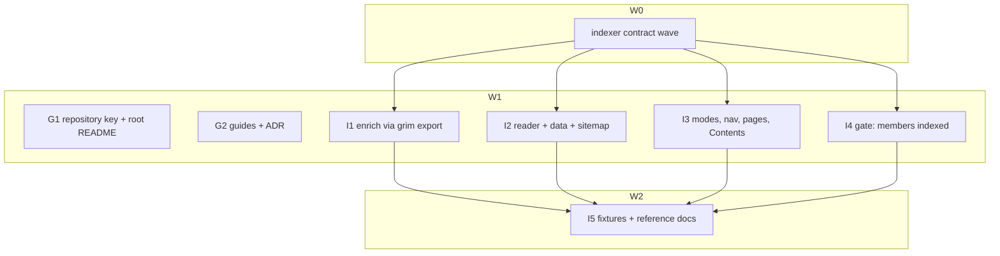

# Plan: Index-hosted marketplace — render, gate and deploy

## Status

- **Plan:** plan_marketplace_render_deploy
- **Active phase:** Execution complete — awaiting /hex-finalize
- **Step:** 7/7 pipelines merged; integration gate green; 2 review calls, 2 fix passes
- **Last update:** 2026-10-18 (grimoire task --force verify green; indexer tsc/lint/vitest 1100/build/smoke green)
- State:   review
- Tier:    high
- Tier-grammar: 5
- Updated: 2026-10-18
- Next:    /hex-finalize
- Repos:
  - `grimoire` /home/mherwig/dev/grimoire-duo  trunk `hex/adr-harness-marketplace-export`  base `34f06a89` (feature branch `hex/plan-marketplace-render-deploy`)  landed: no
  - `indexer` /home/mherwig/dev/grimoire-duo/.agents/worktrees/indexer-mkt  trunk `feat/marketplace-enrich-landing`  base `0d15844`  landed: no

---

## Overview

**Status:** Approved (owner, 2026-10-18 — revised after review of the export/render/deploy split; supersedes `/home/mherwig/.claude/plans/toasty-questing-clock.md`)
**Issue/Ticket:** grimoire-rs/grimoire#177, grimoire-rs/indexer#10 (both open, unreleased)
**Related ADR:** `.agents/adr/adr_harness_marketplace_export.md` (D10 landing page, D13 scope — amended here)
**Research reused:** `research_url_marketplace_trust.md`, `research_marketplace_hosting_prior_art.md`
**Scope:** medium · **Reversibility:** two-way (nothing here is released)

## Objective

Owner model, per department:

- **Index repository** = source of truth: package pointers (today) **plus `marketplace.toml` + `marketplace.lock`**. Teams publish bundles through their own pipelines and add a plugin with one PR (`include = ["…/team-kit:1"]`); the scheduled `grim update --marketplace` rolls floating tags.
- **Index CI** builds the site (packages, marketplace, or both) and pushes `grim export marketplace` output to a **sibling marketplace repository** — a deploy target only, git, default branch. No branches, no HTTP-hosted marketplace.
- **Every registry member of a plugin is a package of the same index** (enforced by the index gate); the plugin page lists them in a Contents tab linking to their package pages.
- **The exported repository explains itself**: `grim export marketplace` writes a root `README.md` with per-harness add commands, so a marketplace repo without Pages (GitLab, Bitbucket, GitHub Enterprise) still tells users what to do.

The indexer today downloads a foreign marketplace from GitHub (`marketplace.url`, raw fetch, checkpoint member) — removed. It now exports the repository's own `marketplace.toml` with `grim` during enrich, like it describes packages with `grim describe`.

## Scope

### In Scope

- grimoire: `[marketplace].repository` key; generated root `README.md`; guide: department layout, private-repo auth per harness, sibling-repo CI recipe; ADR amendment.
- indexer: remove remote fetch; enrich runs `grim export marketplace`; three site modes and lowercase nav; plugin Contents tab; gate rule "members are indexed packages".

### Out of Scope

- Branch-targeted marketplaces, HTTP/Pages-hosted marketplaces, a standalone marketplace mini-site, `grim publish --announce` for plugins, a company-wide aggregate marketplace (same pattern with one more index; no new mechanism).

## Component contracts

### grimoire

- **C-001 `[marketplace].repository`.** Optional string in `marketplace.toml`: the https clone URL consumers add (`validate_repository_url`: https, no userinfo; else exit 65 `Manifest`). Not emitted into any harness file. Documented in `configuration.md`, `commands.md`, schema.
- **C-002 Root README.** `grim export marketplace` writes `<output root>/README.md` whose first line is exactly `<!-- generated by grim export marketplace; edit marketplace.toml instead -->`. Ownership: written when absent or when its first line is that marker; any other existing `README.md` is left untouched with one warning (`README.md is not grim's; leaving it`), never an error, also under `--force`. Unselected-client and rename rules do not touch it. Deterministic bytes; a rerun reports it `unchanged`.
- **C-003 README content**, in order: `# <marketplace name>`; description; owner name and email/url when declared; `## Add this marketplace` with one subsection per **selected** client, command per the table below using `repository` (absent → the literal `<clone URL of this repository>` and a one-line note to set `[marketplace].repository`); `## Plugins` table: name, description, version; `## Private repositories` one paragraph (clients clone with the machine's git — credential helper or SSH agent; link to the use-a-marketplace guide); on-ramp line. All interpolated text escaped like the plugin README's member descriptions (`family::contents_line` escaping).

  | Client | Add | Install |
  |---|---|---|
  | claude | `claude plugin marketplace add <repository>` | `claude plugin install <plugin>@<name>` |
  | copilot | `copilot plugin marketplace add <repository>` | `copilot plugin install <plugin>@<name>` |
  | codex | `codex plugin marketplace add <repository>` | `codex plugin add <plugin>@<name>` |
  | qoder | `qoder plugins marketplace add <repository>` (append `.git` when the URL host is not github.com and it does not end in `.git`) | `qoder plugins install <plugin>` |
  | cursor | prose: an administrator imports `<repository>` as a Team Marketplace, or `cursor-agent plugin marketplace add <repository>` interactively | — |

- **C-004 Report.** The README appears in the JSON `files` array with `client: null` and the existing action literals; a left-alone foreign README is not listed.

### indexer

- **C-005 Config.** The `marketplace` key is removed (`index.config.json` carrying it → config error "marketplace was removed; commit marketplace.toml at the repository root"). A marketplace exists iff `<root>/marketplace.toml` exists.
- **C-006 Enrich export.** `enrichMarketplace(root, run: GrimRunner)`: when `marketplace.toml` exists, run `grim export marketplace --marketplace <root>/marketplace.toml -o <root>/enrich/marketplace/export --force --format json`; on success keep the export tree and the report; on failure keep the previous export (enrich never fails for it) and log the error. If the run rewrote `marketplace.lock` (bytes differ before/after), warn `marketplace.lock was stale; run grim update --marketplace and commit it`. Parse `[marketplace].repository` (`smol-toml`) and the lock's members per plugin (`{kind, name, ref}`, `ref` = `pinned` minus `@sha256:…`; path members dropped). Store `enrich/marketplace/meta.json` `{repository?, members}`. Checkpoint pack/seed carries `enrich/marketplace/` as before (local files now). No network request other than the `grim` child.
- **C-007 Reader.** `readMarketplace(root): LocalMarketplace | null` from `enrich/marketplace/export/.claude-plugin/marketplace.json` (else `.qoder-plugin/`), plugin `source` resolved under the export dir with containment (`..`, absolute, symlink escape → plugin skipped + warning), `README.md`/`CHANGELOG.md` ≤ 256 KiB, `assets/logo.*` via `validLogo`; plus `meta.json`. Shape `{name, repository, clients, plugins: [{…MarketplacePlugin, members: [{kind,name,ref,href?}]}], docs, logos}`; `href` = `/p/<ns>/<name>/` when `ref` equals an indexed package's ref.
- **C-008 Mode.** `siteMode(packageCount, marketplace)` → `packages` (no marketplace) · `both` · `marketplace` (zero packages). `GrimoireData.{siteMode, marketplace}` plain JSON.
- **C-009 Nav.** `ResolvedSiteConfig.nav: NavLink[] | null`; `navFor(nav, docsUrl, repoUrl, mode)`: explicit nav wins; `both` → `packages` `/`, `marketplace` `/marketplace/`, then docs/repo; other modes → docs/repo only. Labels lower case.
- **C-010 Routes.** `packages`: `/` and `/p/` byte-identical to base. `both`: `/` packages, `/marketplace/` marketplace view. `marketplace`: `/` marketplace view, no `/marketplace/` page. With a marketplace: `/marketplace/<plugin>/`, `/marketplace/all.json`; sitemap per mode. Add-marketplace bar uses `repository`; absent → bar shows "set [marketplace].repository in marketplace.toml" instead of commands.
- **C-011 Contents tab.** Plugin page Contents tab lists members (KindMark, name, ref); linked when `href`, plain otherwise.
- **C-012 Gate.** `validate` on a change touching `marketplace.toml` or `marketplace.lock`: every registry member (`include` refs and lock `pinned` refs, digest/tag stripped) must equal the `ref` of a package in the index (after the change); else a validation failure naming plugin and ref. Path and `project` members are refused in an index-hosted marketplace.

## User-experience scenarios

- **S-001** Department index with packages + `marketplace.toml` → nav `packages | marketplace`; plugin page shows README, changelog, Contents with links to package pages; add bar shows the four commands with `repository`.
- **S-002** Index repo with only `marketplace.toml` → `/` is the marketplace; no tabs.
- **S-003** Team PR adds a plugin including a bundle not in the index → gate fails naming the ref.
- **S-004** Index CI exports into a checkout of the sibling marketplace repo and pushes; its GitLab front page is the generated README with add commands.
- **S-005** Curator keeps a hand-written README in the marketplace repo → export leaves it, warns once.
- **S-006** Stale `marketplace.lock` during enrich → site renders, warning tells the curator to update and commit.
- **S-007** Old `index.config.json` with `marketplace` → build fails with the migration message.

## Error taxonomy

grimoire: bad `repository` → 65. indexer: removed config key → config error; enrich export failure → warning, previous export kept; escaping/oversized plugin content → skip + warning; gate violation → validation failure.

## Trade-offs

- Indexer input: **`marketplace.toml` via `grim export` in enrich** (chosen; same grim-runner pattern as `grim describe`, ecosystem-internal) vs reading a foreign `marketplace.json` (generic, but no lock, no gate, no member links).
- Foreign root README: **leave + warn** (chosen; never destroys curator text) vs 65 unless `--force` (consistent with marketplace files, but breaks existing repos with a README).

## Contract wave (indexer, serial)

Owns `src/config.ts`, `test/renderer/config.test.ts` (C-005 implemented, C-009 `nav` null). Stubs: `src/marketplace/read.ts` (types, pure helpers moved from `src/enrich/marketplace.ts`: `parseMarketplace`, `relativeSource`, `validLogo`, caps; stub `readMarketplace`, `siteMode`); `src/enrich/marketplace.ts` export signature `enrichMarketplace(root, run)` stub; `src/renderer/types.ts` `GrimoireData.{siteMode, marketplace}`; `src/renderer/astro/lib/nav.ts` `navFor` stub; importers re-pointed (`renderer/index.ts`, `renderer/types.ts`, `astro/lib/marketplace.ts`); `content.config.ts` second base `<stage>/marketplace-docs/<plugin>/{readme,changelog}.md`, id `marketplace/docs/<plugin>`. `tsc` green; `test/marketplace/contract.test.ts` failing until pipelines land.

## Parallelization

| id | Repo | scope | expected files | wave | depends-on | marks | status |
|---|---|---|---|---|---|---|---|
| G1 | grimoire | C-001…C-004, S-004, S-005 | `src/export/{marketplace,marketplace_export,family}.rs`, `src/api/export_report.rs`, `test/tests/test_export_marketplace.py`, `docs/src/content/docs/{configuration,commands}.md` | 1 | — | review | merged |
| G2 | grimoire | S-001, S-003, S-004 (docs) | `docs/src/content/docs/guides/{hosting-a-marketplace,use-a-marketplace}.md`, `docs/src/content/docs/{package-index,tutorials/own-index}.md`, `docs/astro.config.mjs`, `.agents/adr/adr_harness_marketplace_export.md`, `.claude/rules/vendor-capability-watchlist.md` | 1 | — | — | merged |
| I1 | indexer | C-006, S-006 | `src/enrich/marketplace.ts`, `src/enrich/checkpoint.ts`, `src/cli/enrich.ts`, `src/data/index.ts`, `package.json`, `test/enrich/marketplace.test.ts`, `test/enrich/checkpoint.test.ts` | 1 | CW | — | merged |
| I2 | indexer | C-007, C-008, C-010 (data, sitemap), S-007 | `src/marketplace/read.ts`, `src/renderer/index.ts`, `test/marketplace/read.test.ts`, `test/renderer/build.test.ts` (marketplace blocks) | 1 | CW | review | merged |
| I3 | indexer | C-009, C-010 (pages), C-011, S-001, S-002 | `pages/index.astro`, `components/MarketplaceView.astro`, `pages/marketplace/*`, `lib/{marketplace,plugins,nav,commands}.ts`, `components/{SiteHeader,PackageDetail}.astro`, `test/renderer/marketplace_modes.test.ts`, `test/renderer/marketplace.test.ts` | 1 | CW | — | merged |
| I4 | indexer | C-012, S-003 | `src/validate/**`, `test/validate/**` | 1 | CW | — | merged |
| I5 | indexer | S-001, S-002 end to end | `test/fixtures/dev/**` (`marketplace.toml`, lock, seeded `enrich/marketplace/`), `scripts/dev.mjs`, `docs/reference/{config-schema,cli}.md` | 2 | I1, I2, I3, I4 | — | merged |

Critical path: CW → I2 → I5. Shippable after wave: 2 — department index renders and gates its marketplace; grim export writes a self-describing marketplace repo. Heavy gates (`task verify`, Windows rig) one at a time (hex.md pitfall).

### Steps

**G1** 1. Tests first: `repository` validation, README bytes for a sample (all clients, absent repository, escaping), ownership (absent / marker / foreign kept + warning / `--force` still keeps foreign), rerun unchanged, report entry. 2. Implement in `marketplace_export.rs` beside the marketplace-file writer; reuse `contents_line` escaping. 3. Docs keys. 4. `cargo fmt`, `task verify`.

**G2** 1. Hosting guide: department layout section (index repo holds `marketplace.toml`, teams add bundle entries, scheduled update); sibling-repo deploy recipe (index CI checks out the marketplace repo, `grim export marketplace -o <checkout>`, gate + commit/PR there; adapt the gate script's output-root assumption). 2. use-a-marketplace: private repos per harness (git credential helper / SSH agent; Claude documented; Copilot regression #4103; Codex/Qoder unverified; Cursor admin import; local-clone fallback; Artifactory hosts no pushable git). 3. Index pages link the marketplace section. 4. ADR amendment: D10 (index renders its own `marketplace.toml`), D13 (git default branch only; branches and HTTP out of scope), README ownership. 5. `task verify`, `task docs:check`.

**I1** 1. Delete the remote fetch (`githubRepo`, `fetch*`, URL store binding). 2. `enrichMarketplace` per C-006 with a fake `GrimRunner` (success, failure keeps previous, stale-lock warning, path members dropped). 3. Checkpoint carries the local tree. 4. `compileIndex` tolerates a missing `index/` (test). 5. `smol-toml` direct dep.

**I2** 1. `readMarketplace` per C-007 (fixture export trees written in-test: Qoder fallback, escapes, caps, member `href`). 2. `resolveInputs`: `siteMode`, `GrimoireData.marketplace`, docs staged, logos, sitemap per mode. 3. Rewrite `build.test.ts` marketplace blocks. 4. Build from `dist` (`test/package.test.ts`).

**I3** 1. Extract `MarketplaceView.astro`. 2. `index.astro` per mode; `/marketplace/` only in `both`. 3. `navFor` + lowercase. 4. Add bar from `repository` (C-010 absent case). 5. Contents tab (C-011). 6. Mode tests incl. packages-only byte-identical.

**I4** 1. Locate the validate pipeline's changed-path handling. 2. Rule per C-012 with tests (indexed ok, missing ref, path member, project member, lock-only change). 3. Message names plugin + ref.

**I5** 1. Dev fixture: `marketplace.toml`, `marketplace.lock`, seeded `enrich/marketplace/` (export tree + `meta.json`) whose members are fixture packages. 2. A marketplace-only test root. 3. Reference docs: drop `marketplace` config key, document `marketplace.toml` at root and enrich behaviour. 4. `npm run dev:smoke`, build from `dist`.

## Open questions

None — README ownership resolved by the trade-off above (leave + warn).

## Verification

- grimoire: `task verify`, `task docs:check`; real run: export a sample with `repository` set, read root `README.md`.
- indexer: `npx tsc --noEmit`, `npm run lint`, `npx vitest run`, `npm run build` + build from `dist`, `npm run dev:smoke`, `npm run dev` on the fixture in `both` and marketplace-only modes.
- End to end: dev index with `marketplace.toml` → `npm run enrich` (real `grim`) → build → plugin page Contents links resolve.

## Commits (finalize)

grimoire (`--signoff`): `feat(export): write a marketplace README with each harness's add command`; `docs: host a department marketplace from its index repository`.
indexer: remote-fetch enrich commit folded into `feat(enrich): export the repository's marketplace.toml with grim`; renderer commit reworded `feat(renderer): render the index's marketplace beside or instead of its packages`; `feat(validate): require marketplace members to be indexed packages`.

## Execution log

- **Q:** the plan carries a `Repo` column but `hex.md` declares no `Federation:` bullets (federation.md would halt). **Research:** the meta-orchestrator assigned both repos and their branches explicitly (grimoire `hex/plan-marketplace-render-deploy`, indexer worktree branch `feat/marketplace-enrich-landing`, no new per-repo `hex/<slug>` branch). **Decision:** proceed without the halt; the `Repos:` ledger above is the frozen base record; no satellite back-pointer is written; indexer commits carry no `Hex-Plan:` trailer (finalize subjects are the plan's).
- **Layout:** indexer contract wave runs on `feat/marketplace-enrich-landing` directly; I1–I4 in worktrees `.agents/worktrees/mkt-i{1..4}` (branches `feat/marketplace-enrich-landing--i{n}`); I5 on the indexer branch after they merge. G1 (cargo-heavy) runs on the grimoire feature branch in the main checkout (disk pitfall); G2 (docs) in `.agents/worktrees/mkt-g2`.
- **Contract wave** `36fe802` + `769f49c` (meta `clients` added so I2 need not guess clients from file presence; I1 fills it from the report's `files[].client`).
- **Q:** I4 exempted root `marketplace.toml`/`marketplace.lock` from the path gate, making a member-valid marketplace PR auto-merge eligible with no ownership check on plugin entries. **Research:** indexer `docs/explanation/security-and-trust-model.md` — anything outside `index/` is repository content and falls to manual review; plugin entries have no owner model. **Decision:** marketplace changes stay manual review (path gate unchanged for them); the member rule still runs and adds its reasons so the reviewer sees S-003's failure. Documented in the trust-model page.
- **README link anchor:** G2 gave the private-repo heading `{#private-repositories}`; G1's README link was re-pointed to it.
- **Review r1** (`/hex-review` high, 7 seats + codex): 5 Block, ~35 Warn → fix pass 1 (6 fixers). **Review r2** (medium): all 5 Blocks closed, 6 Warn → fix pass 2. Codex unavailable in r2 (usage limit).
- **Contract amendments from execution** (living record):
  - C-001: `[marketplace].repository` also refuses a query or fragment; the shared `validate_repository_url` now rejects a host-less URL (`https:///u:t@h` reads as userinfo to URL parsers) — a security tightening, no URL with a host changes behaviour.
  - C-002: a README case variant (`readme.md`) or a symlink is foreign; ownership is re-checked immediately before the write; the marker line may end in one `\r`.
  - C-003: `repository` is shell-quoted in `sh` fences unless every character is inert (`[A-Za-z0-9-._~:/@%+=,]`); the indexer's add bar uses the same set and Qoder `.git` rule.
  - C-006: grim exports into `enrich/marketplace/export.next`, swapped over `export/` with `meta.json` only on success (10-minute timeout); `meta.json` = `{repository?, clients, members}`; a bundle include is one member `{kind: "bundle", name, ref}`, its constituents are not listed.
  - C-007: doc/logo caps 1 MiB (match grim); listings fall back across all five client files; `null` when `marketplace.toml` is absent; route-colliding plugin names refused; marketplace `name` and `repository` charset-checked.
  - C-008: `siteMode(packageCount, marketplace, listedPlugins)` — zero listed plugins never takes over a zero-package index.
  - C-012: marketplace changes stay manual review (see above); bundle lock rows require the bundle to be indexed.
