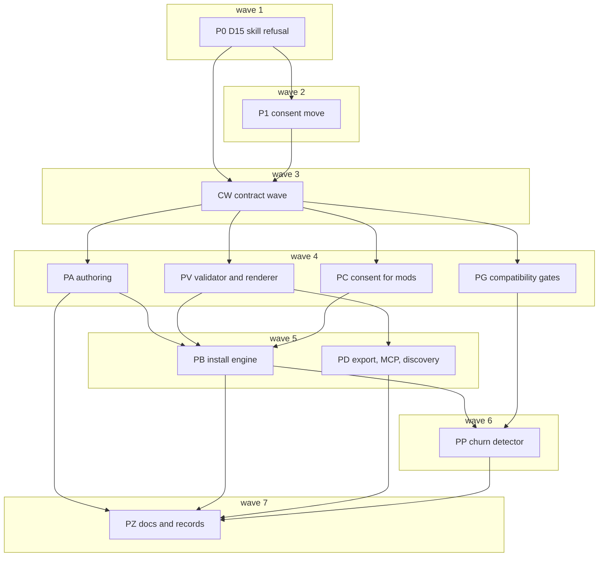

# Plan: The experimental `mod` artifact kind

## Status

- **Plan:** plan_mod_artifact_kind
- **Active phase:** every "must close" criteria-audit item closed (items 3, 4 and the project half of 7 in the last entry); offline install of an installed mod checked green. Follow-up issue grimoire-rs/grimoire#386 was closed in the same pull request (last Schedule log entry); the branch awaits a re-finalize. Resume point: § Schedule log last entry
- **Step:** /hex-execute → /hex-finalize
- **Last update:** 2026-11-23 (uncommitted, before the re-finalize)
- **Finalize:** release gate green on the final tree (`task --force verify`, `task docs:check`); the series is five Conventional Commits; remote check results are in the pull request's finalize ledger.
- State:   review
- Tier:    xhigh
- Tier-grammar: 5
- Updated: 2026-11-19
- Reviewed: 36f69cae8f7ee138be5c26a243bc06004c0e30f9
- Next:    /hex-finalize

---

## Header

- **Goal contract (binding):** `.agents/goals/adr-mod-artifact-kind.md`. Autonomy: never prompt; a doubt is resolved by research and recorded here (§ Decisions taken while decomposing). Granted acts: none, so a push, a PR or issue act, a workflow dispatch and every act in another repository go to the meta-orchestrator (§ Acts outside this run's grants).
- **Run rule (goal § Rules):** the plan includes the fix for "skill package carrying Claude plugin code is refused at build, publish and install". It is pipeline P0, the first to land, on this branch, in this PR.
- **Source ADR:** `.agents/adr/adr_mod_artifact_kind.md`, decisions D1 to D15, `Status: Proposed`. The owner started this run on it with every open question ruled (ADR § Open questions), and the ADR passed a spec, quality, security, research and cross-model review with one re-validation (`hex.md` › Memory, 2026-11-18). This plan reopens no ADR decision; it decomposes them. Flipping the status to Accepted stays the owner's act (goal § Recorded decisions, 3rd).
- **System design:** `.agents/specs/design_mod_artifact_kind.md` (flows § 5, data shapes § 6, touch list § 9, tests § 10, phases § 12). Shapes are cited, not restated.
- **D15 design:** this plan's § P0 design, by class only (goal § Issue resolution, item 7). ADR D15 leaves the mechanism to the bugfix's own plan; the run rule makes P0 that plan.
- **Research (read-only, not committed by this run):** eleven of the twelve `research_mod_kind_*.md` and `research_harness_mods_*.md` files in the starting checkout's `.agents/research/`; the twelfth is unpublished and was not read. Committing them is the goal file's decision, after a class-only check. Not repeated.
- **Discover inputs:** six read-only reports at HEAD `8e54b636` (architecture map re-check, kind identity and authoring, consent and install, export and test infra, the D15 seams, docs and records). Not committed. Facts this plan relies on are cited as `file:line`.
- **Branch and trees:** `hex/adr-mod-artifact-kind` from `origin/main` (v0.16.0). The run's worktree `.agents/worktrees/adr-mod-artifact-kind` is the integration tree. Pipeline workers use at most three edit-only worktrees under `.agents/worktrees/<pipeline>`, each after `git submodule update --init --recursive` (a fresh worktree has empty `external/` dirs).
- **Classification:** large scope · one-way door (high: kind token and position, layer layout, `mod.toml` grammar, annotation, lock row field, consent record path, key and version, report keys, status and reason literals, files grim writes into Claude and OpenCode folders; P0's `skill-plugin-manifest` slug at index 10, the URL anchors `#skill-plugin-manifest` and `#promise-skill-plugin-manifest`, and the D15 name rule, which can be narrowed later but not widened without a second break) · tier xhigh (auto) · `architect=on` for the D15 design only · `research=skip` · `adversary=on`.
- **Tracking:** no open issue or PR covers this work (`gh issue list --state open`, `gh pr list`, read 2026-11-19). Nearest: #303 (the indexer must accept a new kind before grim announces one, the release-order precedent for F-2) and #329 (retry the 0.15.1 download in CI, touches the old-grim step PG extends).
- **Gate command:** `env -u OCX_GLOBAL -u OTEL_EXPORTER_OTLP_ENDPOINT -u OTEL_EXPORTER_OTLP_HEADERS task --force verify` in the integration tree. A set `OCX_GLOBAL` breaks it; `--force` because a cached run exits 0 with no tests. Docs: `env -u OCX_GLOBAL task docs:check` (Node 24). Python tools run as `/usr/bin/python3`. Read the real exit code, never one wrapped by `; echo`. Mid-step, use the narrowest command (`cargo test <filter>`, `uv run pytest <file> -k <name>`).
- **Host limits:** about 12 GB free disk (98%); one shared cargo target; never two cargo builds at once (a run-local `lane.sh` wraps every cargo call in one `flock` and a 900 s `timeout`, the precedent in `plan_install_record_cache.md` § Notes); at most three edit-only worker worktrees; full test runs only in the integration tree; no Windows side, so Windows proof comes from CI.

## Objective

A publisher ships native harness code as a `mod`: one layer with a `claude/` and an `opencode/` directory. A consumer declares it, consents to the workspace once, and grim writes the code under a grim-owned `src/` directory, generates each client's wrapper with a serializer, and registers it where the client loads it. Grim removes it again on revoke, flag off, drift, `--no-trust-workspace` and uninstall, with no network. Before the kind lands, the shipped skill kind stops accepting content that reaches client-loaded code (D15). The consent record moves to one kind-free record for every gated kind (D6). Everything ships behind `[options.experimental] mods`, additive only apart from the one owner-authorised exception D15 records.

## Scope

**In:** ADR D1 to D15 in full; ADR § Migration and rollout items 1 to 9 (order, flag, consent move, older grims, the churn detector job, docs, catalog drift, AI config, watchlist rows); ADR § Amendments 1 to 12; the design's § 10 test strategy; the upgrade fixture, old-grim checks against 0.15.1 and 0.16.0, and the Principle 9 differential.

**Out (ADR § Deferred):** committed Claude registration; a `schedule:` trigger for the load probe; per-entry kind in `HookConsentReport`; keeping a user's `enabledPlugins: false` across revoke and re-consent; an advisory cause for a same-named plugin from another origin; reading client logs or state; OpenCode TUI and GUI plugin parts; garbage collection of stores and records for deleted workspaces.

## Acts outside this run's grants

| # | Act | Owner of the act |
|---|---|---|
| F-1 | Teach `grimoire-rs/grimoire-vscode` the kind (ADR rollout 10, first bullet): admit and colour it, read `serves`, reuse the flag and consent prompts, reuse the settings harness chips | meta-orchestrator, other repo |
| F-2 | Teach `grimoire-rs/indexer` the kind (ADR rollout 10, second bullet): validation, `com.grimoire.mod.clients` into the record, harness badges and filter. It must ship before grim announces the kind (#303 precedent) | meta-orchestrator, other repo |
| F-3 | Push the branch, open the PR, dispatch `verify-deep.yml` (deep tier, including the `mod-load-probe` job), report each job | meta-orchestrator |
| F-4 | Download the v0.16.0 release asset and record its SHA-256 for PG's CI step | PG worker (a read of a public release, no remote write) |

## Human-only steps

| # | Step | Blocks |
|---|---|---|
| H-1 | The D15 confirmation run in a logged-in client (ADR D15, Migration item 1). No agent logs in to a client, touches a real `~/.claude`, or answers a trust prompt on a real directory. P0 does not wait for it; its verdict is recorded by class only, answers open question 1, and also checks the same content class inside a legacy rule support directory (`adr_rule_support_dir_removal.md` § Installing an old package). The PR body carries it as a merge-gate checkbox. If the run does not confirm the finding, the owner decides whether P0 still merges; dropping it means removing P0's `fix(skill)!:`, `docs:` and records commits before merge, re-pinning `invalid-mod` at index 10 in CW's slug tests, dropping PG's 0.16.0 leg of `test_old_grim_skill_plugin_manifest.py` with its `MODULES` entry and CI lines, and rebasing P1's `status.rs` hunk | nothing in this plan; it gates the owner's merge decision |
| H-2 | Flip `adr_mod_artifact_kind.md` to `Status: Accepted`. `test_no_adr_referenced_by_a_finalized_plan_stays_proposed` (`.claude/tests/test_ai_config.py:1951`) fails once this plan reads `Step: finalized` while the ADR is Proposed | `/hex-finalize` |
| H-3 | Decide a `schedule:` trigger for the load probe (recurring CI spend) | nothing (deferred) |
| H-4 | Run the logged-in probe items the no-login probe cannot answer (design § 10.3 items 8 and 9; item 10 needs a Copilot install) | nothing; recorded as unverified |

## Decisions taken while decomposing

Each row is a question met while planning, the evidence, and the decision. None reopens an ADR decision (goal § Issue resolution, step 2). Planner rulings, not owner decisions.

| # | Question | Evidence | Decision |
|---|---|---|---|
| PD-1 | Tier and gate | Classifier: new modules, frozen wire, lock and consent formats, an owner-authorised breaking change, large scope. `xhigh` blocks at the gate | Tier `xhigh`. Under the goal loop the gate never prompts (protocol § meta-plan gate): the announce block was printed and the recommended defaults taken |
| PD-2 | The ADR is Proposed: does the plan re-run an architect or research on D1 to D14? | Owner started the run on it; every question ruled; reviewed once (`hex.md` › Memory). "Each artifact is reviewed once" | No. D1 to D14 are decomposed inline. One architect seat ran for the D15 mechanism only, which the ADR leaves to the bugfix's plan |
| PD-3 | ADR rollout 1 orders the D15 fix, then the consent move, then the kind. How on one branch? | ADR Migration 1; the run rule (one branch, one PR) | P0 lands first, P1 second (PD-32), then the contract wave. `/hex-finalize` keeps that order: P0's commits first (`chore(agents):` index row, `fix(skill)!:`, its `docs:` and records), then P1's, then the kind |
| PD-4 | The branch has no ADR index row for the mod ADR | `test_every_adr_has_an_index_row` (`test_ai_config.py:1926`) requires one; `grep -c adr_mod_artifact_kind .claude/rules/arch-principles.md` is 0, and the test fails at `8e54b636` (`uv run pytest -k every_adr_has_an_index_row` in `.claude/tests`, run 2026-11-19); the allowlist is shrink-only | P0 step 1 adds the row as its own `chore(agents):` commit, so the first gate on the branch can be green |
| PD-5 | When do the ADR § Amendments land, given "applied on acceptance"? | Goal: implement as written; the status flip is the owner's | P0 applies amendment 1's D15 sentences; PZ applies amendment 1's mods sentence (the third scoped exception) and amendments 2 to 12, each marked with its date and the ADR. The PR merge is the owner's acceptance act, H-2 flips the status |
| PD-6 | Design § 6.8's error sample shows `"retryable": false, "forceable": false` | `error_document` (`src/main.rs:311-335`) emits them only when true | The code is the contract. `invalid-mod` documents carry neither key; PZ's `mods.md` example follows the code |
| PD-7 | The hook binding gate refuses with hook wording and reads `skipped` | `binding_name_refusal` `src/oci/hook.rs:261`, called inside `hook_gate` `src/install/installer.rs:961` | The mod gate is its own check with kind-neutral wording, exit 65, reason `invalid-mod` (ADR D3 rule 5). The hook gate is unchanged |
| PD-8 | `kind_support` defaults to `Native` and several vendors end in `_ => Native` | `vendor.rs:795`, `vendor_opencode.rs:174`, `vendor_kilo.rs:200` | CW adds an explicit `Mod` arm in `client_supports_kind` (`installer.rs:1748`) that answers false. PB flips Claude and OpenCode to `Native`, declines Kilo explicitly, and adds the `clients.md` matrix column with the parity test change (`client_target.rs:1080`) in that same commit (ADR rollout 6) |
| PD-9 | Unprefixed consent keys remove the only kind discriminator in a key set | `split_by_kind` `consent.rs:219`, `is_settings_key` `:224`, callers in `allow.rs`, `status.rs:2296`, `hook_consent.rs:358-490`, `policy.rs:501-530` | P1 moves the discriminator to the declaration: each kind's declared set is computed per kind from config and lock (`declared_consent_keys(kind)`), and checked against the one record set. `kind_enabled` and `add_would_record` take the kind as a parameter |
| PD-10 | Where does the per-row `clients` field live? | No lock row carries a kind-specific field (`src/lock/locked_artifact.rs:45-74`); every `LockedArtifact` literal breaks at compile (about 80 sites) | `LockedArtifact.clients: Vec<String>`, serialized only on `[[mod]]` rows, landed in CW. A `[[mod]]` row with no or empty `clients`, or another kind's row with one, makes the lock unreadable (78). `clients` stays out of `lists_content_equal` (`lock_io.rs:286`): the digest pins the annotation it was copied from |
| PD-11 | Silent writers drop new config | `add.rs:2300-2307` writes only `shared_skills`; `add.rs:2468-2473` emits tables by hand; `DesiredSet` `PartialEq` is an explicit chain (`declaration.rs:642`) | CW fixes all three with tests: a rewrite keeps `[mods]` and `plugin_api` |
| PD-12 | `[mods]` path values | `[hooks]` and `[settings]` are `PathValues::Rejected` (`project_config.rs:234`); ADR D1 "as for settings" | `[mods]` is `PathValues::Rejected`, so a path value exits at parse. A hand-edited path source in the lock never writes (`not-armed`, `not-registered`), checked in PB |
| PD-13 | `com.grimoire.requires-features` has no writer today | Only reader `src/oci/features.rs:16-175` | PA adds the writer with ADR D12's rule, and `KNOWN_FEATURES` gains `mods` |
| PD-14 | The pack walker drops symlinks silently and has 512 MiB / 10,000 / depth 64 limits | `collect_files` `skill_package.rs:632-715`; `PackLimits` `:495-546` | PA adds a Mod-only symlink refusal and a Mod `PackLimits` (16 MiB, 2,000 files, depth 16). Skill and hook behaviour is pinned unchanged by `pack_skill_dir_skips_symlinked_file_and_dir` (`:1382`) |
| PD-15 | `root_refusal` is private and returns a settings type | `settings_phase.rs:1176`, `SettingsDecline` | `pub(crate)`; the mod phase maps `RootRelative` and `RootInWorkspace` to the existing causes (ADR D5, deviation 5) |
| PD-16 | The mod store and the settings store | `settings_store.rs` constants and envelope (`:17-35`); 0.16.0 moves a settings file with an unknown field aside | New `src/install/mod_store.rs` with its own envelope `{v, workspace, records, shared}`. The generic helpers (`ensure_store_dir`, `write_owner_only`, `unusable_path`, `parse` shape) become `pub(crate)` and are reused; the settings envelope stays byte-identical, pinned by a unit |
| PD-17 | Global mod records | Settings keep global records inline in `global.json` (`SettingsStore::Inline`); ADR D5 forbids that for mods | A second store slot in `InstallState`; `discard_settings_records`' twin drops `Mod` records from both `state.json` and `global.json` with a warning |
| PD-18 | Where mod convergence runs | Hooks converge in `persist_and_converge` (`installer.rs:882`, callers `installer.rs:833`, `update.rs:402`, `tui/app.rs:3933`) and in `delete_nodes` (`src/command/uninstall.rs:675`, its `converge_for` call at `:749`); `persist_and_converge` holds no run value (PD-38) | The write half, the disarm half and the shared outputs run inside `install_and_persist` with the seat's `ModReach`, before the exit is decided, so every CLI and TUI path reaches them once per run; `delete_nodes` runs the disarm half and the shared outputs for `uninstall` and the TUI's Delete |
| PD-19 | Who owns pruning a mod record? | `prune.rs:242,495` exclude `Settings` | Mod joins the exclusion; the mod phase owns its disarm, so a generic prune never deletes a mod file without the ordered disarm |
| PD-20 | The `.claude/settings.local.json` exclude line | `ensure_settings_local_excluded` `hook_registrar.rs:2599` | Kept (ADR D5). Its "file still in use" predicate gains Mod. No exclude line for any mod output |
| PD-21 | The old-grim harness accepts only 0.15.1 | `test/src/old_grim.py:29-57`; CI step `verify-deep.yml:325-356` | PG adds `GRIM_OLD_BIN_0_16_0` with its own identity check (`grim 0.16.0` plus a refusal of `[mods]`, which a later dev build accepts), a second pinned download step, and the module in `test/taskfile.yml`'s `MODULES` list. Each test row runs against both binaries |
| PD-22 | The D10 probe needs real clients without a login | `research_mod_kind_load_paths.md` header: `claude -p hi --debug-file` loads plugins and fires `session.start` before "Not logged in"; `opencode run --standalone ... -m none/none` makes no model request. `test_settings_real_harness.py` has a strict environment allowlist and no OpenCode variable | A new opt-in module `test_mod_load_probe.py` with `GRIM_REAL_CLAUDE_BIN` and a new `GRIM_REAL_OPENCODE_BIN`, its own allowlist, a scratch `HOME` and config roots, trust pre-recorded only in the scratch config, `-m none/none` always. Items needing a session report a skip with its reason, never a pass (H-4). The CI job is `workflow_dispatch`, `continue-on-error: true`, outside `test-results.needs` |
| PD-23 | `verify-deep.yml`'s golden junit check pins `(24, 0, 24)` | golden step `verify-deep.yml:279`, tuple `:296` | PG updates the count and its comment for `test_golden_pre_mods.py`; P1's two changed golden tests keep the count |
| PD-24 | Docs timing | Owner feedback: one docs pass after the last code fix | PZ runs after every code pipeline. Exceptions: P0 ships its D15 docs obligations with its fix, and PB's `clients.md` matrix column ships with the vendor change (PD-8) |
| PD-25 | Model classes at execution | `hex.md` › Preferences overrides `builder:implement` to deep | Unchanged; `/hex-execute` resolves it. Marks below only raise a pipeline's floor |
| PD-26 | Contract tests in the wave or per step? | `decompose.md` puts them in the wave; precedent plans write them per step | CW writes tests for what it delivers. Each later step writes its named tests first and records the red run |
| PD-27 | AGENTS.md is at its 280-line budget | `test_ai_config.py:479-483`; `AGENTS.md` is 280 lines | PZ edits rows in place; no line is added |
| PD-28 | PA's packer and PV's validator both need the `mod.toml` parser, in one file | Two pipelines may not share a file (`decompose.md`) | Both parse modes and the packed serializer are real in CW (C-030, C-031), pure functions with units, so PA and PV depend on CW only |
| PD-29 | Consent behaviour that needs a written mod (revoke lines, first-write disclosure, the option B pin) cannot be proved before the write path exists | A negative test with no write path passes vacuously | PC delivers the policy and the record (units and record-content tests); C-062 and C-063 are proved in PB, which depends on PC |
| PD-31 | Which binary generates the upgrade fixture? | A fixture named after a feature-branch commit dies at `/hex-finalize` (`pre_settings_47da12f` points at a commit not on HEAD); `pre_dependencies_cdeedcaa` used a release commit; a second target directory costs several GB | PG generates `test/data/golden/pre_mods_1972e3b9/` from the v0.16.0 release binary it downloads (F-4), per `.agents/golden_fixture_generation.md`: no build, and it proves the real 0.16.0 upgrade. The comparison runs with `--trust-workspace`, so P1's owner-ruled consent re-ask does not read as drift |
| PD-32 | P0 and P1 both edit `src/command/status.rs` (P0: one stderr line for C-006; P1: the consent split at `:2296`) | Two pipelines may not share a file; status shares no proof seam with `installer.rs` (`gate_after_proof` is private to it) | P1 depends on P0. It costs one wave on the critical path; the alternatives (a shim keeping `split_by_kind`, or the D15 status line moved into CW) either keep dead API or split D15 across commits |
| PD-33 | D15 architect's third point: a status JSON cause for the C-006 state? | A cause is a frozen literal once shipped (`stability.md` § Additive fields) | No cause: one stderr line only (C-006). A cause can be added later, additively |
| PD-34 | Version named in D15 messages and docs | `Cargo.toml` is 0.16.0, the latest tag | "since grim 0.17.0", the next minor; the release run rechecks if another release intervenes |
| PD-35 | Two refused rows in one run | The install error path reports the first error (architect, not checked further) | Existing behaviour, unchanged: each refused row fails, the exit is 65, and the first refusal names itself; a rerun names the next. Recorded, not fixed |
| PD-36 | Cross-process serialization of the mod store, shared outputs and registration | `install`, `update`, `add` and `uninstall` take the scope's `ConfigFileLock` for the whole run (`install.rs:82`, `update.rs:135`, `add.rs:155`, `uninstall.rs:106`; the TUI's `config_guard`, `tui/app.rs:3053`, held at `:3387` and `:4449`); the settings plan relied on the same lock (`plan_settings_artifact_kind.md` PD-31) | Every mod write and disarm runs under that lock, so one scope's store, generated files and entries change in one process at a time; a project-scope store and settings file belong to one workspace, and global scope takes the global lock. A client writing a settings file between read and rename is caught by the writer's re-read (75). `grim consent allow` and `revoke` keep v1's discipline (atomic write, last writer wins), a named residual |
| PD-37 | Worker trees share one cargo target, so a worker's acceptance run could use another tree's binary | `lane.sh` precedent touches sources and builds under one `flock` | `lane.sh` also copies the freshly built `grim` into `<tree>/test/bin/grim` inside the same `flock`, and every pytest run in a tree sets `GRIM_COMMAND` to that copy, so a red run and its positive control use the tree's own binary |
| PD-30 | `PZ` and authoring | PA changes CLI surfaces the catalog skills describe | PZ depends on PA too, so the drift review sees the final `build` and `publish` behaviour |
| PD-38 | The mod phase's reach | `SettingsRun` cannot carry it: `grim add` passes `SettingsRun::Full` (`add.rs:1358`) and so does the TUI's Install (`tui/app.rs:3695`), yet ADR D8 says `add` prunes only its previous closure; `persist_and_converge` (`installer.rs:882`) holds no run value | A separate `ModReach::{Full, Closure { install, prune }, Skip}` that CW attaches at every seat beside the policy (`install.rs:136,430`, `update.rs:283,1577`, `add.rs:1358`, `tui/app.rs:3688-3695,4604`): bare `install` and `update` and the TUI's Install are `Full`; a named `update`, the TUI's Update and `add` are `Closure` (`add`'s prune set is its target's previous closure); dev install and dev refresh are `Skip` (no mod write, no mod disarm: mods have no path source). The mod halves run inside `install_and_persist`, where the reach is in scope, before the exit is decided; `delete_nodes` runs the disarm half for `uninstall` and the TUI's Delete. Settings' `Full` behaviour is unchanged |
| PD-39 | `task p9:diff` builds `origin/main` into a second target (`taskfiles/p9.taskfile.yml:76`) | `origin/main` is the v0.16.0 tag commit `1972e3b9`; the task's cache check (`:62`) accepts a binary at `target/p9/bin/grim-<MAIN_SHA>-<TOOLCHAIN>` | Phase V pre-seeds that path with the v0.16.0 release binary (F-4) when `origin/main` still equals the tag; otherwise `p9:diff` is left to the CI deep run (F-3) and the record says so |
| PD-40 | ADR D1 says path sources "declare and lock, never written … as for settings"; settings refuse a path value at parse | `project_config.rs:234`; `plan_settings_artifact_kind.md` PD-3 read the same sentence the same way | PD-12 stands: refused at parse, and a hand-edited path source in the lock is never written (C-052) |

## Open questions

Each carries the recommendation the run takes unless the owner overrides it.

1. [NEEDS CLARIFICATION: does the D15 refusal cover deeper positions in a skill tree, or the root only?]
   Recommended: root only (C-002, C-003) — a deeper refusal would also refuse skills that ship plugin templates, and widening after release is a second breaking change. Widen before merge only if H-1's verdict covers a deeper position; P0's commits are its own, so a widening touches no later pipeline.
2. [NEEDS CLARIFICATION: on an upgraded machine, should grim delete the files it wrote for a skill it now refuses?]
   Recommended: no, keep them and refuse every install-type run (C-006) — the ruling grants a refusal, not a deletion; an older grim on the same machine would restore them, so the two would flip-flop. A removal can be added later without a format change; a deletion cannot be taken back. `upgrading.md` states the residual.

## Traceability to the source

| ADR decision | Pipelines | Contracts | Scenarios |
|---|---|---|---|
| D1 Wire and declaration | CW, PA, PB | C-020…C-024, C-030, C-033…C-035, C-052 | S-001…S-004, S-030 |
| D2 Descriptor and layout | CW, PA, PV, PB | C-030…C-032, C-037, C-040, C-059 | S-001, S-032 |
| D3 Install-time re-validation | CW, PV, PB, PD | C-037, C-040, C-042, C-051, C-053, C-071 | S-017, S-018 |
| D4 Generated files and locations | PV, PB | C-041, C-054, C-055 | S-004, S-005, S-007 |
| D5 Invariant I1 per client | PB, PZ | C-050, C-054, C-058, C-084 | S-016, S-022 |
| D6 Consent | P1, CW, PC, PB, PZ | C-010…C-017, C-027, C-060…C-063, C-082 | S-006, S-019, S-026 |
| D7 Shared Claude files and keys | PB, PA | C-036, C-054, C-056 | S-008, S-015, S-021, S-029 |
| D8 Lifecycle | PB | C-056, C-057 | S-009…S-014, S-023, S-033 |
| D9 Supported clients from the artifact | CW, PB, PD | C-024, C-026, C-052, C-058, C-070, C-073 | S-004, S-005, S-030 |
| D10 Class 3 and the churn detector | PP, PZ | C-090, C-091, C-083 | S-034 |
| D11 Kind order | CW, PA | C-020, C-034, C-035 | S-002 |
| D12 Older grims | PA, PG, PP, PZ | C-033, C-080, C-081, C-092, C-082 | S-027 |
| D13 Export | PD | C-070…C-073 | S-024, S-025 |
| D14 Stability | CW, PG, PZ | C-025, C-026, C-081, C-082, C-084 | S-028 |
| D15 Prerequisite fix | P0 | C-001…C-009 | S-031 |

## Design guarantees

### Backwards compatibility (Principle 9 gate)

Additive only, except the two recorded deviations below: D15, and the consent move. A project without mods keeps its lock, state and config bytes, and its reports differ only by `serves: null` (ADR Driver 2); a workspace that holds hook or settings consent re-asks once, because the record moved (ADR D6).

| Surface | Change | Proof (test, owner) |
|---|---|---|
| OCI wire, every existing kind | None | existing golden and release tests stay green (CW, PA) |
| A skill carrying the D15 content | **Refused at build, publish and install** (D15) | P0 tests and upgrade fixture; `upgrading.md`, `stability.md` (P0) |
| `grimoire.lock`, no mods | Byte-identical | `test_golden_pre_mods.py` from the v0.16.0 binary (PG), `grimoire_lock.rs` snapshot (CW) |
| `grimoire.lock`, mods | `[[mod]]` when non-empty, `clients` on its rows only; `lock_version` stays 1 | byte-exact unit, `lock.schema.json` golden (CW) |
| `grimoire.toml` | `[mods]`, `[options.experimental] mods`, `[options.vendors.opencode] plugin_api`; hash unchanged when the table is empty | `hash.rs` unit, `test_golden_pre_hooks.py` stays green (CW) |
| `.grimoire/state.json`, `global.json` | Never hold a mod record; byte-identical without mods | PG golden; `install_state.rs` units (PB) |
| Consent record | **Moves** to `$GRIM_HOME/consent/`, `v: 2`, `sources`, unprefixed; an old record is not honoured (ADR D6, owner ruling, no import) | P1 units and `test_consent_v2.py`; the two changed golden tests (P1); `upgrading.md` (PZ) |
| `HookConsentReport.hooks` | Keeps its name, carries every kind's entries (ADR deviation 4); settings entries lose their `settings:` prefix and `record` names the new path, both inside the experimental surface (`stability.md` § Unstable, `:533`, `:585`) | `api/hook_report.rs` unit (P1) |
| Settings documents | A marketplace name starting with `grim-mods` refuses (D7), inside the experimental settings surface (`stability.md:585`) | C-036 (PA) |
| Reports | `serves` always present on `status` items, `describe`, `search` items, `null` outside mods | `status_report.rs`, `search_report.rs`, `fetch.rs` units (CW); p9 key (CW) |
| `ErrorReason` | `skill-plugin-manifest` (index 10, P0), then `invalid-mod` (index 11, CW) appended | `c031_4_no_new_error_reason_slug` and `c021_exit_codes_and_reasons_equal_main` extended by appending (P0, CW) |
| Status causes | `mod-files-tracked`, `mod-files-present`, `mod-disabled-in-client` appended, advisory | `artifact_status.rs` units (CW) |
| `grim config list` | Two rows appended (`experimental.mods`, `vendors.<name>.plugin_api`) | config-keys units by appending (CW) |
| `--kind` value lists | `mod` appended in every parser | parser units (CW) |
| Export, every plugin that stages no mod | Unchanged exit codes and bytes | every existing export test stays green unedited; `test_mod_export.py::test_skills_only_plugin_inside_claude_exits_0` (PD) |
| Flag-off differential | Stdout differs by the closed additive keys only | `test/tools/p9_diff.py` (CW), `task p9:diff` (Phase V) |
| Subcommands | 26 stays 26 | `command_name.rs` table unchanged |

### Constitution deviations

| Violation | Why needed | Simpler alternative rejected because |
|---|---|---|
| Principle 9: skills carrying the D15 content stop building and installing | Owner ruling 2026-11-19, "refuse, at publish and consume" (ADR D15); the route stays open otherwise | (a) dropping the fix and (c) disclosure only were offered and not chosen (ADR D15 table) |
| Principle 9: an old consent record is not honoured | Owner ruling 2026-11-18, no import (ADR D6, rejected option with its cost) | An import path is security-relevant code for a one-time re-ask; CI is unaffected |

### TDD approach

Every step runs **Specify, Implement, Self-check**:

1. **Specify:** write the tests named in the step's contracts, from this plan and the ADR, not from code. Record the red run.
2. **Implement:** until the step's tests and the touched existing tests pass.
3. **Self-check:** the narrowest command, and one empirical mutation per contract: change one token, show a named test fails, revert.

Rules every step follows:

- A stale `test/bin/grim` passes negative tests vacuously, so every "nothing was written" assertion carries a positive control in the same test.
- Plan IDs stay out of source, test names and comments (code-docs LNK-01).
- Fixtures are pushed by `make_mod` or `push_manifest`, never by the grim under test.
- No test touches a real `HOME`; client roots are redirected (`settings_sandbox` precedent, `test/src/helpers.py:452`), and `test/conftest.py:249-293` keeps guarding managed Claude settings.
- No test runs a client binary except `test_mod_load_probe.py`, opt-in.
- D15 tests and their names describe what is refused, never how a client loads it.

## Component contracts

Each row adds placement, behaviour and the named test to the ADR's statement. Shapes not restated here live in the design (§ 5 flows, § 6 tables, § 10.3 probe items) and in the ADR's D12 table; those sections are part of each contract that cites them, so a tester reads them, never the code.

### P0: the prerequisite fix to the skill kind (D15)

**Design (architect seat, by class only).** A shipped kind, the skill, accepts content that reaches client-loaded code outside the consent gate. What is refused: a skill whose root carries a Claude plugin manifest directory, `.claude-plugin`. The supported routes are the `mod` kind for client-loaded code and a marketplace for a whole plugin. Criteria (weights): closes the class on every consume path (3), little frozen surface (2), one predicate with few call sites (2), fits the precedent (1), a clear remedy (1). Picks, each scored against at least two alternatives:

| Decision | Pick | Rejected (score against the pick) |
|---|---|---|
| Refused set | Root only, any entry type, folded name (35) | any depth (30: refuses skills that ship plugin templates); exact ASCII directory name (26: case variants pass on case-insensitive filesystems) |
| Build seam | The packed, post-ignore entry list, checked in `pack_skill_dir` (`skill_package.rs:197`) and in a `grim publish` pre-pass beside `refuse_stray_stem_files` (`publish.rs:1172`) (36) | the on-disk tree in `validate_skill_dir` (30: refuses content that never ships); packed tar headers (30: publish still needs a pre-pass) |
| Install seam, fresh staging | After `materialize` in `stage_locked_artifact_within` (`installer.rs:2811`), on the staged canonical root, for `Skill`; the same call in `grim_render` (`mcp/render.rs:142`) (34) | inside `DefaultMaterializer::materialize` (33: policy in the transform seam, catches the fetch companion); the registry blob before extraction (25: trusts header names) |
| Installed by an older grim | On the `AlreadyInstalled` path (`gate_after_proof`, defined `installer.rs:2018`, called `:1046`), check the record's output paths (else the output root, read with `symlink_metadata`); a manifest name fails the row with 65; files, record and lock stay (33) | keep, warn once, exit 0, the precedent's shape (30: a converging run reads green while the content keeps reaching the client, and nothing forces the user to act); remove grim's unmodified outputs (29: no user content is lost and `uninstall` or a reinstall restores them, but it surprises the user with a deletion the ruling did not grant, and an older grim restores them, so the two flip-flop); remove the refused subtree (20: the row reads `modified` forever); re-read the cached layer on every no-op install (30: breaks offline) |
| Reason | New slug `skill-plugin-manifest`, 65, `data`, not forceable, not retryable (32) | no slug (disqualified: ADR D15 requires a named reason and its literal; 31 on the criteria, and a consumer could not tell this 65 from any other); `unsupported-artifact-feature` (25: its remedy "update grim" is wrong) |

Departures from the precedent (`adr_rule_support_dir_removal.md`), on purpose: a slug (ruling 5), because this refusal recurs on runs that converge other rows; `.grimignore` is honoured (decision (d)), because an ignored entry really is not shipped.

- **C-001 ADR index row (PD-4).** `.claude/rules/arch-principles.md`'s ADR Index gains the `adr_mod_artifact_kind.md` row in the table's format. `test_every_adr_has_an_index_row` passes. Own `chore(agents):` commit, first on the branch after this plan.
- **C-002 Name rule.** A name is a manifest name when, after cutting it at its first `:` (an NTFS stream suffix), removing trailing ASCII dots and spaces and taking its Unicode uppercase, it equals `.CLAUDE-PLUGIN`. Manifest names: `.claude-plugin`, `.Claude-Plugin`, `.CLAUDE-PLUGIN`, `.claude-plugin.`, `.claude-plugin `, `.claude-plugin::$INDEX_ALLOCATION` and `.claude-plugın` (U+0131). Not: `claude-plugin`, `.claude-plugins`, `.claude-plugin-x`. Unit `skill_plugin_manifest_name_rule`, plus a regular file of that name at the root.
- **C-003 Build, release, publish.** A skill whose packed entries include `<name>/<M>` or `<name>/<M>/…`, `<M>` a manifest name, exits 65; with `--format json` the error carries `reason: skill-plugin-manifest`; nothing is pushed. New `SkillErrorKind::SkillPluginManifest { dir, entry }` with the `RuleSupportDir` message shape (`skill_error.rs:117`): "since grim 0.17.0", the entry found, why (a skill package must not carry code a client loads; that code ships as the consent-gated `mod` kind), the fix (a mod, or the plugin through a marketplace, or the entry in `.grimignore`), and `https://grimoire.rs/upgrading.html#skill-plugin-manifest`. Not refused: an entry the ignore set excludes, a symlink (the walk drops it), an empty directory, a manifest name below the root. `grim publish`, `--dry-run` included, with a refused skill anywhere in the batch exits 65 with zero pushes, whatever the entry order. Units `pack_refuses_root_manifest_dir` (the entry keeps its spelling), `pack_keeps_nested_ignored_and_symlinked_manifest`, `publish_prepass_refuses_before_push`; `test_skill_plugin_manifest.py::test_build_and_release_refuse`, `::test_publish_refuses_with_zero_pushes`, `::test_grimignore_entry_publishes_plain_skill`, `::test_nested_manifest_skill_builds_and_installs` (positive control).
- **C-004 Path sources.** `grim lock`, `add <path>`, `update`, `install <path>` and dev install of a refused path-source skill exit 65 with the reason (they pack through `pack_skill_dir`, `local_pack.rs:67`). `grim status` on a locked path skill that later gained the entry exits 0, reads `outdated` and warns (the existing path-drift behaviour). `test_skill_plugin_manifest.py::test_path_source_refused_and_status_outdated`.
- **C-005 Fresh install.** On a fresh install of a refused registry or path skill the row fails with 65 and the reason before any client write: no destination path exists for any client afterwards, other declared rows install, and `--force` exits 65 again. The install check reads the names back from the staged directory as the filesystem stored them, never from tar header strings. New `InstallErrorKind::SkillPluginManifest { name, entry, installed }`; its message names the consumer's fixes: a version without the entry, or `grim remove skill <name>`. After `grim add` of such a skill, the declaration and lock row stay (only a failed relock rolls back, `add.rs:330-354`), and the test asserts it. The error document is `{"error": {"code": "data", "exit": 65, "reason": "skill-plugin-manifest", "message": …}}`, with no `retryable` and no `forceable` key. Units `stage_refuses_root_manifest_entry` (a hand-built tar with a directory-only entry, and with a file under it), `classify_skill_plugin_manifest_everywhere` (the skill variant, the install variant and both `LocalSource` wrappers: 65, the reason, not forceable, not retryable); `test_skill_plugin_manifest.py::test_install_refuses_published_skill` (a tar built by a helper modelled on `_old_format_rule`, `test_multifile_rules.py`, pushed raw; a clean sibling skill installs).
- **C-006 Installed by an older grim.** An intact installed skill whose output root holds a manifest-named entry fails every install-type run (`install`, `add <other>`, `update` with no clean version, TUI install and update) with 65 and the reason; its files, `state.json` and lock stay byte-unchanged; offline and `--force` give the same result. The check reads the record's output paths where the record lists them, else the output root with `symlink_metadata`; the message is worded by class ("this installed skill carries …") and names `grim update` and `grim uninstall skill <name>`. `grim status` exits 0, its JSON byte-identical to 0.16.0 for that project, and stderr names the skill once. Named residuals, in `upgrading.md` and `stability.md`: the content keeps reaching the client on that machine until `grim update` or `grim uninstall`, and `status` JSON reads `installed` for the row (PD-33). `grim uninstall` exits 0 and removes the outputs (record-based); `grim update` to a version without the entry exits 0 and leaves no manifest name at any output root. Units `install_one_refuses_intact_installed_manifest`, `tui_install_refuses_intact_installed_manifest`; the C-009 module asserts the one stderr line on `status`.
- **C-007 Export and MCP.** `grim export plugin` and `grim export marketplace` with a refused member exit 65 with the reason and create no output path (staging, `export/stage.rs:1319`). MCP `grim_render` of a refused skill returns a tool error and leaves `dest_dir` without the skill's directory. Adoption proofs that stage a refused skill read the existing "unproven". Unit `render_refuses_root_manifest`; `test_skill_plugin_manifest.py::test_export_refuses_member`.
- **C-008 Unchanged surfaces and literal pins.** Unchanged: `grim fetch` for every kind but a mod, which now has a fetch arm (2026-11-21, ADR D13); fetch is unchanged for those kinds in every mode (the description companion `--out` included, `fetch.rs:763`), `describe`, `search`, `grim lock` of a registry pin, every hook command. A skill with no manifest name at its root builds to the same digest and installs the same bytes as 0.16.0, so every existing golden and old-grim module passes unchanged. `skill-plugin-manifest` is appended at index 10 of `FROZEN_REASON_SLUGS` (`error.rs:~1816`); `error_reason_slugs_are_locked`, `c031_4_no_new_error_reason_slug` and `c021_exit_codes_and_reasons_equal_main` (`export.rs:655`) gain one arm each.
- **C-009 Upgrade module, docs and records (D15 obligations).** `test/tests/test_old_grim_skill_plugin_manifest.py`, added to `test/taskfile.yml`'s `MODULES`: grim 0.15.1 (`GRIM_OLD_BIN`) releases and installs the skill, then this grim's `install` exits 65 with files and state byte-equal, `status` exits 0 with JSON unchanged, `install --offline` exits 65, `uninstall` exits 0 in a copy of the project, `update` to a clean v2 exits 0 with the entry gone, and grim 0.15.1's `install` afterwards exits 0 (the stated old-binary behaviour). This real-binary module is the upgrade fixture; no golden directory is committed. Docs, class only (effect, commands, remedy; never how a client treats the content): `upgrading.md` `## A skill can no longer carry a Claude plugin manifest {#skill-plugin-manifest}` (Breaking, commands, why in one sentence, who is affected, the fix, already installed, older grims); `changelog.md` 0.17.0 entry marked breaking; `stability.md` § compatibility promise `{#promise-skill-plugin-manifest}` naming the owner-authorised exception and the old-binary behaviour, § Additive fields naming the literal; `json-interface.md` reason row; one line each in `artifacts.md` § Skills, `publishing.md`, `commands.md`. Catalog drift: `grim-authoring`'s skill-spec reference, `grim-usage`'s publish and troubleshooting references; `task catalog:verify`. AI config: one line in `subsystem-install-layout-skills-rules.md` naming the two seams. Records: the D15 half of ADR amendment 1 in `adr_artifact_trust_model.md` (the AMENDED sentence after decision 2 at `:62-66`, the "except the refusal of `adr_mod_artifact_kind.md` D15" clause at `:85-86` and `:108-109`, the Consequences addition at `:168-169`); a Changelog row in `adr_artifact_trust_model.md` citing the owner ruling of 2026-11-19 and the mod ADR, and its metadata extended; an `## Implementation (D15 fix)` block appended to `adr_mod_artifact_kind.md` listing the rulings above. The `fix(skill)!:` commit carries a `BREAKING CHANGE:` footer, class only.

### P1: consent move (D6)

- **C-010 Record v2.** `$GRIM_HOME/consent/<workspace_key>.json` holds `{"v": 2, "workspace", "sources", "consented_at"}` (design § 6.4): `deny_unknown_fields`, no defaults, `sources` a sorted set. `ensure_consent_dir` creates `$GRIM_HOME/consent/` 0700 on its own (it no longer goes through `ensure_hooks_dir`; the `ensure_owned_files_dir` pattern, `hook_dispatch.rs:168`); the file is 0600, written atomically. Read: absent, I/O error, parse error, unknown field, unknown `v`, a v1 body and a foreign `workspace` all read `Absent` with a debug log. Units in `consent.rs`: `v2_round_trips`, `v1_body_at_the_new_path_reads_absent`, `unknown_field_reads_absent`, `foreign_workspace_reads_absent`, `truncated_reads_absent`.
- **C-011 Unprefixed key, per-kind declared sets (PD-9).** One entry shape for every gated kind: `<binding>@<registry>/<repository>` (`consent_key`, `consent.rs:176`). `SETTINGS_KEY_PREFIX`, `split_by_kind` and `is_settings_key` are removed; `declared_consent_keys(kind, ...)` computes each kind's declared set from config and lock, and each kind checks its own set against the record (`evaluate`, `:240`). A hook entry and a settings entry with one binding and repository are one entry: no drift in either direction. Units: `hook_and_settings_with_one_binding_share_an_entry`, `a_new_binding_drifts`, `a_rebinding_drifts`, `a_new_repository_drifts`; `policy.rs` units over the truth table for `ConsentPolicies::new` with two kinds.
- **C-012 Old path never honoured, deleted on match.** On every `record` (`consent.rs:320`) and `revoke` (`:358`), `$GRIM_HOME/hooks/consent/<key>.json` is deleted when it is a regular file (`symlink_metadata`, never followed) inside the validated `GRIM_HOME`, a minimal struct reads its `workspace`, and that equals the resolved workspace; an unreadable, foreign or linked one stays. Order: the v2 record is written (temporary name, rename) before the old file is deleted, so an interruption between the two leaves both files and loses no grant. Nothing else reads the old file. Units `old_record_delete_follows_the_v2_write`, `old_record_symlink_is_not_deleted`; `test_consent_v2.py::test_old_record_is_not_honoured`, `::test_allow_deletes_the_old_record_of_this_workspace`, `::test_old_record_of_another_workspace_stays`, `::test_revoke_deletes_the_old_record`.
- **C-013 Write seams.** Exactly three seams write the record (`grim consent allow`, `grim add`, an accepted prompt); `install` writes none (`test_hook_consent.py`'s write-seam allowlist test moves to the new path and still holds). `--global` `allow` exits 64, `revoke` reads `Absent`, unchanged. `allow` records every gated artifact the workspace declares, any flag state (design § 5.3 step 1).
- **C-014 Prompt names kinds.** `ConsentNoun` (`trust.rs:312`) becomes a set of kinds; the prompt lists the kinds present, names each entry's kind from the declaration and marks entries whose kind's flag is off (ADR D6). A hooks-only workspace keeps the fragments pinned at `test_hook_arming.py` and `test_hooks_boundary.py`. `test_consent_v2.py::test_prompt_names_each_kind_and_marks_flag_off`.
- **C-015 Reserved name.** `consent` stays in `RESERVED_ARTIFACT_NAMES` (`src/oci/hook.rs:188`); a direct unit asserts it, because the enumeration test in `hook_dispatch.rs` never provoked `ensure_consent_dir`.
- **C-016 Test and fixture migration.** Every suite that seeds or reads `hooks/consent` moves to the new path and the v2 shape: `test_hook_consent.py`, `test_settings_consent.py`, `test_settings_status.py`, `test_settings_gate.py`, `test_hook_arming.py`, `test_hooks_boundary.py`, `test_hooks_wp01_review.py`, `test_hooks_flag_off.py`, `test_remove_relock.py`, `test_settings_reports.py`, `test_settings_lifecycle.py`, `test_hooks_upgrade.py`, plus the Rust tests in `hook_consent.rs`, `trust.rs`, `api/hook_report.rs`. Old-grim tests keep pinning the old grim's v1 path (`test_old_grim_settings.py:208-225`). `test_golden_pre_settings.py::test_an_old_consent_record_still_arms_its_hook` and `::test_an_old_consent_record_still_gates_a_grown_declaration` (`:500`, `:527`) now assert the re-ask (ADR rollout 3): non-interactive install reads `gated`, `workspace-not-consented`, nothing armed; the golden file itself is not regenerated.
- **C-017 Report field.** `HookConsentReport.hooks` (`api/hook_report.rs:346`) keeps its name and carries every kind's entries. Unit.

### CW: contract wave

- **C-020 Kind identity (D1, D11).** `ArtifactKind::Mod` appended after `Settings`; `ALL` length 8; token `mod`; `subdir` `mods`; `artifact_type` `application/vnd.grimoire.mod.v1` (read tier); `config_media_type` `application/vnd.grimoire.mod.config.v1+json`; `is_dir_artifact` and `is_tar_kind` true. Every compile-forced arm (about 42, Discover list) gets the kind with today's safe answer: declined, not hosted, no path source (`local_pack.rs:57`), MCP render declined (`mcp/render.rs:110-176`). Every silent site in the Discover list is updated: `--kind` parsers (`build.rs:48`, `release.rs:61`, `add.rs:89`, `remove.rs:48`, `why.rs:38`, `uninstall.rs:49`) and their tests, `mcp/tool_args.rs:64-74,328`, `mcp/server.rs:73,341`, `command_error.rs:55`, `requires_decl.rs` "eight tables", `schema.rs:156-161`, `fetch.rs:395,541,555,1142`, `add.rs:1254,1631,2059`, `status.rs:1944,2521`, `hook_consent.rs:123`, `tui/app.rs:2150,4559`, `api/status_report.rs:387`, `p9_diff.py:127` `_ARTIFACT_TABLE`, `test/src/helpers.py:159` `_KIND_ORDER`. `client_supports_kind` answers false for `Mod` (PD-8); `kind_is_permanently_declined` gains its arm. Units: `mod_is_appended_last_and_sorts_last`, token round trip, `ALL` uniqueness, `is_tar_kind`.
- **C-021 Config wire (D1, PD-11, PD-12).** `[mods]` in `RawConfig`, `PathValues::Rejected`; `DesiredSet.mods` in the field, `Clone`, `PartialEq`, `from_maps` and `table`; `DECLARATION_TABLES` length 8; the hash emits `mods` only when non-empty, between `mcp` and `rules` (JCS order); the declaration writer (`add.rs:2468`) emits `[mods]`; `RawBundleSource` and `BundleSource` gain `mods`, appended. Units: an empty table leaves the hash; a path value refuses at parse; `rewrite_keeps_the_mods_table`.
- **C-022 Flag (D1).** `ExperimentalOptions.mods`, `mods_enabled()`; `ConfigKey::ExperimentalMods` appended after `TuiTheme` (append-only, `config_keys.rs:72-76`), project-settable, no environment form (the env-inert test row gains it); `grim config` get, set and unset handle it. Units by appending.
- **C-023 Host declaration (D1, PD-11).** `VendorOptions.plugin_api: Option<String>`, closed set `{"v1", "v2"}`, unset meaning V2 (owner ruling 2026-11-23). `validate_vendors` (`project_config.rs:706`) refuses it under any client but `opencode`, and refuses another value, with `VendorsInvalid` (78). Config key `options.vendors.<name>.plugin_api` (string) beside `shared_skills`; `command/config.rs`'s single-field dispatch becomes two-way; `vendor_field_completeness_matches_vendor_options` stays green. The vendors writer keeps `plugin_api` on rewrite. The value is read from the resolved scope's config only, with no cross-scope merge. Units: `plugin_api_under_claude_is_refused`, `plugin_api_v3_is_refused`, `rewrite_keeps_plugin_api`.
- **C-024 Lock wire (D1, D9, PD-10).** `[[mod]]` (`RawLock.mods`, serde `mod`) emitted only when non-empty, after settings and before bundles, also in the scoped (marketplace) view. `LockedArtifact.clients` per PD-10. Every lock seam carries mods: `iter_artifacts`, `tables_mut`, `content_equal`, `effective_set.rs:153,255,620`, `edit.rs:1115,1280,1490`, `closure.rs:246,300,329`, `prior.rs:69`, `part_stamps.rs:152`, `resolver.rs:1012,1326-1382,1486`. Resolve fills `clients` from `com.grimoire.mod.clients` (`graph.rs:763`), and the offline carry path (`graph.rs:782-800`) carries it from the prior row. A mod manifest without the annotation refuses at resolve (65, `invalid-mod`). The annotation reader is real here: split on `,`, each `[a-z0-9]+`, sorted, unique, else refused. `lock.schema.json` updated. Units: byte-exact `[[mod]]` snapshot, `mod_row_without_clients_is_unreadable`, `skill_row_with_clients_is_unreadable`, `unknown_client_name_is_kept`, `clients_do_not_change_content_equality`, `missing_annotation_refuses_at_resolve`.
- **C-025 Errors and literals (D14).** `ErrorReason::InvalidMod` (`invalid-mod`), appended at index 11 after P0's `skill-plugin-manifest`, not retryable, not forceable; `FROZEN_REASON_SLUGS`, `error_reason_slugs_are_locked`, `c031_4_no_new_error_reason_slug`, `c021_exit_codes_and_reasons_equal_main` extended by appending. `Error::Mod(ModError)` classified 65 with that reason (`Error::Hook` precedent, `error.rs:101,353`). `HookArmingCause` appends `mod-files-tracked`, `mod-files-present` and `mod-disabled-in-client`, each advisory: `state()` never moves the row (the `LocalFileTracked` precedent). Units pin each literal and its advisory state.
- **C-026 Reports (D9, D14).** `serves: Option<Vec<String>>`, always present, on `StatusEntry` (`status_report.rs:194`), `DescribeReport` (`fetch.rs:877`) and `SearchEntry` (manual `Serialize`, field count 16 to 17, `search_report.rs:217-247`, with `json_carries_replaced_by_plain_table_does_not` updated). CW sets it `null` on every row. `p9_diff.py` `ADDITIVE_STDOUT_KEYS["status"]` gains `"serves": lambda v: v is None`, and `self_test` plants a `null` that passes and a `["claude"]` that is reported. Units, `task p9:self-test`.
- **C-027 Consent shim (D6).** `ConsentPolicies.mods` and `InstallTarget::with_mod_policy`; a target with no mods policy plans no mod write (fail closed). The seats in `install.rs`, `update.rs`, `add.rs` and `tui/app.rs` attach it from the same record read; per-kind declared sets (C-011) gain `Mod`; `consent_key_for` and `declared_consent_key_for` gain the arm; the `ExperimentalOptions` literals (`hook_consent.rs:101,637`) gain the field. Units: `target_without_mod_policy_plans_nothing`; every hook and settings test stays green.
- **C-030 `mod.toml` build mode (D2, PD-28).** Real in CW, because PA's packer and PV's validator both consume it. Read at most 64 KiB before parsing (65 above). `schema = 1`; `name` passes `SkillName` and equals the directory stem; `description` required; `[claude]` and `[opencode]` with optional `entry`; `[requires]` as `hook.toml` (`oci/hook.rs:395-487`). Unknown keys and unknown tables refuse (65). `to_packed_toml` serializes the parsed struct with every served harness's resolved `entry` through the `toml` crate in a fixed key order. Units per row of design § 6.1, and `packed_toml_is_stable_across_key_order`.
- **C-037 Shared tree rules (D2, D3 rules 1 and 4).** Also real in CW, in `mod_manifest.rs`, so build and install apply one definition: the code-extension sets (all files; the OpenCode entry), the segment rule (`[A-Za-z0-9._-]+`, no leading or trailing dot), the Windows device-name test (reusing `unportable_component`, `src/export/archive.rs:222`, moved to `src/path_safety.rs`), and case-insensitive uniqueness. Units per rule.
- **C-031 `mod.toml` install mode (D2, PD-28).** Unknown top-level tables are returned as unknown harness names; unknown keys inside a known table refuse; unknown top-level keys refuse; `entry` is required for every served harness and never resolved. A later key in a known table is reached only behind its own `requires-features` token (D2), so no `api` or `min` key exists. Units: `install_mode_ignores_an_unknown_table`, `install_mode_refuses_an_unknown_key_in_claude`, `install_mode_never_resolves_a_default_entry`.
- **C-028 Module stubs.** Registered once so no later pipeline edits a module root: `src/oci/mod_manifest.rs` (real, C-030, C-031 and C-037), `src/install/mod_validate.rs` (`validate_layer`, `ValidatedMod`, `ModInvalid`), `src/install/mod_render.rs` (`RenderedClaude`, `RenderedOpenCode`, `marketplace_name`, `render_*`), `src/install/mod_store.rs`, `src/install/mod_phase.rs` (`converge`, `ModReach::{Full, Closure, Skip}` attached by CW at every seat with a unit per seat, PD-38). Reachable stubs keep today's behaviour (write nothing); `unimplemented!()` only where nothing reachable calls it, and its owner removes it (PD-26). Proved by `cargo check` and C-029's self-test, which reaches every stub on the install path.
- **C-029 Test infrastructure.** `make_mod(repo, tag, files, *, clients="claude,opencode", mod_toml=None, requires=None, annotations=None)` builds the tar rooted at `<name>/` and pushes with `push_artifact` (`test/src/registry.py:135`), never through grim; `make_raw_mod` takes raw layers for hostile fixtures via `push_manifest`. `write_config` gains `mods=`, `experimental_mods=`, `vendors=` (raw `[options.vendors.<name>]` lines). `mod_sandbox(base, home)` redirects `CLAUDE_CONFIG_DIR` and `OPENCODE_CONFIG_DIR` (and XDG) and creates the roots. Self-test `test_mod_helpers.py::test_declared_mod_with_the_flag_off_locks_and_writes_nothing`: with the flag off, a declared mod locks with `clients`, `grim install` exits 0 and writes no file; a skill in the same run is written (positive control). It stays true after PB; the `feature-flag-off` status reading is PB's (C-058). The stub behaviour with the flag on is a `mod_phase.rs` unit that PB replaces.

### PA: authoring and publish (D1, D2, D7, D11, D12)

- **C-032 Packer (D1, D2, PD-14).** `grim build` infers `mod` from `mod.toml` only after `SKILL.md` and `hook.toml` were tested absent (`detect_kind`, `build.rs:155-185`); `--kind mod` works. The walk uses `MOD_NEVER_IGNORED = ["mod.toml"]` (`ignore_set.rs:51-56,162-167`), the Mod `PackLimits` and a symlink refusal (65); the top level holds `mod.toml` and at least one known harness directory, anything else refuses (65); every file in a harness directory has a code extension, and every packed path passes C-037's segment, device-name and uniqueness rules, so `grim build` never publishes a layer a grim refuses at install (`+page.ts`, `[id].ts` or a name with a space refuse at build, 65). A harness with no `entry` takes the one top-level file whose stem equals `name`; none or several refuse (65). An OpenCode entry ends in `.ts` or `.js` and its stem is unique among that directory's code files. The packed `mod.toml` is serialized by `toml` from the parsed struct with every served harness's resolved `entry`, in a fixed key order; the author's file is untouched; `content_hash.rs:193` passes the kind. Units: the default-entry table of design § 10.1; `packed_mod_toml_is_byte_identical_across_two_builds` (golden); `pack_skill_dir_skips_symlinked_file_and_dir` stays green. `test_mod_build.py::test_build_resolves_the_default_entry`, `::test_symlink_refuses`, `::test_non_code_file_refuses`, `::test_oversized_mod_toml_refuses`.
- **C-033 Annotations and features (D1, D12, PD-13).** `annotations_for_mod` (title, description, version, kind, provenance, the `annotations_for_hook` shape) stamps `com.grimoire.mod.clients`: the harness directory names present, sorted, comma-joined. `com.grimoire.requires-features` with `mods` is written on every manifest whose bundle members or `requires` edges name a mod, a mod included, and never on a manifest that only coexists with mods; `KNOWN_FEATURES` gains `mods`. `test_mod_publish.py::test_requires_features_follow_mod_edges_only` (a bundle with a mod member carries it; a mod requiring a mod carries it; a plain skill and a mod with no mod edge do not), `::test_a_manifest_stamped_mods_resolves` (this grim accepts the token).
- **C-034 Release, publish and schema (D1, D11).** `grim release` takes the tar path (`release.rs:268`, `declared_requires` `:686-710`); `--compression gzip` applies. `publish.toml` `[mods.<name>]`, conventional source `mods/<name>/`, publish order after settings and before bundles (`add_kind!`, `publish.rs:2155-2174`). `grim schema --kind mod` emits `grim-mod.schema.json` (`SchemaKind::Mod`, golden under `src/command/testdata/`, `taskfiles/schema.taskfile.yml`). `test_mod_publish.py::test_release_and_publish_order`, `::test_schema_is_additive`.
- **C-035 Bundles and `requires` (D1, D11).** A bundle source's `[mods]` table and `[requires.mods]` resolve; mod members sort last (`bundle.rs:84`, `_KIND_ORDER`). `test_mod_publish.py::test_bundle_member_and_requires_edge_resolve`.
- **C-036 Settings refuses the mod namespace (D7).** A settings document whose `/extraKnownMarketplaces/<name>` starts with `grim-mods` refuses at build and at install (`src/oci/settings.rs`, `MARKETPLACE_ROWS`), 65, with a message naming the mod kind. Units in both modes; `test_mod_publish.py::test_settings_marketplace_name_grim_mods_refuses` (build and a hand-pushed layer at install), with a settings package declaring another marketplace name installing in the same test (positive control).

### PV: layer validator and renderer (D3, D4)

- **C-040 Layer validator (D3 rules 1 to 4).** `validate_layer(layer, annotation, lock_clients)` runs before any write and before export staging, and refuses with `invalid-mod` naming the rule, using C-037's shared rules: only regular files and directories; every path passes `path_segment_refusal` and `contain`; in a known harness directory each segment matches `[A-Za-z0-9._-]+`, neither starts nor ends with `.`, is not a Windows device name (`con prn aux nul com1-com9 lpt1-lpt9`, any case, alone or before a dot), and is unique case-insensitively; known harness directories equal the known names in the annotation, and the lock row's `clients` equal the annotation; every served harness has a packed `entry` that passes rule 1, names an existing code file, carries an allowed entry extension and, for OpenCode, a unique stem; every file carries a code extension; the D1 caps hold. An unknown harness directory gets containment, the segment rule and the caps only, one warning, and is never written. Hostile corpus units, one per rule: `..`, absolute, drive prefix, NUL, backslash, leading and trailing dot, each device-name form, a case-insensitive duplicate, a symlink entry, a hardlink entry, a non-code file, annotation and directory set disagreeing, lock `clients` disagreeing, a missing entry, an entry outside its harness directory. Each refuses before any byte is produced.
- **C-041 Renderer (D4).** Pure functions over a validated mod and a binding: the Claude tree (author files under `src/`, `.claude-plugin/plugin.json` `{"name"}` plus `"types": "./src/types/index.d.ts"` exactly when the author tree holds `types/index.d.ts`, `hooks/hooks.json` `{"modules": ["../src/<entry>"]}`); the shared `marketplace.json` (`name`, `owner: {"name": "grim"}`, `plugins` sorted by name with `"source": "./<b>"`); the settings entry values (`/extraKnownMarketplaces/<name>` = `{"source": {"path": <absolute marketplace root>, "source": "directory"}}`, `/enabledPlugins/<b>@<name>` = `true`); the OpenCode tree (`src/**` plus `index.ts` = the fixed bytes `export { default } from `, then `serde_json::to_string("./src/" + entry without its extension)`, then a newline). Every JSON file is a `serde_json::Value` written pretty with a trailing newline. Marketplace names: project `grim-mods-<first 12 hex of workspace_key>`, global `grim-mods-<12 hex>` from `$GRIM_HOME/mods/marketplace-id`; every name matches `^grim-mods-[0-9a-f]{12}$`. Goldens for design § 6.7 with `types` present and absent, parsed back; the OpenCode line parsed back to one specifier; `marketplace_name_matches_the_pattern`.
- **C-042 Composition safety (D3 rule 6).** Generated strings come only from a gated binding, a validated entry, fixed literals and the resolved anchor root, and `serde_json` escapes them. Unit: an anchor root holding `"`, `\` and a newline round-trips through the generated JSON and the OpenCode line.

### PC: consent for mods (D6)

- **C-060 Mods policy.** `ConsentPolicies::new` builds the mods half from the one record read: per-binding verdict (`own_answer` gated on `Settings` or `Mod`, `policy.rs:318`); the declared set is the union over gated kinds whose flag is on; each kind checks its own entries (C-011); the flag pair outranks the record in both directions; a non-loopback plain-HTTP pin is gated (`insecure-transport`). The policy exposes which entries this run's gesture added, for C-062. Truth-table units in `policy.rs` (absent, granted, drifted, foreign workspace, unknown `v`, one flag off, flag pair each way, plain-HTTP pin).
- **C-061 Gesture, prompt, allow.** `grim add <mod>` is the gesture: `consentable_keys` (`add.rs:1472`) mints keys through `consent_key_for`, whose `Mod` arm CW adds, so PC changes no line in `add.rs`; the prompt includes mods (C-014); `grim consent allow` records declared mods, any flag state; the TUI consent site stays hooks-only (`ConsentSite::hooks_only`, `hook_consent.rs:345`; `tui/app.rs:5800`), so a mod declared there is asked about at the next `grim install`. `test_mod_consent.py::test_add_records_the_mod_entry`, `::test_allow_records_mods_with_the_flag_off`; unit `tui_site_does_not_record_mods`.

PB proves the consent behaviour that needs a written mod (PD-29):

- **C-062 Revoke and disclosure lines.** `grim consent revoke` prints one stderr line per written mod (from the mod store) naming `grim install` as the step that disarms it. Every changing run prints one stderr line for each mod first written under an entry this run's gesture did not add, naming its kind and source (ADR D6, I5). `test_mod_consent.py::test_revoke_names_written_mods`, `::test_first_write_under_an_existing_entry_is_disclosed`, `::test_bundle_member_and_requires_edge_are_disclosed`, `::test_nothing_written_before_consent` (positive control: the same run with `--trust-workspace` writes), `::test_trust_workspace_writes_with_no_record`, `::test_no_trust_workspace_disarms_for_the_run`.
- **C-063 Option B widening, pinned.** A hook consented as `b@r/x` and a mod declared as `b` from `r/x` share the entry: the mod is written with the disclosure line and no prompt (ADR D6 (1')). `test_mod_consent.py::test_same_binding_across_kinds_needs_no_new_answer`.

### PB: install engine (D3, D4, D5, D7, D8, D9) — mark `hard`, `review`

- **C-050 Store and state split (D5, PD-16, PD-17).** `$GRIM_HOME/mods/<workspace_key>.json` per project and `$GRIM_HOME/mods/global.json` (`workspace: null`), envelope `{v: 1, workspace, records, shared}` (design § 6.5), dir 0700, file 0600, `deny_unknown_fields`; an unusable file reads empty with a warning and keeps its bytes at `<file>.unusable` on the next save; no records and no shared outputs removes the file. `validate_grim_home` runs before any store or record read. `$GRIM_HOME/mods/marketplace-id` is created on the first global mod write, after `validate_grim_home`: 32 bytes from `getrandom`, `create_new` (`O_EXCL`) at 0600 in the 0700 directory, the root-key precedent (`hook_dispatch.rs:459-481`), so a concurrent first install adopts the winner's id; readers treat a missing file as no global mod written, and the renderer takes the id as input. Mod records read from `state.json` or `global.json` are dropped with a warning; neither file ever holds one. Units in `mod_store.rs` and `install_state.rs`; `settings_store_envelope_is_unchanged`.
- **C-051 Binding gate (D3 rule 5).** On every mod row, whatever declared it (a `grimoire.toml` key, a bundle member, a `requires` edge), `SkillName` then the device-name refusal run before any key or path is minted; a failure refuses the row (65, `invalid-mod`), other rows converge. Separately, Claude is declined, with one warning, for a binding Claude's validator refuses (prefixes `claude-`, `anthropic-`, `anthropics-`, `cc-plugin-`; names `claude`, `anthropic`, `anthropics`, `claude-code`, `claude-mods`; research wrapper facts § 1). Units and `test_mod_gate.py::test_bad_binding_refuses_before_any_path` (config key, bundle member, `requires` edge; `nul`, `con.x`, uppercase, `@`, `/`, newline), `::test_claude_reserved_binding_declines_claude_only`.
- **C-052 Hosting (D9, PD-8).** `client_hosts` gains the row's `clients` for every caller (`expected_outputs.rs:48,202` and its tests `:283,288`, `status.rs:3295`, the tests in `vendor_droid.rs:546-568`), and `client_supports_kind` answers for the kind at its callers (`status.rs:2359`, `install_state.rs:2106`, `installer.rs:1144`): a client hosts a mod when its vendor supports the kind at that scope, the row lists it, and, for OpenCode, the resolved scope's config does not set `plugin_api = "v1"`. `kind_support(Mod)` is `Native` for `claude` and `opencode`, `Declined` elsewhere (Kilo explicit); the `clients.md` matrix gains the column and the parity test (`client_target.rs:1011,1080,1140`) in the same commit. A gap is one warning and zero files; OpenCode's warning names the key. `candidate_anchors` gains the global arms (`claude-root`, `open-code-root`); `expected_outputs` returns no pending outputs for the kind. `test_mod_install.py::test_opencode_with_plugin_api_v1_declines_with_one_warning`, `::test_only_claude_present_declines_opencode`, `::test_row_not_serving_a_client_writes_nothing_there`, `::test_hand_edited_path_source_in_the_lock_is_never_written` (`not-armed`, `not-registered`; PD-12, PD-40).
- **C-053 Fetch, validate, integrity.** Per mod to write: fetch the layer (store first; offline and uncached exits 81 at the end, after the disarm half), verify the pinned digest, run C-040 (which also compares the lock row's `clients` with the annotation), render in memory, then the integrity gate against the store records: unchanged skips; a modified output or an untracked destination refuses (65, forceable); `--force` adopts a file equal to a render of the pin and replaces any other. `test_mod_install.py::test_hostile_layer_refuses_per_class` (one hand-pushed artifact per D3 class, `reason: invalid-mod`, nothing written, a skill in the same run written), `::test_hand_edited_lock_clients_refuse_at_install`, `::test_untracked_opencode_dir_refuses_and_force_adopts`.
- **C-054 Write path and shared outputs (D4, D7).** Containment: every mod output path is resolved through its `PathAnchor` with `Containment::Strict` (`subsystem-install-state.md`, layer 1 and layer 2), so a symlinked ancestor that leaves the anchor refuses (`anchor-escape`, 65) before any byte is written; grim-owned files use the plain rename that clobbers a planted link at the leaf; settings files are spliced by `json_splice` (every byte outside grim's members kept) and written by `settings_writer::apply` (`settings_writer.rs:120`: one re-read, 75 `locked` on a race, an unparseable file refuses 65 and is never repaired). Write-ahead: before the first write the store is saved with the planned outputs added beside every output the record already owns (both generations, with their hashes); the final save drops only the outputs no longer written, so a crash at any point leaves each file provable against a recorded hash or a render. Claude order: `src/**`, `plugin.json`, `hooks/hooks.json`, then `marketplace.json`, then the settings entries; OpenCode: on an update delete `index.ts` first, write `src/**`, write `index.ts` last. Each file goes to a temporary name in its own directory and is renamed. Shared outputs are rendered once per scope from the store after the write half and the disarm half (design § 5.2 step 12), never per row: the marketplace lists every mod of the scope that holds written Claude outputs, so a named update of one mod or a failed row of another keeps the rest listed. `marketplace.json` is written or deleted only while its bytes equal the hash in the scope's `shared` slot; a file equal to the current render is adopted; any other refuses (`untracked-destination`, 65, forceable). The `/extraKnownMarketplaces/<current name>` entry is grim's when its value equals the render, and recorded with a value hash; another value refuses (65, forceable). `/enabledPlugins/<b>@<name>`, one per written mod: absent → `true` written; `true` → kept; `false` → kept, the mod's files still written, `mod-disabled-in-client` (`--force` writes `true`); any other value grim did not write → `untracked-destination` (65, forceable). Paths are absolute. Global roots pass the settings root fence (PD-15): a refused client reads `not-armed` (`settings-root-relative` or `settings-root-in-workspace`), exit 0. Generated files are recorded outputs: a re-run leaves `status` not-modified. OpenCode registration edits no `opencode.json`. `test_mod_install.py::test_install_both_clients_matches_goldens`, `::test_rerun_writes_nothing`, `::test_hand_edited_marketplace_refuses_and_force_restores`, `::test_foreign_marketplace_entry_refuses`, `::test_enabled_plugins_value_table`, `::test_two_mods_named_update_of_one_and_failure_of_the_other_keep_the_marketplace`, `::test_symlinked_mods_dir_refuses_anchor_escape`, `::test_global_roots_outside_and_inside_the_repository`.
- **C-055 Locations (D4).** Exactly design § 6.6 at both scopes; `<b>` is the consumer binding; no new `PathAnchor`. The Claude registration file is the one `vendor_claude.rs::settings_config_path` (`:400`) names for the settings kind at each scope, so linked worktrees follow the settings kind's rule. Global OpenCode root is `$OPENCODE_CONFIG_DIR`, else the XDG `opencode` dir; global Claude root follows `CLAUDE_CONFIG_DIR`. `test_mod_install.py::test_project_and_global_locations`.
- **C-056 Disarm half and the prefix rule (D7, D8, PD-18).** Inside `persist_and_converge` and `delete_nodes`, over every mod of the scope and every client that holds its outputs, whatever the reach and whatever `--client` selects; no network; also when an earlier row failed; before the exit code is decided. A mod is disarmed when it is gated (consent absent or drifted, flag off, `--no-trust-workspace`), pruned (bare runs: any dropped row; named runs and `add`: the previous closure only) or uninstalled. Order: Claude `enabledPlugins` entry, `hooks/hooks.json`, the rest; OpenCode `index.ts`, the rest. A file is deleted when it equals the recorded hash or a render of a pin the record or lock names (content store, `adoption.rs` precedent, `provable(Mod)`); any other is kept, stays recorded with its original hash, and is warned, naming `grim uninstall --force mod <name>`; a kept `index.ts` warns that it keeps loading. The marketplace entry and file go with the scope's last mod. In the file grim manages for a scope, every `/extraKnownMarketplaces/` key matching `^grim-mods-[0-9a-f]{12}$` and every `/enabledPlugins/` key ending in `@` plus such a name that is not the current name is removed. `test_mod_lifecycle.py::test_revoke_then_install_disarms`, `::test_flag_off_then_install_disarms`, `::test_edited_src_file_is_kept_with_mod_files_present`, `::test_edited_index_ts_is_kept_and_warned`, `::test_disarm_while_another_row_fails_and_offline`, `::test_revoke_then_install_client_claude_disarms_opencode_too`, `::test_moved_checkout_keeps_only_its_own_marketplace_key`; unit `prefix_rule_keeps_user_keys`.
- **C-057 Reach and commands (D8).** The reach is the seat's `ModReach` (PD-38): under `Closure` a named `grim update` and `grim add` write only their closure's mods and prune only the previous closure; a gated mod outside the closure is disarmed and named on stderr; `Skip` seats write and disarm no mod. `grim uninstall mod <name>` removes now, removes a `false` `enabledPlugins` entry without refusal, refuses a drifted settings entry (65, forceable) and, with the scope's last mod, names `claude plugin marketplace remove <name>`. `grim remove mod <name>` changes config and lock only and names `grim uninstall mod <name>`. `grim why mod <name>` names the declaring path (a `[mods]` key, a bundle member or a `requires` edge) as it does for other kinds. `status`, `lock`, `remove`, `context`, `consent allow|revoke|list`, `hook list`, `export`, `fetch` and the MCP tools never converge mods. `test_mod_lifecycle.py::test_why_names_the_declaring_path`, `::test_non_converging_commands_leave_mod_files_unchanged` (each listed command run over a written mod; files and entries byte-unchanged). `test_mod_lifecycle.py::test_named_update_after_revoke_disarms_outside_the_closure`, `::test_add_prunes_only_the_previous_closure` (after `grim remove mod a`, a following `grim add <skill>` keeps a's files until `grim install`), `::test_uninstall_names_the_marketplace_remove_command`, `::test_remove_leaves_files_until_the_next_install`, `::test_uninstall_removes_a_false_entry`.
- **C-058 Status (D5, D7, D9).** A mod row reads the shared ladder; `arming` names each client's cause; `serves` lists the row's `clients`; install row `armed` stays `null`. Advisory causes, never moving the row: `mod-files-tracked` (`is_tracked`, `hook_registrar.rs:2702`, on a written path), `mod-files-present` (a mod grim did not write, or disarmed, still has files at its expected paths), `mod-disabled-in-client` (a recorded `enabledPlugins` value of `false`). Status never reads client state or runs a client binary. The `.claude/settings.local.json` exclude line stays when mods alone use that file (PD-20), and no `.git/info/exclude` line names a mod output. `test_mod_status.py::test_installed_row_serves_its_clients`, `::test_flag_off_reads_feature_flag_off`, `::test_tracked_output_reads_mod_files_tracked`, `::test_false_entry_reads_mod_disabled_in_client`, `::test_fresh_clone_reads_workspace_not_consented`, `::test_no_exclude_line_for_mod_outputs`, `::test_settings_local_exclude_line_stays_with_mods_only`.
- **C-059 Crash recovery and forward compatibility (D2, D8).** Fault injection at the store and writer seams (units; no production test hook): a crash after the write-ahead save of a first install, of an update (both generations recorded), after the files but before the settings entries, and after the `enabledPlugins` removal but before the file deletions of a disarm. Each next run converges: disarm removes every file that matches a recorded hash or a render of a pin the record or lock names, and a retried install ends `installed`. `unknown_harness_table_and_directory_install_known_clients_with_one_warning`: a packed `mod.toml` with an `[amp]` table and an `amp/` directory holding a non-code file installs Claude and OpenCode, writes nothing for `amp`, warns once (unit, named by the ADR; acceptance twin `test_mod_install.py::test_unknown_harness_directory_installs_known_clients`).

### PD: export, MCP and discovery (D3, D9, D13)

- **C-070 Admission (D13).** `admits(family, client, kind, served)`: `(Claude, claude, Mod)` is `Ok` when the row serves `claude`; a row not serving it and every other Claude-family client (`droid`, `junie`, `openclaw`, `qoder`) get `client-declined`; Agent Plugins gets `no-format-surface`. Rows in the admission table units (`family.rs:495-534,619`).
- **C-071 Staging (D3, D13).** The D3 validator runs before staging. A plugin with one admitted mod stages the author tree under `<plugin>/src/` and the install `hooks/hooks.json` bytes; `ClaudeManifest` gains `types` (appended, `skip_serializing_if`), set under the D4 condition before the base-version write (`stage.rs:1049`). Two or more admitted mods: each is omitted as `not-representable`, with one README line and one stderr line naming the fix (one mod per plugin); exit 0, unless every member is omitted (`EmptyPlugin`, 65, existing). The plugin version hash covers the new files. `test_mod_export.py::test_one_mod_is_staged_with_install_bytes`, `::test_two_mods_are_both_omitted`.
- **C-072 Output fence (D13).** Only when a plugin stages a mod: an output directory inside a known client config root (`<claude-root>`, `<workspace>/.claude`, `<workspace>/.opencode`, the OpenCode config root) refuses with `ExportError::Usage` (64) after admission and before any write, so before `create_dir_all` (`stage.rs:947`). Both sides are compared canonicalized (`dunce::canonicalize`; an output directory that does not exist yet compares through its nearest existing ancestor, `path_safety::resolved_prefix`), so an alias or a symlinked parent cannot pass. An export that stages no mod keeps its behaviour and exit code. `test_mod_export.py::test_mod_plugin_inside_claude_exits_64`, `::test_mod_plugin_through_a_symlink_into_claude_exits_64`, `::test_skills_only_plugin_inside_claude_exits_0`.
- **C-073 MCP and discovery (D9, D13).** `grim_render` declines the kind in the Hook and Settings style (`mcp/render.rs:110-176`); `serves` on `describe` and `search` is read from the annotation (`CatalogEntry`, `registry_catalog.rs:233,1437-1488`, cache field `serde(default)`), `null` when absent. Units; `test_mod_export.py::test_grim_render_declines_mods`, `test_mod_discovery.py::test_describe_and_search_show_serves`, `::test_serves_is_null_without_the_annotation`.

### PG: compatibility gates (D12, D14)

- **C-080 `test_old_grim_mods.py` (D12).** Every row of ADR D12, the five added rows included except the `global.json` row (PP), against 0.15.1 (`GRIM_OLD_BIN`) and 0.16.0 (`GRIM_OLD_BIN_0_16_0`, PD-21). Fixtures are hand-written or pushed by `make_mod`, `make_bundle` and `make_dependent`. The mixed-consent row uses a hook, which arms after P1: in one shared `GRIM_HOME`, an older grim allows, a newer grim writes v2, the older grim revokes, and a newer grim still arms the hook. Added to `test/taskfile.yml` `MODULES`; the CI step fetches both binaries with pinned SHA-256s. P0's `test_old_grim_skill_plugin_manifest.py` gains its 0.16.0 leg here, so both older binaries pin D15's old-binary behaviour.
- **C-081 Upgrade fixture and differential (D14).** `test/data/golden/pre_mods_1972e3b9/` generated from the v0.16.0 release binary (PD-31) per `.agents/golden_fixture_generation.md`, with `test_golden_pre_mods.py`: a project of every existing kind keeps lock, state and config bytes, online and offline. Added to the `verify-deep.yml` golden command and its junit count (PD-23). `task p9:self-test` passes with the CW key.

### PP: churn detector and the last old-grim row (D10, D12)

- **C-090 Load probe module (D10, PD-22).** `test/tests/test_mod_load_probe.py`, opt-in by `GRIM_REAL_CLAUDE_BIN` and `GRIM_REAL_OPENCODE_BIN`, Linux only. A probe mod whose hook writes a marker on `session.start` is installed by grim into a scratch project with scratch `HOME`, `CLAUDE_CONFIG_DIR`, `OPENCODE_CONFIG_DIR` and XDG roots. The child environment is an allowlist built from scratch (the `test_settings_real_harness.py` `_harness_env` pattern) plus the clients' documented opt-outs for auto-update, telemetry and non-essential traffic, their names verified against upstream docs when written and cited in the module; OpenCode's scratch config disables updates. Trust is seeded only in the scratch config (`$CLAUDE_CONFIG_DIR/.claude.json` for the scratch project path), and the debug file must show no trust prompt. Claude runs as `claude -p hi --debug-file <f> < /dev/null`; OpenCode as `opencode run --standalone --print-logs --log-level debug -m none/none x < /dev/null`. Each client has a hard timeout with a kill; after exit the marker is polled for up to 20 s. Outcomes: marker present, pass; marker absent after a clean exit, fail (the churn signal); a hang or an absent client, skip with its reason. Per design § 10.3 item, with its scope and expected result: 1 a name-only `plugin.json` loads (both scopes, marker); 2 an absolute path in `settings.local.json` loads in the first session (project, marker); 3 an untrusted scratch project does not load a `settings.local.json` registration (project, no marker, while the trusted twin writes one); 4 a user-scope registration loads (global, marker); 5 which of the settings key and the manifest `name` Claude keys a directory marketplace by, and 6 whether one marketplace name declared by two scratch projects crosses over (project): observations, recorded in junit properties, failing only when the mod does not load at all; 7 the extensionless re-export of a `.js` entry (OpenCode, both scopes, marker). Items 8 to 10 skip with their reason (H-4). The resolved client versions are written into the junit properties.
- **C-091 CI job (D10).** `mod-load-probe` in `.github/workflows/verify-deep.yml`: `workflow_dispatch` only, `needs: [build]`, installs the latest `claude` and `@opencode/cli` with `npm install --ignore-scripts --prefix <scratch>` and a throwaway npm cache, prints the resolved versions in one log line, `continue-on-error: true`, job-level `permissions: contents: read` and no secret in its environment, uploads its junit as `deep-mod-probe`, and stays out of `test-results.needs` so it gates no merge. No `schedule:` (H-3). `test/manual/README.md` gains the local recipe. `test_mod_load_probe.py::test_deep_workflow_probe_job_is_dispatch_only_and_non_gating` parses the workflow and pins the trigger, `continue-on-error` and the `needs` exclusion.
- **C-092 The `global.json` row (D12).** Appended to `test_old_grim_mods.py`: after a global mod install by this grim, both older grims read `$GRIM_HOME/state/global.json` unchanged.

### PZ: docs, catalog, AI config, records (D5, D6, D10, D12, D14, rollout 6 to 9, amendments 2 to 12)

- **C-082 Pages.** New `docs/src/content/docs/mods.md`, `<!-- doc_type: reference -->`, experimental banner, in the Reference sidebar group (`docs/astro.config.mjs:203-221`): layout, `mod.toml`, served clients, the host declaration, consent, lifecycle table, the silent-inert causes beside `installed` (ADR D8), excluded manifest features (`userConfig`, `dependencies`, `defaultEnabled`, `engines`), "the lock pins what grim writes, not what the client loads", revoke with the grim that granted, authors test through a local registry. Runnable examples bound by `<!-- doc: mods-reference -->` to `test/tests/test_docs_mods_reference.py`. Updates: `artifacts.md`, `concepts.md`, `commands.md` (consent path, `--kind mod`), `json-interface.md` (`serves`, `invalid-mod`, the three causes), `publishing.md`, `configuration.md` (flag, `plugin_api`), `clients.md` (compensation bullet and workflows bullet per amendment 6; the matrix column landed in PB), `hooks.md` (consent path), `settings.md` (the `grim-mods` reserved prefix), `stability.md` (amendment 8, D12 table under forward compatibility, the consent re-ask and the grant a persistent non-interactive machine loses without `--trust-workspace` (ADR rollout 3), the rule to set a global `plugin_api` only once no older grim runs (D12), and that `grim consent list` still lists hooks only (deviation 4)), `upgrading.md` (the consent re-ask first, then the mods sections), `guides/dependencies.md`, `changelog.md` (`changelog` skill). Every "sorted by kind" list gains `mod` (`test_docs_kind_lists.py`).
- **C-083 Records.** Amendment 1's mods sentence in `adr_artifact_trust_model.md` (after the settings box, with a Changelog row citing the owner rulings of 2026-11-18) and amendments 2 to 12 applied with their date: `adr_hook_workspace_consent.md`, `adr_settings_artifact_kind.md` (decision 7; Appendix A's Claude row `:1077`), `adr_vendor_support_tiers.md`, `adr_artifact_dependencies.md`, `adr_harness_plugin_export.md` (the Admission gate bullet `:266`), `.agents/upstream-watchlist.md:31` and a new mod-kind watchlist section with the four rows of rollout 9, dated. Proof: `.claude/tests/test_upstream_stale.py` reads the new rows; the step's report lists each amendment with the `file:line` it landed at.
- **C-084 Catalog and AI config.** `grim-usage` (consume and troubleshooting: the new consent path at `consume.md:860`, the `settings:` prefix at `consume.md:1030`, `troubleshooting.md:383,415`), `grim-authoring` (`SKILL.md:164,213-215`, kinds table, new `references/mod-spec.md`), `catalog/hooks/README.md:144`, `catalog/README.md` drift list (`mods.md`, `src/oci/mod_manifest.rs`); `test_catalog_drift.py` `_ALL_TABLES` gains `mods`. New `.claude/rules/subsystem-install-layout-mods.md` (glob `src/install/mod_*.rs`, which exists after CW) with rows in `.claude/rules.md` (By subsystem, By auto-load path, "nine parts"), `subsystem-file-structure.md`'s part table and `.claude/hooks/post_tool_use_tracker.py`'s reminder map; amendment 4 to `arch-threat-model.md`; amendment 11 to `AGENTS.md` in place (PD-27); amendment 12 to `arch-principles.md:96`, `subsystem-install-layout-hooks.md:105`, `subsystem-cli-commands.md:24,47`, `subsystem-install-layout-settings.md:104`; `product-context.md:109`. `task claude:tests`, `task catalog:verify`, `task docs:check` pass.

## User-experience scenarios

Each: action → expected outcome → error cases.

- **S-001 Build a mod.** `grim build mods/status-band` with `claude/` and `opencode/`, no declared entry → packed `mod.toml` names both default entries, annotation `claude,opencode`. Errors (65): no or two default candidates, a symlink, a non-code file, an unknown key, `mod.toml` over 64 KiB, a stray top-level file.
- **S-002 Publish.** `grim publish` with `[mods.status-band]` → pushed after settings, before bundles; `--compression gzip` applies. Error: a bundle or skill naming a mod without `requires-features = mods` cannot be produced by grim (the writer stamps it).
- **S-003 Declare with the flag off.** `grim add <mod>` → declared and locked with `clients`, nothing written, `status` reads `gated` (`feature-flag-off`), exit 0.
- **S-004 Install with consent.** Flag on, `grim add` as gesture, Claude and OpenCode present, `plugin_api` unset → design § 6.6 files, entries in `.claude/settings.local.json`, status `installed`, `serves` lists both, install row `armed: null`.
- **S-005 OpenCode opt-out.** `plugin_api = "v1"` → OpenCode declines with one warning naming the key, zero files; Claude is written.
- **S-006 Fresh clone, non-interactive.** `grim install` → nothing written, exit 0, `workspace-not-consented`; with `--trust-workspace` → written, no record file.
- **S-007 Re-run.** `grim install` again → nothing written, `installed`, shared outputs not-modified.
- **S-008 Tampered shared file.** A hand-edited `marketplace.json` → 65 `untracked-destination`; `--force` restores. A foreign value at the grim marketplace entry → 65.
- **S-009 Revoke.** `grim consent revoke` → stderr names each written mod; the next `grim install` disarms (files and entries gone, `gated`). An edited `src/` file stays with `mod-files-present`; an edited `index.ts` stays with the "keeps loading" warning.
- **S-010 Flag off later.** The next converging command disarms.
- **S-011 One-run opt-out.** `--no-trust-workspace` → disarmed for this run; the next consented run writes again.
- **S-012 Uninstall.** `grim uninstall mod status-band` → removed now; the scope's last mod names `claude plugin marketplace remove <name>`; a user `false` entry goes with no refusal.
- **S-013 Remove.** `grim remove mod status-band` → config and lock only; stderr names `grim uninstall mod status-band`; the next install prunes.
- **S-014 Named update after revoke.** `grim update some-skill` → mods outside the closure are disarmed and named; nothing else outside the closure changes.
- **S-015 User disable.** A user sets the `enabledPlugins` entry to `false` → kept across `grim install`, `mod-disabled-in-client`, exit 0; `--force` writes `true`.
- **S-016 Tracked output.** A teammate commits `.claude/mods/` → `mod-files-tracked`, row state unchanged.
- **S-017 Hostile artifact.** One hand-pushed artifact per D3 class → 65 `invalid-mod`, nothing written, other rows converge.
- **S-018 Bad binding.** A bad binding as a config key, a bundle member binding or a `requires` edge → 65 before any key or path exists; a Claude-reserved binding → Claude declined with a warning, OpenCode written.
- **S-019 Transitive mod.** A mod through a bundle member or `requires` edge → written with the first-write disclosure line naming kind and source.
- **S-020 Untracked OpenCode dir.** An existing `.opencode/plugins/<b>/` grim did not write → 65, forceable; `--force` adopts a file equal to a render of the pin.
- **S-021 Moved checkout.** Copy the workspace, `grim install --force` in the copy → consent asks again; the copy's `settings.local.json` holds only its own `grim-mods-<h12>` keys.
- **S-022 Global scope roots.** `CLAUDE_CONFIG_DIR` and `OPENCODE_CONFIG_DIR` outside the repository, or unset → written under the roots; set inside the repository → `not-armed` (`settings-root-in-workspace`), exit 0; relative → `settings-root-relative`.
- **S-023 Disarm under failure.** Disarm while another row fails, and with `--offline` → the mods are still removed.
- **S-024 Export.** One mod → staged with the install `hooks.json` bytes and `types`; two mods → both omitted, README and stderr line, exit 0 (65 `EmptyPlugin` if nothing else remains); a mod plugin with `-o` inside `.claude` → 64; a skills-only plugin with the same `-o` → 0; `droid`, `junie`, `openclaw`, `qoder` → `client-declined`; Agent Plugins → `no-format-surface`.
- **S-025 MCP render.** `grim_render` on a mod → declined error naming `grim install`.
- **S-026 Consent move.** A workspace consented by 0.16.0 → its hooks and settings re-ask once; the old record is ignored and deleted at the next `grim consent allow` when its `workspace` matches; CI with `--trust-workspace` is unaffected.
- **S-027 Older grim on a mods project.** 0.15.1 and 0.16.0 behave per the ADR D12 table, every row.
- **S-028 Project without mods.** Lock, state and config byte-identical; reports differ only by `serves: null`; hook or settings consent re-asks once (S-026).
- **S-029 Settings and the namespace.** A settings package declaring `/extraKnownMarketplaces/grim-mods-x` → 65 at build and at install.
- **S-030 Discovery.** `grim describe` and `grim search` show `serves` from the annotation; `null` when the source never published it.
- **S-031 D15.** A publisher builds, releases or publishes a skill whose root carries `.claude-plugin` → 65 `skill-plugin-manifest`, nothing pushed, the message names the mod kind, a marketplace and `.grimignore` as remedies. A consumer adds such a skill → 65 for that row, nothing written for it, other rows install, `--force` does not help. A machine where an older grim installed one → each install-type run exits 65 naming `grim update` and `grim uninstall skill <name>`; `status` exits 0 with one stderr line; uninstall and an update to a clean version succeed. A skill with a plugin template in a subdirectory builds and installs as before.
- **S-032 Newer mod, unknown harness.** A mod with an unknown harness directory → known clients installed, one warning, nothing written for the unknown one.
- **S-033 Crash recovery.** A crash after the write-ahead save → the next disarm removes every file that matches a render of the pin.
- **S-034 Churn detector.** A maintainer dispatches `verify-deep.yml` → `mod-load-probe` reports the load facts for the latest clients; red is a signal and blocks no merge.

### Scenario tests

| Scenario | Tests |
|---|---|
| S-001 | `test_mod_build.py::test_build_resolves_the_default_entry`, `::test_symlink_refuses`, `::test_non_code_file_refuses`, `::test_oversized_mod_toml_refuses` |
| S-002 | `test_mod_publish.py::test_release_and_publish_order`, `::test_requires_features_follow_mod_edges_only` |
| S-003 | `test_mod_helpers.py::test_declared_mod_with_the_flag_off_locks_and_writes_nothing`, `test_mod_status.py::test_flag_off_reads_feature_flag_off` |
| S-004 | `test_mod_install.py::test_install_both_clients_matches_goldens`, `test_mod_status.py::test_installed_row_serves_its_clients` |
| S-005 | `test_mod_install.py::test_opencode_with_plugin_api_v1_declines_with_one_warning` |
| S-006 | `test_mod_consent.py::test_nothing_written_before_consent`, `::test_trust_workspace_writes_with_no_record`, `test_mod_status.py::test_fresh_clone_reads_workspace_not_consented` |
| S-007 | `test_mod_install.py::test_rerun_writes_nothing` |
| S-008 | `test_mod_install.py::test_hand_edited_marketplace_refuses_and_force_restores`, `::test_foreign_marketplace_entry_refuses` |
| S-009 | `test_mod_lifecycle.py::test_revoke_then_install_disarms`, `::test_edited_src_file_is_kept_with_mod_files_present`, `::test_edited_index_ts_is_kept_and_warned`, `test_mod_consent.py::test_revoke_names_written_mods` |
| S-010 | `test_mod_lifecycle.py::test_flag_off_then_install_disarms` |
| S-011 | `test_mod_consent.py::test_no_trust_workspace_disarms_for_the_run` |
| S-012 | `test_mod_lifecycle.py::test_uninstall_names_the_marketplace_remove_command`, `::test_uninstall_removes_a_false_entry` |
| S-013 | `test_mod_lifecycle.py::test_remove_leaves_files_until_the_next_install` |
| S-014 | `test_mod_lifecycle.py::test_named_update_after_revoke_disarms_outside_the_closure` |
| S-015 | `test_mod_install.py::test_enabled_plugins_value_table`, `test_mod_status.py::test_false_entry_reads_mod_disabled_in_client` |
| S-016 | `test_mod_status.py::test_tracked_output_reads_mod_files_tracked` |
| S-017 | `test_mod_install.py::test_hostile_layer_refuses_per_class` |
| S-018 | `test_mod_gate.py::test_bad_binding_refuses_before_any_path`, `::test_claude_reserved_binding_declines_claude_only` |
| S-019 | `test_mod_consent.py::test_bundle_member_and_requires_edge_are_disclosed`, `::test_same_binding_across_kinds_needs_no_new_answer` |
| S-020 | `test_mod_install.py::test_untracked_opencode_dir_refuses_and_force_adopts` |
| S-021 | `test_mod_lifecycle.py::test_moved_checkout_keeps_only_its_own_marketplace_key` |
| S-022 | `test_mod_install.py::test_global_roots_outside_and_inside_the_repository` |
| S-023 | `test_mod_lifecycle.py::test_disarm_while_another_row_fails_and_offline` |
| S-024 | `test_mod_export.py::test_one_mod_is_staged_with_install_bytes`, `::test_two_mods_are_both_omitted`, `::test_mod_plugin_inside_claude_exits_64`, `::test_skills_only_plugin_inside_claude_exits_0`; the admission units in `family.rs` |
| S-025 | `test_mod_export.py::test_grim_render_declines_mods` |
| S-026 | `test_consent_v2.py`; the two changed tests in `test_golden_pre_settings.py` |
| S-027 | `test_old_grim_mods.py` |
| S-028 | `test_golden_pre_mods.py`; `task p9:diff` |
| S-029 | `test_mod_publish.py::test_settings_marketplace_name_grim_mods_refuses` |
| S-030 | `test_mod_discovery.py::test_describe_and_search_show_serves`, `::test_serves_is_null_without_the_annotation` |
| S-031 | `test_skill_plugin_manifest.py`, `test_old_grim_skill_plugin_manifest.py` |
| S-032 | `test_mod_install.py::test_unknown_harness_directory_installs_known_clients` |
| S-033 | the C-059 fault-injection units |
| S-034 | `test_mod_load_probe.py` |

## Parallelization

| Pipeline | Scope | Expected files | Wave | Depends on | Marks | Status |
|---|---|---|---|---|---|---|
| P0 | C-001…C-009; S-031 | `src/skill/{skill_package,skill_error}.rs`, `src/command/{publish,export,status}.rs` (pre-pass; the slug test; one stderr line), `src/install/installer.rs` (staging check, `AlreadyInstalled` check), `src/mcp/render.rs`, `src/error.rs`, `test/tests/test_skill_plugin_manifest.py`, `test/tests/test_old_grim_skill_plugin_manifest.py`, `test/taskfile.yml` (`MODULES`), `docs/src/content/docs/{upgrading,changelog,stability,json-interface,artifacts,publishing,commands}.md`, `catalog/skills/grim-authoring/references/skill-spec.md`, `catalog/skills/grim-usage/references/{publish,troubleshooting}.md`, `.claude/rules/{arch-principles,subsystem-install-layout-skills-rules}.md`, `.agents/adr/{adr_artifact_trust_model,adr_mod_artifact_kind}.md` | 1 | — | review | merged |
| P1 | C-010…C-017; S-026 | `src/hook/{consent,policy,trust}.rs`, `src/install/hook_dispatch.rs`, `src/command/hook_consent.rs`, `src/command/hook/{allow,revoke}.rs`, `src/api/hook_report.rs`, `src/command/status.rs` (consent load only, `:2270-2330`), `src/command/{add,update}.rs` and `src/tui/app.rs` (consent call sites and tests only), `src/install/settings_phase.rs` (key tests only), `test/tests/test_consent_v2.py`, the C-016 test files, `test/data/golden/pre_settings_47da12f/tools/generate.py` (path only), `test/manual/README.md` (path only) | 2 | P0 | review | merged |
| CW | C-020…C-031, C-037 | `src/oci/mod_manifest.rs` (real parser and tree rules), `src/path_safety.rs` and `src/export/archive.rs` (the moved portability check), `src/hook/{consent,policy}.rs` (C-027 shim), every compile-forced and silent kind site (C-020), `src/config/**`, `src/lock/**`, `src/resolve/{graph,resolver}.rs`, `src/oci/{artifact_kind,layer,manifest,annotations}.rs` (identity and the clients reader), `src/error.rs`, `src/api/{status_report,search_report,artifact_status}.rs`, `src/fetch.rs`, `src/command/config_keys.rs`, `src/command/config.rs`, `src/command/add.rs` (writers, parser, seats), `src/command/{install,update}.rs` and `src/tui/app.rs` (arms and the `ModReach` and policy seats), `src/install/{installer,client_target}.rs` (arms, seats, `client_supports_kind`), the five new module stubs and their roots (`src/oci.rs`, `src/install.rs`), `src/lock/testdata/lock.schema.json`, `test/src/helpers.py`, `test/tools/p9_diff.py`, `test/tests/test_mod_helpers.py` | 3 | P0, P1 | — | merged |
| PA | C-032…C-036; S-001, S-002, S-029 | `src/oci/{annotations,features,bundle,requires_decl,settings}.rs`, `src/skill/skill_package.rs`, `src/install/{ignore_set,content_hash}.rs`, `src/command/{build,release,publish,schema}.rs`, `src/command/testdata/mod.schema.json`, `taskfiles/schema.taskfile.yml`, `test/tests/test_mod_{build,publish}.py` | 4 | CW | — | merged |
| PV | C-040…C-042 | `src/install/mod_validate.rs`, `src/install/mod_render.rs`, their golden testdata | 4 | CW | — | merged |
| PC | C-060, C-061, the rest of C-027 (moved from CW) | `src/hook/{consent,policy,trust}.rs`, `src/command/hook_consent.rs`, `src/command/hook/allow.rs`, `src/tui/app.rs` (consent site only), `test/tests/test_mod_consent.py` | 4 | CW | — | merged |
| PG | C-080, C-081; S-027, S-028 | `test/tests/test_old_grim_mods.py`, `test/tests/test_old_grim_skill_plugin_manifest.py` (0.16.0 leg), `test/src/old_grim.py`, `test/taskfile.yml`, `test/data/golden/pre_mods_<sha>/**`, `test/tests/test_golden_pre_mods.py`, `.github/workflows/verify-deep.yml` (old-grim and golden steps) | 4 | CW | — | merged |
| PB | C-050…C-059, C-062, C-063; S-003…S-023, S-032, S-033 | `src/install/{mod_store,mod_phase,installer,install_state,settings_store,settings_phase,adoption,prune,uninstall,expected_outputs,client_target,path_anchor,status_badge,hook_registrar,vendor,vendor_claude,vendor_opencode,vendor_kilo,vendor_droid}.rs`, `src/command/{install,update,uninstall,remove,why,status}.rs`, `src/command/hook/revoke.rs`, `src/api/artifact_status.rs`, `docs/src/content/docs/clients.md` (matrix column only), `test/tests/test_mod_{install,lifecycle,status,gate,consent}.py` | 5 | CW, PA, PV, PC | hard, review | merged |
| PD | C-070…C-073; S-024, S-025, S-030 | `src/export/{family,stage}.rs`, `src/command/{export,describe,search}.rs`, `src/mcp/{render,server,tool_args}.rs`, `src/catalog/registry_catalog.rs`, `src/fetch.rs` (describe `serves` only), `test/tests/test_mod_{export,discovery}.py` | 5 | CW, PV | — | merged |
| PP | C-090…C-092; S-034 | `test/tests/test_mod_load_probe.py`, `test/tests/test_old_grim_mods.py` (one row), `.github/workflows/verify-deep.yml` (probe job), `test/manual/README.md` | 6 | PB, PG | — | landed |
| PZ | C-082…C-084 | `docs/**`, `catalog/**`, `.claude/rules/**`, `.claude/rules.md`, `.claude/hooks/post_tool_use_tracker.py`, `AGENTS.md`, `.agents/adr/*.md` (amendments 2 to 12), `.agents/upstream-watchlist.md`, `test/tests/test_docs_mods_reference.py`, `test/tests/test_catalog_drift.py` | 7 | PA, PB, PD, PP | — | merged |

- **Critical path (longest dependency chain; durations not estimated):** P0 → P1 → CW → PC → PB → PP → PZ (PA and PV run beside PC into PB).
- **Shippable after wave 7:** the PR ships whole. P0 is self-contained in its commits (docs and records included), but its message names the `mod` kind as a remedy, which exists only from wave 5; shipping P0 alone would need that remedy line dropped.
- **Under-parallelization:** P1 waits for P0 because both edit `status.rs` (PD-32). Wave 4 has four ready pipelines and the host allows three live worker trees; the ready set launches PA, PV and PC first (each gates PB), then PG as a slot frees.
- **Merge order:** P0, P1, CW, then topological, critical path first. Every merge runs the gate in the integration tree; a red landing gate stops the run.

## Implementation steps

Each step is one fresh agent with this step's brief, the contracts its pipeline row cites, and the rule pointers for its area. Each step commits nothing; the pipeline worker captures `git write-tree` per step, and the orchestrator lands the pipeline as Conventional Commits (`git commit -s --no-verify`).

### P0 (D15)

1. C-001: the ADR index row, its own `chore(agents):` commit; `task claude:tests` green.
2. C-002, C-003, C-008: name rule, pack check, publish pre-pass, the skill error variant, the `skill-plugin-manifest` slug with its classification and pins; unit tests first, then `test_skill_plugin_manifest.py` build and publish cases. Rules: `subsystem-cli-commands.md`, `quality-rust-errors.md`.
3. C-004, C-005: path sources, the staging check, the install error variant; the install and path-source acceptance cases. Rules: `subsystem-install-layout-skills-rules.md`, `quality-rust-exit_codes.md`.
4. C-006, C-007: the `AlreadyInstalled` check, the status stderr line, the TUI unit, export and `grim_render`; their units and acceptance cases.
5. C-009 (test): `test_old_grim_skill_plugin_manifest.py` under `GRIM_OLD_BIN` (0.15.1), added to `MODULES`.
6. C-009 (docs and records): the docs pass of this phase, the catalog drift review, the rule line, the trust ADR's D15 half of amendment 1 with its Changelog row, the ADR implementation block. Class only. Commit subjects: `fix(skill)!:` (code and tests, `BREAKING CHANGE:` footer), `docs:`, `chore(agents):`.

### P1 (D6)

1. C-010, C-015: record v2, the new directory, the reserved-name unit. Rules: `subsystem-install-layout-hooks.md`, `arch-threat-model.md` I2.
2. C-011, C-017: unprefixed keys and per-kind declared sets through `consent.rs`, `policy.rs`, `hook_consent.rs`, `allow.rs`, `status.rs` (consent load only).
3. C-012, C-013, C-014: old-path delete, write seams, prompt naming kinds; `test_consent_v2.py`.
4. C-016: migrate the listed test files and Rust tests; change the two golden tests to assert the re-ask; run the touched suites once.

### CW

1. C-020: the variant and every compile-forced arm (`cargo check` lists them), then the silent sites from the Discover list.
2. C-021, C-022, C-023: config wire, flag, host declaration, the two silent writers.
3. C-025, C-026: reason, causes, `serves` fields, p9 key (before the lock step, whose resolve refusal uses `invalid-mod`).
4. C-024: lock wire, `clients` across about 80 `LockedArtifact` literals, resolver read, schema golden.
5. C-030, C-031, C-037: `mod_manifest.rs` both parse modes, the packed serializer, the shared tree rules and the moved portability check.
6. C-027, C-028, C-029: consent shim, `ModReach` at every seat, module stubs, test helpers and `test_mod_helpers.py`.

### PA

1. C-033, C-035: annotations (so `grim build` stamps `com.grimoire.mod.clients`), the `requires-features` writer, bundles and `requires`; units only.
2. C-032: packer, limits, symlink refusal, default entry, C-037 on the packed list, packed golden; `test_mod_build.py`.
3. C-034, C-036: release, publish, schema; the settings namespace refusal; `test_mod_publish.py`, including the C-033 and C-035 acceptance cases, which need `grim release`.

### PV

1. C-040: validator and the hostile corpus units.
2. C-041, C-042: renderer, goldens, composition unit.

### PC

1. The rest of C-027, moved from CW step 6 (§ Schedule log): `kind_enabled(Mod)` reads `mods_enabled()`, `declared_consent_keys(Mod, ..)` and `config_consent_keys(Mod, ..)` read the mods rows, `GATED_KINDS` and the per-kind declared sets gain `Mod`, `add_would_record` gains the kind, units by appending; the three `shortcut:` comments go; a `mod_phase.rs` unit pins that the stub writes nothing with the flag on (PB replaces it). Then C-060: mods policy and truth table.
2. C-061: gesture, allow, TUI site; `test_mod_consent.py` record-content tests.

### PG

1. C-080: `old_grim.py` second binary and identity check; `test_old_grim_mods.py`; the task list; the CI fetch step (F-4).
2. C-081: generate `pre_mods_1972e3b9` from the v0.16.0 binary; `test_golden_pre_mods.py`; the golden step (`verify-deep.yml:279`) and its junit tuple (`:296`).

### PB (mark `hard`, `review`)

Each step names the tests it owns; a test needing a client written lands in the step that writes it. Steps 3 to 7 assert files, entries, exit codes and stderr only; each `grim status` reading those tests imply (S-007 `installed`, S-009 `gated`, the causes) is asserted in step 8, which owns C-058.

1. C-050: mod store, state split, `settings_store` helper extraction with the envelope pin, `marketplace-id` (units: created once, 0600, stable, never read from the repository). Rules: `subsystem-install-state.md`, `subsystem-install-layout-settings.md`.
2. C-051, C-052: binding gate, hosting, `kind_support`, the `clients.md` column with the parity test, anchors, expected outputs; units only. Rules: `subsystem-vendor-paths.md`, `subsystem-client-detection.md`, `vendor-capability-watchlist.md`.
3. C-053 and C-054 part one (Claude plugin tree): fetch, validate, integrity, containment, write-ahead with both generations, the plugin tree's write order; `::test_hostile_layer_refuses_per_class`, `::test_hand_edited_lock_clients_refuse_at_install`, `::test_symlinked_mods_dir_refuses_anchor_escape`.
4. C-054 part two (Claude shared outputs): the scope-wide marketplace file, the marketplace and `enabledPlugins` entries through `settings_writer`, the root fence; `::test_hand_edited_marketplace_refuses_and_force_restores`, `::test_foreign_marketplace_entry_refuses`, `::test_enabled_plugins_value_table`, `::test_two_mods_named_update_of_one_and_failure_of_the_other_keep_the_marketplace`.
5. C-054, C-055 (OpenCode) and the both-client cases: `::test_global_roots_outside_and_inside_the_repository`, `::test_install_both_clients_matches_goldens`, `::test_rerun_writes_nothing`, `::test_project_and_global_locations`, `::test_untracked_opencode_dir_refuses_and_force_adopts`, the C-052 acceptance cases, `test_mod_gate.py`, `::test_unknown_harness_directory_installs_known_clients`.
6. C-056: disarm half and the prefix rule in `persist_and_converge` and `delete_nodes`; `prune.rs` exclusion; `adoption.rs` `provable(Mod)`; the C-056 lifecycle tests.
7. C-057: `ModReach` at work, uninstall, remove, why, the non-converging commands; the C-057 lifecycle tests.
8. C-058, C-059: status, advisory causes, the exclude-line assertions, crash and forward-compatibility units; `test_mod_status.py`.
9. C-062, C-063: revoke lines, first-write disclosure, the option B pin; the consent acceptance with positive controls in `test_mod_consent.py`.
10. Round trip: `test_mod_install.py::test_every_built_mod_passes_install_validation` (each PA build fixture, built by `grim build`, passes `validate_layer` and installs), then any scenario of the PB list in § Scenario tests still without its test.

### PD

1. C-070, C-071: admission and staging.
2. C-072, C-073: output fence, MCP decline, `serves` on describe and search; `test_mod_export.py`.

### PP

1. C-090, C-091: probe module and the CI job; run it locally once if both binaries are installed on the host, under the module's own isolation, and record the result by item in § Verification record.
2. C-092: the `global.json` old-grim row.

### PZ (one sonnet docs and records pass, after the last code fix)

1. C-082 (new page): `mods.md`, its sidebar entry and `test_docs_mods_reference.py`.
2. C-082 (updates): the page updates and the kind lists.
3. C-083: records and watchlist.
4. C-084: catalog and AI config; `task claude:tests`, `task catalog:verify`, `task docs:check`.

## Verification (Phase V, run by /hex-execute after PZ)

1. `env -u OCX_GLOBAL -u OTEL_EXPORTER_OTLP_ENDPOINT -u OTEL_EXPORTER_OTLP_HEADERS task --force verify` in the integration tree.
2. `env -u OCX_GLOBAL task docs:check`.
3. `env -u OCX_GLOBAL task catalog:verify`.
4. `task p9:diff` (deep-only gate, run locally so a miss does not first appear in CI).
5. `task test:old-grim` with `GRIM_OLD_BIN` (0.15.1) and `GRIM_OLD_BIN_0_16_0` set.
6. `test_golden_pre_*` with `GRIM_REQUIRE_GOLDEN=1` and a registry on port 5000.
7. `test_mod_load_probe.py` if both client binaries exist on the host (PD-22); otherwise recorded as not run.
8. The suite floor (`test/SUITE_FLOOR`) raised to the new pass count.

## Verification record

Run 2026-11-19, wave 12, in this worktree.

| Item | Result |
|---|---|
| 1. `task --force verify` | exit 0, 18:10 to 18:17 UTC: acceptance 4,093 passed, 291 skipped; AI config 91 passed; unit and lint stages green |
| 2. `task docs:check` | exit 0: 47 pages built, all internal links valid, 5 docs tests passed |
| 3. `task catalog:verify` (`--force`, `SKIP_BUILD=true`) | exit 0, every catalog package built |
| 4. p9 diff | exit 0, 0 differences over 37 checkpoints, against the merge base `2728cf20` (by hand; see the Schedule log) |
| 5. old-grim interop list, 0.15.1 and 0.16.0 binaries | 207 cases, 207 passed, 0 skipped (`require_all_passed.py`); before the test fix below, 206 passed and 1 failed |
| 6. `test_golden_pre_*`, `GRIM_REQUIRE_GOLDEN=1`, registry on port 5000 | 32 passed, 0 skipped |
| 7. `test_mod_load_probe.py` | not run: no client binary on this host (PD-22); CI's deep tier runs it |
| 8. `test/SUITE_FLOOR` | raised from 4,103 to 4,384, the case count `accept_floor.py` read from this gate (4,384 cases, 291 skipped, 0 failed) |
| Windows | not run: no Windows side on this host; CI shows it |

## Goal DoD trace (ticks happen between hex-mode runs, with this evidence)

| Goal item | Pipelines and steps | Evidence |
|---|---|---|
| D1 Wire and declaration | CW 1-5; PA 1-3; PB 2, 5 | C-020…C-024, C-030, C-033…C-035, C-052; `test_mod_helpers.py`, `test_mod_build.py`, `test_mod_publish.py` |
| D2 Descriptor and layer layout | CW 5, PA 2, PV 1, PB 5, 8, 10 | C-030…C-032, C-037, C-040, C-059; packed golden; `unknown_harness_table_and_directory_install_known_clients_with_one_warning`; `test_every_built_mod_passes_install_validation` |
| D3 Install-time re-validation | CW 5, PV 1-2, PB 2-3, 5, PD 1 | C-037, C-040…C-042, C-051, C-053, C-071; hostile corpus units; `test_mod_install.py::test_hostile_layer_refuses_per_class`, `test_mod_gate.py` |
| D4 Generated files and installed locations | PV 2, PB 3-5 | C-041, C-054, C-055; renderer goldens; `test_mod_install.py` |
| D5 Invariant I1, per client | PB 1, 3, 4, 8; PZ 3-4 | C-050, C-054, C-058, C-083, C-084 (amendment 4) |
| D6 Consent | P1 1-4, CW 6, PC 1-2, PB 9, PZ 2 | C-010…C-017, C-027, C-060…C-063, C-082; `test_consent_v2.py`, `test_mod_consent.py` |
| D7 Ownership of shared Claude files and keys | PB 4, 6; PA 3 | C-036, C-054, C-056; `test_mod_install.py`, `test_mod_lifecycle.py` |
| D8 Lifecycle without a runtime gate | PB 6-8 | C-056, C-057, C-059; `test_mod_lifecycle.py` |
| D9 Supported clients from the artifact | CW 3-4, PB 2, 5, 8, PD 1-2 | C-024, C-026, C-052, C-058, C-070, C-073 |
| D10 Class 3 and generated registration files | PP 1, PZ 3 | C-090, C-091, C-083 (amendment 5); the job in `verify-deep.yml` |
| D11 Kind order | CW 1, PA 1, 3 | C-020, C-034, C-035 |
| D12 Older grims | PA 1, 3, PG 1, PP 2, PZ 2 | C-033, C-080, C-092, C-082; `task test:old-grim` record |
| D13 Export | PD 1-2 | C-070…C-073; `test_mod_export.py`, `test_mod_discovery.py` |
| D14 Stability | CW 3, PG 2, PZ 2 | C-025, C-026, C-081, C-082; `task p9:diff` record |
| D15 Prerequisite fix | P0 1-6, PG 1 | C-001…C-009; `test_skill_plugin_manifest.py`, `test_old_grim_skill_plugin_manifest.py`; H-1 recorded by class only |
| PR merge-ready, CI green per job, deep verify (DONE block only) | F-3 | meta-orchestrator's acts; Phase V runs every local gate first |

## Review record (plan-artifact scope)

Round 1, 2026-11-19, one batch: `reviewer:spec` (deep), architect panel (deep), researcher panel (standard), and the cross-model adversary (`codex exec -m gpt-6.1-sol`, read-only, run on a copy of this file alone in a scratch directory, so neither the ADR nor any repository file reached the outside service). The adversary was launched first, not last as the batch order asks; it ran in the background and blocked nothing.

| Seat | Verdict | Findings | Disposition |
|---|---|---|---|
| spec | needs work; coverage 97 of 97 IDs | 3 High, 13 Warn, 5 Suggest, 1 Deferred | all applied; the Deferred (path values) is ruled in PD-40 |
| architect | needs work | 3 High, 6 Warn, 8 Suggest, 3 Deferred | all applied; the Deferred become H-1's refuted branch and scope and open question 2's options |
| researcher | no Block | 6 High, 7 Warn, 2 Suggest | applied, except two stated conventions (the ADR's D12 old-grim residual; the ADR's D7 prefix rule) and one deferred (preserve an unknown-`v` consent record as `.unusable`: not adopted, a re-ask writes a record an N+1 grim can still read) |
| adversary | 6 Block, 11 Warn, 2 Suggest | all actionable; one Warn (contracts citing the design's tables) answered by the contract-section preamble |

Blocks fixed: the old-grim mixed-consent row now uses a hook (C-080); the flag-off self-test stays true after PB (C-029); the PB and PD shared test file is split (`test_mod_discovery.py`); the write-ahead keeps both generations (C-054, C-059); cross-process serialization is the scope lock (PD-36); destination containment and the export fence are canonicalized (C-054, C-072). One re-validation by `reviewer:spec` followed, because Block findings were fixed: all six Blocks closed, 98 of 98 IDs covered, waves and file sets re-derived clean. It found one new Block in the fix delta (PD-38 derived the mod reach from `SettingsRun`, which cannot tell `add` from a bare install) and six smaller items. All seven were applied by the orchestrator after the re-validation, with the reviewer's own remediations (PD-38 and PD-18 rewritten around `ModReach`, a `test_add_prunes_only_the_previous_closure` case, status readings moved to PB step 8, the `PA --> PB` edge and launch order, PA's steps swapped, the fixture fallback, H-1's drop list, the TUI lock sites). The loop allows one re-validation, so these seven are not re-reviewed; `/hex-execute`'s contract wave is the next gate that reads them.

## Rollback

Every pipeline lands as its own commits on the feature branch, so a pipeline is reverted alone in topological reverse order. Before release, the flag ships off. After release, the frozen literals (ADR D14) cannot be withdrawn; the experimental surface can change in a minor (`stability.md` § Unstable). P0's refusal is the one change an older grim does not see.

## Risks

| Risk | Mitigation |
|---|---|
| CW touches about 42 match arms (step 1) and about 80 `LockedArtifact` literals (step 4) | Each step owns its compile; `cargo check` lists the sites; the Discover lists name the silent ones |
| PB is the critical path and the largest pipeline | Marked `hard` and `review`; ten steps sized by context, each owning its tests; PC and PV land its dependencies first |
| `installer.rs` (10,526 lines) and `status.rs` (9,477) are touched by CW and PB | Serial by dependency; CW limits itself to arms and seats |
| Client behaviour the research did not observe (design § 10.3) | PP's probe answers seven items; the rest stay recorded as unverified (H-4); the flag ships off |
| Disk (about 12 GB free) | One shared target; at most three edit-only trees, each removed when its pipeline merges; the golden fixture is generated from the downloaded v0.16.0 binary (PD-31) and `p9:diff` reuses it (PD-39), with no second target; `.agents/.tmp/` scratch is deleted after the fixture is committed. Stop and report before any step when free space falls below 4 GB |
| The 0.16.0 release asset or its SHA-256 cannot be fetched | Local progress continues with the 0.15.1 leg, recorded as partial; the PR is not merge-ready until both old-binary suites pass in CI (#329's retry covers the download). The fixture then needs a source: PG step 2 builds `1972e3b9` once per `.agents/golden_fixture_generation.md` with its own target directory only while free disk stays above 8 GB, deleting that directory afterwards; below that it stops and is reported |

## Schedule log

- 2026-11-19 — `/hex-execute` started (goal-loop sub-orchestrator, unattended: the announce block was printed and defaults taken). Decisions of this run, not the owner's:
  - Worker models: every step runs on `sonnet` with a strict brief, per the goal loop's spawn rule, which overrides `hex.md` › Preferences `builder:implement: deep-reasoning`; `opus` only for reviewer seats and on a second failure of the same step.
  - Reviews: at most three for the run. One `opus` seat over P0 and P1 together after wave 2 (the plan marks both `review`), one over PB after wave 5 (marked `review`), and the review call beside the integration gate.
  - Single-pipeline waves (P0, P1, CW) run directly in the integration tree; waves 4 to 6 run in at most three lane trees under `.agents/worktrees/<lane>` of the integration tree, sharing its cargo target through a run-local `lane.sh` (flock, 900 s cap, copies the built binary to `<tree>/test/bin/grim`). Lanes never commit: the orchestrator captures `git write-tree` per step and lands each wave as Conventional Commits after one `task --force verify` per wave.
  - Ordering: ADR amendment 1's D15 sentences land with P0, the ADR status flip to Accepted with PZ (goal file decision 1, replaces H-2).
  - F-4 done: v0.16.0 `grimoire-x86_64-unknown-linux-gnu.tar.gz` SHA-256 `e55f7d40271418f6fe64fa4ef6d557a1a622d4fc240885d8687bff7a3ba8644f` (equal to the release's `.sha256` asset); 0.15.1 matches the pin in `verify-deep.yml`.
  - Disk at start: 222 GB free (47%), not the 12 GB the header assumed; the three-lane and one-target limits are kept anyway.
- 2026-11-19 — Wave 1 (P0) landed in the integration tree: steps 1 and 2 (index row; name rule, packed-list check, publish pre-pass, slug at index 10), 3 (path sources, fresh-staging check), 4 (installed-by-older-grim check in `gate_after_proof`, status stderr line, TUI unit, export staging with output cleanup, `grim_render`), 5 (upgrade module against 0.15.1, 6 tests), 6 (docs, catalog, rule line, trust-model amendment, ADR implementation block). Decisions: the installed check reads the first recorded output of a skill row and treats an absent or unreadable output as not refused; `grim export` now removes an output directory it created when staging fails (found by `test_export_refuses_member`). The first gate went red on two `test_path_deps.py` tests: the new classifier had routed every `LocalSource` wrapper through the skill classifier, turning a missing path source from 65 into 74; fixed by a `LocalSource` classifier that keeps 65 and adds the reason only for the refusal, pinned by `local_source_wrapper_keeps_data_error_for_io`.
- 2026-11-19 — Wave 2 (P1) landed in the integration tree after a resume: steps 1 and 2 were kept (they compiled and 1,019 consent, policy, status and TUI units passed), steps 3 and 4 ran in parallel in the one tree on disjoint files, step 4 against a release binary built before either started. Decisions of this run, not the owner's:
  - `ConsentNoun` is a struct over the set of gated kinds; each kind adds one word table, not an enum variant per combination. A hooks-only prompt is byte-identical to 0.16.0 (pinned fragments unchanged); the "Declared here" list, each entry with its kind and a flag-off mark, prints only when the answer spans more than one kind or an entry's flag is off.
  - The old v1 record is deleted only when it is a regular file under the canonical `GRIM_HOME` naming this workspace; a planted link in the old `hooks` directory is left alone. `revoke` reads `Absent` when only the old file existed (an old record is not consent) and still deletes it. C-013 held with no code change.
  - Divergence from C-016's file list: `test/data/golden/pre_settings_47da12f/tools/generate.py` is unchanged, because it drives the old `47da12f` binary, which writes the v1 path; moving it would break the generator. `test_old_grim_settings.py` is unchanged for the same reason. `test_hooks_fixes_remove_disarm.py`, `test_hooks_upgrade.py` and `test_record_cache_auto_status.py` needed no change.
  - The two golden tests now assert the re-ask, renamed `test_an_old_consent_record_is_not_honoured_and_the_workspace_is_asked_again` and `test_an_old_consent_record_never_covers_a_declaration_grown_since`, each with a positive control; they passed with `GRIM_REQUIRE_GOLDEN=1` and a registry on port 5000.
  - `test/SKIP_CEILING` 203 to 209: P0's upgrade module adds six cases that skip without the 0.15.1 binary, so the local Linux suite skips 205, and macOS skips four more (the `662f7539` precedent). Its own `test:` commit.
  - The post-wave-2 review seat over P0 and P1 planned in the first entry is dropped: the meta-orchestrator allows only the review beside the integration gate, whose security seat carries the older-grim question for P0 (the refusal reads only the first recorded output; an absent or unreadable output is not refused).
  - The first wave-2 gate failed on one unit outside this wave's files (`catalog::registry_catalog::tests::recheck_reuses_the_cached_catalog_only_while_the_file_is_unchanged`, "the new file was parsed"); it passed alone and the gate was rerun once.
  - Wave-2 gate (`task --force verify`, rerun): exit 0; 7,422 unit tests passed; 3,958 acceptance passed, 205 skipped, inside the new ceiling. Commits `46fa9261` (`feat(consent)!:`, `BREAKING CHANGE:` footer) and `340e3b93` (`test:`).
- 2026-11-19 — Wave 3 (CW) started; steps 1, 3 and 5 landed, steps 2, 4 and 6 remain. Decisions of this run, not the owner's:
  - Sub-wave boundary, a divergence from "commit the wave at once": steps 1 (integration tree), 3 and 5 (two lane trees from the wave-2 tip) ran at once and took about 70 minutes under the one cargo lock, on a host shared with another project's test load, so steps 2, 4 and 6 did not fit the run's budget. Steps 1, 3 and 5 landed as `500db991` after one green `task --force verify`. The lanes' patches applied without conflict. One step-5 worker died from context exhaustion; its retry found the work complete and verified it.
  - The first gate (`task --force verify`, exit 201) went red on 10 acceptance tests, all from the new literals reaching frozen lists: the docs' kind-order lists and one catalog "sorts last" claim (`test_docs_kind_lists.py`, 2), the JSON interface's cause table (`test_every_hook_arming_cause_is_documented`), and the pinned search rows of `test_index_flat_unchanged.py` (7), which gained `serves: null`. One fix pass by the orchestrator; the 13 tests passed alone; then a plain `task verify` over unchanged Rust sources. Units in the forced run: 7,456 passed.
  - C-025 is split by file: `ModError`, `Error::Mod` and `invalid-mod` (index 11) landed with the parser in step 5, beside `mod_manifest.rs` (the `HookError` precedent), so step 4's resolve refusal has its reason; the three causes landed in step 3. The causes map to `Gated` in `state()`, as `LocalFileTracked` does; their callers (PB) keep them advisory.
  - Step 1's interim answers, each replaced by a later step: `grim add --kind mod` refuses with a usage error until the `[mods]` table exists (a declaration would otherwise be dropped silently); `build` and `release --kind mod` exit 65 until PA's packer; `kind_is_permanently_declined(Mod)` is true and `client_supports_kind(Mod)` false; the vendors' `_ => Native` fallbacks cannot answer for `Mod` (the installer asks `client_supports_kind` first, `path_anchor` and export `family` have their own `Mod` arms). `DesiredSet::table(Mod)` and the lock arms answer empty until steps 2 and 4.
  - Sites step 1 left for steps 2 and 4 (they need `DesiredSet.mods` or the lock table): the table lists in `add.rs` `provided_before`, `status.rs` (~1958), `tui/app.rs` `direct_declared_repos`, `status_report` `has_note`, `toml_merge` `DECLARATION_TABLES`, the test table lists in `grimoire_lock.rs`, `install.rs` and `project_config.rs`, and `status_badge`'s `every_locked_kind_is_findable_by_repo`, which skips `Mod` until the lock table exists.
  - Resume order for the rest of CW: step 2 (config, flag, `plugin_api`) in the integration tree beside step 6a (module stubs, `ModReach` at every seat, `ConsentPolicies.mods`, the `Mod` arms of `consent_key_for`, with `kind_enabled(Mod)` and `declared_consent_keys(Mod, ..)` left false and empty behind `shortcut:` comments) in one lane tree; then step 4 (lock wire, `clients`, the annotation reader) in the integration tree; then step 6b (the two `shortcut:` sites made real, the Python helpers, `test_mod_helpers.py`); one `task --force verify`; commit. Step 6 is split in two because its consent sets need the config and lock tables of steps 2 and 4, while its stubs and seats do not.
  - Wave-3 first-half gate: `task --force verify` exit 201 (7,456 units passed; 10 acceptance failures, above), then after the fix pass a plain `task verify` exit 0 (3,958 acceptance passed, 205 skipped; Rust sources unchanged, units cached). Flake not seen this run.
- 2026-11-19 — Wave 3 (CW) second half: steps 2, 4, 6a and the Python half of 6b landed as `d325fe9a`. Decisions of this run, not the owner's:
  - Four workers at once: step 2 and the Python half of 6b in the integration tree (disjoint files), 6a and 4 in two lane trees from `b8f6a49c`; about 40 minutes under the one cargo lock. Both lane patches 3-way applied without conflict. Step 4 left every `DesiredSet.mods` site to the merge; the orchestrator added them (the resolver's two table lists, `effective_set` roots and `drop`, `prior` direct keys, `remove` and `uninstall` undeclare and `plan_hold`, the pin-agreement test helpers).
  - Sub-wave boundary again: step 6b is split into its Python half (helpers, `test_mod_helpers.py`, landed) and its Rust half (not landed): `kind_enabled(Mod)` reads `mods_enabled()`, `declared_consent_keys(Mod, ..)` reads the `[[mod]]` rows, `GATED_KINDS` and the per-kind declared sets gain `Mod`, `add_would_record` gains the kind, the mods policy's `feature_enabled` reads the flag, and a `mod_phase.rs` unit pins the stub with the flag on. Until then mods consent stays off behind three `shortcut:` comments (`hook_consent.rs` twice, `policy.rs`). Reason: a second gate did not fit this run's budget.
  - Worker decisions kept: `update` calls `mod_phase::converge` after its own `persist_and_converge` (it does not go through `install_and_persist`); dev refresh has no mod half, so its `Skip` is vacuous; `add`'s `install_added` takes the pre-add lock for its prune set; `is_gated(Mod)` is true, so `consent_key_for` has the `Mod` arm; `plugin_api` is its own config key variant; offline, a mod row's `clients` comes from the prior row, and with no prior row the lock write refuses rather than write a row without `clients`. The TUI `prune_row` has no mod call (PB decides). No dedicated unit covers the offline `clients` carry (residue for PB). Step 4's tests were written after its code; its four mutations stand in for the red run.
  - The env-inert acceptance rows (`test_hooks_port_contracts.py`) set `GRIM_EXPERIMENTAL_MODS` too, so they pin the mods flag's lack of an environment form once mods write (PB).
  - First gate (`task --force verify`): exit 201. Units 7,487 passed; acceptance 2 failed, 3,957 passed, 205 skipped. The two failures: `test_c153_config_list_adds_the_experimental_hooks_row` pins the `config list --all` key order and now lists `options.experimental.mods` at row 14; the self-test ran `grim install` with no lock and now runs `grim lock` first. Both passed alone (18 tests in the two modules). Then a plain `task verify`: exit 0, 7,487 units, 3,959 acceptance passed, 205 skipped. Flake not seen.
  - Closing decision: CW ends at `d325fe9a`, and the Rust half of step 6b (the rest of C-027) moves to PC step 1. Reason: adding `Mod` to `GATED_KINDS` puts the kind in the consent prompt, whose mod wording (`kind_words`, C-061), the mods policy's flag read and the allow set (C-060, C-061) are PC's, in the same files (`hook_consent.rs`, `policy.rs`, `trust.rs`); landing it in CW would ship a prompt with no words for the kind behind the flag. Nothing is cut: PC's row and step 1 carry it. No mod is declared in any existing test, so the interim state (mods consent off behind three `shortcut:` comments) changes no current behaviour.
- 2026-11-19 — Wave 4 started from `f4f6f619` (sub-orchestrator run, 105-minute budget, unattended). Decisions of this run, not the owner's:
  - All four ready pipelines run at once: PA, PV and PC in lane trees `pa`, `pv`, `pc`; PG in the integration tree, because it edits no Rust and runs no cargo (its newer grim is the integration tree's `test/bin/grim`, built from `d325fe9a`'s code), so it adds no load on the cargo lock and no fourth lane tree.
  - One worker per pipeline runs that pipeline's steps in order, with a hard return time, instead of one worker per step: the run's budget cannot absorb a respawn per step under the shared cargo lock. A pipeline whose last steps do not fit lands its finished steps and stays `active`.
  - The D1 caps (16 MiB decoded, 2,000 files, depth 16) become three constants in `src/oci/mod_manifest.rs` (`MAX_MOD_LAYER_BYTES`, `MAX_MOD_FILES`, `MAX_MOD_DEPTH`, depth counted in path segments below `<name>/`), placed by the orchestrator in every tree before the workers start, so PA's packer and PV's validator read one definition (C-037's "one definition" rule extended to the caps). Lane patches are harvested without that file.
  - PV owns the validator's signature: it takes the decoded tar bytes, because C-040's corpus includes symlink and hardlink entries that only the tar shows; PB and PD build on the signature PV reports.
  - Workers run unit tests in the debug profile (a warm debug test build took 1 min 35 s here, a release test build about 2 min 27 s in the last gate) and build the release binary only for acceptance runs; mutations are batched per step.
- 2026-11-19 — Wave 4 landed: PA, PV, PC and PG, all steps. Decisions of this run, not the owner's:
  - The PA worker read the host's local clock as UTC, stopped 40 minutes early with steps 2 and 3 written but never compiled, and then kept re-sending the same report; a fresh `sonnet` worker on the same tree (the same step's retry at the same class) compiled, fixed and verified steps 1 to 3 and wrote the install-time half of C-036. Retro entry filed.
  - `grim schema --kind mod` is generated from `ModManifest` (`schemars::JsonSchema` on it and `HarnessTable`), not hand-built, as every other kind's schema is; the orchestrator moved the field-order note out of the struct's doc comment into a plain comment and gave `schema` a user-facing description, so no intra-doc link reaches the schema text.
  - PV's public surface, which PB and PD build on: `validate_layer(tar_bytes: &[u8], annotation: Option<&str>, lock_clients: &BTreeSet<String>) -> Result<ValidatedMod, ModInvalid>`, `ValidatedMod { manifest, harnesses, claude_types, unknown_harnesses }` with `files(harness)`; `marketplace_name(scope_id) -> Result<String, ModInvalid>`, `render_claude(&ValidatedMod, binding) -> Option<RenderedClaude>`, `render_marketplace(name, plugins) -> Vec<u8>`, `settings_entries(binding, name, marketplace_root) -> Result<SettingsEntries, ModInvalid>`, `render_opencode(&ValidatedMod) -> Option<RenderedOpenCode>` (`None` when the mod does not serve that client). Refusal rule names: archive, path, entry-type, caps, layout, duplicate, manifest, clients, segment, extension, entry, anchor-root, marketplace-name.
  - PC: `ConsentSite::hooks_only` also drops mods, so `grim add --no-install <mod>` records no mod entry and the mod is asked about at the next `grim install` (the settings precedent); `ConsentPolicies` exposes `gesture_added()` for C-062's disclosure lines, with a dead-code allow until PB reads it; `with_locked` stays hooks and settings only, left to PB.
  - PA: an OpenCode entry's stem is unique among the code files of the entry's own directory; a `.grimignore` at the mod root is not packed; a `[claude]` or `[opencode]` table with no directory refuses (65); the grim-mods marketplace refusal applies to Claude settings documents only and reuses `SettingsError::Malformed` (65, the message names the mod kind).
  - PG finding for PZ (the run contradicted an ADR expectation): ADR D12's row "the same key in the global config: 78 on every command that loads the global config" is wrong on both 0.15.1 and 0.16.0. Project-scope commands ignore unusable global options and exit 0 (0.16.0 warns, 0.15.1 is silent); only `--global` commands exit 78. `test_old_grim_mods.py` pins the observed behaviour; PZ corrects the D12 row and the `upgrading.md` sentence that builds on it. Also observed: a newer grim's `consent allow` moves an old v1 record into `consent/`, so an older `hook revoke` afterwards finds nothing to remove, and the v2 grant stays, which the test pins.
  - `test/SKIP_CEILING` 209 to 281: the local suite skips 277 (205 before, plus 58 older-grim mod cases and 6 more plugin-manifest cases without their binaries, plus 8 upgrade-fixture cases without a registry on port 5000), and the four-case macOS headroom is kept.
  - Gate (`task --force verify`): exit 201. Units 7,542 passed; acceptance 1 failed, 3,978 passed, 277 skipped. The failure: `test_text_io_hygiene.py::test_no_bare_text_io` on one `write_text` in `test_mod_build.py` without `newline=`; fixed by the orchestrator, both modules passed alone (12 tests). Then a plain `task verify`: exit 0, 7,542 units, 3,979 acceptance passed, 277 skipped. Commits `1cce8b92` (PA), `be2e5a79` (PV), `509f6d8a` (PC), `56da3f6d` (PG tests and fixture), `ca40a33b` (PG CI). Flake not seen.
  - Resume point: wave 5. PB (marked `hard`, `review`, ten steps) and PD are ready; PD needs PV only, PB needs PA, PV and PC. Run them in two lane trees from this tip, PB as one worker per step or per two steps (its steps are large), PD as one worker; PP follows PB and PG; PZ follows the last code fix. Both lanes build on PV's surface above and on `ConsentPolicies::gesture_added()`.
- 2026-11-19 — Wave 5 started from `d33b1985` at 08:18 UTC (sub-orchestrator run, 105-minute budget, unattended). Decisions of this run, not the owner's:
  - Scope of this run: PD whole, PB steps 1 and 2. PB's ten steps do not fit one budget; steps 3 to 10 each need the store (step 1) and the hosting answer (step 2), so they run in the next sub-orchestrator run. Steps 1 and 2 are units-only and self-contained, so they land at a gate-green step boundary.
  - Three lane trees at once, `pd`, `pb`, `pb2`, one worker each, the host's three-tree limit. PB steps 1 and 2 run in parallel in two trees: their file sets are disjoint except `install_state.rs`, where step 2 owns only the `client_supports_kind` caller hunk and step 1 the rest; the harvest 3-way applies both.
  - PB workers run on `sonnet` at effort high (the skill's `standard-high` class for a plan-marked hard step); PD on `sonnet`. Hard return time 09:20 UTC, so the wave gate (about 11 minutes forced, about 7 plain) and the commit fit the budget.
- 2026-11-19 — Wave 5 part one landed: PD whole, PB steps 1 and 2. Decisions of this run, not the owner's:
  - PB step 1: two `sonnet` workers in a row died from context exhaustion (the same step at the same class, the retry rule). The second died in the middle of its mutation pass and left seven planted tokens in the tree; the orchestrator finished the step inline, found and restored each token, and each was caught by a named test: the `GRIM_HOME` guard on the marketplace id read, the settings store's two modes, the id file mode, the empty-store removal, the keep of an unusable file, `create_new` for the id, and the call that drops a mod record from a state file. One cause seen: the first read of a lane-tree file loads the lane's own `CLAUDE.md`, `AGENTS.md` and every matching path rule again. Two retro entries filed.
  - PB step 1 residue for step 3: `InstallState` holds no mod slot yet. `mod_store::ModStoreSlot::open(grim_home, workspace, scope)` is the API; step 3 attaches it to `InstallState` (PD-17) or opens it in `mod_phase`. Store API: `path`, `load`, `save(path, workspace, records, shared)`, `read_marketplace_id`, `ensure_marketplace_id`, `SharedOutput {client, anchor, relative, content_hash, entry}`.
  - PB step 2 surface for step 3: `mod_phase::check_binding`, `claude_binding_refusal`, `host_declared`, `plugin_api`, `ModHosting {Hosted, NotServed, Unsupported, PluginApiV1, ReservedByClaude}`, `mod_hosting(client, binding, served, plugin_api, workspace, scope)`, `hosting_warning` (emission is step 3's, one line per client and row). `installer::client_hosts` gains the row's `clients` as its fourth argument; `client_supports_kind(Mod)` now answers vendor support (Claude and OpenCode true); `expected_outputs::generic_hosts` keeps the generic path from ever materializing a mod row, pinned by `the_generic_pipeline_never_materializes_a_mod_row`. Every vendor with a `_ => Native` fallback gained an explicit `Mod => Declined` arm. Status drift for a mod row can now read `clients_missing` for a hosting client with no output; step 3 checks no pinned test depends on it.
  - PD divergence, residue for PB step 3: a mod layer the validator refuses during export exits 65 through `InstallErrorKind::MaterializeFailed`, without the `invalid-mod` reason in the JSON error, because no `ModError` variant carries a validator refusal yet. When step 3 maps an install-time validator refusal to `Error::Mod` with `invalid-mod`, export takes the same mapping. PD decisions kept: `admits` takes the row's clients; a mod not serving `claude`, and every other Claude-family client, is declined without a fetch; the output fence compares resolved prefixes against the Claude root, the OpenCode config roots and `<workspace>/.claude`, `<workspace>/.opencode`, before any directory is created; the clients annotation is read with one extra manifest fetch.
  - CW helper fix found by PD: `make_mod`'s default `mod.toml` named its entries `claude/index.js` and `opencode/index.ts`, which the install-time validator refuses (an entry is relative to its harness directory); it now writes `index.js` and `index.ts` (`486b3959`).
  - Gate (`task --force verify`, 09:02 to 09:13 UTC): exit 0, first run. Units 7,577 passed; acceptance 3,988 passed, 277 skipped, inside the ceiling of 281. Commits `3bfede15` (PB step 1), `8aeb6a5a` (PB step 2), `a896f2d0` (PD), `486b3959` (helper). Flake not seen.
  - Resume point: PB step 3 from `486b3959`, one worker per step in the integration tree (no lane tree: PB's steps are serial and PP, PZ wait for it), each worker told to read files over 300 lines through `grep -n` and small `sed -n` windows. Then steps 4 to 10, then PP, then PZ.
- 2026-11-19 — Wave 6 landed: PB step 3, PP step 1, and the rebase onto `origin/main`. Decisions of this run, not the owner's:
  - PB step 3 and PP step 1 ran in the integration tree and one lane tree. The PB step 4 worker in that lane was cut off by a usage limit before it compiled; its draft diff is kept in the run's scratch area, the lane is removed, and the next PB step 4 worker starts from that draft.
  - Gate (`task --force verify`): exit 201. Units 7,584 passed; acceptance 1 failed, 4,008 passed, 289 skipped. The failure: `test_text_io_hygiene.py::test_no_bare_text_io` on four `write_text` calls in `test_mod_load_probe.py` without `newline=`; fixed by the orchestrator, both modules passed alone. Then a plain `task verify` (11:50 to 11:59 UTC): exit 0, 7,584 units, 4,009 acceptance passed, 289 skipped, floor 4,298 cases.
  - PP step 1 left over: run the probe for real once PB's install engine writes both clients (PB step 5); the local host has neither client binary.
  - Rebase onto `origin/main` `2728cf20` (it gained the pinned timestamp formats and the move from `chrono` to `time`). One conflict, `src/hook/consent.rs` in the consent v2 commit: kept this branch's `sources` field and main's `rfc3339_utc` stamp; no new `chrono` use (`git grep chrono -- src crates` finds comments only). Main's `a_written_record_stamps_second_precision_utc` compiles against the v2 `record` and `load` unchanged.
  - Gate after the rebase (`task --force verify`, 12:03 to 12:27 UTC): exit 0, first run. Units 7,732 passed; acceptance 4,015 passed, 289 skipped, floor 4,304 cases. Commits after the rebase: `e76fe62c` (PB step 3), `c5292b39` (PP step 1). The local backup ref of the pre-rebase head is deleted. Flake not seen.
  - Resume point: PB step 4 from `c5292b39`, then PB steps 5 to 10, PP step 2, PZ.
- 2026-11-19 — Wave 7 landed: PB step 4. Decisions of this run, not the owner's:
  - One `sonnet` worker in a lane tree from `c5292b39`, started from the earlier PB step 4 draft, which applied and compiled as it was. It added `a_relative_global_root_is_fenced_and_project_scope_is_not` and fixed `the_marketplace_file_is_written_only_while_it_is_grims`, which never created the `.claude-plugin` directory. Worker checks: `nextest mod_phase` 18 passed, `test_mod_install.py` 16 passed, clippy and ruff clean.
  - Mutations, one batch on units, each red and reverted, `git diff --stat` equal before and after: the marketplace file hash check, the marketplace entry value check, the `false` keep in `enabledPlugins`, the root fence. The four acceptance tests were not run under mutation.
  - Surface for later steps: `write_shared(handle, roots, scope, workspace, force) -> SharedResult {changed, refused, disabled}`, called once by `converge` after the write half when a Claude row ran; `claude_fence` removes Claude from a row's hosts before any write. Store shared slots: the marketplace file with `entry = None`, the marketplace entry at `/extraKnownMarketplaces/<name>`, one per `enabledPlugins` value. A refused shared output is reported on the row of the run's first Claude mod. `disabled_in_client` rides on `ModOutcome` and is warned; step 8 gives it its status surface.
  - Left for later steps: removing `enabledPlugins` entries and the marketplace file (step 6, disarm); an end-to-end global-scope test of the fence, a relative `CLAUDE_CONFIG_DIR` expecting exit 0 and no files (step 5 owns the global-root cases).
  - Gate (`task --force verify`, 12:46 to 13:05 UTC): exit 0. Units 7,736 passed; acceptance 4,019 passed, 289 skipped, floor 4,308 cases. Commit `6bfe8d17` (PB step 4). Flake not seen.
  - Resume point: PB step 5 from `6bfe8d17`, then PB steps 6 to 10, PP step 2, PZ.
- 2026-11-19 — Wave 8 landed: PB step 5. Decisions of this run, not the owner's:
  - One `sonnet` worker in a lane tree from `7477ee87`. `write_opencode` and `write_claude` now share one `write_tree` (plan, containment, integrity gate, write-ahead save, rename). OpenCode's `index.ts` is deleted first on an update and written last, and `opencode_fence` fences the global OpenCode root. The carried end-to-end fence case is `test_global_roots_outside_and_inside_the_repository`, for `CLAUDE_CONFIG_DIR` and `OPENCODE_CONFIG_DIR`. Worker checks: `nextest mod_phase` 22 passed; `test_mod_install.py`, `test_mod_gate.py` and the text-io hygiene test 37 passed; clippy, fmt and ruff clean.
  - Mutations, one batch on units, each red and reverted, `git diff --stat` equal before and after: the entry handling, the OpenCode fence scope, the strict containment loop, the untracked check. The acceptance tests were not run under mutation.
  - Added beyond the brief: one `tracing::warn` per unknown harness directory in `converge`. `ValidatedMod.unknown_harnesses` was never surfaced, and `test_unknown_harness_directory_installs_known_clients` needs the warning.
  - Gap for step 8: a lock row hand-edited to a path source installs with exit 0 and writes nothing, and `status` shows it as `missing` with no `arming` cause. Surfacing the plan's `not-armed` or `not-registered` cause is step 8's. The bad-binding test edits the lock row's name only; a `[mods]` key, a bundle member and a `requires` edge are not driven one by one.
  - PB step 6 ran in the same lane after step 5 and did not finish its checks by its return time: clippy, the mutation batch and a re-run of the step 5 acceptance files were not done, so it is not landed. Its draft is kept in the run's scratch area under `pb6-draft/` (the diff on top of step 5, the new `test_mod_lifecycle.py`, the worker report). Against that draft, `nextest mod_phase prune` passed 111 and the 7 lifecycle tests passed on a binary built from it.
  - Divergences in the step 6 draft, for the next run to judge before landing: `adoption.rs` `provable(Mod)` is not added, because its proof path stages through the skill materializer. `converge` proves a deletion by rendering the record and the lock pin from the content store instead, and the sync `disarm()` proves by the recorded hash only, under a `shortcut:` comment. `disarm()` changed its signature and `DeleteEnv` gained `locked_mods` (`src/command/uninstall.rs`, `src/tui/app.rs`). The moved-checkout lifecycle test needs `--force`, because the copied marketplace file names the old marketplace; check that against C-056. The unit harness could not arm a `HookPolicy` with `Consent::Granted`, so only the acceptance tests cover the armed side.
  - Gate (`task --force verify`): the first run (14:06 to 14:11 UTC) exited 201 on three `grim-hook` guard tests that failed with NotFound: their binary was reused from the lane build, and the lane was removed while the gate ran. After touching the crate sources, the second run (14:12 to 14:23 UTC) exited 0. Units 7,740 passed; acceptance 4,039 passed, 289 skipped, floor 4,328 cases. Flake not seen. Commit `024ee766` (PB step 5).
  - Resume point: PB step 6 from `024ee766`, starting from the `pb6-draft/` patch: clippy, the step 5 acceptance files, one mutation batch with the revert proof, the three divergences above; then PB steps 7 to 10, PP step 2, PZ.
- 2026-11-19 — Wave 9: PB step 6 finished from its draft, PB step 7 beside it in a lane tree. The three step 6 questions, decided by this run, not the owner:
  - Q1, `provable(Mod)`. Research: `adoption.rs::provable` (`:388`) is the predicate that admits a kind to the adoption prepass, whose proof (`prove_files`) reads a `state.json` record and stages the node through the kind's materializer. A mod has no `state.json` record (C-050) and no materializer path, so `provable(Mod) = true` would send mod nodes through a proof that cannot hold them. The behaviour C-056 and ADR D8 (`:245`) fix is "equals the recorded hash or a render of a pin the record or the lock names, rendered from the content store", which the draft's `render_proofs` gives with an offline access over `$GRIM_HOME`. Decision: keep the draft's way, the render proof in `mod_phase.rs`, and do not add `provable(Mod)`; the plan's parenthesis names the precedent, not a required seam. Two narrowings in the draft are not kept: it rendered no record pin for a mod the lock no longer names, and `disarm()` (uninstall and the TUI Delete) proved by recorded hash only under a `shortcut:`. Both now render: the record pin without a lock row, and proofs computed before `delete_nodes` and passed in.
  - Q2, `--force` in the moved-checkout test. Research: ADR D8 consequences row (`:393`): "existing mod files are untracked destinations (65 unless `--force`, which adopts files equal to a render of the pin), and the prefix rule removes the old registration"; design § 5.8 and S-021 run `grim install --force` in the copy. Decision: the test is right and the code is right; no change.
  - Q3, the armed side in units. Research: `HookPolicy::verdict` (`policy.rs:341`) reads `ConsentDrifted` unless the policy's consented set holds the mod's consent key, and `HookPolicy::new` builds a hook-kind policy; the draft's unit built neither. Decision: the unit builds an armed mods policy as `ConsentPolicies::new` does and pins the armed branches of `disarm_pairs_for`.
  - PB step 6 worker (`sonnet`, integration tree, from the draft): `render_proofs` renders a record pin with no lock row (the row is built from the record, its `clients` from the pinned manifest's annotation); `uninstall_pairs` is the one pair selection of `disarm()` and `uninstall_proofs`, and `uninstall::run` and the TUI `delete_targets` compute the proofs before `delete_nodes` and pass them through `DeleteEnv.mod_proofs`; the `shortcut:` is gone. Armed branches and their tests: armed with its row under `Full` (kept), armed with a dropped row (pruned, not gated), armed in a closure's `install` set (kept), armed with a row whose `clients` drop `opencode` (that client only, unhosted): unit `gated_and_pruned_mods_are_paired_for_every_client_whatever_the_target_selects`; the armed write and the later gated disarm: `test_mod_lifecycle.py::test_revoke_then_install_disarms`; the record-pin proof: `::test_a_render_of_the_record_pin_proves_a_file_its_record_lost`. The armed unit policy uses `HookPolicy::new(..).with_consented(..)`, since `kind` is private; the consent key has one spelling for every kind.
  - Defect found and fixed in the draft: under `Closure` every mod of the previous closure counted as pruned, so a named `grim update a` disarmed `a` itself and `test_two_mods_named_update_of_one_and_failure_of_the_other_keep_the_marketplace` went red. A mod is pruned there only when it is in `prune` and not in `install`; an armed unit pins it. The step 7 worker found the same defect on its own.
  - Mutations, one batch on units, `git diff` sha256 equal before and after: the hooks-first order (`the_entry_file_goes_first_and_the_rest_follow`), `current` in the prefix scrub (`prefix_rule_keeps_user_keys`), the `prune.rs` guard (`the_generic_prune_never_touches_a_mod_record`); the `disarmed` filter, the `gated` term and the prune-set test were planted together and turned `gated_and_pruned_...` and `the_marketplace_file_is_written_only_while_it_is_grims` red, so they are not attributed one by one. The record-pin acceptance test was written after the code; no red run.
  - Gate (`task --force verify`, 15:15 to 15:26 UTC, under the lane lock so no lane cargo could share the target): exit 0, first run. Units 7,747 passed; acceptance 4,047 passed, 289 skipped, floor 4,336 cases. Flake not seen. Commit `86f1b3e4` (PB step 6).
  - PB step 7 (`sonnet`, lane tree from the step 6 draft) finished its scope after its return time, so it is not in this gate. Its tests: `test_why_names_the_declaring_path`, `test_non_converging_commands_leave_mod_files_unchanged` (the MCP tools have no CLI to drive them and are not run), `test_named_update_after_revoke_disarms_outside_the_closure`, `test_add_prunes_only_the_previous_closure`, `test_uninstall_names_the_marketplace_remove_command`, `test_remove_leaves_files_until_the_next_install`, `test_uninstall_removes_a_false_entry`, and an added `test_uninstall_refuses_a_drifted_entry_and_force_removes`. Red first: 4 of 8. Implemented: `uninstall` refuses an `enabledPlugins` value grim did not write (not a boolean) before any delete, as `modified` (65, `--force` removes it); with the scope's last Claude mod it names `claude plugin marketplace remove <name>` (from `ModOutcome.retired_marketplace`, in `delete_nodes`, so the TUI Delete shares it); `remove mod` names `grim uninstall mod <name>`. Mutations: three tokens red on the named acceptance tests, sha256 equal; the `false` removal has no own token, because the disarm scrub removes any value. Its patch is merged by the orchestrator onto `86f1b3e4` in the run's scratch area (`pb7-draft/`).
  - Defect carried to the next wave (C-050, from PB step 1): the generic installer records each mod row with zero outputs into `.grimoire/state.json` (`installer.rs` `install_one`, the `state.record` before the "declared and recorded (zero outputs)" outcome), and every later read warns "discarded mod record". C-050 says neither state file ever holds a mod record. Fix: the generic install path records no `Mod` row; regression test: after `grim install` with a mod, `state.json` holds no mod record and `grim status` prints no discard warning.
  - PB step 7 landed after all: the orchestrator merged its patch onto `86f1b3e4` (three conflict blocks, resolved by hand: the `disarm()` call keeps the step 6 proof argument and gains the marketplace line; `drifted_entry` sits beside `uninstall_pairs`; the test module keeps both appended blocks) and started a second gate at 15:28 UTC, inside the start limit. Gate (`task --force verify`, 15:28 to 15:43 UTC, under the lane lock): exit 0, first run. Units 7,747 passed; acceptance 4,055 passed, 289 skipped, floor 4,344 cases. Flake not seen. Commit `cdbe2517` (PB step 7).
  - Resume point: the carried C-050 state-file fix above, then PB steps 8 to 10, PP step 2, PZ, from `cdbe2517`.
- 2026-11-19 — Wave 10: the carried C-050 fix with PP step 2 (C-092), PB step 8 split in two (8a status in the integration tree, 8b crash and forward-compatibility units in a lane), PB step 9 (C-062, C-063) in a second lane after a no-cargo spec worker. Four `sonnet` workers. Decisions taken by this run, not the owner:
  - C-050 root cause: `install_one` (`installer.rs`, the `peers.is_empty()` path) recorded every mod row with zero outputs into the state file before the skipped outcome, so every later read warned "discarded mod record". The fix records no `Mod` row on that path, and the unit `the_generic_pipeline_never_materializes_a_mod_row` now pins `is_none()`. Regression tests, red first: `test_mod_install.py::test_no_state_file_holds_a_mod_record` and `::test_no_global_state_file_holds_a_mod_record`. Mutation (the guard's kind swapped) turned the unit and both tests red; reverted, sha256 equal. No reader relied on the zero-output record.
  - C-092 is paired with C-050 because it is the same state-file class at global scope: `test_old_grim_mods.py::test_global_state_file_stays_readable_by_an_older_grim`. Both older grims (0.15.1 and 0.16.0) exit 78 on a config with `[mods]` or a lock with `[[mod]]`, and neither has `list`, so before the old run the test rewrites the config to skills only and deletes the lock; the row proves the global state file the new grim wrote stays readable (old `--global status` exits 0, the file byte-equal, its skill record kept and no mod record). It skips locally where an old binary is missing: `test/SKIP_CEILING` goes from 293 to 295 (the local skips rise by two; the four-case macOS headroom is kept).
  - PB step 8a (C-058): mod rows read the mod store, never a state file, so a row answers the same whether a zero-output record exists or not. Mod outputs are hashed on their bytes, as `mod_phase` does; the footprint hash read an installed single-file output as `modified`. Tests: `test_mod_status.py`, 8 tests, red first 6 of 8 (the two early greens are install-side exclude-line checks). Mutations, planted together and reverted, `git diff -- src` sha256 equal: `serves` set to `None`, the `mod-files-tracked` and `mod-disabled-in-client` causes off, the path-source cause swapped; each red on its named test.
  - Divergence from ADR D6's event table, for review: a written output defers the two consent causes (`workspace-not-consented`, `consent-drifted`), because a `--trust-workspace` run leaves no consent record and its written rows would otherwise read `gated`. The cost: after `grim consent revoke` a written mod reads `installed` until the next converging command disarms it, where the table's revoke row says `gated`. This is how hooks read today (the dispatch table is the arming authority until the next converge). Telling the two apart needs the grant's source in the mod store, which no record carries.
  - PB step 8 gaps left: `mod-files-present` has no test of its own (an untracked mod directory with no store record); the shared-output drift proof (each `SharedOutput` hash against its file or entry, a user `false` never drift) is not built.
  - PB step 8b (C-059): five units in `mod_phase.rs`: a crash after the write-ahead save of a first install and of an update, a crash between the Claude files and the settings entries, a crash in a disarm after the plugin entry left, and an unknown harness table and directory (`unknown_harnesses == ["amp"]`). All green on first run, `nextest mod_phase mod_store` 51 passed; three mutations red, sha256 equal before and after.
  - PB step 9 (C-062, C-063): `grim consent revoke` warns once per mod in the workspace's mod store, naming `grim install`; a converging run that first writes a mod under an entry it did not add this run warns that the mod was written under an existing consent entry. `HookPolicy` gains `added_now`, filled by `ConsentPolicies::note_added`, so the run whose own gesture adds the entry prints no line. Seven tests in `test_mod_consent.py`. The worker's mutation of the `added_now` filter was not caught, because its gesture was `install --trust-workspace`, which adds no entry. The orchestrator changed that step to `grim add --kind mod`, which records the entry and writes the mod in one run; with the filter dropped `::test_first_write_under_an_existing_entry_is_disclosed` went red, reverted, sha256 equal.
  - Gate: `task --force verify`, 16:32 to 16:46 UTC: exit 0. An earlier start at 16:31 was stopped by the orchestrator during lint to re-check the status consent decision, not on a failure. Units 7,752 passed; acceptance 4,072 passed, 291 skipped, floor 4,363 cases. Flake not seen. PP is landed; its probe still needs both client binaries, which this host does not have (§ Human-only steps).
  - Review, read-only, after the commits (two seats; no cross-model pass, for time). Neither seat found a Block.
    - Spec and correctness seat (`sonnet`, diff `0a7ffa55..5fee81f7`): C-050, C-058, C-059, C-062 and C-063 are met as written; no new report key.
      - Warn, carried: `ConsentPolicies::note_added` (`policy.rs`) puts every consent key of the added packages into `added_now`, including a key the record already held, for example `grim add --kind mod b` when `b`'s entry came from a hook or an earlier mod. The first-write disclosure then stays silent for an entry that predates the run. Fix: keep only the keys the record lacked before the gesture; regression test: that `grim add` prints the disclosure line.
      - Suggest: `first_write` reads "no store record", so a retry after a crash past the write-ahead save prints no disclosure. The revoke test also matches the generic revoke line.
    - Security seat (`opus`), on the run brief's question about the D15 refusal for a skill an older grim installed. The premise does not hold: the install check scans every recorded output, skips one that is absent and moves on, and an unreadable output fails the install. No registry-sourced layout is left unrefused: several clients, the shared pool beside native copies, either scope, a missing first output and a symlinked root were all checked.
      - Warn, carried: a skill an older grim installed from a local path (a dev record) that carries the manifest stays live. `grim install` never visits dev records, and `grim update` only warns "skipping refresh" and exits 0; `grim status` names it. No in-scope attacker, since the source is the user's own path.
      - Suggest: tests cover one Claude client at project scope only; a doc comment says no link is followed, but `read_dir` follows the root's.
  - Resume point: the two carried Warns above (each with its regression test first), then PB step 10 (`test_every_built_mod_passes_install_validation`, then the scenarios still without a test), the two PB step 8 gaps above, the MCP tools the non-converging-commands test does not drive (a check or the reason none is possible), then PZ whole (ADR flipped to Accepted with a dated changelog line; D12's row and `upgrading.md`: only `--global` commands exit 78), then Phase V.
- 2026-11-19 — Wave 11: the two carried Warns, PB step 10, the PB step 8 gaps, the MCP tools in the non-converging check, the TUI Install check against D15, and the revoke divergence. Four `sonnet` workers: three lanes (`w11cons`, `w11d15`, `w11stat`) and one Python-only worker in the integration tree. Decisions taken by this run, not the owner:
  - Revoke divergence, settled by research: keep the behaviour. `grim consent revoke` deletes the whole consent record (`consent::revoke`), and the mod store records no grant source (`ModStore { records, shared }`, `SharedOutput` has no such field), so after a revoke "no record" is the same data as after a `--trust-workspace` run. Telling them apart needs a new persisted field (the grant's source on each record); the dispatch table and the consent directory hold nothing for mods either. Status keeps reading a written mod `installed` until the next converging command disarms it, as hooks read today. PZ amends ADR D6's revoke row (`gated` at the next converging command, `installed` until then) and the docs. Pinned by `test_mod_status.py::test_revoked_mod_reads_installed_until_the_next_install`.
  - PB step 10: `test_mod_install.py::test_every_built_mod_passes_install_validation`, three cases (`default-entry-both`, `author-entry`, `claude-only`: the valid mod directories `test_mod_build.py` builds), each released, locked and installed with exit 0 and its entry written for every served client. Every other scenario of the PB list already has its test (the plan's `test_mod_build.py::test_build_resolves_the_default_entry` landed as `::test_build_infers_the_kind_and_resolves_the_default_entry`).
  - MCP tools: the "no CLI form drives them" reason was wrong; the stdio server is driven elsewhere (`test_record_cache_mcp.py`). `test_non_converging_commands_leave_mod_files_unchanged` now drives `grim mcp --allow-writes` after the revoke: `grim_status` (with and without `check`), `grim_fetch` and `grim_render` online, `grim_search` offline (with no `[[registries]]` the browse fallback is the public index; the orchestrator moved it offline so the test stays hermetic). `grim_fetch` answers "mods cannot be fetched yet" and `grim_render` "mods render no files; use grim install"; the mod files are unchanged after every call, and `grim install` still disarms last.
  - Carried Warn 1 (first-write disclosure): `ConsentPolicies::note_added` now takes the record as it stood before the gesture and keeps only the keys it lacked, for `added_now` and for `added` alike (its doc says "entries this run's gesture added"). Callers: `hook_consent::gesture` passes the pre-gesture record, `adopt_consent` the mod policy's consented set read before it is overwritten. Regression test, red first (0 disclosure lines where 1 was expected): `test_mod_consent.py::test_add_under_an_entry_recorded_before_the_run_is_disclosed`; unit `a_key_the_record_held_before_the_gesture_is_not_added`. Mutation (an empty prior set in `gesture`) turned the test red; reverted.
  - Carried Warn 2 (a dev record carrying the refused manifest directory): `installer::refuse_installed_dev_plugin_manifest` checks every dev record with `installed_plugin_manifest`, called by `grim install` after the state read and by `grim update` before the lock is saved (a named update narrows it to the closure). Both exit 65 `skill-plugin-manifest` with the registry-sourced case's remedies; `status` keeps exit 0 and its stderr line; `grim uninstall skill <name>` succeeds. Regression test, red first (install exit 0): `test_skill_plugin_manifest.py::test_installed_dev_skill_with_entry_refuses_install_and_update`. Mutation (`r.dev` negated) red; reverted. The check sits in the two commands, not in the shared install path, so `grim add` and a TUI action on another row are not blocked by a stale dev record elsewhere. Residual: `grim install ./<other path>` (a dev install of a different directory) is not refused by a stale dev record elsewhere.
  - TUI Install against D15: it reaches the installer's refusal (`perform`, `install_row`, `install_and_persist`, `install_all_with_progress`, `install_one`, then `gate_after_proof` for an installed record or the pack refusal for a fresh row). Unit `tui_install_of_a_skill_with_a_plugin_manifest_is_refused` pins the fresh row: the error names the manifest and nothing is written. No fix needed.
  - PB step 8 gaps: `test_mod_status.py::test_unwritten_mod_with_files_reads_mod_files_present` pins `mod-files-present` (the cause is only reachable past the consent gate, so the test consents and never installs). The shared-output drift proof is built: status hashes each `shared` slot read-only, the marketplace file by its bytes (`own_file_hash`) and the `extraKnownMarketplaces` entry by its value (`settings_value_hash`), the helpers the installer used; either recorded generation counts as grim's, and a missing file or entry is drift. Drift moves an `installed` Claude mod row to `modified` (a gate, `stale` and `missing` keep precedence; every Claude mod of the scope moves together, since the marketplace lists them all). No new JSON key. The store records no `enabledPlugins` slot (`record_shared` writes the marketplace file and its entry only), so a user `false` is never drift and still reads `mod-disabled-in-client`. Tests: `::test_hand_edited_marketplace_file_reads_modified`, `::test_hand_edited_marketplace_entry_reads_modified` (edit, delete, restore), `::test_disabled_plugin_value_is_not_shared_drift`; written after the code, so mutations stand in for the red run: drift forced false turned the two drift tests red with the `false` control green; the files-present branch off turned its test red; the `written` filter off turned the revoke test red in a combined run. All reverted. Not covered by a test: drift at global scope (same code path).
  - Review: one `sonnet` read-only seat on the wave diff, no Block. Fixed: the doc comment on `refuse_installed_dev_plugin_manifest` now says only what is refused (the class rule); the online MCP drive notes it reaches only the session test registry. Declined, with reasons: (1) the dev-record refusal runs after the consent prompt, so an accepted prompt is recorded before the 65; the registry-sourced refusal (`gate_after_proof`) has the same order, and the record holds the user's answer, which stays valid, so the two refusals keep one order. (2) An unparseable settings file reads as drift: grim cannot prove its entry, so `modified` is the honest row, and a re-run after the user repairs the file reads `installed`. (3) Drift moves every Claude mod row of the scope: both shared slots (the marketplace file and its `extraKnownMarketplaces` entry) list every Claude mod of the scope, so every row is affected; the store keeps no per-mod slot. (4) The dev refusal also fires for a manifest under a client outside `--client`: same as the registry-sourced case, which checks every recorded output; PZ documents it with the D15 page text.
  - PZ was not started: it cannot finish, gate and commit inside this run's budget, so it stays whole.
  - Resume point: PZ whole, in one pass (docs, catalog skills drift, AI config, ADR amendments): flip the ADR to Accepted with a dated changelog line (accepted with its implementation on the owner's goal-loop start of 2026-11-19); amend D6's revoke row to this wave's decision (a written mod reads `installed` until the next converging command, which disarms it to `gated`); correct D12's `plugin_api` row and `upgrading.md` (only `--global` commands exit 78 on an older grim); then Phase V.
- 2026-11-19 — Wave 12: PZ whole, then Phase V. Three `sonnet` workers along C-082, C-083 and C-084, then one `sonnet` verifier that read the three new mod pages against the code.
  - C-082: the new `docs/src/content/docs/mods.md` with its sidebar entry; its `<!-- doc: mods-reference -->` fences are pinned by `test_docs_mods_reference.py`. Updated pages: artifacts, changelog, clients, commands, concepts, configuration, hooks, json-interface, mcp-servers, publishing, settings, stability, upgrading, `guides/dependencies` and `guides/registries`. The pages say the kind is experimental behind `[options.experimental] mods`, and that the load probe is opt-in and dispatch-only. The D15 refusal is described by class only.
  - The verifier corrected four sentences against the code: the older-grim `plugin_api` rows (a project config exits 78; in the global config only `--global` commands exit 78, `test_old_grim_mods.py`); a dev install of a path writes no mod (`install.rs`, `ModReach::Skip`); the depth cap counts below the mod root (`mod_validate.rs`); the OpenCode entry name rule holds per directory (`build.rs`). Prose gate on changed lines: no sentence over 25 words is left. The new DOC-PLAIN-11 hits ("older grim", SHOULD) follow the wording the pages already use, and stay.
  - C-083: the ADR is Accepted with its dated changelog line. D12's `plugin_api` row is corrected, D6's revoke row is wave 11's decision, and the `## Implementation (mod kind)` block lists every divergence this log records. Amendments, each with a changelog row: `adr_artifact_trust_model.md` (the mods box, the third scoped exception), `adr_hook_workspace_consent.md` (amendment 2: the record path, `v` 2, the unprefixed set), `adr_settings_artifact_kind.md` (amendment 3), `adr_artifact_dependencies.md` (amendment 9), `adr_harness_plugin_export.md` (amendment 10), `adr_vendor_support_tiers.md` (amendment 5). The upstream watchlist gains `## Mod kind watchlist`.
  - Divergence, repaired: the C-083 worker wrote its six ADR edits into the main checkout, not this worktree. The patch was applied here and reverse-applied there, so the main checkout holds only its earlier changes. `adr_artifact_trust_model.md` was merged by hand, because this worktree already carried P0's D15 text.
  - C-084: the catalog skills (`grim-usage`, and `grim-authoring` with the new `references/mod-spec.md`), the two catalog READMEs, `.claude/rules.md`, the new `subsystem-install-layout-mods.md`, seven rules, `post_tool_use_tracker.py`, and AGENTS.md at 280 lines. `task claude:tests` (`--force`): 91 passed.
  - Phase V items 4 to 6 ran beside the workers, since PZ changes no Rust. p9 ran by hand with `MAIN_SHA=2728cf20`, the merge base, because `task p9:diff` reads `origin/main`, which moved to `43ea02b4`. The old-grim list ran through pytest directly, because `task test:old-grim` calls the `python3` shim, which fails silently.
  - Old-grim fix: `test_catalog_kindless_upgrade.py::test_grim_0_15_1_lists_the_rows_this_grim_cached` compared 0.15.1's search items with this grim's by equality, and broke on the additive `serves` key. The test now removes `serves` from this grim's items and asserts it is `null` first.
  - Not run on this host: the load probe (item 7, no client binary) and the Windows proof (no Windows side). Both come from CI.
  - Integration review: running beside the gate; its outcome is recorded in the next entry.
  - Resume point: the integration review's triage and fix pass, then `/hex-finalize`.
- 2026-11-19 — Wave 12 review and fix pass. The integration review read the branch diff from `2728cf20`: the cross-model adversary on the diff and the plan, then three `opus` seats (spec, security, quality) that checked its claims against the code. Gate beside it (`task --force verify`, 18:10 to 18:17 UTC): exit 0, acceptance 4,093 passed and 291 skipped, AI config 91 passed. Decisions taken by this run, not the owner:
  - A1, Block, confirmed by security and quality: at global scope the shared Claude tail of `converge` wrote through a fenced root while a mod record existed. Fixed.
  - A2, filed as Block, confirmed as Warn by security: a disarm scrubbed the Claude settings file through a symlinked `.claude` before any strict anchor check. Fixed.
  - A3, Block, confirmed by quality: `grim uninstall --force` kept an edited mod file, because `disarm` took no force scope. Fixed.
  - A4, filed as Block, confirmed as Warn by quality: uninstalling one of two Claude mods left it listed in the marketplace file. Fixed.
  - A5, Suggest (spec): the "consent-gated" wording in changelog, stability and upgrading reads wider than the guarantee. Declined: it mirrors the shipped error text in `src/skill/skill_error.rs`, and consent does gate grim's writes.
  - A6, refuted by quality: status reads the mod store with no mod declared.
  - A7, Suggest (security): a failed revoke of the old-path consent record logs at debug only. Deferred: a log level, not a functional defect.
  - A8, Warn, held for OpenCode only (spec): `mod-spec.md` now says an OpenCode entry candidate is renamed, not named in `mod.toml`.
  - Security also refuted a premise about how an older grim treats the skill class D15 refuses.
  - Spec seat: no Block; it confirmed D1, D6, D7, D8, D11, D12, D13 and D14 in the code. Its Suggests applied: `serves` ends the status, search and describe key lists in `json-interface.md`; the `mod-files-present` remedy matches the message grim prints; A8's qualifier.
  - Quality's new Warns, deferred to a follow-up: narrowing `[options].clients` never reaps a mod's outputs for the dropped client; the fence and path helpers are repeated in `status.rs`. Neither is a regression of a shipped kind, and neither fit this run's budget. Suggests deferred: a shared refusal overwrites the first row's own refusal; `converge` and `write_shared` are long.
  - Fix pass, one `sonnet` worker, each unit test red first:
    - `a_fenced_global_claude_root_gets_no_shared_files_while_a_record_exists` (red: the shared tail wrote a relative root's directory under the cwd). `converge` skips the shared tail when the Claude root is fenced.
    - `force_removes_an_edited_mod_file_that_a_plain_disarm_keeps` (red: the edited file stayed). `disarm` takes the `ForceScope`, and `delete_nodes` passes `env.force`; a forced mod's regular file goes whatever its hash, an odd entry stays.
    - `uninstalling_one_of_two_claude_mods_drops_it_from_the_marketplace` (red: the file still listed the removed mod). `disarm` rewrites the shared files from the store through `write_shared`, and reports a retired marketplace only when no Claude mod is left.
    - `a_symlinked_claude_dir_is_never_written_through_by_a_disarm` (unix; red: the file outside the workspace was rewritten). The scrub resolves the settings file with `resolve_strict` and skips with a warning when it does not resolve. The red run covered the `disarm_pair` call site; `retire_shared` uses the same helper.
  - Gate after the fix (`task --force verify`, 18:32 to 18:43 UTC): exit 0, units 7,758 passed, acceptance 4,093 passed and 291 skipped (floor 4,384), AI config 91 passed. `task docs:check` exit 0; `task --force catalog:verify` exit 0.
  - Not run on this host: the load probe and the Windows proof. Both come from a CI deep run.
  - Resume point: `/hex-finalize`.
- 2026-11-19 — Rebase onto `origin/main` `43ea02b4`. Backup ref `backup/hex-adr-mod-artifact-kind-pre-rebase` at `7236f4cf`. Decisions taken by this run, not the owner:
  - Shape: one squash of the branch onto `43ea02b4`, not a per-commit rebase. A per-commit rebase stopped about 14 times on the same conflicts, and `/hex-finalize` recomposes the history with `reset --soft` anyway, so the per-commit history buys nothing. The squash sits on `origin/main`, so finalize's clean `rebase --onto` holds. Committed as one `feat:` commit for the code and one `chore(agents):` commit for the records.
  - Conflict resolutions, each keeping both sides' intent:
    - `src/command/hook_consent.rs`: main's `HookPolicy::with_declared` and its per-kind drift checks merged with the branch's `DeclaredKeys` map (`consent::keys_of`, `consent::all_keys`); `resolve_for_add` reads hooks through `workspace.entry(ArtifactKind::Hook)`. The unit tests build hook keys through a `hooks(&[…])` helper, since the record type changed under them.
    - `src/error.rs`, `src/resolve/resolve_error.rs`: main's `KindMismatch` and the branch's `InvalidMod` both kept, each with its own exit and reason.
    - `src/hook/policy.rs`: the mods policy carries main's `declared` set too, so a mod answers per package as settings do.
    - `src/install/installer.rs`: main's zero-peer path kept; a mod row still writes no install record (the mod store owns it).
    - `src/tui/app.rs`: `direct_declared_repos` lists mods and bundles beside main's kinds.
    - `test/tests/test_hook_consent.py`: main's new assertions read `record["sources"]`, the v2 field.
    - `docs/src/content/docs/json-interface.md`: main's `add` row and the branch's mod rows both kept.
  - Main's fixes against the mod paths, one line each (one `opus` reviewer seat, read-only; its report checked against the tree):
    - `b25518d3`: no change. A mod answers per package (`own_answer`), and main's all-or-none hook check survives in `gesture`.
    - `6e3bba9a`, `f53b05ed`: no change. The mod disarm keeps an edited file and warns; it never deletes one silently.
    - `61148c92`: no change. `plan_hold` has a mod arm and `required_by`.
    - `57426cf2`, `5a374126`, `7cc7481a`, `89a891c0`, `5aa74134`, `6a2289f8`, `5788cc37`, `377d5183`: no change. Each is kind-generic or reads through `iter_artifacts`, which covers mods.
    - `81e3714f`: not applicable. `p9_diff.py` compares state files only, and the mod store has no counterpart on main.
    - `553b8516`: needs a fix. The mod store kept the pin with its tag, while `grim install` hands over a tagless lock, so an `add` or `update` followed by `install` rewrote the store. Fixed in wave 14.
    - `e7e719cc`: needs a fix. A dependency mod that a removal drops got no warning that its files stay. Fixed in wave 14.
    - `ce1fbf42`: minor, deferred. `refuse_stale_edges` picks store-only reads from install state, which never holds a mod, so an installed mod reads its manifest from the network on every install. The edge check itself still runs.
    - `3b5eeef1`, `73ec9de4`, `1b011d5a`: browse only, deferred. `grim search` and the TUI never load the mod store, so a bundle with a mod member reads `pending` and a direct mod reads `not-installed`. The direct-mod half was on the branch before the rebase.
  - Gate (`env -u OCX_GLOBAL task --force verify`, 19:11 to 19:23 UTC): exit 0, units 7,775 passed, acceptance 4,110 passed and 291 skipped, AI config 91 passed. Backup ref deleted after the commit.
- 2026-11-19 — Wave 14: the clients-narrowing Warn and the two main fixes the rebase review named. Each acceptance test was red against the gated binary first:
  - Clients narrowing (quality Warn, kept from the 18:43 entry). `test_narrowed_clients_disarm_the_dropped_client_at_the_next_install`, four cases (Claude or OpenCode dropped, project or global scope), red 4 of 4: the dropped client's tree stayed. Cause: `disarm_pairs_for` never read `[options].clients`. Fix at that shared disarm path: a pair whose client the configured list no longer names is disarmed, as an unhosted one is. `--client` alone still never disarms (the test's positive control). Mutation check: with the new clause replaced by `false`, the four cases went red again; restored, all pass.
  - `553b8516`: `test_add_then_install_keeps_the_mod_store_unchanged`, red: the store held `status-band:1@…`. Fix: the store record keeps the pin without its tag (`installer::tagless`, now `pub(crate)`), and the store compares pins with `LockedSource::eq_content` in `recorded_same` and the status pin check.
  - `e7e719cc`: `test_remove_warns_of_a_dependency_mod_it_dropped`, red: only the removed mod was named. Fix: `grim remove` warns once for each mod the edit dropped from the lock, with the same text as for the target.
  - Docs: `mods.md` § Lifecycle names the clients narrowing and the dependency warning; `subsystem-install-layout-mods.md` names the narrowing in the disarm half.
  - Still deferred: `ce1fbf42` (manifest re-read per install) and the search and TUI badges, both from the rebase entry. Task 3 of this run (the criteria-audit gaps) starts after this wave's commit; see the next entry.
  - Gate (`env -u OCX_GLOBAL task --force verify`, 19:30 to 19:40 UTC): exit 0, units 7,775 passed, acceptance 4,116 passed and 291 skipped, AI config 91 passed.
- 2026-11-19 — Task 3: the criteria-audit gaps, "must close" items 1 to 10. Each auditor claim was checked against the tree first. Tests and docs were drafted by three `sonnet` workers into staging and run here before they entered the tree.
  - Closed:
    - 1 (D3, D13): `test_mod_export.py::test_export_refuses_an_invalid_mod_and_writes_nothing`. A mod layer with no `mod.toml` exits 65 with `invalid-mod` and writes no `dist/`.
    - 2 (D5): `test_global_roots_outside_and_inside_the_repository` now reads `--global status` in each fenced case. The row reads `not-armed` with `settings-root-relative` or `settings-root-in-workspace`, and `installed` with no arming at the outside root.
    - 6 (D12): `test_mod_publish.py::test_requirer_of_a_mod_is_stamped_with_the_mods_feature`. A skill that requires a mod carries `com.grimoire.requires-features = mods`.
    - 7 (D7), global half: `test_global_install_and_uninstall_keep_the_users_marketplace_and_drop_a_stale_one`. A user's marketplace and other keys survive install and uninstall, a stale `grim-mods-` key is dropped, and no `plugins/known_marketplaces.json` is created under the Claude root. The draft ran `grim remove`, which never converges; the test runs `grim uninstall mod`, as the lifecycle table says.
    - 8 (D11): `mod` added to every full kind list the auditor named, and to the further full lists in `grim-usage`, `grim-authoring`, `artifacts.md` and `concepts.md`. Publish order puts mods after settings, as `src/command/publish.rs` does. Both skills pass `grim build`. History pages and marketing summaries are left alone.
    - 9 (D6, D8 docs): `test_mod_status.py::test_drifted_mod_reads_installed_until_the_next_install`. `mods.md` § Revoke and the ADR's "Not consented or drifted" row now say that a written mod defers `consent-drifted` as it defers a revoke.
    - 10 (D13): refuted. `stages_a_mod` fences only one admitted mod, which matches the ADR. `test_two_mods_exported_into_claude_are_not_fenced` pins it.
  - Defect found, fixed in the next entry: item 5 (D8). After a disarm keeps an edited file, the row reads `modified`, not `gated` with `mod-files-present`. The ADR and `mods.md` § Lifecycle both promise the latter. Cause: the kept output stays in the mod record for `grim uninstall --force`, so `src/command/status.rs` counts the mod as written. It therefore defers the consent cause, and it skips `mod-files-present`, which it emits only for a client with no recorded output. Fix direction: a persisted per-pair "disarmed" mark in the mod store (the store is unreleased, so the field is additive), read by status for both checks, with `mod-files-present` added beside the gate cause. The regression test (revoke, edit `src/` file, install, `status --format json`, assert `gated` and `("claude", "mod-files-present")`) was red here and was kept out of this commit.
  - Left for a follow-up issue (closed 2026-11-22, see the last entry):
    - 3 (D8): disarm at global scope for revoke, flag off and manifest removal. Wave 14's clients-narrowing test covers global scope for narrowing only.
    - 4 (D8): disarm for OpenCode for flag off, manifest removal, uninstall and `--no-trust-workspace`, plus "client no longer hosting" for Claude.
    - 7 (D7), project half: `known_marketplaces.json` is not asserted at project scope.
    - 11 to 20 from the audit list: the consent-prompt mod entry, `plugin_api` per scope, path sources at global scope, mod build caps, the binding gate for bundle members and `requires` edges, Claude write order, no layer fetch on read paths, staged-bytes comparison in export, `serves` on `describe` and `search` against `ADDITIVE_STDOUT_KEYS`, and the TUI install path of the D15 refusal.
  - Gate (`env -u OCX_GLOBAL task --force verify`, 19:41 to 19:52 UTC): exit 0, units 7,775 passed, acceptance 4,121 passed and 291 skipped, AI config 91 passed.
- 2026-11-19 — Item 5 (D8) fixed after the Task 3 commit, regression test first:
  - `test_mod_lifecycle.py::test_kept_edited_file_reads_gated_with_mod_files_present`, red against the Task 3 binary: the row read `modified`.
  - Fix: the mod store gains `disarmed`, the `(mod, client)` pairs a disarm left kept files for. The field is optional and omitted when empty; the store is unreleased. A disarm that keeps a file adds its pair, and the next write of that pair removes it. A save drops a pair whose record no longer holds that client's outputs. Status treats a disarmed pair as unwritten, so the consent cause is no longer deferred. Beside the gate cause, it adds `mod-files-present` for each disarmed pair with files on disk. A mod grim never wrote still reads `mod-files-present` only past the gate, as before.
  - Unit test: `mod_store::tests::a_disarmed_pair_is_kept_only_while_its_record_holds_that_clients_outputs`.
  - Mutation check: with the status lookup replaced by `false`, the acceptance test went red again (`modified`); restored, the 87 mod acceptance tests pass.
  - `subsystem-install-layout-mods.md` names the new envelope field and how status reads it.
  - Gate (`env -u OCX_GLOBAL task --force verify`, 19:57 to 20:08 UTC): exit 0, units 7,776 passed, acceptance 4,122 passed and 291 skipped, AI config 91 passed.
- 2026-11-19 — Task 3 continued: the last "must close" audit items 3, 4 and 7 (project half), and the offline check of the deferred `ce1fbf42` note. All new tests are in `test_mod_lifecycle.py`. Each passed against the gated `79b65b95` binary, so no code changed.
  - 3 (D8), global scope: `test_every_disarm_trigger_clears_both_clients`, global cells flag off, removal from the manifest (`grim remove`, then `grim install`) and `grim uninstall`. Each removes the Claude and OpenCode trees and the marketplace file, and leaves no settings entry naming the mod. Consent revoke and `--no-trust-workspace` are no trigger at global scope: global scope keeps no consent record (`src/hook/consent.rs`, `Recorded::GlobalNeedsNoRecord`). The parametrisation leaves those two cells out instead of skipping them, so `SKIP_CEILING` is untouched.
  - 4 (D8), OpenCode: the same test's project cells (revoke, `--no-trust-workspace`, flag off, removal, uninstall) declare Claude and OpenCode and assert that both trees go. "Client no longer hosting" for Claude: `test_a_client_the_mod_no_longer_lists_is_disarmed`. A version 2 whose clients annotation and harness directories name OpenCode only takes the mod off Claude at the next install, and the OpenCode copy stays.
  - 7 (D7), project half: every cell of the parametrised test, and `test_non_converging_commands_leave_mod_files_unchanged`, assert that no `known_marketplaces.json` exists anywhere under the test's temporary root. That covers both scopes, install, every disarm trigger, and every non-converging command and MCP tool.
  - Offline (`ce1fbf42`): `test_offline_install_of_an_installed_mod_changes_nothing`. With the mod installed and consented, `GRIM_OFFLINE=1 grim install` exits 0 and leaves the trees, the settings file and the mod store byte-identical. It passed, so the manifest re-read stays a follow-up minor: online it costs a registry round trip, offline nothing.
  - Mutation checks, one at a time, each reverted, the revert shown by `git diff` listing only the test file: `|| mod_hosting(..) != ModHosting::Hosted` in `disarm_pairs_for` replaced by `|| false` turned `test_a_client_the_mod_no_longer_lists_is_disarmed` red while the four clients-narrowing cases stayed green; `gated` restricted to project scope turned only `[global-flag-off]` red.
  - `task docs:check` (Node 24.21.0) over the docs pages the last two runs edited: exit 0, 20:15 to 20:16 UTC. 47 pages built, all internal links valid, every URL-contract and declaration check `ok`, `npm audit` 0 vulnerabilities, the 5 node tests passed. Its three build warnings are on pages this branch never edited (the `gitignore` fence language in `guides/shared-skills.md`, the empty `i18n` collection, the 404 entry). Nothing to fix.
  - Follow-up issue, one line each (no security finding is listed; all closed 2026-11-22, see the last entry):
    - Audit 11 (D6): no acceptance test for the mod entry in the consent prompt, the accepted-prompt write seam, the per-binding verdict, or the older record's deletion through `grim add` and the prompt. `src/command/hook_consent.rs`.
    - Audit 12 (D1): no test that `plugin_api` set in one scope leaves OpenCode declining in the other. `src/install/mod_phase.rs` (`mod_hosting`).
    - Audit 13 (D1): no test that a path source is never written at global scope. `src/install/mod_phase.rs`.
    - Audit 14 (D1): no test that build-time caps use the mod constants. `src/command/build.rs`.
    - Audit 15 (D3): no test of the binding gate for bundle members and `requires` edges. `src/install/mod_validate.rs`.
    - Audit 16 (D4): no test of the Claude write order (`src/**`, then `plugin.json`, then `hooks/hooks.json`). `src/install/mod_phase.rs`.
    - Audit 17 (D9): no test that read paths fetch no layer, or that install checks the layer against the annotation. `src/command/status.rs`, `src/install/mod_validate.rs`.
    - Audit 18 (D13): `test_one_mod_is_staged_with_install_bytes` does not compare staged bytes with an install render. `test/tests/test_mod_export.py`.
    - Audit 19 (D14): `serves` on `describe` and `search` items is not in `ADDITIVE_STDOUT_KEYS`; add it once the Principle 9 diff runs those commands. `test/tools/p9_diff.py`.
    - Audit 20 (D15): no acceptance test of the TUI install path of the skill-root refusal; unit tests are the limit today. `src/tui/app.rs`.
    - Quality Warn: the mod fence and path helpers are repeated in status (`mod_fence`) beside `claude_fence` and `opencode_fence`. `src/command/status.rs`, `src/install/mod_phase.rs`.
    - Suggest: a failed delete of the older consent record logs at debug, not warn. `src/hook/consent.rs`.
    - Suggest: a shared-file refusal overwrites the first row's own refusal. `src/install/mod_phase.rs` (`write_shared`).
    - Suggest: `converge` and `write_shared` are long. `src/install/mod_phase.rs`.
    - Browse: `grim search` and the TUI never load the mod store, so a bundle with a mod member reads `pending` and a direct mod reads `not-installed`. `src/command/search.rs`, `src/tui/app.rs`.
    - Minor (`ce1fbf42`): `refuse_stale_edges` reads an installed mod's manifest from the registry on every online install; offline install is unaffected (`test_offline_install_of_an_installed_mod_changes_nothing`). `src/install/installer.rs`.
  - Forced gate (`env -u OCX_GLOBAL task --force verify`, 20:18 UTC) stopped at 20:55 UTC, not failed: lint, build and 7,775 of 7,776 unit tests passed, and the last one, `lock::stored_members::tests::a_walk_past_the_manifest_cap_may_reach_any_key_and_shows_no_closure` (from main, untouched here), ran 28 minutes at 0% CPU with its writer thread waiting on journal commits. Cause: another session on this host ran an I/O load test (`dd ... conv=fdatasync` in loops) from about 20:26, so each fsync waited behind multi-GB flushes (`/proc/pressure/io` some avg60 about 30). One retro entry records it.
  - Divergence, recorded: the wave gate is a plain `env -u OCX_GLOBAL task verify` (20:56 to 21:06 UTC), started once the forced one was stopped. It still ran lint, clippy, every unit test and every acceptance test; only `rust:build` was up to date. Result: exit 0, units 7,776 passed (the stalled test took over 120 s once the load eased), acceptance 4,132 passed and 291 skipped, AI config 91 passed.
- 2026-11-21 — Kind-by-interface audit fixes, eight commits `2832aeff..b824a944`, each closing one audit gap:
  - `2832aeff` feat(mod): `summary` and `keywords` in `mod.toml` (C3).
  - `4686caed` feat(index): `serves` and the `replacedBy` spelling read from an index record (C2, C4).
  - `e90a3610` feat(fetch): a mod's `mod.toml` and sorted file list through `grim fetch` and `grim_fetch`; `--vendor` refused (C1).
  - `4c35c4de` fix(telemetry): a mod's event reference carries its declared tag.
  - `ce10c888` fix(install): a written mod reports `installed`, `updated` or `unchanged` with a `target`, not `skipped`.
  - `3e93dfcc` fix(cli): help text and kind lists name `mod`.
  - `febb1473` test: the kind-by-interface acceptance suite.
  - `b824a944` chore(rules): the artifact-kinds rule, and `mod` in kind lists.
  - The both-spellings `replacedBy` ruling was reversed in a follow-up commit: a record with both keys is kept, with `replaced_by` preferred.
  - Docs and records pass after it: ADR D9, D13, rollout 10 and the gaps table; pages for fetch, `serves`, `summary` and `keywords`, schema URL and `uninstall bundle`.
- 2026-11-22 — Follow-up issue grimoire-rs/grimoire#386 closed inside pull request #385; uncommitted, before the re-finalize:
  - Fix: when a mod's own file and the shared Claude marketplace file were both hand-edited, the shared refusal replaced the mod's own. The shared result now lands on a Claude row with no failure of its own (`shared_home` in `src/install/mod_phase.rs`); a row that refused or errored keeps its result. If every Claude row failed, the shared step still runs and its report is logged as a warning.
  - Refactor, no behaviour change: `mod_dir` and `mod_fence` live once in `mod_phase.rs` (the `status.rs` copies and `claude_fence`/`opencode_fence` are gone). `converge` is split into `open_store_handle`, `hosted_clients`, `write_artifact`, `write_half`, `disarm_half`, `shared_half`; `write_shared` into `marketplace_identity`, `marketplace_files`, `write_marketplace`, `judge_settings`, `apply_settings`.
  - Fix: `grim search` and the TUI showed an installed mod as `not-installed` and a bundle with a mod member as `pending`. They now add the mod store's records to the in-memory state they read (`mod_store::overlay_records`); nothing is written, an absent or unreadable store adds nothing. `ClientOutput::current_hash` hashes a mod's file bytes, so an untouched mod reads `installed`.
  - Fix: a bad mod name said "skill name"; it now says "mod name" (`SkillName::parse_for`). Other kinds unchanged.
  - Fix: the mod build byte cap counts the packed files, as the install validator does (`pack_mod_dir` in `src/skill/skill_package.rs`). Before, a tree could pass `grim build` and fail at install by a few bytes. Implementing agent's decision, for the owner to see: the build side moved and the install validator stayed, because it bounds untrusted input and the mod kind is not released.
  - Not a defect: the stale-edge check does not read an installed mod's manifest from the registry per online install. The manifest comes from the local content store first; the request count is the same with and without a local-store shortcut.
  - Tests added: consent prompt for a mod and deletion of the older record (`test_mod_consent.py`, pty helper `test/src/consent_driver.py`); `plugin_api` read from the installing scope; a hand-edited path source in the global lock is never written; a bad name through a bundle member or `requires` edge never makes a path; read commands fetch no layer; exported bytes equal install bytes; `describe` and `search` in the Principle 9 diff with `serves` additive (`test/tools/p9_diff.py`); Rust unit tests for the Claude write order and the three build caps at the boundary.
  - Manual test: `test/manual/` gained the sample mod `catalog/mods/hello-mod`, the project `project-mods/` and README section 15. The indexer repository gained `test/manual/mod-kind.md`.
  - Commit guard (`.claude/hooks/pre_commit_verification.py`) covers this repository's worktrees only and recognises the commit subcommand behind git options and shell quoting.
  - Owner decisions 2026-11-22: `mod-load-probe` in `verify-deep.yml` stays dispatch-only (H-3 settled, no schedule); the TUI install path of the skill-root refusal stays covered by unit tests only; the commit guard is scoped to this repository.
  - Reported, not changed: for the skill kind the pack cap counts file bytes and the install cap counts the decoded tar, so a tree at 512 MiB could pack and fail to install. Untested, released surface, left for a decision.
- 2026-11-23: owner ruling, the OpenCode plugin API defaults to V2. `plugin_api` accepts `"v1"` (opt out) and `"v2"`; unset hosts. The advisory cause is `mod-plugin-api-unsupported`; docs, catalog skills, rules and records updated to match; uncommitted, before the re-finalize.
