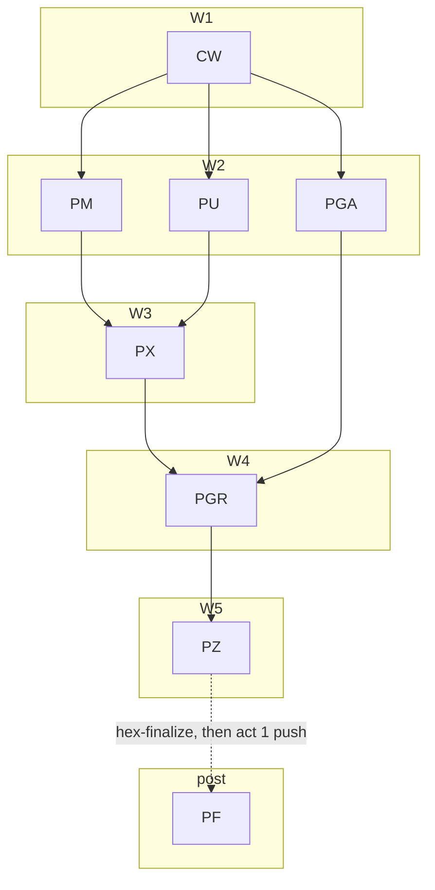

# Plan: Repository split (`grim-mirror` and `grim-gui` repositories, `grim-sdk` crate)

## Status

- **Plan:** plan_repository_split
- **Active phase:** landing
- **Step:** review call 2 approved; awaiting /hex-finalize, then acts 4 (push M and U) and PF (pin `grim-sdk` by rev)
- **Last update:** 2026-11-26 (review call 2 of 3: Approve, 0 Blocks; deferred Warns in § Review record, call 2)
- State:   landing
- Tier:    xhigh
- Tier-grammar: 5
- Updated: 2026-11-26
- Reviewed: 31a8f663500eee62eb2f463bd4381f4fde74d496
- Next:    /hex-finalize, then the landing enumeration: act 4 (push M `hex/initial-scaffold` `6c5d785`, U `hex/initial-scaffold` `c523ed3`), then PF

---

## Header

- **Goal contract (binding):** `.agents/goals/repository-split.md`, decisions GD-1 to GD-3. Autonomy: prompting never. Granted acts: none beyond ordinary local work, so every remote act is listed under § Acts outside this run's grants.
- **Source:** `.agents/discussions/repository-split.md` (ratified 2026-11-25): 15 requirements (R1 to R15 below, in source order), the owner's decisions, the orchestrator's rulings, 8 open questions, the verification list.
- **Research (not repeated):** the six inventories `.agents/research/research_repository_split_{recon,prior_art,ocx,conventions_template,agent_config,testing_and_conventions}.md` (2026-11-25) and four discover files written by this run (2026-11-26): `research_repository_split_sdk_surface.md` (grim-sdk cut line and API), `research_repository_split_grimoire_cut.md` (edit list for the grimoire branch, SDK landing list), `research_repository_split_tauri_skeleton.md` (Tauri 2 versions, unsafe lint, Docker, CI), `research_repository_split_scaffold_map.md` (bundle refs, taskfile, hook and test constants, CI carry-over). Steps cite them as `[sdk]`, `[cut]`, `[tauri]`, `[map]`, `[ac]` (agent_config) and `[tc]` (testing_and_conventions).
- **Classification:** large scope (three repositories, one new crate, a removed crate) · one-way door, high: the `grim-sdk` public API becomes the contract two repositories pin; the layouts of the two new repositories · tier **xhigh** (auto: new package plus a Large scope) · `architect=inline` (every boundary decision is the owner's, ratified in the source; the design below implements it, and PZ records it as an ADR) · `research=skip` (persisted research covers the topic) · `adversary=on` (no accepted ADR covers the decisions).
- **Repositories** (column `Repo` below):
  - `G` = grimoire, the integration worktree `/home/mherwig/.herdr/worktrees/grimoire/uno`, branch `hex/repository-split` (GD-2: trunk `72d3fce1`, the goal-file commit, then the nine commits of `hex/artifact-mirroring` up to `eaa7da0b`).
  - `M` = `/home/mherwig/dev/grimoire-rs/grim-mirror`, a new local git repository (GD-1).
  - `U` = `/home/mherwig/dev/grimoire-rs/grim-gui`, a new local git repository (GD-1).
- **Source commits a copy may name** (PD-11): `72d3fce16fa93890f0cddef4a8d7443c980716ab` (trunk, `v0.17.0`, on `origin/main`), `eaa7da0b2683d68a7bb61489e91238d47a7ef325` (head of PR 398, on `origin/hex/artifact-mirroring`), for the two shared rules `grimoire-rs/vscode` at `9230dcd364dcdd9b1f5b0bc206423972789cdd39`, and for U's icon set one tagged commit of `tauri-apps/create-tauri-app`, chosen and recorded in PU.1. Never a commit of `hex/repository-split`, because `/hex-finalize` rewrites it.
- **Gate commands:**
  - G: `env -u OCX_GLOBAL -u OTEL_EXPORTER_OTLP_ENDPOINT -u OTEL_EXPORTER_OTLP_HEADERS task --force verify`, and `env -u OCX_GLOBAL task docs:check` (Node 24) after PZ.
  - M: `env -u OCX_GLOBAL task --force verify` in M.
  - U: `env -u OCX_GLOBAL task --force verify` in U. Its Rust and acceptance phases run inside the U build container (PD-13).
- **Host limits:**
  - One cargo or docker build at a time across all three repositories. The outermost command of a step or gate takes `flock /home/mherwig/.herdr/worktrees/grimoire/uno/.agents/.tmp/split-build.lock` (gitignored directory), and nothing nested takes it again (PD-26).
  - Each repository has its own `target/`. Never share a `CARGO_TARGET_DIR` across them (hex.md pitfall).
  - This host has Docker 29 but no webkit2gtk, no pkg-config and no sudo. It has no Windows side and no macOS.
  - Python is `/usr/bin/python3`. gh is `/home/mherwig/.ocx/toolchain/links/default/gh/content/bin/gh`, read-only use only.
- **Worktrees:** none beyond the three repository trees. G work is serial in `uno`, and M and U are their own trees. See § Parallelization.
- **Tracking:** PR `grimoire-rs/grimoire#398` (rewritten by this plan's G part), issues #399 to #402 (mirror follow-ups, untouched by this run).

## Objective

The mirror tool leaves grimoire before it ever lands. It moves to a local repository `grim-mirror` with its ten acceptance suites, the harness they need, and the full grimoire scaffold and agent configuration. That repository's gate passes against the grim built in `uno`.

A second local repository, `grim-gui`, holds a Tauri 2 skeleton whose binary `grim-gui` starts as `grim gui`. It shows the version of the grim it finds, or the text "grim not found".

Neither repository links grim's code. Both reach grim only through the binary, by way of a minimal `crates/grim-sdk`, which the grimoire branch gains. That branch also loses the mirror crate and every reference to it, and keeps plugin dispatch, the `mirror` table and `grim convert`.

## Scope

**In:** R1 to R15 of the source in full (see § Traceability), the source's verification list where it can run locally, and the eight open questions, answered in § Decisions taken while planning.

**Out, as the source puts it:**

- the GUI's screens and features;
- packaging, signing and auto-update of the GUI;
- a `grim-mirror` release and the other items of #402;
- a library API of grim;
- growing `grim-sdk` beyond what the mirror calls, plus the one call R5 names;
- a conventions repository;
- bringing `vscode` and `indexer` onto the base;
- a Windows build of `grim-mirror`.

**Out by GD-1:** creating the GitHub repositories, any push, and CI runs as evidence. The workflow files are written and linted; their runs are listed under § Acts.

## Acts outside this run's grants

For the meta-orchestrator and the owner. None blocks `/hex-execute`.

1. Push `hex/repository-split` and open its one PR, naming PR 398 as the one it replaces (GD-2). Dispatch `verify-deep.yml` on the new head.
2. Owner: push the same tip to `hex/artifact-mirroring`, or close PR 398.
3. Meta-orchestrator, after act 1: trigger pipeline PF (§ PF), the pin of `grim-sdk` by commit (GD-3).
4. Owner, after PF (PD-27): create `grimoire-rs/grim-mirror` and `grimoire-rs/grim-gui`. Recommended: public, with the grimoire ruleset on `main` switched on after the first green gate (source open question 1). Then push `main` and `hex/initial-scaffold` of each and open one PR per repository. CI there is the evidence this run cannot produce, in particular the `grim-gui` builds on macOS and Windows and the macOS `unsafe_code` check (PD-15, risk R-3).
5. Owner: transfer #399, #400 and #401 to `grim-mirror`, and tick the split item on #402 (source open question 3).
6. Owner, only if PF measures the git fetch as too costly: publish `grim-sdk` to crates.io (a release act; source open question 8).
7. After the grimoire PR merges: move both pins (`grim-sdk` rev and `GRIM_COMMIT`) to the merged `main` commit, one small change per repository (source ruling "the SDK pin follows the pull request").

## Decisions taken while planning (goal § Issue resolution)

Format: situation → ruling → the alternative not taken, with an example. All rulings are this orchestrator's, not the owner's.

- **PD-1 Tier and gate.** The meta-plan gate would block at xhigh. Ruling: xhigh, gate answered by this orchestrator under "prompting never". Alternative: high, which tier-high § Phase 3 rejects for Large scope.
- **PD-2 No architect seat; the decisions go into an ADR in PZ.** Every boundary decision (split, scaffold not code, invoke not link, SDK in grimoire, Tauri, copy plus bundles) is the owner's, ratified in the source. Ruling: design inline; PZ writes `.agents/adr/adr_repository_split.md` (Status Accepted for the owner's decisions, the orchestrator's rulings marked open to veto) and its `arch-principles.md` index row. Alternative: an architect worker re-deriving decisions the owner already took, for example re-scoring monorepo against split.
- **PD-3 Version floor is new code.** R5 asks the SDK to "check the version floor", but the mirror has none today [sdk] § Negative. Ruling: add `GrimDriver::require_version` (C-007) as the one new function. The mirror keeps its capability probe and sets no floor, because no released grim carries dispatch, the `mirror` table and `convert`, and the branch grim reports `0.17.0`, the same as the released one. The GUI sets no floor. Alternative: a floor of `0.18.0` in the mirror, which would refuse the grim built from this branch.
- **PD-4 SDK acceptance check is an ignored Rust test run by a task.** The source asks for one acceptance check against the grim built in the same run. Ruling: `crates/grim-sdk/tests/against_grim.rs`, `#[ignore]`, run by `task rust:sdk:accept` with `GRIM_SDK_TEST_GRIM` set to the built grim, inside `task verify` and as a step of the `verify-basic.yml` smoke job. Without the variable the test panics, so it never passes silently. Alternative: a pytest case plus a second staged probe binary, which reuses the plumbing PGR removes [cut] Table 2.
- **PD-5 SDK manifest: own version, inherited rest.** `grim-sdk` is consumed from other repositories, through a path during the run and from git after PF. Cargo walks up lexically from the manifest, so both routes reach grimoire's root `Cargo.toml` (the symlink of PD-6 points at the worktree root). Ruling: literal `version = "0.1.0"`, and `edition.workspace`, `license.workspace` and `[lints] workspace = true` inherited. The release bump leaves the literal version alone, which C-010 guards. Alternative: a fully literal manifest, which duplicates the lint table with nothing to keep it in step (review round 1, architect seat).
- **PD-6 Local override shape (GD-3).**
  - A symlink outside both repositories, `/home/mherwig/dev/grimoire-rs/.grimoire-split → /home/mherwig/.herdr/worktrees/grimoire/uno`.
  - Each new repository's root `Cargo.toml` declares `[workspace.dependencies] grim-sdk = { path = "../.grimoire-split/crates/grim-sdk" }`, and members use `grim-sdk.workspace = true`.
  - PF changes that one line to `{ git = "https://github.com/grimoire-rs/grimoire", rev = "<40-hex>" }`.
  - No host path and no personal data is committed.
  - Alternative: a `[patch."https://github.com/grimoire-rs/grimoire"]` table in a gitignored `.cargo/config.toml` over a committed git dependency. Rejected: cargo may fetch the original git source to resolve it, and that source has no `grim-sdk` until the push.
- **PD-7 GUI bridge follows the source ruling: `GrimDriver::version()`.** The source rules "a Rust command asks `grim-sdk` for the version of the grim it finds". grim prints its version as text, so no JSON exists to pass on for this one call. Ruling: the command `grim_version` calls `GrimDriver::version()` and returns the version string. R12 is carried as a convention: U's `subsystem-shell.md` states that every later command returning grim JSON returns grim's `serde_json::Value` unchanged. Alternative: run `grim context --format json` and pass its document. It would demonstrate R12 now, but it replaces the owner's ruling, and `grim context` fails on a bad config in the GUI's working directory, so a found grim would show "failed" (review round 1, architect seat).
- **PD-8 Mirror repository keeps the `crates/grim-mirror/` layout.** Ruling: a one-member workspace with the crate at `crates/grim-mirror/`. The ten suites, `test/src/git_fixture.py:18` and `test_mirror_bundles.py:19` (both read `crates/grim-mirror/licenses/MIT.txt`) and the `.gitattributes` line then copy byte-identical. Alternative: the crate at the repository root, which rewrites those paths in eleven files.
- **PD-9 Mirror version line.** Ruling: `[workspace.package] version = "0.1.0"` in M, a fresh line for a tool that never shipped. Any test that asserts the inherited `0.17.0` is updated in M.2 and listed in the step report. Alternative: keep `0.17.0`, which ties a separate tool to grim's numbers.
- **PD-10 Branches in the new repositories.** Ruling: `git init -b main`, then one empty signed-off root commit `chore: initialize the repository` on `main`, then all work on branch `hex/initial-scaffold`. When the owner creates the remote, a PR from that branch runs CI. Alternative: everything on `main`, which skips the PR gate and breaks the "never commit to main" principle the repositories inherit.
- **PD-11 Manifest source commits.** Ruling: only the SHAs § Header lists (three fixed, plus the create-tauri-app tag commit PU.1 records). Files come from the trunk where the branch did not change them, and from `eaa7da0b` for the crate, its tests and the mirroring docs page. Alternative: copying from `hex/repository-split`, whose SHAs die at `/hex-finalize`.
- **PD-12 One builder of grim for the new repositories.** The new repositories test against the grim built in `uno`, staged into their `test/bin/` by copy. `grim install` in them also runs with that grim. Alternative: the host grim 0.16.1 [map] § 1, which lacks the three contracts the mirror probes for.
- **PD-13 Tauri build in a container.** The host has no webkit2gtk and no sudo. Ruling: `docker/linux-build.Dockerfile` (Ubuntu 24.04, the Tauri v2 prerequisites, xvfb, rustup with toolchain 1.95.0 preinstalled, Node 24, uv) [tauri] § 4. Every Rust build, clippy, unit test and acceptance run of U goes through `scripts/in-container.sh`; front-end lint and tests run on host Node 24 (ocx). Alternative: installing system packages, which needs sudo.
- **PD-26 Build lock ownership.** One lock file, one owner: the outermost command a step or gate runs takes `flock` (for example `flock <lock> task verify`, `flock <lock> cargo test …`). Nothing nested takes it again; `scripts/in-container.sh` never locks. Alternative: a lock in every wrapper, which deadlocks when a task calls the wrapper (review round 1).
- **PD-27 Pushes of the new repositories wait for PF.** Before PF the SDK dependency resolves only through the local symlink, so CI in M and U cannot build. Ruling: act 4 pushes and opens PRs only after PF, and act 7 moves both pins to `main` after the grimoire PR merges (the source's "the pin follows the pull request" ruling). Alternative: push before PF, which makes every CI job red.
- **PD-14 GUI acceptance layer.** R14 asks for grim's testing idea applied to Tauri. Ruling, three layers:
  - nextest unit tests for the bridge, with fake grim scripts;
  - vitest with happy-dom for rendering;
  - a small black-box pytest suite under `test/`, run in the container under `xvfb-run`. It starts `grim gui` through plugin dispatch, waits for the bridge's stderr line (C-030), then stops the process.
  It uses the floor, skip and xfail files and the floor tools. Alternative: `tauri-driver` WebDriver, which runs on Linux and Windows only and is heavy for one page [tauri] § 6.
- **PD-15 GUI CI tiers.** Basic, on every PR: lint, unit tests, the Linux acceptance under xvfb, plus an unsigned `npx tauri build --no-bundle` on Linux, macOS and Windows (source ruling: "CI builds it unsigned on Linux, macOS and Windows"). Deep, by dispatch: the same three systems with bundling on, unsigned. `tauri-action` is not used [tauri] § 7. Alternative: the 3-OS build in deep only, which would leave the source's verification line unproven on every PR.
- **PD-16 Workflow lint.** No workflow linter is installed [map] § 4. Ruling: each new repository pins `actionlint` in its `ocx.toml` (the indexer does the same) and runs it from a `ci:lint` task in `task verify`. Fallback if ocx cannot resolve it: `docker run` of the `rhysd/actionlint` image at a version tag at least two weeks old, recorded in the manifest. The G workflow edits are linted the same way once. Alternative: YAML parse only, which misses expression and shell errors.
- **PD-17 Mirroring docs move without a stub.** `mirroring.md` never reached `origin/main` [cut] § Direct Answer. Ruling: delete it and its sidebar line in G. The page goes to M as `docs/mirroring.md`, with links back to grimoire made absolute (`https://grimoire.rs/…`). Alternative: a stub page in G, which publishes a URL the owner does not want.
- **PD-18 Git hardening snapshot.** Ruling: byte copy of `src/catalog/git_cmd.rs` at `72d3fce1` (the branch does not touch it) to `crates/grim-mirror/tests/fixtures/git_cmd.rs.snapshot`. Provenance lives in the manifest only, so the bytes stay identical to the source. The test reads the snapshot [sdk] § 5. Alternative: a header line in the snapshot, which breaks the byte comparison the manifest drift check uses.
- **PD-19 Founding records travel with the tool.** Ruling: M copies `adr_artifact_mirroring.md`, `design_artifact_mirroring.md` and `plan_artifact_mirroring.md` from `eaa7da0b` into its `.agents/` (copied rows), with an ADR index row in M's `arch-principles.md`. Alternative: link to grimoire's copies only, which leaves M's decision record outside its own repository.
- **PD-20 Rules the structural tests need.** `test_ai_config.py` needs `meta-ai-config.md`, `workflow-{bugfix,refactor,feature}.md`, `arch-principles.md`, and the global count [map] § 3. Ruling:
  - copy or rewrite those rules in both repositories;
  - drop `workflow-release.md` with `TestReleaseImplementation`, `test_workflows.py` and `test_upstream_stale.py`, each with a reason in the manifest (no release flow, no OCX signing, no harness ledger);
  - set the global count per repository from the real set.
  Alternative: copy `workflow-release.md` unchanged, which would name workflows that do not exist there.
- **PD-21 Installed bundle content is not authored.** Bundle rules ship without the two local edits grimoire carries [rules.md] § Vendored. Ruling: in M and U, `shell:verify` and the link check skip `.claude/rules/**` and `.claude/skills/**` paths that carry `license:` and `repository:` frontmatter. A friction entry goes to the retro inbox if an installed file fails a gate. Alternative: re-applying the local edits, which the next `grim install` reverts.
- **PD-22 Who commits, and when.** The grimoire commit guard has fired in sibling repositories before (user memory). Ruling:
  - Workers never commit, in any repository.
  - In G, the `/hex-execute` orchestrator commits after each green G gate (CW.3, PGA.2, PGR.2, PZ.3).
  - In M and U, the orchestrator makes each repository's commit series once, after that repository's green `task verify` in PX, inside the 300 s stamp window, from file sets listed before the gate ends. The intermediate commits of a series are a split of one verified tree and carry no gate of their own, the same trade `/hex-finalize` makes in G.
  - Never write a stamp by hand.
  Alternative: commits per step, which the guard can block mid-run.
- **PD-23 GUI identifiers.** Ruling: package and binary `grim-gui`, lib `grim_gui_lib`, `productName` `grim-gui`, `identifier` `rs.grimoire.gui`, window label `main`. Alternative: `mainBinaryName` over another package name, which Tauri's docs advise against [tauri] § 2.
- **PD-24 Inventory row keys.** Ruling:
  - The manifest accounts for every table row of the two inventory files. Neither permitted source SHA holds them; they are tracked only on `hex/repository-split`, whose SHAs die at `/hex-finalize`. So each repository holds a copy taken from `uno`, recorded with its sha256 and the sentinel `source_commit = "untracked"`; the checker reads that fixed copy.
  - A row is identified by the pair `(inventory, key)`.
  - A row whose first cell matches `^[AB]\d+\.\d+$` keys on that ID (for example `A2.26`).
  - Every other table row keys on `<inventory>§<nearest heading number>#<1-based row ordinal under that heading>`, for example `agent_config§4.2#3`.
  - Numbered findings outside tables (agent_config § 15) are not rows.
  Alternative: hand-chosen keys, which no script can check.
- **PD-25 Source open questions.**
  - (1) Visibility: act 4.
  - (2) Force-push and deep dispatch: acts 1 and 2.
  - (3) Issue transfers: act 5.
  - (4) Install progress as JSON events: the GUI agent's first check, recorded in U's `AGENTS.md` "Next work".
  - (5) A bundle of the generic grimoire rules: not in this run; they are copied and listed in the manifest.
  - (6) Tauri and `unsafe_code`: C-033.
  - (7) `artifact-kinds.md` and `grim-compat-markers.md`: copied into U from vscode `9230dcd3` with manifest rows; no bundle.
  - (8) Git dependency cost: measured in PF.

## Open questions

None open. The source's eight are answered in PD-25. The doubts this plan raised are PD-1 to PD-27.

## Traceability to the source

| Req | Text (short) | Contracts / scenarios | Pipelines |
|---|---|---|---|
| R1 | mirror in its own repository, never on grimoire `main` | C-018–C-028, S-001–S-004 | PM, PX, PGR |
| R2 | PR 398 rewritten without the crate; dispatch, `mirror` table, `convert` kept | C-011–C-017, S-009 | PGR, PZ |
| R3 | GUI skeleton, Tauri 2, binary `grim-gui`, `grim gui` | C-029–C-036, S-005 | PU |
| R4 | only the `grim` binary; nothing links grim | C-008, C-021, C-029 | CW, PM, PU |
| R5 | `crates/grim-sdk`: find, run JSON, version floor, exit codes; moved; 0.1.0; Unstable; unpublished | C-001–C-010, S-010, S-011 | CW, PGA, PZ |
| R6 | both repositories pin `grim-sdk` by commit | C-041 | PF |
| R7 | same scaffold by copy | C-018, C-024, C-025, C-034, C-036, C-038 | PM, PU |
| R8 | rules and skills through bundles, `grimoire.toml` + lock | C-027, C-040, S-013 | PM, PU, PX |
| R9 | manifest of copied files and source commits; every inventory row accounted | C-038–C-040, S-012 | CW, PM, PU, PX |
| R10 | commit guard with its stamp task; structural tests and reminder tables rewritten | C-024, C-026, C-037 | PM, PU |
| R11 | mirror repository gate passes before the crate is removed | C-024 | PX before PGR |
| R12 | GUI front end plain TypeScript, JSON passed unchanged | C-030, C-031 | PU |
| R13 | agentic configuration in full, subsystem idea included | C-026, C-037 | PM, PU, PX |
| R14 | entire testing idea; GUI gets it applied to Tauri | C-022, C-024, C-035 | PM, PU |
| R15 | other conventions of the same kind | C-038, C-039 (B rows of [tc]) | PX |

## Design guarantees

### Backwards compatibility (Principle 9 gate, G only)

| Surface | Change | Additive because | Proof |
|---|---|---|---|
| CLI, JSON, schemas, layouts | none | `src/` of grim is untouched by every pipeline ([cut]: no `src/` hit) | `git diff eaa7da0b -- src/` empty at PGR's gate |
| Plugin dispatch, `mirror` table, `convert` | kept as at `eaa7da0b` | same code, same tests | `test_plugin_dispatch.py`, `test_publish_mirror_table.py`, `test_convert.py` byte-identical to `eaa7da0b` |
| `crates/grim-mirror` | removed | never released, never on `main` | `git cat-file -e origin/main:crates/grim-mirror` fails |
| `crates/grim-sdk` | new crate, Unstable, unpublished, own version line | new surface | `stability.md` row (PZ); C-008; C-010 |
| Release flow | `cargo set-version` keeps bumping only the root | no change to `taskfiles/release.taskfile.yml` | C-010 guard test |

### Constitution deviations

| Principle / rule | Deviation | Reason |
|---|---|---|
| `product-tech-strategy.md` golden path (Rust only) | U is Tauri 2 with a TypeScript front end | owner decision in the source; U's own `product-tech-strategy.md` names it |
| `quality-rust-exit_codes.md` "one enum per workspace" | `grim-sdk` carries its own `ExitCode` copy | it is a client of the binary with no dependency on the main crate; the `include_str!` test pins equal values by name (moved from the mirror) |
| Principle 5 (one source of truth) | M keeps a byte snapshot of grim's git hardening | the owner ruled out a grim submodule; the manifest records the source commit and the drift command reports a change |

### TDD approach

The contract wave lands the SDK (a move with its tests) and the manifest checker, with the checker's own fixture tests green and the real-manifest test red. Every later step follows Stub, then Specify (failing tests from the contracts below, never from the code), then Implement. Acceptance suites run only in each repository's own tree.

## Component contracts

### grim-sdk (G, `crates/grim-sdk`)

- **C-001 Manifest.** `name = "grim-sdk"`, literal `version = "0.1.0"`, `edition.workspace = true`, `license.workspace = true`, `[lints] workspace = true`, `publish = false` (PD-5). Dependencies `serde_json = "1"`, `semver = "1"`; dev `tempfile = "3"`, `toml` (the root's version). Listed in root `members`. Lib only, so no `dist` key.
- **C-002 Binary resolution** ([sdk] § 2). `resolve_bin(Option<&OsStr>) -> PathBuf` returns an absolute `GRIM_BIN` as given, else the bare `grim`, which the spawn looks up on `PATH`. `bin_from_env() -> PathBuf` reads `GRIM_BIN`. Edges: relative or empty `GRIM_BIN` falls back to `grim`; a non-UTF-8 value is read through `var_os`.
- **C-003 Process core.** `pub fn run`, `pub fn run_retry`, `pub struct Output { code: Option<i32>, stdout: String, stderr: String }`, `CALL_DEADLINE` (120 s), `PUBLISH_DEADLINE` (600 s).
  - stdin is null.
  - ETXTBSY retries 20 times at 25 ms.
  - A deadline kills the child and returns `code: Some(75)`.
  - `run_retry` reruns once on 75.
  - A failed spawn, for example grim not found, returns `DriverError { code: None }`.
  Behaviour as `publish.rs:98-185` today.
- **C-004 Errors.** `DriverError { code: Option<i32>, message: String }` with `Display` and `Error`. `exit_failure` passes codes 69, 74, 75, 80 and 81 through; any other code becomes 69 "unexpected output". The SDK names no mirror concept.
- **C-005 Exit-code table.** `ExitCode` with the 12 variants and values of `crates/grim-mirror/src/exit_code.rs` and `From<ExitCode> for std::process::ExitCode`. Test `values_match_grims_exit_codes` reads `concat!(env!("CARGO_MANIFEST_DIR"), "/../../src/cli/exit_code.rs")` and fails when a value differs by name (S-011). The read sits under `#[cfg(test)]`, so a dependent repository never compiles it. A crates.io package (act 6) would have to move this test out of the packaged crate first.
- **C-006 Calls** ([sdk] § 2):
  - `GrimDriver { pub bin: PathBuf }`;
  - `version() -> Result<String, DriverError>`, which strips the `grim ` prefix;
  - `schema(kind: &str) -> Result<Value, DriverError>`;
  - `has_command(name: &str) -> Result<bool, DriverError>`;
  - `convert(src, dest, kind: &str) -> Result<ConvertOutcome, DriverError>`, with `ConvertOutcome::{Converted { report: Value }, Refused(String)}`;
  - `publish_group(dir, dry_run, env: &[(&str, &OsStr)], deadline) -> Result<Vec<PublishItem>, DriverError>`;
  - `describe(reference) -> Result<Option<Recorded>, DriverError>`, where 79 maps to `None`;
  - the types `Probe`, `Recorded`, `PublishItem` and `PublishStatus`.
  The tests listed under [sdk] § 4 "Move" pass in the SDK, adapted only where a signature changed (`kind: &str`, `report: Value`, caller-supplied `env`).
- **C-007 Version floor (new).** `GrimDriver::require_version(&self, min: &semver::Version) -> Result<semver::Version, DriverError>`. It parses `grim X.Y.Z[-pre]`. Below the floor it returns code 69 with the message `grim <found> is older than <min>; upgrade grim`. Unparsable output returns 69 "unexpected output". A missing grim returns `code: None`. Unit cases: equal, above, below, pre-release below its release, garbage output, missing binary.
- **C-008 Boundary tests (G).** `crates/grim-sdk/tests/boundary.rs`:
  - `cargo tree -p grim-sdk -e normal --prefix none --offline`, run from the workspace root, names `grim-sdk` and none of `grimoire`, `grim-hook`, `grimoire-hook-core`;
  - the manifest has `publish = false`;
  - `dist-workspace.toml` does not name `grim-sdk`.
- **C-009 Acceptance check (G).** `crates/grim-sdk/tests/against_grim.rs`, one `#[ignore]` test. It reads `GRIM_SDK_TEST_GRIM`, an absolute path, and panics with a message if the variable is unset. Against that binary it asserts:
  - `version()` equals the text `grim --version` prints, minus the prefix;
  - `require_version(0.17.0)` succeeds and `require_version(99.0.0)` returns 69;
  - `has_command("convert")` is true and `has_command("no-such-command")` is false;
  - `schema("publish")` returns a JSON object.
  It is run by `task rust:sdk:accept` (PGA).
- **C-010 Version-line guard (G).** In `boundary.rs`:
  - `package.version` in the SDK manifest is the string `"0.1.0"`, not a `workspace` table;
  - the `cargo set-version` line of `taskfiles/release.taskfile.yml` carries no `--workspace` and no `-p`.
  So `task release:prepare` bumps only `[workspace.package]` (S-010).

### grimoire branch (G)

- **C-011 Crate gone.**
  - `crates/grim-mirror/` is deleted, and the root `members` names `crates/grim-sdk` instead.
  - `Cargo.lock` is regenerated once by `cargo metadata` without `--locked` after the member is dropped. It then holds no `grim-mirror` and no `spdx` entry, and holds `grim-sdk`. `cargo metadata --locked` succeeds. No hand-deleted hunks: CW's `semver` entry overlaps the mirror's.
  - `git grep -n "grim-mirror" -- crates Cargo.toml Cargo.lock .github test .gitattributes` finds nothing.
  - `Cargo.toml` gains no `[lib]`.
- **C-012 Harness cut.**
  - The `grim_mirror_binary` fixture, the `GrimMirrorRunner` class and the `grim_mirror` fixture are removed from `test/conftest.py:192-258`.
  - `test/src/git_fixture.py` and the ten `test_mirror_*.py` files are deleted.
  - `test/taskfile.yml` returns to trunk bytes.
  - `test/SUITE_FLOOR` and `test/SKIP_CEILING` are set to the counts the merged tree's junit report shows, not computed (expected about 4423 and 296). `XFAIL_CEILING` stays 0.
- **C-013 CI cut.** The mirror plumbing of `verify-basic.yml`, `verify-deep.yml` and `acceptance.yml` is removed, so the mirror lines return to trunk bytes. `verify-basic.yml` smoke gains one step, `SDK acceptance`, after `Build`, running `task rust:sdk:accept`. The workflow files pass actionlint.
- **C-014 Kept surfaces.** `src/` is unchanged against `eaa7da0b`. The three grim-side suites are byte-identical and green.
- **C-015 Agent configuration (G).**
  - `subsystem-mirror.md` is deleted.
  - `subsystem-sdk.md` is added (`paths: crates/grim-sdk/**`, under 40 lines, with the invariants of C-001 to C-005 and C-008).
  - `.claude/rules.md`: the three mirror rows are removed and three SDK rows added.
  - `arch-principles.md:19-24,109`, `arch-threat-model.md:193-197`, `product-context.md:106-110` and `subsystem-cli-commands.md:44` are rewritten as [cut] Table 1 says.
  - `AGENTS.md`: the layout line and the row swap mirror for SDK, and the `GRIM_BIN` row clause is rewritten. The net line change is ≤ 0, so the file stays ≤ 280 lines.
  - A `CONTEXT_REMINDERS` row `crates/grim-sdk/**` points to `subsystem-sdk.md`.
  - `task claude:tests` is green.
- **C-016 Docs (G).**
  - `mirroring.md` and `astro.config.mjs:196` are deleted.
  - The links in `commands.md`, `publishing.md`, `artifacts.md`, `json-interface.md` and `stability.md` point to `https://github.com/grimoire-rs/grim-mirror`.
  - `stability.md`: the grim-mirror bullet (`:662-669`) becomes one sentence (a plugin is not grim's and carries its own stability), and a `grim-sdk` bullet is added (Unstable sibling surface, own version line, unpublished, no library API of grim).
  - The two catalog-skill clauses are rewritten.
  - `task docs:check` and `task catalog:verify` are green. The repository URL does not exist until act 4: if a link check fetches external URLs and fails on it, that exact URL is excluded with a comment naming act 4, and the PR body lists the exclusion for removal.
- **C-017 Records (G).**
  - `adr_artifact_mirroring.md` gets a dated note: the crate moved before merge; D1, D6 to D8 and D11 to D17 bind `grimoire-rs/grim-mirror`; the grim side is D2, D9, D10, D18, D19. Its status is unchanged.
  - A new `adr_repository_split.md` (PD-2) gets its index row.
  - `product-context.md` "Related Repositories" gains rows for `grim-mirror` and `grim-gui`.
  - `.agents/upstream-watchlist.md:358-365` is rewritten as [cut] says.
  - One dated `hex.md` Memory line is added.
  - PZ also writes the PR body text for the meta-orchestrator to `.agents/plans/plan_repository_split.pr.md`.

### grim-mirror repository (M)

- **C-018 Scaffold.**
  - The root `Cargo.toml` is a workspace with `members = ["crates/grim-mirror"]` and `resolver = "3"`.
  - `[workspace.package]` holds `version = "0.1.0"`, edition 2024 and Apache-2.0.
  - `[workspace.lints]` matches grimoire's table.
  - `[workspace.dependencies]` holds `grim-sdk` (PD-6).
  - Copied or rewritten: `rust-toolchain.toml` (1.95.0), `rustfmt.toml`, `taplo.toml`, `cog.toml`, `.taskrc.yml`, `LICENSE`.
  - `deny.toml` loses the oci-client comment.
  - `.licenserc.toml` includes `crates/**/*.rs`.
  - `.config/nextest.toml` loses the probe override.
  - `.gitattributes` and `.gitignore` are rewritten for M ([map] § 5).
- **C-019 SDK switch.**
  - `grim-mirror` depends on `grim-sdk` and on no other grim crate.
  - The moved items are deleted from `publish.rs`, `exit_code.rs` and `model.rs`; `model.rs` re-exports `DriverError` and `Probe`.
  - Call sites switch as [sdk] § 5 lists.
  - `capabilities()`, `Published`, `convert_warnings`, `infra_code` and the offline refusal stay in the mirror.
  - Every unit test that stays in the mirror passes unchanged, apart from import paths.
- **C-020 Git hardening snapshot** (PD-18). `hardening_covers_what_the_index_clone_copy_sets` reads `tests/fixtures/git_cmd.rs.snapshot`. A manifest row names `72d3fce1:src/catalog/git_cmd.rs` as the source.
- **C-021 Boundary (M).** `crates/grim-mirror/tests/boundary.rs`:
  - the dependency tree includes `grim-sdk` and none of `grimoire`, `grim-hook`, `grimoire-hook-core`;
  - `publish = false`;
  - the `dist-workspace.toml` test is dropped.
- **C-022 Harness (M).** `test/` contains:
  - `conftest.py`: registry lifecycle, abort with exit 4 when no registry answers, `grim_binary`, `grim_mirror_binary`, `GrimMirrorRunner`, `grim`, `grim_home`, `unique_repo`, and the 1000-character test-id cap. It has no top-level `src.*` import and no managed-Claude guard.
  - `tests/conftest.py`, trimmed to `project_dir` and `grim_at`, with no `index_fixture` or `otlp_fixture` import.
  - `src/{__init__,zot,registry,runner,git_fixture,assertions}.py`, plus `src/helpers.py` reduced to `write_config` and `make_artifact`.
  - `pyproject.toml` with dev dependencies pytest and pytest-xdist only, and `uv.lock` regenerated.
  - `tools/{accept_floor,accept_shard,require_all_passed}.py`.
  - The meta suites `test_accept_floor.py`, `test_accept_shard.py`, `test_text_io_hygiene.py`, and a new `test_registry_required.py`. It runs a nested pytest session with `GRIM_TEST_REGISTRY_HOST=127.0.0.1:1` and asserts exit 4 with the abort message (S-004).
  - `SUITE_FLOOR` and `SKIP_CEILING` measured, `XFAIL_CEILING` 0.
- **C-023 Suites.** The ten `test_mirror_*.py` files are byte copies from `eaa7da0b`. All 71 cases pass against the grim staged from `uno`, including `grim mirror --help` through dispatch (S-001).
- **C-024 Gate (M).**
  - `task verify` runs two phases. Lint: `rust:format:check`, `rust:clippy:check`, `shell:verify`, `claude:verify`, `ci:lint`, `docs:check`. Build and test: `rust:build`, `rust:test:unit`, `test:parallel`.
  - `.verify:mark` is copied verbatim and writes `.claude/hooks/.state/commit-verified`.
  - `test:build` copies grim from `GRIM_SOURCE_BINARY` and builds `grim-mirror` into `test/bin/`. The default is `../.grimoire-split/target/release/grim`, which stays valid after PF because PF keeps the symlink as the local grim source (C-041); CI sets the variable. A missing file fails the task, naming the variable.
  - `test:floor` enforces the floor and the two ceilings, as in CI.
  - A commit attempted without a fresh stamp is refused by M's hook, and one after a green gate passes. Both are covered by M's `test_hooks.py` stamp cases and demonstrated once at PX landing (S-003).
- **C-025 CI (M).**
  - `verify-basic.yml` jobs:
    - conventional commits and DCO;
    - supply chain;
    - smoke: check out grimoire at `GRIM_COMMIT` with submodules, build grim, build the mirror, run nextest, upload both binaries;
    - acceptance through `acceptance.yml`, with shards, a merge job running `task test:floor`, and a publish job with no checkout.
  - `verify-deep.yml`: Linux and macOS build, unit and acceptance; Windows is not built, and the reason is stated in the workflow.
  - Also: `claude.yml`, `.github/actions/build-rust` renamed, and `dependabot.yml` covering actions and cargo.
  - `GRIM_COMMIT` is `eaa7da0b…` until PF. The smoke job caches the grim build keyed on `GRIM_COMMIT`.
  - Before PF the workflows cannot run, because the SDK resolves only through the local symlink (PD-27).
  - Every action is pinned by a full commit SHA with a version comment. Annotated tags are peeled (`git ls-remote <repo> '<tag>^{}'`).
  - Workflow permissions are minimal, and inputs reach shell through `env:`.
  - actionlint is clean.
- **C-026 Agent configuration (M).**
  - Top level: `AGENTS.md` (the grimoire structure, ≤ 280 lines, the "N principles distill" sentence matching its headings, the worktree convention) and a `CLAUDE.md` stub.
  - Rules:
    - `.claude/rules.md` with every table;
    - first-party rules copied as is per [ac] § 4.1 (`quality-core`, `quality-rust`, `quality-rust-errors`, `quality-rust-exit_codes`, `quality-python`, `quality-bash`, `workflow-intent`, `workflow-bugfix`, `workflow-refactor`), and `quality-security` rewritten for M's attack surfaces;
    - rules rewritten on the grimoire pattern: `product-tech-strategy`, `product-context`, `arch-principles` (with the ADR index), `arch-threat-model` (attackers on upstream git content, the registry and the spawned grim), `meta-ai-config`, `workflow-feature`, `workflow-git`, `workflow-github`;
    - subsystem rules: `subsystem-mirror.md` (moved from grimoire, invariant 1 rewritten), `subsystem-cli.md`, `subsystem-cli-api.md` (the run report), `subsystem-tests.md`, `subsystem-ci.md`, `subsystem-taskfiles.md`.
  - Hooks: all copied. `CONTEXT_REMINDERS` maps `crates/grim-mirror/src/**` and `test/**` to their rules. `CONFIG_REMINDERS` is trimmed to M's files ([map] § 3).
  - `.claude/settings.json`.
  - Tests: `test_ai_config.py` constants set from M's real sets, and `test_hooks.py` rows adapted.
  - Also: `.claude/taskfile.yml` without `test_upstream_stale.py`, the templates, the scripts, and the first-party skills per [ac] § 9 (grimoire-only skills `docs`, `changelog`, `prepare-release`, `upstream-refresh` not taken, each with a reason).
  - `.agents/`: README, `memory/hex.md` (pointers and preferences rewritten, empty Memory), `retro/inbox/`, and the PD-19 records.
- **C-027 Bundles (M).**
  - `grimoire.toml`: `clients = ["claude"]`, plus bundles `hex`, `nox`, `rust-essentials`, `python-essentials` and `docs-essentials` ([map] § 1).
  - `grimoire.lock` is written by `grim install` (PD-12).
  - `grim status --format json` lists every item as installed, with exit 0 (S-013).
- **C-028 Docs and community (M).**
  - `README.md` comes from the crate README.
  - `docs/mirroring.md` follows PD-17 and carries its `doc_type` and `doc_tier` declarations.
  - Also: `CONTRIBUTING.md`, a rewritten `SECURITY.md`, `CODE_OF_CONDUCT.md`, the issue templates and `CODEOWNERS`.
  - `docs:check` runs the docs-quality checks (`doc_declaration`, `prose`, `links_raw`) from the installed bundle over `README.md` and `docs/`.

### grim-gui repository (U)

- **C-029 Layout and dependencies.**
  - The root `Cargo.toml` is a workspace with `members = ["src-tauri"]`, `[workspace.lints]` as grimoire's, and `[workspace.dependencies] grim-sdk` (PD-6).
  - `src-tauri/Cargo.toml`: package `grim-gui` with `[lib] name = "grim_gui_lib"` (rlib only), `tauri = "=2.12.5"`, `tauri-build = "=2.7.4"`, `serde` (derive), `serde_json` and `grim-sdk`. No `tauri-plugin-*`.
  - `src-tauri/icons/` holds the icon set of the create-tauri-app template (needed by `generate_context!`, `.ico` for Windows), copied at a tagged commit of `tauri-apps/create-tauri-app` and recorded with that SHA.
  - `package.json` dependencies: `@tauri-apps/api` only. Dev dependencies: `@tauri-apps/cli`, `typescript`, `vite`, `vitest`, `happy-dom`, each an exact version published at least two weeks before the step runs, recorded in the step report. No UI framework. `.npmrc` sets `save-exact=true`; `package.json` sets `engines.node` to `>=24`; installs use `npm ci`.
  - `package-lock.json` and `Cargo.lock` are committed.
  - `src-tauri/tests/boundary.rs`: the tree includes `grim-sdk` and no other grim crate.
- **C-030 Bridge command** (PD-7). `src-tauri/src/bridge.rs`: `pub fn version_with(driver: &grim_sdk::GrimDriver) -> Result<String, BridgeError>` and `#[tauri::command] fn grim_version() -> Result<String, BridgeError>`, which calls it with `GrimDriver { bin: grim_sdk::bin_from_env() }`.
  - Success returns the text `GrimDriver::version()` returns, unchanged.
  - A `DriverError` with `code: None` (grim could not be started) returns `BridgeError::NotFound { message }`, where `message` carries the SDK's text with the OS error.
  - Any other `DriverError` returns `BridgeError::Failed { code, message }`.
  - Both variants carry `code: Option<i32>` and `message: String` (`code` is always `None` for `NotFound`), and `BridgeError` derives `Serialize` with `#[serde(tag = "kind", rename_all = "kebab-case")]`, so the shape is `{"kind": "not-found"|"failed", "code": int|null, "message": str}`.
  - Each call writes one stderr line: `grim-gui: grim_version ok version=<v>`, `grim-gui: grim_version not-found`, or `grim-gui: grim_version failed code=<n>`.
  - `run()` returns `tauri::Result<()>`, and `main` maps an error to exit 1, with no `expect`.
  - Unit tests use fake grim scripts (unix): ok, not found, exit 78, garbage output. The deadline is the SDK's and is tested there (C-003).
  - `subsystem-shell.md` states the R12 convention for later commands: grim JSON is returned as grim's `serde_json::Value`, unchanged.
- **C-031 Front end.**
  - `src/main.ts` invokes `grim_version` once on load and passes the result to `render`.
  - `src/view.ts`: `render(root: HTMLElement, result: {ok: string} | {err: BridgeErrorJson})`.
    - ok shows `grim <version>`;
    - not-found shows `grim not found`, plus a hint to install grim or set `GRIM_BIN` to an absolute path, and the error message;
    - failed shows `grim failed (exit <code>)`.
  - No inline script or style in `index.html`.
  - vitest with happy-dom covers the three states, and `mockIPC` covers the command name main.ts invokes.
  - The page text is proven by vitest only. The end-to-end run (C-035) proves the script ran under the CSP and reached the bridge, but not the rendered text; that gap is accepted for a skeleton.
  - `tsc --noEmit` is clean.
- **C-032 Security configuration.**
  - `build.rs` declares `AppManifest::commands(&["grim_version"])`.
  - `capabilities/default.json` grants only `allow-grim-version` to window `main`: no `core:default` and no plugin.
  - `tauri.conf.json` `security.csp` is `default-src 'self'; script-src 'self'; style-src 'self'; img-src 'self' data:; connect-src ipc: http://ipc.localhost`.
  - A Rust test in `src-tauri/tests/config.rs` parses both files and asserts these values, and that no `tauri-plugin` appears in `Cargo.toml`.
  - If `invoke` needs a core permission at run time, the acceptance case S-005 fails. The step then adds the narrowest core permission and records it in the manifest as a deviation.
- **C-033 Unsafe lint.** The workspace `unsafe_code = "forbid"` holds for the Linux build. If a build fails on it, the fallback is `[tauri] § 3`: `deny` in `src-tauri` only, plus `#[allow(unsafe_code)]` on `run()` with a one-line why. That fallback is used only on that evidence and recorded as a manifest deviation. macOS stays unproven until CI (act 4).
- **C-034 Build environment.**
  - `docker/linux-build.Dockerfile` (PD-13).
  - `scripts/in-container.sh <cmd…>` builds the image once (`task gui:image`), then runs the command. It never takes the build lock (PD-26). It exits 69 with `docker not found` when `docker` is absent (S-008).
  - Mounts, resolved at run time so no host path is committed: the repository at its own absolute path (working directory), its parent directory's `.grimoire-split` link, and the link's target (`readlink -f ../.grimoire-split`) read-only at that same absolute path, so the SDK path dependency resolves in the container.
  - User and caches: `--user $(id -u):$(id -g)`, `HOME=/tmp`, `CARGO_HOME` and the npm cache under `target/.container-cache/` (inside the bind-mounted repository, so owned by the user). The image preinstalls toolchain 1.95.0 under a world-readable `RUSTUP_HOME`, so nothing installs at run time.
  - The build output is `target/release/grim-gui`. `rust-toolchain.toml` pins 1.95.0.
  - `rust:build` and `rust:clippy:check` depend on `web:build`, because `generate_context!` reads `dist/` at compile time.
- **C-035 Acceptance (U).** pytest under `test/`, with the M-style harness reduced to a runner and binary lookup, plus the floor tools and meta suites. It runs under `dbus-run-session xvfb-run -a` in the container with `WEBKIT_DISABLE_DMABUF_RENDERER=1`, `LIBGL_ALWAYS_SOFTWARE=1`, `GDK_BACKEND=x11` and a private `XDG_RUNTIME_DIR`.
  - S-005: `grim gui`, with `grim-gui` on `PATH` and the uno-built grim, prints the `ok version=<v>` line within 30 s, where `<v>` is the output of `grim --version` without its `grim ` prefix.
  - S-006: `grim-gui` started directly, with grim absent from `PATH` and `GRIM_BIN` unset, prints `not-found` and keeps running until stopped.
  - S-007: with `GRIM_BIN` set to a fake grim that exits 78, it prints `failed code=78`.
  - S-008: a host-side case runs `scripts/in-container.sh true` with `PATH` stripped of `docker` and asserts exit 69 and `docker not found`.
  - The process is terminated after the line. The suite has a floor of 4 plus the meta cases, and a skip ceiling of 0.
- **C-036 CI (U).**
  - `verify-basic.yml` jobs: conventional commits, DCO, supply chain (cargo-deny plus `npm audit --audit-level=high`; a registry outage is a rerun, not a finding), web (`npm ci`, `tsc`, vitest, `vite build`), rust on ubuntu-24.04 (apt prerequisites, clippy, nextest), Linux acceptance under xvfb with grim built from `GRIM_COMMIT` followed by `task test:floor` (floor and ceilings enforced in CI), and a build matrix on ubuntu-24.04, macos-latest and windows-latest running `npx tauri build --no-bundle`, unsigned (PD-15).
  - As in C-025: unusable before PF (PD-27), grim build cached on `GRIM_COMMIT`, actions pinned by peeled commit SHA.
  - `verify-deep.yml`: the bundled unsigned build on the same three systems.
  - Also `claude.yml`, and `dependabot.yml` covering npm `/`, cargo `/` and actions `/`, grouped so tauri and `@tauri-apps/*` move together.
  - Actions are pinned by SHA, and actionlint is clean.
- **C-037 Agent configuration (U).** As C-026, on the Tauri layout:
  - subsystem rules `subsystem-shell.md` (`src-tauri/**`), `subsystem-web.md` (`src/**`, `index.html`, `vite.config.ts`), `subsystem-tests.md`, `subsystem-ci.md` and `subsystem-taskfiles.md`;
  - `artifact-kinds.md` and `grim-compat-markers.md` copied from vscode `9230dcd3`;
  - `arch-threat-model.md` covering attackers on webview content, IPC and the spawned grim;
  - `product-tech-strategy.md` naming the Tauri deviation;
  - `CONTEXT_REMINDERS` rows for `src-tauri/**` and the front end;
  - `pre_commit_verification.py` tool detection that also checks `src-tauri/Cargo.toml` ([map] § 3);
  - `grimoire.toml` bundles `hex`, `nox`, `rust-essentials`, `typescript-essentials` and `python-essentials` (U has a pytest suite), with `grim status` clean;
  - an `AGENTS.md` "Next work" section for the GUI agent: the JSON-events question (PD-25), reuse of the vscode webview code, and the open macOS lint proof.

### Manifests (M and U)

- **C-038 Format.** `scaffold-manifest.toml` at the repository root:
  - `[source] repository = "grimoire-rs/grimoire"`.
  - `[[file]] path, source_repo, source_path, source_commit, mode = "copied" | "rewritten", sha256`. `sha256` is taken from the source bytes at `source_commit`. For a `copied` file it must equal the target bytes.
  - `[[row]] inventory = "agent_config" | "testing_and_conventions", key, disposition = "taken" | "rewritten" | "not-applicable", targets = [paths], reason`. `reason` is required unless the disposition is `taken`. `targets` is required unless the disposition is `not-applicable`.
  - `[[deviation]] what, reason`.
  The two inventory files themselves are under `.agents/research/` (PD-24). Files authored for M or U, the checker included, have no `[[file]]` row: the manifest lists copies only. The checker bytes are identical in both repositories, which PX.6 compares.
- **C-039 Checker.** `tools/scaffold_manifest.py` (stdlib only) and its test `.claude/tests/test_scaffold_manifest.py` (fixtures under `.claude/tests/fixtures/scaffold_manifest/`).
  - `check` exits 1 and names each defect:
    - an inventory row key (PD-24 derivation) with no `[[row]]`;
    - an unknown key;
    - a missing `reason` or `targets`;
    - a target path that does not exist;
    - a `copied` file missing or differing from its `sha256`;
    - a `source_commit` that is not 40-hex (except `untracked` for the two inventory copies);
    - a duplicate `path`, or a duplicate `(inventory, key)` pair.
  - `drift --checkout <source_repo>=<path> …` prints each `[[file]]` whose `source_path` at that checkout's `HEAD` differs from its recorded `sha256` (S-012). Rows whose `source_repo` has no `--checkout`, and `untracked` rows, are listed as skipped. It is not part of the gate; a fixture test covers it.
  - `task claude:tests` runs `check`.
- **C-040 Bundle boundary.** The checker also fails when a `[[file]]` path is a file whose frontmatter carries both `license:` and `repository:`, since bundle content is never copied by hand (R8).

### Pin (PF, M and U, after the push)

- **C-041 Pinned SDK.**
  - The root `[workspace.dependencies] grim-sdk` is `{ git = "https://github.com/grimoire-rs/grimoire", rev = "<pushed tip, 40-hex>" }` in M and U.
  - `GRIM_COMMIT` in their workflows is the same SHA.
  - The `.grimoire-split` symlink stays, as the local grim source of C-024 and C-034 only; Cargo no longer reads it.
  - `cargo metadata --locked` resolves after `cargo update -p grim-sdk`.
  - The boundary tests pass against the git source.
  - Both full gates are green.
  - The fetch time and the submodule clone are measured and written to the plan's Notes (source open question 8).

## User-experience scenarios

- **S-001** Operator runs `grim mirror --help` with `grim-mirror` on `PATH` → mirror help, exit 0. Error: `grim-mirror` absent → clap's error, exit 64, unchanged. (M, `test_mirror_cli.py`)
- **S-002** Operator runs `grim mirror check` / `sync` against a registry → behaviour of the ten suites. Errors: the exit codes of `test_mirror_cli.py` (64, 65, 69, 78, 79, 81). (M)
- **S-003** Developer runs `task verify` in M → green, stamp written; `git commit -s` within 300 s passes; a commit without the stamp is refused naming `task verify`. (M)
- **S-004** Registry unreachable → the pytest session aborts with exit 4 and a message naming `GRIM_TEST_REGISTRY_HOST`; never a green run with skips. (M)
- **S-005** User runs `grim gui` with grim on `PATH` → window shows `grim <version>`, stderr line `ok`. (U)
- **S-006** User starts `grim-gui` with no grim reachable → page shows `grim not found` and the hint; the app stays open. (U)
- **S-007** `GRIM_BIN` names a grim that fails → page shows `grim failed (exit 78)`. (U)
- **S-008** Developer on a host without webkit runs `task verify` in U → the container builds and tests; green. Error: Docker absent → `scripts/in-container.sh` exits 69 with `docker not found`. (U)
- **S-009** grimoire user runs plugin dispatch, `grim publish` with a `mirror` table and `grim convert` → same results as at `eaa7da0b`; `git grep grim-mirror` finds no crate, workflow or test reference. (G)
- **S-010** Maintainer runs `task release:prepare` → the root version moves, `grim-sdk` stays `0.1.0`; the guard test fails if the bump line gains `--workspace`. (G)
- **S-011** Contributor changes a value in `src/cli/exit_code.rs` without `grim-sdk` → `cargo test -p grim-sdk` fails naming the variant. (G)
- **S-012** Maintainer runs `python3 tools/scaffold_manifest.py drift --checkout grimoire-rs/grimoire=<checkout>` → lists copied files whose grimoire source changed; none when unchanged. (M, U)
- **S-013** Developer clones M or U and runs `grim install` → rules and skills land from bundles, `grim status` is clean. (M, U)
- **S-014** Reader follows a grimoire docs link about mirroring → `https://github.com/grimoire-rs/grim-mirror`; `task docs:check` finds no dead link. (G)

## Error taxonomy (new surfaces)

| Surface | Failure | Result | Remediation shown |
|---|---|---|---|
| `grim-sdk` | grim not found | `DriverError { code: None }` | install grim or set `GRIM_BIN` (absolute) |
| `grim-sdk` | deadline | code 75 after one retry | rerun; network or registry slow |
| `grim-sdk` | grim older than floor | code 69 | `upgrade grim` with both versions |
| `grim-sdk` | unparsable output | code 69 "unexpected output" | report; grim and SDK out of step |
| `grim-gui` bridge | not found / failed | `BridgeError` JSON | page text per C-031 |
| `in-container.sh` | docker absent | exit 69 | install Docker |
| manifest checker | missing row, drifted copy | exit 1, one line per defect | add the row or refresh the copy |

## Edge cases

- `GRIM_BIN` set but relative → ignored, `PATH` lookup (C-002); the GUI then reports not-found if `PATH` lacks grim.
- `grim gui` started by dispatch sets `GRIM_BIN` to the dispatching grim, so S-005 shows that grim's version even when another grim is first on `PATH`.
- A grim pre-release (`0.18.0-rc.1`) is below `0.18.0` for `require_version` (semver order).
- The ten suites run with xdist; one zot per session; workers inherit the host at fork (as in grimoire).
- A bundle that ships a rule colliding with a copied first-party rule name → C-040 flags the copy; the bundle wins.
- `uno` rebuilding grim while M tests run → M and U test against a copy in `test/bin/`, never the build output (C-024).
- PF before the push → the git rev does not exist. PF refuses to start unless `git -C uno fetch origin hex/repository-split` succeeds and `git -C uno merge-base --is-ancestor <rev> FETCH_HEAD` holds (`ls-remote` matches ref names, not commits).
- The pinned rev is a PR-branch commit; after a rebase merge it is no longer on `main`. Act 7 moves the pin to `main`.

## Trade-off analysis

The owner decided the large trade-offs in the source: split against monorepo, scaffold against code, invoke against compiled-in, SDK now against later, Tauri, copy against `ocx-sh/conventions`. Each carries its alternatives and reasons there, and PZ records them in `adr_repository_split.md`. The trade-offs this plan chose are PD-4 to PD-27, each with its alternative. Three of them weigh more than the rest:

| Choice | Options | Criteria (weight) | Pick |
|---|---|---|---|
| SDK override (PD-6) | symlink and path dependency · `[patch]` in `.cargo/config.toml` · absolute path dependency | resolves before the push (3), nothing host-specific committed (2), PF diff of one line (1) | symlink and path dependency: 3+2+1. `[patch]` fails the first criterion. An absolute path fails the second. |
| GUI build (PD-13) | Docker image · host system packages · CI only | works on this host without sudo (3), the same environment as CI's Ubuntu 24.04 (2), cost (1) | Docker: 3+2. Host packages need sudo. CI-only gives no local gate, against GD-1. |
| GUI acceptance (PD-14) | stderr line plus vitest · tauri-driver · none | proves dispatch, `GRIM_BIN` and the bridge end to end (3), runs headless in the container (2), size (1) | stderr line plus vitest: 3+2+1. tauri-driver scores 3+2, but its size is high and it has no macOS support. |

## Rollout and migration

- **Order.** CW → {PGA, PM, PU} → PX (M and U gates green) → PGR → PZ → `/hex-finalize` (meta-orchestrator) → act 1 → PF.
- **R11.** The crate is removed from G only after PX lands with M's gate green. PGR's precondition is a commit of M's series whose tree holds the crate and its ten suites.
- **Finalize.** `/hex-finalize` reshapes the G series. Six branch commits carry mirror hunks, named here by subject because their SHAs differ per branch: `feat(mirror): add the grim-mirror plugin crate`, `test(mirror): cover grim-mirror end to end against a registry`, `docs: document mirroring, grim convert and plugin dispatch`, `docs(catalog): cover convert, plugins and the mirror table in the skills`, `chore: record the grim-mirror subsystem in the agent rules`, and the agents-records commit. PGR and PZ remove those hunks again. The finalize brief names all six, and its invariant is: the finalized tree equals the PZ tip, and `git log -p main.. -- crates/grim-mirror test/src/git_fixture.py 'docs/**/mirroring.md'` is empty. The ADR records this.
- **Rollback.**
  - G: `backup/hex/artifact-mirroring-828f4d61` and `eaa7da0b` hold the pre-split state.
  - M and U are new local directories; deleting them undoes them.
  - PF is one manifest line per repository plus the workflow SHAs.

## Parallelization

| Pipeline | Repo | Scope | Expected files | Wave | Depends on | Marks | Status |
|---|---|---|---|---|---|---|---|
| CW | G, M, U | C-001–C-010, C-038–C-040 (checker), S-010, S-011, S-012 (drift test), R5, R9 | G `crates/grim-sdk/**`, `Cargo.toml`, `Cargo.lock`; M and U `tools/scaffold_manifest.py`, `.claude/tests/test_scaffold_manifest.py`, `.claude/tests/fixtures/scaffold_manifest/**`, `scaffold-manifest.toml`, `.agents/research/research_repository_split_{agent_config,testing_and_conventions}.md`; symlink `/home/mherwig/dev/grimoire-rs/.grimoire-split` | 1 | — | | merged |
| PGA | G | C-009 wiring, C-015 (SDK half) | `taskfiles/rust.taskfile.yml`, `taskfile.yml`, `.github/workflows/verify-basic.yml`, `.claude/rules/subsystem-sdk.md`, `.claude/rules.md`, `.claude/hooks/post_tool_use_tracker.py` | 2 | CW | | merged |
| PM | M | C-018–C-028, S-001–S-004, S-013 | all of M except `scaffold-manifest.toml` `[[row]]` entries | 2 | CW | hard | merged |
| PU | U | C-029–C-037, S-005–S-008, S-013 | all of U except `scaffold-manifest.toml` `[[row]]` entries | 2 | CW | | merged |
| PX | M, U | C-038–C-040 (rows), R9, R13, R15, S-012; landing gates of M and U | `scaffold-manifest.toml` in M and U (rows), plus fixes the accounting shows | 3 | PM, PU | review | merged |
| PGR | G | C-011–C-015, S-009 | per [cut] Table 1 except docs pages and catalog skills | 4 | PX, PGA | | merged |
| PZ | G | C-016, C-017, S-014 | `docs/**`, `catalog/skills/**`, `.agents/adr/**`, `.claude/rules/{arch-principles,product-context}.md`, `.agents/upstream-watchlist.md`, `.agents/memory/hex.md`, `.agents/plans/pr_repository_split.md` (ED-14) | 5 | PGR | | merged |
| PF | M, U | C-041, R6 | `Cargo.toml`, `Cargo.lock`, `.github/workflows/*.yml`, `scaffold-manifest.toml` in M and U | post | act 1 (push after `/hex-finalize`) | | pending |

- **Critical path:** CW → PU → PX → PGR → PZ (PU is the longest wave-2 pipeline: container image, Tauri build, acceptance under xvfb). PM is marked `hard` (a cross-repository move with a harness rewrite).
- **Shippable after wave:** 4. G holds the SDK and no crate, and M and U are green locally. Wave 5 adds the docs and records the PR needs before it is merge-ready.
- **Parallelism justification:** G pipelines run serially in `uno`, because they share `AGENTS.md`, `.claude/rules.md`, `verify-basic.yml` and the one integration tree, and the host allows one build at a time. Wave 2 runs three pipelines in three different repositories, with no worker worktree needed.
- **Integration trees:** `uno` for G, M's and U's own directories for them. Each repository's full gate runs only there.

## Steps

Every brief below is self-contained for a fresh agent. Each step reads the plan's Header, the PD rows it cites and the contracts in its scope. Rules for every step:

- run every build under the build lock, taken by the outermost command only (PD-26);
- a worker never commits; the orchestrator commits where a step says so (PD-22); nobody pushes;
- never hand-write a stamp;
- in G, leave `src/` untouched;
- report the files touched and the commands run with their results.

### CW (contract wave)

1. **CW.1 grim-sdk crate (G).** Create `crates/grim-sdk` as [sdk] § 2 and § 4 lay out.
   - Modules `lib.rs`, `bin.rs`, `process.rs`, `error.rs`, `exit_code.rs`, `driver.rs`, `version.rs`. Copy the code from `crates/grim-mirror/src/{publish,exit_code,model}.rs` and adapt only the signatures C-006 names.
   - Write the C-007 tests first, then `require_version`.
   - Add `tests/boundary.rs` (C-008, C-010) and `tests/against_grim.rs` (C-009), plus a short `README.md` stating Unstable, unpublished and no library API of grim.
   - Root `members` adds `crates/grim-sdk`. Leave `crates/grim-mirror` untouched in G.
   - Gate: `cargo test -p grim-sdk`, `cargo clippy -p grim-sdk --all-targets -- -D warnings`, and `cargo test -p grim-sdk --test against_grim -- --ignored` with `GRIM_SDK_TEST_GRIM=$PWD/target/release/grim` after `cargo build --release --locked`.
   - Windows: U builds on Windows in CI, and the moved code never has. Run `rustup target add x86_64-pc-windows-msvc` and `cargo check -p grim-sdk --target x86_64-pc-windows-msvc` (check only, no linker). Fix any unix-only code with `cfg` gates that keep Linux behaviour byte-identical.
2. **CW.2 Repositories and manifest checker (M, U).**
   - Create both directories with `git init -b main` and no commits yet (PD-22). Create the symlink (PD-6).
   - Write `tools/scaffold_manifest.py` (C-038 to C-040) with fixture tests first. Fixtures: a complete tiny manifest, one per `check` defect class, and a `drift` case with a changed source (S-012).
   - Copy the two inventory files into each `.agents/research/`. Write `scaffold-manifest.toml` with `[source]` and the two inventory `[[file]]` rows (`untracked`).
   - The same checker bytes go to both repositories, with no `[[file]]` row (authored, C-038).
   - Write a throwaway probe workspace in M that names `grim-sdk` through the PD-6 path, and run `cargo metadata` there to prove the path resolves. Delete it after.
   - Gate: `uv run --with pytest pytest .claude/tests/test_scaffold_manifest.py -k "not real_manifest"` green in both; the real-manifest case is red (the contract test).
3. **CW.3 Integration (G).** Run the full G gate in `uno`. The orchestrator then commits `feat(sdk): add the grim-sdk client crate` (`-s`).

### PGA (G, after CW)

1. **PGA.1 Acceptance wiring.**
   - Add task `rust:sdk:accept`: env `GRIM_SDK_TEST_GRIM={{.ROOT_DIR}}/target/release/grim`, command `cargo test --release --locked -p grim-sdk --test against_grim -- --ignored`.
   - Call it in `.verify:build-test` right after `rust:build`.
   - Add the `SDK acceptance` step to the `verify-basic.yml` smoke job after `Build`.
   - Lint the workflow with actionlint (PD-16).
2. **PGA.2 SDK rule.** Add `subsystem-sdk.md` (C-015), its three `rules.md` rows and a `CONTEXT_REMINDERS` row placed before the `src/**` rows. Leave `AGENTS.md` alone (it is at budget; PGR swaps the row). Gate: `task claude:tests`, then the full G gate. Commit `chore(sdk): wire the grim-sdk acceptance check and rule`.

### PM (M, after CW; marked hard)

1. **PM.1 Rust scaffold.** C-018. Copy and rewrite per [map] § 5. Add one `[[file]]` row per file as it is copied (sha256 from `git show <commit>:<path>`).
2. **PM.2 Crate move.**
   - Copy `crates/grim-mirror/**` from `eaa7da0b` with `git archive`, adding one row per file.
   - Then C-019, C-020 and C-021: delete the moved code, switch the call sites, snapshot the git hardening file, rewrite `boundary.rs`, and apply PD-9.
   - Edited files change their row to `rewritten`.
   - Write `Cargo.lock` once with `cargo generate-lockfile`, then gate with `cargo test --locked -p grim-mirror` and clippy in M.
3. **PM.3 Taskfiles and tool pins.** Root `taskfile.yml` and `taskfiles/{rust,shell,git,coverage}.taskfile.yml` per [map] § 2 (no `release` taskfile: M has no release flow, PD-20), a new `ci:lint` task and the `docs:check` task (C-024, C-028 command), `.verify:mark` copied verbatim. `ocx.toml` lists zot, uv, ruff, shellcheck, shfmt, hawkeye, cargo-deny, lychee and actionlint; `ocx.lock` is resolved with `ocx`.
4. **PM.4 Harness and suites.** C-022 and C-023. Copy the trimmed harness and the byte-identical suites. Write `test_registry_required.py` first. It runs `[sys.executable, "-m", "pytest", "-p", "no:cacheprovider", "--rootdir", <test dir>, <one trivial test>]` with a scrubbed environment: no `PYTEST_ADDOPTS`, no `PYTEST_XDIST_*`, and only `GRIM_TEST_REGISTRY_HOST=127.0.0.1:1` set, under a 60 s timeout. Run `task test:parallel` and set `SUITE_FLOOR` and `SKIP_CEILING` from the junit counts.
5. **PM.5 Rules and entry files.** C-026, first half: `AGENTS.md`, `CLAUDE.md`, `.claude/rules.md`, and every rule listed there (copied or rewritten), with the subsystem rules written from M's code.
6. **PM.6 Hooks, tests, skills, records and bundles.** C-026, second half, and C-027:
   - the hooks and `settings.json` with M's reminder tables;
   - the adapted `.claude/tests/*`;
   - `.claude/taskfile.yml`, the templates, the scripts and the skills;
   - the `.agents/` layout with the PD-19 copies;
   - `grimoire.toml`, then `grim install` with the uno-built grim and `grim status`.
   Gate: `task claude:tests`; only the real-manifest case may be red.
7. **PM.7 Docs and community files.** C-028.
8. **PM.8 CI.** C-025. Look up each action's commit SHA with `git ls-remote https://github.com/<o>/<r> '<tag>^{}'` (peeled; an annotated tag's own SHA is not a commit), choosing tags at least two weeks old. Run actionlint clean.

### PU (U, after CW)

1. **PU.1 Scaffold, build environment and front end.** C-029, C-034 and C-031, in this order, because `generate_context!` needs `dist/`:
   - the root workspace and the scaffold files as in PM.1, with manifest rows as files are copied;
   - `docker/linux-build.Dockerfile` and `scripts/in-container.sh`, with the exit-69 check for a missing docker;
   - the front end: `package.json` with exact versions, `.npmrc`, `npm install` to write the lock, `tsconfig.json`, `vite.config.ts`, `index.html`, `src/*.ts`, with the vitest tests first;
   - `src-tauri/` from the vanilla-ts template shape trimmed per [tauri] § 1, including `icons/`, with a stub `grim_version` command.
   Gate: host Node 24 runs `npm run build`, `npx tsc --noEmit` and `npx vitest run`. Then `scripts/in-container.sh cargo generate-lockfile` writes `Cargo.lock`, and `scripts/in-container.sh cargo build --locked -p grim-gui` builds, or the C-033 evidence is recorded.
2. **PU.2 Bridge.** C-030 and C-032: write the unit tests and `config.rs` first, then `bridge.rs`, `lib.rs` and `main.rs`. Gate: nextest and clippy in the container.
3. **PU.3 Boundary.** The `src-tauri/tests/boundary.rs` of C-029. Gate: nextest in the container.
4. **PU.4 Acceptance.** C-035: the harness and the four cases first, then `task test:accept` in the container, with grim staged from `GRIM_SOURCE_BINARY` (default as C-024). Set the floor and the ceilings.
5. **PU.5 Taskfiles and pins.** As PM.3. Lint phase: `rust:format:check`, `rust:clippy:check` (container), `shell:verify`, `claude:verify`, `web:lint` (`tsc`), `ci:lint`. Build and test phase: `rust:build` (container), `rust:test:unit` (container), `web:test` (vitest), `test:accept` (container). Then `.verify:mark`. `ocx.toml` adds node 24.
6. **PU.6 Rules and entry files.** C-037, first half, done as PM.5 is for M.
7. **PU.7 Hooks, tests, skills, records and bundles.** C-037, second half, done as PM.6 is for M.
8. **PU.8 Community files, README and CI.** C-036 plus the community files of C-028, adapted to U (no docs site; `README.md` with build and run instructions). Action SHAs as in PM.8.

### PX (M and U, after PM and PU; marked review)

For each step: list the keys first with `tools/scaffold_manifest.py check`, which names every missing row, then write the rows. Where a row shows a gap in the repository, fix the gap and record the fix in the step report.

1. **PX.1 Agent-config accounting, M.** A `[[row]]` for every table row of `research_repository_split_agent_config.md` in M's manifest: disposition, targets and reason.
2. **PX.2 Agent-config accounting, U.** The same in U's manifest.
3. **PX.3 Testing and conventions accounting, M.** The same for `research_repository_split_testing_and_conventions.md` (IDs A1.1 to B9.11 plus the keyed A5 and A6 rows). The B rows cover R15.
4. **PX.4 Testing and conventions accounting, U.** The same in U's manifest.
5. **PX.5 Review.** One reviewer seat reads both manifests against both inventories and the two trees: dispositions honest, `taken` truly unchanged, reasons sound. This is the pipeline's own review per its mark.
6. **PX.6 Landing gates.**
   - Compare the checker bytes in M and U; they must be equal.
   - Run M's full gate. On green, within 300 s, the orchestrator makes M's root commit on `main`, branch `hex/initial-scaffold`, then M's planned commit series, all `-s`. Planned series: build scaffold · feat crate move · test harness and suites · chore agent config · docs · ci · chore manifest.
   - Show once that a commit without a fresh stamp is refused (S-003) and record the hook's message.
   - Then the same for U.
   - Record each repository's head SHA in § Schedule log. This is R11's evidence.

### PGR (G, after PX and PGA)

1. **PGR.1 Cut.**
   - Apply [cut] Table 1: every row outside `docs/` and `catalog/`, and outside the records PZ owns. The agent-config cuts land here, so `task claude:tests` stays green (C-015).
   - `AGENTS.md`: swap the mirror lines for the SDK lines, net ≤ 0.
   - `Cargo.lock`: regenerate as C-011 says, then confirm with `cargo metadata --locked`.
2. **PGR.2 Measure and gate.** Collect the merged-tree counts and write `SUITE_FLOOR` and `SKIP_CEILING`. Run the full G gate. Check C-011 and C-014 with the commands they name. Commit `refactor(mirror): move the grim-mirror crate to its own repository`.

### PZ (G, after PGR): docs and records, after the last code change

1. **PZ.1 Docs.** C-016. Gate: `task docs:check`, `task catalog:verify`.
2. **PZ.2 Records.** C-017, including `adr_repository_split.md` (owner decisions, rulings with veto note, PD-7 recorded as following the source ruling, the R11 evidence SHA from PX.6 marked local-only until act 4) and its index row in the same change; the PR body file names PR 398 as replaced, lists acts 1 to 7, and states that no CI run backs the new repositories yet.
3. **PZ.3 Gate.** Run the full G gate, then commit `docs: move mirroring to its repository and record the split`.

### PF (M and U, post-finalize, triggered by the meta-orchestrator)

1. **PF.1** Refuse to start unless the pushed rev is on `origin/hex/repository-split` (Edge cases). Then apply C-041 in M:
   - edit the dependency line, the workflow `GRIM_COMMIT` values and the manifest;
   - run `cargo update -p grim-sdk` and time the first fetch, submodule clone included;
   - run M's full gate.
   The orchestrator then commits `build: pin grim-sdk to grimoire <short>`.
2. **PF.2** The same in U.
3. **PF.3** Write the fetch measurements to Notes. Keep the symlink (C-041).

## Risks

| ID | Risk | Mitigation |
|---|---|---|
| R-1 | grimoire's commit guard blocks commits in M and U (user memory) | PD-22: commits only after the repository's own green gate; if still refused, after a green `uno` gate; never a hand stamp |
| R-2 | bundle content differs from grimoire's locally edited copies and fails `shell:verify` or a link check | PD-21; retro entry |
| R-3 | `generate_context!` trips `forbid(unsafe_code)` on macOS | unprovable here; C-033 fallback; act 4 CI |
| R-4 | WebKit in the container needs sandbox flags | `WEBKIT_DISABLE_DMABUF_RENDERER=1`; if still failing, `--security-opt seccomp=unconfined` for the acceptance run only, recorded as a deviation |
| R-5 | `ghcr.io/ocx-sh/lore/*` refs inferred, not pulled [map] § 1 | PM.6 runs `grim install`; on 79 the step searches the index and records the real refs |
| R-6 | `hex-state` not in the `hex` bundle | `test_ai_config.py` global count is set from the installed set; a missing rule is a retro entry, not a copy |
| R-7 | Network needed: Docker image, apt, npm, ghcr, crates.io | a fetch failure is infrastructure: retry once, then report the blocked step |
| R-8 | the cargo git dependency clones grimoire's two submodules (`external/`) on every fresh fetch | measured in PF; fallback is act 6 |
| R-9 | `SUITE_FLOOR` drift between PGR and later G changes | measured at PGR.2 and re-checked at PZ.3 |
| R-10 | `grim-sdk` has never compiled for Windows; U's CI builds it there | CW.1 `cargo check --target x86_64-pc-windows-msvc`; a link-time issue stays for act 4 CI |
| R-11 | the pinned rev leaves `main`'s history after a rebase merge | act 7 |

## Review record (plan-artifact scope, round 1, 2026-11-26)

- **Seats:** spec (deep), architect (deep), researcher (standard), and the cross-model adversary (`codex exec -m gpt-6.1-sol`, read-only, on a copy of the plan alone with host paths replaced, so no repository file and no personal path reached the outside service).
- **Blocks fixed (9; the mount and the container user count as two):**
  - container mount of the symlink target and the container user (C-034);
  - Tauri icons (C-029);
  - checker provenance (C-038);
  - the symlink kept after PF (C-041);
  - rev check by fetch and ancestry (Edge cases);
  - commit scope (PD-22);
  - the lock owner (PD-26);
  - `serde` for `BridgeError` (C-029).
- **Warns fixed:**
  - PD-7 now follows the source ruling;
  - PD-5 inherits the lint table;
  - pushes wait for PF (PD-27, acts 4 and 7);
  - front-end-first build order;
  - the deadline test lives in the SDK only;
  - container WebKit env;
  - peeled action SHAs;
  - nested-pytest env scrub;
  - U floor in CI;
  - S-008, S-010 and S-012 covered;
  - lockfile regenerated, not hand-cut;
  - link-check allowance for the future repository URL;
  - `(inventory, key)` identity;
  - drift per source repository;
  - Windows check of the SDK;
  - steps split (PU.6/7, PX.1 to PX.4);
  - finalize invariant over six commits;
  - `python-essentials` in U.
- **Declined, with reason (for the human reader):**
  - "pinning needs a push": GD-3 orders exactly this, and PF is the named unit.
  - "intermediate commits are ungated": PD-22 accepts it, the same trade `/hex-finalize` makes.
  - "stderr line does not prove rendering": C-031 records the gap; vitest proves the text.
  - "kill the process tree on deadline": this is a pure move, and the existing `shortcut:` comment travels with the code.
  - "boundary by package identity, not three names": the three names are every grim crate that exists.
  - "audit the whole diff against trunk": the finalize invariant and C-014 cover it.
  - Researcher suggestions not taken: a PR template, dependabot `cooldown`, and hawkeye headers for Python and TypeScript. None exists in grimoire, and the scaffold copies grimoire's conventions, not new ones.

## Review record (execution, call 1 of 3, 2026-11-26)

- **Scope:** G `960a68c7..` plus the PZ working tree; M and U `main..hex/initial-scaffold`. Tier xhigh (plan). Seats (all sonnet): spec ×3 (G, M, U) with convergence, seams, test-coverage ×2 (G+M, U), security, quality+performance, docs, architect; researcher skipped (a move, no algorithm change). Cross-model: `codex exec -m gpt-6.1-sol`, read-only, on path- and name-sanitized diffs in an empty directory.
- **Verdict: Request Changes** (3 Blocks). Convergence: G converged; M partial on R1 (stale rule references); U partial on R3, R4, R7, R8, R12 (the CI and floor defects below).
- **Blocks:** M `crates/grim-mirror/README.md:6,11` installs from grimoire and calls itself not yet split; M `verify-basic.yml` supply-chain and smoke jobs use `ocx exec` without installing ocx (codex); U `test/taskfile.yml:57` `test:floor` runs `cd test` from `test/` under `CI=true` (codex, spec U).
- **Warns (actionable):** grim-sdk `process.rs:97` post-exit pipe join has no deadline (a descendant holding the pipes hangs `run`; codex, quality); `process.rs:61` ETXTBSY matched as raw errno 26 on every OS; `driver.rs` `convert` passes unknown exit codes through instead of 69 (codex); `driver.rs` positional arguments without a leading-`-` guard; missing SDK tests (ETXTBSY, non-UTF-8 `GRIM_BIN`, `bin_from_env`); M `convert_warnings` and kind-mapping unit tests (spec M); stale `test_publish_mirror_table.py` in M rules; `claude.yml` OR-gate in M and U (copied from grimoire trunk, where it is pre-existing); `GRIM_COMMIT` in two M files; build-grim without rust-cache; M and U floor meta-tests too weak; dead registry helpers in M; checker tests that do not isolate "unknown key" and "duplicate row", and `untracked` accepted on any file; U Dockerfile unpinned installers and base tag; U image never rebuilt on a Dockerfile edit; U sync `grim_version` blocks the main thread; U `config.rs` reads one capability file; U S-005 cannot tell `GRIM_BIN` from `PATH`; U coverage `--ignore-run-fail`; G `artifacts.md:975` link text; G PR body and ADR bare PR/issue numbers; ADR consequences missing PD-6, PD-13, PD-14, ED-6; `gui` not reserved like `mirror` in `stability.md`.
- **Deferred to the owner:** `require_version` has no consumer (PD-3 keeps the mirror's probe; recorded as reserved surface); whether `grim gui` is announced in `commands.md` § Plugins; whether M and U keep `claude.yml`; prose findings in the copied `CONTRIBUTING.md`/`SECURITY.md` (no declaration, outside the docs gate); the exit-code parse count; floor slack; links to `grimoire-rs/grim-mirror` are dead until act 4; the git-rev resolution proof belongs to PF; S-005 proves the bridge, not the rendered text (C-031).
- **Fix pass:** one pass per repository (M, U, G code, G docs and records), then each repository's full gate. No second review call in this run.

## Review record (execution, call 2 of 3, 2026-11-26)

- **Scope:** fix delta G `a5a6f103..31a8f663`, M `1a476f8..6c5d785`, U `053d944..c523ed3`, plus the fifteen requirements against all three heads. Seats (sonnet): spec with convergence, quality and gate wiring (M, U); grim-sdk and the three call-1 Blocks checked by the orchestrator. Cross-model: `codex exec -m gpt-6.1-sol`, read-only, on path- and name-sanitized diffs.
- **Verdict: Approve.** The three call-1 Blocks are closed (M README installs from `grim-mirror`; M `supply-chain` installs ocx, `smoke` runs no ocx task; U `test:floor` runs from the root). Convergence: Converged (R1, R3, R6, R11 met locally only under GD-1 to GD-3).
- **Deferred Warns (not functional on the supported hosts):** U build image is amd64-only (pre-existing since the llvm-cov pin; `--platform linux/amd64` in `scripts/in-container.sh` would make an arm64 host emulate instead of fail); M `unit-results` adds a second red job when `smoke` fails before nextest; fork PRs get a read-only token in `unit-results` (pattern copied from grimoire); grim-sdk detached pipe readers on a deadline (recorded `shortcut:`, declined in plan review).

## Notes

- `hex.md` pitfalls applied: plan text written with the Write tool (commit-guard heredoc pitfall); separate targets per tree; acceptance before review; plain `git apply` when landing diffs.
- The run never pushes, never opens a PR, never creates a remote repository.

## Execution decisions

Format: question → research → decision. All rulings are the `/hex-execute` orchestrator's.

- **ED-1 Heading number of a lettered section (PD-24).** Question: the testing inventory's headings `A5.`/`A6.` start with a letter, so a digits-only heading number slugifies them into long keys. Research: PD-24 says "nearest heading number"; `A5` is the section's number in that file. Decision: the heading number is `^[A-Z]?\d+(\.\d+)*`, so keys read `testing_and_conventions§A5#3`; the slug stays only for unnumbered headings. Alternative: slug keys such as `§a5-what-the-ten-mirror-suites-…#3`.
- **ED-3 Wave 2 lanes.** Question: PM and PU are eight and eight serial steps; serial dispatch would put the whole run behind them. Decision: each splits into a code lane (PM.1-4, PU.1-5) and a config lane (PM.5-8, PU.6-8) with disjoint file sets, run concurrently; the shared `scaffold-manifest.toml` takes appended `[[file]]` blocks only. They start while the CW.3 gate runs, since they read `grim-sdk` from the working tree, not the commit. Alternative: one worker per step, eight rounds per repository.
- **ED-4 Contact address in the copied code of conduct.** Question: `CODE_OF_CONDUCT.md` copied into M and U carries the project's report address, an owner e-mail. Research: the same line is published in grimoire's trunk file (`72d3fce1:CODE_OF_CONDUCT.md:46`); the copy goes to no outside service during this run. Decision: keep the byte copy (`copied` row), so the scaffold stays one convention across the three repositories. Alternative: replace it with a GitHub-only reporting route, which makes the file a rewrite and diverges from grimoire.
- **ED-5 Cached gate for the PGA commit.** Question: PGA.2 asks for the full G gate; a forced run holds the one build lock for about 25 minutes while the M and U lanes wait on it. Research: PGA touches no Rust source; the forced gate runs again at PGR.2, PZ.3 and the integration gate. Decision: PGA.2 runs `task verify` with task caching (still the full documented gate, cached tasks skipped); PGR.2, PZ.3 and the integration gate run `--force`. Alternative: `--force` at every G commit.
- **ED-6 S-007 shows exit 69, not 78.** Question: S-007 expects `failed code=78` for a fake grim exiting 78, but C-004 maps every code outside 69, 74, 75, 80, 81 to 69 "unexpected output", and `version()` goes through that mapping. Research: C-004 is the contract the mirror relies on; C-030 passes the `DriverError` code through unchanged; the message still carries the original status. Decision: keep C-004; S-007's case asserts `failed code=69` and the message; manifest `[[deviation]]` in U. Alternative: a raw-code field on `DriverError`, which grows the SDK API beyond what the mirror calls (out of scope).
- **ED-7 Tauri `custom-protocol` feature.** Question: a plain `cargo build --release` of `grim-gui` loads the dev URL, so the page never reaches the bridge. Research: `tauri build` enables the `custom-protocol` feature itself; `cargo build` does not. Decision: `src-tauri` declares the feature and `rust:build` passes `--features custom-protocol`; manifest `[[deviation]]` in U. Alternative: build through `npx tauri build --no-bundle` locally, which needs the CLI inside the container for every gate run.
- **ED-8 npm `@tauri-apps/*` at 2.12.4.** Question: [tauri] names 2.12.5; on npm 2.12.5 is from 2026-11-16, under the two-week rule. Decision: `@tauri-apps/cli` and `@tauri-apps/api` 2.12.4 (2026-10-21 and 10-14) with the Rust crates at `=2.12.5` / `=2.7.4` as C-029 says; the CLI and the crates stay in one minor line. Alternative: npm 2.12.5, which breaks the two-week rule.
- **ED-9 `docs-essentials` in U.** Question: C-037 lists U's bundles without `docs-essentials`, but U ships `README.md` and `CONTRIBUTING.md`, which the docs-quality rule set governs, and the PX.5 seat flagged four docs rows marked n/a "no docs site". Research: R15 asks for the other conventions of the same kind; M runs `docs:check` over its README. Decision: U adds `docs-essentials` and a `docs:check` task over its two root pages; manifest `[[deviation]]`. Alternative: n/a rows, which leave U's README ungoverned.
- **ED-10 `taken` rows inside rewritten files.** Question: about 95 M and 73 U `taken` rows point at files whose `[[file]]` block is `rewritten`. Research: the seat sampled 14 test classes and the `AGENTS.md` sections; each named convention is present unchanged, only other parts of the file differ. Decision: disposition is per convention, not per file; a `[[deviation]]` in each manifest says so. Alternative: demote every such row to `rewritten`, which hides which conventions were really adapted.
- **ED-11 Licence-header check under hawkeye 7.** Question: `task rust:license:check` fails in grimoire itself (`unknown field \`includes\``), and both copies inherited the broken `.licenserc.toml`. Research: `ocx.toml` floats `hawkeye:7`; the check is not part of `task verify`, so grimoire's gate never saw it. Decision: M and U rewrite `.licenserc.toml` to the schema hawkeye 7 accepts and run the check green; grimoire's own copy is out of this goal's scope and is reported as a follow-up issue to file. Alternative: copy the broken file byte-identical.
- **ED-12 Which installed files the link check skips (PD-21).** Question: M's first landing gate failed `claude:lint:links` on 13 links inside installed skills; the copied exclusion keys on top-level `repository:` frontmatter, which current bundles nest under `metadata:` or omit (`*-reference` skills). Decision: the exclusion list is derived from `grimoire.lock` (every `[[skill]]` and `[[rule]]` name), the exact installed set; same text in M and U. Alternative: a hand-kept list, which drifts with every bundle change.
- **ED-13 PZ.3 gate is the integration gate.** Question: the skill runs one integration gate after every pipeline has merged, and PZ.3 asks for a full G gate on the same final tree. Decision: one `task --force verify` on the PZ tree serves both, beside the one review call; `task docs:check` and `task catalog:verify` ran green in PZ.1. Alternative: two forced runs of the same tree.
- **ED-14 PR body file name.** Question: C-017 names `.agents/plans/plan_repository_split.pr.md`, but the structural tests treat every `plan_*.md` as a plan and require a Status block. Decision: `.agents/plans/pr_repository_split.md`. Alternative: a Status block in a PR body.
- **ED-15 Floor after the docs pass.** Question: the integration gate counted 4601 cases against `SUITE_FLOOR` 4602; the local gate only warns, CI enforces. Research: deleting `mirroring.md` removed one docs-parametrized case (risk R-9). Decision: `SUITE_FLOOR` 4601 in the fix pass. Alternative: keep 4602 and let PR CI fail.
- **ED-16 Reserve the plugin name `gui`.** Question: `stability.md` reserves `mirror` for the mirror plugin, but `grim gui` would be shadowed by a future built-in of that name. Decision: reserve `gui` the same additive way. Alternative: leave it to the generic collision review, which the mirror precedent already rejected.
- **ED-17 Leading-dash guard in grim-sdk.** Question: positional values reach grim's argv unguarded, so a value starting with `-` would parse as an option. Decision: the SDK refuses such a positional with code 64 before spawning; no `--` separator, since not every grim call is proven to accept it. Alternative: `--` everywhere, unproven per call.
- **ED-18 Fix pass inside call 1.** Question: the caller allows one review call, the skill one fix pass per gate. Decision: one fix pass over every actionable finding in all three repositories, then each repository's full gate; owner-judgement findings are deferred in § Review record; no re-review in this run. Alternative: stop at the findings, which leaves three Blocks open.
- **ED-2 Fixture shape (C-039).** Question: one fixture directory per defect class, or one good fixture mutated per case. Decision: one `good` fixture copied and mutated per parametrized case; every defect class still has its own case. Alternative: ten near-identical fixture trees.

## Schedule log

- 2026-11-26 `/hex-execute` started; State `executing`. Scope: CW, PGA, PM, PU, PX, PGR, PZ, integration gate, review call 1. PF excluded (needs the push).
- CW.1 and CW.2 returned green (grim-sdk: 26 unit, 5 boundary, 1 acceptance; checker: 17 fixture cases, 190 + 177 keys). CW.3 G gate started. PM and PU started as two lanes each (code, config) with disjoint file sets, while the CW.3 gate holds the build lock (ED-3).
- CW.3 G gate green (`task --force verify`: accept floor 4673 cases, 292 skipped, 0 xfailed, 0 failed); committed `81cad205` (chore, planning artifacts) and `a5b0cf17` (feat(sdk)), the contract-wave commit. PGA started.
- PGA returned (claude:tests 91 passed, `rust:sdk:accept` 1 passed, actionlint 1.7.7 clean); cached G gate green; committed `fd5c1836`. PM and PU config lanes returned (M: 203 passed, 3 red pending code lane and PX; U: 200 passed, 2 red pending code lane and PX).
- PM code lane returned: `cargo test --locked -p grim-mirror` 232 unit + 2 boundary, clippy clean, `task test:parallel` 112 passed (71 mirror cases), floor 112, skip ceiling 0. M probe gate (`task --force verify`): every lint task green except `test_real_manifest` (rows missing, PX). PX.1 and PX.3 (M accounting) started.
- PX.1 (190 rows: 63 taken, 90 rewritten, 37 n/a) and PX.3 (177 rows: 70 taken, 57 rewritten, 50 n/a; fixed `.gitattributes`, `test/README.md`, `.gitignore`) returned; M gap B8.6 fixed (`docs-style.md` rewritten). M `check` exit 0. PU code lane returned: vitest 6, container build with `forbid(unsafe_code)` (no C-033 fallback), nextest 12, clippy clean, `test:accept` 43 passed under xvfb, floor 43, skip ceiling 0. PX.2 and PX.4 (U accounting) started.
- PX.2 (190: 62 taken, 87 rewritten, 41 n/a) and PX.4 (177: 36 taken, 58 rewritten, 83 n/a) returned; U follow-ups fixed (coverage tooling in the image, `task coverage` green; SPDX headers on TypeScript; `.gitignore`). PX.5 seat: changes-requested (3 Blocks: a false n/a in M, two U skills citing a rule U lacks; Warns on n/a reasons, docs rows in U, taken-in-rewritten-file rows). Fix pass on both started (ED-9 to ED-11).
- S-003 refusal shown in M before its gate: `git -C <M> commit --dry-run` with no stamp was refused, "BLOCKED: Cannot commit without passing verification. Run `task verify` first" (the guard also prints a hand-stamp command, which is never used).
- PX.5 fixes landed in M and U; M landing gate run 2 red on `claude:lint:links` (ED-12), run 3 green (`task --force verify`: nextest 234 passed, accept floor 112 cases, 0 skipped, 0 xfailed). M commit series on `hex/initial-scaffold` over root `dee7c7a` on `main`: `c558250` build, `70b5893` feat, `fb91014` test, `b77beea` chore, `790f219` docs, `85d36e0` ci, `1a476f8` chore (manifest). **R11 evidence: M head `1a476f8a357b8ad4cd61ac4ac49757047a8a8fc3` holds the crate and its ten suites with a green gate** (local only until act 4). Checker bytes equal in M and U. U landing gate and PGR.1 started.
- U landing gate green (`task --force verify`: nextest 12, vitest 6, acceptance 43 passed under xvfb, accept floor 43 cases, 0 skipped, 0 xfailed). U commit series on `hex/initial-scaffold` over root `e4cd089` on `main`: `eef5d6d` build, `8440afb` feat, `94afae1` test, `3312475` chore, `79511c1` docs, `103b8af` ci, `053d944` chore (manifest).
- PGR.1 returned (crate, harness fixtures, ten suites and CI plumbing removed; `AGENTS.md` net 0; lock without `grim-mirror`/`spdx`; `git diff eaa7da0b -- src/` empty; three grim-side suites byte-identical). Measured floor 4602 cases, skip ceiling 292 (the plan's 4423 estimate was low: 4673 minus the 71 mirror cases). PGR gate green (`task --force verify`: accept floor 4602 cases, 292 skipped, 0 xfailed, 0 failed); committed `ef5710d7`. PZ started.
- PZ.1 and PZ.2 returned (docs:check green, catalog:verify green, claude:tests 91 passed; no link-check exclusion needed). PZ.3 / integration gate started beside the review call (ED-13).
- Integration gate green (`task --force verify`, exit 0; accept floor 4601 cases, 292 skipped, 0 xfailed, 0 failed; the local floor check warned 4601 < 4602, ED-15); committed `a5a6f103` (docs). Review call 1: Request Changes (§ Review record). Fix pass 1 started in M, U, G code and G docs (ED-18).
- Fix pass 1 landed; every gate green after it:
  - G `task --force verify` exit 0, accept floor 4601 cases, 292 skipped, 0 xfailed, 0 failed (no floor warning); committed `e52cacd4` fix(sdk) and `34759d7b` docs.
  - M `task --force verify` exit 0, nextest 236 passed, accept floor 112 cases, 0 skipped; committed `6c5d785`.
  - U `task --force verify` exit 0, nextest 15, vitest 8, acceptance 43 under xvfb, accept floor 43 cases, 0 skipped; committed `c523ed3`. Checker bytes equal in M and U.
- Handoff: PF not run (needs the push, act 1). Finalize target: the branch head after the commit of this record.
