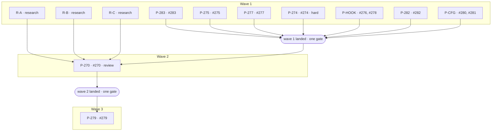

# Plan: Settings kind follow-ups (#270, #274–#283)

## Status

- **Plan:** plan_settings_follow_ups
- **Parent plan:** plan_settings_artifact_kind (resume its fix pass, cycle 3, after this plan's wave 3 lands)
- **Active phase:** 5 — wave 5 (closing review 3 convergence row G3-274) landed in the G3 fix pass
- **Step:** awaiting /finalize: G3-274 landed in landing A and its page fix in landing B; no review call remains, so the meta-orchestrator decides the next act
- **Last update:** 2026-11-06 (G3 fix pass, landing B)
- **Refinement count (follow-up budget):** 2 of 4 (the joint fix pass, then the G3 fix pass)
- State:   review
- Tier:    high
- Tier-grammar: 5
- Updated: 2026-11-06
- Next:    /hex-finalize (joint with plan_settings_artifact_kind)
- Reviewed: 9a951ee3f76085b0a72ef62e53ece033fbc28768

---

## Header

- **Goal contract (binding):** `.agents/goals/config-artifact-type.md`, Definition of done, the follow-up block. Autonomy: never prompt. Every doubt runs § Issue resolution and is recorded below as question, research, decision. Granted acts: none. Never push, never open or edit a PR, never create an issue, never touch another repository. Out-of-scope findings go to the meta-orchestrator.
- **Issues in scope:** [#270](https://github.com/grimoire-rs/grimoire/issues/270), [#274](https://github.com/grimoire-rs/grimoire/issues/274), [#275](https://github.com/grimoire-rs/grimoire/issues/275), [#276](https://github.com/grimoire-rs/grimoire/issues/276), [#277](https://github.com/grimoire-rs/grimoire/issues/277), [#278](https://github.com/grimoire-rs/grimoire/issues/278), [#279](https://github.com/grimoire-rs/grimoire/issues/279), [#280](https://github.com/grimoire-rs/grimoire/issues/280), [#281](https://github.com/grimoire-rs/grimoire/issues/281), [#282](https://github.com/grimoire-rs/grimoire/issues/282), [#283](https://github.com/grimoire-rs/grimoire/issues/283). Each issue's "Done when" is its acceptance criterion. **Out:** [#271](https://github.com/grimoire-rs/grimoire/issues/271) and [#272](https://github.com/grimoire-rs/grimoire/issues/272) (other repositories), [#284](https://github.com/grimoire-rs/grimoire/issues/284) (concerns `main`).
- **ADR (Accepted 2026-11-04):** `adr_settings_artifact_kind.md`. This plan reopens no decision in it. #270 extends its Appendix A rows and settles Appendix B keys under the ADR's own verification rule.
- **Research:** `.agents/research/research_settings_follow_ups_harness_scope.md` (#270 scoping), `.agents/research/research_ai_config_rule_splits.md` (#280, #281, Claude Code rule loading). Not repeated. Wave 1 adds three per-harness research artifacts for #270 (R-A, R-B, R-C).
- **Excluded:** the closing-review findings, `.agents/review/review_settings_artifact_kind_closing.md`. They belong to the parent plan's fix pass (cycle 3). § Closing-review overlaps names every place a step here touches the same region.
- **Branch:** `hex/config-artifact-type`, feature checkout `/home/mherwig/.herdr/worktrees/grimoire/duo`. Workers use their own worktrees under `.agents/worktrees/<pipeline>`. **No gate or build runs in the feature checkout except the orchestrator's landing gate.**
- **Classification:** small-to-medium per issue, eleven issues, two-way doors except two append-only on-disk names (#277's cache field, any new `VendorRoot` row in #270). Tier `high` (auto, confident). Overlays: `architect=inline` (accepted ADR), `research=1` plus one Claude Code tooling axis (PD-24), `adversary=off`.
- **Gate command:** `env -u OCX_GLOBAL -u OTEL_EXPORTER_OTLP_ENDPOINT -u OTEL_EXPORTER_OTLP_HEADERS ocx exec -- task --force verify`. Read the real exit code. A run takes five to six minutes.
- **Refinement budget:** the goal's cap is 4 outer cycles; 2 are spent. The meta-orchestrator plans cycle 3 for the fix pass and keeps cycle 4 for CI. **A red landing gate in the feature checkout spends a cycle**, so every pipeline proves its own full gate green in its worktree before it lands (PD-3).

## Objective

Close eleven follow-up issues on this branch, one Conventional Commit per
issue, so the PR body closes each by number. Five are bugs fixed red-first
(#274, #275, #277, #278, #283). Two tighten wording (#276) and docs (#279, #282).
Two split over-budget AI-config rules (#280, #281). One extends the settings
kind to the other harnesses and to the unverified keys of the first six (#270),
under the ADR's rule that only a verified key ships.

## Scope

**In:** each issue's "Done when"; the per-harness research for #270; the
`/upstream-refresh` coverage for every harness; regression tests for every bug;
the catalog drift review that a CLI text change requires (AGENTS.md › First-Party Catalog).

**Out:** #271, #272, #284; the closing-review findings; a YAML or JSON5 splice
engine (Goose, OpenClaw, PD-16); a project-scope settings target for a new
harness (PD-17); any change to the meaning of a first-slice settings row (PD-19);
a line-budget test over all rules (four other first-party rules exceed 200 lines;
reported out of scope).

## Decisions (§ Issue resolution: question → research → decision)

| # | Question | Research | Decision |
|---|---|---|---|
| PD-1 | Which tier and overlays? | No new one-way door; the accepted ADR covers the kind; eleven issues across six areas, each small. | Tier `high`, auto, confident. `architect=inline`, `research=1` (+1, PD-24), `adversary=off`. One spec reviewer, deep-reasoning class (`hex.md` override). |
| PD-2 | How does each issue get its own commit when workers cannot record? | Parent plan § Worker rules: workers stage, the orchestrator records under the five-minute verify marker. The commit hook blocks any `git commit` without a fresh marker. | Each step ends with `git add -A` and `git write-tree`; the report names the tree id. An issue's patch is `git diff --binary <tree before its first step> <tree after its last step>`. Commit types: `fix(install)` #274, #275; `fix(settings)` #276; `fix(catalog)` #277, #282; `fix(hook)` #278; `test:` #283; `docs:` #279; `chore:` #280, #281; `feat(settings)` #270. Each body ends `Closes #N`. **Ask of the meta-orchestrator:** keep the per-issue commits, or at least every `Closes` line, through `/hex-finalize`. |
| PD-3 | How to land without spending a refinement cycle on a red gate? | Goal § Loop shape counts a red gate's fix pass as a cycle. The parent run's wave gates went red once on missing `clippy`. `git apply --index` refuses a path whose working copy differs from the index. | Every pipeline's last step runs the full gate in its own worktree, at most two such gates at once. A wave lands only from a clean feature checkout (PD-29). The orchestrator applies each issue patch with `git apply --index --3way` in the landing order below. It runs one full gate and saves `git write-tree` as the gated tree. Then it runs `git reset -q`, and for each issue `git apply --cached <patch>` and records it. After the last record, `git diff --exit-code <gated tree> HEAD` must exit 0. |
| PD-4 | What causes #283? | `test/src/stdio_drivers.py` `drive()` passes the whole payload through `subprocess.run(input=…)`, which closes stdin at once. `src/mcp/server.rs:183-201` serves `rmcp` until stdin EOF. The recorded failure has the id 1 response and no id 2 (retro `2026-11-05.md:291-298`). The MCP stdio transport defines a client closing stdin as shutdown. | Hypothesis H1: the driver closes stdin before a slow live search answers, and the server ends with id 2 in flight. Under `-n auto` the search is slow. The product stays unchanged. The fix goes into the test drivers only. Step 1 must reproduce it before any fix. If it does not reproduce, the step tests H2 (shared `grim-test/paged-150` namespace with `test_search_paging_oci.py`), H3 (the 60 s timeout under load) and H4 (a capped checkpoint served mid-build). The step then records the cause it found. |
| PD-5 | How to prove #283 fixed without 50 full-suite runs? | One full run takes 5–6 min. Fifty would take about 4.6 hours of serial machine time and compete with this run's gates. The DoD allows "isolated with a recorded reason" as the alternative. | The proof has three parts. (a) A deterministic regression test that loses id 2 every time before the fix, independent of load. (b) 50 consecutive runs of `tests/test_mcp.py tests/test_mcp_fetch.py tests/test_search_paging_oci.py tests/test_stdio_drivers.py` under `-n auto`. The orchestrator runs them in the background in the P-283 worktree while wave 1 builds, for real load. (c) Every full gate this run makes. No new dependency: no `pytest-repeat`, no `uv.lock` change. The PR body states the substitution. #283 lands with wave 1 whether or not (b) has finished, because its driver fix protects the wave 1 landing gate itself. (b) must finish before the meta-orchestrator ticks #283's box. A failure in (b) reopens P-283 step 1 as forward work. Accepted by the meta-orchestrator, 2026-11-05: recorded in the goal file § Context. |
| PD-6 | How is #279 re-recorded, and is the recorder available? | The `test:demo` task (`test/taskfile.yml:123-142`) builds and runs `ocx exec -- uv run pytest recordings/ -v` with `GRIM_COMMAND`. It does not forward `CLI_ARGS`. The recorder is a pexpect PTY harness (`test/recordings/cast_recorder.py`). Present on this machine: ocx, uv, task, zot, cargo, and `test/.venv` with pexpect 4.9.0. asciinema is not needed. The stale line is `docs/public/casts/registries.cast:798`; the current text is `src/command/command_error.rs:43`. | Forward `{{.CLI_ARGS}}`, so `task test:demo -- -k registries` records one cast. With no arguments every cast still records. Pin `pass --kind skill\|rule\|agent\|bundle\|mcp\|hook\|settings` in the expect step. No gate-time drift test, because the recorder stays out of the gate (DOC-EX-12). Record in wave 3, against the binary from the head that carries every `src/**` change. |
| PD-7 | How to fix #277 with a bounded read cost? | `build_entry` reuses a prior row whose tag and digest match with no manifest fetch (`registry_catalog.rs:1394`), so a kindless row never gains a kind. A foreign repository is legitimately kindless in two ways: an image index takes the `InvalidManifest` branch (:1417), which records the digest and no manifest, and a plain image manifest yields no kind. A transport error and `Ok(None)` record no digest, so the next refresh retries anyway. A `CatalogVersion` bump would re-read every row and make an older grim refuse the cache. At tag v0.15.1, `CatalogEntry` has no `deny_unknown_fields` (`registry_catalog.rs:82`). At tag v0.14.3 it has one (:244), and a cache it cannot read is "rejected and rebuilt" (the S-015 path, documented at :170). A 0.15 cache with a `kind` already triggers that. | Add `kind_read: bool` to `CatalogEntry` (serde default `false`, serialized only when `true`). This is an append-only cache name. It is set on a kindless row whose digest is recorded: a manifest read that yielded no kind, or the `InvalidManifest` branch. It is never set on a transport error or `Ok(None)`. A kindless row without it gets one manifest fetch at the next refresh, even when its digest is unchanged. After that there are no extra reads. No version bump. |
| PD-8 | What does #278 change, and where? | `HookPolicy::feature_off_message` (`src/hook/policy.rs:210-217`) is already scope-aware for settings only. The hook text is at :373. The status hook rows go through `arming_message` (`src/command/status.rs:912`, called at :840 and :884). `grim hook list` gets its verdicts from `status::hook_arming` (`src/command/hook/list.rs:28-30`), so the same arm serves it. The install warning reads `refusal_reason`, which calls `feature_off_message` (`installer.rs:697`, `status.rs:1451`). The `cause.message()` builders at `list.rs:384` and `hook_report.rs:165` are test helpers, and so are the `tui/app.rs:9106,9109` calls. Docs and catalog quoting the remedy: `hooks-troubleshooting.md:29` (`:52` already has `--global`), `catalog/skills/grim-usage/references/troubleshooting.md:311`, `catalog/hooks/README.md:104,:128`, `consume.md:565` (already says "per scope"), `configuration.md:100` ("at project or global"). | Add a `(Hook, Global)` arm in `feature_off_message` and a `(FeatureFlagOff, Global)` arm in `arming_message` (C-021–C-023). Project text, cause tokens, state tokens and JSON keys stay byte-identical. `HookArmingCause::FeatureFlagOff.message()` and the test helpers stay as they are. The docs drift edits only lines that describe a global-scope run: `hooks-troubleshooting.md:29`, grim-usage `troubleshooting.md:311` and `catalog/hooks/README.md`. `consume.md:565` and `configuration.md:100` already cover both scopes and stay, and `consume.md` remains P-282's file. |
| PD-9 | What does #276 change, and may `src/hook/consent.rs` be touched? | The record-failure log lives in `src/command/hook_consent.rs:596`, not in `consent.rs` as the issue says. The prompt-failed log is already kind-aware (`ConsentNoun::prompt_failed`, `src/hook/trust.rs:372-377`), pinned by `a_failed_prompt_is_logged_for_what_it_asked` (trust.rs:509-517). `ArmRefusal` (`src/install/hook_registrar.rs:130`) has no kind. Its `GrimHomeRelative`, `GrimHomeInWorkspace` and `GrimHomeShared` variants reach settings at `settings_phase.rs:324,:726` and the status settings row. Closing-review security finding S-1 sits in `src/hook/consent.rs`. | Pass the `ConsentNoun` into `record()`, so the warning uses that noun's words: hook text byte-identical, settings and mixed runs naming workspace consent and their own "nothing applied" words. Give `ArmRefusal` a kind-aware reason for the three `GRIM_HOME` variants, used at the settings call sites; hook text stays byte-identical. The prompt-failed box is met by the existing test, cited in the commit. `src/hook/consent.rs` is not edited. |
| PD-10 | How to fix #274's four gaps without moving `--client` narrowing? | Gap 1: `preserved_recorded_clients` (`installer.rs:1625-1660`) rolls intact out-of-selection outputs forward. It cannot tell a dropped client from a `--client`-narrowed one. The re-register clears `adopted` (:2967), and the reaper then removes the entry. Gap 2: the reap retain matches by client name (`prune.rs` ~:633-648), so it drops a kept-modified sibling. Gap 3: the classify loop pushes a client once per output, and `reaped` is sorted but not deduped. Gap 4: the stale-removal loop (:2997-3028) ignores `adopted`; `reap_relocated_roots` (:2311) is the model. Evidence: PF-2 report. | Gaps 2 and 3: key the retain on the output (target plus entry), and dedup the client lists. Gap 4: honour `adopted` in the stale removal: warn, name it in `abandoned_entries`, keep the member, unless `--force`. Gap 1: pass the configured client set to `preserved_recorded_clients`. An adopted entry output of a client outside that set is carried forward verbatim, never re-registered, and left to the reaper. Every other case keeps today's roll-forward. Mark the pipeline `hard`. |
| PD-11 | How to fix #275? | `cut_range` (`json_splice.rs:1154`) does not know about comments. `remove_member` (:217) and `remove_array_element` (:319) cut through it, and `remove_nested_handler` (:660) does too. The comment-safe `cut_item` (:1719) serves the `_at` functions, but it handles only a comment before the comma. The closing-review Warn at `json_splice.rs:247` is the same defect, made easier to reach. | Route both older functions, and through them `remove_nested_handler`, through `cut_item`. Extend `cut_item` for a comment after the comma, and extend the `_at` tests to match. Every result parses. A comment outside the removed member survives. Output for comment-free input stays byte-identical. This also closes the `json_splice.rs:247` Warn, which the fix pass then marks as already fixed. |
| PD-12 | Where do #280's dated rows go? | Claude Code loads every `.md` under `.claude/rules/` recursively. A file with no `paths:` loads at launch (research_ai_config_rule_splits.md, answer 1). `upstream_stale.py:23` hard-codes the watchlist path, and `test_upstream_stale.py:23,:33,:336,:357` pin it. The ledger `.agents/upstream-checks.md` is read by the same script. | Keep the rule body in `.claude/rules/vendor-capability-watchlist.md`, under 200 lines, with its `paths:` and a link to the data. The rule states in one sentence why the data lives outside `.claude/rules/`. Move every dated section verbatim to `.agents/upstream-watchlist.md`, including its heading and its default-date sentence. Re-point the script and its test. Do not edit `meta-ai-config.md`: it is already at 293 lines. |
| PD-13 | How is #281 split? | The section map is in the research artifact (lines 46-50). Inbound references: `AGENTS.md:84,:102,:111`, `.claude/rules.md:76,:87,:96,:142,:145`, four skills, `deep-pass.md:18`, `hex.md:34`, a dead tracker glob `src/file_structure/**` (`post_tool_use_tracker.py:32`), and source comments. `AGENTS.md` is at its 280-line cap. | Keep `subsystem-file-structure.md` on `src/**` and `crates/**` as the core and index: Design Rationale, Telemetry, Catalog Cache, Constraints, Cross-References, and a parts index. AGENTS.md and the source comments then stay valid unchanged. Move the other sections verbatim into flat `subsystem-*.md` parts. Each part is under 200 lines by `wc -l` and has narrower `paths:` that each match at least one file and never end in `/*.rs`. Every exact glob string two rules share is declared in `.claude/rules.md`. Proposed parts: install-layout-skills-rules, install-layout-agents-mcp, install-layout-settings, install-layout-hooks, vendor-paths, client-detection, install-state (with the containment guard), path-anchors (with the anchor table). The step may regroup if a part busts the budget. |
| PD-14 | What fixes #282? | The parser accepts a path value in `[skills]`, `[rules]`, `[agents]` and `[bundles]`, and rejects one in `[mcp]`, `[hooks]` and `[settings]` (`src/config/project_config.rs:218-237`). `catalog/skills/grim-usage/SKILL.md:152-155` lists `[mcp]` as path-accepting. It also lists `grim install` among reference-accepting commands, though `install` takes no positional. The README (§ Versioning) says the catalog publishes at grim's own release version. CI overrides it with `--version <tag>`, and the fallback is "the next planned release". `publish.toml` reads 0.15.0, but `[workspace.package]` is 0.15.1, the last release. `release:prepare` bumps only `Cargo.toml`. | Fix the syntax list (and `references/consume.md` if it differs) and add a test that parses each documented form with the real binary. **Rule:** the `publish.toml` fallback equals `[workspace.package] version`. Between releases that is the last release, so a manual run re-pushes existing tags (a no-op, or a loud failure on changed content) and never mints a tag ahead of a grim release. `release:prepare` sets both, and a test pins the equality. State the rule in the header, in `catalog/README.md` § Versioning and in `.claude/rules/workflow-release.md`, whose "bumps are staged … during feature work" sentence contradicts the README. `task catalog:verify` passes. |
| PD-15 | How is #270 researched? | The scoping artifact names candidate harnesses, the two page contradictions (Kiro, Warp), and which harnesses have credential-free verbs. `deep-pass.md` § 1 (settings row) and § 2 (sandbox) give the verification method. | Three wave 1 research pipelines write `.agents/research/research_upstream_<harness>_settings_20261105.md` in the upstream-refresh template (Claims, Live CLI check, Routing, Expires). **R-A** covers harnesses with likely rows: Droid, Antigravity CLI, Kiro, Warp, Gemini CLI, Kilo. **R-B** covers harnesses with likely reasons for no rows: agents, Amp, Cline, Junie, Zed, OpenClaw, Goose. **R-C** covers Appendix B on the first six. Rows come only from the ADR's three categories: behaviour defaults, permission policy, marketplaces. A key ships only with resolved values and a stated merge. Anything else stays off, with the reason. |
| PD-16 | Rows for Goose (YAML) and OpenClaw (JSON5)? | grim splices JSON, JSONC and TOML only. `vendor_goose.rs:31-40` records a YAML splice as real work, and a new engine runs about 1,500–2,500 lines. | No rows. The reason is "no splice engine for the format", plus a re-check trigger. An engine is a follow-up for the meta-orchestrator to file. |
| PD-17 | May a new harness write a project-scope file? | Only Claude writes a project file today (`.claude/settings.local.json`, a per-developer file). Droid, Gemini, Kilo and Kiro document committed project files. Writing into one would be a new I1/T3 decision the ADR did not make. | New harnesses ship at global scope only. Each harness that documents a project file records "project scope: needs an ADR decision" as its reason. |
| PD-18 | How are real-binary checks run? | Goal § Autonomy narrowed the parent plan's PD-5. The `claude -p` fallback is struck. No harness binary runs with the owner's login, credentials or real `HOME` (`deep-pass.md` § 2). | Install from npm with `--ignore-scripts` into scratch, then run under `env -i` with a scratch `HOME`. Never use `~/.local/bin/{claude,codex}`. A non-npm binary is used only from a direct release archive, with its checksum checked where one is published. No vendor installer script runs. A check that needs a session reports "not run" with the reason. Nothing from these checks is committed as a test. codex runs under the owner's login only as `/hex-review`'s cross-model reviewer. |
| PD-19 | What about the OpenCode `permission` deprecation? | The OpenCode schema marks `permission` deprecated in favour of a `permissions` array; the docs page still shows the object form (scoping artifact, Key Findings). The first-slice rows use `/permission/<tool>`. | R-C re-checks it. If the drift is confirmed, it is recorded as a finding for the meta-orchestrator (fix pass or issue). P-270 does not change what a first-slice row means. |
| PD-20 | Is grim's `antigravity` client the Antigravity CLI? | The client's root is `~/.gemini/config`. The CLI's settings file is `~/.gemini/antigravity-cli/settings.json` (scoping artifact). | R-A confirms it from primary sources before any row. If they are different products, no rows, with that reason. A settings file outside every existing root needs a new append-only `VendorRoot` row (`path_anchor.rs`: `SHIPPED_ANCHOR_TAGS`, `hermetic_vendor_roots`). |
| PD-21 | How are the Kiro and Warp page contradictions settled? | Kiro: the configuration page (2026-10-21) says `cli.json` is global only; the settings reference (2026-11-03) says workspace values override per key. Warp: two pages disagree on hand-editing `agents.execution_profiles`. | The newer reference page wins only when a credential-free check agrees (`kiro-cli settings list --all`, if it runs without login). Otherwise every key whose behaviour depends on the contradiction stays off, with the reason. Global-only rows are unaffected by Kiro's scope question (PD-17). |
| PD-22 | How big is #270? | About 250–350 lines per JSON harness, mostly tests and docs; TOML adds only `settings_config_format`. Six harnesses are candidates, and the Appendix B keys add rows to six vendors. | Estimate 1,000–2,200 changed lines across one `feat(settings)` commit. P-270 builds one or two harnesses per step, serially. It runs only after R-A to R-C settle which harnesses get rows (wave 2). |
| PD-23 | Does #270 touch the ledger `.agents/upstream-checks.md`? | The ledger already holds one row per harness: 18, without the vendor-neutral `agents` target. grim ships 19 clients (`src/install/vendor_*.rs`). Closing-review S-030 sits at `upstream-checks.md:17`. | No. Coverage goes through the `domains.md` "Settings keys per harness" table and the dated rows in the watchlist data file. That table has 19 rows: `agents` reads "none: no settings file, a directory convention". |
| PD-24 | Is a second researcher allowed? | `meta-ai-config.md` › Research Protocol requires research before any AI-config edit, on a Claude Code tooling axis. | One extra researcher on that axis wrote `research_ai_config_rule_splits.md`. Disclosed as a deviation from `research=1`. |
| PD-25 | Ten wave 1 pipelines exceed the concurrency cap of eight. | The cap comes from hex `protocol.md` § Worker coordination. The machine has 12 cores and 62 GB RAM, and four pipelines compile Rust. | Launch R-A, R-C, P-CFG, P-274, P-HOOK, P-275, P-277 and P-283 first. P-282 and R-B start as the first two finish. Every Rust worker sets `CARGO_BUILD_JOBS=3` and warms its target from a copy of `target/debug`. At most two full gates run at once. |
| PD-26 | Docs for #274's behaviour change? | The parent's P9 already added an `upgrading.md` note: an adopted MCP entry stays and is named in `abandoned_entries`. | P-274 adds one line to that note only if it does not already cover the pin-roll and stale-removal cases. No other pipeline in wave 1 edits `upgrading.md`. |
| PD-27 | #274 says "a two-output client keeps both outputs in the record and appears once in `reaped_clients`". Taken literally, both clauses cannot hold at once. | Reaping works per output. An unmodified output is deleted and leaves the record; a modified one is kept and stays recorded (`prune.rs` `ReapedClients` docs, ~:390-420). If both outputs stay in the record, nothing was reaped, so the client cannot appear in `reaped_clients`. The defect the issue reports is gap 2: the kept-modified output is lost from the record without being reaped. | Reading: no output leaves the record unless it was reaped. The unmodified output is reaped, and the kept-modified output stays recorded. The client appears once in each list it qualifies for (C-014, C-015). The commit body states this reading. |
| PD-28 | #274 says an adopted entry is "never reaped or removed as stale". Does `--force` still remove one? | The shipped reaper keeps an adopted entry only "without `force`". `test_force_uninstall_can_remove_an_adopted_mcp_entry` pins `--force` removal on uninstall. The threat model's N4 says a user who passes a gate they were shown is not an attacker. | Reading: never without `--force`. `--force` keeps today's meaning on all three paths: reap, stale removal and uninstall (C-013, C-016). The commit body states this reading. |
| PD-29 | How are inputs passed to workers, and where does scratch go? | The plan and both research artifacts are untracked until the meta-orchestrator commits them. `git add -A` in a worktree sweeps any copied file into an issue's tree. `.gitignore:118-119` ignores `.agents/worktrees/` and `.agents/.tmp/`. | `/hex-execute` starts only from a clean feature checkout: `git status --porcelain` is empty, because the meta-orchestrator commits this plan's artifacts first. Workers read the plan and research inputs by absolute path from the feature checkout. Scratch, baselines and run logs go to `.agents/.tmp/<pipeline>/` inside the worktree, and never into a tracked path. |
| PD-30 | (execute) Workers were to spawn in the foreground (meta-orchestrator, 2026-11-05). How are steps dispatched? | The Agent tool in this session takes no foreground option: every spawn returned at once as an async worker with a completion notice. Splitting red and green across two agents per issue would double the hand-offs. | One fresh agent per issue (per issue-sized slice for P-274), doing that issue's red step and then its fix step, red evidence quoted. At most eight live (PD-25). First eight: P-283, P-275, P-277, P-274 steps 1-3, P-HOOK #276, P-CFG #280, R-A, R-C. Each later slice (P-274 step 4, P-HOOK #278, P-CFG #281, P-282, R-B) starts as a slot frees. The orchestrator waits on completion notices and never polls a worker. Disclosed deviations: async spawn, and one agent per issue rather than per step. |
| PD-31 | (execute) Who runs each pipeline's full gate (PD-3), given at most two at once and workers that never wait? | Workers in one foreground batch finish close together, so worker-run gates would stack well past two, on a machine already at load 24 with two other repos gating. | Workers end at `git add -A` and `git write-tree` with their narrow checks only. The orchestrator runs each finished pipeline's full gate in its worktree in the background, two at a time, then checks that `git add -A && git write-tree` still gives the reported tree. A red pipeline gate is the pipeline's own last step (PD-3) and goes back to a fixer in that worktree: an inner check, not a refinement cycle. A red landing gate in the feature checkout spends a cycle. |
| PD-32 | (execute) Where do R-A to R-C write while wave 1 lands, given PD-29's clean landing checkout? | Untracked files in `.agents/research/` make `git status --porcelain` non-empty during the landing. `.agents/.tmp/` is gitignored. | Research artifacts go to `.agents/.tmp/research/` in the feature checkout. P-270 step 1 moves them into `.agents/research/` in its worktree, so they join the #270 commit. |
| PD-33 | (execute, P-277) PD-7 and C-012 rest on "a 0.15 cache with a `kind` already makes 0.14.3 refuse it". The worker found that false: `CatalogEntry` has the same fields at v0.14.3 and v0.15.1. So a `kind_read: true` row is the first thing that makes a 0.14.x grim refuse an OCI-only cache. Keep the field, or move the marker? | `stability.md` § catalog cache: "a cache is not a contract and rebuilding it costs one network refresh"; a refused cache reads cold online and the refusal surfaces offline; builds from 0.15 ignore unknown fields. The same page says "a user who only browsed OCI registries directly is not exposed", which `kind_read` makes untrue for a registry holding foreign (kindless) repositories. Moving the marker into the sync sidecar would avoid the exposure, but a sidecar mismatch then re-reads every kindless row, and it reopens an accepted plan decision for a downgrade path the contract already accepts. | Keep `kind_read` on `CatalogEntry` (PD-7 stands; additive, `CatalogVersion` V1). Correct the docs in the #277 commit: `stability.md` § catalog cache and `upgrading.md` § catalog-cache-downgrade name the new exposure (a downgrade to 0.14.x or earlier: online one rebuild; offline the refusal shows until an online run or `$GRIM_HOME/catalog/` is deleted). C-012 now reads: 0.15.1 lists the same rows (verified); 0.14.3 refuses a cache holding a `kind_read` row and takes the S-015 path. |
| PD-34 | (execute, the P-270 boundary) Which harnesses get rows, and which keys stay off? | R-A (`research_upstream_{antigravity,droid,kiro,warp,gemini,kilo}_settings_20261105.md`), R-B (`research_upstream_other_harnesses_settings_20261105.md`), R-C (`research_upstream_appendix_b_settings_20261105.md`). Every candidate key has a Claims row and a Routing verdict there; every key left off has its reason in that Routing line. Precedent for the category reading: the first slice ships `/spinnerTipsEnabled` and `/includeGitInstructions` as behaviour defaults, and narrows `/permissions/defaultMode` per scope. | Ship every key each artifact routes as a row, global scope only (PD-17), with its stated type, merge class and limit. **Rows:** Antigravity (new append-only root `antigravity-cli` = `~/.gemini/antigravity-cli`, PD-20: same product), Droid (`droid-root`), Kiro (`kiro-root`, flat dotted pointers), Warp (TOML; Linux needs a new append-only root `warp-config` = XDG `warp-terminal`, macOS uses `warp-root`, Windows has no grim root so Warp settings decline there), Gemini (`gemini-root`), Kilo (`kilo-config-root`, `kilo.jsonc`), Amp (`amp-root`, the `settings.json` grim's MCP entry already uses; eight UI and attribution toggles count as behaviour defaults by the `/spinnerTipsEnabled` precedent; limit: which of `settings.json` and `settings.jsonc` wins is unstated). Appendix B: Claude 10, Codex 4, Copilot 42, OpenCode 1, Qoder 1. **OpenCode `/share`** ships as `Enum[manual, disabled]`: `auto` publishes every session, the data-egress reason the research gives for the Copilot `remoteExport` and telemetry keys, decided here because no owner answer can be asked for. **No rows:** agents (no settings file), Cline (no keys documented), Junie (no per-key precedence across its two files), Zed (macOS path contradicts itself, Windows unstated), OpenClaw (JSON5) and Goose (YAML) (no splice engine), Cursor (no Appendix B key resolved). Each carries the re-check trigger its artifact names. Warp `[agents.profiles]` / `execution_profiles` stay off (PD-21 unresolved). |
| PD-35 | (execute, P-270 step 2b) Kilo string rows (`/model`, `/small_model`, `/default_agent`) and the `{env:` / `{file:` expansion tokens: check them, or drop the rows? | The 2026-09-27 Kilo research (row I1) says Kilo keeps OpenCode's config replacer and expands both tokens in any config string. Unchecked, a published package could make Kilo read a local file or variable into its config. `src/oci/settings.rs` already refuses both tokens for OpenCode (`ExpansionToken`), outside the closing review's protected lines 174-187. | Extend that check from OpenCode to OpenCode and Kilo (`EXPANDING_VENDORS`, 4 lines), with a Kilo unit test; the rows ship. `src/oci/settings.rs` joins P-270's file set for this change only. `settings.md:155` ("An OpenCode value") gains Kilo in step 4. |
| PD-36 | (execute, P-270 step 2b) Does Droid's `/extraKnownMarketplaces/<name>` take Claude's github-only source narrowing? | Claude's narrowing (`CLAUDE_SOURCE_KINDS`) records what the first slice verified (field list: shape from `research_marketplace_native_consumption.md`), not a security rule. Copilot's row already ships `directory`, `git` and `github` sources without narrowing. The Droid research verified all four documented shapes (`github`, `url`, `local`, `git-subdir`) against `droid doctor` 1.3.0. The credential-in-URL check applies to every marketplace row. | No narrowing: Droid takes the four verified shapes, with the credential-in-URL check, on the Copilot precedent. |
| PD-37 | (execute, P-270 step 2c) Gemini resolves `$NAME`, `${NAME}` and `${NAME:-default}` in every string value of `settings.json` (configuration reference; `packages/cli/src/utils/envVarResolver.ts`). The Gemini research artifact missed it. Check it, or drop the string rows? | Same exposure as PD-35: a published package could pull a user's environment into Gemini's config. Keys are not resolved. | Refuse a Gemini string value holding `$` followed by a word character or `{`, with the existing `ExpansionToken` error (exit 65, no new variant), in `src/oci/settings.rs` outside lines 174-187. The rows ship. Step 4 names it at `settings.md:155`, in the Gemini artifact and in the watchlist. `a_client_without_settings_rows_is_an_unknown_vendor` moved from Kiro to Zed. |
| PD-38 | (execute, P-270 step 2d) Two new append-only roots (`antigravity-cli`, `warp-config`) and nine new settings anchors are missing from `.claude/rules/subsystem-path-anchors.md`, a #281 part outside P-270's listed files. Who adds them? | C-035 names "the settings part of the split file-structure rule"; after #281 the root table and the per-kind anchor rows live in `subsystem-path-anchors.md`, and the per-harness file rows in `subsystem-install-layout-settings.md`. | Step 4 adds them: both parts join P-270's file set. Warp's limits (live reload, fallback on an unknown value, Preview builds not covered, no Windows root) go to `settings.md` and the watchlist in the same step. |
| PD-39 | (execute, P-270 step 3a) A user's `"attribution": false` sits where Claude's three `/attribution/*` rows recurse. Without `--force` grim refuses and leaves `false` byte-identical (tested). Should a forced write also keep `false`? | The shipped rule for a value of another type at a piece's container: refuse without `--force`, replace with it (`settings_writer::clear_the_way`). PD-28 and threat model N4: a user who passes a gate they were shown is not an attacker. A special case would edit `settings_phase.rs`, which the closing-review fix pass owns. | Keep the shipped rule: `--force` replaces `false`, as for any type conflict. No special case. |
| PD-40 | (execute, P-270 step 4) C-036 asks for "a dated row in the watchlist data file" for each newly verified key. With 227 new rows, one watchlist row per key would duplicate `settings_fields()` and `settings.md#fields`. What does it mean? | The watchlist's "Settings keys watchlist" section states its own shape: `/upstream-refresh` re-checks every key row per harness through the `domains.md` table, and the watchlist rows carry the limits (`on-limited`) and file-path claims. `task upstream:stale` reads the dates on those rows. | Each harness with new rows gets one dated row ("Settings key list": the keys verified 2026-11-05 against its research artifact and vendor version), and each named limit gets its own dated row, as the shipped `on-limited` rows have. No per-key rows. |
| PD-41 | (execute, P-270 step 5) The plan-marked review returned Request Changes: 1 Block, 3 Warn, 5 Suggest. B1: Gemini `/security/folderTrust/enabled` shipped; `false` turns off the gate that keeps an untrusted repository's `.gemini/settings.json`, `.env` and MCP servers from loading. Fix it inside the pipeline, and does that spend a refinement cycle? | Goal § Loop shape: "Inner review-fix rounds do not count"; the outer cycle is a review ⇄ execute pass after execute. Step 5 is P-270's own last step before it lands (PD-31 reads a pipeline's own gate the same way). Threat model T3; the Antigravity artifact keeps `/trustedWorkspaces` off and the Kiro artifact keeps `chat.disableTrustAllConfirmation` off for the same reason. | One fixer pass in the P-270 worktree, an inner round: refinement count stays 0 of 4. B1: drop the row (Gemini 34 → 33, 317 → 316 rows) with the reason "turns off the harness's folder trust gate (T3)", recorded in the Gemini artifact as a dated note. Rule for later rows: a key that switches off a harness's workspace or folder trust gate stays off. W1: move the four Codex rows after the shipped `rules` row, unless code needs the own-file row last. W2: name all thirteen harnesses in the five grim-usage and grim-authoring lines (AGENTS.md › First-Party Catalog drift review). W3: document the quoted dotted key form (`"chat.defaultModel"`). Suggests S1 to S4 are applied; S5 (Warp detected by `~/.warp`, its Linux settings in XDG `warp-terminal`) joins the Antigravity detection finding for the meta-orchestrator. `vendor-capability-watchlist.md:26` drops its stale row count. |
| PD-42 | (execute, G-282) The fix brief tied the publish workflow's C-026 contradiction to `GRIM_ALLOW_HOOKS`; which contract is it? Which commands take a path? | Plan line 154 makes C-026 the catalog-version contract; `grim export plugin ./x` exits 0 like `grim install ./x`; `grim --offline add <ref>` exits 69, not 81 | The workflow comment at :9 says versions bump through a PR. SKILL.md and `subsystem-cli-commands.md` name `add`, `install` (dev-install) and `export plugin` as taking a path. The drift test parses every documented short and qualified form through `grim context`, and does not pin the offline exit code |
| PD-43 | (execute, G-275) The brief asked to re-run "the existing generated tests"; none existed. And the byte-order-mark fix left `status` reading an MCP entry `missing` | Search of `json_splice.rs` tests; a probe after the splice fix: a repeat install read `updated` | A bounded sweep (6 comment shapes, 1 to 3 items, every position, both bracket placements, over 5,000 cases) is added. `json_config::parse_object` also reads past the mark, so the integrity read agrees with the splice (acceptance test over `opencode.json` and `.jsonc`). A file holding only the mark is still refused |
| PD-44 | (execute, G-270R) Verdicts the records step had to make | Fetched upstream pages, quotes checked 19 of 19 | Copilot `trustedFolders`: off for good, it is internal state and writing it pre-trusts a folder. Cursor `autoAcceptWebSearch`: off, no type or pointer upstream. Amp: no expansion for its rows; `AMP_SETTINGS_FILE` is in the binary's help but not the docs, so not honoured. S-030 read one surface, so the ledger's `Last check` stays 2026-09-27 with the reason in Notes. Claude's project `/sandbox/enabled` keeps its row; its limit is in the settings Limits list |
| PD-45 | (execute, G-274) How does every install pass learn `[options].clients` when `install_and_persist`'s callers lie outside the pipeline's files? Is the drift check per client or per output (N-W14)? What does a drifted stale member get under `--force`? | Callers of `install_and_persist`; the C-013 contract; a two-output Copilot with one edited file refused `RefusedUntracked` on the intact one; `install` refuses a drifted stale member without `--force` | `install_and_persist` reads `[options].clients` from its `config_path` itself (a warning and no carry-forward when it cannot); PD-48 moves that list onto `InstallTarget`. The settings set stays `None`. The check is per client, not per output: registering a client rewrites every file it owns, so one edited file would refuse the whole pass. A dropped client with one edited file stays whole at the old pin, and the reap then keeps the edited file and reaps the intact one (owner: `test_dropped_client_keeps_its_edited_file_and_reaps_the_other`). A drifted or unreadable stale member is kept and named in `abandoned_entries`, even under `--force`: no new delete path. Skipped Suggests: one keep-adopted helper and the `install_all_before_reap` name wait for the planned `InstallPass` context; prune's refcount keyed on names has no reachable case (one footprint, one hash) |
| PD-46 | (execute, G-270) Decision 6's second withheld case, as the records step wrote it, also withholds an output whose anchor is not the root this host resolves (Warp `warp-root` read on Linux). Implement that half? | `settings_file_here` per client; the Cursor existing-file order and the Copilot and Kiro moved-root acceptance cases; Warp's file is `settings.toml` below either root | No. Comparing anchors withholds Cursor's moves between its two roots on one host and the moved-root cases, so the match compares the path below the anchor and withholds only where the client has no settings file here. The ADR case is reworded to that rule. Residual: a Warp output carried between macOS and Linux stays visible at the other platform's root, a file that platform's Warp does not read; a per-host set of producible anchors would close it and is on the out-of-scope list |
| PD-47 | (execute, G-270) Call 1 line 26 (hook payload key checked by shape only, `is_hook_payload`) and line 27 (an unknown client string dropped at load is lost on the next save): fix now? | The workspace key is not canonicalised; ADR Decision 6; `only_a_settings_output_is_ever_set_aside` | Both stay deferred. Line 26: an equality check on a key that is not canonical would drop a moved workspace's hook records and strand their payloads, and arming stays gated by consent. Line 27: either remedy changes Decision 6, and withholding every kind breaks the pinned rule that only a settings output is set aside |
| PD-48 | (execute, G3-274, C3-W29) How does every install pass learn `[options].clients` without `install_and_persist` parsing the config file a second time? | Every mutating `InstallTarget::parse` caller (`install`, `add`, `update`, the TUI install paths) passes the resolved scope's raw `[options].clients` as `config_default`, the list the second load re-read. `InstallTarget::new` callers are tests and the settings uninstall target, which installs no MCP server. `install_all_with_progress`'s one production caller, the dev-install refresh, never installs one either | `InstallTarget::configured_clients(&self) -> Option<&[ClientTarget]>`, filled by `parse` from `config_default` before detection. It is `None` when that list is empty or blank, and always from `new`. A `--client` flag never fills it. Under a flag, an unparseable config list warns and configures nothing; config load refuses such a list first. The installer reads the set from the target on every pass, and `install_all_before_reap`'s trailing set now feeds only the settings step. The second load is deleted |
| PD-49 | (execute, G3-274, D-9) Removing a container's only item drops the container with its interior comments (rules and MCP uninstall). Does that contradict C-005? | `json_splice.rs`'s container removal predates the branch ([6f16d0b](https://github.com/grimoire-rs/grimoire/commit/6f16d0b)). The settings writer keeps a commented emptied container (`empty_container_has_comment`) | C-005 holds: its removed span includes the emptied container member. Keeping a commented emptied container in the flat removals would change released kinds, so that change is out of scope and goes on the out-of-scope list. *Superseded 2026-11-10 by issue [#305](https://github.com/grimoire-rs/grimoire/issues/305) (owner decision): `remove_member` and `remove_array_element` now keep an emptied container that holds a comment, hook cascade included; a container without a comment is still cut whole, byte for byte as before.* |
| PD-50 | (execute, G3-274, D-7) s5's half of C3-W37: a client carried at the old pin inside a record at the new pin, then put back in `[options].clients`, reads `installed` while its registration holds the old definition. Fix now? | The integrity gate answers a no-op before any fetch when every output is intact, the pin is unchanged and the record covers every target client. A record holds one pin, so a carried output looks like a rolled one without the descriptor or a per-output pin | Deferred to the out-of-scope list. Closing it needs a fetch on every no-op or a per-output pin in install state, a schema addition. `grim update` reaps the carried client in the same run, so only `install`, `add` and the TUI leave it carried until the next `update` |

## Component contracts

**#283 — test drivers (P-283)**

- **C-001** A JSON-RPC test driver keeps the server's stdin open until a response has arrived for every request id it sent, or the timeout ends. Then it closes stdin and waits for exit. A payload with no request ids behaves as today.
- **C-002** Drivers whose process reads stdin to EOF before acting (the hook launcher, `grim hook run` runtimes, the telemetry contract) behave exactly as today. The new behaviour is opt-in for MCP drivers. `stdio_drivers.drive` keeps its current semantics, and `test_mcp_fetch._drive` and every other `grim mcp` driver found by grep use the new path.
- **C-003** A deterministic regression test serves a registry stub on loopback that delays its catalog answer. A `grim_search` call through the shared MCP driver gets its id 2 response. Before the fix it fails every run, whatever the load.
- **C-004** The bounded proof from PD-5 runs with zero failures and is recorded in § Schedule log.

**#275 — JSON splice (P-275)**

- **C-005** `remove_member` removes the first, a middle, or the last member when a line or block comment sits before or after the separating comma. The result parses as JSONC. Every comment outside the removed member's own span survives.
- **C-006** `remove_array_element` meets C-005 for array elements. `remove_nested_handler` meets it through the same cut.
- **C-007** `remove_member_at` and `remove_array_element_at` also handle a comment after the comma.
- **C-008** For input with no comments, the output of all five functions is byte-identical to today's. Existing tests pass unchanged.

**#277 — catalog cache (P-277)**

- **C-009** `CatalogEntry` gains `kind_read: bool`, serde default `false`, serialized only when `true`. It is set on a kindless row whose digest is recorded: a manifest read that yielded no kind, or the `InvalidManifest` branch (`registry_catalog.rs:1417`). It is never set after a transport error or `Ok(None)`. `CatalogVersion` stays V1.
- **C-010** On refresh, a prior row whose tag and digest match is reused without a manifest fetch only if it has a `kind` or `kind_read: true`. A kindless row without `kind_read` costs exactly one manifest fetch. It then carries the derived kind, or `kind_read: true` when there is none.
- **C-011** Upgrade fixture: a raw V1 cache, as 0.15.1 writes it, holds three kindless rows with unchanged digests: a grim settings artifact, a foreign plain image manifest, and a foreign image index (the `InvalidManifest` stub). The first refresh makes exactly three manifest fetches, and the settings row then has `kind: "settings"`. The second and third refreshes make zero. The fetches are counted with the `Knobs` counters in the `registry_catalog.rs` tests.
- **C-012** A grim 0.15.1 binary (`GRIM_OLD_BIN`, parent § Environment) runs `grim search --offline --format json` over a cache the new grim wrote. It lists the same rows, so `kind_read` is ignored. grim 0.14.3 rejects and rebuilds the cache (`deny_unknown_fields` at tag v0.14.3 `registry_catalog.rs:244`, the S-015 path at :170). Any 0.15 cache that holds a `kind` already triggers that, so nothing new breaks. The step quotes both lines in its report.

**#274 — MCP reap (P-274)**

- **C-013** A `grim update` that drops a client from an explicit `[options].clients` never removes an MCP entry the client adopted. This holds when the same update rolls that entry's pin to a new value. The member stays byte-identical, the output leaves the record, and `abandoned_entries` names it. With `--force` it is removed.
- **C-014** A dropped client with two outputs, one locally modified, has the unmodified one reaped and removed from the record. The modified one stays recorded and its file is untouched. No output leaves the record unless it was reaped (PD-27).
- **C-015** `reaped_clients` and `kept_modified_clients` each list a client at most once, sorted.
- **C-016** The stale-entry removal in `install_mcp` skips an adopted entry without `--force`. It warns, names the entry in `abandoned_entries`, and leaves the file byte-identical. With `--force` it removes the entry.
- **C-017** A `--client`-narrowed run keeps today's roll-forward, and kinds other than mcp are unchanged. Every existing prune, installer and update test passes unchanged.

**#276 — consent wording (P-HOOK)**

- **C-018** When the consent record cannot be written, the warning is chosen by what was asked. A unit test pins all three texts side by side:
  - hooks only, byte-identical to today: `hook consent could not be recorded; nothing armed`
  - settings only: `workspace consent could not be recorded; nothing applied`
  - both: `workspace consent could not be recorded; nothing armed or applied`

  The `nothing …` tails are `ConsentNoun::words().undone` (`trust.rs:339-366`).
- **C-019** `ArmRefusal`'s three `GRIM_HOME` variants read as follows on the settings path: the `settings_phase.rs` install and uninstall warnings and the status settings row `message`. The hook text (`hook_registrar.rs:207-235`) and every cause token stay byte-identical. A unit test pins the hook and settings text for each variant.
  - `GrimHomeRelative`: `GRIM_HOME is a relative path, so the settings record would resolve inside the workspace`
  - `GrimHomeInWorkspace`: `GRIM_HOME resolves inside this workspace, which would make the settings record repo-resident`
  - `GrimHomeShared`: `on Windows, GRIM_HOME is not a local path under your user profile, so another host could change this host's settings records`
- **C-020** The prompt-failed log is already kind-aware. The commit cites `a_failed_prompt_is_logged_for_what_it_asked` as the evidence. `src/hook/consent.rs` is unchanged.

**#278 — hook flag-off remedy (P-HOOK)**

- **C-021** For a hook at global scope, `HookPolicy::feature_off_message` reads ``hooks are gated; enable them with `grim config set --global options.experimental.hooks true` ``, and so does the `grim install --global` warning that calls it. At project scope it stays byte-identical. The FS-1 test that asserts one text at both scopes becomes a per-scope pair: a deliberate contract change for hooks at global scope.
- **C-022** In `grim status --global --format json`, a hook row with cause `feature-flag-off` has `message`: `hooks are disabled for this scope; run grim config set --global options.experimental.hooks true, then grim install --global`. Cause, state and every JSON key are unchanged, and project scope stays byte-identical.
- **C-023** `grim hook list --global --format json` carries the C-022 message in `arming[].message`, because it reads `status::hook_arming`. An acceptance assertion pins it. No other production surface prints the remedy. The `cause.message()` builders at `list.rs:384` and `hook_report.rs:165` and the `tui/app.rs:9106,9109` calls are tests and stay.

**#282 — catalog drift (P-282)**

- **C-024** grim-usage's Reference Syntax states exactly what the parser does. Path values are accepted in `[skills]`, `[rules]`, `[agents]` and `[bundles]`. `[mcp]`, `[hooks]` and `[settings]` take registry references only. Only commands that take a reference are named. `references/consume.md` agrees.
- **C-025** A test parses every form grim-usage's Reference Syntax documents, with the real binary and the cheapest command that loads `grimoire.toml` (named in the step report). The forms: a tagged reference, a digest reference, a bare reference (`:latest`), a short reference with no registry, a qualified `alias/repo` with a matching `[[registries]]` entry, and `./`, `../` and absolute local paths. Each form is written into every table the doc says accepts it, and each documented-accepted pair exits 0. The test also reads the path-accepting table list from SKILL.md. A path value in a table the doc says refuses one (`[mcp]`, `[hooks]`, `[settings]`) exits with the parser's config error code.
- **C-026** `catalog/publish.toml`'s top-level `version` equals `[workspace.package] version` in `Cargo.toml`. The header, `catalog/README.md` § Versioning and `.claude/rules/workflow-release.md` state the rule. `task release:prepare` sets both, and a test pins the equality. `task catalog:verify` exits 0.

**#280, #281 — rule splits (P-CFG)**

- **C-027** `vendor-capability-watchlist.md` is under 200 lines and keeps its `paths:`. It holds the rule body, a link to `.agents/upstream-watchlist.md`, and one sentence on why the data lives outside `.claude/rules/`.
- **C-028** The `task upstream:stale` report before and after the move lists the same rows, dates and stale count; only the source path differs. `upstream_stale.py` and `test_upstream_stale.py` read the data file, and a missing data file still reports `MISSING`.
- **C-029** Every pointer that names a dated watchlist section resolves to the data file:
  - `.claude/rules.md`
  - `hex.md:36`
  - `domains.md:17-19,:77,:92,:125,:151`
  - `deep-pass.md:19`
  - upstream-refresh `SKILL.md:23`
  - `researcher-brief.md:32`
  - `post_tool_use_tracker.py:121,:131`
  - `docs-style.md:92` (the `◐`/`✗` rationale rows)
  - `AGENTS.md:111` ("watchlist › Config roots and env vars"), a same-line edit that keeps `AGENTS.md` at 280 lines

  Mentions that name only the rule still resolve, because the rule links the data. These stay: `arch-threat-model.md:171`, `arch-principles.md:84`, `subsystem-file-structure.md:509-510`, upstream-refresh `SKILL.md:3` and `clients.md:130`.
- **C-030** `subsystem-file-structure.md` is a core and index under 200 lines and keeps `paths: src/**, crates/**`. Every other section moves verbatim, with its `{#anchor}`, into flat `.claude/rules/subsystem-*.md` parts. Each part is under 200 lines, and each `paths:` glob matches at least one file and never ends in `/*.rs`.
- **C-031** `.claude/rules.md` lists every part in By subsystem and By auto-load path, and declares every exact glob string two rules share. Every inbound reference resolves, including anchored ones. The tracker's dead glob `src/file_structure/**` is re-pointed. #281 leaves `AGENTS.md` unchanged, because the core keeps its name and globs. `task claude:tests` exits 0.

**#270 — other harnesses and unverified keys (R-A, R-B, R-C, P-270)**

- **C-032** Each of the 13 other clients gets one of two outcomes. Either it has verified rows (pointer, value type, merge class, scopes), each sourced from the harness's own docs per `deep-pass.md` § 1, with the settings file path and format. Or it gets a recorded reason for no rows, with a re-check trigger.
- **C-033** A key with unresolved values or an unverified merge stays off. Its reason is recorded in the harness's research artifact and, for the first six, in ADR Appendix B.
- **C-034a / C-034b / C-034c** R-A's, R-B's and R-C's artifacts each hold one Claims row per candidate key: key, values, merge, scope, source URL, page date. Each Routing line reads "rows" or "no rows: reason". Each Live CLI check follows PD-18 and reports one of three results with its evidence: ran and passed, ran and failed, or not run with the reason. No token, credential or credential-bearing log appears in the file.
- **C-035** A harness with rows is wired the way the first six are: vendor const and `impl Vendor` methods, `settings_config_path` and format, any new append-only `VendorRoot` row, the unit tests (pattern `vendor_qoder.rs:381-500`), `SETTINGS_HOSTS`, `SETTINGS_GOLDEN`, the row-count pins, the host lists (`path_anchor.rs:1288`, `installer.rs:7045`), `test/src/helpers.py` `_SETTINGS_ROOTS`, `test_settings_helpers.py`, `test_settings_publish.py`, the regenerated schemas (`src/command/testdata/settings.schema.json`, `docs/public/schemas/grim-settings.schema.json`), `settings.md` `#fields` and `#files`, the `clients.md` cell, ADR Appendix A and the settings part of the split file-structure rule. `settings_docs_table_matches_registry` passes. Global scope only (PD-17).
- **C-036** `/upstream-refresh` covers every harness. The `domains.md` "Settings keys per harness" table has one row for each of the 19 clients: either its keys, or "none" with the reason and a re-check trigger. No line limits settings coverage to the first six. `domains.md:73` ("Six harnesses …"), `deep-pass.md:20` ("the six `settings` harnesses") and `researcher-brief.md:28-29` (the six by name) name every harness with rows. `deep-pass.md:172-176` gives each harness with rows its credential-free verb, or `skip` with the reason. Each newly verified key has a dated row in the watchlist data file, which `task upstream:stale` reads.

**#279 — cast (P-279)**

- **C-037** `task test:demo -- -k registries` records only the registries cast. With no arguments, every cast records as before.
- **C-038** `test/recordings/casts/registries.yaml` pins the full kind list in its expect step. `docs/public/casts/registries.cast` is re-recorded against the binary from the head that carries every `src/**` change and shows that list.

## User-experience scenarios

- **S-001 (#274)** A user adopted an MCP entry for Copilot, then drops `copilot` from `[options].clients`. The next `grim update` also moves that server's pin. Expected: the hand-written entry stays byte-identical, the row's `abandoned_entries` names it, and `reaped_clients` lists `copilot` once. Error case: `grim update --force` removes the entry.
- **S-002 (#274)** Copilot has entries in both `.vscode/mcp.json` and `.github/mcp.json`, and the user edited one. Dropping copilot reaps the unedited entry and keeps the edited one recorded. `grim status` reports it modified. `reaped_clients` and `kept_modified_clients` each list copilot once, and `grim update --force` reaps the rest.
- **S-003 (#275)** `grim uninstall mcp x` runs on an `opencode.jsonc` whose `x` member sits next to a comment on either side of a comma. The file still parses, and the user's comments are still there.
- **S-004 (#276)** A settings-only `grim install` runs where the consent record cannot be written. Stderr names workspace consent and says nothing was applied. A hook-only run prints today's hook text.
- **S-005 (#276)** A settings package under a `GRIM_HOME` nested in the workspace gets `settings left unchanged: …` in settings wording. `grim status` shows the same wording in the row `message`, with cause `grim-home-in-workspace` unchanged.
- **S-006 (#278)** `grim install --global` runs with the hooks flag off. The warning names `grim config set --global options.experimental.hooks true`. `grim status --global --format json` names it in the hook row `message`. Project-scope runs print today's text.
- **S-007 (#277)** After upgrading from a grim that cached kindless rows, one refresh shows a settings package under `grim search settings`. Later refreshes make no extra manifest reads.
- **S-008 (#282)** A user copies each reference form from grim-usage. Every form documented as accepted parses. The `[mcp]` path form is documented as refused, and it is refused.
- **S-009 (#279)** A docs reader plays the registries cast and sees today's kind list.
- **S-010 (#270)** A publisher writes a settings package for a newly covered harness. `grim build` accepts a verified key and refuses an unknown or unverified one with exit 65, as for the first six. `grim install --global`, with the flag on, splices the value into that harness's global file, and `grim status` reports it.
- **S-011 (#280, #281)** An agent editing `src/install/vendor_droid.rs` gets the watchlist rule body, not 277 dated rows. Editing `src/hook/**` loads the hooks part and the core, not 984 lines.
- **S-012 (#283)** A full `task --force verify` no longer fails `test_grim_search_pages_an_oci_scope_like_the_cli` under parallel load.

## Contract wave

None. The pipelines share no new type: each issue's surface is local to its pipeline. P-270 builds on P-CFG's data file and the settings part, and on P-274's `installer.rs`, by landing order (wave 2), not by stubs.

## Parallelization

| Pipeline | Scope | Expected Files | Wave | Depends on | Marks | Status |
|---|---|---|---|---|---|---|
| P-283 | #283: C-001–C-004, S-012 | `test/src/stdio_drivers.py`, `test/tests/test_mcp.py`, `test/tests/test_mcp_fetch.py`, `test/tests/test_stdio_drivers.py` (new), a loopback stub helper under `test/src/` if needed | 1 | — | — | landed (wave 1) |
| P-275 | #275: C-005–C-008, S-003 | `src/install/json_splice.rs` | 1 | — | — | landed (wave 1) |
| P-277 | #277: C-009–C-012, S-007 | `src/catalog/registry_catalog.rs`; optional `test/tests/test_catalog_kindless_upgrade.py` | 1 | — | — | landed (wave 1) |
| P-274 | #274: C-013–C-017, S-001, S-002 | `src/install/prune.rs`, `src/install/installer.rs`, possibly `src/command/update.rs`, `src/api/update_report.rs`, `test/tests/test_reap_adopted.py`, possibly `docs/src/content/docs/upgrading.md` (PD-26) | 1 | — | hard | landed (wave 1) |
| P-HOOK | #276 then #278: C-018–C-023, S-004–S-006 | `src/command/hook_consent.rs`, `src/hook/trust.rs`, `src/install/hook_registrar.rs`, `src/install/settings_phase.rs` (call sites only), `src/command/status.rs`, `src/hook/policy.rs`, `test/tests/test_hooks_flag_off.py`, `test/tests/test_settings_status.py`, `catalog/skills/grim-usage/references/troubleshooting.md`, `catalog/hooks/README.md`, `docs/src/content/docs/hooks-troubleshooting.md` (PD-8: only lines that describe a global-scope run) | 1 | — | — | landed (wave 1) |
| P-282 | #282: C-024–C-026, S-008 | `catalog/skills/grim-usage/SKILL.md`, possibly `catalog/skills/grim-usage/references/consume.md`, `catalog/publish.toml`, `catalog/README.md`, `taskfiles/release.taskfile.yml`, `.claude/rules/workflow-release.md`, `test/tests/test_catalog_drift.py` (new) | 1 | — | — | landed (wave 1) |
| P-CFG | #280 then #281: C-027–C-031, S-011 | `.claude/rules/vendor-capability-watchlist.md`, `.agents/upstream-watchlist.md` (new), `.claude/skills/upstream-refresh/scripts/upstream_stale.py`, `.claude/tests/test_upstream_stale.py`, upstream-refresh `SKILL.md`, `references/domains.md`, `references/researcher-brief.md`, `references/deep-pass.md`, `.claude/hooks/post_tool_use_tracker.py`, `.claude/rules.md`, `.agents/memory/hex.md` (Pointers lines only), `.claude/rules/subsystem-file-structure.md` and the new `subsystem-*.md` parts, the `SKILL.md` of `code-check`, `builder`, `security-auditor`, `meta-validate-context`, `.claude/rules/docs-style.md` (line 92), `AGENTS.md` (line 111, same-line edit) | 1 | — | — | landed (wave 1) |
| R-A | #270 research: Droid, Antigravity CLI, Kiro, Warp, Gemini CLI, Kilo. Owns C-034a; input to C-032, C-033 | `.agents/research/research_upstream_<harness>_settings_20261105.md` ×6 | 1 | — | — | done (artifacts in `.agents/.tmp/research/`, PD-32) |
| R-B | #270 research: agents, Amp, Cline, Junie, Zed, OpenClaw, Goose. Owns C-034b; input to C-032, C-033 | one combined `.agents/research/research_upstream_other_harnesses_settings_20261105.md` | 1 | — | — | done (artifacts in `.agents/.tmp/research/`, PD-32) |
| R-C | #270 research: Appendix B on Claude, Codex, Copilot, Cursor, OpenCode, Qoder; the OpenCode `permission` re-check (PD-19). Owns C-034c; input to C-033 | `.agents/research/research_upstream_appendix_b_settings_20261105.md` | 1 | — | — | done (artifacts in `.agents/.tmp/research/`, PD-32) |
| P-270 | #270: C-032, C-033, C-035, C-036, S-010 | `src/install/vendor_<harness>.rs` per harness with rows, `src/install/vendor.rs` (tests), `src/install/path_anchor.rs`, `src/install/installer.rs` (test list), the vendor files of the first six for Appendix B keys, `test/src/helpers.py`, `test/tests/test_settings_helpers.py`, `test/tests/test_settings_publish.py`, both settings schemas, `docs/src/content/docs/settings.md`, `docs/src/content/docs/clients.md`, `.agents/adr/adr_settings_artifact_kind.md` (Appendices A, B), `.agents/upstream-watchlist.md`, the settings part of the split rule, `domains.md`, `deep-pass.md`, `researcher-brief.md`, the R-A to R-C artifacts | 2 | wave 1 landed (inputs: R-A, R-B, R-C, P-CFG, P-274) | review | landed (wave 2) |
| P-279 | #279: C-037, C-038, S-009 | `test/taskfile.yml`, `test/recordings/casts/registries.yaml`, `docs/public/casts/registries.cast` | 3 | wave 2 landed (P-270; every `src/**` pipeline has landed by then) | — | landed (wave 3) |
| G-275 | Convergence gap (closing review 2): C-005 contradicts, C-006 contradicts, S-003 contradicts — a line comment ending in `,` before the last or only item (N-H5, N-W23) | `src/install/json_splice.rs`, `test/tests/test_fix_splice_status.py` | 4 | P-275 landed | — | landed (joint fix pass, landing 2) |
| G-274 | Convergence gap (closing review 2): C-013 contradicts under `update --client X` (N-W12); S-002 partial — the status and CLI-list clauses (N-W21) | `src/install/installer.rs`, `src/command/update.rs`, `test/tests/test_reap_adopted.py` | 4 | P-274 landed | — | landed (joint fix pass, landing 2) |
| G-270 | Convergence gap (closing review 2): S-010 contradicts for Kiro (N-B1), partial for the other six new harnesses (N-H3); C-035 partial — the load test's host list (N-H2) | `src/install/install_state.rs`, `test/src/helpers.py`, one new `test/tests/test_settings_every_host.py` | 4 | P-270 landed | — | landed (joint fix pass, landing 2) |
| G-282 | Convergence gap (closing review 2): C-024 partial — the dev-install path (N-W34); C-025 partial — the fully-qualified test cannot fail (N-W25) | `catalog/skills/grim-usage/SKILL.md`, `test/tests/test_catalog_drift.py`, `.claude/rules/subsystem-cli-commands.md` (line 25) | 4 | P-282 landed | — | landed (joint fix pass, landing 2) |
| G-270R | Convergence gap (closing review 2): C-033 partial — no recorded reason for Copilot `trustedFolders` or Cursor `autoAcceptWebSearch` (N-W36, N-W39) | `.agents/adr/adr_settings_artifact_kind.md` (Appendix B), `.agents/research/research_upstream_appendix_b_settings_20261105.md` | 4 | R-C done, P-270 landed | — | landed (joint fix pass, landing 2) |
| G3-274 | Convergence gap (closing review 3). C-013 contradicts: after `install` carries a dropped client's adopted member at the old pin, an unchanged-pin `grim update --client X` with one missing output rewrites the member, then reaps it (C3-W37). C-016 is partial: a stale member in an unparseable `config.toml` is dropped unnamed (C3-W32). Also C3-W29 (second `[options].clients` reader), C3-W35, C3-W36 (tests that cannot fail), C3-W38 (PD-45 text) and C3-W39 (record the C-005 reading, D-9) | `src/install/installer.rs`, `src/command/update.rs`, `test/tests/test_reap_adopted.py`, this plan's § Decisions | 5 | G-274 landed | hard | merged (G3 landing A) |

Wave 1 holds ten pipelines on disjoint file sets. Two exceptions are deliberate. P-HOOK and P-282 both edit grim-usage, in different files: P-HOOK edits `references/troubleshooting.md`, and P-282 edits `SKILL.md` and `consume.md`. P-CFG and P-282 both edit `.claude/**`, also in different files. P-CFG alone edits `AGENTS.md`, line 111 only. P-270 waits for wave 2, after all of wave 1 lands. It shares `installer.rs` with P-274 and builds on P-CFG's layout, and its schema and docs tables must see every wave 1 change. P-279 waits for wave 3 because the cast records the binary's own output.

**Landing order inside wave 1** (each issue's patch, PD-3): #283, #275, #277, #274, #276, #278, #282, #280, #281. Bug fixes land first, `test:` and `fix:` before `chore:`.

**Critical path:** the longest wave 1 pipeline (P-274, marked `hard`, or R-A, which carries the most harnesses and the sandboxed installs) → wave 1 landing → P-270 → wave 2 landing → P-279.

**Shippable after wave: 1** for nine issues (#274–#278, #280–#283). Wave 2 adds #270, and wave 3 adds #279. Each wave leaves the branch green.

## Implementation Steps

Every step names its files. Every step ends with `git add -A`, then `git write-tree`, and its report gives the tree id and a Deferred list. A step that changed Rust also runs `cargo fmt --all` and `cargo clippy --locked --all-targets -- -D warnings`. A step that changed Python runs `ocx exec -- ruff check` and `ocx exec -- ruff format --check` on its files. "Red" means the new test was run before the fix and failed for the stated reason; the report quotes the failing assertion. The parent plan's § Worker and orchestrator rules and § Environment apply unchanged.

### P-283 — #283 flaky search paging (test-only)

1. **Reproduce and RCA, red.** Write `test/tests/test_stdio_drivers.py`. It runs a loopback registry stub that delays `/v2/_catalog`, configured as an `oci` source through `GRIM_INSECURE_REGISTRIES`. It drives `grim mcp` with an `initialize` and a `grim_search` call through the shared driver, and asserts the id 2 response arrives. Run it red. If H1 does not reproduce, test H2–H4 (PD-4) and restate C-001–C-003 in the report before any fix. Files: `test/tests/test_stdio_drivers.py`, a stub helper under `test/src/` if shared.
2. **Fix the drivers.** Add an opt-in JSON-RPC mode that closes stdin only after every request id is answered or the timeout ends (C-001). Keep `drive()`'s EOF semantics for the launcher, runtime and telemetry callers (C-002). Point `test_mcp.py`'s MCP helpers and `test_mcp_fetch._drive` at it. Grep `test/` for every other `grim mcp` driver. Gate: `test_stdio_drivers.py`, `test_mcp.py`, `test_mcp_fetch.py`, `test_search_paging_oci.py`, `test_telemetry_contract.py`, `test_hook_launcher.py`, `test_hook_run_runtime.py`, then the full gate. Files: `test/src/stdio_drivers.py`, `test/tests/test_mcp.py`, `test/tests/test_mcp_fetch.py`.
3. **Bounded proof (orchestrator).** Run the 50 targeted runs of PD-5 (b) in the background in this worktree while wave 1 builds. Record the pass count in § Schedule log. A single failure reopens step 1.

### P-275 — #275 JSON splice next to a comment

1. **Red tests.** In the `json_splice.rs` tests, cover `remove_member` and `remove_array_element`. Place line and block comments before and after the separating comma, and remove the first, a middle and the last member. Assert the result parses (`parsed()` helper, :3079) and that each outside comment survives. Extend the `_at` tests for a comment after the comma. Run red. Files: `src/install/json_splice.rs`.
2. **Fix.** Route both functions, and through them `remove_nested_handler`, through `cut_item`, and extend `cut_item` for a comment after the comma (C-005–C-008). Gate: `cargo test --bin grim install::json_splice::tests::`, the uninstall and managed-config unit modules, `task rust:verify`, the mcp and settings uninstall acceptance modules, then the full gate. Files: `src/install/json_splice.rs`.

### P-277 — #277 kindless cached rows

1. **Red test.** Add an upgrade-fixture unit test modelled on `refresh_skips_the_manifest_when_the_digest_is_unchanged` (:4082-4138). It writes raw V1 cache JSON with the three kindless rows of C-011, including an image-index stub that takes the `InvalidManifest` branch. It refreshes three times and counts manifest fetches with `Knobs`. Run red. Files: `src/catalog/registry_catalog.rs`.
2. **Implement `kind_read`** (C-009, C-010). Run the C-012 check with `GRIM_OLD_BIN` and quote the two v0.14.3/v0.15.1 lines. Optionally add an acceptance test that seeds a kindless cache in `GRIM_HOME` and runs `grim search settings --format json`. Gate: the module's unit tests, `task rust:verify`, the search acceptance modules, then the full gate. Files: `src/catalog/registry_catalog.rs`, optional `test/tests/test_catalog_kindless_upgrade.py`.

### P-274 — #274 MCP reap gaps (hard)

1. **Red tests, all four gaps.** Gaps 2 and 3 get `prune.rs` unit tests using `entry_output`, `record_mcp` and `write_mcp_config` (helpers at :1715-:1741), with a two-output Copilot record and one output modified. Gap 4 gets an `installer.rs` unit test: an adopted stale entry, without and with `force`. Gap 1 gets an acceptance case in `test/tests/test_reap_adopted.py`: an adopted entry, a narrowed `[options].clients`, and a same-update pin roll. Run all four red. Files: `src/install/prune.rs`, `src/install/installer.rs`, `test/tests/test_reap_adopted.py`.
2. **Fix gaps 2 and 3.** Key the retain on the output, and dedup both client lists (C-014, C-015). Gate: `cargo test --bin grim install::prune::tests::`. Files: `src/install/prune.rs`.
3. **Fix gap 4.** Honour `adopted` in the stale removal, on the `reap_relocated_roots` model (C-016). Gate: `cargo test --bin grim install::installer::tests::`. Files: `src/install/installer.rs`.
4. **Fix gap 1.** Thread the configured client set to `preserved_recorded_clients`, and carry forward a dropped client's adopted entry output verbatim (C-013, C-017). The PD-26 note goes in this step if needed. Gate: prune, installer and update unit modules, `test_reap_adopted.py`, `test_update*.py`, the mcp acceptance modules, `task rust:verify`, then the full gate. Files: `src/install/installer.rs`, possibly `src/command/update.rs`, `src/api/update_report.rs`, `docs/src/content/docs/upgrading.md`.

### P-HOOK — #276 then #278 (tree captured between them)

1. **#276 red tests.** Pin hook, settings and mixed wording for the record-failure warning, and hook and settings wording for each of the three `ArmRefusal` `GRIM_HOME` variants (C-018, C-019). Run red. Files: `src/hook/trust.rs` or `src/command/hook_consent.rs` (wherever the noun method lands), `src/install/hook_registrar.rs`.
2. **#276 implement.** Give `record()` the noun (`hook_consent.rs:586,:596`; callers :215 and :336). Make `ArmRefusal`'s reason kind-aware at `settings_phase.rs:324,:726` and on the status settings row. Do not touch `src/hook/consent.rs` (C-020). Gate: the touched unit modules, the consent and settings-status acceptance modules, `task rust:verify`. Capture tree **T276**. Files: `src/command/hook_consent.rs`, `src/hook/trust.rs`, `src/install/hook_registrar.rs`, `src/install/settings_phase.rs`, `src/command/status.rs`.
3. **#278 red tests.** Write per-scope unit tests in `policy.rs`, replacing the FS-1 one-text test at ~:1190-1220, and in `status.rs` `arming_message`. Add acceptance cases to `test/tests/test_hooks_flag_off.py` for the `grim install --global` warning and the `grim status --global --format json` message. Run red. Files: `src/hook/policy.rs`, `src/command/status.rs`, `test/tests/test_hooks_flag_off.py`.
4. **#278 implement** (C-021–C-023): the `(Hook, Global)` arm in `feature_off_message` and the `(FeatureFlagOff, Global)` arm in `arming_message`. Add the C-023 `grim hook list --global` assertion to `test_hooks_flag_off.py`. Gate: `task rust:verify`, `test_hooks_flag_off.py`, `test_settings_status.py`, the hook status and list acceptance modules. Files: `src/hook/policy.rs`, `src/command/status.rs`, `test/tests/test_hooks_flag_off.py`.
5. **#278 drift review** (PD-8). Edit only the lines that describe a global-scope run: `hooks-troubleshooting.md:29`, grim-usage `references/troubleshooting.md:311`, and `catalog/hooks/README.md:104,:128`. Leave `consume.md:565` and `configuration.md:100`, which already cover both scopes. Gate: `task catalog:verify`, the docs-quality checks on the changed pages by hand, then the full gate. Capture tree **T278**. Files: `docs/src/content/docs/hooks-troubleshooting.md`, `catalog/skills/grim-usage/references/troubleshooting.md`, `catalog/hooks/README.md`.

### P-282 — #282 catalog drift

1. **Red tests.** Write `test/tests/test_catalog_drift.py`. It covers every documented form against the real binary (C-025) and the version equality (C-026). The `[mcp]` path case and the version check fail today. Files: `test/tests/test_catalog_drift.py`.
2. **Fix.** Correct the SKILL.md syntax (and `consume.md` if it differs) and set `publish.toml` to 0.15.1 with the rule in its header. Update `catalog/README.md` § Versioning, add the `publish.toml` write to `release:prepare`, and fix the sentence in `.claude/rules/workflow-release.md`. Check the task change with `task --dry release:prepare VERSION=0.15.1` and a scratch copy. Never run the real task, which commits nothing but rewrites `Cargo.toml` and runs a gate. Gate: the new test, `task catalog:verify`, `task claude:tests`, then the full gate. Files: as in the table.

### P-CFG — #280 then #281 (tree captured between them)

1. **Baseline.** Save `task upstream:stale` output and `wc -l .claude/rules/*.md` to `.agents/.tmp/p-cfg/` (gitignored, PD-29), and run `task claude:tests` green. No tree change.
2. **#280.** Create `.agents/upstream-watchlist.md` with every dated section verbatim, and trim the rule to its body plus the link (C-027). Re-point the script, its test and every pointer C-029 lists, including the same-line edit at `AGENTS.md:111`, and update `.claude/rules.md`. Compare the `upstream:stale` report against the baseline (C-028). Inside `.claude/**`, always cite the data file with its path (`.agents/upstream-watchlist.md`), never as a bare name: `test_ai_config.py`'s backticked-name check resolves bare `*.md` names only under `.claude/` and the repository root. Gate: `task claude:tests`, `task upstream:stale`. Capture tree **T280**.
3. **#281 split.** Move each section verbatim into its part, with `paths:` and its `{#anchor}`. Trim the file-structure rule to core plus index (C-030). Check each part with `wc -l` and each glob with the dead-glob test. Gate: `task claude:tests`.
4. **#281 wiring.** Update `.claude/rules.md` (By subsystem, By auto-load path, the declared overlaps) and every inbound reference, anchored ones included: the four skills, `deep-pass.md:18`, `hex.md:34`, and the tracker glob at `post_tool_use_tracker.py:32` (C-031). Gate: `task claude:tests`, then the full gate. Capture tree **T281**.

### R-A, R-B, R-C — #270 research (artifacts only, no build)

Each runs `deep-pass.md` § 1 (settings row) and § 2 (sandbox) per harness, under PD-15 to PD-21. R-A also confirms PD-20 first and settles PD-21. R-C re-checks PD-19 and reads the Copilot config page to its end. Each artifact uses the upstream-refresh template: Claims (key, values, merge, scope, source URL, page date), Live CLI check (command, result, or "not run: reason"), Routing (rows / no rows + reason), and Expires. No secret, token or credential-bearing log goes into any file. **Gate:** all four sections are present for every harness, an `Expires:` line is present, every candidate key has a Routing verdict, and a grep for token-shaped strings (`ghp_`, `sk-`, `Bearer `, `token=`) finds nothing. Sandboxes live under the session scratchpad or `.agents/.tmp/r-<x>/`, never in a tracked path. Each artifact lands in the feature checkout's `.agents/research/` with wave 1 as an untracked file. P-270 reads it from there by absolute path and adds it to the #270 commit.

### P-270 — #270 remaining harnesses and unverified keys (review)

Built on the feature head after wave 1 lands.

1. **Decide the row set.** From R-A to R-C, list each harness with rows and each without, with its reason, and draft the 19-row `domains.md` table (C-032, C-033, C-036). No Rust. Gate: `task claude:tests`.
2. **One step per one or two harnesses with rows** (C-035). Each step carries everything a test pins for its rows, so `task rust:verify` stays green at the step's end:
   - the vendor rows and their unit tests;
   - any append-only `VendorRoot` row;
   - `SETTINGS_HOSTS`, `SETTINGS_GOLDEN`, the row-count pins (`vendor.rs:1876,:1881`) and the host lists;
   - the `settings.md` `#fields` rows that `settings_docs_table_matches_registry` (`vendor.rs:1886`) compares;
   - the regenerated schemas, which `schema.rs:470` compares;
   - the `clients.md` cell, tested at `client_target.rs:1127-1140`;
   - `test/src/helpers.py`, `test_settings_helpers.py` and `test_settings_publish.py`.

   Gate: `task rust:verify` plus the settings acceptance modules.
3. **Appendix B keys on the first six.** The same per-step set as step 2, for the keys that verified. ADR Appendix B records each key that stays off, with its reason (C-033). Gate: `task rust:verify` plus the settings acceptance modules.
4. **Coverage and prose** (C-036): `domains.md`, `deep-pass.md`, `researcher-brief.md`, the watchlist data rows, the settings rule part, `settings.md` `#files` and prose, and ADR Appendix A. Gate: `task claude:tests`, `task upstream:stale`, and the docs-quality checks on the changed pages by hand (`task docs:check` fails on two LFS pointers, a known pre-existing failure). Then the full gate.
5. **Plan-marked review** (one deep-reasoning reviewer, not a `/hex-review` call): verification evidence per key, Principle 9 (additive rows, append-only anchors, schema additive), and the docs tables against the registry.

### P-279 — #279 registries cast

1. **Wire and record.** Forward `{{.CLI_ARGS}}` in `test:demo`, and pin the kind list in `registries.yaml`. Then run `task test:demo -- -k registries` against the head build. Check that the new cast contains the full list and no longer contains the line at the old :798. Gate: `task test:demo -- -k registries` exit 0, `task shell:verify` if the taskfile change is shell-relevant, `task docs:check` by hand on casts, then the full gate. Files: `test/taskfile.yml`, `test/recordings/casts/registries.yaml`, `docs/public/casts/registries.cast`.

### G-275 — convergence gap: comma-ending comment (closing review 2)

1. **Red.** Add `cut_item` rows to `json_splice.rs`: a line comment ending in `,` before the last item and before the only item, once with the closing bracket on the removed item's line and once on its own line. Assert that the result parses and that the comment's text is unchanged. Add the S-003 acceptance test to `test_fix_splice_status.py` (`grim uninstall mcp x` on an `opencode.jsonc` with that comment).
2. **Fix.** `cut_range` takes only the separator that `cut_item` found through `trivia_end`, never a byte-level backward search. Gate: `task rust:verify` plus the named acceptance test.

### G-274 — convergence gap: adopted carry-forward under `--client` (closing review 2)

1. **Red.** In `installer.rs` and `test_reap_adopted.py`: `grim update --client X` with X dropped from `[options].clients` and a pin roll keeps the adopted member without `--force` (C-013). Add the S-002 clauses: `grim status` reports the kept member modified, and the CLI lists name copilot once.
2. **Fix.** Decide the adopted carry-forward by `[options].clients` membership before the materialize-set skip (review D4). Gate: `task rust:verify` plus the named acceptance tests.

### G-270 — convergence gap: every settings host end to end (closing review 2)

1. **Red.** Derive `every_listed_key_survives_load`'s host list from the registry (every client with a non-empty `settings_fields()`). Add `test_settings_every_host.py`, parametrised over every settings host: build, global install, reload, `grim status`, uninstall. Kiro fails both.
2. **Fix.** `is_settings_file` compares the anchored relative path, not the file name. Land N-W4's withheld arm in the same change. Gate: `task rust:verify` plus the named acceptance module.

### G-282 — convergence gap: grim-usage path forms (closing review 2)

1. **Fix the premise.** `subsystem-cli-commands.md:25` and `SKILL.md:155-157` state that `grim install <path>` dev-installs, as `install.rs:33-40` does. `test_catalog_drift.py` pins the true statement and parses each documented short and fully-qualified form against the config parser. Gate: `task claude:tests` plus the named module.

### G-270R — convergence gap: unrecorded Appendix B reasons (closing review 2)

1. **Record.** Appendix B and the R-C artifact give a routing verdict and reason for Copilot `trustedFolders` and Cursor `autoAcceptWebSearch`. No Rust. Gate: `task claude:tests`.

### G3-274 — convergence gap: adopted protection at a carried pin (closing review 3)

Findings are in `.agents/review/review_settings_artifact_kind_closing_3.md`. Every red names the mutant it kills, and the step pastes the red run.

1. **Red.** In `test_reap_adopted.py`, add the scenario for C-013 at an unchanged pin:
   - Install MCP pin A for copilot and cursor, with the `.vscode/mcp.json` member adopted.
   - Drop copilot from `[options].clients`, lock pin B, and run `grim install`.
   - Delete copilot's `.github/mcp.json`.
   - Run `grim update --client copilot` without `--force`.
   - Assert the adopted member is byte-identical and named in `abandoned_entries`.

   Then add the remaining reds:
   - A stale member in an unparseable `config.toml` is warned about and named (C-016, C3-W32).
   - Restoring the "or pass --force" remedy fails an assertion (C3-W35).
   - The `pruned` rows are sorted with the rest (C3-W36).
2. **Fix.**
   - `preserved_recorded_clients` decides the dropped adopter on every reconciliation, not only when `pin_changed` (installer.rs:1767-1770, :2981-2987).
   - `configured_clients` reuses the one global config load instead of a second parse (C3-W29).
   - Gate: `task rust:verify` plus the named acceptance module, then `task --force verify`.
3. **Record.**
   - PD-45 says the carry-forward is decided per client, for the reason at installer.rs:1782-1785 (C3-W38).
   - A new PD row records D-9: C-005's removed span includes an emptied container member (C3-W39).

## Closing-review overlaps

The fix pass (cycle 3) runs after this plan lands and edits the same regions listed here. It must rebase its findings onto the moved text.

| This plan | Closing-review finding at | Relation |
|---|---|---|
| P-275 | `json_splice.rs:247` (Warn, cause at :1470) | **Closed by #275.** The fix pass marks it fixed after re-reading the landed code. |
| P-275 | `json_splice.rs:96-135`, `:1042-1046` (BOM) | Adjacent, untouched here. |
| P-274 | `settings_phase.rs:1718` (High; narrowing vs pin roll) | Same theme, other kind. The fix pass may reuse P-274's configured-set plumbing. |
| P-274 | `installer.rs:1449`, `:295` | Same file, other regions. Patches are taken as 3-way. |
| P-HOOK | `settings_phase.rs:262-395` (blocking I/O; P-HOOK's :324 call site lies inside), `:336-343` | P-HOOK changes only the text argument at :324 and :726. The fix pass moves the I/O. |
| P-HOOK | `status.rs:1320`, `:1347-1351`, `:1456-1462`, `:1483-1490` | Nearby. P-HOOK touches `arming_message` and the settings-row message only. |
| P-HOOK | S-1 in `src/hook/consent.rs` | Untouched (PD-9). |
| P-HOOK | `hooks-troubleshooting.md:37`, `agent-hooks.md:91`, `commands.md:550` (`--trust-hooks` wording) | P-HOOK edits only `hooks-troubleshooting.md:29` (PD-8); `agent-hooks.md` and `commands.md` stay. |
| P-HOOK | `tui/app.rs:3443-3446` | Untouched. P-HOOK does not edit `tui/app.rs` (C-023). |
| P-HOOK, P-282 | `consume.md:565` (flag-off remedy, "per scope") | Already covers both scopes. P-282 owns the file; P-HOOK leaves it (PD-8). |
| P-277 | `annotations.rs:791` | Untouched. |
| P-282 | `consume.md:681` (0.16.0 floor), `commands.md:96` | P-282 edits `consume.md` only in the path-syntax region. |
| P-CFG | `subsystem-cli-commands.md:41`; any closing-review Warn citing `subsystem-file-structure.md` or the watchlist | After #280 and #281 the cited text lives in the data file or a part. The fix pass edits it there. |
| P-CFG, P-270 | `.agents/upstream-checks.md:17` (S-030) | Untouched by this plan (PD-23). |
| P-270 | `settings.md:203`, `:189`, `:204` (Block), `:324` (in the `#files` table), `:349-351` | P-270 appends rows to `#fields` and `#files`. It must not rewrite the Block's lines, which the fix pass owns. |
| P-270 | `oci/settings.rs:174-187`, `installer.rs:1449` | Untouched. |
| P-270 | `test_settings_real_harness.py:94-105`, `:108-112` | P-270 adds no committed real-binary test (PD-18). |

## Constitution check (AGENTS.md › Core Principles)

- **Principle 9:** every change is additive or a bug fix. The JSON keys, cause tokens, exit codes and the cache version are unchanged. #277 adds one optional cache field that 0.15.x ignores. #270 appends rows, schema keys and any `VendorRoot` names, never renaming one. #278 changes stderr and a `message` text, which `stability.md` does not freeze, and project text stays byte-identical. #275 keeps comment-free output byte-identical. No Constitution Deviations row.
- **Principle 2:** five bugs are fixed red-first. #276 and #278 pin both wordings.
- **Principle 3:** consent's write seams are untouched. No real-binary check sees a credential (PD-18).
- **Principle 6:** no push, no PR act, no commit by workers.

## Risks

| Risk | Mitigation |
|---|---|
| P-274's gap 1 changes the install path every command shares. | `hard` mark; the existing narrowing tests are the safety net; the fix covers only an adopted entry output of a client outside the configured set. |
| #283's hypothesis is wrong. | Reproduce first (P-283 step 1). The DoD allows isolation with a recorded reason as the last resort. |
| Load from ten pipelines causes flakes in the pipelines' own gates. | PD-25 build budget, and at most two full gates at once. A gate that fails only on a known flake is rerun once and recorded. |
| Most real-binary checks cannot run credential-free. | Expected (scoping artifact). Keys then rest on docs alone where the docs settle values and merge. Otherwise they stay off. |
| P-270 grows past one step's budget. | One or two harnesses per step, and the row set is settled before any Rust (step 1). |
| The fix pass meets moved text after #280 and #281. | Named above; the parts keep their `{#anchor}`s. |

## Upkeep

- `.agents/memory/hex.md` › Memory gains the active-plan pointer for this plan.
- `.claude/state/current_plan.md` points at this plan (Subplans protocol). The parent's Status block is untouched.

## Schedule log

- 2026-11-05 /hex-plan high complete. Discover: four explorers and an architecture explorer. Research: one harness-scope researcher plus one Claude Code tooling researcher (PD-24). Review: one spec reviewer. Adversary off. Plan artifacts are not committed by this run.
- 2026-11-05 Spec review (one deep-reasoning reviewer): Request Changes, 0 Block, 13 Warn, 6 Suggest. All 13 Warns fixed in one round: C-032/C-033 owned by P-270 and C-034 split per R-pipeline; 19 clients; exact strings in C-018, C-019, C-021–C-023; `kind_read` named, with the `InvalidManifest` branch (PD-7, C-009–C-012); PD-27, PD-28 (#274 readings) and a widened C-025 (#282); P-270 steps re-cut so each carries what its tests pin; wave 1 landing as P-270's dependency; PD-29 and PD-3 (clean checkout, `git diff --exit-code`); C-029 widened to `AGENTS.md:111` and `docs-style.md:92`. Suggests applied: the `Expected Files` header, the critical path, R-* gates, P-CFG and P-HOOK steps split, `catalog/hooks/README.md` and the `consume.md:565` owner, and the C-004 landing rule. Citations fixed (`cut_item` :1719, `project_config.rs:218-237`). State set to plan-approved.
- 2026-11-05 /hex-execute high, wave 1 (from aa57c84). Dispatch per PD-30 (async workers, one per issue or slice) and PD-31 (orchestrator-run pipeline gates, two at a time). Pipeline gates, each `task --force verify` green with the reported tree unchanged: P-CFG (07:30–07:52Z), P-283 (07:37–08:01Z), P-282 (07:52–08:06Z), P-277 (08:05–08:20Z), P-275 (08:06–08:22Z), P-HOOK (08:20–08:32Z), P-274 (08:34–08:45Z). No red gate, no retry: refinement count 0 of 4. Run decisions PD-30 to PD-34 recorded above.
- 2026-11-05 #283 root cause: `drive()` passed the requests through `subprocess.run(input=…)`, which closes the server's stdin at once; rmcp on stdin EOF drains in-flight requests for 5 s, then exits 0, so a live `grim_search` slower than 5 s under load never answered id 2. The drivers now hold stdin open until every request is answered. Red: "the slow grim_search call (id 2) got no response; ids [1]" (7 s stall). C-004 bounded proof (PD-5 b): 50 consecutive runs of `tests/test_mcp.py tests/test_mcp_fetch.py tests/test_search_paging_oci.py tests/test_stdio_drivers.py` under `-n auto` in the P-283 worktree, 08:01–08:46Z, while other gates ran: **50 passed, 0 failed** (40 tests each).
- 2026-11-05 Wave 1 landing (PD-3): nine issue patches applied in the landing order with `git apply --index --3way`, all clean; one landing gate in the feature checkout; commits #283, #275, #277, #274, #276, #278, #282, #280, #281, then this bookkeeping. The landing gate's result is recorded in the next entry.
- 2026-11-05 Wave 1 landing gate (feature checkout, 08:47–08:56Z): green; nextest 5539 passed, acceptance 2734 passed, 86 skipped. Gated tree `99147a9e` equals the head after the ten wave 1 commits (`d2be51d`..`1d5599e`), `git diff --exit-code` 0.
- 2026-11-05 Wave 2, P-270 in one worktree at `1d5599e`, serially: step 1 with 2a (Antigravity 25 rows, new root `antigravity-cli`; Amp 8), 2b (Droid 30, Kilo 9; PD-35, PD-36), 2c (Kiro 34, Gemini 34; PD-37), 2d (Warp 29, new root `warp-config`; PD-38), 3a (Appendix B: Claude 10, Codex 4, OpenCode 1, Qoder 1; PD-39), 3b (Copilot 42, ADR Appendix B), 4 (coverage and prose; PD-40). Each step's `task rust:verify` and settings acceptance modules green. Pipeline gate 11:43–11:46Z green.
- 2026-11-05 P-270 step 5 (plan-marked review, one deep-reasoning reviewer): Request Changes, 1 Block, 3 Warn, 5 Suggest (PD-41). One inner fixer round: Gemini `/security/folderTrust/enabled` dropped (trust gate, T3), Codex rows moved after `rules`, catalog skills name thirteen harnesses, the quoted dotted key documented, S1–S4 applied. 316 rows across 13 harnesses (226 new). Pipeline gate 12:13–12:16Z green: nextest 5600, acceptance 2734 passed, 86 skipped. Refinement count 0 of 4 (PD-41: an inner round).
- 2026-11-05 Wave 2 landing (PD-3): the #270 patch applied with `git apply --index --3way` on `1d5599e`; one landing gate; commits #270, then this bookkeeping. The landing gate's result is recorded in the next entry.
- 2026-11-05 Wave 2 landing gate (feature checkout, 12:16–12:24Z): green; nextest 5600 passed, acceptance 2734 passed, 86 skipped. Gated tree `417245d4` equals the head after `fa72cc8` (#270) and `5535e6b`, `git diff --exit-code` 0.
- 2026-11-05 Wave 3, P-279 at `5535e6b`: `test:demo` forwards `CLI_ARGS`; `registries.yaml` pins `pass --kind skill|rule|agent|bundle|mcp|hook|settings`; `task test:demo -- -k registries` recorded one cast (1 passed, 23 deselected), and the cast's joined output carries the full list where the old one ended at `mcp`. Only `docs/public/casts/registries.cast` changed under `docs/public/`. Pipeline gate 12:28–12:34Z green: nextest 5600, acceptance 2734 passed, 86 skipped.
- 2026-11-05 Wave 3 landing (PD-3): the #279 patch on `5535e6b`, one landing gate, commits #279 and this bookkeeping. The run stops here, before the integration gate and any closing review (meta-orchestrator's scope). Refinement count 0 of 4.
- 2026-11-05 Joint fix pass, wave 4 (refinement 1 of 4, PD-42 to PD-47): five pipelines, each in its own worktree with its own full gate (`task --force verify`), tree unchanged after each run. G-275, G-282 and G-270R at `d4a3b67`, beside the settings plan's fix pipelines: G-275 (`262c421`) green, nextest 5604, acceptance 2738 passed, 86 skipped; G-282 (`1466e3d`) green, nextest 5600, acceptance 2767 passed, 86 skipped; G-270R (`d518146`) green, nextest 5600, acceptance 2734 passed, 86 skipped. All three apply with `--3way` onto the settings plan's landing 1 (`087d55b`). G-274 and G-270 at `087d55b`, since their files overlap the settings plan's engine steps: G-270 (`1b6506f`) green, nextest 5630, acceptance 2784 passed, 87 skipped; G-274 (`f875d49`) green, nextest 5631, acceptance 2774 passed, 87 skipped. ADR Decision 6's second withheld case is reworded to the rule G-270 implements (PD-46).
- 2026-11-05 Landing 2 rehearsal (settings plan PD-26): the five patches replayed in commit order on a scratch index reproduce each pipeline's tree, ending at `c1bbf1a`; that tree's full gate in its own worktree is green, nextest 5638, acceptance 2826 passed, 87 skipped, tree unchanged after the run.
- 2026-11-05 Landing 2 (PD-3): in the feature checkout on `087d55b`, commits G-275, G-282, G-270R, G-270, G-274, then this bookkeeping. The first landing gate (17:57Z) went red at `rust:clippy:check` with a rustc internal compiler error in the stale incremental cache (`verify_ich.rs:80`), on the tree the rehearsal had already passed; after `cargo clean -p grimoire` the meta-orchestrator reran the gate on the same tree, with no code change. This pass stops there, before the integration gate and /hex-review call 3. The landing gate's result goes to the meta-orchestrator's report and into the next bookkeeping. Refinement count 1 of 4.
- 2026-11-06 G3 fix pass, wave 5 (refinement 2 of 4, joint with the settings plan's cycle 4): G3-274 at `adb790d` in its own worktree, the orchestrator's full gate green with the tree unchanged (nextest 5660, acceptance 2835 passed, 87 skipped). It gives `InstallTarget::configured_clients()` (PD-48), which the settings plan's narrowed-run step builds on, records PD-49 (D-9) and defers the re-added-client half of C3-W37 (PD-50), and fixes synthesis item 18. Landed first in the settings plan's landing A; the `upgrading.md` sentence it changes lands with G3-DOCS in landing B. Review `9a951ee` is carried by the squash, as the settings plan's log records.
- 2026-11-06 G3 fix pass: the settings plan's landing A carried G3-274 as its first commit, `b9a0ace`. Landing A gate (feature checkout, 00:50:08–00:55:46Z): exit 0 on the first run; nextest 5694 passed, acceptance 2853 passed, 87 skipped, AI config 91 passed. Gated tree `0484e1e5` equals the head after `e2620ab`, `git diff --exit-code` 0. Commits `b9a0ace`..`e2620ab`. The rehearsal of the same tree in its own worktree was green too (00:37:47–00:48:03Z, nextest 5694, acceptance 2853 passed, 87 skipped). The `upgrading.md` sentence G3-274 changes (the adopted entry is left alone on every pass) landed in landing B with G3-DOCS.
- 2026-11-06 Landing B gate (feature checkout, 01:03:07–01:08:32Z): exit 0 on the first run; nextest 5694 passed, acceptance 2854 passed, 87 skipped, AI config 91 passed. Gated tree `34e4bba5` equals the head after `e344102`, `git diff --exit-code` 0. Commits `64b1a8e`..`e344102`. The rehearsal of that tree was green too (00:56:44–01:02:52Z, nextest 5694, acceptance 2854 passed, 87 skipped), and `task docs:check` and `task catalog:verify` exited 0 on it (C3-W46). The G3 fix pass ends here: every G3 gap row is merged, and its deferrals are in the settings plan's PD-34 and PD-50 here.
