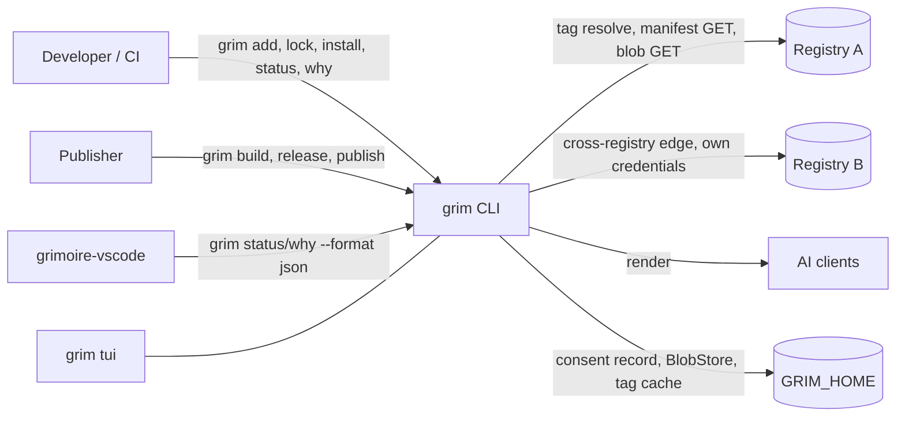
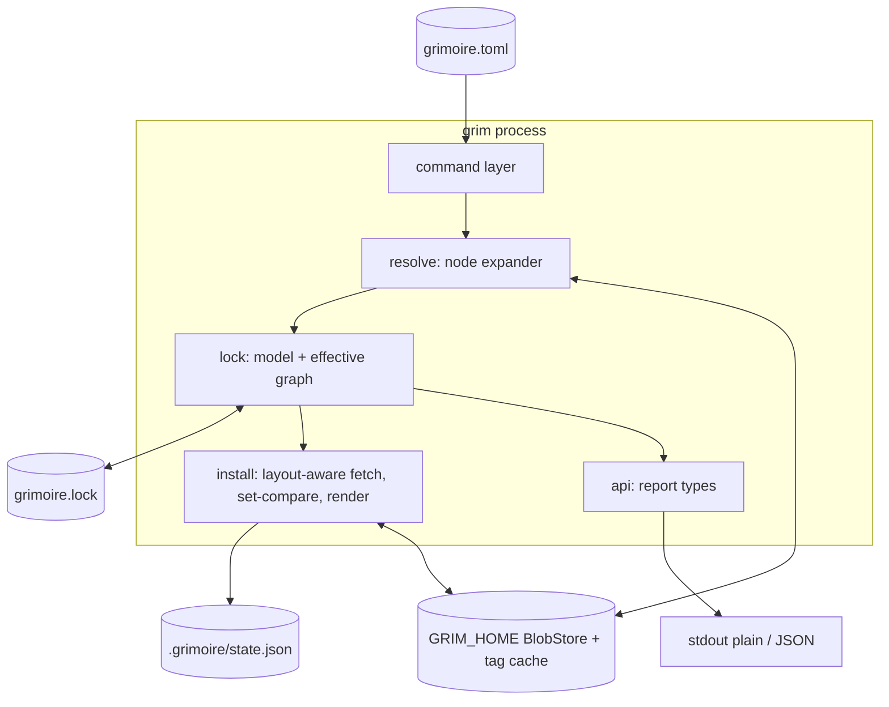
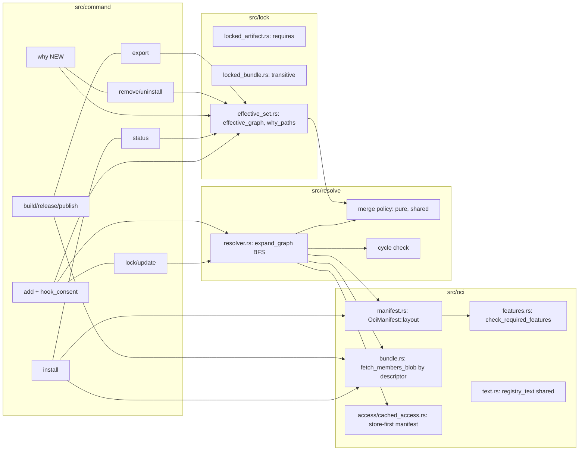

# System Design: Artifact dependencies and the why system

## Metadata

**Status:** Proposed
**Date:** 2026-11-01 (revision 2)
**Author:** Claude (architect)
**ADR:** `.agents/adr/adr_artifact_dependencies.md` (decisions, contracts, rollout; this file does not restate them)
**Input:** `.agents/discussions/artifact-dependencies.md`, `.agents/research/research_artifact_dependencies_*.md`

## Executive Summary

A dependent artifact is a normal artifact whose manifest carries a second
layer: the existing bundle members document. Resolution becomes a bounded
breadth-first expansion over "nodes", where a bundle is a node whose only
layer is that document.

The lock stores forward edges exactly as published. Install verifies them
against the digest-pinned manifest. Everything else is derived offline from
those edges:

- removal;
- the closure-aware effective set;
- `required_by`;
- `grim why` paths.

Everything ships in one release. This file covers the components, the data
flow, the two core algorithms, the failure modes and the test map.

## Non-goals

Each of these is owner-decided or out of scope for this change:

- Version ranges, constraint intersection, or a solver. Edges are
  presence-only refs.
- A `recommends` or optional-dependency tier.
- System or binary dependencies (runtimes, CLIs, packages outside OCI).
- An Agent Skills specification field. Declarations live under the
  `grim.requires.` metadata prefix only.
- New trust gates for transitive hooks or MCP servers. Consent and transport
  rules are applied along edges, and no trust decision is reopened.
- Exporting edges as Claude Code plugin `dependencies`. Export flattens
  instead.
- Allowing cycles.
- A lock format version bump.

## 1. Context (C4 Level 1)



| Actor / system | Role here |
|---|---|
| Publisher | Declares requires in source; release writes the two-layer manifest |
| Consumer (user, CI) | Declares roots; grim pulls the closure |
| Registry A/B | Serve manifests and members layers; per-host credentials, never forwarded; plain HTTP only through the existing insecure set |
| grimoire-vscode | Reads `direct`, `required_by` and `grim why` JSON. Its release ships with or before this grim release |
| AI clients | Receive rendered files; unaware of dependencies |

## 2. Containers (C4 Level 2)

grim is one binary, so the containers are the persistent stores and the
process boundary.



| Container | Changes |
|---|---|
| `grimoire.toml` | None for consumers. Roots are still direct tables plus `[bundles]` |
| `grimoire.lock` | Additive `[[<kind>.requires]]` (ids as published) and `transitive = true`; both omitted when unused |
| `BlobStore` | No format change. `CachedAccess::fetch_manifest` now reads it first in both modes, which makes it the edge cache |
| tag cache | None |
| `.grimoire/state.json` | None |
| `$GRIM_HOME/hooks/consent/` | No shape change. `add` writes only the target's newly reached hooks |

## 3. Components (C4 Level 3)



| Component | Responsibility | Reuses / replaces |
|---|---|---|
| `OciManifest::layout` | Rule F4; picks content and requires descriptors | Replaces `single_layer()` at `installer.rs:2367`, `fetch.rs:349`, `expected_outputs.rs:108`, `resolver.rs:780`, `layer.rs:120` (`compression_of`). `description.rs:214` keeps `single_layer()` |
| `check_required_features` | Rule F1, with a 1024-byte and 32-name cap | annotation map |
| `fetch_members_blob` | Bounded read of one members or requires layer **by descriptor**, with no tag resolve | Split out of `fetch_bundle_layer`; that function becomes a tag-resolving wrapper for declared bundles |
| `CachedAccess::fetch_manifest` | Store first (digest-verified on put), then inner | Today write-only (`cached_access.rs:93-125`) |
| `expand_graph` | BFS over nodes; node, byte and depth budgets checked before admission; bounded concurrency | `resolve_digest`, `MemberRef::resolve`, `SkillName::parse` |
| Merge policy | Direct wins; equal **digests** merge; different digests conflict; collect all | generalized `merge_bundle_members` |
| `effective_graph` | Offline closure: direct precedence first, then repository match | `snapshot_matches` rule |
| `why_paths` | Root-first simple paths, capped and step-budgeted; DP `path_count` | — |
| `hook_consent::resolve_for_add` | Consent set = hooks newly reached through the target's own edges | Replaces the single-entry projection |
| `registry_text` | Escapes every registry-sourced string in new messages | Moved from `layer.rs:338` |

The merge policy is **one pure function** called from both the online
expander and the offline closure.

## 4. Data flow

### Resolve and lock (`grim add`, `grim lock`, `grim update`)

1. Load the config and build roots: direct entries plus declared bundles.
   Path roots read their edges from source and refuse relative refs.
2. Level 0 is the roots. For each frontier node, behind 32 permits and
   inside `per_artifact_timeout`:
   1. Resolve the tag to a digest. Partial update keeps the old pin only when
      the node's winning requested identifier is unchanged.
   2. Read the manifest by pinned digest: from the store, else the
      registry, which writes it to the store.
   3. Run F1, then F4.
   4. For a requires or members layer, call
      `fetch_members_blob(parent_repo, descriptor)`. It reads the store
      first, then the registry.
   5. Resolve relative ids against this node's current pinned repository.
   6. Offline store miss: carry forward the previous lock entry's
      `requires` unverified. This is the only use of lock `requires` in
      resolve, and it is never trusted: install's set-compare refuses a
      mismatch.
3. Collect the whole level. If any node failed, report the error of the
   smallest `(kind, name)`.
4. Sort the level's edges. Before inserting them:
   - count the new keys against the remaining node budget;
   - add the fetched bytes to the requires-bytes budget;
   - check the depth against `MAX_DEPTH`.

   On a breach, refuse with 65, naming the parent `via`.
5. Fold the edges through the merge policy, comparing resolved digests.
   Record conflicts without expanding those keys.
6. The next frontier is the newly settled, non-conflicted keys.
7. When the frontier is empty: conflicts give 78 (all of them, ending with
   the "declare … directly" fix); otherwise the cycle check gives 65.
8. Build the lock:
   - each entry gets `[[<kind>.requires]]`, ids as published;
   - bundles reached through an edge get `transitive = true`;
   - a direct override with a different repository than a shadowed edge
     prints a warning.
9. `add` only:
   - **Install reachability.** The set `add` installs is computed from the
     target over `E_after`, including dependencies already locked, so a
     locked but missing dependency is installed too. This replaces the
     single-entry projection in `install_added` and the TUI add path.
   - `pulled_in = E_after \ E_before \ {target}`.
   - Consent is written for hook nodes that are reachable from the target,
     whose settled id equals the reaching edge id, and that are absent from
     `E_before`.
   - If `E_before` is `None` (incomputable), exclude every node declared in
     the pre-add config or present in the previous lock (entries and
     `[[bundle.member]]` rows) from both consent and `pulled_in`.

### Install

1. Read the lock and compute `effective_graph`.
2. For each entry:
   1. Fetch the manifest by pinned digest (store first).
   2. Run F1 and `layout`.
   3. Read the requires layer by descriptor.
   4. **Set-compare** it with the lock's `requires` (as published). A
      mismatch gives 65 `stale-lock`. All entries are checked before any
      file is written.
3. Fetch `layers[0]` only, verify it, and render.
4. Hook arming: unchanged rungs for direct and transitive hooks alike;
   `insecure_transport` checks the hook's own host only (D4).

### Status / why (offline)

1. Read the lock and config, then compute `effective_graph`. If the result
   is `None`, `required_by` is `null` and `source` is `"dependency"` for
   non-direct, non-bundle rows.
2. `status`:
   - `direct` comes from the config tables;
   - `required_by` is the inverse of `children`, sorted;
   - plain mode notes a direct declaration that is also required at the
     same digest.
3. `why`:
   1. Check the offline graph for a cycle (65 `stale-lock`).
   2. Compute `path_count` by DP.
   3. Run `why_paths(graph, target, 256, 100_000)`.
   4. Collect `overrides`.
   5. Print the report. Plain mode shows the first 10 paths and "N more".

### Remove / uninstall (offline)

1. `E_before = effective_graph(config, lock)`.
2. If it is `None`, act on the target only, keep everything else, and print
   the "run grim lock" line. Stop.
3. Apply the config mutation in memory and compute `E_after`.
4. Drop or delete `E_before \ E_after`. A node still reachable is protected.
   A dependency-only target reports `kept-by-dependency`.

### Publish

1. Build validates declarations offline: grammar, names, no self-reference.
2. Publish sorts the batch topologically over same-batch edges, with the
   kind order as tie-break. A batch cycle gives 65 before any push.
3. Release, per entry:
   1. Check that refs parse and syntactically resolve against the target.
   2. Apply `--pin` freezing.
   3. Push `layers[0]` and the requires layer, then the manifest.

   `same_content` is unchanged.

### Export

Compute the closure from the exported artifact and write every node into the
plugin as a member. Emit no Claude `dependencies`.

## 5. Algorithm sketches

Pseudocode at signature level. Names follow the ADR's component contracts.

### Iterative expander

```text
fn expand_graph(roots, prev_lock, opts) -> Result<ResolvedGraph, ResolveError>:
    graph = ResolvedGraph::new()               // nodes: key -> NodeState, children: key -> set
    conflicts = []
    for r in sorted(roots): graph.settle(r.key, Contribution::Direct(r))
    frontier = sorted(roots); depth = 0
    budget = Budget { nodes: MAX_TRANSITIVE_NODES, bytes: MAX_REQUIRES_BYTES }

    while frontier not empty:
        if depth > MAX_DEPTH: return Err(GraphTooLarge(Depth, via = frontier[0]))
        results = join_bounded(frontier, RESOLVE_CONCURRENCY, |node|      // ASYNC-05, ASYNC-09
            timeout(opts.per_artifact_timeout, resolve_node(node, prev_lock)))  // ASYNC-04
        results.sort_by_key(|r| r.key)                                      // DATA-DET
        if let Some(e) = results.iter().find(is_err): return Err(e)        // smallest failing key
        next = []
        for r in results:
            graph.pin(r.key, r.digest)
            budget.bytes.charge(r.requires_bytes, via = r.key)?            // before admission
            fresh = r.edges.filter(|e| graph.state(e.key).is_none() && counts_toward_cap(e, r))
            budget.nodes.charge(fresh.len(), via = r.key)?                  // before insertion
            for edge in r.edges.sorted():
                graph.children[r.key].insert(edge.key)
                match merge_policy(graph.state(edge.key), Contribution::Edge(r.key, edge)):
                    Settled(new) if new => next.push(edge.key)
                    Settled(_)          => {}
                    Conflict(c)         => conflicts.push(c)               // never expanded
        frontier = next.filter(|k| !graph.is_conflicted(k)); depth += 1

    if conflicts not empty: return Err(BundleConflict(conflicts))         // 78, ends with the fix
    if let Some(cycle) = find_cycle(graph.children): return Err(DependencyCycle(cycle))  // 65
    Ok(graph)

fn resolve_node(node, prev_lock) -> NodeResult:
    if node.is_path(): return edges_from_source(node)                       // relative refs refused
    digest   = keep_or_resolve(node, prev_lock)     // keep only if winning requested id unchanged
    manifest = access.fetch_manifest(node.id@digest)                        // store first; offline miss below
    check_required_features(node.id, manifest)?                             // F1
    (edges, bytes) = match manifest.layout(node.kind)?:                     // F4
        Content(_)                        => ([], 0)
        ContentWithRequires{requires, ..} => members_at(node.repo, requires)?   // >= 1 member
        BundleMembers(layer)              => members_at(node.repo, layer)?
    NodeResult{ digest, resolved_edges(edges, node.repo), published_edges: edges, requires_bytes: bytes }
    // offline manifest miss: published_edges = prev_lock.entry(node.key, digest)?.requires (unverified)

fn members_at(repo, desc) -> (Vec<BundleMember>, u64):
    doc = fetch_members_blob(access, repo, desc)?    // by descriptor; 512 KiB; 512 members; no tag resolve
    for m in doc.members: SkillName::parse(m.name)?; MemberRef::parse(m.id)?.resolve(repo)?
    (doc.members, desc.size)

fn merge_policy(state, contribution) -> Outcome:      // pure; shared with effective_graph
    match (state, contribution):
        (None, _)                                          => Settled(new = true)
        (Direct(_), Edge(..))                              => Settled(new = false)  // direct wins
        (Implied(d), Edge(_, e)) if e.digest == d          => Settled(new = false)  // equal digest merges
        (Implied(d), Edge(p, e))                           => Conflict{key, [d ..., e.id required by p]}
        (Conflicted, _)                                    => Settled(new = false)
```

`counts_toward_cap` is false only for depth-1 members of a declared bundle.
That keeps today's shapes outside the new caps.

`find_cycle` is an iterative three-colour DFS. It starts from roots in
`(kind, name)` order and visits children in that order. It reports the
first back edge, rotated so the smallest key leads.

### Closure-aware effective set (offline)

```text
fn effective_graph(set: &DesiredSet, lock: &GrimoireLock) -> Option<EffectiveGraph>:
    g = EffectiveGraph::new()
    for r in set.roots(): g.nodes[r.key] = Direct(r.source)
    queue = VecDeque::from(sorted(set.roots())); seen = {}
    while let Some(key) = queue.pop_front():
        if !seen.insert(key): continue
        parent_repo = lock.repo_of(key)?
        edges = match key.kind:
            Bundle => lock.bundle_snapshot(key)?.members         // missing -> None
            _      => lock.entry(key)?.requires                  // [] when absent
        for e in edges.sorted():
            g.children[key].insert(e.key)
            if set.is_direct(e.key): g.add_parent(e.key, key); continue     // direct precedence FIRST
            target = lock.lookup(e.key)?                                    // missing -> None
            if target.repo != MemberRef::parse(e.id).resolve(parent_repo).repo: return None
            match merge_policy(g.nodes.get(e.key), Edge(key, e)):
                Settled(true)  => { g.nodes[e.key] = Implied{..}; queue.push_back(e.key) }
                Settled(false) => g.add_parent(e.key, key)
                Conflict(_)    => g.nodes[e.key] = Conflicted        // unreachable for a lock resolve accepted
    Some(g)

fn path_count(g, target) -> u64:        // g acyclic (checked by caller)
    // DP in reverse topological order: count[root] = 1; count[n] = sum over parents, saturating at 2^53-1

fn why_paths(g, target, limit, step_budget) -> WhyPaths:
    // iterative reverse DFS from target over parents(), path-local visited set
    // stop at roots (Direct or declared bundle); reverse each path to root-first
    // stop when limit+1 paths collected or step_budget edge visits spent
    // sort lexicographically, dedup, truncate to limit
    // truncated = path_count(g, target) > paths.len()
```

The mutations are unchanged: `E_before \ E_after` with
`effective_set = effective_graph(..).nodes`. On `None`, the target-only path
from the data flow applies, never the destructive pre-cache fallback.

## 6. Failure modes

| Failure | Detection | Behavior | Exit / reason |
|---|---|---|---|
| Registry slow on one node | per-node timeout over the whole chain | the level fails; smallest failing key reported | 69 |
| Hostile members layer (size, count) | descriptor + post-transfer cap; member cap | refuse | 65 |
| Traversal name (`../x`) | `SkillName::parse` | refuse | 65 |
| Fan-out bomb | node budget, before insertion | refuse, naming `via` | 65 |
| Byte bomb across many small layers | `MAX_REQUIRES_BYTES` | refuse, naming `via` | 65 |
| Deep chain stall | `MAX_DEPTH` | refuse | 65 |
| Cycle `A -> B -> A` | DFS after expansion | refuse, naming the cycle and the publisher | 65 |
| Diamond at different digests | merge policy | collect all; message ends with the "declare … directly" fix | 78 |
| Tag flap creates a later conflict | merge policy at the next update | as above | 78 |
| Edge target missing | tag resolve 404 | refuse, naming the parent | 79 |
| Future layout or unknown feature | F4 / F1 | refuse with "update grim" | 65 `unsupported-artifact-feature` |
| Oversize or malformed `requires-features` | F1 caps | refuse | 65 `unsupported-artifact-feature` |
| Lock `requires` ≠ pinned layer (0.15.1 lock, hand edit, offline carry-forward) | install set-compare, before any write | refuse, "run grim lock" | 65 `stale-lock` |
| Attacker-edited lock tries to steer resolve | lock `requires` is never a *trusted* cache: read only on an offline store miss, unverified | no effect online; offline carry-forward refused at install by the set-compare | 65 `stale-lock` at install |
| Mirror switch with relative edges | ids re-resolved against the parent's current repository | resolves to the mirror | — |
| Offline lock, manifest not in store | carry forward unverified | lock written; install verifies | 0, then 65 at install if wrong |
| Offline graph incomputable | `effective_graph` → `None` | target-only mutation; `required_by: null`; `why` refuses | 65 `stale-lock` (why) |
| Cycle in a hand-edited lock | offline cycle check | `why` refuses | 65 `stale-lock` |
| Path source edges changed since lock | freshness compare | refuse | 65 `stale-lock` |
| Repo-planted unconsented hook required by an added skill | consent excludes `E_before` nodes | hook stays unarmed | `not-armed`, `consent` cause |
| Repo plants a direct `[hooks]` entry and breaks the closure (e.g. a declared bundle with no snapshot) | `E_before` is `None`; consent excludes every config-declared and previous-lock node | hook stays unarmed | `not-armed`, `consent` cause |
| Transitive hook on a routable plain-HTTP host | existing `insecure-transport` rung, same as direct | not armed unless `--trust-hooks` | `insecure-transport` |
| Transitive clobber under `add --force` | force scoped to the target | refuse, listing destinations | 65 `untracked-destination` |
| Floating dependency gains a hook | consent set drift | re-gate | `consent-drifted` |
| Offline, edge not cached and no previous entry | store miss | edges treated as empty; install verifies | 0, then 65 at install if wrong |
| `grim why` path explosion | step budget + cap + DP count | truncate; `path_count` exact | 0 |
| Old grim reads a new lock | `deny_unknown_fields` | refuse (also protects old `remove`) | 78 (shipped) |
| Requires layer of a described artifact is bad or unreachable | `describe` fetch | fail, never a partial list | 65 / 69 / 81 |

## 7. Test strategy

Unit tests live inline in the owning module. Acceptance tests run under
`test/tests/` against the local `registry:2`. Two-layer fixtures are pushed
with a raw-manifest helper in `test/src/`, added if absent.

### Mapped to the dossier's `## Verification` list

| Dossier item | Test | Level |
|---|---|---|
| A requires B requires C: all three locked and installed | `test_dependencies.py::test_transitive_chain_installs` | acceptance |
| Cycle A -> B -> A refused | `test_dependencies.py::test_cycle_refused` (exit 65; message has `skill/a -> skill/b -> skill/a` and the publisher); unit `find_cycle`, including a self-edge and the rotation tie-break | both |
| Diamond conflict lists every conflict, exit 78 | `test_dependencies.py::test_diamond_conflict_lists_all` (message ends with `declare skill b directly in grimoire.toml to choose one`); `test_diamond_equal_digest_merges` (`b:1` and `b:1.2` on one digest give exit 0) | acceptance |
| Direct declaration overrides | `test_dependencies.py::test_direct_overrides_edge` (direct pin wins; its edges expanded; repository-mismatch warning on stderr) | acceptance |
| Remove drops orphans | `test_dependencies.py::test_remove_drops_orphans`, `test_uninstall_deletes_orphans`, `test_uninstall_dependency_only_kept` (`kept-by-dependency`) | acceptance |
| `--pin` freezes requires | `test_release_pin.py::test_pin_freezes_requires` (pushed layer carries digest ids; relative made absolute) | acceptance |
| Relative refs survive a mirror | `test_dependencies.py::test_relative_ref_after_mirror` (copy both repos to a second namespace, switch the declaration, re-lock: the edge resolves to the mirror; the lock `id` is unchanged) | acceptance |
| Unknown `requires-features` refused with "update grim" | `test_forward_compat.py::test_unknown_feature_refused` (exit 65, `reason == "unsupported-artifact-feature"`, message contains `update grim`); a three-layer manifest; absent and empty annotations accepted | acceptance |
| Upgrade fixture: 0.15.1 lock reads unchanged; dependency-free lock byte-identical | `test_golden_pre_dependencies.py` over `test/data/golden/pre_dependencies_cdeedcaa/`, with the five assertions in the ADR, including offline | acceptance |
| Old-grim check | `test_old_grim_dependencies.py`, local opt-in via `GRIM_OLD_BIN`; run once before the release | acceptance |
| `task verify`, `task catalog:verify` pass | gates | CI |

### Why system

| Behavior | Test |
|---|---|
| `status` rows carry `direct` and `required_by`; `[]` for an unrequired root | `test_status_json.py::test_required_by_fields` |
| `required_by: null` and `source: "dependency"` when the graph is incomputable offline | `test_status_json.py::test_required_by_null_when_incomputable` (delete a nested bundle's snapshot, run `--offline`) |
| `source` unchanged for direct and bundle rows; `dependency: …` for dependency-only | `test_status_json.py::test_source_literals` |
| Direct declaration also required at the same digest prints the stderr note | `test_status.py::test_redundant_direct_note` |
| `why` single path; multi-path sorted; direct target includes `[target]` | `test_why.py::test_paths_root_first_sorted` |
| `why` `overrides` lists the shadowed edges | `test_why.py::test_overrides` |
| `why` plain output: 10 paths, then "N more" | `test_why.py::test_plain_truncates_at_ten` |
| `why` exits: 79, 79 `no-lock`, 79 `no-config`, 65 `stale-lock` (incomputable and cyclic lock), 64 | `test_why.py::test_exit_codes` |
| `why` ignores `--registry`; `--help` text | `test_why.py::test_registry_flag_inert`, CLI help snapshot |
| `add` `pulled_in` | `test_add_json.py::test_pulled_in` |
| `describe` and MCP `grim_describe` `requires`: list, `[]`, `null`; a bad layer fails | `test_describe.py::test_requires_field`, `test_requires_layer_invalid_fails`; MCP tool test |
| JSON schema snapshots updated additively | existing `src/api` schema snapshot tests |

### Boundary tests

| Boundary | Below (passes) | At + 1 (refuses) |
|---|---|---|
| `MAX_TRANSITIVE_NODES` | 2048 transitive nodes | 2049 → 65, names `via` |
| `MAX_WHY_PATHS` | 256 paths → `truncated: false` | 257 → 256 shown, `truncated: true`, `path_count: 257` |
| `WHY_STEP_BUDGET` | — | layered diamond (20 × 2): `truncated: true`, `path_count` = 2^20 exact |
| `path_count` saturation | — | 60 × 2 layered diamond → 9007199254740991 |
| `MAX_DEPTH` | chain of 32 levels | 33 → 65 |
| `MAX_REQUIRES_BYTES` | 32 MiB total | 32 MiB + 1 → 65 |
| `MAX_BUNDLE_MEMBERS` on a requires list | 512 | 513 → 65 |
| `requires-features` annotation | 1024 bytes, 32 names | 1025 bytes or 33 names → 65 `unsupported-artifact-feature` |
| Depth-1 bundle members exempt | three declared 512-member bundles resolve | — |

### Contract and invariant tests

| Invariant | Test |
|---|---|
| Dependency-free lock byte-identical modulo `generated_by` | unit round-trip in `grimoire_lock.rs` + golden fixture |
| `[[<kind>.requires]]` byte-exact rendering, including key order and table form | unit snapshot in `grimoire_lock.rs` |
| `requires` and `transitive` omitted when empty/false | unit serialization |
| `ErrorReason` append-only | extend `c031_4_no_new_error_reason_slug` (`src/error.rs`) and `c021_exit_codes_and_reasons_equal_main` (`src/command/export.rs:660`) to the 9-slug list |
| `UninstallStatus` literal appended | existing enum snapshot |
| Online expander and offline closure agree | unit: the same graph fed to both yields equal node sets and origins |
| Offline closure applies direct precedence before the repository check | unit: direct entry at another repository plus an edge yields `Some(graph)` |
| Incomputable closure is never destructive | `test_dependencies.py::test_remove_offline_incomputable_keeps_files` |
| Lock `requires` is never a trusted cache | unit `lock_requires_never_trusted_cache`: an edited lock `requires` does not change `expand_graph` output online; offline with a store miss it is carried forward, and `test_install_refuses_mismatched_requires` refuses it |
| Install set-compare refuses before any write | `test_dependencies.py::test_install_refuses_mismatched_requires` (0.15.1-style lock and a hand-edited lock; no destination touched) |
| Store-first manifest read is digest-verified | unit in `cached_access.rs`: a corrupted store entry is refused, not used |
| Requires layer read by descriptor, no second tag resolve | unit with a counting fake registry: exactly one `resolve_digest` per node |
| Partial update keeps a child pin only when its winning id is unchanged | unit: change the parent's edge `b:1` → `b:2`, run `update parent`; `b` is re-resolved |
| Offline lock of a dependency-free project after upgrade | golden fixture assertions 4a (`golden/tag-cache/`, store hit) and 4b (`golden/tag-cache-no-manifests/`, store-miss carry-forward); both produce the same bytes modulo `generated_by` |
| `add` installs a locked but missing dependency | `test_dependencies.py::test_add_installs_missing_locked_dependency`: lock has `s -> d`; delete `d`'s files; `grim add skill s` (same ref) reinstalls `d` |
| TUI add path uses target reachability | unit in the TUI add path: adding `s` with locked `d` schedules both `s` and `d` |
| `RESOLVE_CONCURRENCY` bound | unit with a counting fake registry: max in-flight ≤ 32 (lands with the `fix(resolve):` commit) |
| Cross-registry edge uses its own host credentials | `test_dependencies.py::test_cross_registry_edge` (two local registries, auth only on the second) |
| Consent: `add` records a newly reached transitive hook; `install` writes none; a gained hook drifts | `test_hook_consent.py` additions |
| **Repo-planted hook attack** | `test_hook_consent.py::test_add_does_not_consent_preexisting_hook`: workspace locks hook `h` unconsented; `grim add skill s`, where `s` requires `h` at the same id; `h` stays `not-armed` (consent cause); the record does not list `h` |
| **Closure-breaking planted hook** | `test_hook_consent.py::test_add_does_not_consent_when_closure_incomputable`: the repo declares a direct `[hooks]` entry `h` (unconsented) and a `[bundles]` entry with no `[[bundle]]` snapshot; `grim add skill s`, where `s` requires `h`; `h` stays `not-armed`; the record does not list `h`; `pulled_in` omits `h` |
| Transitive hook transport parity | `test_hook_consent.py::test_transitive_hook_transport_parity`: a transitive hook on a routable `GRIM_INSECURE_REGISTRIES` host is `insecure-transport` exactly like a direct one, and `--trust-hooks` arms it; a hook on an HTTPS host reached through a plain-HTTP parent is not withheld for transport |
| `add --force` scoped to the target | `test_dependencies.py::test_add_force_transitive_clobber_refused` |
| Registry text escaped in new messages | unit: control characters in a member name and a feature name are escaped |
| `generated_by` hint validated and semver-compared | unit: `grim 0.16.10` > `grim 0.16.9`; a garbage value adds no hint |
| TUI expands any node with requires; `(repeated)` on an ancestor | unit in `src/tui/bundle_members.rs` |
| `grim.requires.*` grammar errors are 65 at build | `test_build.py::test_requires_key_invalid` |
| MCP `[requires]` split leaves the descriptor JSON unchanged; schema declares it | unit in `src/oci/mcp.rs`; schema snapshot |
| Publish topological order and batch cycle | `test_publish.py::test_requires_order`, `test_batch_cycle_refused` |
| Identical re-release of a dependent skill adopted after a `--compression` flip | `test_release.py::test_rerelease_dependent_adopted` (`same_content` unchanged) |
| Export flattens the closure; no `dependencies` key | `test_export.py::test_plugin_flattens_dependencies` |

## 8. Risks

These are design-specific; the ADR carries the rest.

| Risk | Mitigation |
|---|---|
| Level-serial latency on deep graphs | Store-first manifests keep steady state flat; real graphs are depth ≤ 2 |
| `effective_set` signature change (`&[LockedBundle]` → `&GrimoireLock`) ripples through callers | In-crate only; compile-checked |
| `Origin::Bundles` → `Implied` refactor | In-crate; compile-checked |
| TUI tree recursion on hostile catalogs | Lazy one-level expansion plus the ancestor guard |
| Two-layer rejection on some registry | Release gated on a push/pull across GHCR, Docker Hub, ECR, Harbor and GitLab |
| grimoire-vscode lags | Paired extension release is a release gate |

## 9. Open Questions

The ADR's three open questions apply here as well. This file adds none.

## Changelog

| Date | Author | Change |
|------|--------|--------|
| 2026-11-01 | Claude (architect) | Initial proposed design |
| 2026-11-01 | Claude (architect) | Revision 2: owner decisions D1-D4 and review findings. Non-goals; store-first edge cache; fetch by descriptor; install set-compare; consent from the target's new reach; direct-first offline closure and non-destructive `None`; budgets before admission; DP `path_count`; boundary tests; one-release rollout |
