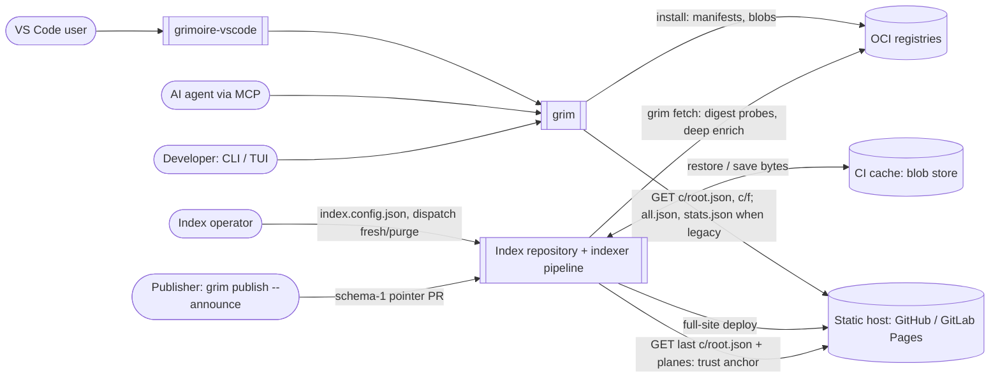
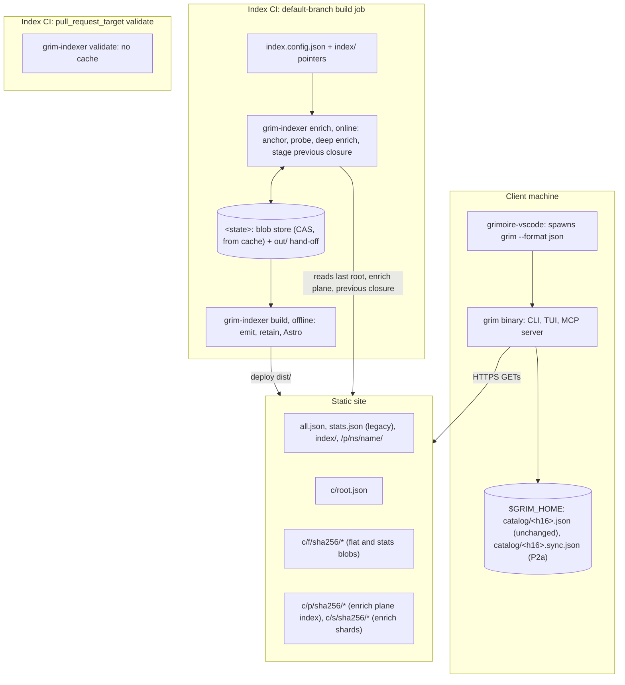
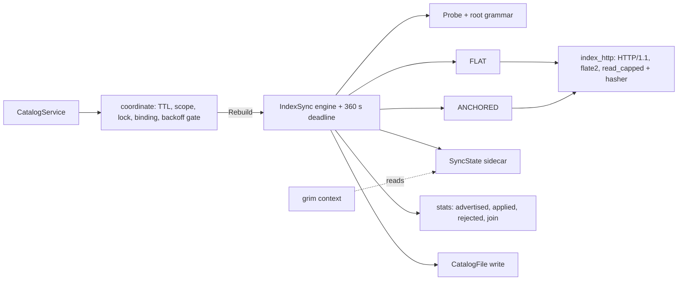
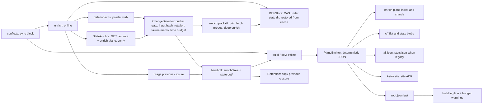
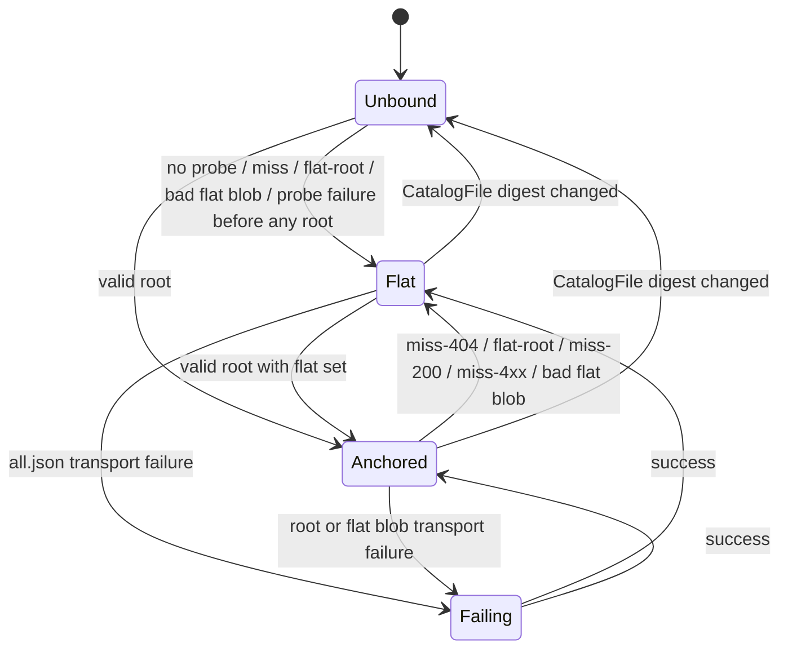

# System Design: Index at Scale

<!--
System Design Document (Technical Architecture)
Owner: /hex-architect run 2026-10-17, amended 2026-10-21 (architect), reset 2026-10-21 (architect), owner answers folded in 2026-10-22, KISS cut 2026-10-22
Handoff to: /hex-plan (decomposition), /builder, /qa-engineer, /security-auditor
Decision record: .agents/adr/adr_catalog_at_scale.md — read that first.
This document does not re-argue the decision; it specifies the system.
-->

## Metadata

**Status:** Draft (review-round history: Changelog and git, through `a5de87d3`; owner answers and KISS cut 2026-10-22)
**Author:** architect (/hex-architect)
**Date:** 2026-10-17 · **Amended:** 2026-10-22
**Related ADR:** [`adr_catalog_at_scale.md`](../adr/adr_catalog_at_scale.md) (D1–D23, M1–M3, M5, C1–C14,
CD-2…CD-9 and Open questions 1–28 cited by number). Site and P0 material (former D24, D25, M4,
M6) lives in [`adr_index_site_at_scale.md`](../adr/adr_index_site_at_scale.md); tree sync (formerly
Phase 3) is deferred to [`adr_catalog_tree_sync.md`](../adr/adr_catalog_tree_sync.md)
**Related discussions:** `.agents/discussions/index-scale-rollout.md`,
`.agents/discussions/index-structure.md`
**Repos touched:**
- `grimoire` (grim) — main `fa92f264`;
- `grimoire-indexer` — main `9a9b053`;
- index repositories (rendered CI only);
- `grimoire-vscode` — main `2c9c56c`.

**Design point:** 20,000 entries; ceiling 100,000. Every size below is derived from per-entry rates
and is unmeasured at scale.

**Tech Strategy Alignment:**
- [x] Rust 2024 + Tokio in grim, with no new crate. gzip is the direct `flate2` dependency; reqwest
      stays without `gzip` and `http2` (ADR D5).
- [x] TypeScript + Vitest in the indexer and the extension. No new indexer dependency here; the P0
      package's are in the site ADR.
- [x] No server, database or CDN up to the host ceiling. Every published file is static.

## Executive Summary

The index keeps `all.json`, `stats.json` (raw, with deterministic `.gz` siblings) and
`/p/<ns>/<name>/` while `sync.legacy` is true, the default, and gains one directory, `c/`.

- **One root, two blobs, one private plane.** `c/root.json` (~0.5 KB, mutable) names the flat and stats
  blobs (immutable gzip-only files at `c/f/sha256/<hex>.json.gz` that inflate to exactly `all.json` and
  `stats.json`), the enrich plane index (pipeline-private, 256 shards) and the site's `search` file
  (site-private). `planes.catalog` is reserved and always `null` (§5.1).
- **grim (P2a):** polls the ~0.5 KB root while the catalog is unchanged; a changed catalog costs one
  flat blob, fetched by digest. A root miss takes `/all.json`; stats follow the root, with no timer;
  per-source state lives in a private sidecar (§5.2 to §5.4).
- **Indexer (P2b):** `grim-indexer enrich` (online) keeps its state as the enrich plane, anchored in
  the published root, and hands off to `grim-indexer build` (offline); the `c/f` blobs are written first
  and the root last; retention is the previous closure (§5.7, §5.8, §6.10).
- **`legacy: false` is the in-band lever for old clients:** it publishes only `c/`, and a grim that
  never requests `c/` then loses the index (D20).
- **Moved out:** tree sync (formerly Phase 3) is deferred to
  [`adr_catalog_tree_sync.md`](../adr/adr_catalog_tree_sync.md), started by a measured trigger
  (§13.4); site search, browse, the page cap and the P0 hardening patch are in
  [`adr_index_site_at_scale.md`](../adr/adr_index_site_at_scale.md).

## 1. Context (C4 Level 1)

### System Context Diagram



### Actors & External Systems

| Actor / system | Role here | Trust |
|---|---|---|
| Developer, VS Code user | Browse and search a large index | local user |
| AI agent (MCP client) | `grim_search`; the description steers it to pass `limit` and `offset` | local, same as the user |
| Index operator | Sets `sync`; owns the pipeline; dispatches `fresh` or `purge` | index host/curator (ADR Security) |
| Publisher | Announces schema-1 pointers; unchanged (D21) | T1-class when hostile |
| Static host | Serves `dist/`; replaces the whole site per deploy; `max-age=600` | same origin as `all.json` |
| CI cache | Stores the blob store's bytes; never a trust anchor | written by the default-branch build job only |
| OCI registries | Enrich and install sources | existing trust model |

## 2. Containers (C4 Level 2)

### Container Diagram



### Container Descriptions

| Container | Change |
|---|---|
| grim | Sync engine (probe, flat blob), sidecar, redirect policy, deadline, hardened git helper, backoff, stats rule, `grim context` catalog object |
| `$GRIM_HOME` | Adds `catalog/<h16>.sync.json` (P2a). `CatalogFile` keeps its byte shape |
| grimoire-indexer | `sync` block (`layout`, `legacy`, `revalidate`); reserved `c/`; deterministic serializer; enrich-plane dedupe; `c/f` blobs; `enrich` (online) and `build` (offline) split; state store; change detection; plane emitter; retention; CI renderer |
| Blob store | New, pipeline-local, cache-only CAS of companion files and enrich-plane files under `<state>` (`<root>/.grim-index-state/`, gitignored). Never published |
| Index repository | Re-rendered CI only. Pointers and the write side are unchanged; build outputs are never committed |
| Static site | Gains `c/` (root, `c/f/` blobs, enrich plane) and `browse/`. `all.json` and `stats.json` are unchanged while `legacy` is true (and gain `.gz` siblings), `/p/` paths always; `enrich.json` is sunset. Site pages, search and budgets: site ADR |
| grimoire-vscode | Release the 128 MiB buffer; DOM windowing; timeouts; `sources[]` status; unrated voting |

## 3. Components (C4 Level 3)

### 3.1 grim — sync engine (`src/catalog/`)



| Component | Responsibility | Phase |
|---|---|---|
| `coordinate` | Existing TTL, scope and lock pre-flight. On the refresh path it hashes the `CatalogFile` bytes it already read, checks the binding, and applies the backoff gate (§6.6) | P2a |
| IndexSync engine | Chooses FLAT or ANCHORED per refresh (§5.3) under one 360 s deadline | P2a |
| Probe | Root URL from the locator (§5.2); classifies valid, `flat: null`, miss-404, miss-200, miss-4xx or transport failure | P2a |
| `index_http` | Shared `pub(crate)` helpers: one client per sync, shipped timeouts, hand-negotiated gzip via `flate2`, redirect policy (§6.5), per-kind caps, streaming SHA-256 inside `read_capped`, bounded inflate of `.gz` blobs (GR-R38); the root is a plain GET with no conditional headers (cut by owner decision, #216) | P2a |
| Verifier | Digest grammar → stream hash under the cap → size → parse → structure | P2a |
| SyncState | The sidecar (§5.4) | P2a |
| stats | The stats blob (legacy path: `stats.json`) under the advertised, applied and rejected digests (§5.3); no timer | P2a |

Index catalogs are always built under the empty browse scope, so the engine always syncs the full set.

### 3.2 grim — transport and git

| Component | Responsibility |
|---|---|
| `root_url` / `blob_url` / `stats_url` | `reqwest::Url`-based derivation (§5.2). Replaces the string slicing in `stats_url` (`index_source.rs:579`) |
| Redirect policy | `Policy::custom` in `build_client` (`index_source.rs:596`): ≤ 5 hops, refuse https → http, `referer(false)` (§6.5) |
| Hardened git helper | Extracted from `index_announce.rs` and shared; replaces the plain clone in `fetch_git` (`index_source.rs:789`) (§6.7) |
| Redaction | One purpose-built helper strips userinfo, query and fragment and keeps scheme, host and port. It runs on `sources[].error`, the `CatalogError::IndexFetch` Display (`src/catalog/catalog_error.rs:89-128`, choke point `index_fetch()`), the `tracing::warn!` sites (`index_source.rs:707-716`) and the reqwest error chain (GR-R27). `normalize_remote_url` (`src/oci/git_provenance.rs:363`) is a provenance normalizer, not this helper |
| Credentials | Index GETs add no `Authorization` or `Cookie` of grim's own; locator userinfo reaches only its own origin (§6.5) |
| Plain output | `print_table` screens record text with a dedicated escape for the strip set of IX-R30 only, the same code points (GR-R23; `print_table`, `screen_plain`, `is_hidden` and `flag_tag_len` in `src/cli/printer.rs`, fed by `src/api/search_report.rs:352-390`). Not `str::escape_debug`, which `grim context` uses (`src/api/context_report.rs:195-240`) and which also escapes quotes, backslashes, tab and newline. A tab or line feed in a cell prints as one space, since a cell never spans lines |

### 3.3 grim — surfaces

| Surface | Change |
|---|---|
| `grim search` | No flag or shape change. During backoff, `sources[].error` names the deferral (§5.5) |
| MCP `grim_search` | No behaviour change. The description tells agents to pass `limit` and `offset` (D12) |
| `grim context` | `registries[].catalog`, always present (§5.5) |
| `grim rate` | Refetches the stats once for an unrated row (GR-R10) |
| `--refresh` (search, TUI) | Bypasses backoff and the stats skip rules |

### 3.4 Indexer — build pipeline (`grimoire-indexer`)



| Component | Responsibility | Phase |
|---|---|---|
| `config.ts` | `sync.layout`, `sync.legacy`, `sync.revalidate`; `sync` joins `KNOWN_KEYS` (`IX/src/config.ts:391`); `legacy: false` with `layout: flat` exits 65 | P2b |
| `enrich` / `build` boundary | `grim-indexer enrich` and `state-key` are the online commands. `enrich` owns grim calls, anchor read, closure staging, `--fresh`, `--purge`, stamping and blob-store writes; `state-key` reads the root and the enrich plane index for the CI cache key (IX-R27). `build` and `dev` read only the hand-off: the `enrich/` working tree plus `<state>/out/` (§6.10, IX-R35) | P2b |
| StateAnchor | Run by `enrich`. Fetches the last published `c/root.json` over HTTPS with a cache-busting query, from the explicit `site` only (`loadConfig`, never `resolveConfig`'s first-party default, as `cli/enrich.ts:45-48` already does), through the existing `request()` helper (no redirects, capped body; `validate/adapters/http.ts:87`); resolves the enrich plane from the blob store by digest first and the site on a miss; verifies every file by digest (§6.10) | P2b |
| BlobStore | Pipeline-local CAS `<state>/b/sha256/<hh>/<hex>`, re-hashed on every read (IX-R41); keeps companion files (1 MiB each, capped on ingest), the enrich plane's own files and the closure files `build` emits (§5.8), which P-10 bounds at 16 MiB, except the `f` blobs and the search file; restored and saved by the rendered CI; never under `dist/`. `<state>` is `<root>/.grim-index-state/`, with no environment override; `enrich` writes `<state>/.gitignore` containing `*`, so no repository file changes | P2b |
| `data/index.ts` | Pointer walk (sorted, `:107`). `all.json` and page routes from the full pointer inventory, duplicates included, with today's serializer; dedupe by `ref` for the enrich plane only; every variable record field bounded and stripped of controls at emit (IX-R30) | P2b |
| ChangeDetector | Run by `enrich`. Bucket gate with the enricher check, input hash, rotation by last-deep time, per-ref failure memo, stamping on success, deep-enrich time budget (§6.10) | P2b |
| Enrich pool | Today's pool of 8 (`IX/src/enrich/index.ts:437-465`); the ⌈N/7⌉ slice (`:425`) is removed | P2b |
| PlaneEmitter | `c/f` gzip flat and stats blobs (`put_cas`), legacy copies with `.gz` siblings, enrich plane; root last (§5.7) | P2b |
| Retention | Stage in `enrich` (the previous root's closure, verified), copy in `build` (§5.8) | P2b |
| CI renderer | `ci.ts` templates: blob-store restore and save, single writer, timeouts and `CI_JOB_TIMEOUT`, dispatch inputs (§3.7) | P2b |

Site search, browse, the page cap, the sanitizer, the CSP and the logo allow-list: [`adr_index_site_at_scale.md`](../adr/adr_index_site_at_scale.md).

`c` and `browse` are reserved in every layout. An operator-owned file that would land under
`dist/c/` or `dist/browse/` (a theme page, or a file in any `public/` layer) fails the build with
exit 65, naming it and the move **[T]** (IX-R02, ADR Open question 18).

### 3.5 Indexer — retention

Specified in §5.8. `grim-indexer enrich` stages the previous closure from the `site` in
`index.config.json` (online); `grim-indexer build` copies it (offline). Retention is kept (owner decision 2026-10-22, [#216](https://github.com/grimoire-rs/grimoire/issues/216), cut 3 rejected).

### 3.6 Indexer — state and change detection

Specified in §6.10. The new indexer reads no checkpoint (`IX/src/enrich/checkpoint.ts`); ~~the overlap
release writes `enrich.json` once more (IX-R13), then retires it (ADR D22)~~. **Cut (owner decision 2026-10-22, [#216](https://github.com/grimoire-rs/grimoire/issues/216), cut 8).** The indexer never writes `enrich.json`; P2e (IX-R34) is folded into P2b.

### 3.7 Pipeline — rendered CI (`npm run ci`)

| Addition | Phase | GitHub Actions | GitLab CI |
|---|---|---|---|
| Job timeout | P2b | `timeout-minutes: 120`, plus `CI_JOB_TIMEOUT: 7200` on the `enrich` step, so `enrich` reads the same variable GitLab sets | `timeout: 2h`: GitLab's 60-minute default is below a cold build of today's indexer at 20,000. GitLab sets `CI_JOB_TIMEOUT` itself |
| State key | P2b | A step before restore runs `npx --no grim-indexer state-key`, which prints `<state_epoch>-<blobs>` from the published enrich plane (read with a cache-busting query), renewing the epoch weekly (when it is older than 7 days). A step before save runs `npx --no grim-indexer state-key --next`, which prints the key of what `enrich` handed off. `npx --no`, as the stats templates already call `grim-indexer`, because `package.json` is a user-owned init file that existing repositories never receive again (`cli/init.ts:44-49`; `npm run ci` writes workflows only). `state-key` checks its own output (a safe integer epoch, one line, else a non-zero exit), and the rendered step matches it against `^[0-9]{1,16}-[0-9a-f]{64}$` before it reaches `GITHUB_OUTPUT`; anything else means a cold build, with no restore and no save. Its reads go through `request()` like `enrich`'s (IX-R29): a fetch failure or an unverifiable plane exits non-zero. No published plane yet (a 404 root, or `planes.enrich: null`) is not a failure: it prints a fresh key that matches no entry, so the first plane build runs cold and still saves | fixed key `grim-index-state-v1` |
| Restore | P2b | `actions/cache/restore`, exact key `grim-index-state-v1-<state key>`, **no `restore-keys`**, build job only | `cache:` in the protected `pages` job only |
| Save | P2b | `actions/cache/save` under the `--next` key, build job on the default branch only, **whenever no entry exists under that key**, even with an unchanged digest, and only when the job's earlier steps succeeded (no `if: always()`) | `policy: pull-push` in that job, `when: on_success`; never `unprotect: true`, never `fallback_keys` |
| Enrich step | P2b | the body below, under the default `bash` | the same body, under the job's `sh` |
| Cache path | P2b | the blob-store directory only; never `$HOME`, `$GRIM_HOME` or `~/.docker` | same |
| Dispatch inputs | P2b | `fresh` (boolean), `purge` (string, ref or digest), passed through `env:` as `GRIM_INDEX_FRESH` and `GRIM_INDEX_PURGE`; the enrich step below appends `--purge=` and `--fresh` only when they are set | pipeline variables `GRIM_INDEX_FRESH`, `GRIM_INDEX_PURGE` on manual runs; the same step body |
| Incident | — | `gh cache delete <key>` removes a poisoned entry at once | "Clear runner caches" (it bumps the project's cache index) |

**Kept (owner decision 2026-10-22, [#216](https://github.com/grimoire-rs/grimoire/issues/216)).** `state_epoch` and its weekly renewal (cut 5) stay, as does the published enrich plane the key is read from (cut 4).

Cache scoping of the validate, verify-ci and stats workflows is the P0 package ([site ADR](../adr/adr_index_site_at_scale.md)); the single-writer rule below assumes it.

**Enrich step [T].** POSIX `sh`, so one body serves GitHub's default `bash` and GitLab's Alpine
`sh`. A flag is appended only when its input is set: an unconditional `--purge="$PURGE"` would pass
`""` on every scheduled and push run and exit 65 each time. When either flag was passed, exit 65
fails the job, so a mistyped purge never deploys the data it was meant to remove; every other
non-zero exit (69 included) keeps today's warning, and `build` deploys the carried-forward state.

```sh
set -- --seed
strict=
if [ -n "${GRIM_INDEX_PURGE:-}" ]; then set -- "$@" "--purge=$GRIM_INDEX_PURGE"; strict=1; fi
if [ "${GRIM_INDEX_FRESH:-}" = true ]; then set -- "$@" --fresh; strict=1; fi
rc=0
npm run enrich -- "$@" || rc=$?                    # npm passes the script's exit code through
if [ "$rc" -eq 65 ] && [ -n "$strict" ]; then
  echo "enrich rejected --purge or --fresh (exit 65)" >&2; exit 65
fi
[ "$rc" -eq 0 ] || echo "::warning::enrich exited $rc - building from the carried-forward state"
```

GitLab prints `warning: …` instead of `::warning::…`, and runs the body in the `then` branch of an
`if` around the grim install (`gitlab-enrich.sh:30-35`), never in a subshell, where `exit 65` would
leave only the subshell and fall through to today's `|| echo`; an install failure keeps today's
warning.

The build job keeps `cache: npm` (`github-pages.yml:33`); it runs only on the default branch and is
the only cache writer. **Progress counts only once a deployed root names it:** a save from a run that
never deployed is never found on GitHub (the restore key comes from the published plane) and, on
GitLab's fixed key, holds blobs no published digest names, so they are re-hashed and never used.
Saving only on success therefore loses nothing, and on GitLab keeps a failed job from replacing a good
entry. GitLab's fixed key cannot carry `state_epoch`: `fresh` and `purge` do not retire it, and the
incident step is the only eviction. A self-managed runner that mounts one `/cache` volume for every
project is not a single writer: the template documents a project-dedicated runner or a distributed
cache. A pipeline that is not re-rendered keeps working with no blob cache: every build deep-enriches
up to its time budget and warns (§6.10).

### 3.8 Extension (`grimoire-vscode`)

| Component | Change |
|---|---|
| `src/grim.ts` spawn | Release `MAX_OUTPUT_BYTES = 128 MiB` (`:484`), on main |
| `src/installer.ts` | `PAGING_GRIM_VERSION = '0.15.0'` (`:50`) matches grim's first paging release |
| `src/webview/sidebar/main.ts`, `sidebar.css`, `src/webview/render.ts` (`tabRow` :776, `listBody` :807, `treeNodes` :855, `renderSidebarResults` :1026) | DOM windowing over one flattened row list in every density, mode and grouping: ≤ ~200 rows rendered, spacers for the rest, a row-height model, roving focus, incremental observation (VX-R03) |
| `src/views/sidebar.ts:1016,1028`, `:1309-1319`; `src/webview/protocol.ts` | Full-list posts (`syncList`, `postReady`) chunked through the existing `append` message |
| `src/grim.ts:673` | Default timeout 420 s, except for calls that cannot refresh (`--offline`, `--version`, `config set --dry-run`), which keep 120 s; an online `rate --dry-run` may refresh and takes 420 s; an explicit `timeoutMs` still wins (VX-R05) |
| `src/grim.ts:550`; `src/catalog.ts:401,416,431,457,576-600`; `src/views/sidebar.ts:891,1015`; `src/webview/render.ts:608` | "Incomplete results" from `sources[].ok` and `error` instead of stderr warnings; `footer-*.html` goldens updated (VX-R06) |
| `src/views/details.ts:769` | Unrated rows ask `grim rate <ref> --dry-run` before hiding the vote |

## 4. Key Design Decisions

The ADR records decisions D1–D23, M1–M3 and M5; this document specifies them at:

- D1 → §5.6, GR-R12, GR-R31 · D2, M1 → §5.1 · D3 → §5.7 · D4 → §5.2 · D5 → §5.3, §6.3, §6.9 · D6 → moved to
  [`adr_catalog_tree_sync.md`](../adr/adr_catalog_tree_sync.md) · D7 → §5.4 · D8 → §6.4 · D9 → §6.5 ·
  D10 → §6.7 · D11 → §6.6 · D12, D13 → §3.3, §5.5 · D14 → §5.3 · D15 → §5.1 (`expires`), GR-R34 ·
  D16, M5 → §5.8 · D17 → §5.7, §6.10 · D18 → §3.8, §17 · D19 → §13.4 · D20 → §13.1, §13.3 ·
  D21 → IX-R04, §6.7 · D22, M2 → §3.7, §6.10 · D23, M3 → §6.10.
- Former D24, D25, M4 and M6 (site, P0):
  [`adr_index_site_at_scale.md`](../adr/adr_index_site_at_scale.md).

## 5. Contracts

Every bullet marked **[T]** is an assertion a test can encode without reading code.

### 5.1 Published files

Paths are relative to the **index directory**, the directory the locator names, where `all.json` lives while `legacy` is true (§5.2). Clients
ignore unknown fields in every document; producers add fields only additively under `schema: 1`.

**Digest grammar [T]:** every digest field matches `^[0-9a-f]{64}$`, checked **before** any URL or
path is built. Uppercase is rejected. A digest is SHA-256 over the exact decoded (identity) bytes
served; for a `.gz` file, the inflated bytes. A **ref** is `{ "sha256": <digest>, "size": <integer> }`
with `0 < size ≤ cap(kind)`, the inflated size for a `.gz` file.

**Deterministic serializer [T]:** every `c/` file except the `c/f` blobs and the site's `c/q` file is UTF-8 JSON with object keys in byte
order, no insignificant whitespace, and a trailing `\n` on the root only. Producers build objects from
sorted arrays: JS enumerates integer-like keys (`"10"`) before others (`"0a"`). **`all.json` is not
re-serialized:** it keeps today's serializer, one-space indentation, key order and every pointer's
element **[T]** (golden bytes against a pre-plane build). The `c/f` blobs contain the gzip of exactly the
bytes of `all.json` and `stats.json`.

#### `c/root.json` (mutable, cap 64 KiB, ~0.5 KB)

**Cut 7 rejected (owner decision 2026-10-22, [#216](https://github.com/grimoire-rs/grimoire/issues/216)).** The root names the `c/f` blobs, not `/all.json` and `/stats.json`; `c/f/` and `sync.layout` stay.

```json
{
  "flat": { "sha256": "9f2c…64 hex…", "size": 41400000 },
  "generated_at": "2026-10-21T08:00:00Z",
  "generation": 1792560000,
  "planes": {
    "catalog": null,
    "enrich": { "sha256": "77b0…", "size": 66000 }
  },
  "schema": 1,
  "search": { "sha256": "e1c4…", "size": 21000000 },
  "stats": { "sha256": "5d9e…", "size": 3000000 }
}
```

| Field | Rule |
|---|---|
| `schema` | Integer. Accepted only when exactly `1`; anything else is a miss-200 **[T]** |
| `generation` | Integer, 0 ≤ g ≤ 2^53 − 1. Producer: `min(max(build UNIX seconds, previous generation + 1), 2^53 − 1)`; the previous generation is read whenever a root is readable, `--fresh` included, and ignored with a warning when above now + 1 day. Consumer: informational, never compared **[T]** |
| `generated_at` | RFC 3339 UTC |
| `flat` | Always present. A ref to the same build's flat blob (§ `c/f` below; the inflated `size` ≤ 128 MiB), or `null` under `layout: flat`: a flat-sync client treats the root as a miss |
| `stats` | Always present. A ref to the same build's stats blob (inflated `size` ≤ 128 MiB, as `stats.json` today) in every layout, or `null` when the build has no `stats.json`. `null` advertises nothing: grim keeps what it has (§5.3) |
| `search` | Always present. A ref to the site's search file `c/q/sha256/<hex>.json.gz` (site ADR S1), or `null` when the build has none. Site-private: grim never types it and ignores it; it is there so the file belongs to the root's closure and is retained with it (§5.8) **[T]** |
| `planes` | Always present, an object. `catalog` is reserved and always `null` (tree sync: [`adr_catalog_tree_sync.md`](../adr/adr_catalog_tree_sync.md)); `enrich` is a ref (plane-index cap) or `null`. Unknown members ignored **[T]** |
| Reserved | `expires` (never emitted; never enforced unsigned). Siblings `c/root.json.*`, never requested by v1 clients **[T]** |

| `layout` | `flat` | `planes.enrich` |
|---|---|---|
| `flat` | `null` | ref, or `null` when `enrich` handed nothing off (§6.10) |
| `anchored` | ref | as above |

`planes.catalog` is `null` in every layout. `tree` is a reserved value: exit 65 until [`adr_catalog_tree_sync.md`](../adr/adr_catalog_tree_sync.md) ships.

**Phase-2a grim [T]:** checks `flat` and `stats` are `null` or refs and `planes` is an object. It types
nothing else: `planes.enrich` is an untyped JSON value, so `"planes": {"enrich": "x"}` still parses, and
`planes.catalog` and `search` are ignored. It never requests `c/p/`, `c/s/` or `c/q/`.

#### `c/f/sha256/<hex>.json.gz` — flat and stats blobs (immutable, public)

| Rule |
|---|
| The file is the gzip of the build's `all.json` (the flat blob; none under `layout: flat`) or of `stats.json` (the stats blob, every layout), with no raw copy. Its ref's `sha256` and `size` cover the **inflated** bytes, exactly the `all.json` or `stats.json` bytes, so a flat digest is the same on the blob path and on `/all.json` **[T]** |
| `<hex>` is the SHA-256 of the inflated bytes, so a root names its blobs by content. The URL is `<index directory>c/f/sha256/<hex>.json.gz`, built only from a grammar-checked digest **[T]** |
| Caps: 128 MiB inflated each. The downloaded body is capped at the same figure |
| **Client read [T]:** GET the file as a plain file; a `Content-Encoding: gzip` on the response is decoded first by the existing path. A body starting with the gzip magic `1f 8b` is inflated, aborting once the output passes the ref's `size` or `INDEX_BODY_LIMIT`. A body without it was decoded in transit by a host or CDN and is used as it is. Then verify sha256 and size and parse it as the legacy file. An aborted inflate, a bad stream and a mismatch are a failed blob (§5.3 FLATBLOB) |
| **Producer:** deterministic gzip: one member, mtime 0, no name or comment, a fixed level. The same function writes the legacy `.gz` siblings (IX-R52). The digest covers the inflated bytes, so a zlib change alters the bytes and never the name **[T]** |
| Written by `put_cas` before anything that names them (§5.7); retained by §5.8; never revalidated, since the name changes with the bytes |
| Not canonicalized, like `all.json` and `stats.json` |
| `c/b/` stays reserved and unused: the private blob store stays `<state>/b/` (D22) |

#### `c/p/sha256/<hex>.json` — enrich plane index (immutable, pipeline-private)

**Kept (owner decision 2026-10-22, [#216](https://github.com/grimoire-rs/grimoire/issues/216), cut 4 not adopted).** The plane stays published under `c/p/` and `c/s/`.

| Rule |
|---|
| `plane` is `"enrich"`, the root member it was fetched for **[T]** |
| `buckets` keys match `^[0-9a-f]{2}$`, at most 256; an absent key is an empty bucket **[T]** |
| Values are shard refs, 0 < size ≤ 2 MiB **[T]** |
| Cap: 256 KiB |

Members:

```json
{ "blobs": "c3a9…64 hex…", "buckets": { "00": { "checked": "2026-10-21T08:00:00Z",
  "deep": "2026-10-21T03:00:00Z", "enricher": "0.6.0", "pointers": "5e1d…64 hex…",
  "sha256": "…", "size": 81234 } }, "marketplace": { "sha256": "…", "size": 4096 },
  "plane": "enrich", "schema": 1, "state_epoch": 1792000000 }
```

| Member | Meaning |
|---|---|
| `blobs` | SHA-256 of the sorted, `\n`-joined blob digests the plane references |
| `state_epoch` | UNIX seconds when the current cache lineage started; with `blobs`, the CI cache key (§3.7, §6.10) |
| `buckets.*.checked` | When the bucket was last probed (moved from per package, C9) |
| `buckets.*.deep` | When every package in the bucket was last deep-enriched; drives the rotation (§6.10) |
| `buckets.*.enricher` | The enricher version the bucket was last stamped with; a mismatch makes the bucket due |
| `buckets.*.pointers` | SHA-256 over the bucket's sorted `(pointer path, pointer bytes)` pairs |
| `marketplace` | Blob ref of the marketplace manifest, or `null` (C6) |

`checked`, `deep`, `enricher` and `pointers` are stamped only when every package in the bucket
succeeded or sits in its failure backoff (§6.10).

#### `c/s/sha256/<hex>.json` — enrich shard (immutable, pipeline-private, cap 2 MiB)

```json
{ "bucket": "a7", "entries": { "ghcr.io/acme/code-review": { "…": "enrich entry, below" } },
  "plane": "enrich", "schema": 1 }
```

| Rule |
|---|
| `plane` and `bucket` equal the slot it was fetched for **[T]** |
| Every key `k` satisfies `hex(sha256(utf8(k)))[0..2] == bucket` **[T]** |
| Keys are non-empty, ≤ 512 bytes, no control characters; at most 4,096 entries **[T]** |
| A shard stays ≤ 2 MiB; the build warns at 1.5 MiB. An enrich entry is ~1.4 KB, so an enrich shard is ~110 KB at 20,000 entries and ~550 KB at 100,000. An enrich shard that would pass 2 MiB degrades its largest entries to pointer-only (IX-R47) **[T]** |

**Enrich entry** (pipeline-private), keyed by `ref`:

```json
"ghcr.io/acme/code-review": {
  "data": { "created": "2026-09-01T10:00:00Z", "digest": "sha256:…", "updated": "2026-10-20T03:00:00Z",
            "version": "1.4.0" },
  "failing_since": null,
  "failures": 0,
  "files": { "changelog.md": { "sha256": "…", "size": 61234 }, "logo.png": { "sha256": "…", "size": 1700 },
             "readme.md": { "sha256": "…", "size": 13100 } },
  "input": "8b0e…64 hex…",
  "last_failure_at": null
}
```

| Rule |
|---|
| `data` is today's `data.json` sidecar minus `descDigest` and `describedAt` bookkeeping, clamped on ingest by IX-R30's bounds and strip set (IX-R47) **[T]** |
| `files` names are allow-listed: `readme.md`, `changelog.md`, `contents.md`, `contents.json`, `logo.{png,jpg,webp,gif}` (the companion set of `IX/src/enrich/checkpoint.ts:61`, which `content.config.ts:35` reads) |
| `input` is defined in §6.10 |
| `failures` (integer ≥ 0), `last_failure_at` and `failing_since` (RFC 3339 or `null`; the start of the current run of failures) are the per-ref failure memo (§6.10); a success resets them to `0`, `null` and `null` |
| A **pointer-only** entry (a purged ref whose re-enrich failed, or a ref failing for 30 days, §6.10) is `data: null`, `files: {}`, `input: null`, with its failure memo set; its `all.json` element and search row carry pointer fields only **[T]** |
| No per-package `checked` (C9) |
| `order` (optional, additive; indexer `18dca931`) carries a sidecar's key order through the byte-sorted plane, as a tree of `{ k: [key names], c: [child order or null] }` nodes. It is written only when restore cannot rebuild that order from `enrich`'s own key order, which is never the case for a sidecar `enrich` wrote, so shards do not grow. Restore checks its shape and caps its depth. It can only rank keys already present, never add, drop or rename one. An entry whose `order` is absent or malformed restores in `enrich`'s order |

#### Blob naming (pipeline cache only, never published)

`<state>/b/sha256/<hh>/<hex>`: no extension; the media type is the referencing file name's. The
directory is restored and saved by CI; `dist/c/b/` is never written **[T]**. Each companion file is
capped at 1 MiB on ingest, truncated before it is hashed and stored **[T]**, and stream-hashed again
on every restore or read, a mismatch counting as missing (IX-R41) **[T]**. Logos are copied from the
store to the existing `logos/<ns>/<name>.<ext>` after a magic-byte check, with `<ext>` derived from
the bytes (logo allow-list: site ADR) **[T]**.

#### `c/q/sha256/<hex>.json.gz` — site search file

Site-private and gzip-only, specified in the site ADR (S1): [`adr_index_site_at_scale.md`](../adr/adr_index_site_at_scale.md).
Named by the root's `search` member, so it belongs to the root's closure and is retained with it (§5.8).

#### Producer invariants (indexer)

| # | Invariant | Test |
|---|---|---|
| P-1 | `sha256(inflate(flat blob)) == root.flat.sha256` and `sha256(inflate(stats blob)) == root.stats.sha256`, sizes included, within one build; with `legacy`, both inflate to their `/all.json` and `/stats.json` copies | unit **[T]** |
| P-3 | Two builds from the same input give byte-identical flat and stats blobs (the gzip bytes included); the root differs only in `generation`, `generated_at` and `planes.enrich`. Private planes carry timestamps and are not covered | golden bytes, including keys `"10"` and `"0a"` **[T]** |
| P-4 | Every `c/f/`, `c/p/`, `c/s/` file is named by the digest of its own (inflated) bytes | unit **[T]** |
| P-5 | Root fields follow the layout table above | unit per layout **[T]** |
| P-7 | A stats-only change leaves `root.flat` unchanged and changes `root.stats` | unit **[T]** |
| P-9 | The root is written last, after every file it names exists and verifies; the flat and stats blobs are written first (§5.7) | fault injection **[T]** |
| P-10 | No file under `dist/` and no file in the blob store exceeds 16 MiB, except `all.json`, `stats.json`, their `.gz` siblings, their `c/f` blobs and the search file | 20,000 synthetic build **[T]** |
| P-11 | Two pointers with the same `ref` (D17): both `/p/` pages render, both `all.json` elements stay, and grim, the enrich plane and the site pick the same winner (last occurrence) | property **[T]** |
| P-12 | `legacy: false` leaves no `/all.json`, no `/stats.json` and no `.gz` sibling; its `c/` files equal the `legacy: true` build of the same input (the root up to P-3's fields), the page routes are the same, and page HTML differs only in the footer's `/all.json` link | unit **[T]** |

P-2 and P-6 moved (§18); P-8 was retired with the stats plane. IDs are not reused.

### 5.2 Discovery

Derivation uses `reqwest::Url` only **[T]**:

| Locator | Index directory | Root URL | `stats.json` URL |
|---|---|---|---|
| `https://h/idx` or `https://h/idx/` | `https://h/idx/` | `…/idx/c/root.json` | `…/idx/stats.json` |
| `https://h/idx/all.json` | `https://h/idx/` | `…/idx/c/root.json` | `…/idx/stats.json` |
| `https://h/` or `https://h` | `https://h/` | `https://h/c/root.json` | `https://h/stats.json` |
| other `*.json` last segment | — | **no probe** | sibling `stats.json` (as today) |
| any query or fragment | — | **no probe** | **none** **[T]** |
| git transport | — | no probe | as today |

The `all.json` derivation is unchanged for every locator **[T]**.

**Probe classification** (one GET per refresh, 10 s within the deadline, 64 KiB cap):

| Response | Class | Effect |
|---|---|---|
| 200 passing §5.1 with `flat` set | valid | ANCHORED; a flat ref equal to the adopted one skips the blob download |
| 200 passing §5.1 with `flat: null` | flat-root | FLAT (`/all.json`); **root state dropped [T]**; logged at `debug` |
| 404, 410 | miss-404 | FLAT; **root state dropped [T]**; `fallbacks` reset |
| 200 that is HTML (a SPA fallback) or not JSON, fails the grammar, has `schema != 1`, is over the cap, or is invalid | miss-200 | FLAT this refresh; `debug`; `fallbacks` + 1 |
| any other 4xx (403 from S3 or a CDN for a missing key, 401, 451, …) | miss-4xx | as miss-200 **[T]** |
| 304 (the root GET is plain, so a 304 is unexpected; cut by owner decision, #216) | miss-200 | as miss-200 **[T]** |
| 5xx, 408, 429, timeout, connection error, refused redirect | transport failure | **FAIL** when `state.root` is set (a root was adopted): the cache is served with `ok: false` and `/all.json` is not tried, since the outage is site-wide. A source with no adopted root takes FLAT, so a probe failure cannot break a working flat index (Principle 9) **[T]** |

There is no persisted miss. A flat index costs one extra small GET per refresh per source **[T]**.
A persistent non-root answer shows as a rising `fallbacks` in `grim context` (§5.5), not as a
warning on every refresh.

### 5.3 Sync algorithm

```text
refresh(source, force):                                  # under one 360 s deadline
  state := bound sidecar (§5.4) or NONE
  if git:   hardened clone (§6.7); entries := project; layout := flat; COMMIT; return
  rootURL := derive(locator)                             # §5.2
  if none:  return FLAT(state)
  r := GET rootURL                                       # plain: no validator is stored or sent (cut by owner decision, #216)
  miss-404 or flat-root -> fallbacks := 0; return FLAT(state)                  # FLAT clears the root state
  miss-200 or miss-4xx  -> fallbacks += 1; return FLAT(state)
  transport failure     -> FAIL if state.root is set, else FLAT(state)   # no /all.json retry after a root; 429/503 Retry-After feeds §6.6
  valid   -> fallbacks := 0; return ANCHORED(state, r)

FLAT(state):                                             # today's /all.json path, unconditional
  GET all.json                                           # transport error -> FAIL
  entries := current if {sha256(body), len(body)} == state.flat else project(body)   # same digest and size: restamp only
  sidecar: layout := flat; flat := {sha256(body), len(body)}; root := null

ANCHORED(state, r):                                      # r valid, r.flat set
  entries := current if state.flat == r.flat else project(FLATBLOB(r))   # same digest and size: no download, restamp only (a new root included)
  layout := anchored; flat := r.flat
  root := {sha256(r), generation}                        # adopted only here, after its blob verified

FLATBLOB(r):                                             # the root's flat blob, verified
  GET c/f/sha256/<r.flat.sha256>.json.gz, unconditional # transport error -> FAIL
  200 -> bytes := the body; if it starts 1f 8b, inflate it, aborting once the output passes
         min(r.flat.size, INDEX_BODY_LIMIT); else a host decoded it in transit: use it as is   # §5.1
         sha256 and size of bytes equal to r.flat -> return bytes
  404, or a body that fails verification (an aborted inflate included) -> FALLBACK(r)  # r is not adopted
FALLBACK(r):                                             # ends the refresh; fallbacks += 1
  GET all.json                                           # 404 or transport error -> FAIL: the cache is served, and the
                                                         # next refresh fetches r again and retries the blob (§6.4)
  200 -> entries := project(body); layout := flat; flat := {sha256(body), len(body)}; root := null

STATS (entries final; every path but FAIL, restamps included; before COMMIT or restamp):
  root path (ANCHORED):
       a := the stats ref of the root just fetched
       state.stats.advertised := a                                        # {sha256, size}, or null
       if a is not null and (force or (a.sha256 != state.stats.applied and a.sha256 != state.stats.rejected)):   # a null ref: no request, nothing cleared
            GET c/f/sha256/<a.sha256>.json.gz; inflate and verify sha256 and size (§5.1); parse; join by ref
            success -> applied := a.sha256; rejected := null
            404, mismatch, unparseable or newer schema_version -> carry forward; rejected := a.sha256   # skipped until the root names another digest
            transport failure -> carry forward; applied and rejected unchanged                          # retried on the next refresh
  legacy path (FLAT, FALLBACK):
       fetch stats.json as today (404/410 -> empty; other failure -> carry forward)
       on success: applied := null; advertised := null; rejected := null
  otherwise: carry forward each entry's rating/downloads by ref; new refs unrated
  no stats are read from a plane; the blob and stats.json are parsed, never stored raw [T]

FAIL: CatalogFile untouched; failure state updated (§6.6); cache served with sources[].ok = false
DEADLINE: the in-flight request cancelled; classified as transport at the point reached
restamp: if STATS changed no entry's rating or downloads:
           the sidecar's checked_at := now, catalog_built_at := the CatalogFile's built_at,
           `stats` as STATS set it; the CatalogFile is neither re-serialized nor
           rewritten (§5.4, §6.4) [T]
         else: COMMIT the current entries with the joined stats (§6.3): the CatalogFile,
           then the sidecar bound to its bytes with checked_at and `stats`, so a restart
           never sees an `applied` digest over the old ratings [T] (GR-R35)
```

**Equivalence [T].** Take a generation G and the same stats input. FLAT(G) and ANCHORED(G) then produce
equal `CatalogFile.entries`, except `fetched_at`. The fixture contains a duplicate ref (last occurrence
wins), an element whose schema is 2 (it projects to nothing), and an unchanged ref with stats.

### 5.4 On-disk state

| Path | Owner | Contract |
|---|---|---|
| `$GRIM_HOME/catalog/<h16>.json` | `CatalogFile` | **Byte shape unchanged.** `deny_unknown_fields` removed from the five cache structs |
| `$GRIM_HOME/catalog/<h16>.sync.json` | SyncState | New, private, versioned, tolerant |

```json
{
  "version": 1,
  "locator_sha256": "3b1f…64 hex…",
  "catalog_sha256": "a90c…64 hex…",
  "catalog_built_at": "2026-10-21T08:00:00Z",
  "entries": 20000,
  "layout": "anchored",
  "flat": { "sha256": "9f2c…", "size": 41400000 },
  "root": { "sha256": "77b0…", "generation": 1792560000 },
  "checked_at": "2026-10-21T09:00:00Z",
  "fallbacks": 0,
  "stats": { "advertised": { "sha256": "5d9e…", "size": 3000000 }, "applied": "5d9e…", "rejected": null },
  "failures": 0,
  "last_failure_at": null,
  "last_error": null,
  "retry_after": null
}
```

| Rule |
|---|
| **Binding [T]:** applies only when `version` is the one this grim writes (1 today), `locator_sha256 == sha256(source key)`, and `catalog_sha256` equals the SHA-256 of the `CatalogFile` bytes on disk (`null` = none exists). Otherwise everything in it is ignored. A grim release that changes how it projects `all.json` bumps `version`, so an unchanged flat digest never leaves stale projections: one fresh sync re-projects |
| **Same-second rewrite [T]:** two writes of different entries within one second break the binding at the next refresh. The cheap freshness check gains nothing from it: the sidecar's `checked_at` still sits in that second |
| **Cold first failure [T]:** no `CatalogFile`, a failure → sidecar with `catalog_sha256: null` and backoff → no request within `retry_after` |
| No URL, locator or userinfo is stored; `last_error` is redacted **[T]** |
| `layout`: `flat` or `anchored` for index sources, `null` for OCI |
| `flat` is the `{sha256, size}` of the verified flat bytes (the `all.json` generation) the `CatalogFile` reflects. A new root is adopted without a download only when both match (GR-R36); "unchanged `flat.sha256`" elsewhere means both. No validator is stored **[T]** |
| `root` stores the adopted root's digest and `generation`. An older sidecar's `etag` and `last_modified` are read and ignored, then dropped on the next write (cut by owner decision, #216). A root enters it only after its flat blob verified (§5.3, §6.3), so a root whose blob failed stores none **[T]** |
| `checked_at`: when a refresh last confirmed the catalog current (an unchanged `flat.sha256`), or `null`. Freshness against `CATALOG_TTL_SECONDS` runs from the later of the `CatalogFile`'s `built_at` and a bound `checked_at`. The freshness check binds cheaply, `catalog_built_at` equal to the file's `built_at`; the full digest binding runs on the refresh path. A quiet refresh writes the sidecar only and never re-serializes the `CatalogFile` (the `SyncOutcome::Restamp` arm of `persist_outcome`) **[T]** (GR-R28), unless its stats fetch changed a rating or download: those live in the `CatalogFile` entries (`CatalogEntry::rating` and `CatalogEntry::downloads`), so that refresh commits the joined entries and the new binding together (§5.3 `restamp`, GR-R35) |
| `stats`: `advertised` is the stats ref `{sha256, size}` in the adopted root (`null`: it names none); `applied` is the digest of the stats joined into the bound `CatalogFile` (`null`: none, or the legacy `stats.json`); `rejected` is the digest of the last stats blob that failed verification, or `null`, and a successful apply clears it. `applied` is written only with, or after, the entries carrying those stats, never ahead of them **[T]** (GR-R35). A rejected digest is not fetched again unless forced (`--refresh`, `grim rate`; §5.3). The flat and stats blobs are parsed and discarded, never stored raw |
| `fallbacks`: saturating count of consecutive refreshes that fell back to `all.json` on a miss-200, a miss-4xx or a bad flat blob; reset by a valid root or a 404/410 (§5.2) |
| `catalog_built_at` and `entries` are `null` until a catalog has been built (a cold first failure) |
| Written with `atomic_write` under the source's advisory lock; the uncoordinated fallback writes `CatalogFile` only, which breaks the binding **[T]** |

**Sidecar mix table [T]:**

| Writer → reader | Result |
|---|---|
| P2a cache → older grim | Reads normally (shape unchanged); an older grim sees the `CatalogFile`'s own `built_at` and may refresh sooner than a P2a grim would |
| older grim rewrites the cache → P2a grim | Digest mismatch → one fresh sync |
| a future grim adds a cache field → P2a grim | Reads it (no `deny_unknown_fields`) |

### 5.5 CLI, JSON and MCP surfaces

No new flag and no changed default. Additions follow the null policy: always present, `null` when
absent, no `skip_serializing_if` in `src/api/`.

**`grim context` → `registries[].catalog`** (`src/api/context_report.rs`):

```json
"catalog": { "built_at": "2026-10-21T08:00:00Z", "entries": 20000, "layout": "anchored",
             "generation": 1792560000, "fallbacks": 0, "failures": 0,
             "last_error": null, "retry_after": null }
```

| Field | Type | Null when |
|---|---|---|
| `catalog` | object \| null | no readable version-1 sidecar |
| `built_at` | RFC 3339 string \| null | no catalog built yet (a cold first failure). Otherwise the later of the `CatalogFile`'s `built_at` and the sidecar's `checked_at`: when the catalog was last confirmed current, today's meaning |
| `entries` | integer \| null | as `built_at` |
| `layout` | `"flat"` \| `"anchored"` \| null | OCI source |
| `generation` | integer \| null | layout not `anchored` |
| `fallbacks` | integer | never; consecutive `all.json` fallbacks on a non-root answer or a bad flat blob (§5.2) |
| `failures` | integer | never |
| `last_error` | string \| null | last refresh succeeded |
| `retry_after` | RFC 3339 \| null | no backoff pending |

It reads the sidecar only **[T]**. The context schema, tripwire and `json-interface.md` change in
the same commit.

**`grim search` during backoff:** shape unchanged; `sources[i].ok = false`, and `sources[i].error`
contains `refresh deferred until <RFC 3339>` plus the redacted last error **[T]**.

**MCP `grim_search`:** behaviour and parity unchanged **[T]**. The description says: "A large index
returns tens of megabytes unbounded, and `total`, `truncated` and `sources[].capped` report the cut."

### 5.6 Exit codes

**None new in grim [T].** Every new failure is a degraded refresh; `grim search --limit 0` → 64 is
unchanged.

Indexer (`IX/src/cli/exit.ts`, no new code):
- `grim-indexer enrich` and `build` exit **65** on an invalid `sync` block (`legacy: false` with `layout: flat` included) or the reserved layout `tree`
  (see [`adr_catalog_tree_sync.md`](../adr/adr_catalog_tree_sync.md)); `build` also on an operator-owned file colliding with `c/` or `browse/` (§3.4), and
  `enrich` on an invalid `--purge` argument: an empty value, or one that is neither 64 lowercase
  hex characters nor a well-formed ref, checked before any network request **[T]**. A
  **well-formed ref** is one the pointer-ref grammar accepts: `parseRef`
  (`IX/src/validate/core/metadata.ts:147`), `<host>/<repository>` with the OCI repository
  grammar. The rendered enrich step fails the job on this 65 (§3.7);
- `grim-indexer enrich` exits **69** when `failures × 2 > total` over every package in the walk,
  today's rule and denominator (`cli/enrich.ts:126-135`). The failure memo follows its own rule,
  over the refs this build attempted (§6.10) **[T]**. The rendered enrich step keeps today's
  warning for 69 (`templates/ci/github-enrich.yml`, `gitlab-enrich.sh:34`; §3.7), so `build` still
  deploys from the carried-forward state;
- `grim-indexer validate` treats a pull request that adds a duplicate `ref` as not eligible: its
  existing "non-zero means manual review" contract (`IX/src/validate/index.ts:12-15`), never a
  rejection **[T]**;
- `enrich` exits 0 with a warning **[T]** on an anchor or retention-staging failure, a cache miss, an
  unset `site`, a ref cut to pointer-only after 30 days of failure (IX-R51), a spent time budget, or a
  budget shrunk by a short job timeout ("re-render required", §6.10), an enrich shard degraded to fit its 2 MiB cap (IX-R47; its refs count as
  failures under the 69 rule above), and on a well-formed `--purge` argument (above) that matches
  nothing;
- `build` exits 0 with a warning **[T]** on a missing hand-off (§6.10), a budget warning (§5.9), a
  clamped record field, and a duplicate `ref` already on the default branch.

### 5.7 Indexer configuration and outputs

```json
{ "sync": { "layout": "flat", "legacy": true, "revalidate": "1h" } }
```

| Rule |
|---|
| `sync`, `layout`, `legacy` or `revalidate` absent → `flat`, `true`, `"1h"` |
| `layout` is `flat` or `anchored`; `tree` is reserved ([`adr_catalog_tree_sync.md`](../adr/adr_catalog_tree_sync.md)). Anything else, `tree` included, exits 65 naming the key **[T]** |
| `legacy` is a boolean. `true` also writes `/all.json` and `/stats.json` at their frozen paths, with `all.json.gz` and `stats.json.gz` siblings. `false` publishes only `c/`: the build removes `dist/all.json`, `dist/stats.json` and the siblings after the site step (the renderer reads `all.json` as its own input, `renderer/index.ts:340`) and drops the footer link to `/all.json` (`src/config.ts:132`); `/p/<ns>/<name>/` pages are site output, which `legacy` does not govern. `false` with `layout: flat` would leave no flat file at all: exit 65 naming both keys **[T]**. **Staged flip (owner decision 2026-10-22, [#216](https://github.com/grimoire-rs/grimoire/issues/216), cut 1):** the default is `true` now and flips to `false` in the first indexer release after a grim carrying P2a becomes the supported floor. That release must also change the default layout or allow `false` with `flat`; grimoire-rs/indexer `docs: deprecate the true default of sync.legacy` (P2b branch, unpushed) carries the deprecation note |
| `revalidate` matches `^[1-9][0-9]*(m\|h\|d)$` and lies in [15m, 7d]; else exit 65 **[T]**. Kept (owner decision 2026-10-22, [#216](https://github.com/grimoire-rs/grimoire/issues/216)): it is the interval for re-checking enrich buckets, unrelated to grim's root request (cut 2, §6.4) |
| `sync` not an object → exit 65; unknown keys inside `sync` → warning |
| `sync` joins `KNOWN_KEYS`; an older indexer warns "nothing reads `sync`" and builds flat **[T]** |
| **Write order [T]:** the flat and stats blobs (`put_cas`), then the legacy copies and their `.gz` siblings when `legacy`, the enrich plane, and the root last. A non-atomic deploy target uploads children before `c/root.json` and `index.html` (site ADR S2) |

| `layout` | Adds to `dist/` beyond a pre-plane build |
|---|---|
| every layout | `c/root.json`, the stats blob (`stats: null` when the build has no `stats.json`), the enrich plane (`c/p/`, `c/s/`), the site's `c/q/` file (site ADR), the previous root's closure files (§5.8) |
| `flat` | root with `flat: null`; `c/f/` contains the stats blob only |
| `anchored` | root with `flat` set; the flat blob beside the stats blob |
| `legacy: true` | `/all.json` and `/stats.json`, byte-identical to the inflated blobs, with `.gz` siblings byte-identical to the blob files |
| never | a stats plane (ADR D14) |
| ~~overlap release only~~ | ~~`/enrich.json` in the old format, only when ≤ 16 MiB (D22)~~ **Cut (owner decision 2026-10-22, [#216](https://github.com/grimoire-rs/grimoire/issues/216), cut 8):** never written |

### 5.8 Retention (pipeline-private)

**Kept (owner decision 2026-10-22, [#216](https://github.com/grimoire-rs/grimoire/issues/216), cut 3 rejected).** Retention stays.

**Closure.** A root's closure is the root, every blob it names (the flat and stats blobs, the `search`
file, the enrich plane index) and every shard that plane index names. `dist/c/` contains the new root's
closure plus the live (previous) root's closure, nothing older: one fallback generation, best-effort,
never wrong data. Precedent: Debian `by-hash` keeps the previous Release's files.

**Stage (`grim-indexer enrich`, online).** For each file in the previous root's closure: take it from
the blob store by digest (re-hashed), else GET it from the explicit `site` through `request()` (no
redirects, capped, `Accept-Encoding: gzip`), then require its sha256 and size (of the inflated bytes for
a `.gz` file). Write it to `<state>/out/retained/<path>`, the path built from a template over (kind,
digest), never from data. A missing or mismatching file is skipped with a warning. Staging stops at
`budget_end` + 10 min, the reserve's stage slot (§6.10); a file not yet staged is skipped with a warning.

**Copy (`grim-indexer build`, offline).** Copy each staged file the new closure lacks into
`dist/c/{f,p,s,q}/` as a regular file, re-hashed first and checked to land under `dist/c/`. Then add the
new closure's files to `<state>/b` by digest, so the next build stages from the cache.

No hand-off (`ci.enrich: false`, `dev`, a failed stage) stages nothing: the build deploys the new
closure alone.

**Store first.** A warm store needs no GET; a cold one (a new runner, an evicted key) fetches the previous
closure from `site`, ~260 files. `site` is read only when set explicitly: an index that never set it would
otherwise inherit the first-party default and republish that site's files.

**Best-effort (Open question 4).** A skipped file costs its holder a 404 and a fall to `all.json`, never
wrong data. **Purge (Open question 24):** `--purge <sha256>` removes the digest from staging, the blob
store and the next deploy. `--purge <ref>` resolves through that ref's enrich entry to its blob digests
(§6.10) and re-emits the ref's `all.json` element and search row; an older copy of a purged ref lives
until the next build (one build of lag).

| Assertion |
|---|
| A file of the previous root's closure that the new closure lacks is in `dist/` afterwards; a file of the root before it is not **[T]** |
| The `search` file the previous root names is retained with its closure **[T]** |
| A staged file with swapped bytes or a wrong size is dropped with a warning, a file the site 404s is skipped with a warning, and a failed stage or a missing hand-off still yields a deployable `dist/`; a stage that reaches `budget_end` + 10 min stops, skips the rest with a warning and deploys **[T]** |
| A file the blob store contains is read with no GET (swapped store bytes fall back to the site); with no explicit `site` (only `resolveConfig`'s default) the stage makes no request; `build` makes no network request **[T]** |
| Containment: a digest or kind outside the grammar is ignored, nothing is written outside `dist/c/{f,p,s,q}/`, no entry can produce `all.json` or any non-`c/` target, and retained files are regular files, `f` and `q` byte-identical and verified over their inflated bytes **[T]** |
| `--purge <sha256>` removes that digest from staging and the blob store **[T]** |

### 5.9 Build log line (`grim-indexer build`)

One log line, no network; the enrich counters come from the hand-off (§6.10). It is **log text,
not a contract**.

```text
grim-indexer: built layout=anchored legacy=true generation=1792560000 flat sha256=9f2c… bytes=41400000 gzip=7000000 stats sha256=5d9e… bytes=3000000 planes enrich=77b0… retained files=262 skipped=0 probed=17143 deep=2857 calls=42857 probe_ms_p50=300 deep_ms_p50=300 budget_min=85 throttled=0 backoff_refs=0 enrich=complete failed_buckets=0
```

The `flat` fields (inflated bytes and digest of the `all.json` bytes) are reported in every layout;
triggers B and F read them. `probe_ms_p50` and `deep_ms_p50` are the measured median latencies of probe and deep calls, kept
apart because probes are ~80% of the calls and a cold build is all deep calls; the cold estimate
(NFR-1) uses `deep_ms_p50`. `budget_min` is the time budget this run had (§6.10); `throttled` counts
429 answers; `backoff_refs` counts refs in their failure backoff; `enrich` is `complete`, `budget`
(time budget spent, §6.10) or `none` (no hand-off).

The site's fields (`search`, `site bytes`, `entries`) and their warnings, triggers D and E, are the
site ADR's (S2).

Budget warnings, each on its own line (warn-only, exit 0):
- a private-plane shard ≥ 1.5 MiB, or any single state file ≥ 12 MiB (P-10 early warning);
- the stage skipped a previous-closure file (missing or failing verification, §5.8);
- `all.json` ≥ 80% of grim's 128 MiB body cap, or entries ≥ 80% of 100,000; above either cap the
  warning is error-level, and the build still exits 0 (Principle 9);
- `legacy: false` with no retention anchor (`site` unset or `ci.enrich: false`): a stale-edge root can name a pruned blob and fail a refresh;
- `enrich=budget`, or any `throttled` answer;
- `budget_min` below 85 because the job timeout is short: "re-render required" (§6.10).

### 5.10 Extension

Contracts and requirements are in §17.

### 5.11 Versioning strategy

- **Published files** evolve under `schema: 1` by additive fields. A `schema: 2` root is a miss-200
  for v1 clients, which fall back to `all.json`.
- **Permanent once emitted (the client contract):** `c/root.json`, `c/f/sha256/`.
- **The algorithm is named in the path**, so a future hash gets a sibling directory.
- **Not permanent:** `c/q/`, the enrich plane (`c/p/`, `c/s/`: pipeline-private inside the reserved
  `c/`), the blob store.
- **Frozen while `legacy` is true (the default):** `all.json`, `stats.json`. `/p/<ns>/<name>/` stays
  frozen whatever `legacy` says.
- **The sidecar is private.** An unknown `version` is ignored, costing one fresh sync.

## 6. Data Model & Algorithms

### 6.1 Per-source sync state machine



### 6.2 Cost model (20,000 entries; HTTP/1.1; estimates)

| Quantity | Value |
|---|---|
| Root | ~0.5 KB, in every layout |
| Changed catalog (`anchored`) | The root plus the flat blob, ~7 MB gzip (~41 MB inflated); unchanged: the root alone |
| Stats blob | ~3 MB raw, ~0.6–0.8 MB gzip (estimate), gzip on the wire on any host; one fetch per client per advertised digest, only when it differs from the applied one (D14) |
| Cold start | The flat blob (~7 MB gzip) and the stats blob |
| Ceiling, 100,000 | The flat blob ~207 MB raw (~35 MB gzip) exceeds the 128 MiB cap past ~64,000 entries; the deferred tree ADR starts before that (§13.4) |
| Client at 100,000 (unmeasured) | A cold or changed-flat refresh peaks at ~1.2–1.4 GB RSS (parse plus `CatalogFile` rewrite; ADR Open question 22). The flat blob is the gzip file (~35 MB) on any host and needs ≥ 0.9 Mbit/s to finish inside the 300 s overall timeout (ADR D2). Warm search scales with N, ~5× the 20,000 figure; each warm `--offline` page call re-reads the cache at ~1.5 GB RSS, and a full browse makes ~50 of them; the extension parses ~2 KB of JSON per row, ~2 MB per 1,000-row background page (`protocol.ts:17`) |

**At the ceiling** (past ~64,000 entries) the flat blob no longer fits a shipped grim's 128 MiB `INDEX_BODY_LIMIT`; raising it belongs to the deferred tree ADR ([`adr_catalog_tree_sync.md`](../adr/adr_catalog_tree_sync.md)).

### 6.3 Commit order

Under the advisory lock:
1. Write `CatalogFile`.
2. Write the sidecar with `catalog_sha256` of the bytes written in step 1 and, under ANCHORED, the adopted root's digest and `generation`: a root whose flat blob failed is never adopted (GR-R06, GR-R36).

A crash after step 1 leaves a digest mismatch, so the next refresh syncs fresh. A half state is never
served **[T]** (fault injection between steps).

### 6.4 Root request

**Cut by owner decision, [#216](https://github.com/grimoire-rs/grimoire/issues/216) (cut 2).** grim sends no conditional request and stores no validator; a 304 classifies as miss-200. `sync.revalidate` is kept and unrelated: it is the interval for re-checking enrich buckets (§6.10), not a root revalidation.

| Rule |
|---|
| Every refresh fetches the root with one plain GET, `--refresh` included: no `If-None-Match`, no `If-Modified-Since` |
| A valid root always runs ANCHORED (§5.3). A flat ref equal to the adopted one, with the prior state held, skips the blob download and restamps the sidecar's `checked_at` only (§5.4); the `CatalogFile`, its `built_at` and each `fetched_at` stay as written **[T]**. The exception is a quiet refresh whose stats fetch changed any entry's rating or downloads: it persists the joined entries and the new binding together (§5.3 `restamp`), once per newly advertised stats digest **[T]** (GR-R35) |
| The sidecar stores the adopted root's digest and `generation` only, and only once its flat blob verified; a root whose flat blob failed stores none, so the next refresh fetches the blob again **[T]** |
| An older sidecar's `etag` and `last_modified` are read and ignored, then dropped on the next write **[T]** |
| Never conditional on `/all.json`, `/stats.json` or the `c/f` blobs |

### 6.5 Redirect policy

```text
on redirect (prev → next, hops n):
  n ≥ 5                                        -> stop: too many redirects
  prev.scheme == https and next.scheme == http -> stop: downgrade refused
  otherwise                                    -> follow
client: referer(false)
```

It applies to every index GET; a refused redirect is a transport error. Assertions **[T]**: https →
http refused; http → http followed for an `http://` locator; cross-origin https followed; the 6th
hop refused.

**Credentials [T].** Index GETs carry no `Authorization` or `Cookie` of grim's own: no
credential-store lookup, no cookie jar. Locator userinfo is sent as Basic auth by reqwest, as today
(`extract_authority`); it reaches only the locator's origin, because reqwest drops `Authorization`
on a cross-origin redirect (`remove_sensitive_headers`). It is never persisted or logged.
Assertions: a cross-origin redirect arrives without `Authorization`; no request carries a cookie;
the sidecar and every log line lack the userinfo.

### 6.6 Backoff

```text
on FAIL:    failures := failures.saturating_add(1); last_failure_at := now
            base  := 60 s doubled min(failures − 1, 6) times, saturating, capped at 3600 s
            delay := min(base × (0.8 + 0.4 × u), 3600 s)        # u ∈ [0,1) from subsec nanos
            retry_after := last_failure_at + delay
            Retry-After on a 429 or 503 (delta-seconds or HTTP-date):
                  retry_after := max(retry_after, now + Retry-After), clamped to now + 3600 s
on success: failures := 0; last_failure_at, last_error, retry_after := null
gate (refresh path; bound; not force; not offline):
            if last_failure_at > now  -> expired
            if retry_after > now + 3600 s -> retry_after := now + 3600 s
            if now < retry_after -> serve cache, sources[].ok = false, no request
```

Assertions **[T]**:
- `failures = u32::MAX` does not overflow, and the delay is ≤ 3600 s;
- a `retry_after` a year ahead is clamped to ≤ 1 h;
- a clock jumped backwards expires the backoff;
- consecutive delays fall within ±20% of 1, 2, 4 … 32, 60 min;
- a 429 with `Retry-After: 120` defers at least 120 s, and logs one `warn` naming the redacted host.

Index and OCI sources share the gate.

### 6.7 Hardened git helper

```text
git_cmd(verb_args, opts{timeout: Option<Duration>, clause set per caller (ADR D10)})
index clone:
  git -c protocol.ext.allow=never -c http.followRedirects=initial
      clone --depth 1 --quiet --no-local -- <url> <tmp>
  env:   GIT_TERMINAL_PROMPT=0, GIT_ALLOW_PROTOCOL=file:http:https:ssh:git,
         GIT_ASKPASS="", SSH_ASKPASS removed, SSH_ASKPASS_REQUIRE=never,
         GIT_HTTP_LOW_SPEED_LIMIT=1000, GIT_HTTP_LOW_SPEED_TIME=30
  proc:  stdin null, current_dir(parent of tmp), kill_on_drop(true),
         tokio::time::timeout(min(300 s, deadline remaining))
announce: today's argv + GIT_ALLOW_PROTOCOL + kill_on_drop; timeout None
errors:  every URL through the redaction helper (§3.2, GR-R27)
```

Assertions **[T]**:
- an `ext::` URL fails, and a URL starting with `-` is a path argument;
- a local-path index clones through `--no-local`, and fixtures still pass; `--no-local` and
  `protocol.ext.allow=never` close the local-clone and transport CVE classes (CVE-2022-39253,
  CVE-2024-32004, CVE-2024-32021, CVE-2024-32465);
- a stalled server is killed within the deadline;
- credentials in a URL never appear in an error;
- an inherited `GIT_ALLOW_PROTOCOL=ext` does not re-enable `ext::` for announce.

### 6.8 Deadline and memory

- **Deadline:** 360 s per source refresh; every request uses `min(its own timeout, remaining)`. On
  expiry the in-flight request is cancelled and the result classified at the point reached **[T]**.
- **Memory:** FLAT and ANCHORED reduce the old entries to the stats carry-forward map before the new
  body is parsed.

### 6.9 — removed 2026-10-22 (KISS)

Owner decision 2026-10-22 (KISS): reverses Q7(a). The soft ratchet is dropped. `generation` is
informational: the producer keeps it monotonic, grim never compares it, and adopts the root it is served
and logs the adoption at `debug`.

### 6.10 Indexer build: state and change detection

**Kept (owner decision 2026-10-22, [#216](https://github.com/grimoire-rs/grimoire/issues/216), cut 6 not adopted).** Detection stays per hash bucket, as below. The per-package replacement needed cut 4, which is not adopted either. `revalidate` (§5.7) is the bucket window and is unrelated to grim's root request (cut 2).

**Command boundary [T].** The online steps are `enrich` and `state-key`. `grim-indexer enrich` owns
every grim call, the anchor read, the closure-staging GETs (§5.8), `--fresh`, `--purge`, bucket
stamping and the blob-store writes; `state-key` reads only the root and the enrich plane index,
through the same `request()` path and explicit `site` (IX-R27, IX-R29). `grim-indexer build` and
`dev` stay offline, the documented invariant
(`IX/docs/explanation/index-vs-site.md:29`): they read only the hand-off, the `enrich/` working
tree plus `<state>/out/`. `<state>` is `<root>/.grim-index-state/`, ignoring itself through a
`.gitignore` that `enrich` writes (§3.4 BlobStore, IX-R35).

```text
enrich(config, now, flags):                                        # online
  if --purge x and x is empty, or neither ^[0-9a-f]{64}$ nor a well-formed ref (§5.6): exit 65   # before any I/O
  W     := config.sync.revalidate                                  # default 1 h
  T     := min(7 × W, 7 days)                                      # rotation period
  job   := CI_JOB_TIMEOUT (seconds) if set, else none              # GitLab sets it; GitHub templates render it (§3.7)
  budget_end := enrich start + (job ? max(0, min(85 min, job − 35 min)) : 85 min)
                                                                   # 35 min: cache 5, stage 10, Astro 15, margin 5
  if job and job − 35 min < 85 min: warn "re-render required"      # GitLab's 60 min default leaves 25 min
  site  := explicit config.site (loadConfig) if https, or http on a loopback host; else unset   # D22
  if site unset: warn; R := none                                   # every build cold, no retention
  else:  R := GET <site>/c/root.json?<nonce> via request() (no redirects, cap 64 KiB)   # beats the 10 min edge
                                                                   # 404 -> none; other failure -> warn, none
                                                                   # --seed: accepted, same meaning (IX-R36)
  gen   := min(max(floor(now), R.generation + 1), 2^53 − 1)        # R.generation ignored (warn) if > now + 1 day
  if --fresh: E := none; store := empty                            # gen still from R: the --fresh floor
  else:
    store := <state>/b restored from CI cache                      # bytes only; every read re-hashed (IX-R41)
    E     := enrich plane named by R.planes.enrich:
               each file from store by digest, else GET <site>/c/...?<nonce> with Accept-Encoding: gzip;
               verify sha256 and size; a bucket whose shard 404s or fails to verify is cold
  epoch := new (now) on --fresh, --purge, or E's state_epoch older than 7 days; else E's state_epoch   # weekly
  write <state>/.gitignore := "*"
  PD    := --purge x: 64 hex -> {x}; ref -> the blob digests E[x].files names
  PR    := {x} for a ref, plus every ref whose E entry names a digest in PD; drop PD from the store
  P     := pointer walk (sorted); last occurrence per ref
  A, F  := {}, {}                                                  # refs attempted, refs failed
  for ref in PR ∩ P:                                               # purge first: no backoff, no budget gate
    deep (3 calls); A += ref; success -> fresh entry
    failure -> pointer-only entry (§5.1); F += ref
  for bucket b in 0..255, oldest min(E[b].checked, E[b].deep) first:   # what the last run skipped leads
    ph[b]  := sha256(sorted (path, pointer bytes) of refs in b)
    due[b] := ph[b] != E[b].pointers or E[b].enricher != ENRICHER_VERSION
              or floor((now + W·b/256) / W) != floor((E[b].checked + W·b/256) / W)
    rot[b] := floor((now + T·b/256) / T) != floor((E[b].deep + T·b/256) / T)   # staggered, as the window
    ok[b] := true
    for ref in b minus PR (pool of 8):
      e       := E[b][ref]                                         # none: no carried entry
      waiting := e.failures > 0 and now < e.last_failure_at + min(W × 2^(e.failures − 1), T)
      retry   := e.failures > 0 and not waiting
      missing := any blob of e.files absent from store, or failing its re-hash
      if waiting: carry e forward; continue                        # never blocks the bucket's stamp
      known   := e is none or pointer-only or E[b].enricher != ENRICHER_VERSION
                 or rot[b] or missing or retry                     # deep without probing
      if not due[b] and not known: carry e forward; continue
      if now ≥ budget_end: carry e forward; ok[b] := false; continue   # the budget covers probes too
      A += ref
      if not known:
        (d, c) := grim fetch --digest-only; grim fetch --description --digest-only   # 2 probe calls
        known  := sha256(pointer bytes ‖ d ‖ (c or "none") ‖ ENRICHER_VERSION) != e.input
      if known: describe; fetch --description; fetch contents     # 3 calls; describe and the description
                                                                   # carry d and c, so input is set from them
      success -> e.failures := 0; e.last_failure_at := null; e.failing_since := null; files into store at once
                 e.data := clamp(data) by IX-R30's bounds and strip set   # on ingest (IX-R47)
      failure -> warn; carry e's data forward; F += ref
    all_deep[b] := b has a ref outside its backoff, and every such ref went deep this run
    while shard(b) > 2 MiB and b contains an entry with data:          # IX-R47, before the plane is built
      the entry with the largest data -> pointer-only (§5.1); A += ref; F += ref; warn naming it
    if shard(b) > 2 MiB: leave b out of the plane index; its refs pointer-only   # cold next build
  armed := |F| × 2 < |A|                                           # an attempted-majority failure is an outage
  if armed: for ref in F: E[ref].failures += 1; E[ref].last_failure_at := now; E[ref].failing_since ??= now
            for ref in F with E[ref].failing_since ≤ now − 30 d:    # IX-R51: continuous failure, outage builds excluded
              E[ref] := pointer-only (§5.1); warn naming it
  for each bucket b with ok[b] and (armed or no ref of b in F):   # stamp only on success or backoff
    if due[b] or all_deep[b]: E[b].checked := now; E[b].pointers := ph[b]; E[b].enricher := ENRICHER_VERSION
    if rot[b] or all_deep[b]: E[b].deep := now                     # a full deep pass, whatever caused it
  if |F| × 2 > |P| (today's rule and denominator, cli/enrich.ts:126-135):
       hand off E; exit 69                                         # implies not armed: |P| ≥ |A|
  stage the previous closure (§5.8) until budget_end + 10 min
  hand off: enrich/ tree; <state>/out/{enrich plane files, retained/, handoff.json}
            handoff.json := {generation: gen, planes.enrich, state_epoch: epoch,
                             next_key: <epoch>-<blobs>, counters for §5.9}

build(config):                                                     # offline; dev is the same without retention
  H := <state>/out/handoff.json if present and valid, else none
  gen := H.generation, else floor(now);  planes.enrich := H.planes.enrich, else null
  emit (§5.7 order): flat and stats blobs -> legacy copies -> enrich plane -> site output -> root last (generation gen)
  copy the previous closure (§5.8) from H's staged files                     # none without H
```

| Rule |
|---|
| `rot` compares rotation-period boundaries, staggered by bucket index, against the bucket's last full deep enrich: a missed or irregular build skips no cohort **[T]** |
| **Bucket order [T].** Buckets run oldest `min(checked, deep)` first. A bucket whose every ref outside its backoff went deep this run, whatever caused it (rotation, a cold or lost blob store, an `ENRICHER_VERSION` bump, retries), stamps `checked` and `deep` both, so a bucket this run finished sorts behind one it skipped. After a budget stop the next run therefore starts with the skipped buckets, after a weekly epoch renewal, after an enricher bump, and when the store was lost between runs (a GitLab runner change) |
| A due package costs two pooled grim calls; a deep package costs three, and skips the two probes when it is already known to be deep (no carried entry, an enricher-version change, rotation, a missing blob, a retry, a purge), because `describe` and `fetch --description` return both digests (`src/api/fetch_report.rs`). A new ref or an `ENRICHER_VERSION` bump therefore costs 3 calls per package, not 5 **[T]** |
| No pointer change, no elapsed window, no rotation due and the same stats input → zero calls and byte-identical flat and stats blobs; a ratings run alone changes only the stats blob (V-35) **[T]** |
| A failing ref enters its own backoff, `min(W × 2^(failures − 1), T)`, keeps its carried data and does not block its bucket's stamps. **The memo arms only when fewer than half of the refs attempted in this build failed** (`|F| × 2 < |A|`, purged refs included). Otherwise the build is an outage among what it tried: no memo is armed and no bucket holding a failed ref is stamped, whatever exit 69 says; buckets whose refs all succeeded keep their stamps. Exit 69 keeps today's denominator, every package in the walk, so it implies the outage branch, never the reverse: an incremental build that attempts 100 refs and fails 60 is an outage and still exits 0. A build that attempts very few refs can read as an outage on one failure; the failed ref then carries its data and is retried next build, 3 calls, with no memo **[T]** |
| The time budget: `budget_end` is `min(85 min, job timeout − 35 min)` after `enrich` starts, from `CI_JOB_TIMEOUT` (GitLab sets it; the GitHub templates render it beside `timeout-minutes`), or 85 min when no timeout is known. Past it `enrich` starts no probe and no deep enrichment: the ref is carried forward, its bucket stays unstamped and runs first next time (bucket order, above), so a cold build converges over runs at any registry latency instead of timing out (ADR Open questions 21, 27; NFR-1) **[T]**. A non-re-rendered GitLab pipeline (60-minute default, no blob cache) gets 25 min: it deploys what it reached and warns "re-render required" **[T]** |
| `--purge <ref\|sha256>`: a 64-hex argument is a digest, removed from the blob store and the enrich plane; anything else is a ref, resolved through its enrich entry (`E[ref].files`) to its blob digests, which are then purged. the ref's current `all.json` element and search row are rebuilt from the new entry. Purged refs run before the bucket loop, exempt from their backoff and from the time budget; one whose deep enrich fails is emitted pointer-only, so the purged data is never carried forward **[T]** (both effects) |
| **First plane build.** With no published enrich plane the build is cold: every package goes deep once, and `updated` is re-dated for artifacts without `created` (`IX/src/enrich/index.ts:398-403`); the upgrade note says so **[T]** |
| A poisoned enrich entry of a healthy ref persists at most `T + build interval`, in absolute time. A ref that keeps failing carries its last data forward for up to 30 days of continuous failure ("stale beats empty", as today), then goes pointer-only (`data: null`, `files: {}`) with a warning. `failing_since` starts only on an armed build, so an outage build never starts the clock, and a success clears it; `--purge` removes data at once (IX-R51; ADR Open question 25) **[T]** |

**Cost at 20,000, window 1 h, hourly builds** (unmeasured; ~0.3 s per call, concurrency 8; the
log line reports the measured probe and deep medians, §5.9; the latency envelope is NFR-1):
- every bucket due: ~17,100 packages outside the rotation probe (~34,300 calls) plus the rotation's
  ~2,857 packages (T = 7 h) at 3 calls, probes skipped (~8,600 calls): ≈ 42,900 calls, ~27 min; main
  today (ADR M3 B) makes ~40,000;
- a cold build deep-enriches everything with probes skipped: 20,000 × 3 = 60,000 calls, ~38 min;
- a 6 h window (T = 42 h): ~6,600 probe calls plus ~1,400 rotation calls per build.

**Cache volume.** The blob store is ~1.7 GB raw, ~0.7 GB compressed, plus the enrich plane's own
files (~28 MB) and the new and previous closure's files (§5.8), which spare a re-download from the
site. Before the save, `build` prunes every blob that neither the handed-off enrich plane nor the new
or previous closure names. A new key is written when the blob set changes, the epoch moves, or the
key was evicted: at a change in most hours, up to ~17 GB/day of uploads against a 10 GB
least-recently-used cache. Accepted, since restores use only the exact current key. Named upgrade,
not built: a weekly base entry plus a small delta entry.

### 6.11 Site budget model

Moved to [`adr_index_site_at_scale.md`](../adr/adr_index_site_at_scale.md) (S2): the per-entry budget, the page cap, the host ceilings and the object-storage profile.

## 7. Security Architecture

### 7.1 Boundary

**Integrity, not authenticity.**
- **What the digest chain proves:** the files a client has are one consistent generation as
  served; local blobs are tamper-evident (I5).
- **What it does not prove:** who wrote them (`adr_artifact_trust_model.md` decision 3).
- **Catalog data never arms anything (I1).** Installs stay pinned by the lock's digest (T2).
- **Every failure degrades to a served cache (I3).**
- **The pipeline's trust anchor is the last published root**, fetched over HTTPS, never the cache.

### 7.2 Security research recommendations — adoption

Sources: `research_catalog_scale_security.md` and `research_index_build_state_security.md`.

| Recommendation (research status) | Decision | Where | T/N/I |
|---|---|---|---|
| Decoded cap per body (Required) | **Adopt**: 128 MiB / 64 KiB | §5.1 | T1-class, T3; I3 |
| `content_length()` pre-check + chunk counting (Required) | **Adopt** | `index_http` | T1-class, T3 |
| gzip only (Required) | **Adopt**: `Accept-Encoding` is exactly `gzip` | `index_http` | T1-class |
| Stream-hash → verify → parse → persist (Required) | **Adopt** | §5.3, §6.3 | I5 |
| Digest grammar, template URLs (Required) | **Adopt**, lowercase only | §5.1, §5.8 | T1-class, T3 |
| Complete-before-current (Required) | **Adopt**; root persisted after its closure | §6.3 | I3 |
| `size` per child (Reserve) | **Adopt and enforce now** | §5.1 | I5 |
| Authenticity of an unsigned root (Non-goal) | **Adopt** | §7.1 | decision 3 |
| Rollback: "keep cache + warn" vs soft ratchet | **Deviation 1:** no rollback check; adopt and log (owner decision 2026-10-22, KISS: reverses Q7(a)) | §6.9 | I3 |
| `expires` (Reserve) | **Adopt** | §5.1 | — |
| Stale-serve, ~7-day nudge (Required) | **Deviation 2:** no separate nudge | §5.5 | I3 |
| Conditional GET (Reserve until trigger) | **Deviation 3:** cut by owner decision, #216; the root is a plain GET | §6.4 | — |
| Redirect policy (Required) | **Adopt** | §6.5 | T3, on-path |
| Probe: miss = 404/410 only (Required) | **Deviation 4:** a 200 garbage is a miss; no persisted miss | §5.2 | T1-class |
| "Once signed, never fall back" + bit (Reserve) | **Deviation 5:** the bit lands with the verifier | ADR D15 | — |
| Two rules: cache write authority ≤ reader trust; digests anchored in the published root | **Adopt**: single build-job writer (cache scoping of the other workflows: P0, site ADR), pinned cache path, anchor read with a cache-busting query, every blob re-hashed on read, `state-key` output parsed strictly | §3.7, §6.10 | T1-class |
| Forced deep re-enrich age; `fresh` dispatch | **Adopt**: rotation period `T = min(7 × revalidate, 7 d)` in absolute time; `--fresh`, `--purge`; a new `state_epoch` retires the key | §6.10 | — |
| Bound and strip third-party record text (G8, deferred in round 1) | **Adopt**: record keys allow-listed, every field clamped at emit, the IX-R30 strip set removed (C0, DEL, C1, the bidi, invisible-format and tag characters; a flag tag sequence excepted); plain output screened in grim for the same code points (GR-R23) | ADR D17 | T4 |

### 7.3 Git research rows (`research_git_remote_probe_security.md` §6)

| Row | Decision |
|---|---|
| `-c protocol.ext.allow=never`, `--`, `current_dir`, `kill_on_drop`, timeout, `GIT_ALLOW_PROTOCOL`, low-speed | **Adopt** (§6.7) |
| Allowlist without `file` | **Deferred to the owner**; `--no-local` closes the local-clone CVE class meanwhile |
| `http.followRedirects=false` | **Argued:** `initial` |
| `GIT_ASKPASS` / `SSH_ASKPASS` | **Adopt** for the index clone |
| ssh `BatchMode` | **Argued:** stdin null, no askpass and the deadline bound a prompt |
| Config-time shape gate | **Withdrawn** |

### 7.4 STRIDE (deltas only)

| Threat | Vector | Control |
|---|---|---|
| Spoofing | On-path rewrite of an `https` index | TLS; downgrade hops refused |
| Spoofing / Tampering | On-path rewrite of an `http://` locator, which `classify_index` accepts | Accepted: the locator's scheme is the operator's explicit opt-in, and grim rejects `insecure` on index entries (`src/config/project_config.rs:289-295`); no warning (ADR Open question 5) |
| Tampering | Hostile host serves a self-consistent set of files | Out of scope until signing; caps and grammar bound the damage |
| Tampering | A host serves a flat or stats blob whose bytes differ from the root's digest | Verified before use: a bad flat blob falls back to `/all.json` or fails the refresh and never adopts the root; a bad stats blob keeps the applied stats and is remembered as rejected, so it is skipped until the root advertises another digest (D14) |
| Tampering | Low-trust workflow writes the build cache | One build-job writer; `cache-mode: none` elsewhere; no `restore-keys`; validate and verify-ci use no cache; digests from the published root; re-hash on read |
| Tampering | The same writer through the cache archive, extracted before any digest check | Not covered by digests: only the single writer and the pinned cache path close it |
| Tampering | Poisoned enrich entry with a plausible `input` | Rotation within `T + build interval`; `--purge`; `--fresh`; new `state_epoch` |
| Tampering | A hostile `state-key` output injecting `GITHUB_OUTPUT` or `GITHUB_ENV` lines | Strict grammar; anything else is a cold build (§3.7) |
| Tampering (T4) | Agent-readable text hidden in record fields: tag characters, invisible format characters | The IX-R30 strip set at emit, the same code points escaped in plain output (GR-R23). **Residual:** a well-formed flag tag sequence keeps its tags, at most 7 tag letters or digits per sequence, each behind a visible flag glyph |
| Tampering | A mistyped `purge` dispatch deploying the data it meant to remove | Exit 65 fails the job when `--purge` or `--fresh` was passed (§3.7) |
| Information disclosure | A locator with userinfo or a token in an error, the sidecar or logs (CWE-532) | One redaction helper on every error and warn path (§3.2, GR-R27); no URLs persisted; userinfo only to the locator's origin (§6.5) |
| Denial of service | Decompression bomb, fan-out, slow loris, retry storm (CWE-770) | Caps, timeouts, deadline, git kill, backoff, time budget |
| Elevation | `ext::` or local-clone CVEs via a git locator | Protocol gates, `--`, `--no-local` |

### 7.5 Follow-ups (not done here)

- `arch-threat-model.md`: rows for the index host/curator, the on-path attacker and the build-cache
  writer.
- `quality-security.md:101-104` says grim has no `flate2` dependency, so compression bombs do not
  apply; `Cargo.toml:62` and `index_source.rs:654` make that stale.

## 8. Non-Functional Requirements

S1–S9 are numbered as in ADR Decision Drivers. "Catalog bytes" excludes `stats.json`.

| # | Category | Requirement | Ties to | Verified by |
|---|---|---|---|---|
| NFR-1 | Scalability | Indexer build at 20,000 within the 120-minute job timeout, warm and cold, as a stage sum: cache restore and save ≤ 5 min + `enrich` probes and deep work ≤ `min(85 min, job timeout − 35 min)` (time budget, §6.10) + closure staging ≤ 10 min + `build` with Astro ≤ 15 min = 115 min. **Latency envelope:** a cold build (60,000 deep calls, 8 in flight) fits one run while the deep-call median stays ≤ ~0.68 s, and a warm build (~42,900 calls) while the median stays ≤ ~0.95 s. Above either, a build converges at any latency over about ⌈median ÷ 0.68 s⌉ runs (cold), each of which deploys, because each run starts with the buckets the last one skipped (§6.10 bucket order); the weekly epoch renewal, an enricher bump and a lost store included (ADR Open questions 21, 27). The cold estimate uses the measured `deep_ms_p50` (§5.9) | S5 | V-16, V-19 |
| NFR-2 | Scalability | No build-state or private-plane file over 16 MiB at 20,000 (P-10) | S8 | V-19 |
| NFR-5 | Availability | Any transport failure serves the cache; ≤ 1 attempt per backoff interval; one refresh ≤ 360 s | S4 | V-3, V-8, V-10 |
| NFR-6 | Availability | Best-effort (ADR Open question 4): a client holding the previous root resolves every file of its closure unless the stage skipped it; else it falls to `all.json` | S6 | V-15 |
| NFR-7 | Availability | A failed `enrich`, cache restore, anchor fetch or retention stage, or an unset `site`, never blocks a deploy | S5 | V-15, V-24, V-29 |
| NFR-9 | Latency | Warm `grim search` on 20,000 < 1 s and < 300 MB RSS; no network while fresh. A quiet refresh (an unchanged flat ref) with an unchanged stats ref writes the sidecar only: no `CatalogFile` re-serialization, < 1 s, < 300 MB RSS, < 1 KB written beyond the sidecar; one whose newly advertised stats changed a rating rewrites the `CatalogFile` once (GR-R35) | S2 | V-13, V-31 |
| NFR-10 | Latency | Release latency ≤ `revalidate` + build interval + build and deploy time while a warm build fits its budget (NFR-1); above that, plus one build interval per extra run; unbounded until the next push when no cron runs | S5 | V-16 |
| NFR-11 | Latency | Flat-index overhead ≤ 1 request per refresh, ≤ 10 s. An `anchored` refresh makes ≤ 3 requests (root, flat blob, stats blob), under GitLab's 1,000 requests per 50 s per IP; a 429 honours `Retry-After` (GR-R29) | S6 | V-3, V-8 |
| NFR-12 | Security | Every digest checked against the grammar before use; every per-kind cap enforced | I5, T1 | V-5 |
| NFR-13 | Security | The build trusts only digests named by the published root or computed in the build, and re-hashes every blob it reads | T1-class | V-17, V-24 |
| NFR-15 | Security | No URL or credential persisted or logged by grim | CWE-532 | V-9 |
| NFR-17 | Cost | `anchored`, catalog unchanged: ≤ 1 KB catalog bytes per refresh, on any host | S3 | V-3, V-13 |
| NFR-18 | Cost | The stats blob: one fetch per client per advertised digest, none while it equals the applied or the rejected digest, a refresh with an unchanged root included; the legacy `stats.json` keeps today's every-refresh fetch; `--refresh` and `grim rate` aside | S3 | V-3, V-33 |
| NFR-19 | Cost | Cold start ≤ the flat blob plus the stats blob | S3 | V-5, V-13 |
| NFR-20 | Cost | Registry calls per build ≤ 2.5 per entry at the default window, ≤ 3 per entry cold | S5 | V-16, V-19 |
| NFR-21 | Operability | The build log line reports sizes, entries, plane digests, call counts and the probe and deep call medians (`probe_ms_p50`, `deep_ms_p50`), and warns at every budget | S5 | V-15 |
| NFR-22 | Operability | `grim context` shows layout, generation, fallbacks and failures without network | S4 | V-11 |
| NFR-23 | Operability | Operators recover with `fresh` and `purge` dispatch inputs; a suspected poisoned cache also takes the incident step (`gh cache delete`, or "Clear runner caches" on GitLab) | S8 | V-15, V-17 |
| NFR-24 | Operability | Every cell of §13.3 behaves as stated; MCP parity unchanged | S6, Principle 9 | V-2, V-12, V-21, V-29 |

NFR-3, NFR-4, NFR-8 and NFR-14 (`index.html` growth, site size, site search degradation, unsanitized markup) moved to [`adr_index_site_at_scale.md`](../adr/adr_index_site_at_scale.md); the IDs are not reused. NFR-16 and NFR-25 moved (§18).

## 9. Infrastructure

| Item | Value |
|---|---|
| GitHub Pages | 1 GB site, enforced on an uncompressed tar; 10-minute deploy timeout; 100 GB/month soft bandwidth; `max-age=600`; gzip only; Range offsets index the gzip stream; no bandwidth dashboard |
| GitLab Pages | 1 GB on GitLab.com (self-managed default 100 MB); **200,000 file entries**, directories included; never compresses, serves `.gz`/`.br` siblings; ETag per deployment; `max-age=600` without access control; Range ignored |
| CI cache | GitHub: 10 GB per repo by default, 7 days idle, least-recently-used, write-once keys, exact then `restore-keys` prefix. GitLab: runner-local or distributed, protected caches separated by key suffix |
| Deploy model | Full-site replace per run. The hourly cron exists only when stats are enabled (`IX/src/ci.ts:381`); otherwise builds run on push |
| Clients | N self-installed, unpinned clients; no telemetry. Egress is expressed per 1,000 clients |
| Peak | Upgrade and start-of-day waves are synchronized. Cold start is ~8 MB per client (the gzip flat and stats blobs) |

Source: `research_static_host_ci_limits.md`.

## 10. Dependencies

| Dependency | Status |
|---|---|
| P1 releases: extension (128 MiB buffer, paging loader), grim 0.15.0 (pre-500, paging), indexer (pool, carry-forward) | Before P2a and P2b (§12, §13.2; GR-R11, VX-R01, IX-R45); the slice is then replaced |
| `adr_registry_browse_filters.md` D6 amendment | Referenced only |
| reqwest 0.13 (`reqwest::Url`), `flate2`, `sha2` | Present; no `gzip`, no `http2` |

## 11. Risks, Mitigations & Pitfalls

| Risk | Likelihood | Impact | Mitigation |
|---|---|---|---|
| Old extension × uncapped grim × > ~8,000 entries | Certain without VX-R01 | Browse fails | Release the buffer first |
| `stats.json` egress | High | ~21 GB/month per 1,000 clients if the digest changes daily, ~170 GB if before every refresh (gzip, estimates) | D14: fetched once per advertised digest, so one download per client per ratings-job run; the ratings revisit trigger |
| Cache poisoning of the blob store | Low after D22 | Bad README or contents for ≤ `T` + one build interval | Single writer; anchoring; rotation; `--purge`; new `state_epoch`; incident cache delete |
| Cold cache: GitLab runner change, weekly epoch renewal, first plane build | Medium | ~38 min of grim calls at 20,000 | Warns; the time budget converges a longer one over runs; job timeout 120 min |
| A GitLab pipeline left on the 60-minute default, not re-rendered | Medium until P2d | A 25 min budget and no blob cache: pages past the budget lose their README each build | Deploys and warns "re-render required" (§6.10) |
| A package that always fails | Medium | Its bucket re-probed every build | Per-ref failure backoff (§6.10) |
| Host rate limit (GitLab 1,000 requests per 50 s per IP) | Low | A flat or stats blob GET answered 429 | `Retry-After` honoured, logged (GR-R29) |
| Client memory at the 100,000 ceiling | Low below the ceiling | ~1.2–1.4 GB peak RSS per changed-flat refresh (§6.2) | Accepted at the ceiling (ADR Open question 22); a streamed cache is the named upgrade |
| Host rewrites JSON | Low | A host that re-encodes the gzip blob changes no verified byte (the digest covers the inflated JSON); one that rewrites the JSON costs every refresh a failed flat-blob download, then `/all.json` (or fails when `legacy` is false) | Visible as `fallbacks` in `grim context`; memoising the failing digest is the named upgrade |
| A flat blob missing at its address (a retention miss, a host glitch) | Low | A client falls back to `/all.json`, or fails one refresh with the cache served | Fix 2: the root is not adopted, so the next refresh retries; retention of `f` (§5.8) |
| Retention stage unreachable or hostile | Low | A stale-edge client falls to `all.json`; one fallback generation only | §5.8 |

Pitfalls, recorded for implementers:
- `upload-pages-artifact` rejects links: retention and logos write regular files.
- GitHub auto-disables scheduled workflows after 60 days without repository activity.
- Windows renames can fail with os error 5: the sidecar retries once.

## 12. Implementation Phases

| Phase | Repo | Content | Ships when |
|---|---|---|---|
| P0 | indexer | The hardening package (sanitizer, CSP, logo allow-list, cache scoping): moved to [`adr_index_site_at_scale.md`](../adr/adr_index_site_at_scale.md); released from indexer main, with the P1 pool and carry-forward, not backported to the 0.5.x line; needs grim ≥ 0.15.0 | after the grim 0.15.0 release |
| P1 | extension, then grim; indexer | Release what is on main: first the extension (buffer, paging loader; VX-R01, VX-R02), live on the VS Code Marketplace and Open VSX; then grim 0.15.0 (pre-500, paging; GR-R11); the indexer (pool, carry-forward; IX-R45). grim 0.15.0 carries no hardening: the layout-independent hardening (D9, D10, D11, GR-R23, GR-R27) ships with P2a in [#210](https://github.com/grimoire-rs/grimoire/pull/210) (ADR Open question 20) | now |
| P2a | grim | GR-R01, GR-R02, GR-R06, GR-R08…GR-R10, GR-R12…GR-R23, GR-R26…GR-R29, GR-R31, GR-R33…GR-R36, GR-R38; sidecar + binding; drop `deny_unknown_fields`; D8–D14; docs (§15) | independent of the indexer, except its gate: P2b's conformance tree checked into grim first (IX-R42, GR-R26; §16.5 step 1) |
| P2b | indexer | IX-R01…IX-R10, IX-R12, ~~IX-R13~~ (cut 8, owner decision 2026-10-22, [#216](https://github.com/grimoire-rs/grimoire/issues/216)), IX-R34 (folded in from P2e), IX-R21…IX-R23, IX-R26…IX-R31, IX-R35, IX-R36, IX-R40…IX-R43, IX-R47…IX-R49, IX-R51, IX-R52: `enrich`/`build` boundary, state store, enrich plane, root with the `c/f` blobs in every layout, `legacy`, CI renderer, previous-closure retention | independent of P2a; its conformance tree lands first, since P2a's gate needs it (§16.5 step 1) |
| P2c | extension | VX-R03…VX-R10 | any time after P1; windowing and chunked posts live on both marketplaces before any index passes ~8,000 entries, the same gate as VX-R01 |
| P2d | index ops | Re-render CI; the first plane build is cold and deep-enriches every package once (~38 min of grim calls at 20,000), re-dating `updated` for artifacts without `created` (upgrade note); opt into `anchored` | after P2b |
| ~~P2e~~ | indexer | ~~Stop writing `enrich.json` (IX-R34)~~ **Folded into P2b (owner decision 2026-10-22, [#216](https://github.com/grimoire-rs/grimoire/issues/216), cut 8):** the indexer never writes `enrich.json` (grimoire-rs/indexer `feat: stop writing enrich.json` (P2b branch, unpushed)) | ~~the release after P2b~~ with P2b |
| Tree sync | grim + indexer | Deferred: [`adr_catalog_tree_sync.md`](../adr/adr_catalog_tree_sync.md) | started at half of trigger B or C, or at F (§13.4) |

## 13. Migration & Rollout

### 13.1 Operator opt-in and opt-out

| Action | Steps | Client effect |
|---|---|---|
| Upgrade the indexer (any layout) | Bump the lock; `npm run ci` re-renders CI (workflows only: `state-key` runs through `npx --no`, and `<state>` ignores itself); merge | A root with `flat: null` appears; P2a+ grims probe 200 and stay flat |
| Opt into `anchored` | Set `"sync": {"layout": "anchored"}` | P2a+ grims switch on their next refresh; older grims unaffected; the gzip `c/f` blobs add ~8 MB at 20,000 to the site (site ADR S2) |
| Opt out | Set `"flat"` | The root's `flat` ref goes null; P2a+ grims use `all.json` |
| Stop publishing the legacy files | Set `"legacy": false` with `anchored` | `all.json` and `stats.json` disappear: G1 grims, and any grim that never requests `c/`, fail the refresh and stay stale for good, a cold install empty; G0 grims lose the index's rows once their 1 h cache expires. Set it only after no G0 or G1 grim remains, since neither reads `c/` (D20). The default flips to `false` in the first indexer release after a grim carrying P2a becomes the supported floor, together with a default-layout change or an allowed `false` with `flat` (owner decision 2026-10-22, [#216](https://github.com/grimoire-rs/grimoire/issues/216), cut 1) |
| Restore the legacy files | Set `"legacy": true` | The files return on the next deploy |
| Raise `revalidate` | Set `"6h"` | Fewer registry calls; release latency up to 6 h |
| Operator rollback | Redeploy older content | Clients adopt the older root on their next refresh; grim does not compare generations |
| Recover from bad state | Dispatch `fresh` or `purge`; on a suspected poisoned cache also delete it (`gh cache delete`, or "Clear runner caches" on GitLab) | Next build re-enriches all, or the purged ref or digest, under a new `state_epoch` |

### 13.2 Release sequence

1. P1 releases: the extension first, live on the VS Code Marketplace and Open VSX, because it
   installs grim from `releases/latest` (`package.json:331`, `installer.ts:12`); then grim 0.15.0.
2. P0 (site ADR), from indexer main with the P1 pool and carry-forward, after the grim 0.15.0
   release, since it needs grim ≥ 0.15.0; not a backport to the 0.5.x line.
3. grim P2a (with the layout-independent hardening, [#210](https://github.com/grimoire-rs/grimoire/pull/210)) and indexer P2b, in either order, except that P2a's gate needs P2b's conformance-tree
   half checked into grim first (IX-R42, GR-R26; §16.5 step 1).
4. Index operators re-render CI and opt into `anchored` (P2d); the first plane build is cold (upgrade note).
5. Extension P2c, its windowing live before any index passes ~8,000 entries.
6. ~~Indexer P2e stops writing `enrich.json`.~~ Folded into P2b (owner decision 2026-10-22, [#216](https://github.com/grimoire-rs/grimoire/issues/216), cut 8): the indexer never writes it.
7. Start the deferred tree ADR ([`adr_catalog_tree_sync.md`](../adr/adr_catalog_tree_sync.md)) at half of trigger B or C, or at F.

### 13.3 Version-mix matrices

grim generations: **G0** ≤ 0.14.3 (index capped at 500); **G1** 0.15.0, the P1 release
(pre-500, paging); **G2** P2a.

Indexer generations: **X0** ≤ 0.5.10 (checkpoint, sequential); **X1** the P1 main release (pool,
carry-forward, checkpoint); **X2** P2b (planes, state store). The P0
patch changes no layout, state or output path, so a patched X0 or X1 stays X0 or X1 here.

Index layouts: **L0** flat from X0/X1 (no `c/`); **L0′** flat from X2+ (`flat: null`); **L1**
`anchored`, with `legacy` true (default) or false. Extension: **E0** ≤ 0.3.7 (16 MiB, no paging); **E1** the P1 release
(128 MiB, paging loader); **E2** P2c.

| Indexer | Can emit |
|---|---|
| X0, X1 | L0 |
| X2 | L0′, L1 |

**grim × index**

| grim × index | L0 | L0′ | L1 |
|---|---|---|---|
| G0 | `all.json`, first 500 | same; never requests `c/` **[T]** | same **[T]** |
| G1 | `all.json`, uncapped, paged | same **[T]** | same **[T]** |
| G2 | probe 404 → `all.json` **[T]** | probe 200 `flat: null` → `all.json`, empty stderr **[T]** | anchored; the flat blob only when the flat ref changes **[T]** |

**Extension × grim** (the extension never reads the index directly, so the index kind reaches it only through grim, per the table below)

| Extension × grim | Index ≤ ~8,000 | Index > ~8,000 |
|---|---|---|
| E0 × G0 | works (500 rows) | works (500 rows) |
| E0 × G1–G2 | works | **breaks**: output exceeds 16 MiB. Mitigation: E1 first |
| E1 × G0 | works; paging gated off **[T]** | works (500 rows) |
| E1 × G1–G2 | paged background load **[T]** | paged **[T]**; a refresh over 120 s on a non-loader call times out (fixed in E2) |
| E2 × G0 | works; paging gated off; 500 rows **[T]** | same **[T]** |
| E2 × G1–G2 | windowed; `sources[]` status; ≥ 420 s on refreshing calls **[T]** | same **[T]** |

**Index kind × clients** (legacy-only: L0 or L0′; `c/` + legacy: L1 with `legacy: true`; `c/`-only: L1 with `legacy: false`; old grim: G0 or G1, which read `all.json` only; new grim: G2; old extension: E0; new extension: E1 or E2)

| Index kind | Old grim, old extension | Old grim, new extension | New grim, old extension | New grim, new extension |
|---|---|---|---|---|
| legacy-only | `all.json` **[T]** | same **[T]** | `all.json`; past ~8,000 entries the output breaks E0 (above) | `all.json` **[T]** |
| `c/` + legacy | `all.json`, `c/` never requested **[T]** | same **[T]** | root path; the same E0 limit | root path **[T]** |
| `c/`-only | `all.json` is a 404. G1: the refresh fails, the cache is served. G0 has no stale-serve: its rows vanish once the 1 h cache expires, with the error in `sources[]`. A cold start is empty **[T]** | same **[T]** | root path; the same E0 limit | root path **[T]** |

**Indexer × previous site × CI**

| Case | Result |
|---|---|
| X0/X1 with a `sync` key | warning "nothing reads `sync`", flat build **[T]** |
| X2, `layout: tree` | exit 65 **[T]** |
| X2, previous site L0 | Every package is deep-enriched once (~38 min of grim calls at 20,000) under the time budget; the first plane build is cold, warns, and re-dates `updated` for artifacts without `created` **[T]** |
| X2, previous site L0′/L1 | anchor from root; blobs from cache, else re-enrich **[T]** |
| X2, `site` unset, or neither `https` nor loopback | no anchor and no retention; every build cold, warns, deploys **[T]** |
| X2, `ci.enrich: false` | no `enrich` step, so no anchor and no retention stage; `planes.enrich: null`; a pointers-only deploy, as today **[T]** |
| X2, `dev` | offline; reads a hand-off if one exists; no retention **[T]** |
| X2, a local `build` with `site` set | no network request; uses a local hand-off or none **[T]** |
| X1 after an X2 deploy (downgrade) | ~~reads `enrich.json` from the overlap release when written (≤ 16 MiB); else~~ cold full enrich, since no `enrich.json` is written (owner decision 2026-10-22, [#216](https://github.com/grimoire-rs/grimoire/issues/216), cut 8) **[T]** |
| X1 after P2e (folded into P2b, owner decision 2026-10-22, [#216](https://github.com/grimoire-rs/grimoire/issues/216), cut 8) | cold full enrich **[T]** |
| X2, workflow not re-rendered | builds: `enrich --seed` now reads the published root and enrich plane (IX-R36); no blob cache, so every build deep-enriches under the time budget and warns **[T]**. On GitLab's 60-minute default the budget is 25 min: the build deploys what it reached and warns "re-render required" **[T]** |

Shared `$GRIM_HOME` mixes are covered by the §5.4 sidecar mix table.

### 13.4 Trigger measurement runbook

**Trigger A: retired by the 2026-10-21 reset.**

**Gzip.** The `c/f` blobs and `c/q` files are gzip files on every host; only the legacy `all.json` and
`stats.json` depend on host compression. A missing `content-encoding: gzip` on
`curl -sSI --compressed "$SITE/all.json"` (`SITE` is the index's `site`) means the host ignores their
`.gz` siblings (IX-R52): multiply the legacy clients' (G0, G1) share of trigger C by ~6×.

**Host checks after the first X2 deploy** (once per host, same `SITE`):

| Check | Command | Expect |
|---|---|---|
| Anchor beats the edge | right after a deploy, `curl -sS "$SITE/c/root.json?grim-measure=$(date +%s)"` | `generation` equals the build log line's, inside the 10-minute `max-age` |

A stale anchor means the host ignores the query for caching: record it, since the next build then
starts from the previous root and rebuilds more than it needs.

**Trigger B — change rate.** Over 7 days of build log lines, B is the share of consecutive runs
whose `all.json` digest changed. Above 50% start the deferred tree ADR ([`adr_catalog_tree_sync.md`](../adr/adr_catalog_tree_sync.md)); the early warning is 25%.

**Trigger C — egress.** Use the host's dashboard or logs where they exist. Otherwise per month:

```text
  N × refreshes_per_day × 30 × (catalog_bytes × changed_share)     # clients, catalog
+ N × min(ratings_runs_per_day, refreshes_per_day) × 30 × stats_bytes   # clients, one stats blob per advertised digest
+ builds_per_month × pipeline_bytes                                # anchor, staged-closure misses (ADR Quantified Impact)
```

`catalog_bytes` is the root alone while the catalog is unchanged, and the flat blob (gzip) on a change.
Above 50% of the host cap start the deferred tree ADR; the early warning is 25%.

**Trigger F — flat size.** The build log line's inflated `flat bytes=`. Above 64 MiB (half the 128 MiB
`INDEX_BODY_LIMIT`, ~32,000 entries) start the deferred tree ADR, which carries the cap raise.

**Triggers D and E** (search-file size, site budget) are the site's: [site ADR S2](../adr/adr_index_site_at_scale.md).

## 14. Verification

| # | Check | Suite |
|---|---|---|
| V-1 | Regression at 600 rows: no truncation in search, `rate`, `status --check`, browse filters | grim acceptance |
| V-2 | §13.3 grim × index matrix; G0 (0.14.3) and G1 (0.15.0) run as pinned released binaries, G2 as the built grim, over legacy-only, `c/` + legacy and `c/`-only indexes; every index fixture is generated from the conformance tree (V-28) | grim acceptance with a static server |
| V-3 | Sync: a root 304 is a miss-200 (cut by owner decision, #216); a quiet refresh restamps only the sidecar's `checked_at` and leaves the `CatalogFile` bytes unchanged; a 200 root with the adopted digest is a no-op for flat; miss-200 and miss-4xx (403, 401) count `fallbacks`; miss-404 and `flat: null` drop the root state; 408 and 429 are transport; transport failure → stale-serve + backoff; cold start; a verified root with a lower `generation` than the adopted one is adopted and logged; the stats blob fetched once per advertised digest and not while it equals the applied one (request log) | grim unit + acceptance |
| V-4 | Equivalence (§5.3) over the conformance tree (V-28): FLAT and ANCHORED give equal entries | grim unit |
| V-5 | Grammar and bounds: uppercase digests, oversize per kind; a malformed `flat` or `stats` ref (a miss-200); `planes.enrich`, `planes.catalog` and `search` of any JSON type (`"x"`, `[]`) accepted unread; a gzip bomb; a lying `Content-Length`; a blob whose size differs from its root ref; a 304 (a miss-200) | grim unit |
| V-6 | §5.2 derivation table; query locators fetch no stats | grim unit |
| V-7 | Binding: same-second rewrite, interrupted commit, cold first failure, older-grim rewrite, the uncoordinated fallback writing `CatalogFile` only | grim unit |
| V-8 | Backoff through an injectable `now` (the clock seam in GR-R08): `u32::MAX`, future `retry_after`, clock jump, jitter band; the doubling saturating and capped at 3600 s; `Retry-After` on 429 and 503 | grim unit |
| V-9 | Redirects, git helper, `Accept-Encoding: gzip` exactly; redaction on `sources[].error`, the `CatalogError::IndexFetch` Display, the warn sites and the reqwest error chain (userinfo, query and fragment gone, scheme and port kept); credentials: no cookie, no grim-own `Authorization`, userinfo absent after a cross-origin redirect and from the sidecar and logs | grim unit / acceptance |
| V-10 | Deadline: a stalled flat-blob body → the refresh fails within 360 s with the cache served | grim acceptance |
| V-11 | `grim context` catalog object, `fallbacks` included; `built_at`/`entries` null after a cold first failure; `built_at` follows `checked_at` after a quiet refresh | grim acceptance + tripwire |
| V-12 | MCP parity unchanged | grim MCP tests |
| V-13 | Benchmark, synthetic 20,000, asserted: warm < 1 s / < 300 MB; a quiet refresh with unchanged stats < 1 s / < 300 MB with no `CatalogFile` write; an unchanged catalog costs ≤ 1 KB; refresh peak ≤ 2 × warm | grim bench (asserted thresholds) |
| V-15 | Producer invariants P-1, P-3…P-5, P-7, P-9…P-12; config and exit 65 rows, `legacy: false` with `layout: flat` included; `c/` and `browse/` reservation across every `public/` layer and `theme/pages`; exit 69 on `enrich` with a carried hand-off; retention §5.8; each §5.9 budget warning at its threshold | indexer Vitest |
| V-16 | Incremental build: no-op rebuild → zero deep enriches, byte-identical flat and stats blobs; one release → one new flat blob and a new root; stats-only change → `root.flat` unchanged and `root.stats` changed (golden); call counts with the probe skip (rotation, missing, new and retried refs make 3 calls, due refs 2; an `ENRICHER_VERSION` bump makes 3 per ref, not 5); a missing blob sends only that ref to deep re-enrich; one permanently failing ref over 3 builds, each attempting most of its bucket, keeps its bucket stamped and costs a bounded number of calls; an outage among attempted refs (`|F| × 2 ≥ |A|`) arms no memo and stamps no bucket holding a failed ref, while buckets that succeeded keep their stamps, both with exit 69 and in an incremental build that exits 0; exit 69's denominator stays every package in the walk; the time budget leaves a deployable hand-off and the next run continues; after a budget stop, run 2 takes the skipped buckets first, after a weekly epoch renewal and after an `ENRICHER_VERSION` bump, with the blob store restored and with it lost; probes after `budget_end` are not made (the ref is carried, its bucket unstamped); `CI_JOB_TIMEOUT=3600` gives a 25 min budget and the "re-render required" warning; a purge of a ref in its failure backoff re-enriches it at once; a purge with the budget spent still re-enriches the ref, or emits it pointer-only when that fails; rotation covers every bucket within `T` despite a skipped build | indexer Vitest |
| V-17 | Build-state security: unanchored cache entry ignored; an anchored name with swapped bytes fails its re-hash; no `restore-keys`; cache path pinned to the blob store; the key carries `state_epoch`; a `state-key` output outside `^[0-9]{1,16}-[0-9a-f]{64}$` yields a cold build with no save; `state-key` itself exits non-zero when the plane's `state_epoch` is `"1\nX=y"` or any value but a safe integer; the rendered call is `npx --no grim-indexer state-key` and works in a repository whose `package.json` has no `state-key` script; the save has no `if: always()` (GitLab `when: on_success`); `enrich` writes `<state>/.gitignore` with `*`; `state-key` with no published plane prints a fresh key and the save still runs. Enrich step (§3.7), on both forges: `--purge=` appears only under `[ -n "${GRIM_INDEX_PURGE:-}" ]` and `--fresh` only under `= true`, never unconditionally; `exit 65` under the `strict` guard; the warning for every other non-zero exit; on GitLab the body sits in the `then` branch of the install `if`, not in a subshell. Substring assertions on the rendered workflows, as `test/cli/ci.test.ts` does; zizmor scans `.github/` only, so it does not cover rendered templates | indexer Vitest |
| V-19 | Indexer synthetic builds at 20,000 and 100,000 entries, pass/fail: warm and cold within the NFR-1 stage sum; calls ≤ 2.5 per entry warm and ≤ 3 cold; no blob-store or private-plane file over 16 MiB (P-10); entries reported. The site budgets (RSS, `.astro/`, site bytes, the Astro step) are in the site ADR. Reuses `scripts/lib/inflate.mjs`; a manual and release gate (L5), not part of `task verify` | indexer benchmark job |
| V-20 | ~~Overlap: `enrich.json` written iff ≤ 16 MiB, and read by a frozen X1 checkpoint-reader fixture; X2 never reads it~~ **Cut (owner decision 2026-10-22, [#216](https://github.com/grimoire-rs/grimoire/issues/216), cut 8).** The indexer never writes `enrich.json` | indexer Vitest |
| V-21 | Extension §17 rows; compat-marker sweep | extension tests |
| V-22 | `task verify`; indexer and extension suites; `task catalog:verify` after the `grim-usage` drift review | all |
| V-23 | Plain root GET (cut by owner decision, #216): no request carries `If-None-Match` or `If-Modified-Since`, even with an older sidecar's `etag` and `last_modified`, which are ignored and dropped on the next write; a 304 is a miss-200 | grim unit |
| V-24 | Stale-edge anchor: a build whose plain root fetch returns the previous generation still reads the current one through the cache-busting query; a missing enrich-plane shard makes only that bucket cold. Anchor and seed reads through `request()`: an oversize body, a gzip bomb, an HTML 200 and a 3xx are each refused with a warning and a deployable `dist/`; with only `resolveConfig`'s default `site` no request is made. `state-key` reads the same way: each of those cases exits non-zero, so the build runs cold with no save; a 404 root or `planes.enrich: null` prints a fresh key | indexer Vitest |
| V-28 | Conformance tree: ~300 entries with a duplicate ref, keys `"10"` and `"0a"`, a schema-2 element, a description truncated mid-character, one hostile record per bounded field (IX-R30, the unlisted-key default included, and an element past the 8 KiB unlisted budget whose values `all.json` keeps clamped), and one per strip-set class (C0, DEL, C1, U+061C, U+180E, U+200B, U+2060–2064, the bidi overrides and isolates, U+FEFF, U+FFF9–FFFB, a tag run) beside a kept England flag tag sequence, ZWJ emoji and LRM, its control characters stored as JSON `\u` escapes; the hostile records keep the layout `anchored`. It carries `all.json`, the flat and stats blobs, the root and the enrich plane (IX-R42). Checked into grim's `test/` with a digest manifest; the indexer's CI regenerates the tree and diffs its manifest against grim's at a pinned grim tag | indexer Vitest + grim unit |
| V-29 | `enrich`/`build` boundary: `build` and `dev` pass under a network-denied sandbox, `site` set or not; `enrich --seed` from a non-re-rendered workflow reads the root and enrich plane; `ci.enrich: false` deploys with `planes.enrich: null` and no retention; a missing hand-off is the same | indexer Vitest |
| V-30 | Duplicate upgrade (the ADR Validation fixture): a pre-plane (X1) index with two pointers to one `ref`, rebuilt by X2: both `/p/` URLs survive, `all.json` keeps both elements, and G1 over `all.json` and G2 pick the same winner (P-11) | indexer Vitest + grim acceptance |
| V-31 | Quiet root, changed stats, restart (GR-R35), through an injectable `now`: a new stats digest in a root whose flat ref is unchanged, while the stats blob changes one rating and one download count. The `CatalogFile` carries the new values and the sidecar binds to its new bytes; a new process reads them with `--offline`; the next refresh with an unchanged stats ref fetches no stats and still shows them. A fetch that changes nothing writes the sidecar only, and the `CatalogFile` bytes stay unchanged | grim unit + acceptance |
| V-32 | Oversized inline metadata (IX-R47): a `describe` payload with 10,000 keywords and tags, a 1 MiB description and a 1 MiB unlisted key is stored in the enrich entry clamped by IX-R30's bounds and strip set, and the `all.json` element and record emitted from it equal those emitted from the raw payload (the clamp is idempotent); a bucket of synthetic entries past 2 MiB degrades its largest entries to pointer-only until the shard fits, each counted in `A` and `F` with its memo, and warns naming them; a bucket that overflows with every entry pointer-only is left out of the plane index and is cold next build; in every case the plane verifies, the hand-off is deployable, `build` exits 0 and no exit code is new | indexer Vitest |
| V-33 | Fix 1, stats behind an unchanged flat ref (D14): `stats.advertised` ahead of `stats.applied`, then a root whose flat ref equals the adopted one, and as a further case a root whose digest equals the adopted root's: the stats blob is fetched, verified and applied on that refresh; the next refresh makes no stats request. A blob that fails verification (404, mismatch, unparseable, newer `schema_version`) keeps `applied`, sets `rejected` and is not fetched again on later refreshes, quiet ones included, until the root advertises another digest, which is fetched and clears `rejected` on success; a transport failure changes neither and retries on the next refresh; `--refresh` and `grim rate` fetch even an applied or rejected digest; the legacy `stats.json` path fetches on every refresh, as today; `advertised == applied` never fetches | grim unit + acceptance |
| V-34 | Fix 2, recovery: a `.json.gz` flat blob whose inflated bytes have a wrong digest, then a 404 blob, falls back to `/all.json` when present and fails the refresh with the cache served when absent (`legacy: false`); neither stores a root digest; with the blob repaired at the same address and the root unchanged, the next refresh fetches the root, fetches the blob and converges to the adopted state; a transport error on the blob is a failed refresh, not a fallback; a new root with the adopted flat digest and a different size re-verifies the blob and fails like a bad one | grim unit + acceptance |
| V-35 | Two builds from one input with no ratings run give byte-identical `stats.json` and an unchanged `root.stats`; a ratings run that changes entries changes both. A stats golden pins it | indexer Vitest |
| V-36 | Root probe failure modes through scripted hosts, nextest `retries = 0`: a 200 HTML page (a SPA fallback), a 200 non-JSON body, `schema: 2`, a root over 64 KiB and `flat: null` are misses that take `/all.json` and log at `debug`; 404, 410 and 403 likewise; 500, 503, 408, 429, a stalled body and a refused redirect fail the refresh with the cache served once a root was adopted, and the request log has no `/all.json` request; a source that never adopted a root takes `/all.json` instead; a 304 is a miss-200; a cold first failure arms the backoff | grim unit + acceptance |
| V-38 | Sidecar binding with the new fields: a binding mismatch discards `root`, `flat` and `stats` together (one fresh sync); an unknown or older `version` (a projection change bumps it) or an unreadable `stats` object (`advertised`, `applied`, `rejected`; no timestamp) is ignored; an older grim's rewrite of the `CatalogFile` breaks the binding; no validator is written, and an older sidecar's `etag` and `last_modified` are read and ignored; `*.sync.json` beside the cache never counts as a catalog file | grim unit + acceptance |
| V-39 | Stats withdrawal: `stats: null` in an adopted root after stats were applied keeps every rating and download, leaves `applied` unchanged and makes no stats request; a root that never names stats makes no stats request; a later root naming a digest applies it on that refresh | grim unit + acceptance |
| V-40 | `legacy`: `false` leaves no `/all.json`, `/stats.json` or `.gz` sibling, and equals the `true` build of the same input as P-12 states; `false` with `layout: flat` exits 65; the ratings and downloads seeds of a `false` site read the root's stats blob and carry the same entries as a `true` site (IX-R49); a downloads run then a ratings run in one job keep both updates; a named blob's 404, a digest or size mismatch and a 5xx root each fail the seed and leave the carried ratings intact; write order: a fault after any step leaves no root | indexer Vitest |
| V-41 | `index-e2e` (L6, below) | grim e2e CI job |
| V-42 | Gzip blob round trip: the producer writes each `c/f` and `c/q` file as deterministic gzip (one member, mtime 0, fixed level; equal input gives equal bytes), named by the sha256 of the inflated JSON, with a ref whose size is the inflated size; grim fetches the file as a plain GET, inflates it, verifies sha256 and size, and joins the entries; the digest and size equal those of the `/all.json` path | indexer Vitest + grim unit + acceptance |
| V-43 | Host-decoded body: a scripted host that decodes the gzip in transit serves JSON without the `1f 8b` magic bytes and grim accepts it as-is, verified over those bytes; a body that starts with the magic bytes is inflated exactly once, whatever `content-encoding` says | grim unit + acceptance |
| V-44 | Inflate bomb (GR-R38): a `.json.gz` blob whose output passes the ref size aborts at the ref size, and a lying ref aborts at `INDEX_BODY_LIMIT` (the kind cap); an oversize compressed body aborts at the cap; nothing is stored and the refresh falls back as for a bad blob | grim unit |
| V-45 | Legacy siblings (IX-R52): with `legacy: true`, `all.json.gz` and `stats.json.gz` equal the deterministic gzip of `all.json` and `stats.json` byte for byte, and those two equal the inflated flat and stats blobs; the blob files and the siblings of the same JSON are byte-equal | indexer Vitest |
| V-47 | 30-day cut (IX-R51), through an injectable `now`: a ref failing on armed builds for 30 days without a success goes pointer-only (`data: null`, `files: {}`) with a warning naming it; an outage build (half or more of the attempted refs failed) arms no memo, starts no clock and never cuts; a success before the cut clears `failing_since`, and one after it restores the entry; no exit code changes | indexer Vitest |

Retired V-IDs are listed in §18; they are not reused.

### 14.1 Test layers

| Layer | Suite | V-cases |
|---|---|---|
| L1 | Rust unit, nextest | V-3, V-5…V-9, V-23, V-31, V-33, V-34, V-36, V-38, V-39, V-42…V-44 |
| L2 | pytest acceptance (`test/tests/`) | V-1…V-3, V-9…V-11, V-30, V-31, V-33, V-34, V-36, V-38, V-39, V-42, V-43 |
| L3 | indexer Vitest | V-15…V-17, ~~V-20~~ (cut 8), V-24, V-28 (indexer half), V-29, V-30, V-32, V-35, V-40, V-42, V-45, V-47 |
| L4 | conformance tree (IX-R42, GR-R26) | V-4, V-28 |
| L5 | synthetic 20,000 and 100,000 entries | V-13, V-19 |
| L6 | e2e, grim `index-e2e` job | V-41 |

V-12, V-21 and V-22 run in their own suites.

- **L1.** Reuse `spawn_scripted_host` (`src/catalog/index_source.rs:1585`), `spawn_capturing_host`
  (`:1631`) and `build_client` (`:596`); `spawn_fixed_host` (`:1617`) serves one fixed response. Pass
  `now` as a parameter: no tokio test-util clock. The probe tests count requests, so they get a
  nextest `[[profile.ci.overrides]]` entry with `retries = 0`; `.config/nextest.toml:11` sets
  `retries = 2` for the `ci` profile.
- **L2.** Parametrize `test_index_scale`, `test_index_stale`, `test_index_transport` and
  `test_index_source` over three index kinds: legacy-only, `c/` + legacy and `c/`-only. One shared
  `IndexHandler` in `test/src/index_fixture.py` (ETag, request log, fault table) replaces the
  per-test `SimpleHTTPRequestHandler` subclasses, and a `write_root_json()` builder sits beside
  `write_all_json`. Two tests glob `catalog/*.json` (`test_index_source.py:639`,
  `test_search.py:704`); the sidecar adds `*.sync.json` there, so they filter it.
- **L6.** A new grim CI job, `index-e2e`, pins `grimoire-rs/indexer@<sha>`, runs `npm ci --ignore-scripts`
  with `permissions: contents: read`, and runs the production `grim-indexer build` from a hand-written
  `metadata.json` (no zot, no enrich) three ways: no `sync` block, `layout: anchored`, and
  `layout: anchored` with `legacy: false` (`test/tests/test_index_e2e.py`). It asserts: grim 0.14.3,
  pinned through an ocx group, and the built grim list equal rows from the default build, both with
  an empty stderr; the default and anchored builds list equal rows, the default through
  `/all.json` and the anchored never asking for it; the `legacy: false` build publishes no legacy
  file and the built grim requests only `/c/root.json` and `/c/f/` blobs from it; and after one
  package edit and a rebuild, `search --refresh` fetches the root and exactly one new flat blob. It
  ages no catalog and checks no header. The plain root GET with no conditional header, and the
  restamp, are asserted by `test/tests/test_index_anchored.py`:
  `test_an_unchanged_root_is_fetched_plainly_and_nothing_else_is_fetched`,
  `test_refresh_asks_for_the_root_once_and_without_a_validator` and
  `test_a_changed_root_is_adopted_and_stored_without_validators`. Its `_age_cache` helper backdates
  the `CatalogFile`'s `built_at`, recomputes the sidecar's `catalog_sha256` and backdates
  `checked_at`. A pytest marker keeps `index-e2e` out of the ordinary acceptance run. A bump of the pinned
  indexer sha reruns it, which is why an indexer-side test against a released grim and a weekly
  drift run are dropped.
- **Known gaps, not designed here:** the indexer has no data-only build seam (`build.ts` always runs
  Astro), so L6 runs the full build, and a seam follows only if L6 proves too slow; making
  `index-e2e` a required check needs branch protection, an owner action at rollout; there is no
  Windows nextest CI lane.

## 15. Documentation Impact

**Phase 2a — grim (`docs/src/content/docs/`):**
- `stability.md` (package-index transport row, main `:41`): add `c/root.json` and `c/f/`
  with "presence not promised"; state that the root and the `c/f` blobs (gzip files whose refs cover the inflated JSON) are
  the client contract, and that `all.json` and `stats.json` are served while `legacy` is true.
- `package-index.md`: the root, the `c/f` blobs, discovery, fallback, the stats rule.
- `commands.md`: `grim context` catalog object; `--refresh` semantics; MCP `limit` and `offset`.
- `json-interface.md`: context object; `sources[].error` deferral wording; MCP parity unchanged.
- `upgrading.md`: the sidecar, one fresh sync after a mixed-version rewrite, the stats fetch per advertised digest.
- `configuration.md#data-layout`: `catalog/<h16>.sync.json`.
- `hosting-an-index.md`: the `sync` block, `legacy` included; the root in every layout; `fresh` and `purge`;
  the host ceiling; a rollback lands on the next refresh.
- `.claude/rules/subsystem-file-structure.md`: the new `$GRIM_HOME` entry.
- Skill `grim-usage`: drift review of `registries.md` and `consume.md`.

**Phase 2b — indexer (`grimoire-indexer/docs/`):**
- `config-schema.md`: `sync.layout`, `sync.legacy`, `sync.revalidate`.
- `output-layout.md`: `c/` and `browse/` reserved; the root, the `c/f/` blobs and planes; `legacy`;
  `enrich.json` sunset. The legacy `.gz` siblings are here; the gzip-only search file and `browse/` are in the site ADR.
- `cli.md`: `enrich` (online: `--seed`, `--fresh`, `--purge`; the time budget and
  `CI_JOB_TIMEOUT`) and `build`/`dev` (offline); `state-key` and `state-key --next`, called as
  `npx --no grim-indexer state-key`; the build log line; exit 65 and 69 cases.
- `stats-sidecar.md`: the client's stats rule (advertised, applied, rejected; no timer); the seeds' read through the root (IX-R49).
- `index-vs-site.md`: `enrich` and `state-key` are the online steps; `build` stays offline and
  reads its hand-off.
- `theme-overlay.md`: the `c/` and `browse/` reservation in every layout, recorded as an amendment
  of the contract tier with a CHANGELOG notice (ADR Open question 18); bounded record fields.
- `validate` docs: a pull request adding a duplicate `ref` goes to manual review.
- Upgrade notes: the operator-visible rows of §16.2 (a theme or `public/` file under `c/` or `browse/`
  fails the build; the first plane build is cold, ~38 min of grim calls at 20,000, ADR Open question 19);
  `state_epoch` renews weekly, each time with a cold build; an unset or non-https `site` makes every
  build cold; a GitLab pipeline left on the 60-minute default gets a 25 min budget and warns
  "re-render required"; a poisoned cache is cleared with `gh cache delete` or "Clear runner caches".

**Phase 2c — extension:** README requirements (grim 0.15.0 for paging); `manual-testing.md` (a
20,000-row browse).

## 16. Indexer impact & requirements (`grimoire-indexer`)

### 16.1 What changes

| Module | Change | Phase |
|---|---|---|
| `src/config.ts` | `sync` block, `legacy` included; `KNOWN_KEYS` | P2b |
| `src/cli/main.ts:202-209`, `src/cli/enrich.ts` | `enrich` owns the anchor, `--seed` (same meaning, new source), `--fresh`, `--purge`, the closure staging and the hand-off; `state-key [--next]`; exit 69 keeps its majority rule | P2b |
| `src/cli/build.ts`, `src/cli/dev.ts:70` | Read the hand-off only; no network | P2b |
| `src/data/index.ts:156-179` (`packCheckpoint`, `rmSync(outDir)`) | Deterministic serializer for new files only (`all.json` unchanged); enrich-plane dedupe; a record-key allow-list, field bounds and control stripping at emit (`compileIndex` spreads every other sidecar key, `:147-148`); emit order; the gzip `c/f` blobs and `legacy` copies with `.gz` siblings (IX-R52); root last; the checkpoint pack replaced by the plane hand-off | P2b |
| `src/enrich/` (`index.ts`, `checkpoint.ts:243-312` `hydrateFiles`/`reconcile`, `marketplace.ts`) | Plane store replaces `checkpoint.ts`; nonce anchor; 1 MiB blob ingest and re-hash on read; inline `data` clamped on ingest and shard overflow degraded to pointer-only (IX-R47); bucket gate; input hash; rotation replaces the slice; probe skip; per-ref failure memo and the 30-day pointer-only cut (IX-R51); time budget; stamping on success; the marketplace manifest as a blob | P2b |
| `src/validate/` | Duplicate `ref` → manual review | P2b |
| `src/renderer/index.ts` (`:340` `all.json` input, `:733` public layers), `src/ratings/seed.ts`, `src/cli/{ratings,downloads}.ts`, `templates/ci/*-stats-seed.*` | The seeds read the root's stats blob (IX-R49); `legacy: false` removes `all.json`, `stats.json` and their `.gz` siblings after the site step; reservation scan over every public layer and `theme/pages` | P2b |
| `src/ci.ts` + templates | Blob-store cache (exact key, `npx --no grim-indexer state-key`, its grammar, path pinned, save on success iff absent), single writer, dispatch inputs, timeouts and `CI_JOB_TIMEOUT`. No `package.json` or `.gitignore` change: both are user-owned init files (`cli/init.ts:44-49`), and `npm run ci` writes workflows only (`ci.ts:505`, `writeCi`) | P2b |
| retention module | Stage in `enrich`, copy in `build`; the previous root's closure (§5.8) | P2b |

Site renderer, markdown pipeline and P0 CI changes: [`adr_index_site_at_scale.md`](../adr/adr_index_site_at_scale.md).

### 16.2 What breaks

| Change | Who notices | Mitigation |
|---|---|---|
| An operator-owned theme or `public/` file under `c/` or `browse/` | Its operator: build exits 65 with a message naming the file | Upgrade note: move it; a CHANGELOG notice amends the theme tier (ADR Open question 18) |
| A record field over its bound (IX-R30) clamped at emit, the IX-R30 code points stripped; `all.json` keeps every key | Readers of very long or control-laden records | The full text stays in the package's own metadata |
| A first plane build is cold and re-dates `updated` for artifacts without `created` | Readers sorting by `updated` | Upgrade note (ADR Open question 19) |
| A ref failing continuously for 30 days goes pointer-only | Readers of a package that vanished from its registry | Data is dropped only after 30 days of failure, outage builds excluded; `--purge` stays the urgent path (IX-R51; ADR Open question 25) |
| Duplicate `ref` in a new pull request | Its author: validate asks for manual review | Message names the existing pointer |
| `enrich.json` sunset | A downgraded indexer | ~~Overlap release writes it when ≤ 16 MiB~~ Cut (owner decision 2026-10-22, [#216](https://github.com/grimoire-rs/grimoire/issues/216), cut 8): the indexer never writes it, so a downgraded indexer builds cold |
| `legacy: false` | G1 grims keep their cache; G0 grims lose the rows after 1 h; so does any grim that never requests `c/` | Opt-in per index, set after no G0 or G1 grim remains (D20); `true` is the default, flipping on the staged condition of §5.7 (owner decision 2026-10-22, [#216](https://github.com/grimoire-rs/grimoire/issues/216), cut 1) |

### 16.3 Version mix

See §13.3 "Indexer × previous site × CI". The indexer never reads grim's client state; grim reads
only the root, the `c/f` blobs, `all.json` and `stats.json`.

### 16.4 Risks

A cold build on a runner change or an epoch renewal, and a package that always fails: §11. An anchor
fetch that fails is a cold build, never a failed deploy (NFR-7, IX-R28). A serializer bug that churns
every plane file is caught by P-3's golden bytes before release; a `c/f` blob drifting from
`all.json`, by P-1.

### 16.5 Effort order

0. P0 (the site ADR), released from indexer main with the P1 pool and carry-forward, after the grim 0.15.0 release.
1. Deterministic serializer for new files, enrich-plane dedupe, the record-key allow-list and field bounds
   at emit, the conformance tree (unblocks byte stability and grim's equivalence tests).
2. `sync` config (`legacy` included) and the `c/` and `browse/` reservation.
3. The `enrich`/`build` boundary and the state store: anchor, blob store, enrich plane, change detection,
   failure memo and time budget, `--fresh`, `--purge`, `state-key`, and the 30-day cut (IX-R51).
4. The seeds' read through the root (IX-R49), the gzip `c/f` blobs, `legacy` copies and `.gz` siblings
   (IX-R52), the write order and the root in every layout (IX-R05, IX-R48); ~~the overlap `enrich.json`~~ (cut, owner decision 2026-10-22, [#216](https://github.com/grimoire-rs/grimoire/issues/216), cut 8).
5. CI templates.
6. Previous-closure retention; the build log line and budget warnings.

### 16.6 Requirements

| ID | Level | Requirement | Verification | Phase | Decision |
|---|---|---|---|---|---|
| IX-R01 | MUST | Parse the `sync` block per §5.7 (`layout`, `legacy`, `revalidate`); add `sync` to `KNOWN_KEYS`; invalid values exit 65, `legacy: false` with `layout: flat` included | config unit test per §5.7 row | P2b | D3 |
| IX-R02 | MUST | Reserve `c/` and `browse/` in every layout. Scan every `public/` layer and `theme/pages` before the build, not `outDir`, the last layer, which Astro empties (`renderer/index.ts:733`); an operator-owned file that would land under `dist/c/` or `dist/browse/` exits 65 with a message naming it and the move. Pointer namespaces are host-prefixed and cannot collide | unit: a theme file at `public/c/x`, `public/browse/x` and `theme/pages/c/x.astro` | P2b | D2 |
| IX-R03 | MUST | Serialize every new `c/` file but the `c/f` blobs deterministically (§5.1); `all.json` keeps today's serializer, indentation and key order, and the `c/f` blobs are the deterministic gzip (IX-R52) of the bytes of `all.json` and `stats.json`, their refs over the inflated bytes | P-3, P-4: golden bytes with keys `"10"`, `"0a"`; `serialize(parse(x)) == x`; `all.json` bytes equal a pre-plane build's | P2b | D17 |
| IX-R04 | MUST | Dedupe by `ref` for the enrich plane only, last occurrence in sorted path order, warning naming both paths; `all.json` and pages keep every pointer; validate sends a new duplicate to manual review | P-11; validate fixture | P2b | D17, D21 |
| IX-R05 | MUST | Emit `c/root.json` schema 1 in every layout per the §5.1 layout table, written last: `flat` names the flat blob under `anchored` and is `null` under `flat`; `search` names the site's search file or is `null`; `planes.catalog` is `null`; `stats` names the stats blob in every layout (`null` when the build has no `stats.json`); `planes.enrich: null` when no hand-off exists | P-1, P-5, P-9 | P2b | D2, D3 |
| IX-R06 | MUST | `generation = min(max(floor(now), published generation + 1), 2^53 − 1)`, `--fresh` included; a published generation above now + 1 day ignored with a warning | unit with a clock behind, and far behind, the published root | P2b | D17 |
| IX-R07 | MUST | Store enrich state as the enrich plane (§5.1): entries by `ref` with the per-ref failure memo, data inline, files by blob ref, per-bucket `checked`, `deep`, `enricher` and `pointers`, `blobs`, `state_epoch`, `marketplace`. **The plane stays published under `c/p/` and `c/s/` (owner decision 2026-10-22, [#216](https://github.com/grimoire-rs/grimoire/issues/216), cut 4 kept).** | 20,000 synthetic build: P-10; shape unit | P2b | D22, D23 |
| IX-R08 | MUST | Trust only digests named by the published root fetched over HTTPS, or computed in this build | unit: an unanchored cache file is never read | P2b | D22 |
| IX-R09 | MUST | Detect changes per §6.10 in `enrich`: bucket gate incl. enricher version, input with companion digest, probe skip for refs already known to be deep (no carried entry, an enricher change, rotation, a missing blob, a retry), 3-call deep enrich, rotation by last-deep time with `T = min(7 × revalidate, 7 d)`, stamping on full bucket success or backoff, buckets run oldest `min(checked, deep)` first and a full deep pass stamps both; count and log 429 answers (`throttled`); remove the ⌈N/7⌉ slice. **Per-bucket detection kept (owner decision 2026-10-22, [#216](https://github.com/grimoire-rs/grimoire/issues/216), cut 6 not adopted).** | V-16 | P2b | D23 |
| IX-R10 | MUST | `enrich --fresh` and `--purge <ref\|sha256>` with the one semantic of §6.10, each starting a new `state_epoch`; a ref resolves through `E[ref].files`; purged refs run first, exempt from backoff and the time budget, pointer-only when they cannot be re-enriched; an invalid `--purge` (empty, or neither a well-formed ref (§5.6) nor 64 hex) exits 65 before any request; rendered CI exposes both, appending each flag only when set and failing the job on that exit 65 (§3.7) | CLI unit for both purge effects and for `""`, `sha256:`, 63 hex and `../x` (exit 65); V-16 purge cases; rendered-workflow substring assertions (V-17 enrich step) | P2b | D17, D22 |
| IX-R12 | MUST | A stats-only change leaves `root.flat` unchanged and changes `root.stats` | P-7 | P2b | D14 |
| IX-R13 | MUST | ~~The first plane release keeps writing `/enrich.json` in the old format, only when ≤ 16 MiB; nothing reads it back; the next release stops writing it (IX-R34)~~ **Cut (owner decision 2026-10-22, [#216](https://github.com/grimoire-rs/grimoire/issues/216), cut 8).** The indexer never writes `/enrich.json`, and no overlap release exists (grimoire-rs/indexer `feat: stop writing enrich.json` (P2b branch, unpushed)) | ~~V-20~~ | P2b | D22 |
| IX-R21 | MUST | GitLab templates per §3.7: fixed key, `pull-push` and `when: on_success` only in the protected `pages` job, no `unprotect`, no `fallback_keys`, 2 h | rendered-workflow substring assertions | P2b | D22 |
| IX-R22 | MUST | Retention per §5.8: `enrich` stages the previous root's closure, `build` copies what the new closure lacks into `dist/c/{f,p,s,q}/`; best-effort, a missing or mismatching file is skipped with a warning. **Kept (owner decision 2026-10-22, [#216](https://github.com/grimoire-rs/grimoire/issues/216), cut 3 rejected).** | §5.8 assertions | P2b | D16 |
| IX-R23 | SHOULD | Print the §5.9 log line, with the probe and deep call medians, and its budget warnings, including 80% of grim's caps and an error-level warning above them (exit 0) | unit: each warning fires at its threshold | P2b | D19, D3 |
| IX-R26 | MUST | GitHub blob-store cache templates per §3.7: exact key from `state-key`, no `restore-keys`, restore and save only in the default-branch build job, path pinned to the blob store, saved under `state-key --next` whenever that key is absent, only on success (no `if: always()`); 120 min timeout and `CI_JOB_TIMEOUT: 7200` on the `enrich` step | rendered-workflow substring assertions (V-17) | P2b | D22 |
| IX-R27 | MUST | `grim-indexer state-key` prints `<state_epoch>-<blobs>` from the published enrich plane, renewing the epoch when it is older than 7 days (weekly, ADR Open question 23); `state-key --next` prints the hand-off's key. It reads the root and the enrich plane index through IX-R29's `request()` with the explicit `site`, verifying the plane index's digest; a fetch failure, an unverifiable plane or an unusable `site` exits non-zero, so the build runs cold with no save; no published plane yet (a 404 root, or `planes.enrich: null`) prints a fresh key that matches no entry, so that first build still saves (§3.7). The command checks its own output (the epoch a safe integer, one line) and exits non-zero otherwise; the rendered step calls `npx --no grim-indexer state-key` and admits only `^[0-9]{1,16}-[0-9a-f]{64}$`, else a cold build with no save; `state_epoch` also renews on `--fresh` and `--purge`. **Kept (owner decision 2026-10-22, [#216](https://github.com/grimoire-rs/grimoire/issues/216), cut 5).** | CLI unit, including a plane whose `state_epoch` is `"1\nX=y"`; V-17 with a `package.json` that has no `state-key` script; V-24 read cases | P2b | D22 |
| IX-R28 | MUST | A failed `enrich`, cache restore, anchor fetch or retention stage, or a `site` unset or neither `https` nor loopback, warns and deploys; such a `site` builds cold with no retention | fault injection per case | P2b | D16, D22 |
| IX-R29 | MUST | `enrich`'s anchor and stage reads (root, enrich plane, the previous closure's files) and `state-key`'s reads (root, enrich plane index) use the explicit `site` from `loadConfig` and the `request()` helper (no redirects, capped; `validate/adapters/http.ts:87`), carry a cache-busting query and `Accept-Encoding: gzip`, and read the blob store by digest before the site; a 404 or unverifiable private-plane shard makes only that bucket cold; the enrich plane is part of the closure (§5.8) | V-24; §5.8 assertions | P2b | D16, D22 |
| IX-R30 | MUST | Emit records through an allow-list of keys: `compileIndex` spreads every other sidecar key into the record (`{...enrich}`, `src/data/index.ts:147-148`), so an unlisted key keeps its place but takes the default cap. Bound every field at emit, in `all.json` and records alike, on the UTF-8 bytes of the value (not its JSON-escaped form) at a character boundary: `description` 16 KiB, `summary` 1 KiB, `title` 256 B, `keywords` 32 × 64 B, `tags` 128 × 64 B, `authors` 16 × 256 B, `url`, `documentation`, `compatibility` and each `support.*` ~2 KiB; `version` 128 B, `license` 256 B, `revision` 128 B, `vendor` 256 B, `created` 64 B, `deprecated` (free text) 1 KiB, `replacedBy` and `replaced_by` 512 B, `repository` ~2 KiB (every key grim's `IndexPackage` reads is listed, `src/catalog/index_source.rs:64-112`, so equivalence never rests on the unlisted budget); an unlisted string 1 KiB, an unlisted array 32 × 256 B, and all unlisted keys together 8 KiB. Past that budget `all.json` never drops a key: it clamps the value in place (a string or array cut to what fits, down to `""` or `[]`; any other value `null`), a value change only (CD-8). Every `all.json` element deserializes into grim 0.14.3's `IndexPackage`, since that grim fails its whole index on one bad field: a field of the wrong shape, or `null`, takes its type's empty value — `[]` for `keywords`, `tags` and `authors` (an `authors` string stays text), `""` for `name`, `kind`, `ref` and `namespace`, `0` for a `schema` that is not a u32, `null` for every other listed field. A record with a field that has no safe empty value is omitted from `all.json`; today every field 0.14.3 reads has one, so none is. The sum stays under ~51 KiB. Strip exactly this set, the one GR-R23 escapes (`IX/src/enrich/index.ts:165-177` today strips a subset): C0 U+0000–001F except tab and line feed in `description` and `deprecated`; DEL U+007F; C1 U+0080–009F; U+061C, U+180E, U+200B, U+2060–2064; U+202A–202E and U+2066–2069; U+FEFF and U+FFF9–FFFB; the tag block U+E0001 and U+E0020–E007F, except a well-formed flag tag sequence (U+1F3F4, then 3–7 tag digits or lowercase letters U+E0030–E0039 / U+E0061–E007A, then U+E007F). ZWNJ, ZWJ, LRM and RLM stay, since emoji sequences and right-to-left text need them | unit with a 1 MiB description and each field over its bound; unlisted keys past the 8 KiB budget clamped in `all.json`; one hostile fixture per field in the conformance tree (V-28), control characters stored as JSON `\u` escapes; equivalence is kept | P2b | D17 |
| IX-R31 | MUST | Private-plane shards ≤ 2 MiB (warn at 1.5 MiB); companion files capped at 1 MiB on ingest; inline enrich `data` bounded on ingest and an overflowing enrich shard handled per IX-R47 | unit at 100,000 synthetic entries; V-32 | P2b | D2, D22 |
| IX-R34 | MUST | Never write `/enrich.json`: the sunset happens in P2b, not in a later release. **P2e folded into P2b (owner decision 2026-10-22, [#216](https://github.com/grimoire-rs/grimoire/issues/216), cut 8)**; grimoire-rs/indexer `feat: stop writing enrich.json` (P2b branch, unpushed). ~~Stop writing `/enrich.json` in the release after IX-R13~~ | tracked, not tested here | P2b | D22 |
| IX-R35 | MUST | The command boundary (§6.10): the online steps are `enrich` and `state-key` (IX-R27, which reads only the root and the enrich plane index); `enrich` hands off through the `enrich/` tree and `<state>/out/` (`handoff.json`: generation, `planes.enrich`, `state_epoch`, next key, counters); `build` and `dev` make no network request; no hand-off means `planes.enrich: null`, generation `floor(now)` and no retention. `<state>` is `<root>/.grim-index-state/`; `enrich` writes `<state>/.gitignore` containing `*`, so the directory ignores itself and no user-owned file changes (`package.json` and `.gitignore` are `USER_OWNED`, `cli/init.ts:44-49`) | V-29; V-17 `.gitignore` case | P2b | D17 |
| IX-R36 | MUST | `enrich --seed` keeps its documented meaning, "seed from the published site": it reads the published root and enrich plane instead of `enrich.json`, so a workflow that is not re-rendered keeps working | V-29 | P2b | D17 |
| IX-R40 | MUST | A per-ref failure memo in the enrich shard entry (`failures`, `last_failure_at`, `failing_since`): backoff `min(W × 2^(failures − 1), T)`; a ref in backoff keeps its carried data and does not block its bucket's stamps; the memo arms only when fewer than half of the refs attempted in that build failed, else the build is an outage: no memo armed and no stamp for a bucket holding a failed ref, whatever exit 69 says (§6.10) | V-16 steady-state and outage cases | P2b | D23 |
| IX-R41 | MUST | Every blob and enrich-plane file is stream-hashed on restore or read, size ≤ 1 MiB for blobs; a mismatch counts as missing and is re-fetched or re-enriched | V-17 "anchored name, swapped bytes" | P2b | D22 |
| IX-R42 | MUST | Emit the conformance tree (§14 V-28, ~300 entries) from the real emitter: `all.json`, the flat and stats blobs, the root and the enrich plane, checked into grim before P2a's gate. Drift check: the indexer's CI regenerates the tree and diffs it against grim's `test/` fixture fetched at a pinned grim tag | V-28 | P2b | D5, D17 |
| IX-R43 | MUST | `enrich` takes its time budget from `CI_JOB_TIMEOUT` as `min(85, job − 35)` minutes (85 when unset); past it, it starts no further probe or deep enrichment, carries the rest forward unstamped and hands off; blobs land in the store as they are fetched; purged refs run first and sit outside the budget (§6.10). The rendered save runs on success only | V-16 time-budget case, with `CI_JOB_TIMEOUT=3600` | P2b | D17 |
| IX-R45 | MUST | Release the P1 indexer (the pool and carry-forward, §12) before P2b starts: the P2b time budget and the NFR-1 envelope assume the pool, and the P2b changes land on a measured baseline | release checklist | P1 | D23 |
| IX-R47 | MUST | Bound inline enrich state before shard construction (§5.1, §6.10). On ingest, `enrich` clamps `data` with IX-R30's allow-list, per-field bounds, unlisted-key budget and strip set, the function `all.json` emit uses, so emit stays idempotent and equivalence is kept; today `mapMeta` copies `keywords` and `tags` with no bound (`IX/src/enrich/index.ts:172-173`). An entry is then ≤ ~52 KiB. **Aggregate overflow:** a bucket whose shard would pass 2 MiB degrades its entries with the largest `data` to pointer-only (§5.1), largest first, until it fits. This is the path a purged ref whose re-enrich failed takes: the ref joins `A` and `F`, so the IX-R40 memo backs it off instead of re-enriching it every build, and exit 69's rule is unchanged. The build warns naming each degraded ref. A bucket still over 2 MiB with every entry pointer-only, possible only with near-maximal keys, is left out of the plane index (an absent key is an empty bucket, §5.1) and is cold next build, as when its shard fails to verify; its refs emit pointer-only. No layout is a remedy, since every layout publishes the enrich plane. The plane and the hand-off verify and deploy; no exit code is new | V-32 | P2b | D17, D22 |
| IX-R48 | MUST | `sync.legacy` per §5.7: `true` (default) writes `/all.json` and `/stats.json` at their frozen paths, byte-identical to the inflated `c/f` blobs, with `all.json.gz` and `stats.json.gz` siblings byte-identical to the blob files (IX-R52); `false` writes only `c/`, removes `dist/all.json`, `dist/stats.json` and the siblings after the site step and leaves `/p/<ns>/<name>/` untouched; the build writes the flat and stats blobs first, then the legacy copies, the enrich plane, and the root last. **The default is `true` now; the staged flip to `false` and its prerequisite are in §5.7 (owner decision 2026-10-22, [#216](https://github.com/grimoire-rs/grimoire/issues/216), cut 1).** | P-9, P-12; V-40, V-45 | P2b | D3, D17, D20 |
| IX-R49 | MUST | Read the previous stats through the published root, replacing only the published fallback of `localOrPublishedSeed`: an on-disk `.stats.json` from an earlier producer in the job still wins. The `ratings` and `downloads` seeds (`src/cli/ratings.ts:143,172`, `src/cli/downloads.ts:56,71`, `src/ratings/seed.ts`) and the rendered CI seed steps fetch the blob `root.stats` names (inflated, digest and size verified over the inflated bytes, explicit `site`), and `/stats.json` only after a root 404 or a valid root naming none. A named blob that is absent, mismatched or unreadable, or a root unreadable by any answer but 404, fails the seed with `loadSeed`'s existing classes (69 unreadable, 65 invalid) and publishes nothing: a `legacy: false` site has no `/stats.json`, and an empty seed would wipe every carried rating (R-2) | V-40, negative cases included | P2b | D14, D17 |
| IX-R51 | MUST | A ref whose enrichment fails continuously for 30 days goes pointer-only (`data: null`, `files: {}`) with a warning naming it (§6.10). `failing_since` is set on the first armed build that fails the ref, cleared on any success, and never set or advanced by an outage build; `--purge` stays the urgent takedown. No exit code is new | V-47 | P2b | D23 |
| IX-R52 | MUST | Write every `c/f` blob, and the legacy `all.json.gz` and `stats.json.gz`, as deterministic gzip: one member, mtime 0, no name or comment, a fixed level, produced by one function. A `c/f` blob exists only as `.json.gz`; its ref and its file name cover the inflated JSON. The legacy siblings are byte-equal to the blob files of the same JSON and are written only while `legacy` is true | V-42, V-45; P-12 | P2b | D2, D17 |

Moved to [`adr_index_site_at_scale.md`](../adr/adr_index_site_at_scale.md), IDs not reused: IX-R14…IX-R20, IX-R24, IX-R32, IX-R33, IX-R37…IX-R39, IX-R44 and IX-R46. IX-R11 and P-8 are retired with the stats plane; the IDs retired or moved by the 2026-10-22 cut are listed in §18.

## 17. VS Code extension impact & requirements (`grimoire-vscode`)

### 17.1 What changes

The change list (release, windowing and chunked posts, the 420 s timeout, `sources[]` footer status,
unrated voting) is §3.8.

### 17.2 What breaks

Nothing in the extension's contract. A user on v0.3.7 with an uncapped grim breaks past ~8,000
entries until they upgrade; no extension change in this design can reach that user.

### 17.3 Version mix

See §13.3 "Extension × grim". The extension never reads the index, so index layout and indexer
version do not enter its matrix. grim's fallbacks log at `debug` and never light the footer
(GR-R09). E1 reads any stderr as a warning (`src/catalog.ts:401`, `src/views/sidebar.ts:891`); E2 reads
`sources[]` (VX-R06).

### 17.4 Risks

| Risk | Mitigation |
|---|---|
| The paging gate names a version grim never ships | VX-R02 pins it to grim's release |
| A 120 s timeout kills a 360 s refresh on a typed search or a `rate --dry-run` probe | VX-R05 |
| Windowing breaks keyboard navigation or screen readers | VX-R03 roving focus and ARIA rows; focus, keyboard and scroll on the manual release checklist |
| Windowing removes off-screen rows from the webview's find-in-page | Accepted: the sidebar's own search covers every row |
| A full-list post stalls the extension host's `JSON.parse` (`protocol.ts:17` comment) | VX-R04 chunked posts; VX-R08 bytes-per-page bound |

### 17.5 Effort order

1. Release main in P1 (VX-R01, VX-R02).
2. Timeouts and source status (VX-R05, VX-R06): small, high value.
3. Windowing and projection (VX-R03, VX-R04).
4. Unrated voting and background page size (VX-R07, VX-R08).
5. Version-mix tests and docs (VX-R09, VX-R10).

### 17.6 Requirements

| ID | Level | Requirement | Verification | Phase | Decision |
|---|---|---|---|---|---|
| VX-R01 | MUST | Release the 128 MiB buffer (`src/grim.ts:484`) before grim 0.15.0 is tagged and before any index passes ~8,000 entries, because the extension installs grim from `releases/latest` (`package.json:331`, `installer.ts:12`) | live on the VS Code Marketplace and Open VSX; spawn test with a 20 MB stdout fixture | P1 | D18.1 |
| VX-R02 | MUST | `PAGING_GRIM_VERSION` equals grim's first paging release (0.15.0) | installer test: 0.14.3 off, 0.15.0 on | P1 | D18.2 |
| VX-R03 | MUST | Window the DOM in every layout, at the `render.ts` seams `tabRow` (:776), `listBody` (:807), `treeNodes` (:855) and `renderSidebarResults` (:1026), inside the shadow `.scrollable-container` scroller (`upgradeObserverRoot`, `main.ts:516`). **Row heights:** comfortable cards start at their `contain-intrinsic-size` of 92 px and are measured once rendered, since they vary (`sidebar.css:384`); compact rows are 22 px (`:1004`), tree rows 30 px (`:1252`). **Rows:** tree and group modes (registry, scope) flatten into one row list, headers included, so one windower serves every layout. At most ~200 rows rendered, spacers for the rest, `aria-setsize` and `aria-posinset`. **Keyboard:** a roving focus moves through the flattened list and scrolls its target into the window, since the handler at `main.ts:824` takes Escape only and native Tab cannot reach rows outside the window. **Observation:** the `visible` report keeps its contract, but tracks the rows entering and leaving the window instead of the append-only `observeVisibleRows` and `appendedFrom` in `main.ts`. Find-in-page loses off-screen rows; accepted (§17.4). The windower is a pure function | windower unit tests per layout in the VS Code host harness (no jsdom); `@lit-labs/ssr` goldens count rendered nodes at 20,000 rows per layout; focus, keyboard and scroll on the manual release checklist; V-21 | P2c | D18.3 |
| VX-R04 | MUST | Chunk the full-list posts (`postReady`, `syncList`; `sidebar.ts:1028,1309-1319`) through the existing `append` message, each post ≤ 1,000 rows; the P2c gate depends on it. SHOULD keep a card projection in the webview, not full rows | unit: no post exceeds the bound; a manual release-checklist step records webview memory at 20,000 rows; V-21 | P2c | D18.3 |
| VX-R05 | MUST | Default the grim call timeout to 420 s (today 120 s, `grim.ts:673`), the 360 s refresh allowance plus margin, for every call that may refresh the catalog. Only calls that cannot refresh keep 120 s: args containing `--offline` or `--version`, and `config set --dry-run`, which loads no catalog. `--dry-run` alone does not qualify: `grim rate --dry-run` resolves its row through `load_catalog` with the real offline flag before it checks `dry_run` (grim `src/command/rate.rs:175` → `:686`), so an online VX-R07 probe may refresh and takes 420 s. This covers the unpaged search for a grim older than 0.15.0 (`catalog.ts:356`) and `grim rate` (`grim.ts:1144`), dry run included; an explicit `timeoutMs` still wins, so the loader keeps its 30 min (`LOADER_TIMEOUT_MS`, `catalog.ts:29,449` → `scopes.ts:630`) | unit asserting the timeout per argument shape: online `rate --dry-run` 420 s, `rate --dry-run --offline` and `config set --dry-run` 120 s; V-21 | P2c | D18.4 |
| VX-R06 | MUST | Light "Incomplete results" from `sources[].ok == false` or `capped == true`, read additively, instead of the stderr presence check. The stderr→warning seam is `grim.ts:550`; its consumers are `catalog.ts:401,416,431,457,576-600` and `sidebar.ts:891,1015` (the background walker, the E1 path at 20,000 rows); the footer renders at `render.ts:608`. `capped` keeps driving `lowerBound` (`catalog.ts:103,154`); absent fields keep today's behaviour. On grim older than 0.15.0, any stderr still lights "Incomplete results" as before; that covers grim's capped-catalog signal on 0.14.1–0.14.3. `sources[].ok` / `capped` drive the footer only where grim reports `sources` (amended 2026-10-22 to match the P2c review) | unit per site: `debug` stderr alone lights nothing; `footer-*.html` goldens; V-21 | P2c | D18.5 |
| VX-R07 | SHOULD | For an unrated row, ask `grim rate <ref> --dry-run` before hiding the vote, gated on `RATING_GRIM_VERSION`; online, the probe may refresh the catalog, so it runs under VX-R05's 420 s timeout. The probe is gated on grim 0.15.0 (`RATING_GRIM_VERSION` is 0.15.0) (amended 2026-10-22 to match the P2c review) | unit with an unrated fixture | P2c | D18.6 |
| VX-R08 | SHOULD | Size background pages so a 20,000-row browse takes ≤ 10 grim calls (today `BACKGROUND_PAGE_SIZE = 1,000`, `src/webview/protocol.ts:17`), and no single page carries more than 5 MiB of JSON (~2 KB a row), which bounds the host's parse stall | loader test counts calls and asserts the bytes of each page from a recorded 0.15.0 fixture; V-21 | P2c | D18.2 |
| VX-R09 | MUST | Test the §13.3 Extension × grim cells with stub grims replaying recorded 0.14.3 and 0.15.0 output; for the extension, G2 behaves as G1 | CI matrix; V-21 | P2c | D18 |
| VX-R10 | SHOULD | Document the grim floor for paging and a 20,000-row manual test | docs review | P2c | D18 |

## 18. grim requirements (Phase 1 and Phase 2a)

| ID | Level | Requirement | Verification | Phase | Decision |
|---|---|---|---|---|---|
| GR-R01 | MUST | Validate the root per §5.1: `planes` an object; `flat` and `stats` nullable refs; `flat: null` behaves as a 404; `search` and `planes.catalog` ignored; cap 64 KiB | unit table V-5 | P2a | D2, D4 |
| GR-R02 | MUST | Leave `planes` members and `search` untyped (unknown members ignored); never request `c/p/`, `c/s/` or `c/q/` | acceptance: request log has none of them; V-5 | P2a | D2 |
| GR-R06 | MUST | Persist a root only after its whole closure verifies: the flat blob | fault injection §6.3; V-34 | P2a | D5 |
| GR-R08 | MUST | Prerequisites: `pub(crate)` `index_http` helpers; streaming SHA-256 inside `read_capped`; `stats_url` via `reqwest::Url`; D9 policy in `build_client`; an injectable clock for backoff | unit per helper; V-6, V-8, V-9 | P2a | D4, D9 |
| GR-R09 | SHOULD | Log fallbacks that still produce the current catalog at `debug`, not `warn` | acceptance: `flat: null` root → empty stderr | P2a | D4 |
| GR-R10 | SHOULD | `grim rate` forces one stats fetch for an unrated row, even for an applied or rejected digest | acceptance | P2a | D14 |
| GR-R11 | MUST | Release paging (`--offset`, `capped`) as 0.15.0 | version check + VX-R02 | P1 | D18.2 |
| GR-R12 | MUST | Add no exit code; report new failures in `sources[]`; JSON additions always present, `null` when absent, no `skip_serializing_if` | exit-code tests; schema tripwire | P2a | Principle 9 |
| GR-R13 | MUST | Implement the D10 hardened git helper for the index clone and announce | §6.7 assertions | P2a | D10 |
| GR-R14 | MUST | The sidecar per §5.4: digest binding, `checked_at`, `fallbacks`, `stats` (advertised, applied, rejected), failure state, and no validators; drop `deny_unknown_fields` from the five cache structs | V-7, V-38; sidecar mix table | P2a | D7 |
| GR-R15 | MUST | The root is a plain GET per §6.4: no validator is stored, sent or replayed, and a 304 is a miss-200 (cut by owner decision, #216) | V-3, V-23 | P2a | D8 |
| GR-R16 | MUST | Backoff per §6.6, by saturating doubling capped at 3600 s | V-8 | P2a | D11 |
| GR-R17 | MUST | One 360 s deadline per source refresh; each request `min(own, remaining)` | V-10 | P2a | D5 |
| GR-R18 | MUST | `grim context` `registries[].catalog` per §5.5, reading only the sidecar | V-11; tripwire | P2a | D13 |
| GR-R19 | SHOULD | MCP `grim_search` description steers to `limit` and `offset`; behaviour unchanged | V-12 | P2a | D12 |
| GR-R20 | MUST | Stats via the root: the sidecar tracks the advertised and the applied stats digest; on every refresh, an identical root included, a digest that is neither applied nor rejected is fetched from `c/f`, inflated, verified and applied; `--refresh` and `grim rate` force the fetch; a blob that fails verification (404, mismatch, unparseable, newer `schema_version`) is remembered as `rejected` and skipped until the root advertises another digest, while a transport failure retries on the next refresh; `stats: null` fetches and clears nothing; on the legacy path `stats.json` is fetched on every refresh, as today; ratings and downloads carry forward by ref. There is no timer | acceptance with a request log; V-3, V-33, V-39 | P2a | D14 |
| GR-R21 | MUST | Classify the probe per §5.2: miss-404, miss-200, miss-4xx, transport failure (5xx, 408, 429, timeout, connection error: FAIL while `state.root` is set, with no `/all.json` retry; otherwise `/all.json`) | V-3, V-36 | P2a | D4 |
| GR-R22 | MUST | No grim-own `Authorization` or `Cookie` on index GETs; userinfo only to the locator's origin, never persisted or logged | V-9 | P2a | D9 |
| GR-R23 | MUST | Screen record text in `print_table` plain output with a dedicated escape for exactly IX-R30's strip set, the same code points (§3.2; pre-existing gap): C0 U+0000–001F; DEL U+007F; C1 U+0080–009F; U+061C, U+180E, U+200B, U+2060–2064; U+202A–202E and U+2066–2069; U+FEFF and U+FFF9–FFFB; the tag block U+E0001 and U+E0020–E007F, except a well-formed flag tag sequence (U+1F3F4, then 3–7 tag digits or lowercase letters U+E0030–E0039 / U+E0061–E007A, then U+E007F). ZWNJ, ZWJ, LRM, RLM and a well-formed flag tag sequence pass unchanged. A `print_table` cell never spans lines, so a tab or line feed prints as one space there and every other code point of the set prints as `\u{hex}`; IX-R30's emit exception for tab and line feed in `description` and `deprecated` is unchanged. Not `str::escape_debug`, which `grim context` uses (`src/api/context_report.rs:195-240`) and which would also rewrite quotes, backslashes, tab and newline | unit with fixtures: `don't "x"` unchanged; é and CJK text next to an ESC keep their characters; ESC, C1 bytes, U+202E, U+200B, a bare tag run, U+2060, U+061C, U+180E, U+FFF9 and DEL escaped; a tab and a line feed inside a cell each print as one space; the England flag, a ZWJ family emoji and LRM unchanged | P2a | T4 |
| GR-R26 | MUST | Consume the indexer's conformance tree (IX-R42), checked into `test/` with a digest manifest, as the fixture of V-2 and V-4, before P2a's gate (`all.json`, flat and stats blobs, root, enrich plane) | V-28 | P2a | D5 |
| GR-R27 | MUST | One redaction helper (strip userinfo, query and fragment; keep scheme, host and port) on `sources[].error`, the `CatalogError::IndexFetch` Display (`src/catalog/catalog_error.rs:89-128`, `index_fetch()`), the `tracing::warn!` sites (`index_source.rs:707-716`) and the reqwest error chain; `normalize_remote_url` is not it | V-9 | P2a | D10 |
| GR-R28 | MUST | Quiet path: an unchanged flat ref restamps the sidecar's `checked_at` only, never re-serializing the `CatalogFile` (the `SyncOutcome::Restamp` arm of `persist_outcome`), while its stats are unchanged (GR-R35); freshness runs from the later of `built_at` and a bound `checked_at`; `grim context` `built_at` reports that later time | V-3, V-11, V-13, V-31 | P2a | D7, D8 |
| GR-R29 | MUST | Honour `Retry-After` on 429 and 503 and log each 429 at `warn`, redacted | V-8 | P2a | D11 |
| GR-R31 | MUST | FLAT and ANCHORED equivalence over the conformance tree; the 600-row regression; the grim × index matrix with pinned released G0 (0.14.3) and G1 (0.15.0) binaries | V-1, V-2, V-4 | P2a | D1, D20 |
| GR-R33 | MUST | Assert the V-13 budgets: warm < 1 s / < 300 MB; a quiet refresh with unchanged stats < 1 s / < 300 MB with no `CatalogFile` write; refresh peak ≤ 2 × warm | V-13 | P2a | S2, S3 |
| GR-R34 | MUST | Keep the D15 reservations: never emit or enforce `expires`, never request a `c/root.json.*` sibling | V-5: a root carrying `expires` parses and is ignored; request log | P2a | D15 |
| GR-R35 | MUST | Stats on the quiet path: a refresh that restamps (an unchanged flat ref) and whose stats fetch changes any entry's `rating` or `downloads` commits the joined entries and the new binding together (§6.3), `stats.applied` in that same sidecar write; it is never written ahead of the entries carrying those stats. A fetch that changes nothing keeps the sidecar-only restamp (GR-R28) | V-31 | P2a | D8, D14 |
| GR-R36 | MUST | Adopt a root only after its flat blob verified (inflated, then sha256 and size): a root whose blob failed stores no digest, so the next refresh fetches the blob again. A blob that fails (404, mismatch) falls back to `/all.json` when present, else fails the refresh with the cache served; a transport error on the blob is a failed refresh. The recovery sequence (bad blob, fallback, blob repaired at the same address, root unchanged) converges. A root transport failure fails the refresh iff `state.root` is set (a root was adopted), else the source takes `/all.json` (§5.2) | V-34 | P2a | D5 |
| GR-R38 | MUST | Read a `c/f` blob as a plain `.json.gz` GET (§5.1): when the body starts with `1f 8b`, inflate it, aborting once the output passes the ref size or `INDEX_BODY_LIMIT`; otherwise use the bytes as they are, since a host or CDN decoded them in transit; then verify sha256 and size over the result. One inflate per body. A failure takes the path of a bad blob (GR-R36) | V-42, V-43, V-44 | P2a | D2, D5 |

GR-R07 is retired with the stats plane. **Retired 2026-10-22 (KISS):** GR-R05, GR-R30, GR-R37, IX-R50, V-14, V-37, V-46. **Moved to [`adr_catalog_tree_sync.md`](../adr/adr_catalog_tree_sync.md):** GR-R03, GR-R04, GR-R24, GR-R25, GR-R32, IX-R25, NFR-16, NFR-25, P-2, P-6. IDs are never reused.

Decision coverage beyond the rows above: D1 → GR-R12, GR-R31; D15 → GR-R34,
IX-R05; D20 → §13.3 (V-2, GR-R31, IX-R48); D21 → IX-R04, GR-R13.

## 19. Open Questions

Resolved by the owner on 2026-10-22; the ADR's "Open Questions" carries all twenty-eight with their
answers. The ones that changed this document are specified at: 3 → §5.3, GR-R20 · 5 → §7.4 · 7 → §6.9
· 11 (the 256 MiB body limit) → [`adr_catalog_tree_sync.md`](../adr/adr_catalog_tree_sync.md) · 13 → §5.1 · 16 → §5.1, GR-R38,
IX-R52 · 18 → §3.4, §15 · 19 → §12, §15 · 20 → §12 · 23 → §3.7, §6.10, IX-R27 · 24 → §5.8 · 25 →
IX-R51 · Site Q1 → §12, §13.2.

Items the owner already has (CD-2/CD-3 narrowing, project-scope local-path git locators) carry no
marker here.

The owner's decisions on the [#216](https://github.com/grimoire-rs/grimoire/issues/216) cuts, recorded 2026-10-22, are in the ADR's Amendment record: cut 1 staged flip, cut 2 applied, cut 3 rejected, cuts 4, 5 and 6 kept, cut 7 rejected, cut 8 dropped fully (P2e folded into P2b). This document carries each mark where the cut's text appears.

## Appendix

### Glossary

| Term | Meaning |
|---|---|
| Index directory | The directory the locator names (it contains `all.json` while `legacy` is true); `c/` lives beside it |
| Root | `c/root.json`, the only mutable file a client polls |
| Plane | The enrich plane: a pipeline-private plane index naming 256 shards |
| Flat / stats blob | The immutable `c/f/sha256/<hex>.json.gz` gzip files that inflate to the exact bytes of `all.json` and `stats.json` |
| Shard / bucket | One of 256 groups of refs by the first byte of `sha256(ref)` |
| Closure | A root plus every blob it names (flat, stats, search, the enrich plane index) and every shard that index names |
| Blob store | The pipeline-local CAS of companion files; cache-only |
| Anchor | The last published root, the pipeline's only source of trusted digests |
| Binding | The sidecar's `catalog_sha256` equalling the digest of the `CatalogFile` on disk |
| G / X / L / E | Version generations (§13.3) |

### References

- ADR: [`adr_catalog_at_scale.md`](../adr/adr_catalog_at_scale.md); partially superseded:
  [`adr_catalog_freshness_revalidation.md`](../adr/adr_catalog_freshness_revalidation.md)
- Site and P0: [`adr_index_site_at_scale.md`](../adr/adr_index_site_at_scale.md)
- Research (2026-10-20): `research_all_json_consumers.md`, `research_static_index_layouts.md`,
  `research_static_host_ci_limits.md`,
  `research_index_build_state_security.md`
- Research (2026-10-17 and older): `research_catalog_scale_security.md`,
  `research_catalog_sync_migrations.md`, `research_index_findability_change_rate.md`,
  `research_index_scale_archaeology.md`, `research_internal_catalog_success_at_scale.md`,
  `research_git_remote_probe_security.md`
- Shape reference: [`design_artifact_ratings.md`](./design_artifact_ratings.md)
- Prior art: OCX `adr_enumeration_index.md`; conda CEP 16

## Approval

| Role | Name | Date | Status |
|---|---|---|---|
| Maintainer | Michael Herwig | | Pending |

## Changelog

| Date | Author | Change |
|------|--------|--------|
| 2026-10-17 | architect (`/hex-architect`, xhigh) | Initial design |
| 2026-10-17 | architect | Review round 1 applied (findings 1–31) |
| 2026-10-21 | architect (`/hex-architect`, xhigh) | Whole-index amendment: 3-level root and planes; neutral 20,000 design point; indexer build state, change detection, site search and budget; §16 IX-R01…R25, §17 VX-R01…R10, §18 GR-R01…R13; version-mix matrices across grim, indexer, extension and layout |
| 2026-10-21 | architect | Phase 5 review round 1 fixes: P0 indexer patch and phases P0–P3; tree-only dedupe, `all.json` serializer kept; miss-4xx and `fallbacks`; continuous ratchet; staging and orphan GC; credentials; rotation by last-deep time, stamping on success, cold first build; nonce anchor, cache epoch and scoping; best-effort retention with plane-aware ledger and host-headroom cap; stats plane deferred; GitLab `.gz` search sibling; Decision columns; IX-R26…R34, GR-R14…R25; V-23, V-24; P-11 |
| 2026-10-21 | architect | /hex-review round 1 fixes: `enrich`/`build` boundary and `<state>`; retention seed/apply and 72 h ceiling; failure memo, probe skip, time budget, re-hash on read; field bounds; CSP, logo and cache-scoping acceptance; island trigger and theme overlay; sidecar `checked_at`, `max_generation_seen`, `tree_retry`; redaction helper; NFR "Verified by"; §16 IX-R35…R44, §18 GR-R26…R34, V-25…V-29; Open questions 17–24 |
| 2026-10-21 | architect | /hex-review round 2 fixes: save on success with a `CI_JOB_TIMEOUT`-derived budget; purge first, pointer-only on failure; self-checking `state-key`; `<state>` ignores itself; store-first seed over `request()` and the explicit `site`; record-key allow-list and narrowed control set; unified processor, Shiki classes and a post-processed page cap; island mount-time state; windowing seams, row model and roving focus; 420 s default timeout; dedicated plain-output escape; forced adopt resets `max_generation_seen`; IX-R45, NFR-25; Open questions 25–27 |
| 2026-10-21 | architect | /hex-review round 3 fixes (panel): `index.astro` slices `data.packages`, which stays whole; imported `compare`; POSIX enrich step failing only on 65; `state-key` reads through `request()`, fresh key with no plane; pointer-only entry; well-formed ref; `all.json` clamps, never drops; memo armed below half failed; buckets oldest `min(checked, deep)` first, full deep pass stamps both; bounded two-pass page cap with staging budget; verified markdown chain with `clobberPrefix` and `fragmentLinks`; one strip set for indexer and grim; warm `tree` egress; V-30; Open question 28 |
| 2026-10-21 | architect | round-3 codex adversary: 4 High + 1 Warn fixed — quiet-path stats commit (§5.3 `restamp`, §5.4, §6.4, NFR-9, GR-R35, V-31); `CodeBlock`'s `<Code>` on the shared Shiki transformer (IX-R18, V-25); structured page sections bounded with an asserted floor (§6.11, IX-R46, V-18); inline enrich `data` clamped and shard overflow degraded to pointer-only (§5.1, §6.10, IX-R47, V-32); online `rate --dry-run` on the 420 s timeout (VX-R05, VX-R07) |
| 2026-10-21 | architect | Reset: stats and flat via root refs to `c/f` CAS blobs; `legacy` flag; site and P0 moved out |
| 2026-10-22 | architect | owner answers to the open questions folded in (2026-10-22): no stats timer; `anchored` rename; gzip-only `c/f` blobs and legacy `.gz` siblings; `enrich.json` converter; weekly epoch; 30-day pointer-only cut; hardening in [#210](https://github.com/grimoire-rs/grimoire/pull/210); IX-R50…IX-R52, GR-R38, V-42…V-47 |
| 2026-10-22 | architect | KISS cut (owner): retention = previous closure; P3 tree sync deferred to [`adr_catalog_tree_sync.md`](../adr/adr_catalog_tree_sync.md); soft ratchet dropped (reverses Q7(a)); Q19 converter dropped; the root gains an additive site-private `search` member |
| 2026-10-22 | owner | Decisions on the [#216](https://github.com/grimoire-rs/grimoire/issues/216) cuts recorded: cut 1 staged flip, cut 2 applied, cut 3 rejected, cuts 4, 5 and 6 kept, cut 7 rejected, cut 8 dropped fully (P2e folded into P2b, IX-R13 struck, IX-R34 in P2b); VX-R06 and VX-R07 amended to match the P2c review |
